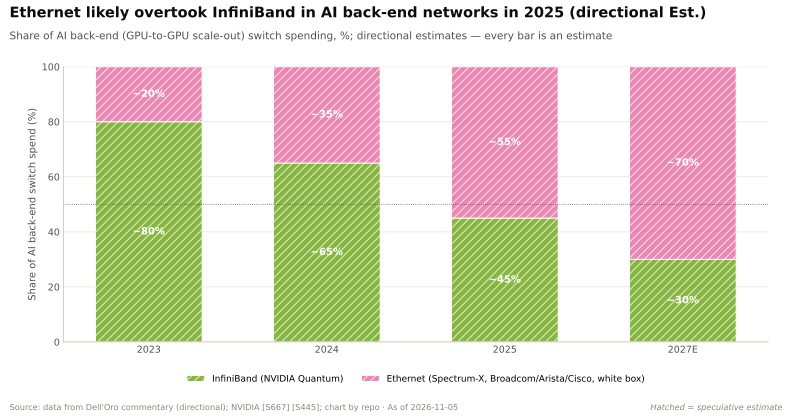
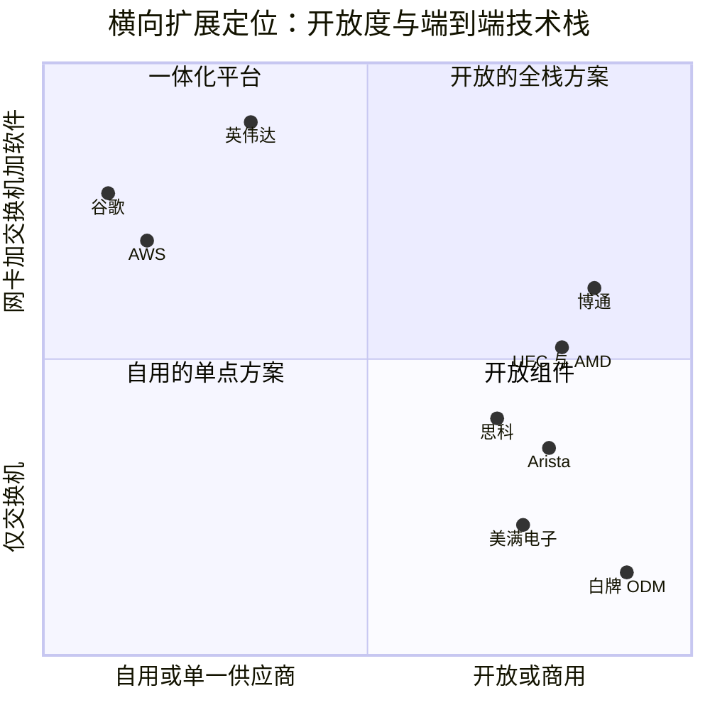

# 横向扩展与跨数据中心网络：竞争格局

> [!NOTE]
> 本页为英文原文的简体中文参考译文，仅供参考；如有出入，以[英文原文](../../../layers/06-scale-out-scale-across-networking/competition.md "English original")为准。

第 06 层 · 横向扩展与跨数据中心网络 · 约 11 分钟阅读 · 最后核实：2026-11-05

## ⚡ 要点速览

- **以太网赢得了协议之争。** 2025 年之前两年，[InfiniBand](../../glossary.md#infiniband) 占 AI 后端交换机销售额的约 80%；2025 年以太网的销售额已超过 InfiniBand 的两倍，1Q26 约占三分之二 [[S90053]](../../../sources/bibliography.md#s90053)[[S90054]](../../../sources/bibliography.md#s90054)。
- **英伟达依然保住了席位。** Dell'Oro 在以太网 AI 后端交换机中将 Celestica 排在第一，英伟达以微弱差距位居第二，Arista 第三（1Q26、2Q26）[[S90054]](../../../sources/bibliography.md#s90054)[[S6523]](../../../sources/bibliography.md#s6523)。IDC 则将英伟达列为 1Q26 全部数据中心以太网交换机收入第一（约 $2.1B）[[S6028]](../../../sources/bibliography.md#s6028)。
- **[Q5 · 最强挑战者]** 以博通（Broadcom）为核心的商用以太网：Tomahawk 6 交付 102.4 Tb/s，比英伟达 Spectrum-6 送达合作伙伴早约 12 个月 [[S274]](../../../sources/bibliography.md#s274)[[S6019]](../../../sources/bibliography.md#s6019)。Arista、白牌 ODM 以及 [Ultra Ethernet 联盟（UEC）](../../glossary.md#ultra-ethernet)将其推向市场。
- **英伟达的领先优势已转移到[网卡（NIC）](../../glossary.md#nic)。** 每颗 Vera Rubin GPU 都配一块 1.6 Tb/s 的 ConnectX-9 [SuperNIC](../../glossary.md#supernic) [[S33004]](../../../sources/bibliography.md#s33004)。博通的 Thor Ultra 为 800G [[S280]](../../../sources/bibliography.md#s280)；AMD 只有靠装配三块 800G UEC 网卡，才能获得更高的每 GPU 带宽（2.4 Tb/s）[[S228]](../../../sources/bibliography.md#s228)。
- **挑战者从较小的基数出发，增长更快。** 博通 AI 网络收入同比增长超过 2.5 倍 [[S6505]](../../../sources/bibliography.md#s6505)，Arista 目标 2026 年 AI 收入 ≥$3.6B [[S6500]](../../../sources/bibliography.md#s6500)。英伟达单季度网络收入约 $17.5B（环比 +18%）[[S408]](../../../sources/bibliography.md#s408)。
- **[超大规模云厂商](../../glossary.md#hyperscaler)的自研网络限制了市场空间。** 谷歌（Google）在其自有的 Virgo 网络上每个站点运行多达 80,000 颗 Vera Rubin GPU [[S554]](../../../sources/bibliography.md#s554)；AWS 使用自有的 EFA [[S292]](../../../sources/bibliography.md#s292)。

## 横向扩展竞争如何评分

训练集群就像一支接力队：每个训练步都以一次[全规约（all-reduce）](../../glossary.md#all-reduce)结束，在最慢的那根接力棒到达之前，没人能跑下一棒。六个因素决定网络竞标的胜负。**[交换机端口数（radix）](../../glossary.md#switch-radix)**（每颗芯片的端口数）决定集群需要多少层。**[拥塞控制](../../glossary.md#congestion-control)**与**[尾延迟](../../glossary.md#tail-latency)**决定 GPU 等待的频率。**网卡协同设计**决定端点是在配合交换机还是与之对抗。**开放性**让买家可以混用多家供应商。**生态**指网络软件和集合通信库（[NCCL](../../glossary.md#nccl)）。**份额**显示当下谁在赢得订单。

| 对手 | 端口数 / 带宽 | 拥塞控制 / 尾延迟 | 网卡协同设计 | 开放性 | 生态 | 份额 |
|---|---|---|---|---|---|---|
| 博通 | 🟩 率先推出 102.4T | 🟨 认知路由（cognitive routing） | 🟥 800G Thor | 🟩 商用芯片，UEC | 🟨 运行 EOS/SONiC | 🟨 AI 网络同比 >2.5 倍 |
| Arista | 🟦 内置博通芯片 | 🟨 EOS 负载均衡 | 🟥 无网卡 | 🟩 兼容任意网卡/GPU | 🟨 EOS | 🟥 以太网 AI 第 3 |
| 思科 | 🟨 G300 102.4T | 🟨 宣称 JCT 缩短 28% | 🟥 无 | 🟩 芯片 + 系统 | 🟨 企业客户基础 | 🟥 未进前三 |
| 美满电子 | 🟥 51.2T | 🟥 AI 功能较少 | 🟦 光学/定制 | 🟩 商用芯片 | 🟥 薄弱 | 🟥 较小 |
| 白牌 ODM | 🟦 内置商用芯片 | 🟦 买方自有软件 | 🟦 由买方选择 | 🟩 SONiC/FBOSS | 🟦 自研 | 🟩 以太网 AI 第 1 |
| UEC（AMD 等） | 🟦 规范而非芯片 | 🟨 包喷洒（纸面上） | 🟨 每 GPU 3×800G | 🟩 开放规范 | 🟥 2025–26 年新推出 | 🟥 早期 |
| 谷歌 | 🟦 OCS 脊层 | 🟦 自研 | 🟦 自研 | 🟦 不对外销售 | 🟦 内部使用 | 🟦 自用 |
| AWS | 🟦 自研 | 🟦 SRD 多路径 | 🟦 Nitro/EFA | 🟦 不对外销售 | 🟦 仅限 AWS | 🟦 自用 |

评级 = 对手相对英伟达（InfiniBand + Spectrum-X）。每个单元格的来源见 `data/l06_competitor_verdicts.csv` [[S274]](../../../sources/bibliography.md#s274)[[S280]](../../../sources/bibliography.md#s280)[[S6503]](../../../sources/bibliography.md#s6503)[[S284]](../../../sources/bibliography.md#s284)[[S90054]](../../../sources/bibliography.md#s90054)[[S257]](../../../sources/bibliography.md#s257)[[S293]](../../../sources/bibliography.md#s293)[[S292]](../../../sources/bibliography.md#s292)。

> [!TIP]
> **算例 —— 为何端口数能赢得竞标。** 由 R 端口交换机组成的两层[胖树（fat tree）](../../glossary.md#fat-tree)可连接 R²/2 颗 GPU：128 端口 51.2T 芯片为 8,192 颗，而 512 端口 102.4T 芯片为 131,072 颗 [[S294]](../../../sources/bibliography.md#s294)[[S274]](../../../sources/bibliography.md#s274)。对于 100,000 颗 GPU，本资料库估计三层结构约需 3,500–3,900 台交换机和约 350k 个[光模块](../../glossary.md#pluggable-transceiver)。由 102.4T 交换机组成的四平面结构约需 2,350 台交换机和约 250k 个光模块（估计）[[S294]](../../../sources/bibliography.md#s294)。率先交付更高端口数的芯片可省掉约 29% 的光学器件开支，这正是博通 2025 年领先的意义所在。

## 协议之争，以及英伟达为何加入以太网阵营

> [!WARNING]
> **数据说明：** 该图中 2025 年的柱形（以太网约 55%）是较早的方向性估计。Dell'Oro 公布的数据更为陡峭：2025 年以太网超过 InfiniBand 的两倍（≥ 约 67%），1Q26 约占三分之二 [[S90053]](../../../sources/bibliography.md#s90053)[[S90054]](../../../sources/bibliography.md#s90054)。

超大规模云厂商偏爱以太网：它们早已在使用以太网工具链，可以让供应商相互竞价，并避免形成单一供应商的“孤岛”。英伟达的 [Spectrum-X](../../glossary.md#spectrum-x)（2023 年 5 月）既是**防守**也是**进攻** [[S271]](../../../sources/bibliography.md#s271)。从防守看，只做 InfiniBand 的英伟达将被挡在约三分之二的后端支出之外，也将失去其 NCCL 软件所调优的那张网络。从进攻看，Spectrum-X 把英伟达的交换机和 SuperNIC 卖进以太网预算：xAI 的 100,000 GPU 集群 Colossus（2024）[[S6000]](../../../sources/bibliography.md#s6000)、Meta 的 FBOSS 交换机以及甲骨文（Oracle）的 Vera Rubin 集群（2025）[[S6009]](../../../sources/bibliography.md#s6009)。

> [!TIP]
> **算例 —— 英伟达的以太网业务已有多大。** Spectrum-X 在 Q2 FY2026 年化收入运行率突破 $10B [[S6027]](../../../sources/bibliography.md#s6027)。此后到 Q2 FY2027 同比增长 2.6 倍 [[S408]](../../../sources/bibliography.md#s408)，意味着年化 ≳$26B，约合每季度 $6.5B，约占约 $17.5B 网络收入的 37%（🔴 本资料库推算）。IDC 统计的 1Q26 英伟达以太网*交换机*收入仅约 $2.1B [[S6028]](../../../sources/bibliography.md#s6028)。因此，Spectrum-X 的大部分收入来自网卡和平台，而非交换机设备本身。

🔧 技术细节：同一拥塞问题的四种解法

标准以太网把每条数据流哈希到一条路径上（ECMP）。AI 流量由少数巨大的数据流构成，因此两条流可能在同一链路上冲突，而其他链路却闲置。**Spectrum-X** 采用逐包[自适应路由](../../glossary.md#adaptive-routing)，并由 SuperNIC 将数据包重新排序 [[S271]](../../../sources/bibliography.md#s271)。**UEC 1.0** 将[包喷洒（packet spraying）](../../glossary.md#packet-spraying)与数据包裁剪（packet trimming）标准化；1.1 增加了可编程拥塞控制 [[S257]](../../../sources/bibliography.md#s257)[[S575]](../../../sources/bibliography.md#s575)。**博通 Jericho3-AI** 构建调度式网络：把数据包拆分成信元，并在发送前授予信用 [[S279]](../../../sources/bibliography.md#s279)。**AWS SRD** 将数据包喷洒到多条路径上，并接受乱序交付 [[S292]](../../../sources/bibliography.md#s292)。

## 逐一审视挑战者

**博通（携手 Arista 与[白牌](../../glossary.md#white-box-switch) ODM）：最强挑战者。** Tomahawk 6（102.4 Tb/s，2025 年 6 月）已部署在博通几乎所有的 AI 超大规模云客户中 [[S274]](../../../sources/bibliography.md#s274)[[S6505]](../../../sources/bibliography.md#s6505)。Jericho4 是一款[深缓冲交换机](../../glossary.md#deep-buffer-switch)，面向超过 100 km 的[跨数据中心扩展（scale-across）](../../glossary.md#scale-across)链路 [[S276]](../../../sources/bibliography.md#s276)。2026 财年第三季度 AI 半导体收入达到 $16.7B，其中包括定制 XPU [[S6504]](../../../sources/bibliography.md#s6504)。**最有力的论据：** 同等或更好的交换芯片，卖给任何人，运行在开放的传输协议上。**差距弥合程度：** 交换芯片已完全追平；网卡尚未追平。

**Arista。** 它基于博通芯片构建设备，并加上 EOS 软件 [[S288]](../../../sources/bibliography.md#s288)。2026 年第三季度收入约 $3.66B（+58.5%）[[S6502]](../../../sources/bibliography.md#s6502)，管理层预计约 30% 的 AI 收入将来自跨数据中心扩展 [[S6500]](../../../sources/bibliography.md#s6500)。

**思科与美满电子。** 思科的 G300（102.4 Tb/s，2026 年 2 月发布）与 Spectrum-6 在同一时间窗口出货，并宣称[作业完成时间](../../glossary.md#job-completion-time)缩短 28% [[S6503]](../../../sources/bibliography.md#s6503)。美满电子的交换芯片停留在 51.2T 的 Teralynx 10 [[S284]](../../../sources/bibliography.md#s284)。它通过光学 DSP 以及 Celestial AI 的光子互连（约 $3.25B）参与竞争 [[S2513]](../../../sources/bibliography.md#s2513)。

**UEC 与 AMD。** UEC 1.0（2025 年 6 月）为所有非英伟达加速器提供了开放的传输协议 [[S257]](../../../sources/bibliography.md#s257)。AMD 的 Helios 搭配 Pensando Vulcano 网卡采用该协议，首批出货约在 2026 年第三季度末 [[S290]](../../../sources/bibliography.md#s290)[[S90020]](../../../sources/bibliography.md#s90020)。

**谷歌与 AWS。** 谷歌的 Virgo 借助[光路交换机（OCS）](../../glossary.md#optical-circuit-switch)以 47 Pb/s 连接超过 134,000 颗 TPU 8t 芯片 [[S241]](../../../sources/bibliography.md#s241)[[S293]](../../../sources/bibliography.md#s293)。AWS 使用自有的 [EFA](../../glossary.md#efa) [[S292]](../../../sources/bibliography.md#s292)。

> [!TIP]
> **算例 —— 增长快，基数小。** Arista 2026 年第三季度的全部收入约为 $3.66B [[S6502]](../../../sources/bibliography.md#s6502)。英伟达在 Q2 FY2027 单季度网络收入约 $17.5B [[S408]](../../../sources/bibliography.md#s408)，约为前者的 4.8 倍。Arista 的 2026 年 AI 目标（每年 ≥$3.6B）[[S6500]](../../../sources/bibliography.md#s6500) 约相当于英伟达约 $70B 年化网络收入运行率的 5%。即使每年翻一番，Arista 也需要约 4 年才能追上英伟达当前的网络规模；真正的挑战在于博通芯片分散于众多厂商之中。

> [!NOTE]
> **🐂 看多观点。** 英伟达是唯一同时出货 InfiniBand、以太网交换机、1.6 Tb/s 网卡（每颗 Vera Rubin GPU 配 ConnectX-9 [[S33004]](../../../sources/bibliography.md#s33004)）和 [NVLink](../../glossary.md#nvlink) 这四类产品的厂商。网络收入约为每 $1 计算收入对应 $0.24（见[发展历程](history-and-how-built.md)），而 Spectrum-X 把向以太网的迁移转化成了增长（同比 2.6 倍）[[S408]](../../../sources/bibliography.md#s408)。

> [!WARNING]
> **🐻 看空观点。** 交换芯片已经商品化。博通率先出货，白牌设备份额领先，UEC 则消除了对英伟达网卡的依赖 [[S274]](../../../sources/bibliography.md#s274)[[S90054]](../../../sources/bibliography.md#s90054)[[S257]](../../../sources/bibliography.md#s257)。一旦 GPU 与其网络分开采购，网络搭售率将向英伟达在公开竞标中赢得的份额回落。而在这些竞标中，以 Celestica 为首的白牌 ODM 的销售额已超过英伟达 [[S6523]](../../../sources/bibliography.md#s6523)。

**[Q5 · 最强挑战者]** 博通的商用生态（Tomahawk/Jericho 芯片、Arista 与白牌系统、UEC 传输协议）。最有力的论据：以同等速度提供开放性。它已弥合交换芯片的差距，并通过 ODM 在份额上领先；英伟达在每 GPU 网卡带宽以及 NCCL/NVLink 集成上仍保持领先。

## 🎯 企业发展视角

1. 商用以太网赢得了协议之争，但英伟达在以太网 AI 交换机领域的销售仍约居第 2 [[S6523]](../../../sources/bibliography.md#s6523)。英伟达的网络护城河如今是否主要在于网卡和软件，而非交换机？
2. 高通的 AI200/AI250 及其 2028 年的 AI300（[UALink](../../glossary.md#ualink) 与 [ESUN](../../glossary.md#esun) [纵向扩展（scale-up）](../../glossary.md#scale-up)）[[S90060]](../../../sources/bibliography.md#s90060)[[S90028]](../../../sources/bibliography.md#s90028) 仍需要[横向扩展（scale-out）](../../glossary.md#scale-out)网卡。哪个来源能提供最大的议价筹码：博通 Thor、AMD Pensando、某家初创公司，还是通过 Spectrum-X 采用英伟达？
3. Arista 基于博通芯片的增长 [[S6502]](../../../sources/bibliography.md#s6502) 表明，系统软件能够在商用芯片之上获取价值。一家新的加速器厂商应在哪些环节选择合作而非自建？
4. 如果 UEC 1.1 与 ESUN 在纵向扩展和横向扩展上收敛为同一种以太网 [[S575]](../../../sources/bibliography.md#s575)[[S90052]](../../../sources/bibliography.md#s90052)，谁会受益：商用交换机厂商还是 NVLink？
5. 谷歌在自有网络上运行 Rubin GPU [[S554]](../../../sources/bibliography.md#s554)。英伟达网络的搭售在超大规模云厂商与[新兴云服务商（neocloud）](../../glossary.md#neocloud)之间的黏性各有多强？

## 📚 来源（Sources）

<!-- Auto-generated from the [S…] citations on this page by `make build`. Edit sources/registry/*.csv, not this list. -->

- [**S228**](../../../sources/bibliography.md#s228) Spheron, *AMD Helios rack-scale AI on GPU cloud: deploy MI455X inference with UALink and Ultra Ethernet (2026 guide)*, 2026. [Link](https://www.spheron.network/blog/amd-helios-rack-scale-mi455x-gpu-cloud/)
- [**S241**](../../../sources/bibliography.md#s241) i-SCOOP, *Inside Google's TPU 8t and TPU 8i, the silicon built for the agentic era*, 2026-04. [Link](https://www.i-scoop.eu/google-tpu-8t-8i/)
- [**S257**](../../../sources/bibliography.md#s257) Ultra Ethernet Consortium, *Ultra Ethernet Consortium launches Specification 1.0*, 2025-06-11. [Link](https://ultraethernet.org/ultra-ethernet-consortium-uec-launches-specification-1-0-transforming-ethernet-for-ai-and-hpc-at-scale/)
- [**S271**](../../../sources/bibliography.md#s271) NVIDIA Newsroom, *NVIDIA Launches Accelerated Ethernet Platform for Hyperscale Generative AI (Spectrum-X)*, 2023-05-29. [Link](https://nvidianews.nvidia.com/news/nvidia-launches-accelerated-ethernet-platform-for-hyperscale-generative-ai)
- [**S274**](../../../sources/bibliography.md#s274) Broadcom, *Broadcom ships Tomahawk 6: world's first 102.4 Tbps switch*, 2025-06-03. [Link](https://investors.broadcom.com/news-releases/news-release-details/broadcom-ships-tomahawk-6-worlds-first-1024-tbps-switch)
- [**S276**](../../../sources/bibliography.md#s276) Broadcom, *Broadcom ships Jericho4, enabling distributed AI computing across data centers*, 2025-08-04. [Link](https://investors.broadcom.com/news-releases/news-release-details/broadcom-ships-jericho4-enabling-distributed-ai-computing-across)
- [**S279**](../../../sources/bibliography.md#s279) Broadcom, *Broadcom introduces Jericho3-AI for AI networking*, 2023-04-18. [Link](https://investors.broadcom.com/news-releases/news-release-details/broadcoms-new-jericho3-ai-fabric-delivers-industrys-highest)
- [**S280**](../../../sources/bibliography.md#s280) Broadcom, *Broadcom introduces Thor Ultra, the industry's first 800G AI Ethernet NIC*, 2025-10-14. [Link](https://investors.broadcom.com/news-releases/news-release-details/broadcom-introduces-industrys-first-800g-ai-ethernet-nic)
- [**S284**](../../../sources/bibliography.md#s284) Marvell, *Marvell Teralynx 10 51.2 Tbps data center switch*, 2023-03. [Link](https://www.marvell.com/company/newsroom.html)
- [**S288**](../../../sources/bibliography.md#s288) Arista Networks, *Arista Etherlink AI networking platforms (7060X6, 7800R4)*, 2024. [Link](https://www.arista.com/en/products/etherlink)
- [**S290**](../../../sources/bibliography.md#s290) AMD, *AMD Advancing AI 2025: Helios rack, MI400 preview and Pensando Vulcano 800G NIC*, 2025-06-12. [Link](https://www.amd.com/en/newsroom.html)
- [**S292**](../../../sources/bibliography.md#s292) Amazon Web Services, *Elastic Fabric Adapter (EFA) and AWS Nitro System documentation*, 2025. [Link](https://aws.amazon.com/hpc/efa/)
- [**S293**](../../../sources/bibliography.md#s293) ACM SIGCOMM / Google (Leon Poutievski et al.), *Jupiter Evolving: Transforming Google's Datacenter Network via Optical Circuit Switches and Software-Defined Networking (SIGCOMM 2022)*, 2022-08. [Link](https://research.google/pubs/jupiter-evolving-transforming-googles-datacenter-network-via-optical-circuit-switches-and-software-defined-networking/)
- [**S294**](../../../sources/bibliography.md#s294) SemiAnalysis (Dylan Patel et al.), *100,000 H100 Clusters: Power, Network Topology, Ethernet vs InfiniBand, Reliability, Failures, Checkpointing*, 2024-06-17. [Link](https://semianalysis.com/2024/06/17/100000-h100-clusters-power-network/)
- [**S408**](../../../sources/bibliography.md#s408) NVIDIA Corporation, *NVIDIA Corp. (NVDA) Q2 Fiscal 2027 earnings call transcript (26 August 2026)*, 2026-08-26. [Link](https://s201.q4cdn.com/141608511/files/content_files/TRANSCRIPT_-NVIDIA-Corp-NVDA-US-Q2-2027-Earnings-Call-26-August-2026-5_00-PM-ET.pdf)
- [**S554**](../../../sources/bibliography.md#s554) Google Cloud Blog (Mark Lohmeyer), *Google Cloud and NVIDIA expand co-engineering collaboration to scale infrastructure for the agentic era (NVIDIA GTC Berlin 2026)*, 2026-10-21. [Link](https://cloud.google.com/blog/topics/ai-infrastructure/google-cloud-infrastructure-at-nvidia-gtc-berlin-2026)
- [**S575**](../../../sources/bibliography.md#s575) Network World, *Ultra Ethernet 1.1 extends the specification to scale-up networks and adds programmable congestion control*, 2026-10. [Link](https://www.networkworld.com/article/4235340/ultra-ethernet-1-1-extends-the-specification-to-scale-up-networks-and-adds-programmable-congestion-control.html)
- [**S2513**](../../../sources/bibliography.md#s2513) Business Wire (Marvell), *Marvell Completes Acquisition of Celestial AI*, 2026-02-02. [Link](https://www.businesswire.com/news/home/20260201331090/en/marvell-completes-acquisition-of-celestial-ai)
- [**S6000**](../../../sources/bibliography.md#s6000) TechPowerUp (NVIDIA press release), *NVIDIA Ethernet Networking Accelerates World's Largest AI Supercomputer, Built by xAI*, 2024-10-29. [Link](https://techpowerup.com/328227/nvidia-ethernet-networking-accelerates-worlds-largest-ai-supercomputer-built-by-xai)
- [**S6009**](../../../sources/bibliography.md#s6009) NVIDIA Investor Relations, *NVIDIA Spectrum-X Ethernet Switches Speed Up Networks for Meta and Oracle*, 2025-10-13. [Link](https://investor.nvidia.com/news/press-release-details/2025/NVIDIA-Spectrum-X-Ethernet-Switches-Speed-Up-Networks-for-Meta-and-Oracle/default.aspx)
- [**S6019**](../../../sources/bibliography.md#s6019) Focus Taiwan (CNA), *Nvidia starts shipping TSMC-backed CPO switches (GTC Taipei / Computex 2026)*, 2026-06-03. [Link](https://focustaiwan.tw/business/202606030020)
- [**S6027**](../../../sources/bibliography.md#s6027) DatacenterDynamics, *Nvidia Q2 2025: networking is booming, but your networks cost nothing*, 2025-08. [Link](https://www.datacenterdynamics.com/en/news/nvidia-q2-2025-networking-is-booming-but-your-networks-cost-nothing/)
- [**S6028**](../../../sources/bibliography.md#s6028) Tiger Brokers (iTiger), *NVIDIA's AI expansion extends to network infrastructure, captures top spot in data center Ethernet switch revenue (IDC)*, 2026-06. [Link](https://www.itiger.com/news/1113632768)
- [**S6500**](../../../sources/bibliography.md#s6500) Nasdaq, *Arista Networks Q2 earnings call highlights*, 2026-08. [Link](https://www.nasdaq.com/articles/arista-networks-q2-earnings-call-highlights)
- [**S6502**](../../../sources/bibliography.md#s6502) Arista Networks via SEC EDGAR, *Arista Networks Q3 2026 earnings release (Form 8-K exhibit 99.1)*, 2026-11. [Link](https://www.sec.gov/Archives/edgar/data/0001596532/000159653226000252/ex991q326-earningsrelease.htm)
- [**S6503**](../../../sources/bibliography.md#s6503) Cisco Investor Relations, *Cisco Announces New Silicon One G300, Advanced Systems and Optics to Power and Scale AI Data Centers for the Agentic Era*, 2026-02-10. [Link](https://investor.cisco.com/news/news-details/2026/Cisco-Announces-New-Silicon-One-G300-Advanced-Systems-and-Optics-to-Power-and-Scale-AI-Data-Centers-for-the-Agentic-Era/)
- [**S6504**](../../../sources/bibliography.md#s6504) Broadcom Inc. via SEC EDGAR, *Broadcom Inc. Q3 fiscal 2026 financial results (Form 8-K exhibit 99)*, 2026-09. [Link](https://www.sec.gov/Archives/edgar/data/0001730168/000173016826000076/avgo-08022026x8kxex99.htm)
- [**S6505**](../../../sources/bibliography.md#s6505) Nasdaq, *Broadcom Q3 earnings call highlights*, 2026-09. [Link](https://www.nasdaq.com/articles/broadcom-q3-earnings-call-highlights)
- [**S6523**](../../../sources/bibliography.md#s6523) Dell'Oro Group, *AI back-end networks switch sales surpass front-end networks for the first time in 2Q2026*, 2026-08. [Link](https://www.delloro.com/news/ai-back-end-networks-switch-sales-surpass-front-end-networks-for-the-first-time-in-2q2026/)
- [**S33004**](../../../sources/bibliography.md#s33004) NVIDIA Newsroom, *NVIDIA Kicks Off the Next Generation of AI With Rubin — Six New Chips; One Incredible AI Supercomputer*, 2026-01-05. [Link](https://nvidianews.nvidia.com/news/rubin-platform-ai-supercomputer)
- [**S90020**](../../../sources/bibliography.md#s90020) Shacknews, *AMD Helios AI rack system on track for initial shipments in Q3 2026*, 2026. [Link](https://www.shacknews.com/article/150249/amd-helios-ai-system-shipping-q3-2026)
- [**S90028**](../../../sources/bibliography.md#s90028) TechRepublic, *Qualcomm unveils AI chips to rival Nvidia, AMD*, 2025-10-27. [Link](https://techrepublic.com/article/news-qualcomm-unveils-ai-chips-to-rival-nvidia-amd)
- [**S90052**](../../../sources/bibliography.md#s90052) Synopsys, *Ethernet standards for scale-up AI: an overview of ESUN, SUE, and UALink*, 2025-11. [Link](https://www.synopsys.com/articles/ethernet-standards-scale-up-ai.html)
- [**S90053**](../../../sources/bibliography.md#s90053) Dell'Oro Group, *Ethernet more than doubles size of InfiniBand as the leading fabric for AI scale-out networks in 2025*, 2026. [Link](https://www.delloro.com/news/ethernet-more-than-doubles-size-of-infiniband-as-the-leading-fabric-for-ai-scale-out-networks-in-2025/)
- [**S90054**](../../../sources/bibliography.md#s90054) Dell'Oro Group, *Ethernet extends lead in AI scale-out networks despite strong InfiniBand rebound*, 2026. [Link](https://www.delloro.com/news/ethernet-extends-lead-in-ai-scale-out-networks-despite-strong-infiniband-rebound/)
- [**S90060**](../../../sources/bibliography.md#s90060) Qualcomm, *Qualcomm Dragonfly AI300 (product page)*, 2026-06. [Link](https://www.qualcomm.com/data-center/products/qualcomm-dragonfly-ai300)
