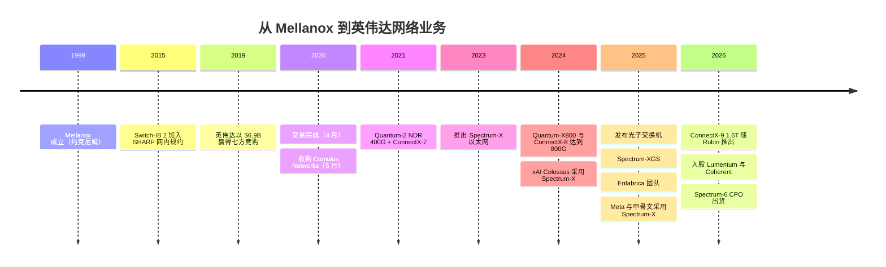
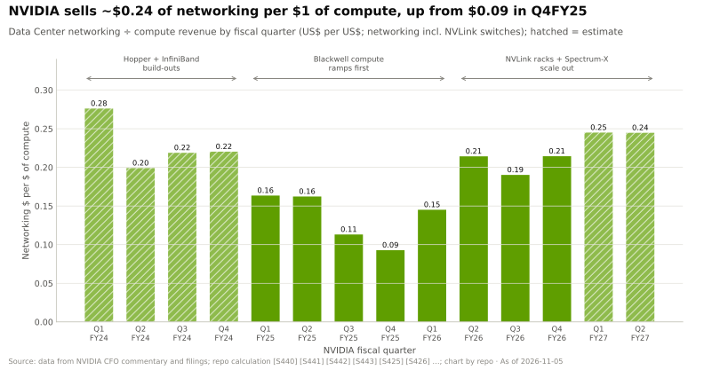

# 横向扩展与跨数据中心网络：发展历程与英伟达的构建方式

> [!NOTE]
> 本页为英文原文的简体中文参考译文，仅供参考；如有出入，以[英文原文](../../../layers/06-scale-out-scale-across-networking/history-and-how-built.md "English original")为准。

第 06 层 · 横向扩展与跨数据中心网络 · 约 10 分钟阅读 · 最后核实：2026-11-05

## ⚡ 要点速览

- **英伟达的网络是买来的。** Mellanox 于 1999 年在以色列约克尼姆（Yokneam）成立，专门研发 [InfiniBand](../../glossary.md#infiniband) 芯片，2019 年收入约 $1.33B [[S6510]](../../../sources/bibliography.md#s6510)。英伟达以 $6.9B 现金收购（2019-03-11 宣布，2020-04-27 完成）[[S464]](../../../sources/bibliography.md#s464)[[S6510]](../../../sources/bibliography.md#s6510)。
- **这是一场激烈的竞购。** 七家竞购方推高了价格；据报道英特尔（Intel）出价约 $6B [[S6508]](../../../sources/bibliography.md#s6508)[[S6509]](../../../sources/bibliography.md#s6509)。
- **回报极为丰厚。** 网络收入从 FY2025 的 $13.0B 增至 FY2026 的约 $31.4B [[S416]](../../../sources/bibliography.md#s416)[[S402]](../../../sources/bibliography.md#s402)，仅 Q2 FY2027 一个季度就约 $17.5B [[S408]](../../../sources/bibliography.md#s408)。当年的收购价如今仅相当于约五周的网络销售额。
- **真正关键的转向是以太网。** [Spectrum-X](../../glossary.md#spectrum-x)（2023 年 5 月）为不愿采购 InfiniBand 的[超大规模云厂商](../../glossary.md#hyperscaler)把交换机与 [SuperNIC](../../glossary.md#supernic) 配成一套 [[S271]](../../../sources/bibliography.md#s271)。到 Q2 FY2027，其同比增速达 2.6 倍 [[S408]](../../../sources/bibliography.md#s408)。
- **[Q4 · 优势来源]** 端到端协同设计（GPU、[网卡（NIC）](../../glossary.md#nic)、交换机、[NCCL](../../glossary.md#nccl)），加上随 GPU 销售的搭售：Q2 FY2027 每 $1 计算收入对应约 $0.24 的网络收入（估计）[[S408]](../../../sources/bibliography.md#s408)。
- **[Q6 · 复制成本]** 本资料库估计 🔴：重建完整技术栈需 5–7 年、$5–10B 以及约 1,500–3,000 名工程师。博通（Broadcom）所需投入要少得多，因为它已拥有交换机。
- **2025–26 年技术栈向光与距离延伸：** 共封装光学 [[S265]](../../../sources/bibliography.md#s265)、Spectrum-XGS 跨数据中心扩展 [[S268]](../../../sources/bibliography.md#s268)、约 $900M 的 Enfabrica 团队 [[S475]](../../../sources/bibliography.md#s475)，以及 $4B 的激光器企业股权投资 [[S6511]](../../../sources/bibliography.md#s6511)。

## 从 HPC 小众市场到 AI 骨干网

| 日期 | 决策 | 为何重要 | 来源 |
|---|---|---|---|
| 2015 | Switch-IB 2 加入 [SHARP](../../glossary.md#sharp) | 交换机承担部分全规约运算；后来在 NVLink 中复用 | [[S273]](../../../sources/bibliography.md#s273) |
| 2019-03 | 以 $6.9B 收购 Mellanox | 网络成为英伟达可掌控的 GPU 配套产品 | [[S464]](../../../sources/bibliography.md#s464) |
| 2020-05 | 收购 Cumulus | 开放的[网络操作系统](../../glossary.md#network-operating-system)，提升以太网可信度 | [[S478]](../../../sources/bibliography.md#s478) |
| 2023-05 | 推出 Spectrum-X | 打入以太网预算，而非拱手相让 | [[S271]](../../../sources/bibliography.md#s271) |
| 2024-10 | xAI Colossus，100k GPU | 证明 Spectrum-X 可扩展 | [[S6000]](../../../sources/bibliography.md#s6000) |
| 2025-03 | 发布 CPO 交换机 | 直击光学器件的功耗与供应问题 | [[S265]](../../../sources/bibliography.md#s265) |
| 2025-09 | Enfabrica 团队 + 授权（约 $900M） | 获得 SuperNIC 与内存互连人才 | [[S475]](../../../sources/bibliography.md#s475) |
| 2026-03 | 分别向 Lumentum 和 Coherent 投资 $2B | 为[共封装光学](../../glossary.md#co-packaged-optics)锁定激光器供应 | [[S6511]](../../../sources/bibliography.md#s6511) |

> [!TIP]
> **算例 —— Mellanox 的投资回报。** 英伟达为一家收入约 $1.33B 的公司支付了 $6.9B，约为 5.2 倍市销率 [[S464]](../../../sources/bibliography.md#s464)[[S6510]](../../../sources/bibliography.md#s6510)。Q2 FY2027 网络业务在 13 周内带来约 $17.5B 收入 [[S408]](../../../sources/bibliography.md#s408)：约每周 $1.35B。因此当年的收购价仅相当于如今约 5 周的网络收入。（网络收入包含 Mellanox 当年并不销售的 [NVLink](../../glossary.md#nvlink) 交换机。）

**[Q4 · 优势来源]** 三个来源，按权重排序：

1. **集成与搭售。** 参考设计在每颗 GPU 旁配一块 [ConnectX](../../glossary.md#connectx) 网卡：先是 400G（CX-7），然后是 800G（CX-8）和 1.6T（CX-9）[[S266]](../../../sources/bibliography.md#s266)[[S264]](../../../sources/bibliography.md#s264)[[S33004]](../../../sources/bibliography.md#s33004)。网络随 GPU 订单一起销售（见下文的[搭售率](../../glossary.md#attach-rate)）。
2. **协同设计。** Spectrum-X 的[自适应路由](../../glossary.md#adaptive-routing)之所以可行，完全依赖 SuperNIC 对数据包重新排序 [[S271]](../../../sources/bibliography.md#s271)。英伟达宣称有效带宽约 95%，而标准以太网约 60%；这是厂商的说法 [[S6012]](../../../sources/bibliography.md#s6012)。
3. **装机基础与技术积累。** 2025 年之前两年，InfiniBand 占 AI 后端交换机销售额的约 80% [[S90053]](../../../sources/bibliography.md#s90053)。SHARP 自 2015 年起便已投入运行 [[S273]](../../../sources/bibliography.md#s273)。

技术本身并不是优势来源：博通率先交付了 102.4 Tb/s（见[竞争格局](competition.md)）。

> [!TIP]
> **算例 —— 一笔 $1B 订单中搭售的价值。** 按 Q2 FY2027 的比率（网络 $17.5B ÷ 计算 $71.5B ≈ 0.245）[[S408]](../../../sources/bibliography.md#s408)[[S405]](../../../sources/bibliography.md#s405)，一位采购 $1B 计算产品的客户还会采购约 $245M 的英伟达网络产品。在 Q4 FY2025 的低点（0.093），这一数字约为 $93M [[S443]](../../../sources/bibliography.md#s443)。NVLink 交换托盘和 Spectrum-X 在 18 个月内使每 $1B 计算收入对应的网络收入回升了约 $150M。

## 这有多难复制？

**[Q6 · 复制成本]**

| 路径 | 参照基准 | 时间 | 金额 |
|---|---|---|---|
| 收购现有厂商 | Mellanox：$6.9B 买下约 $1.33B 收入 [[S464]](../../../sources/bibliography.md#s464)[[S6510]](../../../sources/bibliography.md#s6510) | 整合需 3–4 年（2020 年完成交易 → 2023 年推出 Spectrum-X） | $7B+ |
| 自研交换芯片 | 博通 Tomahawk：6 代，2014–2025 [[S283]](../../../sources/bibliography.md#s283)[[S274]](../../../sources/bibliography.md#s274) | 约每 2 年一代 | 数十亿美元级研发投入（🔴） |
| 打造开放标准 | UEC 1.0（2025 年 6 月）→ 首批网卡 2025–26 [[S257]](../../../sources/bibliography.md#s257)[[S280]](../../../sources/bibliography.md#s280)[[S290]](../../../sources/bibliography.md#s290) | 约 3 年推出首批产品 | 由成员分摊 |
| 投资初创公司 | Upscale 融资约 $500M，Nexthop 一轮融资 $500M，Eridu 约 $230M [[S6518]](../../../sources/bibliography.md#s6518)[[S6517]](../../../sources/bibliography.md#s6517)[[S6516]](../../../sources/bibliography.md#s6516) | 3–5 年实现上量（🔴） | 首款产品需 $0.2–0.6B |
| 收购式招聘（acquihire） | Enfabrica 团队 + 授权 [[S475]](../../../sources/bibliography.md#s475) | 立即 | 约 $0.9B |

本资料库的估计（🔴 分析）是：从零构建一套与英伟达相当的完整技术栈需要 **5–7 年、$5–10B 以及约 1,500–3,000 名工程师**：102.4T 交换芯片、1.6 Tb/s 网卡、在 100k GPU 规模下经过验证的[拥塞控制](../../glossary.md#congestion-control)，以及与集合通信库的集成。理由是：英伟达在收购一家有 20 年历史的公司之后，仍花了四年才推出 Spectrum-X；而大规模下的拥塞行为只能在生产环境中习得，无法靠仿真获得。博通是例外：它已拥有交换机，网卡大约落后一代（800G 对 1.6T）[[S280]](../../../sources/bibliography.md#s280)[[S33004]](../../../sources/bibliography.md#s33004)。其差距或许为 2–3 年和 $1–2B（🔴）。

> [!TIP]
> **算例 —— 为何没人能买到英伟达当年买到的东西。** Mellanox 的收购价约为其销售额的 5.2 倍 [[S464]](../../../sources/bibliography.md#s464)[[S6510]](../../../sources/bibliography.md#s6510)。按这一倍数，一家规模相当于英伟达 FY2026 网络业务（约 $31.4B）[[S402]](../../../sources/bibliography.md#s402) 的企业将耗资约 $160B，因此收购之路已经关闭。剩下的选择是自建（需数年）或收购团队。Enfabrica 的约 $900M [[S475]](../../../sources/bibliography.md#s475) 和 Celestial AI 的约 $3.25B [[S2513]](../../../sources/bibliography.md#s2513) 是 2025–26 年的参考价格。

🔧 技术细节：为何网卡才是难点

交换机只能看到自己的队列；网卡则能看到整条消息。Spectrum-X 和 [UEC](../../glossary.md#ultra-ethernet) 都会把一条消息喷洒到多条路径上，因此数据包会乱序到达。网卡必须以线速对它们进行缓冲和重排序：ConnectX-9 上为 1.6 Tb/s [[S33004]](../../../sources/bibliography.md#s33004)。它还必须读取交换机遥测数据，在队列溢出前让发送端降速。要让这一控制回路在 100,000 个端点上保持稳定，需要在实际运行的集群上调优软件和固件。这正是收购式招聘（如 Enfabrica）价格高昂的原因 [[S475]](../../../sources/bibliography.md#s475)。

## 反事实推演 —— 如果英伟达当初没有……

- 🔴 **……赢下 Mellanox，而是英特尔（出价约 $6B）赢了 [[S6509]](../../../sources/bibliography.md#s6509)？** 英伟达的 SuperPOD 将依赖一家 CPU 竞争对手的 InfiniBand。英伟达很可能会把 NVLink 向外扩展，并与博通或 Arista 合作。FY2026 约 $31B 的网络业务 [[S402]](../../../sources/bibliography.md#s402) 将主要归于他人。
- 🔴 **……一直只做 InfiniBand？** 到 1Q26，以太网已占 AI 后端交换机销售额的约三分之二 [[S90054]](../../../sources/bibliography.md#s90054)。没有 Spectrum-X，英伟达只能争夺约三分之一的市场，并会错失 xAI、Meta 和甲骨文的订单 [[S6000]](../../../sources/bibliography.md#s6000)[[S6009]](../../../sources/bibliography.md#s6009)。
- 🔴 **……放弃共封装光学与激光器股权投资？** TrendForce 指出光引擎、硅光子和封装是上量的制约因素 [[S6507]](../../../sources/bibliography.md#s6507)。若没有对 Lumentum/Coherent 的 $4B 投资承诺 [[S6511]](../../../sources/bibliography.md#s6511)，Rubin 时代的集群规模将更依赖同时供货给博通的供应商。

> [!TIP]
> **算例 —— 估算“只做 InfiniBand”反事实的规模。** 以本资料库对 Spectrum-X 每季度约 $6.5B 的估计（🔴，见[竞争格局](competition.md)）对比 Q2 FY2027 约 $17.5B 的网络收入 [[S408]](../../../sources/bibliography.md#s408)。只做 InfiniBand 的英伟达将损失大约三分之一的网络收入，约每年 $26B。它还会失去随交换机一起进入每个以太网集群的网卡席位。

## 🎯 企业发展视角

1. Mellanox 表明，在*相邻*瓶颈显而易见之前将其买下极具价值。今天哪个相邻瓶颈（光学器件、[SerDes](../../glossary.md#serdes)、网卡固件）被低估了？
2. 价格发现：2019 年 Mellanox 的成交价约为 5 倍市销率 [[S464]](../../../sources/bibliography.md#s464)[[S6510]](../../../sources/bibliography.md#s6510)。如今初创公司在尚未形成规模收入时就以 $2–4B 的估值融资 [[S6518]](../../../sources/bibliography.md#s6518)[[S6517]](../../../sources/bibliography.md#s6517)。稀缺资产是否是团队而非收入？
3. 英伟达花了约 3–4 年才把 Mellanox 变成 Spectrum-X。收购网卡或交换机团队的买方应预计多长的整合时间？
4. 高通于 2025 年 12 月完成了对 Alphawave（SerDes 与互连）的收购 [[S4513]](../../../sources/bibliography.md#s4513)。要把 SerDes IP 变成一款 UEC 网卡需要付出什么？与合作相比又如何？

## 📚 来源（Sources）

<!-- Auto-generated from the [S…] citations on this page by `make build`. Edit sources/registry/*.csv, not this list. -->

- [**S257**](../../../sources/bibliography.md#s257) Ultra Ethernet Consortium, *Ultra Ethernet Consortium launches Specification 1.0*, 2025-06-11. [Link](https://ultraethernet.org/ultra-ethernet-consortium-uec-launches-specification-1-0-transforming-ethernet-for-ai-and-hpc-at-scale/)
- [**S264**](../../../sources/bibliography.md#s264) NVIDIA Newsroom, *NVIDIA Announces New Switches Optimized for Trillion-Parameter GPU Computing and AI Infrastructure (Quantum-X800, Spectrum-X800, ConnectX-8)*, 2024-03-18. [Link](https://nvidianews.nvidia.com/news/networking-switches-gpu-computing-ai)
- [**S265**](../../../sources/bibliography.md#s265) NVIDIA Newsroom, *NVIDIA Announces Spectrum-X Photonics, Co-Packaged Optics Networking Switches to Scale AI Factories to Millions of GPUs*, 2025-03-18. [Link](https://nvidianews.nvidia.com/news/nvidia-spectrum-x-co-packaged-optics-networking-switches-ai-factories)
- [**S266**](../../../sources/bibliography.md#s266) NVIDIA Newsroom, *NVIDIA Quantum-2 Takes Supercomputing to New Heights, Into the Cloud*, 2021-11-09. [Link](https://nvidianews.nvidia.com/news/nvidia-quantum-2-takes-supercomputing-to-new-heights-into-the-cloud)
- [**S268**](../../../sources/bibliography.md#s268) NVIDIA Newsroom, *NVIDIA Introduces Spectrum-XGS Ethernet to Connect Distributed Data Centers Into Giga-Scale AI Super-Factories*, 2025-08-22. [Link](https://nvidianews.nvidia.com/news/nvidia-introduces-spectrum-xgs-ethernet-to-connect-distributed-data-centers-into-giga-scale-ai-super-factories)
- [**S271**](../../../sources/bibliography.md#s271) NVIDIA Newsroom, *NVIDIA Launches Accelerated Ethernet Platform for Hyperscale Generative AI (Spectrum-X)*, 2023-05-29. [Link](https://nvidianews.nvidia.com/news/nvidia-launches-accelerated-ethernet-platform-for-hyperscale-generative-ai)
- [**S273**](../../../sources/bibliography.md#s273) NVIDIA Docs, *NVIDIA Networking documentation hub (ConnectX adapter, Quantum and Spectrum switch product briefs and user manuals)*, 2025. [Link](https://docs.nvidia.com/networking/)
- [**S274**](../../../sources/bibliography.md#s274) Broadcom, *Broadcom ships Tomahawk 6: world's first 102.4 Tbps switch*, 2025-06-03. [Link](https://investors.broadcom.com/news-releases/news-release-details/broadcom-ships-tomahawk-6-worlds-first-1024-tbps-switch)
- [**S280**](../../../sources/bibliography.md#s280) Broadcom, *Broadcom introduces Thor Ultra, the industry's first 800G AI Ethernet NIC*, 2025-10-14. [Link](https://investors.broadcom.com/news-releases/news-release-details/broadcom-introduces-industrys-first-800g-ai-ethernet-nic)
- [**S283**](../../../sources/bibliography.md#s283) Broadcom, *Broadcom StrataXGS Tomahawk switch family (product pages)*, 2025. [Link](https://www.broadcom.com/products/ethernet-connectivity/switching/strataxgs)
- [**S290**](../../../sources/bibliography.md#s290) AMD, *AMD Advancing AI 2025: Helios rack, MI400 preview and Pensando Vulcano 800G NIC*, 2025-06-12. [Link](https://www.amd.com/en/newsroom.html)
- [**S402**](../../../sources/bibliography.md#s402) NVIDIA Corporation via SEC EDGAR (Colette Kress), *CFO Commentary on Fourth Quarter and Fiscal 2026 Results (Form 8-K exhibit 99.2)*, 2026-02-25. [Link](https://www.sec.gov/Archives/edgar/data/1045810/000104581026000019/q4fy26cfocommentary.htm)
- [**S405**](../../../sources/bibliography.md#s405) NVIDIA Corporation via SEC EDGAR, *NVIDIA Announces Financial Results for Second Quarter Fiscal 2027 (Form 8-K exhibit 99.1)*, 2026-08-26. [Link](https://www.sec.gov/Archives/edgar/data/0001045810/000104581026000073/q2fy27pr.htm)
- [**S408**](../../../sources/bibliography.md#s408) NVIDIA Corporation, *NVIDIA Corp. (NVDA) Q2 Fiscal 2027 earnings call transcript (26 August 2026)*, 2026-08-26. [Link](https://s201.q4cdn.com/141608511/files/content_files/TRANSCRIPT_-NVIDIA-Corp-NVDA-US-Q2-2027-Earnings-Call-26-August-2026-5_00-PM-ET.pdf)
- [**S416**](../../../sources/bibliography.md#s416) NVIDIA Corporation via SEC EDGAR, *NVIDIA Corporation Form 10-K for fiscal year ended January 26, 2025*, 2025-02-26. [Link](https://www.sec.gov/Archives/edgar/data/1045810/000104581025000023/nvda-20250126.htm)
- [**S443**](../../../sources/bibliography.md#s443) NVIDIA Corporation, *NVIDIA Announces Financial Results for Fourth Quarter and Fiscal 2025 (press release with CFO commentary)*, 2025-02-26. [Link](https://nvidianews.nvidia.com/news/nvidia-announces-financial-results-for-fourth-quarter-and-fiscal-2025)
- [**S464**](../../../sources/bibliography.md#s464) NVIDIA Newsroom, *NVIDIA to Acquire Mellanox for $6.9 Billion*, 2019-03-11. [Link](https://nvidianews.nvidia.com/news/nvidia-to-acquire-mellanox-for-6-9-billion)
- [**S475**](../../../sources/bibliography.md#s475) CNBC, *Nvidia spends over $900 million on Enfabrica CEO, AI startup technology*, 2025-09-18. [Link](https://www.cnbc.com/technology/)
- [**S478**](../../../sources/bibliography.md#s478) NVIDIA, *NVIDIA Blog and Newsroom acquisition announcements (Cumulus, SwiftStack, DeepMap, Bright Computing, Excelero, Shoreline, Brev.dev, OctoAI, VinBrain, Gretel, Lepton AI, CentML, SchedMD)*, 2025-12. [Link](https://blogs.nvidia.com/)
- [**S2513**](../../../sources/bibliography.md#s2513) Business Wire (Marvell), *Marvell Completes Acquisition of Celestial AI*, 2026-02-02. [Link](https://www.businesswire.com/news/home/20260201331090/en/marvell-completes-acquisition-of-celestial-ai)
- [**S4513**](../../../sources/bibliography.md#s4513) I-Connect007, *Qualcomm completes acquisition of Alphawave Semi*, 2025-12-18. [Link](https://iconnect007.com/article/148161/qualcomm-completes-acquisition-of-alphawave-semi/148158/ein)
- [**S6000**](../../../sources/bibliography.md#s6000) TechPowerUp (NVIDIA press release), *NVIDIA Ethernet Networking Accelerates World's Largest AI Supercomputer, Built by xAI*, 2024-10-29. [Link](https://techpowerup.com/328227/nvidia-ethernet-networking-accelerates-worlds-largest-ai-supercomputer-built-by-xai)
- [**S6009**](../../../sources/bibliography.md#s6009) NVIDIA Investor Relations, *NVIDIA Spectrum-X Ethernet Switches Speed Up Networks for Meta and Oracle*, 2025-10-13. [Link](https://investor.nvidia.com/news/press-release-details/2025/NVIDIA-Spectrum-X-Ethernet-Switches-Speed-Up-Networks-for-Meta-and-Oracle/default.aspx)
- [**S6012**](../../../sources/bibliography.md#s6012) Converge Digest, *NVIDIA cites Spectrum-X Ethernet wins with Meta and Oracle*, 2025-10-13. [Link](https://convergedigest.com/nvidia-cites-spectrum-x-ethernet-wins-with-meta-and-oracle/)
- [**S6507**](../../../sources/bibliography.md#s6507) TrendForce, *NVIDIA and Broadcom begin CPO switch shipments (TrendForce press release)*, 2026-07-27. [Link](https://trendforce.com/presscenter/news/20260727-13151.html)
- [**S6508**](../../../sources/bibliography.md#s6508) Globes, *Seven companies took part in bidding war for Mellanox*, 2019-03. [Link](https://en.globes.co.il/en/article-seven-companies-took-part-in-bidding-war-for-mellanox-1001283325)
- [**S6509**](../../../sources/bibliography.md#s6509) Tom's Hardware, *Nvidia outbids Intel for Mellanox (Reuters via Calcalist)*, 2019-03. [Link](https://www.tomshardware.com/news/nvidia-intel-mellanox-acquisition-outbid,38778.html)
- [**S6510**](../../../sources/bibliography.md#s6510) Wikipedia, *Mellanox Technologies*, 2026. [Link](https://en.wikipedia.org/wiki/Mellanox_Technologies)
- [**S6511**](../../../sources/bibliography.md#s6511) SiliconANGLE, *Nvidia invests $4B in co-packaged optics suppliers Lumentum and Coherent*, 2026-03-02. [Link](https://siliconangle.com/2026/03/02/nvidia-invests-4b-co-packaged-optics-suppliers-lumentum-coherent/)
- [**S6516**](../../../sources/bibliography.md#s6516) CXO Digital Pulse (company release), *Eridu emerges from stealth with over $200M in funding to break through the network wall*, 2026-03. [Link](https://www.cxodigitalpulse.com/eridu-emerges-from-stealth-with-over-200m-in-funding-to-break-through-the-network-wall-and-unlock-faster-ai/)
- [**S6517**](../../../sources/bibliography.md#s6517) Built In, *Nexthop AI raises $500M Series B at $4.2B valuation*, 2026-03-10. [Link](https://builtin.com/articles/nexthop-ai-raises-500m-series-b-4b-valuation-20260310)
- [**S6518**](../../../sources/bibliography.md#s6518) Converge Digest, *Upscale AI secures $190 million for data center networking for AI*, 2026. [Link](https://convergedigest.com/upscale-ai-secures-190-million-for-data-center-networking-for-ai/)
- [**S33004**](../../../sources/bibliography.md#s33004) NVIDIA Newsroom, *NVIDIA Kicks Off the Next Generation of AI With Rubin — Six New Chips; One Incredible AI Supercomputer*, 2026-01-05. [Link](https://nvidianews.nvidia.com/news/rubin-platform-ai-supercomputer)
- [**S90053**](../../../sources/bibliography.md#s90053) Dell'Oro Group, *Ethernet more than doubles size of InfiniBand as the leading fabric for AI scale-out networks in 2025*, 2026. [Link](https://www.delloro.com/news/ethernet-more-than-doubles-size-of-infiniband-as-the-leading-fabric-for-ai-scale-out-networks-in-2025/)
- [**S90054**](../../../sources/bibliography.md#s90054) Dell'Oro Group, *Ethernet extends lead in AI scale-out networks despite strong InfiniBand rebound*, 2026. [Link](https://www.delloro.com/news/ethernet-extends-lead-in-ai-scale-out-networks-despite-strong-infiniband-rebound/)
