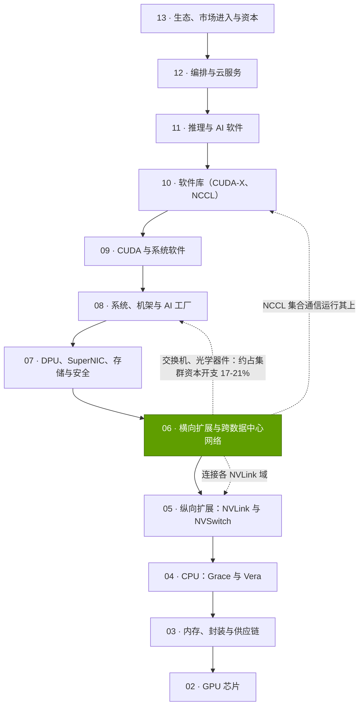
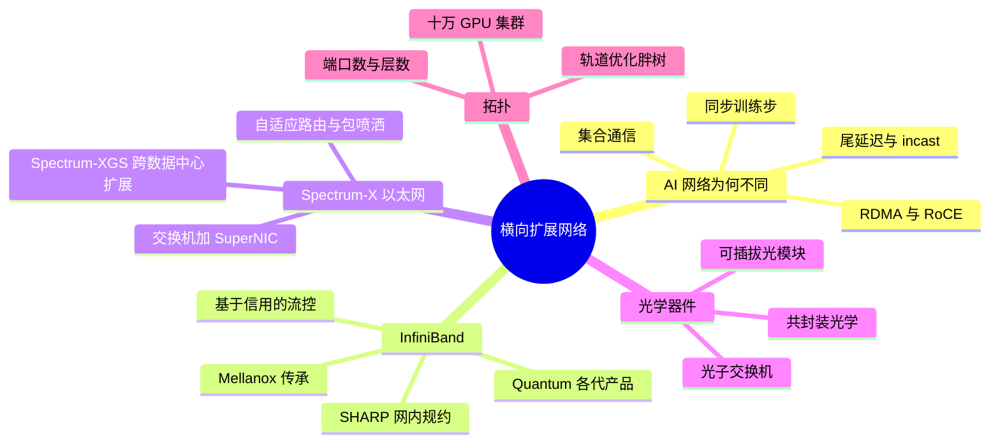

# 第 06 层 —— 横向扩展与跨数据中心网络

> [!NOTE]
> 本页为英文原文的简体中文参考译文，仅供参考；如有出入，以[英文原文](../../../layers/06-scale-out-scale-across-networking/index.md "English original")为准。

共 12 层中的第 06 层 · 单个 NVLink 域之外、以及数据中心之间的 GPU 互连网络 · 约 7 分钟阅读 · 最后核实：2026-11-05

## ⚡ 要点速览

- **职能（[横向扩展（scale-out）](../../glossary.md#scale-out)）：** 把众多 [NVLink](../../glossary.md#nvlink) 域连接成一台“机器”；按本资料库的模型，只要 1% 的数据流慢 10 倍，一个训练步的耗时就会拉长约 3.2 倍（估计）[[S6029]](../../../sources/bibliography.md#s6029)。
- **英伟达出售 [InfiniBand](../../glossary.md#infiniband)、[Spectrum-X](../../glossary.md#spectrum-x) 以太网与 [ConnectX](../../glossary.md#connectx) [SuperNIC](../../glossary.md#supernic)，** 全部源自 $6.9B 的 Mellanox 交易 [[S464]](../../../sources/bibliography.md#s464)。网络业务在 Q1 FY2027 创下 $14.8B 的纪录，Q2 约 $17.5B（估计），约占数据中心收入的 20% [[S90014]](../../../sources/bibliography.md#s90014)[[S408]](../../../sources/bibliography.md#s408)。
- **代际进步：** InfiniBand 端口速率从 10 提升至 800 Gb/s（2001–2024）[[S273]](../../../sources/bibliography.md#s273)；每 GPU 的[网卡（NIC）](../../glossary.md#nic)带宽从 400 Gb/s（ConnectX-7）提升至 1.6 Tb/s（ConnectX-9，2026）[[S266]](../../../sources/bibliography.md#s266)[[S33004]](../../../sources/bibliography.md#s33004)；交换机容量从 Quantum-2 到 Quantum-X800 由 25.6 提升至 115.2 Tb/s [[S266]](../../../sources/bibliography.md#s266)[[S264]](../../../sources/bibliography.md#s264)。
- **买家选择了以太网，英伟达也随之转向：** 1Q 2026 以太网约占 AI 后端交换机销售额的三分之二 🟡 [[S90054]](../../../sources/bibliography.md#s90054)；Spectrum-X 在 Q2 FY2027 同比增长 2.6 倍 [[S408]](../../../sources/bibliography.md#s408)，并支撑着 xAI 的 100,000 GPU 集群 Colossus [[S6000]](../../../sources/bibliography.md#s6000)。
- **规模代价高昂：** 一个 100,000 GPU 的三层网络约需 3,500 台交换机和约 350,000 个光模块（估计）[[S294]](../../../sources/bibliography.md#s294)，网络约占集群硬件资本开支的 17–21% [[S6026]](../../../sources/bibliography.md#s6026)[[S324]](../../../sources/bibliography.md#s324)。
- **下一步：** [共封装光学（CPO）](../../glossary.md#co-packaged-optics)（Quantum-X 与 Spectrum-X Photonics，宣称功耗改善 3.5×–5×，2026 年出货 🟡）[[S265]](../../../sources/bibliography.md#s265)[[S6020]](../../../sources/bibliography.md#s6020)，以及用于互连数据中心（[跨数据中心扩展（scale-across）](../../glossary.md#scale-across)）的 [Spectrum-XGS](../../glossary.md#spectrum-xgs) [[S268]](../../../sources/bibliography.md#s268)。
- **最大弱点 / 最强挑战者：** 以博通（Broadcom）102.4 Tb/s Tomahawk 6 为首的商用以太网 [[S274]](../../../sources/bibliography.md#s274)、白牌设备厂商（1Q 2026 Celestica 在 AI 后端交换领域居首 [[S90054]](../../../sources/bibliography.md#s90054)），以及 Ultra Ethernet 标准 [[S575]](../../../sources/bibliography.md#s575)。英伟达的性能优势主要依据其自身的宣称。

> [!TIP]
> **算例 —— 网络在单颗 GPU 中的占比。** 每颗 GB300 级 GPU 配一块 800 Gb/s 的 ConnectX-8 SuperNIC [[S264]](../../../sources/bibliography.md#s264)，在三层网络中约对应六个光端口端点；黄仁勋给出的价格约为每个 $1,000、功耗约 30 W [[S6016]](../../../sources/bibliography.md#s6016)。即每颗 GPU 约 $6,000、约 180 W 的光学器件，而每颗 GPU 分摊的机架成本约 $55,000 [[S332]](../../../sources/bibliography.md#s332)：仅光学器件就约占 11%，尚未计入交换机。
>
> **结论：** 网络在每颗售出的 GPU 中都占到两位数百分比，这正是英伟达力争这块市场的原因。

## 本层在技术栈中的位置

## 本层导图

## 八个问题一览

| # | 问题 | 简要回答 | 详见 |
|---|---|---|---|
| Q1 | 职能是什么？薄弱时会出什么问题？ | 让数千颗 GPU 步调一致；网络薄弱会让它们空转（估计：训练步变慢 1.2 倍时约 17%） | [AI 网络为何不同](why-ai-networks-are-different.md) |
| Q2 | 关键指标？ | 每 GPU Gb/s、有效带宽、尾延迟、端口数/层数、每 GPU 光学器件功耗（W）与成本（$） | [AI 网络为何不同](why-ai-networks-are-different.md) |
| Q3 | 代际进步？ | IB 端口 10 → 800 Gb/s；每 GPU 网卡 400 → 1,600 Gb/s；交换机 3.6 → 115.2 Tb/s | [InfiniBand 与 SHARP](infiniband-and-sharp.md) |
| Q4 | 优势来源？ | Mellanox 技术，加上网卡–交换机–NCCL 协同设计，并随平台一起销售 | [发展历程与构建方式](history-and-how-built.md) |
| Q5 | 最强挑战者？ | 基于博通芯片的商用以太网（Arista、Celestica）搭配 Ultra Ethernet 网卡 | [竞争格局](competition.md) |
| Q6 | 复制成本？ | 交换芯片可被复制；难点在于经过调优的网卡–交换机–软件库系统 | [发展历程与构建方式](history-and-how-built.md) |
| Q7 | 路线图？ | CPO 交换机 2026 🟡，ConnectX-9 1.6 Tb/s 随 Rubin 推出，ConnectX-10 随 Feynman 于 2028 推出 🟡 [[S90004]](../../../sources/bibliography.md#s90004)；UEC 1.1 [[S575]](../../../sources/bibliography.md#s575) | [路线图](roadmap.md) |
| Q8 | 价值池与并购？ | 光学器件（每 GPU 约 $6,000）、交换机、网卡、跨数据中心扩展；光子技术与网卡 IP 是交易切入点 | [价值链与企业发展](value-chain-and-corp-dev.md) |

## 本层页面

| 页面 | 你将了解 |
|---|---|
| [AI 网络为何不同](why-ai-networks-are-different.md) | 尾延迟、集合通信、RDMA、incast、关键指标 |
| [InfiniBand 与 SHARP](infiniband-and-sharp.md) | Mellanox 传承、Quantum 各代产品、网内规约 |
| [Spectrum-X 以太网与跨数据中心扩展](spectrum-x-ethernet.md) | 为何选择以太网、交换机–SuperNIC 协同设计、性能宣称、Spectrum-XGS |
| [共封装光学](co-packaged-optics.md) | 可插拔与 CPO 的功耗对比、光子交换机、可靠性、节省的兆瓦数 |
| [100,000 GPU 集群拓扑](cluster-topologies-100k-gpus.md) | 轨道优化胖树、端口数计算、器件数量、成本、真实集群 |
| [竞争格局](competition.md) | 博通、Arista、思科、美满电子、UEC、谷歌、AWS 对比 |
| [发展历程与英伟达的构建方式](history-and-how-built.md) | 时间线、关键决策、复制成本 |
| [路线图](roadmap.md) | 交换机、网卡与光学器件路线图 |
| [价值链与企业发展切入点](value-chain-and-corp-dev.md) | 谁获取收入、私营公司、并购 |

🔧 技术细节：如何阅读网络产品规格表

- **单向与双向：** 本资料库按单向口径（端口数 × 速率）引用交换机容量；英伟达常按双向翻倍计算（Quantum-2：25.6 对 51.2 Tb/s）[[S266]](../../../sources/bibliography.md#s266)。
- **端口拆分：** 一台 51.2 Tb/s 交换机可以是 64 × 800G，也可以是 128 × 400G；端口数（radix）取决于拆分方式 [[S267]](../../../sources/bibliography.md#s267)。
- **“有效带宽”** 取决于流量模式与规模；应索取 [NCCL](../../glossary.md#nccl) 总线带宽（bus bandwidth）曲线 [[S34012]](../../../sources/bibliography.md#s34012)。

## 🎯 企业发展视角

1. **每 100,000 颗 GPU 的网络约为 $1B 的支出项**（估计；见[集群拓扑](cluster-topologies-100k-gpus.md)）；每一次架构变化（层数、平面、CPO）都会让这笔钱在交换芯片、网卡、光学器件与集成商之间重新分配。
2. **英伟达的筹码在于捆绑。** Spectrum-X 的优势需要英伟达的网卡与交换机配套使用；若 Ultra Ethernet 网卡能够追平，溢价将收缩到软件与支持服务 [[S575]](../../../sources/bibliography.md#s575)。
3. **光学器件与激光器是下一个瓶颈**，因为 CPO 会把价值从可插拔光模块厂商转移到交换机封装与激光器供应商 [[S90049]](../../../sources/bibliography.md#s90049)。
4. **高通的问题（仅基于公开信息）：** 高通的 AI200/AI250 机架 [[S173]](../../../sources/bibliography.md#s173) 及 2028 年 Dragonfly 路线图 [[S90056]](../../../sources/bibliography.md#s90056) 都需要横向扩展网络；是自建、合作（商用以太网、[UEC](../../glossary.md#ultra-ethernet) 网卡），还是收购网卡与光 I/O 能力？

## 📚 来源（Sources）

<!-- Auto-generated from the [S…] citations on this page by `make build`. Edit sources/registry/*.csv, not this list. -->

- [**S173**](../../../sources/bibliography.md#s173) Qualcomm, *Qualcomm Unveils AI200 and AI250 - Redefining Rack-Scale Data Center Inference*, 2025-10-27. [Link](https://www.qualcomm.com/news/releases/2025/10/qualcomm-unveils-ai200-and-ai250-redefining-rack-scale-data-cent)
- [**S264**](../../../sources/bibliography.md#s264) NVIDIA Newsroom, *NVIDIA Announces New Switches Optimized for Trillion-Parameter GPU Computing and AI Infrastructure (Quantum-X800, Spectrum-X800, ConnectX-8)*, 2024-03-18. [Link](https://nvidianews.nvidia.com/news/networking-switches-gpu-computing-ai)
- [**S265**](../../../sources/bibliography.md#s265) NVIDIA Newsroom, *NVIDIA Announces Spectrum-X Photonics, Co-Packaged Optics Networking Switches to Scale AI Factories to Millions of GPUs*, 2025-03-18. [Link](https://nvidianews.nvidia.com/news/nvidia-spectrum-x-co-packaged-optics-networking-switches-ai-factories)
- [**S266**](../../../sources/bibliography.md#s266) NVIDIA Newsroom, *NVIDIA Quantum-2 Takes Supercomputing to New Heights, Into the Cloud*, 2021-11-09. [Link](https://nvidianews.nvidia.com/news/nvidia-quantum-2-takes-supercomputing-to-new-heights-into-the-cloud)
- [**S267**](../../../sources/bibliography.md#s267) NVIDIA Newsroom, *NVIDIA Spectrum-4 high-performance data center networking infrastructure platform (GTC 2022)*, 2022-03-22. [Link](https://nvidianews.nvidia.com/news/nvidia-announces-spectrum-high-performance-data-center-networking-infrastructure-platform)
- [**S268**](../../../sources/bibliography.md#s268) NVIDIA Newsroom, *NVIDIA Introduces Spectrum-XGS Ethernet to Connect Distributed Data Centers Into Giga-Scale AI Super-Factories*, 2025-08-22. [Link](https://nvidianews.nvidia.com/news/nvidia-introduces-spectrum-xgs-ethernet-to-connect-distributed-data-centers-into-giga-scale-ai-super-factories)
- [**S273**](../../../sources/bibliography.md#s273) NVIDIA Docs, *NVIDIA Networking documentation hub (ConnectX adapter, Quantum and Spectrum switch product briefs and user manuals)*, 2025. [Link](https://docs.nvidia.com/networking/)
- [**S274**](../../../sources/bibliography.md#s274) Broadcom, *Broadcom ships Tomahawk 6: world's first 102.4 Tbps switch*, 2025-06-03. [Link](https://investors.broadcom.com/news-releases/news-release-details/broadcom-ships-tomahawk-6-worlds-first-1024-tbps-switch)
- [**S294**](../../../sources/bibliography.md#s294) SemiAnalysis (Dylan Patel et al.), *100,000 H100 Clusters: Power, Network Topology, Ethernet vs InfiniBand, Reliability, Failures, Checkpointing*, 2024-06-17. [Link](https://semianalysis.com/2024/06/17/100000-h100-clusters-power-network/)
- [**S324**](../../../sources/bibliography.md#s324) fal.ai, *NVIDIA GB200 price in 2026: what a GPU, a tray and an NVL72 rack cost*, 2026. [Link](https://fal.ai/learn/serverless/nvidia-gb200-price)
- [**S332**](../../../sources/bibliography.md#s332) Tiger Brokers (iTiger), *Morgan Stanley's BOM analysis of NVIDIA's Rubin: GPU share declines; PCB, MLCC and ABF substrate values soar*, 2026-05-20. [Link](https://www.itiger.com/news/1188068712)
- [**S408**](../../../sources/bibliography.md#s408) NVIDIA Corporation, *NVIDIA Corp. (NVDA) Q2 Fiscal 2027 earnings call transcript (26 August 2026)*, 2026-08-26. [Link](https://s201.q4cdn.com/141608511/files/content_files/TRANSCRIPT_-NVIDIA-Corp-NVDA-US-Q2-2027-Earnings-Call-26-August-2026-5_00-PM-ET.pdf)
- [**S464**](../../../sources/bibliography.md#s464) NVIDIA Newsroom, *NVIDIA to Acquire Mellanox for $6.9 Billion*, 2019-03-11. [Link](https://nvidianews.nvidia.com/news/nvidia-to-acquire-mellanox-for-6-9-billion)
- [**S575**](../../../sources/bibliography.md#s575) Network World, *Ultra Ethernet 1.1 extends the specification to scale-up networks and adds programmable congestion control*, 2026-10. [Link](https://www.networkworld.com/article/4235340/ultra-ethernet-1-1-extends-the-specification-to-scale-up-networks-and-adds-programmable-congestion-control.html)
- [**S6000**](../../../sources/bibliography.md#s6000) TechPowerUp (NVIDIA press release), *NVIDIA Ethernet Networking Accelerates World's Largest AI Supercomputer, Built by xAI*, 2024-10-29. [Link](https://techpowerup.com/328227/nvidia-ethernet-networking-accelerates-worlds-largest-ai-supercomputer-built-by-xai)
- [**S6016**](../../../sources/bibliography.md#s6016) optics.org, *NVIDIA reveals plan to scale AI factories with co-packaged optics*, 2025-03-19. [Link](https://www.optics.org/news/16/3/26)
- [**S6020**](../../../sources/bibliography.md#s6020) StorageReview, *NVIDIA Spectrum-X Ethernet Photonics enters full production with 4x fewer lasers and a five-vendor CPO supply chain*, 2026-08. [Link](https://storagereview.com/news/nvidia-spectrum-x-ethernet-photonics-enters-full-production-with-4x-fewer-lasers-and-a-five-vendor-cpo-supply-chain)
- [**S6026**](../../../sources/bibliography.md#s6026) AMCompute (blog), *AI Cluster Cost Breakdown: CapEx (2026)*, 2026. [Link](https://www.amcompute.com/blog/ai-cluster-cost-breakdown-capex)
- [**S6029**](../../../sources/bibliography.md#s6029) Cornell Systems Research Seminar (Jinkun Lin, Ziheng Jiang, et al. (NYU / ByteDance)), *Understanding Stragglers in Large Model Training Using What-if Analysis (OSDI '25 seminar listing)*, 2026-02-06. [Link](https://www.cs.cornell.edu/events/systems-research-seminar/understanding-stragglers-large-model-training-using-what-if-analysis)
- [**S33004**](../../../sources/bibliography.md#s33004) NVIDIA Newsroom, *NVIDIA Kicks Off the Next Generation of AI With Rubin — Six New Chips; One Incredible AI Supercomputer*, 2026-01-05. [Link](https://nvidianews.nvidia.com/news/rubin-platform-ai-supercomputer)
- [**S34012**](../../../sources/bibliography.md#s34012) NVIDIA (GitHub), *NCCL Tests — Performance reported (algbw vs busbw)*, 2024. [Link](https://github.com/NVIDIA/nccl-tests/blob/master/doc/PERFORMANCE.md)
- [**S90004**](../../../sources/bibliography.md#s90004) TrendForce, *Key GTC takeaways: how Samsung, Micron, Intel and more power NVIDIA's Vera Rubin and Feynman*, 2026-03-17. [Link](https://www.trendforce.com/news/2026/03/17/news-key-gtc-takeaways-how-samsung-micron-intel-more-power-nvidias-vera-rubin-and-feynman/)
- [**S90014**](../../../sources/bibliography.md#s90014) Global Data Center Hub, *NVIDIA posts $81.6 billion quarter and splits into two reporting platforms*, 2026-05. [Link](https://www.globaldatacenterhub.com/p/nvidia-posts-816-billion-quarter)
- [**S90049**](../../../sources/bibliography.md#s90049) Tom's Hardware, *Nvidia outlines plans for using light for communication between AI GPUs by 2026*, 2025-03. [Link](https://www.tomshardware.com/networking/nvidia-outlines-plans-for-using-light-for-communication-between-ai-gpus-by-2026-silicon-photonics-and-co-packaged-optics-may-become-mandatory-for-next-gen-ai-data-centers)
- [**S90054**](../../../sources/bibliography.md#s90054) Dell'Oro Group, *Ethernet extends lead in AI scale-out networks despite strong InfiniBand rebound*, 2026. [Link](https://www.delloro.com/news/ethernet-extends-lead-in-ai-scale-out-networks-despite-strong-infiniband-rebound/)
- [**S90056**](../../../sources/bibliography.md#s90056) HPCwire (Qualcomm press release), *Qualcomm unveils data center roadmap for the agentic AI era with new Dragonfly portfolio*, 2026-06-24. [Link](https://www.hpcwire.com/off-the-wire/qualcomm-unveils-data-center-roadmap-for-the-agentic-ai-era-with-new-dragonfly-portfolio/)
