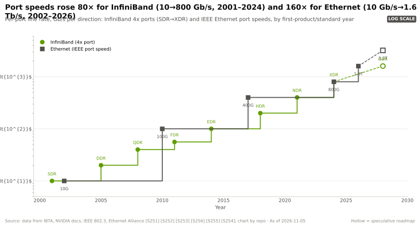
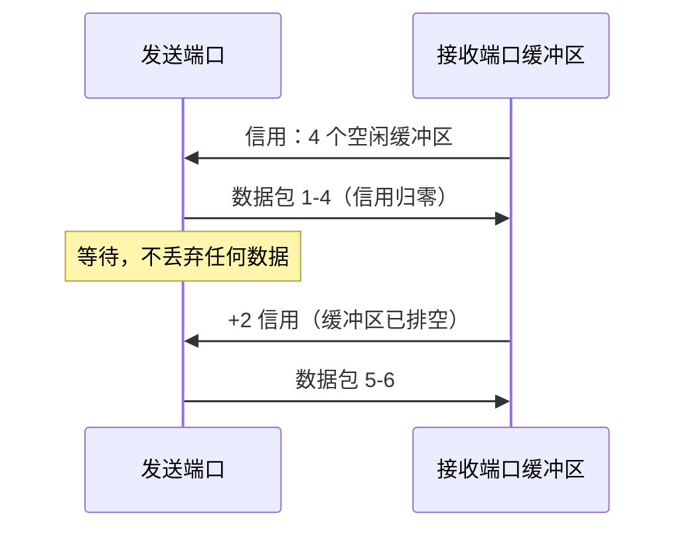
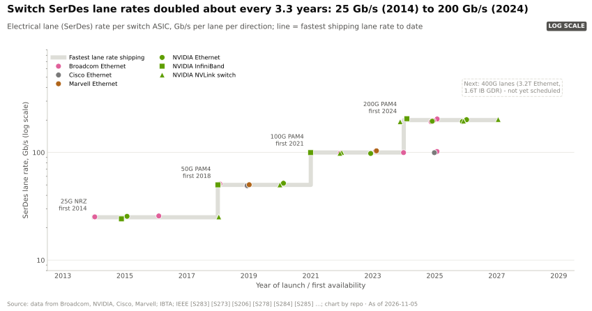
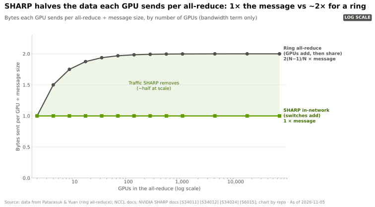

# InfiniBand 与 SHARP

> [!NOTE]
> 本页为英文原文的简体中文参考译文，仅供参考；如有出入，以[英文原文](../../../layers/06-scale-out-scale-across-networking/infiniband-and-sharp.md "English original")为准。

第 06 层 · 横向扩展与跨数据中心网络 · 约 7 分钟阅读 · 最后核实：2026-11-05

## ⚡ 要点速览

- **英伟达的网络是买来的。** 总额 $6.9B 的全现金 Mellanox 交易（2019-03-11 宣布，2020-04-27 完成）把 InfiniBand、Spectrum 以太网与 [ConnectX](../../glossary.md#connectx) 网卡纳入麾下 [[S464]](../../../sources/bibliography.md#s464)；网络业务如今每季度销售额约 $17.5B（估计，Q2 FY2027）[[S408]](../../../sources/bibliography.md#s408)。见 [CS1 · Mellanox](../../case-studies/CS1-mellanox-the-best-deal.md)。
- **[InfiniBand](../../glossary.md#infiniband) 的设计恰好契合 AI 所需：** 无损的[基于信用的流控](../../glossary.md#credit-based-flow-control)、原生 [RDMA](../../glossary.md#rdma)、[自适应路由](../../glossary.md#adaptive-routing)以及集中式[子网管理器](../../glossary.md#subnet-manager) [[S273]](../../../sources/bibliography.md#s273)。
- **端口速率提升了 80 倍**，从 10 Gb/s（SDR，2001）到 800 Gb/s（XDR，2024）；交换机端口数从 36 个（EDR）增至 Quantum-X800 上的 144 个 800G 端口 [[S273]](../../../sources/bibliography.md#s273)[[S264]](../../../sources/bibliography.md#s264)。
- **[SHARP](../../glossary.md#sharp) 让交换机来做运算，** 把每次[全规约（all-reduce）](../../glossary.md#all-reduce)中每颗 GPU 发送的数据量从消息大小的约 2 倍降至 1 倍；英伟达报告在 HDR 上全规约带宽提升约 2 倍，在 BERT 训练中带来约 17% 的提速 [[S6013]](../../../sources/bibliography.md#s6013)[[S6014]](../../../sources/bibliography.md#s6014)。
- **共封装的 Quantum-X Photonics**（144 × 800G）是下一代交换机；据报道首批部署在 2026 年初 🟡 [[S265]](../../../sources/bibliography.md#s265)[[S6022]](../../../sources/bibliography.md#s6022)。
- **弱点在于市场：** 到 1Q 2026，InfiniBand 在 AI 后端交换机销售额中的占比已从约 80% 降至约三分之一 [[S90053]](../../../sources/bibliography.md#s90053)[[S90054]](../../../sources/bibliography.md#s90054)。

## 1. InfiniBand 如何保持流量无损

以太网假定丢包无妨，因为 TCP 会重传；InfiniBand 则假定任何数据都不能丢。在**基于信用的流控**下，接收端通告其空闲缓冲区，发送端只在信用额度内发送——就像停车场只在有空位时才放车进入。不会发生溢出，因此也就没有重传超时拖累尾部。

集中式**子网管理器**（英伟达 UFM 或 OpenSM）负责计算路由，交换机则把数据包**自适应路由**到繁忙端口以外的路径 [[S273]](../../../sources/bibliography.md#s273)。代价是：需要一套独立的技能体系，且大规模部署时英伟达是唯一供应商。

> [!TIP]
> **算例 —— 端口数从 36 跃升到 144 带来了什么。** 端口数为 R 的两层无阻塞[胖树（fat tree）](../../glossary.md#fat-tree)可容纳 R²/2 个端点：EDR 的 36 端口可连 648 颗 GPU，Quantum-2 的 64 端口可连 2,048 颗，Quantum-X800 的 144 端口可连 **10,368** 颗；三层可达约 746,000 颗（估计）[[S264]](../../../sources/bibliography.md#s264)[[S294]](../../../sources/bibliography.md#s294)。
>
> **结论：** 端口数决定了一个集群需要多少交换机、光学器件和跳数（见[集群拓扑](cluster-topologies-100k-gpus.md)）。

**[Q3 · 代际进步]** 每一代端口速率翻倍，交换机容量提升 2–4.5 倍：

| 代际 | 年份 | 英伟达交换机 | 端口数 × 速率 | 容量（单向） | 网内计算 |
|---|---|---|---|---|---|
| EDR | 2014–15 | Switch-IB / Switch-IB 2 | 36 × 100G | 3.6 Tb/s | SHARP v1（Switch-IB 2） |
| HDR | 2018 | Quantum（QM8700） | 40 × 200G | 8.0 Tb/s | SHARPv2 |
| NDR | 2021 | Quantum-2（QM9700） | 64 × 400G | 25.6 Tb/s | SHARPv3 |
| XDR | 2024 | Quantum-X800（Q3400） | 144 × 800G | 115.2 Tb/s | SHARPv4，支持 FP8 |
| XDR + CPO | 2025–26 🟡 | Quantum-X Photonics（Q3450） | 144 × 800G | 115.2 Tb/s | SHARPv4 |

来源：[[S273]](../../../sources/bibliography.md#s273)[[S266]](../../../sources/bibliography.md#s266)[[S264]](../../../sources/bibliography.md#s264)[[S265]](../../../sources/bibliography.md#s265)。英伟达常按双向口径报数（Quantum-2 为 51.2 Tb/s）。

🔧 技术细节：通道与 SerDes

一个 InfiniBand “4x”端口捆绑四条电通道，因此 XDR 的 200 Gb/s [SerDes](../../glossary.md#serdes) 通道合计提供 800 Gb/s [[S273]](../../../sources/bibliography.md#s273)。通道速率大约每三年翻一番，因为每一步都需要新的信号调制方式（NRZ → PAM4）和均衡技术；Quantum-X800 率先采用 200G 通道。下一步（GDR，每端口 1.6 Tb/s）需要 400G 级通道，目前尚无厂商排期。

## 2. SHARP：在网络内部计算

在环形全规约中，所有加法都由 GPU 完成，每颗 GPU 约发送两倍于自身数据量的数据 [[S34011]](../../../sources/bibliography.md#s34011)。**SHARP**（可扩展分层聚合与规约协议，Scalable Hierarchical Aggregation and Reduction Protocol）把加法移入交换芯片：GPU 只需把数据沿聚合树向上发送一次，每台交换机对到达的数据求和并转发一个结果，根节点再把总和向下发回 [[S34024]](../../../sources/bibliography.md#s34024)[[S6015]](../../../sources/bibliography.md#s6015)。SHARP 于 2015 年首次在 Switch-IB 2 上出货 [[S273]](../../../sources/bibliography.md#s273)，如今运行在 Quantum InfiniBand 中，并以 [NVLink](../../glossary.md#nvlink) SHARP 的形式运行在 [NVSwitch](../../glossary.md#nvswitch) 中（[第 05 层](../05-scale-up-nvlink-nvswitch/index.md)）。

> [!TIP]
> **算例 —— 为何 SHARP 能把全规约流量减半。** 在 1,024 颗 GPU 上对 1 GB 数据做全规约，每颗 GPU 配一条 800 Gb/s（100 GB/s）链路：
> - **环形：** 每颗 GPU 发送 2 × (1,023 ÷ 1,024) × 1 GB ≈ **2.0 GB**（一半用于规约散射，一半用于全收集）：约 20 ms。
> - **SHARP：** 每颗 GPU 向上发送 1 GB 一次，并接收一次结果：**1.0 GB**，约 10 ms。环形算法 2 × 1,023 个顺序步骤也缩减为仅几层深的树，降低了小消息的延迟。
>
> **结论：** 字节数减半，受带宽限制的集合通信时间也大致减半。英伟达在 HDR 上测得全规约带宽约提升 2 倍，但由于通信只占每个训练步的一部分，最终换来的是 BERT 训练约 17% 的提速 [[S6013]](../../../sources/bibliography.md#s6013)[[S6014]](../../../sources/bibliography.md#s6014)。

> [!WARNING]
> **误区与事实：** “SHARP 能让训练快 2 倍。”它翻倍的是全规约带宽，而非训练步速度；端到端收益取决于暴露的通信占比（英伟达的 BERT 示例中为 17% [[S6014]](../../../sources/bibliography.md#s6014)），且交换机的聚合资源需要在多个作业之间共享。

🔧 技术细节：SHARP 各版本

SHARPv1（EDR）处理小消息；SHARPv2（HDR）加入了面向大消息的流式聚合，是 [NCCL](../../glossary.md#nccl) 约 2 倍提升结果的来源 [[S6013]](../../../sources/bibliography.md#s6013)[[S6015]](../../../sources/bibliography.md#s6015)；SHARPv3（Quantum-2）支持多租户作业并发 [[S266]](../../../sources/bibliography.md#s266)；SHARPv4（Quantum-X800）增加了 [FP8](../../glossary.md#fp8) 规约 [[S264]](../../../sources/bibliography.md#s264)。NCCL 通过其 CollNet 路径调用 SHARP [[S34024]](../../../sources/bibliography.md#s34024)。以太网阵营正通过 Ultra Ethernet 1.1（2026 年 10 月）加入网内集合通信 [[S575]](../../../sources/bibliography.md#s575)。

## 🎯 企业发展视角

1. **Mellanox 是范本。** $6.9B [[S464]](../../../sources/bibliography.md#s464) 买下的业务，如今每季度的销售额约为该价格的 2.5 倍（估计）[[S408]](../../../sources/bibliography.md#s408)：在市场为系统瓶颈定价之前将其收入囊中。哪些互连资产（光学器件、[网卡（NIC）](../../glossary.md#nic)传输层、交换芯片）是今天的等价物？
2. **随着以太网补齐自适应路由与网内集合通信，InfiniBand 的护城河正收窄至 SHARP 与系统集成** [[S575]](../../../sources/bibliography.md#s575)；英伟达基于 NCCL 调优的领先优势还能维持多久？
3. **单一供应商风险是双刃剑。** 锁定效应把买家推向以太网 [[S90054]](../../../sources/bibliography.md#s90054)；英伟达的对冲方式是自己也卖以太网（见 [Spectrum-X 以太网](spectrum-x-ethernet.md)）。
4. **高通的问题（仅基于公开信息）：** 网内规约或集合通信卸载能否让非英伟达的推理机架形成差异化？还是推理流量对延迟过于敏感，使其意义不大？

## 📚 来源（Sources）

<!-- Auto-generated from the [S…] citations on this page by `make build`. Edit sources/registry/*.csv, not this list. -->

- [**S264**](../../../sources/bibliography.md#s264) NVIDIA Newsroom, *NVIDIA Announces New Switches Optimized for Trillion-Parameter GPU Computing and AI Infrastructure (Quantum-X800, Spectrum-X800, ConnectX-8)*, 2024-03-18. [Link](https://nvidianews.nvidia.com/news/networking-switches-gpu-computing-ai)
- [**S265**](../../../sources/bibliography.md#s265) NVIDIA Newsroom, *NVIDIA Announces Spectrum-X Photonics, Co-Packaged Optics Networking Switches to Scale AI Factories to Millions of GPUs*, 2025-03-18. [Link](https://nvidianews.nvidia.com/news/nvidia-spectrum-x-co-packaged-optics-networking-switches-ai-factories)
- [**S266**](../../../sources/bibliography.md#s266) NVIDIA Newsroom, *NVIDIA Quantum-2 Takes Supercomputing to New Heights, Into the Cloud*, 2021-11-09. [Link](https://nvidianews.nvidia.com/news/nvidia-quantum-2-takes-supercomputing-to-new-heights-into-the-cloud)
- [**S273**](../../../sources/bibliography.md#s273) NVIDIA Docs, *NVIDIA Networking documentation hub (ConnectX adapter, Quantum and Spectrum switch product briefs and user manuals)*, 2025. [Link](https://docs.nvidia.com/networking/)
- [**S294**](../../../sources/bibliography.md#s294) SemiAnalysis (Dylan Patel et al.), *100,000 H100 Clusters: Power, Network Topology, Ethernet vs InfiniBand, Reliability, Failures, Checkpointing*, 2024-06-17. [Link](https://semianalysis.com/2024/06/17/100000-h100-clusters-power-network/)
- [**S408**](../../../sources/bibliography.md#s408) NVIDIA Corporation, *NVIDIA Corp. (NVDA) Q2 Fiscal 2027 earnings call transcript (26 August 2026)*, 2026-08-26. [Link](https://s201.q4cdn.com/141608511/files/content_files/TRANSCRIPT_-NVIDIA-Corp-NVDA-US-Q2-2027-Earnings-Call-26-August-2026-5_00-PM-ET.pdf)
- [**S464**](../../../sources/bibliography.md#s464) NVIDIA Newsroom, *NVIDIA to Acquire Mellanox for $6.9 Billion*, 2019-03-11. [Link](https://nvidianews.nvidia.com/news/nvidia-to-acquire-mellanox-for-6-9-billion)
- [**S575**](../../../sources/bibliography.md#s575) Network World, *Ultra Ethernet 1.1 extends the specification to scale-up networks and adds programmable congestion control*, 2026-10. [Link](https://www.networkworld.com/article/4235340/ultra-ethernet-1-1-extends-the-specification-to-scale-up-networks-and-adds-programmable-congestion-control.html)
- [**S6013**](../../../sources/bibliography.md#s6013) HPCwire, *Accelerating HPC and AI workflows with Mellanox's Scalable Hierarchical Aggregation and Reduction Protocol (SHARP)*, 2019-05-06. [Link](https://www.hpcwire.com/2019/05/06/accelerating-hpc-and-ai-workflows-with-mellanoxs-scalable-hierarchical-aggregation-and-reduction-protocol-sharp/)
- [**S6014**](../../../sources/bibliography.md#s6014) NVIDIA Technical Blog, *Advancing Performance with NVIDIA SHARP In-Network Computing*, 2023. [Link](https://developer.nvidia.com/blog/advancing-performance-with-nvidia-sharp-in-network-computing)
- [**S6015**](../../../sources/bibliography.md#s6015) ISC High Performance 2020 (Springer LNCS; PMC open access) (Richard L. Graham et al.), *Scalable Hierarchical Aggregation and Reduction Protocol (SHARP) Streaming-Aggregation Hardware Design and Evaluation*, 2020-06. [Link](https://pmc.ncbi.nlm.nih.gov/articles/PMC7295336/)
- [**S6022**](../../../sources/bibliography.md#s6022) Fintool, *NVIDIA CPO webinar: co-packaged silicon photonics switches for gigawatt AI factories*, 2026-02. [Link](https://fintool.com/news/nvidia-cpo-webinar-ai-factories)
- [**S34011**](../../../sources/bibliography.md#s34011) Journal of Parallel and Distributed Computing (Pitch Patarasuk, Xin Yuan), *Bandwidth optimal all-reduce algorithms for clusters of workstations*, 2009-02. [Link](https://doi.org/10.1016/j.jpdc.2008.09.002)
- [**S34024**](../../../sources/bibliography.md#s34024) NVIDIA Docs, *NVIDIA Scalable Hierarchical Aggregation and Reduction Protocol (SHARP) documentation*, 2024. [Link](https://docs.nvidia.com/networking/display/sharpv3)
- [**S90053**](../../../sources/bibliography.md#s90053) Dell'Oro Group, *Ethernet more than doubles size of InfiniBand as the leading fabric for AI scale-out networks in 2025*, 2026. [Link](https://www.delloro.com/news/ethernet-more-than-doubles-size-of-infiniband-as-the-leading-fabric-for-ai-scale-out-networks-in-2025/)
- [**S90054**](../../../sources/bibliography.md#s90054) Dell'Oro Group, *Ethernet extends lead in AI scale-out networks despite strong InfiniBand rebound*, 2026. [Link](https://www.delloro.com/news/ethernet-extends-lead-in-ai-scale-out-networks-despite-strong-infiniband-rebound/)
