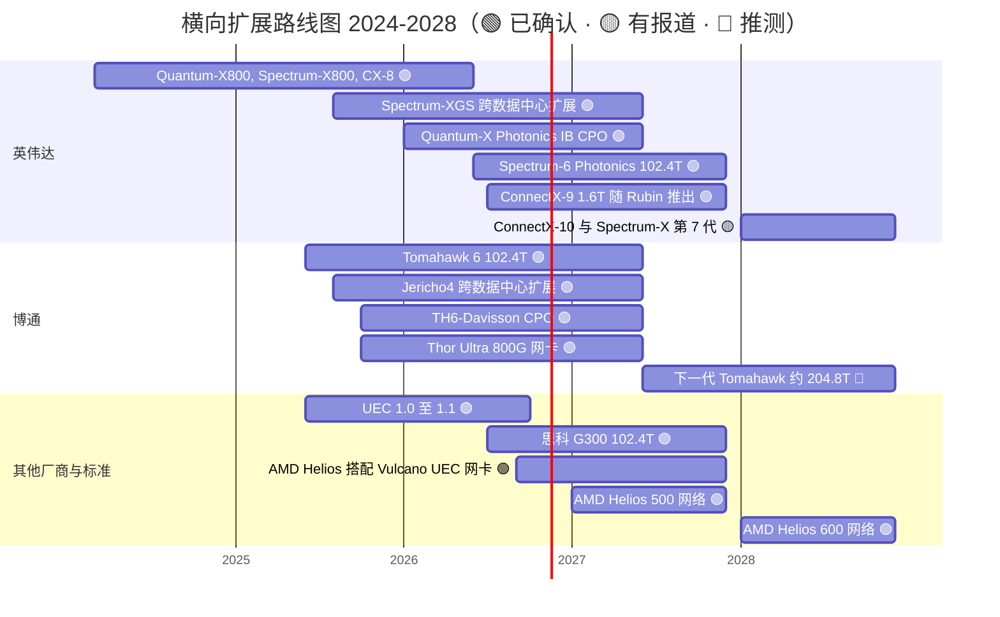

# 横向扩展与跨数据中心网络：路线图

> [!NOTE]
> 本页为英文原文的简体中文参考译文，仅供参考；如有出入，以[英文原文](../../../layers/06-scale-out-scale-across-networking/roadmap.md "English original")为准。

第 06 层 · 横向扩展与跨数据中心网络 · 约 9 分钟阅读 · 最后核实：2026-11-05

## ⚡ 要点速览

- **2026 年是英伟达迈入 1.6 Tb/s 与光互连的一年。** 每颗 Vera Rubin GPU 都配一块 1.6 Tb/s 的 ConnectX-9 [[S33004]](../../../sources/bibliography.md#s33004)。Spectrum-6 [共封装光学（CPO）](../../glossary.md#co-packaged-optics)交换机于 2026 年 6 月送达部分合作伙伴，并自 2026 年秋季起随 Vera Rubin 全面量产 [[S6019]](../../../sources/bibliography.md#s6019)[[S6020]](../../../sources/bibliography.md#s6020)。
- **[InfiniBand](../../glossary.md#infiniband) 率先走向光互连。** CoreWeave、Lambda 和 TACC 在 2026 年初开始部署 Quantum-X Photonics 交换机，此前该产品已从 2025 年底推迟 [[S6022]](../../../sources/bibliography.md#s6022)[[S515]](../../../sources/bibliography.md#s515)。
- **2027–28（🟡 有报道）：** Feynman 将搭配 ConnectX-10（据报道每端口 1.6 Tb/s）、BlueField-5 以及采用 CPO 的第七代 [Spectrum-X](../../glossary.md#spectrum-x) [[S90004]](../../../sources/bibliography.md#s90004)[[S6524]](../../../sources/bibliography.md#s6524)[[S502]](../../../sources/bibliography.md#s502)。英伟达表示铜缆将与 CPO 并存 [[S6527]](../../../sources/bibliography.md#s6527)。
- **博通（Broadcom）主导交换机迭代节奏。** Tomahawk 6（102.4 Tb/s）于 2025 年 6 月出货 [[S274]](../../../sources/bibliography.md#s274)。若其约 2 年翻一番的节奏延续，约 204.8 Tb/s 的产品将在 2027 年前后推出 🔴 [[S283]](../../../sources/bibliography.md#s283)。
- **AMD 目前在每 GPU [横向扩展（scale-out）](../../glossary.md#scale-out)带宽上领先。** 自约 2026 年第三季度末起，Helios 通过三块 [UEC](../../glossary.md#ultra-ethernet) 网卡为每颗 MI455X 提供 2.4 Tb/s [[S228]](../../../sources/bibliography.md#s228)[[S90020]](../../../sources/bibliography.md#s90020)。AMD 已公布用于 2027 和 2028 年机架的网络芯片 [[S538]](../../../sources/bibliography.md#s538)。
- **各类标准全面向以太网收敛。** UEC 1.1（2026 年 10 月）延伸至[纵向扩展（scale-up）](../../glossary.md#scale-up)；[ESUN](../../glossary.md#esun) 1.0 于 2026 年 3 月发布，[UALink](../../glossary.md#ualink) 2.0 于 2026 年 4 月发布 [[S575]](../../../sources/bibliography.md#s575)[[S576]](../../../sources/bibliography.md#s576)[[S90050]](../../../sources/bibliography.md#s90050)。
- **光学器件供应是下一个瓶颈。** 1.6T 交换机端口在 2H 2026 放量 [[S6523]](../../../sources/bibliography.md#s6523)。矽品（SPIL）的 CPO 光引擎产能计划到 2027 年年中扩大约 15 倍 [[S6525]](../../../sources/bibliography.md#s6525)。

## 2024–2028 年路线图

下表未列出的条目来源：Quantum-X800、Spectrum-X800 与 ConnectX-8 [[S264]](../../../sources/bibliography.md#s264)；Jericho4 [[S276]](../../../sources/bibliography.md#s276)；Tomahawk 6-Davisson CPO [[S281]](../../../sources/bibliography.md#s281)。

| 项目 | 时间窗口 | 状态 | 置信度 | 来源 |
|---|---|---|---|---|
| ConnectX-9 SuperNIC，每 GPU 1.6 Tb/s | 2026-Q3 → | 随 Vera Rubin 出货 | 🟢 | [[S33004]](../../../sources/bibliography.md#s33004) |
| Spectrum-6 / Spectrum-X Photonics，102.4T CPO | 2026 年 6 月送达合作伙伴；2026 年秋季上量 | 已出货（有限） | 🟢 / 🟡 上量 | [[S6019]](../../../sources/bibliography.md#s6019)[[S6020]](../../../sources/bibliography.md#s6020)[[S6507]](../../../sources/bibliography.md#s6507) |
| Quantum-X Photonics（InfiniBand CPO） | 2026 年初 → | 首批部署；从 2025 年底推迟 | 🟢 | [[S6022]](../../../sources/bibliography.md#s6022)[[S515]](../../../sources/bibliography.md#s515) |
| Spectrum-XGS 跨数据中心扩展 | 2025 年 8 月 → | 已出货；CoreWeave 首家采用 | 🟢 | [[S268]](../../../sources/bibliography.md#s268) |
| ConnectX-10、BlueField-5、采用 CPO 的 Spectrum-X 第 7 代 | 2028 | 路线图；据报道每端口 1.6 Tb/s | 🟡 | [[S90004]](../../../sources/bibliography.md#s90004)[[S6524]](../../../sources/bibliography.md#s6524)[[S502]](../../../sources/bibliography.md#s502) |
| 博通 Tomahawk 6（102.4T） | 2025 年 6 月 → | 已部署于其几乎所有 AI 超大规模云客户 | 🟢 | [[S274]](../../../sources/bibliography.md#s274)[[S6505]](../../../sources/bibliography.md#s6505) |
| 博通下一代 Tomahawk（约 204.8T） | 约 2027 | 依迭代节奏推断 | 🔴 | [[S283]](../../../sources/bibliography.md#s283) |
| 思科 Silicon One G300（102.4T） | H2 2026 | 2026 年 2 月发布 | 🟢 / 🟡 日期 | [[S6503]](../../../sources/bibliography.md#s6503) |
| AMD Helios：每 GPU 3 × 800G Vulcano | 约 2026 年第三季度末 → | 首批出货 | 🟢 | [[S228]](../../../sources/bibliography.md#s228)[[S90020]](../../../sources/bibliography.md#s90020) |
| 美满电子–Celestial AI 光子互连 | 至 Q4 FY2028 | 目标年化收入运行率 $500M | 🟢 目标 | [[S2513]](../../../sources/bibliography.md#s2513) |
| UEC 1.1：纵向扩展、可编程拥塞控制 | 2026 年 10 月 | 已发布 | 🟢 | [[S575]](../../../sources/bibliography.md#s575) |

> [!TIP]
> **算例 —— 英伟达网络产品日期应打多少折扣。** Quantum-X Photonics 于 2025 年 3 月发布时称“今年晚些时候”推出，实际在 2026 年初才送达首批客户：推迟约一到两个季度 [[S514]](../../../sources/bibliography.md#s514)[[S6022]](../../../sources/bibliography.md#s6022)。Spectrum-X Photonics 承诺 2026 年推出，并于 2026 年 6 月送达合作伙伴，按时交付 [[S265]](../../../sources/bibliography.md#s265)[[S6019]](../../../sources/bibliography.md#s6019)。这两个数据点表明首批出货时间应加约 1 个季度。但上量节奏取决于所搭配的 GPU：Spectrum-6 随 Vera Rubin 在 2026 年秋季上量 [[S6020]](../../../sources/bibliography.md#s6020)。

## 规格演进：谁在定节奏

在两代产品中，都是英伟达率先发布、博通率先出货，而英伟达把交换机与更快的[网卡（NIC）](../../glossary.md#nic)和光学器件捆绑销售。英伟达每代将每 GPU 网卡带宽翻倍（400 → 800 → 1,600 Gb/s）[[S266]](../../../sources/bibliography.md#s266)[[S264]](../../../sources/bibliography.md#s264)[[S33004]](../../../sources/bibliography.md#s33004)。AMD 则通过为每颗 GPU 配三块网卡实现了跨越 [[S228]](../../../sources/bibliography.md#s228)。

> [!TIP]
> **算例 —— AMD 的 2.4 Tb/s 代价几何。** 一个 72 GPU 的 Helios 机架向横向扩展网络注入 72 × 2.4 = 172.8 Tb/s。一个 Vera Rubin [NVL72](../../glossary.md#nvl72) 注入 72 × 1.6 = 115.2 Tb/s [[S228]](../../../sources/bibliography.md#s228)[[S33004]](../../../sources/bibliography.md#s33004)。在 102.4 Tb/s 交换机上，每个 Helios 机架需占用约 1.7 台交换机的叶层端口；Vera Rubin 约为 1.1 台。光学器件和线缆同理。AMD 用更多网络硬件换取带宽，这有利于其合作伙伴（博通、Arista、光学器件厂商），但也抬高了每 GPU 成本。

🔧 技术细节：下一步通道速率

当今的 102.4 Tb/s 芯片使用 512 条 200 Gb/s 的 [SerDes](../../glossary.md#serdes) 通道 [[S274]](../../../sources/bibliography.md#s274)[[S6503]](../../../sources/bibliography.md#s6503)。下一次翻倍（204.8 Tb/s，3.2 Tb/s 端口）需要约 400 Gb/s 的通道，或者通道数翻倍。无论哪种方式，铜缆的传输距离都会缩短，更多链路必须改用光互连。英伟达计划在下一代纵向扩展和横向扩展中同时采用铜缆和 CPO [[S6527]](../../../sources/bibliography.md#s6527)。博通自其 51.2 Tb/s 的 Bailly 起就已出货 CPO [[S282]](../../../sources/bibliography.md#s282)[[S6507]](../../../sources/bibliography.md#s6507)。

## 哪些因素会改变格局

**[Q7 · 路线图与变数]** 英伟达的年度路线图可信；但仍有三件事可能改变份额格局：

- **UEC 网卡的规模化。** 如果 Helios 级集群（基于博通或 AMD 网卡的 UEC 1.0 与 1.1）在 2027 年于 50–100k GPU 规模下展现出与 NCCL 相当的性能，英伟达的网卡优势将收窄至每端口速率 [[S575]](../../../sources/bibliography.md#s575)[[S228]](../../../sources/bibliography.md#s228)。**关注：** Helios 部署公开的作业完成时间。
- **CPO 的可靠性与供应。** CPO 去掉了大部分可插拔模块，却把激光器放进了交换机内部。英伟达宣称可靠性提升 10 倍、激光器数量减少 4 倍 [[S6020]](../../../sources/bibliography.md#s6020)；持怀疑态度的观点认为现场数据仍然有限 [[S6021]](../../../sources/bibliography.md#s6021)。**关注：** CoreWeave 和 Lambda 首批集群的故障率 [[S6022]](../../../sources/bibliography.md#s6022)。
- **[超大规模云厂商](../../glossary.md#hyperscaler)的自研网卡与网络。** 谷歌在自有的 Virgo 网络上运行 Vera Rubin GPU [[S554]](../../../sources/bibliography.md#s554)，AWS 则使用 EFA [[S292]](../../../sources/bibliography.md#s292)。如果更多买家效仿，即便英伟达卖出了 GPU，其网络搭售率也会下降。

> [!TIP]
> **算例 —— 为何 CPO 改变了故障算术。** 本资料库估计，一个 100k GPU 的三层集群约需 350k 个可插拔模块（估计）[[S294]](../../../sources/bibliography.md#s294)。仅作示意 🔴，假设年故障率为 0.5%：即每年约 1,750 次模块更换，每次都是在前面板热插拔。CPO 交换机只保留每颗 GPU 约 1 个模块（共 100k 个，位于网卡侧），因此更换次数下降约 70%。而每次交换机侧故障如今都涉及一个密封封装，外加一个可更换的外置激光器。这场押注是用更困难的故障换取更少的故障。

## 🎯 企业发展视角

1. 博通率先出货交换机；英伟达凭网卡和系统捆绑取胜。对 2027–28 年的超大规模云厂商买家而言，哪种迭代节奏更重要：交换机端口数，还是每颗加速器的网卡带宽？
2. AMD 每 GPU 三块网卡的设计表明，在非英伟达机架中，横向扩展的席位是开放的。对于高通的机架路线图 [[S90028]](../../../sources/bibliography.md#s90028)[[S90060]](../../../sources/bibliography.md#s90060)，网卡应该自建（借助 Alphawave 的 SerDes [[S4513]](../../../sources/bibliography.md#s4513)）、收购还是合作？
3. CPO 把激光器供应集中到少数厂商（Lumentum、Coherent）和台积电（TSMC）封装上 [[S6511]](../../../sources/bibliography.md#s6511)[[S6507]](../../../sources/bibliography.md#s6507)。如果 2027 年的放量推迟，供应风险由谁承担？
4. UEC 1.1 与 ESUN 模糊了纵向扩展与横向扩展的界限 [[S575]](../../../sources/bibliography.md#s575)[[S576]](../../../sources/bibliography.md#s576)。统一的以太网是否会让商用芯片阵营的合作伙伴胜过类 NVLink 的专有链路？

## 📚 来源（Sources）

<!-- Auto-generated from the [S…] citations on this page by `make build`. Edit sources/registry/*.csv, not this list. -->

- [**S228**](../../../sources/bibliography.md#s228) Spheron, *AMD Helios rack-scale AI on GPU cloud: deploy MI455X inference with UALink and Ultra Ethernet (2026 guide)*, 2026. [Link](https://www.spheron.network/blog/amd-helios-rack-scale-mi455x-gpu-cloud/)
- [**S264**](../../../sources/bibliography.md#s264) NVIDIA Newsroom, *NVIDIA Announces New Switches Optimized for Trillion-Parameter GPU Computing and AI Infrastructure (Quantum-X800, Spectrum-X800, ConnectX-8)*, 2024-03-18. [Link](https://nvidianews.nvidia.com/news/networking-switches-gpu-computing-ai)
- [**S265**](../../../sources/bibliography.md#s265) NVIDIA Newsroom, *NVIDIA Announces Spectrum-X Photonics, Co-Packaged Optics Networking Switches to Scale AI Factories to Millions of GPUs*, 2025-03-18. [Link](https://nvidianews.nvidia.com/news/nvidia-spectrum-x-co-packaged-optics-networking-switches-ai-factories)
- [**S266**](../../../sources/bibliography.md#s266) NVIDIA Newsroom, *NVIDIA Quantum-2 Takes Supercomputing to New Heights, Into the Cloud*, 2021-11-09. [Link](https://nvidianews.nvidia.com/news/nvidia-quantum-2-takes-supercomputing-to-new-heights-into-the-cloud)
- [**S268**](../../../sources/bibliography.md#s268) NVIDIA Newsroom, *NVIDIA Introduces Spectrum-XGS Ethernet to Connect Distributed Data Centers Into Giga-Scale AI Super-Factories*, 2025-08-22. [Link](https://nvidianews.nvidia.com/news/nvidia-introduces-spectrum-xgs-ethernet-to-connect-distributed-data-centers-into-giga-scale-ai-super-factories)
- [**S274**](../../../sources/bibliography.md#s274) Broadcom, *Broadcom ships Tomahawk 6: world's first 102.4 Tbps switch*, 2025-06-03. [Link](https://investors.broadcom.com/news-releases/news-release-details/broadcom-ships-tomahawk-6-worlds-first-1024-tbps-switch)
- [**S276**](../../../sources/bibliography.md#s276) Broadcom, *Broadcom ships Jericho4, enabling distributed AI computing across data centers*, 2025-08-04. [Link](https://investors.broadcom.com/news-releases/news-release-details/broadcom-ships-jericho4-enabling-distributed-ai-computing-across)
- [**S281**](../../../sources/bibliography.md#s281) Broadcom, *Broadcom Tomahawk 6-Davisson co-packaged optics Ethernet switch*, 2025-10. [Link](https://investors.broadcom.com/news-releases)
- [**S282**](../../../sources/bibliography.md#s282) Broadcom, *Broadcom delivers industry's first 51.2-Tbps co-packaged optics Ethernet switch platform (Bailly)*, 2024-03. [Link](https://investors.broadcom.com/news-releases)
- [**S283**](../../../sources/bibliography.md#s283) Broadcom, *Broadcom StrataXGS Tomahawk switch family (product pages)*, 2025. [Link](https://www.broadcom.com/products/ethernet-connectivity/switching/strataxgs)
- [**S292**](../../../sources/bibliography.md#s292) Amazon Web Services, *Elastic Fabric Adapter (EFA) and AWS Nitro System documentation*, 2025. [Link](https://aws.amazon.com/hpc/efa/)
- [**S294**](../../../sources/bibliography.md#s294) SemiAnalysis (Dylan Patel et al.), *100,000 H100 Clusters: Power, Network Topology, Ethernet vs InfiniBand, Reliability, Failures, Checkpointing*, 2024-06-17. [Link](https://semianalysis.com/2024/06/17/100000-h100-clusters-power-network/)
- [**S502**](../../../sources/bibliography.md#s502) Tom's Hardware, *Nvidia updates data center roadmap with Rosa CPU and stacked Feynman GPUs; optical NVLink; Groq LPUs with NVFP4 and NVLink also on deck*, 2026-03-17. [Link](https://www.tomshardware.com/pc-components/gpus/nvidia-updates-data-center-roadmap-with-rosa-cpu-and-stacked-feynman-gpus-optical-nvlink-groq-lpus-with-nvfp4-and-nvlink-also-on-deck)
- [**S514**](../../../sources/bibliography.md#s514) NVIDIA Investor Relations, *NVIDIA Announces Spectrum-X Photonics, Co-Packaged Optics Networking Switches to Scale AI Factories to Millions of GPUs*, 2025-03-18. [Link](https://investor.nvidia.com/news/press-release-details/2025/NVIDIA-Announces-Spectrum-X-Photonics-Co-Packaged-Optics-Networking-Switches-to-Scale-AI-Factories-to-Millions-of-GPUs/default.aspx)
- [**S515**](../../../sources/bibliography.md#s515) Converge Digest, *NVIDIA debuts Spectrum-X and Quantum-X Photonics switches*, 2025-08. [Link](https://convergedigest.com/nvidia-debuts-spectrum-x-and-quantum-x-photonics-switches/)
- [**S538**](../../../sources/bibliography.md#s538) AMD Investor Relations, *AAI 2026: AMD Delivers Full-Stack Compute for the Agentic AI Era*, 2026-07-23. [Link](https://ir.amd.com/news-events/press-releases/detail/1294/aai-2026-amd-delivers-full-stack-compute-for-the-agentic-ai-era)
- [**S554**](../../../sources/bibliography.md#s554) Google Cloud Blog (Mark Lohmeyer), *Google Cloud and NVIDIA expand co-engineering collaboration to scale infrastructure for the agentic era (NVIDIA GTC Berlin 2026)*, 2026-10-21. [Link](https://cloud.google.com/blog/topics/ai-infrastructure/google-cloud-infrastructure-at-nvidia-gtc-berlin-2026)
- [**S575**](../../../sources/bibliography.md#s575) Network World, *Ultra Ethernet 1.1 extends the specification to scale-up networks and adds programmable congestion control*, 2026-10. [Link](https://www.networkworld.com/article/4235340/ultra-ethernet-1-1-extends-the-specification-to-scale-up-networks-and-adds-programmable-congestion-control.html)
- [**S576**](../../../sources/bibliography.md#s576) Converge Digest, *OCP releases ESUN 1.0 spec for Ethernet-based scale-up AI fabrics*, 2026-03. [Link](https://convergedigest.com/ocp-releases-esun-1-0-spec-for-ethernet-based-scale-up-ai-fabrics/)
- [**S2513**](../../../sources/bibliography.md#s2513) Business Wire (Marvell), *Marvell Completes Acquisition of Celestial AI*, 2026-02-02. [Link](https://www.businesswire.com/news/home/20260201331090/en/marvell-completes-acquisition-of-celestial-ai)
- [**S4513**](../../../sources/bibliography.md#s4513) I-Connect007, *Qualcomm completes acquisition of Alphawave Semi*, 2025-12-18. [Link](https://iconnect007.com/article/148161/qualcomm-completes-acquisition-of-alphawave-semi/148158/ein)
- [**S6019**](../../../sources/bibliography.md#s6019) Focus Taiwan (CNA), *Nvidia starts shipping TSMC-backed CPO switches (GTC Taipei / Computex 2026)*, 2026-06-03. [Link](https://focustaiwan.tw/business/202606030020)
- [**S6020**](../../../sources/bibliography.md#s6020) StorageReview, *NVIDIA Spectrum-X Ethernet Photonics enters full production with 4x fewer lasers and a five-vendor CPO supply chain*, 2026-08. [Link](https://storagereview.com/news/nvidia-spectrum-x-ethernet-photonics-enters-full-production-with-4x-fewer-lasers-and-a-five-vendor-cpo-supply-chain)
- [**S6021**](../../../sources/bibliography.md#s6021) remio, *NVIDIA put CPO switches into production, but the hard part starts now*, 2026-08. [Link](https://www.remio.ai/post/nvidia-put-cpo-switches-into-production-but-the-hard-part-starts-now)
- [**S6022**](../../../sources/bibliography.md#s6022) Fintool, *NVIDIA CPO webinar: co-packaged silicon photonics switches for gigawatt AI factories*, 2026-02. [Link](https://fintool.com/news/nvidia-cpo-webinar-ai-factories)
- [**S6503**](../../../sources/bibliography.md#s6503) Cisco Investor Relations, *Cisco Announces New Silicon One G300, Advanced Systems and Optics to Power and Scale AI Data Centers for the Agentic Era*, 2026-02-10. [Link](https://investor.cisco.com/news/news-details/2026/Cisco-Announces-New-Silicon-One-G300-Advanced-Systems-and-Optics-to-Power-and-Scale-AI-Data-Centers-for-the-Agentic-Era/)
- [**S6505**](../../../sources/bibliography.md#s6505) Nasdaq, *Broadcom Q3 earnings call highlights*, 2026-09. [Link](https://www.nasdaq.com/articles/broadcom-q3-earnings-call-highlights)
- [**S6507**](../../../sources/bibliography.md#s6507) TrendForce, *NVIDIA and Broadcom begin CPO switch shipments (TrendForce press release)*, 2026-07-27. [Link](https://trendforce.com/presscenter/news/20260727-13151.html)
- [**S6511**](../../../sources/bibliography.md#s6511) SiliconANGLE, *Nvidia invests $4B in co-packaged optics suppliers Lumentum and Coherent*, 2026-03-02. [Link](https://siliconangle.com/2026/03/02/nvidia-invests-4b-co-packaged-optics-suppliers-lumentum-coherent/)
- [**S6523**](../../../sources/bibliography.md#s6523) Dell'Oro Group, *AI back-end networks switch sales surpass front-end networks for the first time in 2Q2026*, 2026-08. [Link](https://www.delloro.com/news/ai-back-end-networks-switch-sales-surpass-front-end-networks-for-the-first-time-in-2q2026/)
- [**S6524**](../../../sources/bibliography.md#s6524) Counterpoint Research, *From Blackwell to Feynman: analyzing NVIDIA's optics roadmap*, 2026. [Link](https://counterpointresearch.com/cn/insights/from-blackwell-to-feynman-analyzing-nvidias-optics-roadmap)
- [**S6525**](../../../sources/bibliography.md#s6525) SDxCentral, *Nvidia targets 15x optics capacity expansion by 2027 to meet CPO demand*, 2026. [Link](https://www.sdxcentral.com/news/nvidia-targets-15x-optics-capacity-expansion-by-2027-to-meet-cpo-demand/)
- [**S6527**](../../../sources/bibliography.md#s6527) SDxCentral, *Nvidia backs copper in next-gen interconnects amid push into co-packaged optics*, 2026-03. [Link](https://www.sdxcentral.com/news/nvidia-backs-copper-in-next-gen-interconnects-amid-push-into-co-packaged-optics/)
- [**S33004**](../../../sources/bibliography.md#s33004) NVIDIA Newsroom, *NVIDIA Kicks Off the Next Generation of AI With Rubin — Six New Chips; One Incredible AI Supercomputer*, 2026-01-05. [Link](https://nvidianews.nvidia.com/news/rubin-platform-ai-supercomputer)
- [**S90004**](../../../sources/bibliography.md#s90004) TrendForce, *Key GTC takeaways: how Samsung, Micron, Intel and more power NVIDIA's Vera Rubin and Feynman*, 2026-03-17. [Link](https://www.trendforce.com/news/2026/03/17/news-key-gtc-takeaways-how-samsung-micron-intel-more-power-nvidias-vera-rubin-and-feynman/)
- [**S90020**](../../../sources/bibliography.md#s90020) Shacknews, *AMD Helios AI rack system on track for initial shipments in Q3 2026*, 2026. [Link](https://www.shacknews.com/article/150249/amd-helios-ai-system-shipping-q3-2026)
- [**S90028**](../../../sources/bibliography.md#s90028) TechRepublic, *Qualcomm unveils AI chips to rival Nvidia, AMD*, 2025-10-27. [Link](https://techrepublic.com/article/news-qualcomm-unveils-ai-chips-to-rival-nvidia-amd)
- [**S90050**](../../../sources/bibliography.md#s90050) HPCwire, *UALink Consortium publishes 4 specifications defining in-network compute, chiplets, manageability and 200G performance*, 2026-04-07. [Link](https://www.hpcwire.com/off-the-wire/ualink-consortium-publishes-4-specifications-defining-in-network-compute-chiplets-manageability-and-200g-performance/)
- [**S90060**](../../../sources/bibliography.md#s90060) Qualcomm, *Qualcomm Dragonfly AI300 (product page)*, 2026-06. [Link](https://www.qualcomm.com/data-center/products/qualcomm-dragonfly-ai300)
