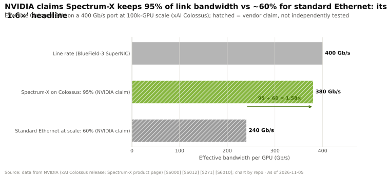
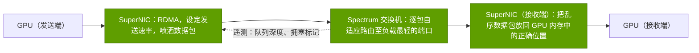
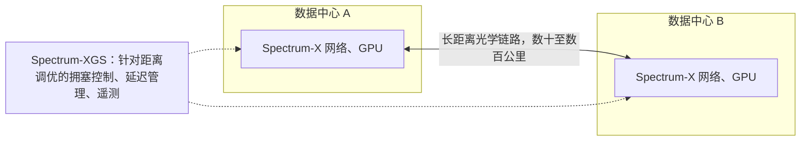

# Spectrum-X 以太网与跨数据中心扩展

> [!NOTE]
> 本页为英文原文的简体中文参考译文，仅供参考；如有出入，以[英文原文](../../../layers/06-scale-out-scale-across-networking/spectrum-x-ethernet.md "English original")为准。

第 06 层 · 横向扩展与跨数据中心网络 · 约 8 分钟阅读 · 最后核实：2026-11-05

## ⚡ 要点速览

- **客户选择了以太网，于是英伟达造出了 AI 以太网。** 2025 年之前两年，[InfiniBand](../../glossary.md#infiniband) 占 AI 后端交换机销售额的约 80%；到 1Q 2026，以太网已占约三分之二（Dell'Oro）🟡 [[S90053]](../../../sources/bibliography.md#s90053)[[S90054]](../../../sources/bibliography.md#s90054)。
- **[Spectrum-X](../../glossary.md#spectrum-x) 是协同设计的一对组合，** 而不只是一台交换机：Spectrum-4 / Spectrum-X800 交换机（51.2 Tb/s，64 × 800G），加上每颗 GPU 一块 BlueField-3 或 [ConnectX](../../glossary.md#connectx) [SuperNIC](../../glossary.md#supernic)，于 2023 年 5 月推出 [[S271]](../../../sources/bibliography.md#s271)[[S267]](../../../sources/bibliography.md#s267)[[S264]](../../../sources/bibliography.md#s264)。
- **机制：** 采用逐包[自适应路由](../../glossary.md#adaptive-routing)的[包喷洒（packet spraying）](../../glossary.md#packet-spraying)、在接收端[网卡（NIC）](../../glossary.md#nic)中重排序，以及由遥测驱动的[拥塞控制](../../glossary.md#congestion-control) [[S6011]](../../../sources/bibliography.md#s6011)[[S271]](../../../sources/bibliography.md#s271)。
- **宣称：** 在 xAI 的 100,000 GPU 集群 Colossus 上有效带宽达 95%，而标准以太网约为 60%，即英伟达宣传的“1.6 倍”；两者都是厂商数据，缺乏独立测试 [[S6000]](../../../sources/bibliography.md#s6000)[[S6010]](../../../sources/bibliography.md#s6010)。
- **采用是真实的：** Meta 与甲骨文（Oracle）（2025 年 10 月）[[S6009]](../../../sources/bibliography.md#s6009)，Q2 FY2026 年化收入运行率超过 $10B [[S6027]](../../../sources/bibliography.md#s6027)，Q2 FY2027 同比增长 2.6 倍 [[S408]](../../../sources/bibliography.md#s408)；IDC 将英伟达列为 1Q 2026 数据中心以太网交换机收入第一 🟡 [[S6028]](../../../sources/bibliography.md#s6028)。
- **[Spectrum-XGS](../../glossary.md#spectrum-xgs)（2025 年 8 月）** 增加了距离感知的拥塞控制，用于互连数据中心（“[跨数据中心扩展（scale-across）](../../glossary.md#scale-across)”）；英伟达宣称跨站点 [NCCL](../../glossary.md#nccl) 性能提升约 1.9 倍，CoreWeave 为首家采用者 [[S268]](../../../sources/bibliography.md#s268)[[S6024]](../../../sources/bibliography.md#s6024)。
- **看空情景：** 商用以太网正借助 Ultra Ethernet [[S575]](../../../sources/bibliography.md#s575) 和博通（Broadcom）102.4 Tb/s 的 Tomahawk 6 [[S274]](../../../sources/bibliography.md#s274) 迎头赶上；Meta 在基于 Arista 的 RoCE 网络上训练了 Llama 3，并未使用 Spectrum-X [[S6002]](../../../sources/bibliography.md#s6002)。

## 1. 英伟达为何进军以太网

三个买方现实把市场推离了 InfiniBand：**运维**（每家云厂商都已具备以太网工具链和人员）、**多租户**（云厂商以以太网原生的隔离方式出售集群切片）和**采购**（[超大规模云厂商](../../glossary.md#hyperscaler)希望有多家供应商，并使用自己的交换机软件，如 Meta 的 FBOSS 和微软（Microsoft）的 SONiC）[[S6009]](../../../sources/bibliography.md#s6009)[[S6005]](../../../sources/bibliography.md#s6005)。英伟达选择同时在以太网内部展开竞争；2026 年初，在以太网扩大领先的同时，InfiniBand 仍出现了反弹 [[S90054]](../../../sources/bibliography.md#s90054)。

> [!TIP]
> **算例 —— 份额迁移意味着什么。** InfiniBand 在 AI 后端交换机销售额中的占比从约 80% 降至约 33% [[S90053]](../../../sources/bibliography.md#s90053)[[S90054]](../../../sources/bibliography.md#s90054)：一家只做 InfiniBand 的厂商将失去一半以上的份额。1Q 2026，英伟达在 AI 后端交换机厂商中排名第二，落后于白牌设备厂商 Celestica，领先于 Arista [[S90054]](../../../sources/bibliography.md#s90054)，同时 Spectrum-X 同比增长 2.6 倍 [[S408]](../../../sources/bibliography.md#s408)。
>
> **结论：** 转向以太网，把份额流失变成了英伟达网络收入内部的结构调整。

## 2. Spectrum-X 如何工作：交换机与网卡作为一个系统

标准 [ECMP](../../glossary.md#ecmp) 会把每条数据流在其整个生命周期内哈希到一条路径上；AI 中为数不多的“大象流”经常在同一条链路上冲突，而其他链路却闲置——这就是英伟达 60% 数据背后的“流冲突”[[S6000]](../../../sources/bibliography.md#s6000)。Spectrum-X 把每条数据流分散到所有路径上，并在网络边缘处理由此带来的后果：

交换机为每个数据包挑选负载最轻的输出端口，只有在自适应路由的余量耗尽时才标记拥塞 [[S6011]](../../../sources/bibliography.md#s6011)；接收端 SuperNIC 把每个乱序到达的数据包写入 GPU 内存中的正确位置；交换机遥测让网卡能在微秒级内对发送端限速，并防止一个租户的作业拖慢另一个租户 [[S271]](../../../sources/bibliography.md#s271)。

> [!TIP]
> **算例 —— 解读“1.6 倍”宣称。** Colossus 的每颗 H100 配一块 400 Gb/s 的 BlueField-3 SuperNIC [[S6000]](../../../sources/bibliography.md#s6000)：95% 约为 380 Gb/s，60% 约为 240 Gb/s，95 ÷ 60 = 1.58，即英伟达的“1.6 倍”[[S6010]](../../../sources/bibliography.md#s6010)。在英伟达自己的博客示例中，背景噪声流量让标准以太网的一个训练步多耗时 1.18 s [[S6011]](../../../sources/bibliography.md#s6011)。
>
> **结论：** 在哈希冲突占主导的场景（大规模下的大型集合通信）中，收益是真实的，但前提是两端都使用英伟达网卡；买家应以自己的作业做基准测试。

| 特性 | InfiniBand（Quantum） | Spectrum-X（英伟达以太网） | 商用以太网 + UEC 网卡 |
|---|---|---|---|
| 负载均衡 | 🟩 原生自适应路由 | 🟩 逐包喷洒 + 网卡重排序 | 🟨 UEC 1.0 加入包喷洒；因网卡而异 [[S575]](../../../sources/bibliography.md#s575) |
| 丢包处理 | 🟩 基于信用，无损 | 🟨 RoCE 加遥测拥塞控制 | 🟨 UEC 传输层可容忍丢包 |
| 网内规约 | 🟩 自 2015 年起支持 SHARP | 🟥 目前以太网尚无 | 🟨 已在 UEC 1.1（2026 年 10 月）中定义 [[S575]](../../../sources/bibliography.md#s575) |
| 运维熟悉度 | 🟥 独立的专业体系 | 🟩 标准工具链，SONiC/FBOSS | 🟩 标准以太网 |
| 多供应商采购 | 🟥 大规模部署仅英伟达一家 | 🟨 完整收益需英伟达网卡 + 交换机 | 🟩 博通、思科、美满电子、Arista、AMD |

🔧 技术细节：Spectrum 产品家族

Spectrum-4（2022）是一颗基于台积电（TSMC）4N 工艺的 51.2 Tb/s [ASIC](../../glossary.md#asic)，在 SN5600 中以 64 × 800G 或 128 × 400G 的形式销售 [[S267]](../../../sources/bibliography.md#s267)。Spectrum-X800（2024）将其与 800 Gb/s 的 ConnectX-8 配套 [[S264]](../../../sources/bibliography.md#s264)。Spectrum-6（2026）容量翻倍至 102.4 Tb/s，是 Rubin 平台六款芯片之一，并搭载于共封装光学交换机中（见[共封装光学](co-packaged-optics.md)）[[S265]](../../../sources/bibliography.md#s265)[[S33004]](../../../sources/bibliography.md#s33004)；ConnectX-9 带来每 GPU 1.6 Tb/s [[S33004]](../../../sources/bibliography.md#s33004)。

## 3. 跨数据中心扩展：数据中心之间的 Spectrum-XGS

受电力上限约束的站点，正把最大的作业推向跨楼宇、跨园区运行；微软通过专用的 AI 广域网（WAN）连接其位于亚特兰大和威斯康星的 Fairwater 站点 [[S6005]](../../../sources/bibliography.md#s6005)。距离会让常规拥塞控制失效，因为在发送端获知拥塞之前，已有数以 MB 计的数据在途。**Spectrum-XGS** 于 2025-08-22 发布，沿用 Spectrum-X 硬件，增加了距离感知的拥塞控制、延迟管理和端到端遥测 [[S268]](../../../sources/bibliography.md#s268)[[S6024]](../../../sources/bibliography.md#s6024)。

> [!TIP]
> **算例 —— 为何距离需要专门的算法。** 光在光纤中每 5 µs 约传播 1 km，因此 100 km 会增加约 1 ms 的往返时延，而在同一机房内仅为几微秒。在 800 Gb/s（100 GB/s）下，这一往返期间约有 100 MB 数据在途；一个晚了整整一个往返时间才作出反应的发送端，早已把拥塞队列撑爆。
>
> **结论：** 跨站点训练需要距离感知的拥塞控制、边缘侧的深缓冲（博通的 Jericho4 和思科的 P200 走的正是这条路线 [[S276]](../../../sources/bibliography.md#s276)[[S286]](../../../sources/bibliography.md#s286)），以及把最重的集合通信留在各站点内部的并行策略。

英伟达宣称 Spectrum-XGS 能让跨站点 NCCL 性能接近翻倍（在一项公开的基准测试中约为 1.9 倍）🟡 [[S268]](../../../sources/bibliography.md#s268)[[S6024]](../../../sources/bibliography.md#s6024)，CoreWeave 是首家公开的采用者 [[S268]](../../../sources/bibliography.md#s268)。

## 🎯 企业发展视角

1. **捆绑经济学。** Spectrum-X 的优势要求英伟达交换机与 SuperNIC 配套使用；正是这种捆绑（而非交换机 ASIC）让英伟达在一个由基于博通芯片的白牌设备领跑的市场中位居第二 [[S90054]](../../../sources/bibliography.md#s90054)。
2. **标准是需要关注的威胁。** 如果来自博通、AMD 等厂商的 Ultra Ethernet 网卡在有效带宽上追平 [[S575]](../../../sources/bibliography.md#s575)[[S280]](../../../sources/bibliography.md#s280)，Spectrum-X 的溢价将收窄至软件与支持服务。
3. **跨数据中心扩展是一个新的价值池**（深缓冲路由器、相干光学器件、拥塞控制），并随受电力约束的站点增多而扩大。
4. **高通的问题（仅基于公开信息）：** 对于多站点推理集群，开放的以太网技术栈（[UEC](../../glossary.md#ultra-ethernet)，以及面向[纵向扩展（scale-up）](../../glossary.md#scale-up)的 [ESUN](../../glossary.md#esun) [[S90052]](../../../sources/bibliography.md#s90052)）能否为网卡或[数据处理器（DPU）](../../glossary.md#dpu)的新进入者留出空间？还是买家会集中采用单一厂商的交换机加网卡捆绑方案？

## 📚 来源（Sources）

<!-- Auto-generated from the [S…] citations on this page by `make build`. Edit sources/registry/*.csv, not this list. -->

- [**S264**](../../../sources/bibliography.md#s264) NVIDIA Newsroom, *NVIDIA Announces New Switches Optimized for Trillion-Parameter GPU Computing and AI Infrastructure (Quantum-X800, Spectrum-X800, ConnectX-8)*, 2024-03-18. [Link](https://nvidianews.nvidia.com/news/networking-switches-gpu-computing-ai)
- [**S265**](../../../sources/bibliography.md#s265) NVIDIA Newsroom, *NVIDIA Announces Spectrum-X Photonics, Co-Packaged Optics Networking Switches to Scale AI Factories to Millions of GPUs*, 2025-03-18. [Link](https://nvidianews.nvidia.com/news/nvidia-spectrum-x-co-packaged-optics-networking-switches-ai-factories)
- [**S267**](../../../sources/bibliography.md#s267) NVIDIA Newsroom, *NVIDIA Spectrum-4 high-performance data center networking infrastructure platform (GTC 2022)*, 2022-03-22. [Link](https://nvidianews.nvidia.com/news/nvidia-announces-spectrum-high-performance-data-center-networking-infrastructure-platform)
- [**S268**](../../../sources/bibliography.md#s268) NVIDIA Newsroom, *NVIDIA Introduces Spectrum-XGS Ethernet to Connect Distributed Data Centers Into Giga-Scale AI Super-Factories*, 2025-08-22. [Link](https://nvidianews.nvidia.com/news/nvidia-introduces-spectrum-xgs-ethernet-to-connect-distributed-data-centers-into-giga-scale-ai-super-factories)
- [**S271**](../../../sources/bibliography.md#s271) NVIDIA Newsroom, *NVIDIA Launches Accelerated Ethernet Platform for Hyperscale Generative AI (Spectrum-X)*, 2023-05-29. [Link](https://nvidianews.nvidia.com/news/nvidia-launches-accelerated-ethernet-platform-for-hyperscale-generative-ai)
- [**S274**](../../../sources/bibliography.md#s274) Broadcom, *Broadcom ships Tomahawk 6: world's first 102.4 Tbps switch*, 2025-06-03. [Link](https://investors.broadcom.com/news-releases/news-release-details/broadcom-ships-tomahawk-6-worlds-first-1024-tbps-switch)
- [**S276**](../../../sources/bibliography.md#s276) Broadcom, *Broadcom ships Jericho4, enabling distributed AI computing across data centers*, 2025-08-04. [Link](https://investors.broadcom.com/news-releases/news-release-details/broadcom-ships-jericho4-enabling-distributed-ai-computing-across)
- [**S280**](../../../sources/bibliography.md#s280) Broadcom, *Broadcom introduces Thor Ultra, the industry's first 800G AI Ethernet NIC*, 2025-10-14. [Link](https://investors.broadcom.com/news-releases/news-release-details/broadcom-introduces-industrys-first-800g-ai-ethernet-nic)
- [**S286**](../../../sources/bibliography.md#s286) Cisco, *Cisco Silicon One P200 and Cisco 8223 for scale-across AI networks*, 2025-10-08. [Link](https://newsroom.cisco.com/)
- [**S408**](../../../sources/bibliography.md#s408) NVIDIA Corporation, *NVIDIA Corp. (NVDA) Q2 Fiscal 2027 earnings call transcript (26 August 2026)*, 2026-08-26. [Link](https://s201.q4cdn.com/141608511/files/content_files/TRANSCRIPT_-NVIDIA-Corp-NVDA-US-Q2-2027-Earnings-Call-26-August-2026-5_00-PM-ET.pdf)
- [**S575**](../../../sources/bibliography.md#s575) Network World, *Ultra Ethernet 1.1 extends the specification to scale-up networks and adds programmable congestion control*, 2026-10. [Link](https://www.networkworld.com/article/4235340/ultra-ethernet-1-1-extends-the-specification-to-scale-up-networks-and-adds-programmable-congestion-control.html)
- [**S6000**](../../../sources/bibliography.md#s6000) TechPowerUp (NVIDIA press release), *NVIDIA Ethernet Networking Accelerates World's Largest AI Supercomputer, Built by xAI*, 2024-10-29. [Link](https://techpowerup.com/328227/nvidia-ethernet-networking-accelerates-worlds-largest-ai-supercomputer-built-by-xai)
- [**S6002**](../../../sources/bibliography.md#s6002) Engineering at Meta, *Building Meta's GenAI Infrastructure*, 2024-03-12. [Link](https://engineering.fb.com/2024/03/12/data-center-engineering/building-metas-genai-infrastructure/)
- [**S6005**](../../../sources/bibliography.md#s6005) Microsoft Official Blog, *Infinite scale: the architecture behind the Azure AI superfactory*, 2025-11-12. [Link](https://blogs.microsoft.com/blog/2025/11/12/infinite-scale-the-architecture-behind-the-azure-ai-superfactory/)
- [**S6009**](../../../sources/bibliography.md#s6009) NVIDIA Investor Relations, *NVIDIA Spectrum-X Ethernet Switches Speed Up Networks for Meta and Oracle*, 2025-10-13. [Link](https://investor.nvidia.com/news/press-release-details/2025/NVIDIA-Spectrum-X-Ethernet-Switches-Speed-Up-Networks-for-Meta-and-Oracle/default.aspx)
- [**S6010**](../../../sources/bibliography.md#s6010) NVIDIA, *NVIDIA Spectrum-X Ethernet Networking Platform (product page)*, 2025. [Link](https://www.nvidia.com/en-us/networking/spectrumx/)
- [**S6011**](../../../sources/bibliography.md#s6011) NVIDIA Technical Blog, *Giga-scale AI Ethernet evolution: Spectrum-X Ethernet rewrites the rules*, 2025. [Link](https://developer.nvidia.com/blog/giga-scale-ai-ethernet-evolution-spectrum-x-ethernet-rewrites-rules/)
- [**S6024**](../../../sources/bibliography.md#s6024) Techzine, *Nvidia unveils Spectrum-XGS Ethernet for 'scale-across' data centers*, 2025-08-22. [Link](https://www.techzine.eu/news/infrastructure/134016/nvidia-unveils-spectrum-xgs-ethernet-for-scale-across-data-centers)
- [**S6027**](../../../sources/bibliography.md#s6027) DatacenterDynamics, *Nvidia Q2 2025: networking is booming, but your networks cost nothing*, 2025-08. [Link](https://www.datacenterdynamics.com/en/news/nvidia-q2-2025-networking-is-booming-but-your-networks-cost-nothing/)
- [**S6028**](../../../sources/bibliography.md#s6028) Tiger Brokers (iTiger), *NVIDIA's AI expansion extends to network infrastructure, captures top spot in data center Ethernet switch revenue (IDC)*, 2026-06. [Link](https://www.itiger.com/news/1113632768)
- [**S33004**](../../../sources/bibliography.md#s33004) NVIDIA Newsroom, *NVIDIA Kicks Off the Next Generation of AI With Rubin — Six New Chips; One Incredible AI Supercomputer*, 2026-01-05. [Link](https://nvidianews.nvidia.com/news/rubin-platform-ai-supercomputer)
- [**S90052**](../../../sources/bibliography.md#s90052) Synopsys, *Ethernet standards for scale-up AI: an overview of ESUN, SUE, and UALink*, 2025-11. [Link](https://www.synopsys.com/articles/ethernet-standards-scale-up-ai.html)
- [**S90053**](../../../sources/bibliography.md#s90053) Dell'Oro Group, *Ethernet more than doubles size of InfiniBand as the leading fabric for AI scale-out networks in 2025*, 2026. [Link](https://www.delloro.com/news/ethernet-more-than-doubles-size-of-infiniband-as-the-leading-fabric-for-ai-scale-out-networks-in-2025/)
- [**S90054**](../../../sources/bibliography.md#s90054) Dell'Oro Group, *Ethernet extends lead in AI scale-out networks despite strong InfiniBand rebound*, 2026. [Link](https://www.delloro.com/news/ethernet-extends-lead-in-ai-scale-out-networks-despite-strong-infiniband-rebound/)
