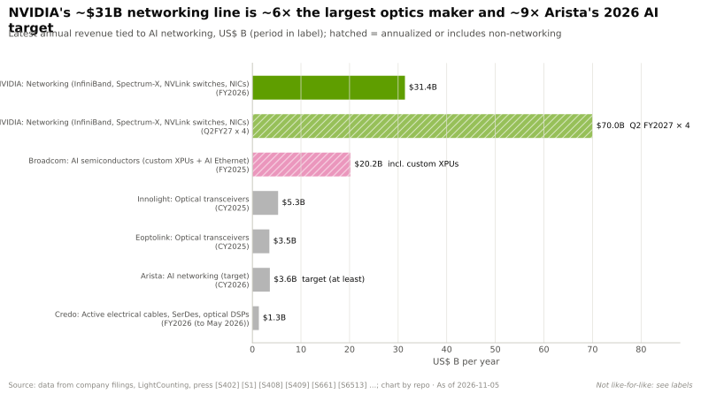
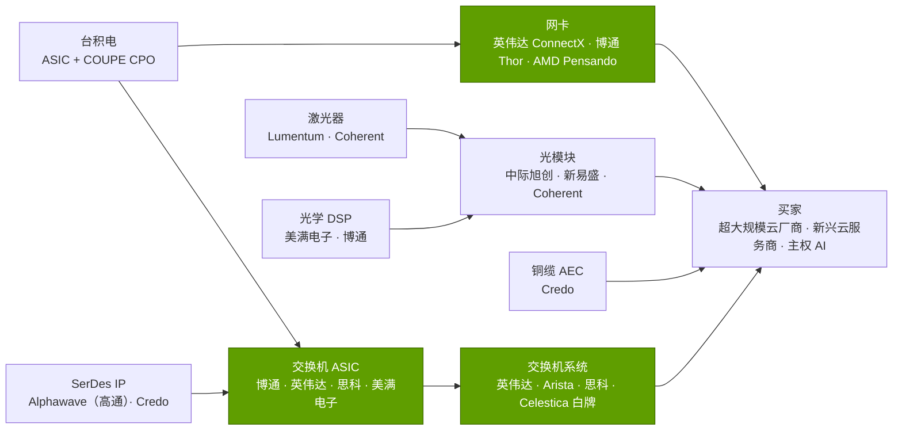

# 横向扩展与跨数据中心网络：价值链与企业发展切入点

> [!NOTE]
> 本页为英文原文的简体中文参考译文，仅供参考；如有出入，以[英文原文](../../../layers/06-scale-out-scale-across-networking/value-chain-and-corp-dev.md "English original")为准。

第 06 层 · 横向扩展与跨数据中心网络 · 约 10 分钟阅读 · 最后核实：2026-11-05

## ⚡ 要点速览

- **网络占集群的五分之一。** 各方估计网络约占 AI 集群硬件资本开支的 17–21%；SemiAnalysis 的 GB200 [NVL72](../../glossary.md#nvl72) 全口径成本意味着网络加存储约占 20.5% [[S6026]](../../../sources/bibliography.md#s6026)[[S324]](../../../sources/bibliography.md#s324)。
- **英伟达占据最大的单一价值池。** 其 FY2026 网络收入（约 $31.4B，含 [NVLink](../../glossary.md#nvlink) 交换机）约为中际旭创（Innolight）2025 年收入的 6 倍、Arista 2026 年 AI 目标的约 9 倍 [[S402]](../../../sources/bibliography.md#s402)[[S6513]](../../../sources/bibliography.md#s6513)[[S6500]](../../../sources/bibliography.md#s6500)。
- **光学器件是增长最快、也最稀缺的环节。** 2025 年中际旭创增长 61%，新易盛（Eoptolink）增长 189% [[S6513]](../../../sources/bibliography.md#s6513)；Credo 2026 财年增长 206% [[S6515]](../../../sources/bibliography.md#s6515)。Coherent 表示其数据中心订单超过当前产能的 4 倍 [[S6512]](../../../sources/bibliography.md#s6512)。
- **英伟达正在花钱买供应安全。** 2026 年 3 月，它分别向 Lumentum 和 Coherent 投资 $2B，并与共封装光学激光器的采购承诺挂钩 [[S6511]](../../../sources/bibliography.md#s6511)。
- **本层的并购交易确定了入场价格。** Mellanox（$6.9B）、AMD–Pensando（$1.9B）、美满电子（Marvell）–Celestial AI（约 $3.25B）、高通（Qualcomm）–Alphawave（约 $2.4B）以及慧与（HPE）–瞻博网络（Juniper）（$14B）[[S464]](../../../sources/bibliography.md#s464)[[S6521]](../../../sources/bibliography.md#s6521)[[S2513]](../../../sources/bibliography.md#s2513)[[S4514]](../../../sources/bibliography.md#s4514)[[S6522]](../../../sources/bibliography.md#s6522)。
- **光学与网络领域的私营初创公司估值高企：** Ayar Labs 约 $3.75B，Lightmatter $4.4B，Nexthop AI $4.2B，Upscale AI 约 $2B [[S6519]](../../../sources/bibliography.md#s6519)[[S2510]](../../../sources/bibliography.md#s2510)[[S6517]](../../../sources/bibliography.md#s6517)[[S6518]](../../../sources/bibliography.md#s6518)。
- **[Q8 · 价值池与并购机会]** 尚未被占据的席位是面向非英伟达加速器的[横向扩展（scale-out）](../../glossary.md#scale-out)[网卡（NIC）](../../glossary.md#nic)，以及光学器件供应链。英伟达已通过股权投资锁定了后者。

## 谁在获取网络支出

绿色 = 英伟达参与销售的环节；它同时也采购激光器和光学器件，并持有两家激光器厂商的股权 [[S6511]](../../../sources/bibliography.md#s6511)。

| 细分环节 | 主要参与者 | 规模 / 增长信号 | 定价权信号 | 英伟达的位置 |
|---|---|---|---|---|
| 交换机系统 | Celestica、英伟达、Arista、思科 | 2Q26 AI 后端交换机销售额首次超过前端 [[S6523]](../../../sources/bibliography.md#s6523) | Arista 指引毛利率 62–64% [[S6500]](../../../sources/bibliography.md#s6500) | 以太网 AI 后端第 2 [[S6523]](../../../sources/bibliography.md#s6523) |
| 交换芯片 | 博通、英伟达、思科、美满电子 | 博通 AI 网络同比 >2.5 倍 [[S6505]](../../../sources/bibliography.md#s6505) | 102.4T 级供应商寥寥 [[S274]](../../../sources/bibliography.md#s274)[[S6503]](../../../sources/bibliography.md#s6503) | 自研 Spectrum 与 Quantum |
| 网卡 | 英伟达、博通、AMD | 每 GPU 一块网卡（英伟达）或三块（AMD）[[S33004]](../../../sources/bibliography.md#s33004)[[S228]](../../../sources/bibliography.md#s228) | 英伟达公司整体毛利率约 75% [[S405]](../../../sources/bibliography.md#s405) | 以 1.6 Tb/s 领先 |
| 光模块 | 中际旭创、新易盛、Coherent | 2025 年收入分别为 $5.3B 和 $3.5B [[S6513]](../../../sources/bibliography.md#s6513) | 供应受限 [[S6512]](../../../sources/bibliography.md#s6512) | 买方；CPO 把价值转入交换机 |
| 激光器与光子器件 | Lumentum、Coherent、台积电 | 英伟达各投资 $2B [[S6511]](../../../sources/bibliography.md#s6511) | 稀缺；制约 CPO 放量 [[S6507]](../../../sources/bibliography.md#s6507) | 股权投资 + 采购承诺 |
| 铜缆与 DSP | Credo、美满电子、博通 | Credo $1.34B（+206%）[[S6515]](../../../sources/bibliography.md#s6515) | Credo 非 GAAP 净利润 >$660M 🟡 [[S6515]](../../../sources/bibliography.md#s6515) | 买方 |

> [!TIP]
> **算例 —— 一个 100,000 GPU 集群中的光学器件。** 黄仁勋给出的口径是每颗 GPU 约六个光模块，每个约 $1,000、约 30 W [[S6016]](../../../sources/bibliography.md#s6016)。即每颗 GPU 约 $6,000 的光学器件，100,000 颗 GPU 约 $600M、约 18 MW。一个这样的集群约相当于中际旭创 2025 年收入的 11% [[S6513]](../../../sources/bibliography.md#s6513)。共封装光学会把其中大部分价值从模块厂商转移到交换机封装中，而那正是英伟达和博通的销售领域。因此英伟达买的是激光器产能，而不是光模块。

## 本层的并购历史

| 日期 | 交易 | 金额 | 买到了什么 | 来源 |
|---|---|---|---|---|
| 2019-03 | 英伟达–Mellanox | $6.9B 现金 | InfiniBand、以太网、网卡：即今天的网络业务 | [[S464]](../../../sources/bibliography.md#s464) |
| 2020-05 | 英伟达–Cumulus Networks | 未披露 | 面向 Spectrum 交换机的开放网络操作系统 | [[S478]](../../../sources/bibliography.md#s478) |
| 2025-09 | 英伟达–Enfabrica（团队 + 授权） | 约 $900M | SuperNIC 与内存互连团队 | [[S475]](../../../sources/bibliography.md#s475) |
| 2026-03 | 英伟达入股 Lumentum 与 Coherent | 各 $2B | 用于 CPO 的激光器产能，非独家 | [[S6511]](../../../sources/bibliography.md#s6511) |
| 2022-04 | AMD–Pensando | 约 $1.9B | Pollara 与 Vulcano 背后的 DPU/AI 网卡团队 | [[S6521]](../../../sources/bibliography.md#s6521) |
| 2026-02 | 美满电子–Celestial AI（已完成） | 首付约 $3.25B | 面向内存与计算的光子互连 | [[S2513]](../../../sources/bibliography.md#s2513) |
| 2025-12 | 高通–Alphawave（已完成） | 约 $2.4B | SerDes 与互连 IP | [[S4513]](../../../sources/bibliography.md#s4513)[[S4514]](../../../sources/bibliography.md#s4514) |

> [!TIP]
> **算例 —— 供应安全让英伟达花了多少钱。** $4B 的激光器股权投资 [[S6511]](../../../sources/bibliography.md#s6511) 约相当于 FY2026 网络收入（约 $31.4B）的 13% [[S402]](../../../sources/bibliography.md#s402)。它还不到黄仁勋所称截至 2027 年 Blackwell 与 Vera Rubin $1 万亿需求的 1% [[S90001]](../../../sources/bibliography.md#s90001)。非独家的股权投资买到的是优先权，而非排他。这与其[高带宽内存（HBM）](../../glossary.md#hbm)和 [CoWoS](../../glossary.md#cowos) 承诺是同一套打法（见[第 03 层](../03-memory-packaging-supply-chain/value-chain-and-corp-dev.md)）。

## 值得关注的私营公司

| 公司 | 业务 | 最近一次公开融资 / 状态 | 为何重要 |
|---|---|---|---|
| Ayar Labs | 用于 CPO 的光 I/O 小芯片（chiplet） | E 轮 $500M，估值约 $3.75B（2026 年 3 月）；英伟达和 AMD 为投资方 [[S6519]](../../../sources/bibliography.md#s6519) | 封装内光学，适用于纵向扩展与横向扩展 |
| Lightmatter | 光子互连（Passage） | D 轮 $400M，估值 $4.4B（2024 年 10 月）[[S2510]](../../../sources/bibliography.md#s2510) | Celestial AI 在光子互连领域的竞争对手 |
| Xscape Photonics | 用于光链路的多波长激光器 | 在 $37M 追加融资后 A 轮合计约 $81M（2026 年 3 月）；NVentures 为投资方 [[S6520]](../../../sources/bibliography.md#s6520) | CPO 的激光器供应 |
| Nexthop AI | 面向超大规模云厂商的 AI 交换机与软件 | B 轮 $500M，估值 $4.2B（2026 年 3 月）[[S6517]](../../../sources/bibliography.md#s6517) | “白牌 + 软件”模式的挑战者 |
| Upscale AI | 基于开放标准的纵向扩展与横向扩展交换 | 累计融资约 $500M，估值约 $2B（2026）[[S6518]](../../../sources/bibliography.md#s6518) | UALink/ESUN 商用替代方案 |
| Eridu | 高端口数 AI 网络芯片 | A 轮 $200M，累计约 $230M（2026 年 3 月）[[S6516]](../../../sources/bibliography.md#s6516) | 交换机端口数领域的新进入者 |
| Celestial AI | 光子互连 | 被美满电子收购（2026 年 2 月完成）[[S2513]](../../../sources/bibliography.md#s2513) | 光子领域的基准价格 |
| Enfabrica | SuperNIC 与内存互连 | 团队与授权归英伟达（2025 年 9 月）[[S475]](../../../sources/bibliography.md#s475) | 网卡团队的基准价格 |

仅基于公开信息；融资数据以报道为准，未经独立核实。

> [!TIP]
> **算例 —— $4.2B 的估值意味着什么。** 仅作示意 🔴，假设投资者按约 10 倍前瞻市销率定价。则 Nexthop AI 的 $4.2B [[S6517]](../../../sources/bibliography.md#s6517) 意味着约 $420M 的年收入，约为英伟达约 $70B 网络收入运行率的 0.6% [[S408]](../../../sources/bibliography.md#s408)。初创公司只需赢得一家[超大规模云厂商](../../glossary.md#hyperscaler)的设计订单，而不必战胜英伟达，这就是它们的融资规模大且早的原因。

🔧 技术细节：为何 CPO 会把利润从模块厂商转移给芯片厂商

可插拔[光模块](../../glossary.md#pluggable-transceiver)把激光器、调制器、[光学 DSP](../../glossary.md#optical-dsp) 和外壳打包在一起，由模块厂商加价销售。在[共封装光学](../../glossary.md#co-packaged-optics)中，调制器位于紧挨交换芯片的[硅光子](../../glossary.md#silicon-photonics)裸片上，DSP 被取消，只有激光光源留在外部。电子与光子器件的价值转移到交换机厂商的封装中，由台积电的 COUPE 工艺制造 [[S6507]](../../../sources/bibliography.md#s6507)。激光器成为唯一仍然稀缺的外部部件。铜质[有源电缆（AEC）](../../glossary.md#active-electrical-cable)在短距离场景中得以保留，因为它比光学器件更便宜、发热更低 [[S6515]](../../../sources/bibliography.md#s6515)。

**[Q8 · 价值池与并购机会]** 最大的价值池——交换机加网卡（仅英伟达一家每年约 $31B，约为每 $1 计算收入对应 $0.24；见[发展历程](history-and-how-built.md)）——由英伟达和博通把持。增长最快的价值池是光学器件与铜缆互连（增速 +61% 至 +206%）[[S6513]](../../../sources/bibliography.md#s6513)[[S6515]](../../../sources/bibliography.md#s6515)。尚存的切入点有：

- **面向非英伟达加速器的横向扩展网卡。** [UEC](../../glossary.md#ultra-ethernet) 使网卡成为标准化部件（AMD Vulcano、博通 Thor）[[S257]](../../../sources/bibliography.md#s257)[[S290]](../../../sources/bibliography.md#s290)[[S280]](../../../sources/bibliography.md#s280)。
- **光子与激光器供应，** 英伟达已买下优先权 [[S6511]](../../../sources/bibliography.md#s6511)，但初创公司仍保持独立。
- **跨数据中心扩展路由器**（Jericho4、思科 P200、Spectrum-XGS）[[S276]](../../../sources/bibliography.md#s276)[[S286]](../../../sources/bibliography.md#s286)[[S268]](../../../sources/bibliography.md#s268)。

## 🎯 企业发展视角

1. 英伟达对 Lumentum 和 Coherent 的股权投资是非独家的 [[S6511]](../../../sources/bibliography.md#s6511)。2027 年还剩多少激光器产能留给其他 CPO 买家？价格几何？
2. UEC 网卡是大多数非英伟达机架中缺失的一环。对于一家加速器厂商，网卡团队（Enfabrica 约花费 $900M [[S475]](../../../sources/bibliography.md#s475)）和 [SerDes](../../glossary.md#serdes) 资产（Alphawave [[S4513]](../../../sources/bibliography.md#s4513)），哪个是更好的起点？
3. 初创公司估值（尚未形成规模收入时即达 $2–4B）[[S6517]](../../../sources/bibliography.md#s6517)[[S6518]](../../../sources/bibliography.md#s6518)[[S6519]](../../../sources/bibliography.md#s6519) 超过了 Mellanox 2019 年约 5 倍市销率的倍数 [[S464]](../../../sources/bibliography.md#s464)[[S6510]](../../../sources/bibliography.md#s6510)。少数股权投资加商业协议，是否比取得控制权更好的切入方式？
4. CPO 把价值从模块厂商转移到交换机封装。哪些光学器件供应商（中际旭创、新易盛、Coherent）受冲击最大？哪些会作为激光器供应商受益？
5. Arista 目标约 30% 的 AI 收入来自跨数据中心扩展 [[S6500]](../../../sources/bibliography.md#s6500)。数据中心互连路由器是否是一个独立、受英伟达主导程度较低、值得通过合作切入的价值池？

## 📚 来源（Sources）

<!-- Auto-generated from the [S…] citations on this page by `make build`. Edit sources/registry/*.csv, not this list. -->

- [**S228**](../../../sources/bibliography.md#s228) Spheron, *AMD Helios rack-scale AI on GPU cloud: deploy MI455X inference with UALink and Ultra Ethernet (2026 guide)*, 2026. [Link](https://www.spheron.network/blog/amd-helios-rack-scale-mi455x-gpu-cloud/)
- [**S257**](../../../sources/bibliography.md#s257) Ultra Ethernet Consortium, *Ultra Ethernet Consortium launches Specification 1.0*, 2025-06-11. [Link](https://ultraethernet.org/ultra-ethernet-consortium-uec-launches-specification-1-0-transforming-ethernet-for-ai-and-hpc-at-scale/)
- [**S268**](../../../sources/bibliography.md#s268) NVIDIA Newsroom, *NVIDIA Introduces Spectrum-XGS Ethernet to Connect Distributed Data Centers Into Giga-Scale AI Super-Factories*, 2025-08-22. [Link](https://nvidianews.nvidia.com/news/nvidia-introduces-spectrum-xgs-ethernet-to-connect-distributed-data-centers-into-giga-scale-ai-super-factories)
- [**S274**](../../../sources/bibliography.md#s274) Broadcom, *Broadcom ships Tomahawk 6: world's first 102.4 Tbps switch*, 2025-06-03. [Link](https://investors.broadcom.com/news-releases/news-release-details/broadcom-ships-tomahawk-6-worlds-first-1024-tbps-switch)
- [**S276**](../../../sources/bibliography.md#s276) Broadcom, *Broadcom ships Jericho4, enabling distributed AI computing across data centers*, 2025-08-04. [Link](https://investors.broadcom.com/news-releases/news-release-details/broadcom-ships-jericho4-enabling-distributed-ai-computing-across)
- [**S280**](../../../sources/bibliography.md#s280) Broadcom, *Broadcom introduces Thor Ultra, the industry's first 800G AI Ethernet NIC*, 2025-10-14. [Link](https://investors.broadcom.com/news-releases/news-release-details/broadcom-introduces-industrys-first-800g-ai-ethernet-nic)
- [**S286**](../../../sources/bibliography.md#s286) Cisco, *Cisco Silicon One P200 and Cisco 8223 for scale-across AI networks*, 2025-10-08. [Link](https://newsroom.cisco.com/)
- [**S290**](../../../sources/bibliography.md#s290) AMD, *AMD Advancing AI 2025: Helios rack, MI400 preview and Pensando Vulcano 800G NIC*, 2025-06-12. [Link](https://www.amd.com/en/newsroom.html)
- [**S324**](../../../sources/bibliography.md#s324) fal.ai, *NVIDIA GB200 price in 2026: what a GPU, a tray and an NVL72 rack cost*, 2026. [Link](https://fal.ai/learn/serverless/nvidia-gb200-price)
- [**S402**](../../../sources/bibliography.md#s402) NVIDIA Corporation via SEC EDGAR (Colette Kress), *CFO Commentary on Fourth Quarter and Fiscal 2026 Results (Form 8-K exhibit 99.2)*, 2026-02-25. [Link](https://www.sec.gov/Archives/edgar/data/1045810/000104581026000019/q4fy26cfocommentary.htm)
- [**S405**](../../../sources/bibliography.md#s405) NVIDIA Corporation via SEC EDGAR, *NVIDIA Announces Financial Results for Second Quarter Fiscal 2027 (Form 8-K exhibit 99.1)*, 2026-08-26. [Link](https://www.sec.gov/Archives/edgar/data/0001045810/000104581026000073/q2fy27pr.htm)
- [**S408**](../../../sources/bibliography.md#s408) NVIDIA Corporation, *NVIDIA Corp. (NVDA) Q2 Fiscal 2027 earnings call transcript (26 August 2026)*, 2026-08-26. [Link](https://s201.q4cdn.com/141608511/files/content_files/TRANSCRIPT_-NVIDIA-Corp-NVDA-US-Q2-2027-Earnings-Call-26-August-2026-5_00-PM-ET.pdf)
- [**S464**](../../../sources/bibliography.md#s464) NVIDIA Newsroom, *NVIDIA to Acquire Mellanox for $6.9 Billion*, 2019-03-11. [Link](https://nvidianews.nvidia.com/news/nvidia-to-acquire-mellanox-for-6-9-billion)
- [**S475**](../../../sources/bibliography.md#s475) CNBC, *Nvidia spends over $900 million on Enfabrica CEO, AI startup technology*, 2025-09-18. [Link](https://www.cnbc.com/technology/)
- [**S478**](../../../sources/bibliography.md#s478) NVIDIA, *NVIDIA Blog and Newsroom acquisition announcements (Cumulus, SwiftStack, DeepMap, Bright Computing, Excelero, Shoreline, Brev.dev, OctoAI, VinBrain, Gretel, Lepton AI, CentML, SchedMD)*, 2025-12. [Link](https://blogs.nvidia.com/)
- [**S2510**](../../../sources/bibliography.md#s2510) Bloomberg, *Photonic Computing Startup Lightmatter Reaches $4.4 Billion Valuation*, 2024-10-16. [Link](https://www.bloomberg.com/news/articles/2024-10-16/photonic-computing-startup-lightmatter-reaches-4-4-billion-valuation)
- [**S2513**](../../../sources/bibliography.md#s2513) Business Wire (Marvell), *Marvell Completes Acquisition of Celestial AI*, 2026-02-02. [Link](https://www.businesswire.com/news/home/20260201331090/en/marvell-completes-acquisition-of-celestial-ai)
- [**S4513**](../../../sources/bibliography.md#s4513) I-Connect007, *Qualcomm completes acquisition of Alphawave Semi*, 2025-12-18. [Link](https://iconnect007.com/article/148161/qualcomm-completes-acquisition-of-alphawave-semi/148158/ein)
- [**S4514**](../../../sources/bibliography.md#s4514) CRN Asia, *Qualcomm: US$2.4 billion Alphawave Semi buy to boost data center push*, 2025-06. [Link](https://www.crnasia.com/news-network/2025/qualcomm-us-2)
- [**S6016**](../../../sources/bibliography.md#s6016) optics.org, *NVIDIA reveals plan to scale AI factories with co-packaged optics*, 2025-03-19. [Link](https://www.optics.org/news/16/3/26)
- [**S6026**](../../../sources/bibliography.md#s6026) AMCompute (blog), *AI Cluster Cost Breakdown: CapEx (2026)*, 2026. [Link](https://www.amcompute.com/blog/ai-cluster-cost-breakdown-capex)
- [**S6500**](../../../sources/bibliography.md#s6500) Nasdaq, *Arista Networks Q2 earnings call highlights*, 2026-08. [Link](https://www.nasdaq.com/articles/arista-networks-q2-earnings-call-highlights)
- [**S6503**](../../../sources/bibliography.md#s6503) Cisco Investor Relations, *Cisco Announces New Silicon One G300, Advanced Systems and Optics to Power and Scale AI Data Centers for the Agentic Era*, 2026-02-10. [Link](https://investor.cisco.com/news/news-details/2026/Cisco-Announces-New-Silicon-One-G300-Advanced-Systems-and-Optics-to-Power-and-Scale-AI-Data-Centers-for-the-Agentic-Era/)
- [**S6505**](../../../sources/bibliography.md#s6505) Nasdaq, *Broadcom Q3 earnings call highlights*, 2026-09. [Link](https://www.nasdaq.com/articles/broadcom-q3-earnings-call-highlights)
- [**S6507**](../../../sources/bibliography.md#s6507) TrendForce, *NVIDIA and Broadcom begin CPO switch shipments (TrendForce press release)*, 2026-07-27. [Link](https://trendforce.com/presscenter/news/20260727-13151.html)
- [**S6510**](../../../sources/bibliography.md#s6510) Wikipedia, *Mellanox Technologies*, 2026. [Link](https://en.wikipedia.org/wiki/Mellanox_Technologies)
- [**S6511**](../../../sources/bibliography.md#s6511) SiliconANGLE, *Nvidia invests $4B in co-packaged optics suppliers Lumentum and Coherent*, 2026-03-02. [Link](https://siliconangle.com/2026/03/02/nvidia-invests-4b-co-packaged-optics-suppliers-lumentum-coherent/)
- [**S6512**](../../../sources/bibliography.md#s6512) The Register, *Nvidia burns $4B to light up American photonics manufacturing*, 2026-03-02. [Link](https://www.theregister.com/2026/03/02/nvidia_4b_us_photonics_manufacturing/)
- [**S6513**](../../../sources/bibliography.md#s6513) LightCounting, *LightTrends newsletter: May 2026 optical vendor landscape*, 2026-05. [Link](https://lightcounting.com/newsletter/en/may-2026-optical-vendor-landscape-376)
- [**S6515**](../../../sources/bibliography.md#s6515) Let's Data Science, *Credo raises guidance as optical ramp accelerates*, 2026-06. [Link](https://letsdatascience.com/news/credo-raises-guidance-as-optical-ramp-accelerates-30d77185)
- [**S6516**](../../../sources/bibliography.md#s6516) CXO Digital Pulse (company release), *Eridu emerges from stealth with over $200M in funding to break through the network wall*, 2026-03. [Link](https://www.cxodigitalpulse.com/eridu-emerges-from-stealth-with-over-200m-in-funding-to-break-through-the-network-wall-and-unlock-faster-ai/)
- [**S6517**](../../../sources/bibliography.md#s6517) Built In, *Nexthop AI raises $500M Series B at $4.2B valuation*, 2026-03-10. [Link](https://builtin.com/articles/nexthop-ai-raises-500m-series-b-4b-valuation-20260310)
- [**S6518**](../../../sources/bibliography.md#s6518) Converge Digest, *Upscale AI secures $190 million for data center networking for AI*, 2026. [Link](https://convergedigest.com/upscale-ai-secures-190-million-for-data-center-networking-for-ai/)
- [**S6519**](../../../sources/bibliography.md#s6519) SiliconANGLE, *Ayar Labs raises $500M in late-stage funding at a $3.75B valuation*, 2026-03-03. [Link](https://siliconangle.com/?p=733016)
- [**S6520**](../../../sources/bibliography.md#s6520) Let's Data Science, *Xscape Photonics raises $37 million Series A extension*, 2026-03-11. [Link](https://letsdatascience.com/news/xscape-photonics-raises-37-million-series-a-63fb75ee)
- [**S6521**](../../../sources/bibliography.md#s6521) Network World (Michael Cooney), *AMD grabs DPU-maker Pensando for a cool $1.9B*, 2022-04-04. [Link](https://www.networkworld.com/article/3655740/amd-grabs-dpu-maker-pensando-for-a-cool-19b.html)
- [**S6522**](../../../sources/bibliography.md#s6522) Bloomberg, *HPE to buy Juniper Networks for $14 billion in expansion bet*, 2024-01-09. [Link](https://www.bloomberg.com/news/articles/2024-01-09/hpe-to-buy-juniper-networks-for-14-billion-in-networking-bet)
- [**S6523**](../../../sources/bibliography.md#s6523) Dell'Oro Group, *AI back-end networks switch sales surpass front-end networks for the first time in 2Q2026*, 2026-08. [Link](https://www.delloro.com/news/ai-back-end-networks-switch-sales-surpass-front-end-networks-for-the-first-time-in-2q2026/)
- [**S33004**](../../../sources/bibliography.md#s33004) NVIDIA Newsroom, *NVIDIA Kicks Off the Next Generation of AI With Rubin — Six New Chips; One Incredible AI Supercomputer*, 2026-01-05. [Link](https://nvidianews.nvidia.com/news/rubin-platform-ai-supercomputer)
- [**S90001**](../../../sources/bibliography.md#s90001) The Star (Reuters), *Nvidia bets on AI inference as chip revenue opportunity hits $1 trillion (Reuters)*, 2026-03-17. [Link](https://www.thestar.com.my/tech/tech-news/2026/03/17/nvidia-bets-on-ai-inference-as-chip-revenue-opportunity-hits-1-trillion)
