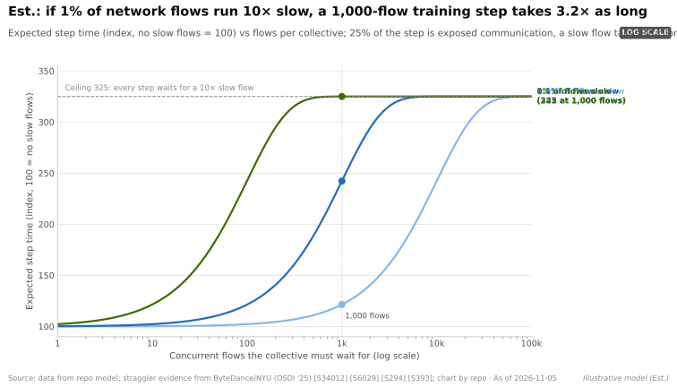
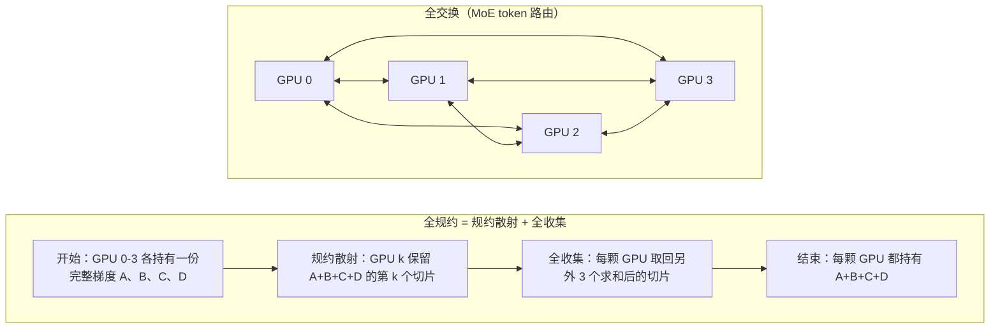
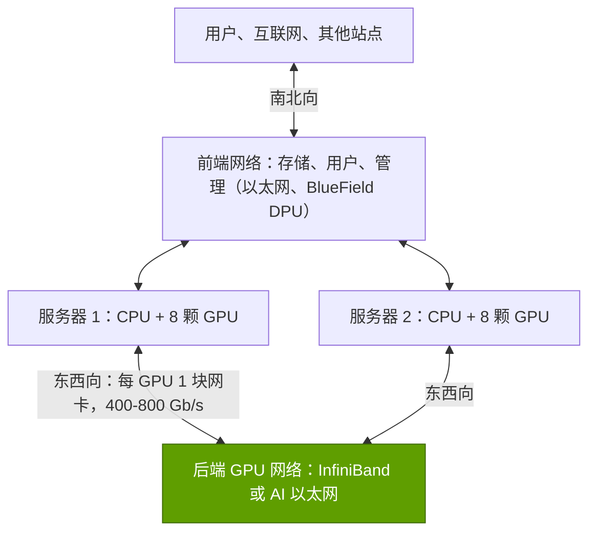

# AI 网络为何不同

> [!NOTE]
> 本页为英文原文的简体中文参考译文，仅供参考；如有出入，以[英文原文](../../../layers/06-scale-out-scale-across-networking/why-ai-networks-are-different.md "English original")为准。

第 06 层 · 横向扩展与跨数据中心网络 · 约 8 分钟阅读 · 最后核实：2026-11-05

## ⚡ 要点速览

- **训练是一场齐步行进。** 每个训练步结束时，GPU 都要通过[集合通信操作](../../glossary.md#collective-operation)交换梯度；在最慢的那条消息到达之前，没有一颗 GPU 能开始下一步。Meta 正是以这种方式在 16,384 颗 H100 GPU 上训练了 Llama 3 405B [[S34006]](../../../sources/bibliography.md#s34006)。
- **因此决定节奏的是尾部，而非平均值。** 按本资料库的简单模型，若 1% 的网络数据流慢 10 倍，一个含 1,000 条数据流的训练步耗时约为原来的 3.2 倍（估计）[[S6029]](../../../sources/bibliography.md#s6029)。
- **涉及的金额很大：** 按每 [GPU 小时](../../glossary.md#gpu-hour)约 $2 计算 [[S393]](../../../sources/bibliography.md#s393)，一个 100,000 GPU 集群每小时成本约 $200,000；若其中 17% 的时间耗在等待网络上，每年浪费约 $300M（估计）。
- **AI 流量是普通网络的最坏情形：** 少量巨大、同时发生的多对一数据流（[incast](../../glossary.md#incast)）。因此集群单独运行一张[后端网络](../../glossary.md#back-end-network)，采用 [RDMA](../../glossary.md#rdma)，每颗 GPU 配一块 400–800 Gb/s 的[网卡（NIC）](../../glossary.md#nic) [[S266]](../../../sources/bibliography.md#s266)[[S264]](../../../sources/bibliography.md#s264)。
- **英伟达的卖点**是负载下的低[尾延迟](../../glossary.md#tail-latency)：它宣称在 100k GPU 规模下，[Spectrum-X](../../glossary.md#spectrum-x) 的有效带宽达 95%，而标准以太网约为 60%；这是厂商自己的说法 [[S6000]](../../../sources/bibliography.md#s6000)。

## 1. 职能：让数千颗 GPU 步调一致

在[数据并行](../../glossary.md#data-parallelism)训练中，所有 GPU 必须先就平均梯度达成一致，才能更新权重。就像赛艇队一样，整体速度取决于最慢的那一桨。[掉队者（straggler）](../../glossary.md#straggler)并不一定是硬件故障：字节跳动对其[大语言模型（LLM）](../../glossary.md#llm)训练集群进行的为期五个月的研究发现，掉队现象很常见，且往往由多种因素相互作用造成 [[S6029]](../../../sources/bibliography.md#s6029)。故障进一步推高成本：Llama 3 为期 54 天的训练中出现了 466 次作业中断 [[S34006]](../../../sources/bibliography.md#s34006)。

> [!TIP]
> **算例 —— 1% 的数据流延迟 10 倍。** 假设一个训练步中有 25% 是无法被计算掩盖的通信，且一次集合通信涉及约 1,000 条数据流（本资料库假设）。
> - 至少一条数据流变慢的概率：1 − 0.99¹⁰⁰⁰ ≈ **100%**，因此每一步都要等待：0.75 + 0.25 × 10 = 正常训练步的 **3.25×**。
> - 即使只有 0.01% 的数据流变慢，概率也约为 9.5%，训练步耗时为 **约 1.21×**。
> - 金额：100,000 颗 GPU × 约 $2/GPU 小时 [[S393]](../../../sources/bibliography.md#s393) = $200,000/小时。1.21× 的训练步会让 1 − 1/1.21 ≈ **17%** 的 GPU 时间闲置：约 $35,000/小时，即**每年约 $300M**（估计）。
>
> **结论：** 压缩尾部的价值远超网络本身的物料成本——这正是英伟达力推高端网络的核心论据。

**[Q1 · 职能与失效后果]** [横向扩展（scale-out）](../../glossary.md#scale-out)网络把数千颗 GPU（超出单个 [NVLink](../../glossary.md#nvlink) 域的范围，见[第 05 层](../05-scale-up-nvlink-nvswitch/index.md)）变成一台训练或推理机器。网络薄弱时不会出现宕机：训练步被拉长，[MFU](../../glossary.md#mfu) 下降，作业重启更频繁，昂贵的 GPU 处于闲置。

🔧 技术细节：图表背后的模型

期望训练步时间 = (1 − m) + m × [1 + (k − 1) × (1 − (1 − p)^F)]，其中 m 为暴露的通信占比，k 为延迟倍数，p 为慢流比例，F 为数据流数量。随着 F 增大，(1 − p)^F 迅速趋近于零，因此规模越大的集合通信越容易被更罕见的事件“绑架”。通信与计算重叠可以缓解这一问题，但无法消除每一步的同步屏障。

## 2. 流量：集合通信操作

AI 作业通过四种集合通信模式进行通信，在英伟达系统上由 [NCCL](../../glossary.md#nccl) 实现 [[S34013]](../../../sources/bibliography.md#s34013)：**[全规约（all-reduce）](../../glossary.md#all-reduce)**（每颗 GPU 最终都得到总和，用于梯度平均）、**[规约散射（reduce-scatter）](../../glossary.md#reduce-scatter)**（每颗 GPU 最终得到一个求和后的切片，用于 [FSDP](../../glossary.md#fsdp)）、**[全收集（all-gather）](../../glossary.md#all-gather)**（每颗 GPU 收集所有其他 GPU 的切片）以及 **[全交换（all-to-all）](../../glossary.md#all-to-all)**（每颗 GPU 向其他每颗 GPU 发送不同的数据块，用于[混合专家模型（MoE）](../../glossary.md#mixture-of-experts)的 token 路由）。

> [!TIP]
> **算例 —— 环形全规约要发送多少数据。** 在[环形全规约（ring all-reduce）](../../glossary.md#ring-all-reduce)中，每颗 GPU 发送的数据量为消息大小的 2(N−1)/N 倍：8 颗 GPU 时为 1.75 倍，数千颗时约为 2 倍 [[S34011]](../../../sources/bibliography.md#s34011)[[S34012]](../../../sources/bibliography.md#s34012)。一个 70B 参数模型的 [BF16](../../glossary.md#bf16) 梯度约 140 GB，因此每次完整交换每颗 GPU 需推送约 280 GB：在 800 Gb/s（100 GB/s）下约需 2.8 s，除非进行重叠或分片。
>
> **结论：** 每 GPU 带宽决定了 GPU 的等待时长，这也是网卡升级到 800 Gb/s（ConnectX-8）和 1.6 Tb/s（ConnectX-9）的原因 [[S264]](../../../sources/bibliography.md#s264)[[S33004]](../../../sources/bibliography.md#s33004)。

全交换——每颗 GPU 同时与其他所有 GPU 通信——是最难的模式，且随 MoE 模型的普及而增加（见 [P4](../../primers/P4-parallelism-explained.md)）。

## 3. 传输、拥塞与 incast

TCP/IP 需要经由操作系统和 CPU 复制数据。[RDMA](../../glossary.md#rdma) 让网卡直接写入远端 GPU 的内存（[GPUDirect RDMA](../../glossary.md#gpudirect-rdma)）。[InfiniBand](../../glossary.md#infiniband) 围绕 RDMA 而设计；[RoCE](../../glossary.md#roce) 则把 RDMA 承载在以太网之中。

| | TCP/IP | RoCEv2（以太网上的 RDMA） | InfiniBand |
|---|---|---|---|
| 数据路径 | 经内核，通过 CPU 内存复制 | 网卡直达 GPU 内存 | 网卡直达 GPU 内存 |
| 丢包处理 | 丢包后超时重传 | 需要 [PFC](../../glossary.md#priority-flow-control) / [ECN](../../glossary.md#ecn) 来避免丢包 | 设计上即无损（[信用机制](../../glossary.md#credit-based-flow-control)） |
| 负载均衡 | 按流哈希（[ECMP](../../glossary.md#ecmp)） | ECMP，除非经过增强（Spectrum-X、UEC） | 原生[自适应路由](../../glossary.md#adaptive-routing) |
| 是否适合 AI 后端 | 🟥 过慢且抖动大 | 🟨 调优后表现良好 | 🟩 专为此设计 |

当许多 GPU 同时向一个接收端发送数据时，接收端所连的交换机端口会溢出。RoCE 无法容忍丢包，因此运营方会加入 PFC 暂停帧和[拥塞控制](../../glossary.md#congestion-control)；而暂停帧可能沿网络反向扩散。Meta 的大部分 AI 算力运行在 RoCE 上 [[S6003]](../../../sources/bibliography.md#s6003)，它报告称标准的 RoCE 拥塞控制算法 DCQCN 与 AI 集合通信匹配不佳，转而依靠其集合通信库中由接收端驱动的准入机制 [[S34022]](../../../sources/bibliography.md#s34022)[[S6030]](../../../sources/bibliography.md#s6030)。

> [!TIP]
> **算例 —— incast 的算术。** 八个发送端各以 400 Gb/s 向一个 400 Gb/s 端口发送数据：到达 3,200 Gb/s，其中 2,800 Gb/s 必须排队或丢弃。一个示意性的 32 MB 缓冲区约 0.09 ms 即被填满（32 MB ÷ 350 GB/s）。
>
> **结论：** 缓冲区无法吸收 AI incast；必须在微秒级内让发送端降速或分散流量——这正是拥塞控制和自适应路由的任务。

## 4. 东西向与南北向；后端与前端

训练流量几乎全是[东西向流量](../../glossary.md#east-west-traffic)（服务器之间），而非[南北向流量](../../glossary.md#north-south-traffic)（进出站点），因此集群会把 GPU 网络与[前端网络](../../glossary.md#front-end-network)分开：

前端 DPU 与存储详见[第 07 层](../07-dpu-supernic-storage-security/index.md)。

**[Q2 · 关键指标]** 五个数字决定了一张网络是助力还是拖累：

| 指标 | 为何重要 | 英伟达现状（2026） |
|---|---|---|
| 每 GPU 横向扩展带宽 | 决定集合通信的传输时间 | 400 Gb/s（ConnectX-7）→ 800 Gb/s（ConnectX-8）→ 1.6 Tb/s（ConnectX-9）[[S266]](../../../sources/bibliography.md#s266)[[S264]](../../../sources/bibliography.md#s264)[[S33004]](../../../sources/bibliography.md#s33004) |
| 负载下的有效带宽 | 冲突会浪费线速 | 宣称 Spectrum-X 达 95%，标准以太网约 60% [[S6000]](../../../sources/bibliography.md#s6000) |
| 尾延迟（p99 流完成时间） | 决定同步训练步的时长 | 很少公开；买家应自行测试 |
| 交换机端口数 → 层数与跳数 | 更少的交换机、光学器件与跳数 | Quantum-X800 为 144 × 800G [[S264]](../../../sources/bibliography.md#s264)；Spectrum-6 为 512 × 200G [[S265]](../../../sources/bibliography.md#s265) |
| 每 GPU 光学器件功耗与成本 | 随 GPU 数量线性增长 | 每 GPU 约 6 个光模块、约 180 W、约 $6,000（黄仁勋）[[S6016]](../../../sources/bibliography.md#s6016) |

## 🎯 企业发展视角

1. **定价权取决于闲置时间。** 为一个 $5B 集群挽回 5% 的 GPU 时间价值约 $250M；能在客户实际负载上证明尾延迟改善的厂商，可以按价值而非设备成本定价。
2. **基准测试是主战场。** 有效带宽的数据大多由厂商自己发布 [[S6000]](../../../sources/bibliography.md#s6000)；独立的网络基准测试将很有价值。
3. **高通的问题（仅基于公开信息）：** AI200/AI250 机架 [[S173]](../../../sources/bibliography.md#s173) 需要一套横向扩展方案；对推理集群而言，开放的 RoCE/Ultra Ethernet 是否足够，还是大规模下的尾延迟要求更深度的网卡–交换机协同设计？

## 📚 来源（Sources）

<!-- Auto-generated from the [S…] citations on this page by `make build`. Edit sources/registry/*.csv, not this list. -->

- [**S173**](../../../sources/bibliography.md#s173) Qualcomm, *Qualcomm Unveils AI200 and AI250 - Redefining Rack-Scale Data Center Inference*, 2025-10-27. [Link](https://www.qualcomm.com/news/releases/2025/10/qualcomm-unveils-ai200-and-ai250-redefining-rack-scale-data-cent)
- [**S264**](../../../sources/bibliography.md#s264) NVIDIA Newsroom, *NVIDIA Announces New Switches Optimized for Trillion-Parameter GPU Computing and AI Infrastructure (Quantum-X800, Spectrum-X800, ConnectX-8)*, 2024-03-18. [Link](https://nvidianews.nvidia.com/news/networking-switches-gpu-computing-ai)
- [**S265**](../../../sources/bibliography.md#s265) NVIDIA Newsroom, *NVIDIA Announces Spectrum-X Photonics, Co-Packaged Optics Networking Switches to Scale AI Factories to Millions of GPUs*, 2025-03-18. [Link](https://nvidianews.nvidia.com/news/nvidia-spectrum-x-co-packaged-optics-networking-switches-ai-factories)
- [**S266**](../../../sources/bibliography.md#s266) NVIDIA Newsroom, *NVIDIA Quantum-2 Takes Supercomputing to New Heights, Into the Cloud*, 2021-11-09. [Link](https://nvidianews.nvidia.com/news/nvidia-quantum-2-takes-supercomputing-to-new-heights-into-the-cloud)
- [**S393**](../../../sources/bibliography.md#s393) Latent Space (Eugene Cheah), *$2 H100s: how the GPU bubble burst*, 2024-10. [Link](https://www.latent.space/p/gpu-bubble)
- [**S6000**](../../../sources/bibliography.md#s6000) TechPowerUp (NVIDIA press release), *NVIDIA Ethernet Networking Accelerates World's Largest AI Supercomputer, Built by xAI*, 2024-10-29. [Link](https://techpowerup.com/328227/nvidia-ethernet-networking-accelerates-worlds-largest-ai-supercomputer-built-by-xai)
- [**S6003**](../../../sources/bibliography.md#s6003) Engineering at Meta, *RoCE networks for distributed AI training at scale*, 2024-08-05. [Link](https://engineering.fb.com/2024/08/05/data-center-engineering/roce-network-distributed-ai-training-at-scale/)
- [**S6016**](../../../sources/bibliography.md#s6016) optics.org, *NVIDIA reveals plan to scale AI factories with co-packaged optics*, 2025-03-19. [Link](https://www.optics.org/news/16/3/26)
- [**S6029**](../../../sources/bibliography.md#s6029) Cornell Systems Research Seminar (Jinkun Lin, Ziheng Jiang, et al. (NYU / ByteDance)), *Understanding Stragglers in Large Model Training Using What-if Analysis (OSDI '25 seminar listing)*, 2026-02-06. [Link](https://www.cs.cornell.edu/events/systems-research-seminar/understanding-stragglers-large-model-training-using-what-if-analysis)
- [**S6030**](../../../sources/bibliography.md#s6030) bearblog (paper summary), *[Paper notes] RDMA over Ethernet for Distributed AI Training at Meta Scale*, 2024. [Link](https://wuql20.bearblog.dev/paper-notes-rdma-over-ethernet-for-distributed-ai-training-at-meta-scale/)
- [**S33004**](../../../sources/bibliography.md#s33004) NVIDIA Newsroom, *NVIDIA Kicks Off the Next Generation of AI With Rubin — Six New Chips; One Incredible AI Supercomputer*, 2026-01-05. [Link](https://nvidianews.nvidia.com/news/rubin-platform-ai-supercomputer)
- [**S34006**](../../../sources/bibliography.md#s34006) arXiv:2407.21783 (Llama Team (AI @ Meta)), *The Llama 3 Herd of Models*, 2024-07-31. [Link](https://arxiv.org/abs/2407.21783)
- [**S34011**](../../../sources/bibliography.md#s34011) Journal of Parallel and Distributed Computing (Pitch Patarasuk, Xin Yuan), *Bandwidth optimal all-reduce algorithms for clusters of workstations*, 2009-02. [Link](https://doi.org/10.1016/j.jpdc.2008.09.002)
- [**S34012**](../../../sources/bibliography.md#s34012) NVIDIA (GitHub), *NCCL Tests — Performance reported (algbw vs busbw)*, 2024. [Link](https://github.com/NVIDIA/nccl-tests/blob/master/doc/PERFORMANCE.md)
- [**S34013**](../../../sources/bibliography.md#s34013) NVIDIA Docs, *NCCL User Guide — Collective Operations*, 2025. [Link](https://docs.nvidia.com/deeplearning/nccl/user-guide/docs/usage/collectives.html)
- [**S34022**](../../../sources/bibliography.md#s34022) ACM SIGCOMM 2024 (Adithya Gangidi, Rui Miao, Shengbao Zheng et al. (Meta)), *RDMA over Ethernet for Distributed AI Training at Meta Scale*, 2024-08. [Link](https://doi.org/10.1145/3651890.3672233)
