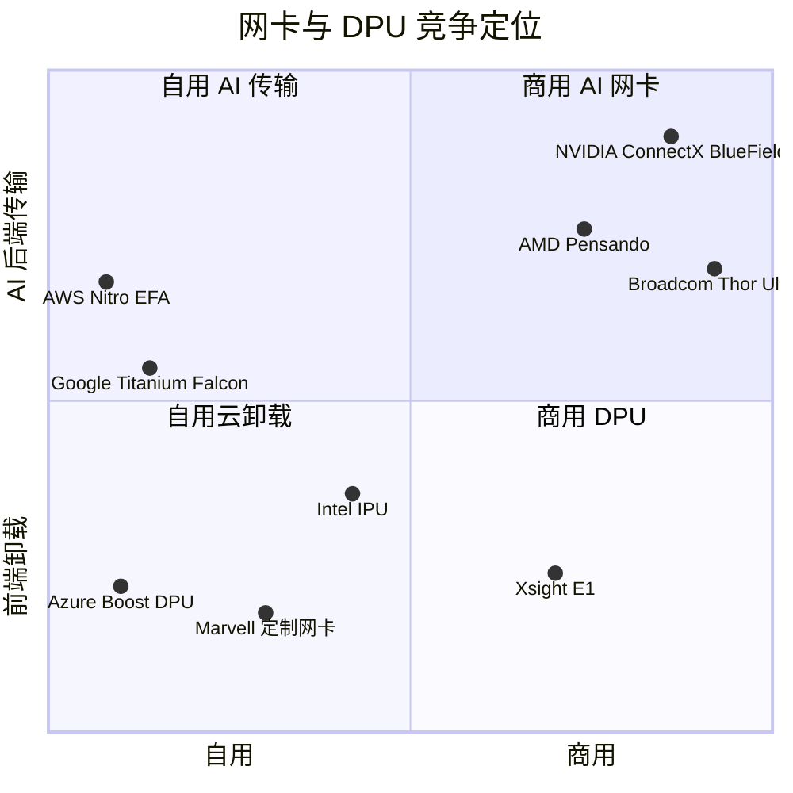

# DPU、SuperNIC、存储与安全：竞争
> [!NOTE]
> 本页为英文原文的简体中文参考译文，仅供参考；如有出入，以[英文原文](../../../layers/07-dpu-supernic-storage-security/competition.md "English original")为准。

第 07 层 · DPU、SuperNIC、存储与安全 · 阅读约 9 分钟 · 最后核实：2026-11-05

## ⚡ 要点速览

- **一个标签下其实是两个市场。**AI [后端网络](../../glossary.md#back-end-network)[网卡（NIC）](../../glossary.md#nic)（每颗 GPU 一块 [SuperNIC](../../glossary.md#supernic)）默认随英伟达机架出货；而负责卸载云网络、存储与安全的[数据处理器（DPU）](../../glossary.md#dpu)，则是最大买家选择自研的领域 [[S264]](../../../sources/bibliography.md#s264)[[S7503]](../../../sources/bibliography.md#s7503)[[S7504]](../../../sources/bibliography.md#s7504)。
- **在速度上英伟达领先一步：**ConnectX-9 随 Vera Rubin 以每颗 GPU 1.6 Tb/s 出货；博通（Broadcom）的 Thor Ultra 和 AMD 的 Vulcano 为 800 Gb/s [[S33004]](../../../sources/bibliography.md#s33004)[[S7529]](../../../sources/bibliography.md#s7529)[[S7500]](../../../sources/bibliography.md#s7500)。
- **每一步都被更快地复制：**竞争对手追平 400G 用了约 3 年，追平 800G 最多只用了 1 年，这得益于开放的[超以太网（Ultra Ethernet）](../../glossary.md#ultra-ethernet) 1.0 规范（2025 年 6 月）（见[路线图](roadmap.md)）[[S266]](../../../sources/bibliography.md#s266)[[S289]](../../../sources/bibliography.md#s289)[[S7528]](../../../sources/bibliography.md#s7528)。
- **AMD 用网卡数量换带宽：**Helios 为每颗 MI455X 配三块 800G Vulcano 网卡，即 2.4 Tb/s，而 Rubin 为 1.6 Tb/s [[S228]](../../../sources/bibliography.md#s228)[[S7500]](../../../sources/bibliography.md#s7500)。
- **[Q5 · 最强挑战者]** [超大规模云厂商](../../glossary.md#hyperscaler)的自研卸载方案，以 [AWS Nitro](../../glossary.md#aws-nitro) 为首：当前每一代 EC2 实例都运行在它之上，AWS 的 GPU 实例通过自有的 [EFA](../../glossary.md#efa)、而非 [ConnectX](../../glossary.md#connectx) 进行横向扩展 [[S7503]](../../../sources/bibliography.md#s7503)[[S292]](../../../sources/bibliography.md#s292)。微软（Microsoft，Azure Boost DPU）和谷歌（Google，Titanium、Falcon）沿用同一套打法 [[S7504]](../../../sources/bibliography.md#s7504)[[S7520]](../../../sources/bibliography.md#s7520)[[S7519]](../../../sources/bibliography.md#s7519)。
- **这块价值池增长迅速：**Dell'Oro 数据显示，SmartNIC 与 DPU 收入在 1Q 2025 同比增长 71%，在 2Q 2025 翻倍 [[S7522]](../../../sources/bibliography.md#s7522)[[S7523]](../../../sources/bibliography.md#s7523)。

## 网卡与 DPU 之争如何评分

在一座工厂里，SuperNIC 是 GPU 的**装卸码头**，DPU 则是核查访客、隔离租户的**前台**。码头比拼吞吐量；前台比拼可编程性与控制力。因此，竞争对手分为两类：商用网卡厂商（博通、AMD、Xsight Labs），以及拥有[自用芯片（captive silicon）](../../glossary.md#captive-silicon)的云运营商（AWS、微软、谷歌）。

| 竞争对手（最佳产品） | 单设备带宽 | 可编程性 | AI 传输特性 | 商用可得性 | 生态 / 软件 |
|---|---|---|---|---|---|
| AWS Nitro v6 + EFA | 🟥 每卡 400G，对比 1.6T | 🟦 AWS 专有固件 | 🟨 [SRD](../../glossary.md#srd) 多路径 | 🟦 不对外销售 | 🟦 覆盖全部 EC2 |
| AMD Pensando Vulcano / Salina | 🟥 800G（每 GPU 3 块） | 🟨 [P4](../../glossary.md#p4-language) 对 [DOCA](../../glossary.md#doca) | 🟨 支持 UEC 1.0 | 🟨 对外销售；Helios 默认配置 | 🟥 SDK 用户基础小 |
| Broadcom Thor Ultra | 🟥 800G | 🟥 固定功能 | 🟨 UEC 包裁剪（trimming）、多路径 | 🟩 适配任意 UEC 交换机 | 🟥 2025-10 起送样 |
| Intel IPU E2100（与谷歌合作） | 🟥 200G | 🟨 P4 + 16 个 Arm 核心 | 🟦 [Falcon](../../glossary.md#falcon-transport) 平台 | 🟥 基本只有一个客户 | 🟥 出售评估后该部门得以保留 |
| Microsoft Azure Boost DPU | 🟦 未披露 | 🟨 可编程 SoC | 🟦 侧重前端 | 🟦 不对外销售 | 🟦 仅限 Azure |
| Xsight Labs E1 | 🟨 800G = BlueField-4 | 🟨 Arm、SONiC-DASH | 🟥 侧重前端 | 🟨 商用 | 🟥 初创公司 |

评级 = 竞争对手对比英伟达最接近的同类产品（🟩 对手领先 · 🟨 持平 · 🟥 对手落后 · 🟦 路线不同）。规格来源：[[S7503]](../../../sources/bibliography.md#s7503)[[S7500]](../../../sources/bibliography.md#s7500)[[S228]](../../../sources/bibliography.md#s228)[[S7529]](../../../sources/bibliography.md#s7529)[[S291]](../../../sources/bibliography.md#s291)[[S7519]](../../../sources/bibliography.md#s7519)[[S7518]](../../../sources/bibliography.md#s7518)[[S7504]](../../../sources/bibliography.md#s7504)[[S7517]](../../../sources/bibliography.md#s7517)[[S512]](../../../sources/bibliography.md#s512)。

> [!TIP]
> **算例 —— 1.6 Tb/s 能为一个训练步带来什么。**假设每颗 GPU 必须跨机架对 2 GB 梯度做[全规约（all-reduce）](../../glossary.md#all-reduce)。环形全规约发送的数据量约为消息的 2×，即每颗 GPU 约 32 Gb：在 800 Gb/s 下约 40 ms，在 ConnectX-9 的 1.6 Tb/s 下约 20 ms，在 Helios 的 2.4 Tb/s 下约 13 ms [[S33004]](../../../sources/bibliography.md#s33004)[[S228]](../../../sources/bibliography.md#s228)。如果这部分流量无法被计算掩盖，在 500 ms 的训练步上节省 20 ms 就意味着有效 GPU 时间增加 4%，对于一个年成本 $1B 的集群约合每年 $40M（估计，本资料库 🔴）。

🔧 技术细节：“AI 传输特性”指什么

传统的 [RoCE](../../glossary.md#roce)（基于以太网的 [RDMA](../../glossary.md#rdma)）假设网络无损，一旦丢包就重传全部数据，因此一条拥塞链路就会拖停整个集合通信。[Spectrum-X](../../glossary.md#spectrum-x) 由交换机把数据包分散到多条路径、再由 SuperNIC 重新排序，因此两端都必须是英伟达的设备 [[S271]](../../../sources/bibliography.md#s271)。AWS 的 SRD 将数据包喷洒到多条路径上，并在 Nitro 硬件中完成丢包恢复 [[S292]](../../../sources/bibliography.md#s292)。超以太网 1.0 则把同样的理念（[数据包喷洒](../../glossary.md#packet-spraying)、包裁剪、乱序交付）标准化，供任何厂商使用 [[S7528]](../../../sources/bibliography.md#s7528)[[S7529]](../../../sources/bibliography.md#s7529)。悬而未决的问题是：谁能同时掌控线路的两端。

## 逐一审视挑战者

### AWS Nitro 与 EFA：最强挑战者

亚马逊于 2015 年以据报道约 $350–370M 收购 Annapurna Labs；完整的 Nitro System（卸载[虚拟机管理程序（hypervisor）](../../glossary.md#hypervisor)、网络、存储与安全）在 re:Invent 2017 上亮相 [[S4540]](../../../sources/bibliography.md#s4540)[[S7533]](../../../sources/bibliography.md#s7533)。AWS 目前列出的第六代 Nitro 每卡最高 400 Gb/s，并在近期的 GPU 实例上支持基于 EFA 的 RDMA [[S7503]](../../../sources/bibliography.md#s7503)。EFA 为 p5（8× H100）或 p6-b200（8× B200）实例提供 3.2 Tb/s，即每颗 GPU 400 Gb/s [[S292]](../../../sources/bibliography.md#s292)。

**最有力的论据：**谁掌控虚拟机管理程序，谁就掌控网卡；AWS 本来就需要在每台服务器中部署 Nitro，因此加上 RDMA 传输的边际成本很低。**已缩小的差距：**AWS 追平了 H100 时代每颗 GPU 400 Gb/s 的水平，但一块 Nitro v6 卡的带宽仅为 ConnectX-9 的四分之一，且不在 AWS 以外销售 [[S7503]](../../../sources/bibliography.md#s7503)[[S33004]](../../../sources/bibliography.md#s33004)。

> [!TIP]
> **算例 —— 英伟达在 AWS 放弃的网卡收入。**p5 每 8 颗 GPU 提供 3,200 Gb/s，与每颗 H100 配一块 ConnectX-7 时每颗 GPU 400 Gb/s 的水平相同 [[S292]](../../../sources/bibliography.md#s292)[[S266]](../../../sources/bibliography.md#s266)。每有 100,000 颗英伟达 GPU 部署在 EFA 之后，英伟达就少出货相应的 SuperNIC；按每块 400G 网卡假设 $1,000–2,000 计（估计，本资料库 🔴），即有 $100–200M 的网卡芯片收入留在了 Annapurna 手中。

### AMD Pensando

AMD 于 2022 年 5 月以约 $1.9B 收购 Pensando [[S7527]](../../../sources/bibliography.md#s7527)。其产品线涵盖支持 P4 编程的 Pollara 400（2025 年起出货）、Salina 400 DPU，以及作为 Helios 默认网络方案的 800G Vulcano；AMD 根据建模宣称作业完成时间最多可缩短 13% [[S289]](../../../sources/bibliography.md#s289)[[S7501]](../../../sources/bibliography.md#s7501)[[S7500]](../../../sources/bibliography.md#s7500)。**最有力的论据：**一个开放的超以太网机架，每颗 GPU 带宽更高，且不含任何英伟达网络产品。**差距：**单设备速度落后一档，且在 Helios 于 2026 年 Q3 末开始放量之前，装机基础很小 [[S90020]](../../../sources/bibliography.md#s90020)。

### Broadcom Thor Ultra

Thor Ultra（2025-10-14）是首款符合 UEC 规范的 800G 以太网网卡，发布即送样，并与 102.4 Tb/s 的 Tomahawk 6 交换机配套 [[S7529]](../../../sources/bibliography.md#s7529)[[S274]](../../../sources/bibliography.md#s274)。**最有力的论据：**定制加速器机架需要一块能与任意交换机配合的网卡；而 Spectrum-X 的最佳特性只在英伟达对英伟达时才能发挥。**差距：**800G 对 1.6T，没有 DPU，尚未形成规模出货。

### 英特尔、谷歌、微软、美满电子与 Xsight Labs

英特尔与谷歌联合开发的 200G IPU E2100 是谷歌 Falcon 传输协议的首个平台；谷歌的 Titanium 负责为其自有云提供卸载 [[S291]](../../../sources/bibliography.md#s291)[[S7519]](../../../sources/bibliography.md#s7519)[[S7520]](../../../sources/bibliography.md#s7520)。微软收购的 Fungible 演变成了 Azure Boost DPU [[S7504]](../../../sources/bibliography.md#s7504)。美满电子（Marvell）销售 OCTEON 10 DPU，并与 Meta 联合设计了 4×100G 的 FBNIC [[S7526]](../../../sources/bibliography.md#s7526)[[S7525]](../../../sources/bibliography.md#s7525)。Xsight Labs 销售 800G 的 E1 DPU，并于 2026 年 7 月以 $2.8B 估值融资逾 $300M [[S7517]](../../../sources/bibliography.md#s7517)。

交换机领域的竞争对手：[第 06 层竞争](../06-scale-out-scale-across-networking/competition.md)；所有层级：[竞争格局](../../cross-cutting/15-competitive-landscape/index.md)。

> [!NOTE]
> **🐂 看多观点。**每个 [NVL72](../../glossary.md#nvl72) 机架出货 72 块 SuperNIC，而 ConnectX-9 是唯一已量产的 1.6 Tb/s 网卡 [[S33004]](../../../sources/bibliography.md#s33004)[[S501]](../../../sources/bibliography.md#s501)。BlueField-4 则增加了在存储领域的立足点：十二家存储厂商基于其 STX 参考架构进行协同设计 [[S7511]](../../../sources/bibliography.md#s7511)。竞争对手会复制每一次速度跃升，但英伟达总能率先迈出下一步。

> [!WARNING]
> **🐻 看空观点。**最大的买家拥有自己的网卡：Nitro 与 EFA、Azure Boost、Titanium 与 Falcon [[S7503]](../../../sources/bibliography.md#s7503)[[S7504]](../../../sources/bibliography.md#s7504)[[S7520]](../../../sources/bibliography.md#s7520)。超以太网将 AI 网卡变成一种标准部件，博通和 AMD 可将其销往搭配任意交换机的系统 [[S7528]](../../../sources/bibliography.md#s7528)[[S7529]](../../../sources/bibliography.md#s7529)。如果机架不再属于英伟达，网卡也就不再属于它。

## 🎯 企业发展视角

1. 如果超以太网将 AI 传输标准化，网卡的价值是否会转移到掌控机架设计的一方（英伟达、AMD、超大规模云厂商），而不是拥有最佳网卡芯片的一方？
2. Nitro、Azure Boost 和 Titanium 都建立在收购来的团队之上；还剩下哪些独立的 DPU 或网卡团队（Xsight Labs 是其中之一），又有谁会需要它们？
3. AMD 每颗 GPU 配三块网卡，是以网卡成本换带宽：这是否会形成一个定制加速器机架必须对标的每 GPU 带宽标准？
4. 对于新进入的加速器厂商（包括高通（Qualcomm）的 AI200 和 AI250 [[S90028]](../../../sources/bibliography.md#s90028)），与商用 UEC 网卡厂商合作是否足够，还是说网卡是一个值得自己掌控的控制点？

## 📚 来源（Sources）

<!-- Auto-generated from the [S…] citations on this page by `make build`. Edit sources/registry/*.csv, not this list. -->

- [**S228**](../../../sources/bibliography.md#s228) Spheron, *AMD Helios rack-scale AI on GPU cloud: deploy MI455X inference with UALink and Ultra Ethernet (2026 guide)*, 2026. [Link](https://www.spheron.network/blog/amd-helios-rack-scale-mi455x-gpu-cloud/)
- [**S264**](../../../sources/bibliography.md#s264) NVIDIA Newsroom, *NVIDIA Announces New Switches Optimized for Trillion-Parameter GPU Computing and AI Infrastructure (Quantum-X800, Spectrum-X800, ConnectX-8)*, 2024-03-18. [Link](https://nvidianews.nvidia.com/news/networking-switches-gpu-computing-ai)
- [**S266**](../../../sources/bibliography.md#s266) NVIDIA Newsroom, *NVIDIA Quantum-2 Takes Supercomputing to New Heights, Into the Cloud*, 2021-11-09. [Link](https://nvidianews.nvidia.com/news/nvidia-quantum-2-takes-supercomputing-to-new-heights-into-the-cloud)
- [**S271**](../../../sources/bibliography.md#s271) NVIDIA Newsroom, *NVIDIA Launches Accelerated Ethernet Platform for Hyperscale Generative AI (Spectrum-X)*, 2023-05-29. [Link](https://nvidianews.nvidia.com/news/nvidia-launches-accelerated-ethernet-platform-for-hyperscale-generative-ai)
- [**S274**](../../../sources/bibliography.md#s274) Broadcom, *Broadcom ships Tomahawk 6: world's first 102.4 Tbps switch*, 2025-06-03. [Link](https://investors.broadcom.com/news-releases/news-release-details/broadcom-ships-tomahawk-6-worlds-first-1024-tbps-switch)
- [**S289**](../../../sources/bibliography.md#s289) AMD, *AMD Advancing AI 2024: Pensando Pollara 400 AI NIC and Salina DPU*, 2024-10-10. [Link](https://www.amd.com/en/newsroom.html)
- [**S291**](../../../sources/bibliography.md#s291) Intel, *Intel Infrastructure Processing Unit (IPU) E2100 (Mount Evans)*, 2022. [Link](https://www.intel.com/content/www/us/en/products/details/network-io/ipu.html)
- [**S292**](../../../sources/bibliography.md#s292) Amazon Web Services, *Elastic Fabric Adapter (EFA) and AWS Nitro System documentation*, 2025. [Link](https://aws.amazon.com/hpc/efa/)
- [**S501**](../../../sources/bibliography.md#s501) eWeek, *Everything Nvidia Just Announced at GTC 2026: 7 Chips, 5 Racks, 1 Giant Bet on Agentic AI*, 2026-03-17. [Link](https://www.eweek.com/news/nvidia-gtc-2026-ai-inference-vera-rubin-neuron/)
- [**S512**](../../../sources/bibliography.md#s512) NVIDIA Blog, *NVIDIA Launches BlueField-4: The Processor Powering the Operating System of AI Factories*, 2025-10-28. [Link](https://blogs.nvidia.com/blog/bluefield-4-ai-factory/)
- [**S4540**](../../../sources/bibliography.md#s4540) Global Venturing, *Arm exits Annapurna Labs in $370m acquisition*, 2015-01-23. [Link](https://globalventuring.com/blog/2015/01/23/arm-exits-annapurna-labs-in-370m-acquisition/)
- [**S7500**](../../../sources/bibliography.md#s7500) AMD, *AMD Pensando Vulcano 800 AI NIC: Built to Scale-Out and Across*, 2026. [Link](https://www.amd.com/en/blogs/2026/amd-pensando-vulcano-800-ai-nic-scale-out-and-across.html)
- [**S7501**](../../../sources/bibliography.md#s7501) ServeTheHome, *AMD Vulcano 800G NIC coming as AMD outlines its UALink and UEC scale plans*, 2025-06. [Link](https://www.servethehome.com/amd-vulcano-800g-nic-coming-as-amd-outlines-its-ualink-and-uec-scale-plans/)
- [**S7503**](../../../sources/bibliography.md#s7503) Amazon Web Services, *Instances built on the AWS Nitro System (Amazon EC2 documentation)*, 2026. [Link](https://docs.aws.amazon.com/ec2/latest/instancetypes/ec2-nitro-instances.html)
- [**S7504**](../../../sources/bibliography.md#s7504) Blocks & Files, *Microsoft boosts Azure infrastructure with Fungible-derived DPU*, 2024-11-20. [Link](https://blocksandfiles.com/2024/11/20/microsoft-boosts-azure-infrastructure-with-fungible-derived-dpu/)
- [**S7511**](../../../sources/bibliography.md#s7511) NVIDIA Newsroom, *NVIDIA Launches BlueField-4 STX Storage Architecture With Broad Industry Adoption*, 2026-03-16. [Link](https://nvidianews.nvidia.com/news/nvidia-launches-bluefield-4-stx-storage-architecture-with-broad-industry-adoption)
- [**S7517**](../../../sources/bibliography.md#s7517) StorageNewsletter, *Xsight Labs raises more than $300 million at $2.8 billion valuation to power next-generation AI and cloud networks*, 2026-08-06. [Link](https://www.storagenewsletter.com/2026/08/06/fms-2026-xsight-labs-raises-more-than-300-million-at-2-8-billion-valuation-to-power-next-generation-ai-and-cloud-networks/)
- [**S7518**](../../../sources/bibliography.md#s7518) Bloomberg, *Intel shelves plans to sell networking division after review*, 2025-12-03. [Link](https://www.bloomberg.com/news/articles/2025-12-03/intel-performed-strategic-review-of-networking-division)
- [**S7519**](../../../sources/bibliography.md#s7519) Converge Digest, *OCP Summit: Google opens Falcon for hardware transport*, 2023-10. [Link](https://convergedigest.com/ocp-summit-google-opens-falcon-for-hardware-transport/)
- [**S7520**](../../../sources/bibliography.md#s7520) Google Cloud, *Titanium (Google Cloud product page)*, 2024. [Link](https://cloud.google.com/titanium)
- [**S7522**](../../../sources/bibliography.md#s7522) Converge Digest, *Dell'Oro: surging demand for AI infrastructure (data center components, 1Q 2025)*, 2025-06. [Link](https://convergedigest.com/delloro-surging-demand-for-ai-infrastructure/)
- [**S7523**](../../../sources/bibliography.md#s7523) DQIndia, *Data center semiconductors and components up 44% on AI hardware demand in 2Q-2025 (Dell'Oro)*, 2025-09. [Link](https://www.dqindia.com/esdm/data-center-semiconductors-and-components-up-44-on-ai-hardware-demand-in-2q-2025-10519731)
- [**S7525**](../../../sources/bibliography.md#s7525) Marvell, *Marvell delivers custom Ethernet network interface controller solution at OCP*, 2024-10. [Link](https://www.marvell.com/company/newsroom/marvell-delivers-custom-ethernet-network-interface-controller-solution-at-ocp.html)
- [**S7526**](../../../sources/bibliography.md#s7526) Marvell, *Marvell extends OCTEON leadership with industry's first 5nm DPUs*, 2021. [Link](https://cn.marvell.com/company/newsroom/marvell-extends-octeon-leadership-industry-first-5nm-dpu.html)
- [**S7527**](../../../sources/bibliography.md#s7527) AMD Investor Relations, *AMD expands data center solutions capabilities with acquisition of Pensando*, 2022-05-26. [Link](https://ir.amd.com/news-events/press-releases/detail/1071/amd-expands-data-center-solutions-capabilities-with)
- [**S7528**](../../../sources/bibliography.md#s7528) Converge Digest, *Ultra Ethernet Consortium releases Specification 1.0*, 2025-06. [Link](https://convergedigest.com/ultra-ethernet-consortium-releases-specification-1-0/)
- [**S7529**](../../../sources/bibliography.md#s7529) StreetInsider (Broadcom press release), *Broadcom introduces industry's first 800G AI Ethernet NIC (Thor Ultra)*, 2025-10-14. [Link](https://www.streetinsider.com/Press+Releases/Broadcom+Introduces+Industry%E2%80%99s+First+800G+AI+Ethernet+NIC/25451603.html)
- [**S7533**](../../../sources/bibliography.md#s7533) hidekazu-konishi.com (Hidekazu Konishi), *AWS custom silicon history and timeline: Nitro System, Graviton, Inferentia, Trainium*, 2025. [Link](https://hidekazu-konishi.com/entry/aws_history_and_timeline_aws_silicon.html)
- [**S33004**](../../../sources/bibliography.md#s33004) NVIDIA Newsroom, *NVIDIA Kicks Off the Next Generation of AI With Rubin — Six New Chips; One Incredible AI Supercomputer*, 2026-01-05. [Link](https://nvidianews.nvidia.com/news/rubin-platform-ai-supercomputer)
- [**S90020**](../../../sources/bibliography.md#s90020) Shacknews, *AMD Helios AI rack system on track for initial shipments in Q3 2026*, 2026. [Link](https://www.shacknews.com/article/150249/amd-helios-ai-system-shipping-q3-2026)
- [**S90028**](../../../sources/bibliography.md#s90028) TechRepublic, *Qualcomm unveils AI chips to rival Nvidia, AMD*, 2025-10-27. [Link](https://techrepublic.com/article/news-qualcomm-unveils-ai-chips-to-rival-nvidia-amd)
