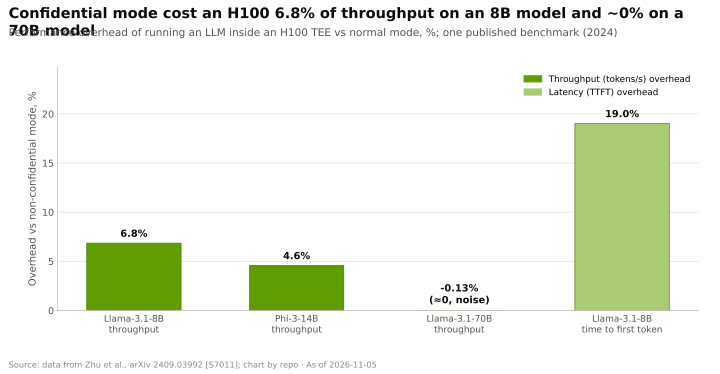
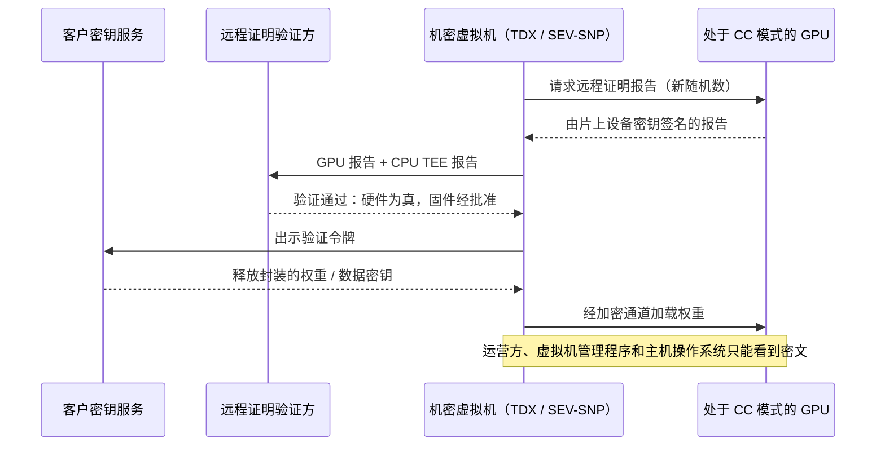

# GPU 上的机密计算
> [!NOTE]
> 本页为英文原文的简体中文参考译文，仅供参考；如有出入，以[英文原文](../../../layers/07-dpu-supernic-storage-security/confidential-computing.md "English original")为准。

第 07 层 · DPU、SuperNIC、存储与安全 · 阅读约 8 分钟 · 最后核实：2026-11-05

## ⚡ 要点速览

- **[机密计算](../../../glossary.md#confidential-computing)保护的是使用中的数据。**权重、提示词和 KV 缓存始终位于一个[可信执行环境（TEE）](../../../glossary.md#trusted-execution-environment)内，云运营方、虚拟机管理程序（hypervisor）和主机操作系统都无法读取；客户在发送机密数据之前通过[远程证明（attestation）](../../../glossary.md#attestation)来验证这一点。
- **英伟达在 GPU 上率先行动：**H100 是首款支持机密计算的 GPU，以片上[硬件信任根](../../../glossary.md#root-of-trust)为锚点；Blackwell 增加了 TEE-I/O 和在线 [NVLink](../../../glossary.md#nvlink) 保护；Vera Rubin [NVL72](../../../glossary.md#nvl72) 将其扩展到整个机架 [[S7012]](../../../sources/bibliography.md#s7012)[[S301]](../../../sources/bibliography.md#s301)[[S7028]](../../../sources/bibliography.md#s7028)。
- **对大模型而言，实测成本很小：**在 H100 上，机密模式使 Llama-3.1-8B 的吞吐量下降 6.85%、Phi-3-14B 下降 4.58%、Llama-3.1-70B 约 0%，但使 8B 模型的首 token 时间增加 19% [[S7011]](../../../sources/bibliography.md#s7011)。
- **Blackwell“几乎相同”的吞吐量是厂商说法**；本资料库未找到任何关于 Blackwell 或 Rubin 机密模式的独立基准测试 🔴 [[S7012]](../../../sources/bibliography.md#s7012)。
- **公有云已提供该能力：**Azure 的机密 H100 虚拟机于 2024 年 9 月正式商用（GA）[[S7013]](../../../sources/bibliography.md#s7013)；谷歌（Google）的 A3 H100 机密虚拟机将 GPU 与 Intel TDX 配对 [[S7016]](../../../sources/bibliography.md#s7016)。
- **弱点：**GPU TEE 依赖 CPU TEE（Intel [TDX](../../../glossary.md#intel-tdx)、AMD [SEV-SNP](../../../glossary.md#sev-snp)），而 AMD 和英特尔 CPU 即将支持的 PCIe 标准 [TDISP](../../../glossary.md#tdisp) 设备模型，可能使英伟达的先发优势商品化 [[S7014]](../../../sources/bibliography.md#s7014)[[S7015]](../../../sources/bibliography.md#s7015)。

## 1. GPU 可信执行环境如何工作

不妨想象租用大楼里的一个银行金库：房东打不开它，审计师的封条则证明它货真价实。一套机密 GPU 部署由四部分组成：

1. **CPU 上的机密虚拟机。**Intel TDX 或 AMD SEV-SNP 对虚拟机内存加密，并阻止虚拟机管理程序访问 [[S7014]](../../../sources/bibliography.md#s7014)[[S7016]](../../../sources/bibliography.md#s7016)。
2. **处于机密模式的 GPU。**固件锁定 GPU，使主机无法读取其显存；身份密钥保存在片上信任根中 [[S7012]](../../../sources/bibliography.md#s7012)。
3. **受保护的链路。**在 H100 上，穿越 [PCIe](../../../glossary.md#pcie) 的数据由驱动程序加密、由 GPU 解密，这是开销的主要来源 [[S7011]](../../../sources/bibliography.md#s7011)。Blackwell 的 TEE-I/O 则在硬件中对该链路和 NVLink 进行在线保护 [[S7012]](../../../sources/bibliography.md#s7012)。
4. **远程证明。**GPU 对其固件和模式签发一份报告；在密钥服务释放权重或数据之前，由客户的验证方对报告进行核验。

> [!TIP]
> **算例 —— 开销对一个 1,000 颗 GPU 的服务意味着多少成本。**1,000 颗 H100 按每小时 $2.99 计，每年成本约 **$26.2M** [[S395]](../../../sources/bibliography.md#s395)。对于 8B 级模型，6.85% 的吞吐量损失 [[S7011]](../../../sources/bibliography.md#s7011) 意味着需要多约 7.4% 的容量，**每年约 $1.9M**；对于 70B 模型，实测损失约为 0%。8B 模型的首 token 时间从 24.2 ms 升至 28.8 ms [[S7011]](../../../sources/bibliography.md#s7011)。**结论：**对于大模型，这点开销在正常的价格谈判范围之内；它真正造成影响的是小型、对延迟敏感的模型，因为数据传输在其工作量中占比更高。

🔧 技术细节：为什么开销随模型规模增大而缩小

- **成本所在：**在 H100 上，开销来自 CPU–GPU 传输的加密；GPU 内部的计算全速运行 [[S7011]](../../../sources/bibliography.md#s7011)。
- **每字节计算量：**在传输量相近的情况下，70B 模型每个 token 的计算量约为 8B 模型的 9×，因此固定成本被摊薄。
- **TEE-I/O（Blackwell）：**在链路硬件内部完成加密，省去了软件中转缓冲步骤，这正是英伟达宣称吞吐量接近原生水平的原因 [[S7012]](../../../sources/bibliography.md#s7012)；尚待独立验证。

## 2. 为什么重要：主权 AI、受监管数据，以及部署在他人云中的权重

- **主权 AI 项目**需要证明外国运营方或芯片厂商的固件无法看到本国数据；远程证明把“请相信我们”变成了一项由客户自己执行的核验。
- **受监管行业**（医疗、金融、公共部门）只要使用中的数据受到保护，就可以使用共享 GPU 云。
- **模型所有者**越来越多地将前沿模型权重部署在自己无法控制的数据中心：[新兴云服务商（neocloud）](../../../glossary.md#neocloud)、主权站点、企业自有机房。加密的权重只会在通过远程证明的 GPU 内部解密。

> [!TIP]
> **算例 —— 被保护的是什么。**Meta 报告训练 Llama 3.1 405B 用了 30.84M H100 GPU 小时 [[S31002]](../../../sources/bibliography.md#s31002)。按每 [GPU 小时](../../../glossary.md#gpu-hour) $2–3 计，一套权重凝结了 **约 $62–92M 的算力**（估计），这还未计入数据、人力和后训练。在 H100 上保护它的代价是推理服务吞吐量的 0–7% [[S7011]](../../../sources/bibliography.md#s7011)。**结论：**对于向第三方站点授权模型权重的实验室而言，机密计算是一份廉价的保险，这也是英伟达将 Vera Rubin NVL72 作为机架级机密计算平台来推广的原因 [[S7012]](../../../sources/bibliography.md#s7012)[[S7028]](../../../sources/bibliography.md#s7028)。

## 3. AMD、英特尔和 Arm 在平台层面的比较

机密 AI 需要一个 CPU TEE、一个加速器 TEE，以及两者之间和加速器之间受保护的链路。英伟达在加速器一侧领先；CPU 厂商掌控 CPU 一侧，并正在通过 PCI-SIG 的 TDISP 对设备链路进行标准化。

| 能力 | 英伟达 | AMD | 英特尔 | Arm 生态 |
|---|---|---|---|---|
| CPU 机密虚拟机 | 🟨 Vera Rubin NVL72 宣称覆盖从 CPU 到 NVLink 的路径 [[S301]](../../../sources/bibliography.md#s301)[[S7028]](../../../sources/bibliography.md#s7028) | 🟩 EPYC 上的 SEV-SNP [[S7014]](../../../sources/bibliography.md#s7014) | 🟩 TDX；用于谷歌的 H100 机密虚拟机 [[S7016]](../../../sources/bibliography.md#s7016) | 🟦 [Arm CCA](../../../glossary.md#arm-cca) Realms；未发现搭配 GPU 的云服务 🔴 |
| 加速器 TEE | 🟩 自 H100（2022）起 [[S7012]](../../../sources/bibliography.md#s7012) | 🟥 未发现公开的 Instinct GPU TEE 🔴 | 🟥 未发现 Gaudi 相关方案 🔴 | 🟦 取决于加速器厂商 |
| 设备链路（TDISP / TEE-I/O） | 🟩 Blackwell TEE-I/O [[S7012]](../../../sources/bibliography.md#s7012) | 🟨 EPYC 9005 列出 SEV-TIO；已有面向 Venice 及 PCIe 6.0 的 Linux 补丁 [[S7014]](../../../sources/bibliography.md#s7014)[[S7015]](../../../sources/bibliography.md#s7015) | 🟨 TDX Connect 是英特尔的对应方案；状态未确认 🔴 | 🟦 未发现 |
| 纵向扩展链路加密 | 🟩 在线 NVLink 保护，Rubin 上达到机架级 [[S7012]](../../../sources/bibliography.md#s7012)[[S301]](../../../sources/bibliography.md#s301) | 🟥 未发现 Infinity Fabric 或 UALink 的相关方案 🔴 | 不适用 | 不适用 |

> [!TIP]
> **算例 —— 为什么 NVLink 加密才是真正的突破口。**[FP8](../../../glossary.md#fp8) 格式的 Llama 3.1 405B 仅权重就需要约 405 GB [[S32008]](../../../sources/bibliography.md#s32008)：至少需要 **6 颗 H100**（每颗 80 GB）或 **2 颗 Rubin GPU**（每颗 288 GB）[[S100]](../../../sources/bibliography.md#s100)，这还未计入任何 [KV 缓存](../../../glossary.md#kv-cache)；一个万亿参数的 FP8 模型至少需要 **4 颗 Rubin GPU**。前沿规模的机密推理必然是多 GPU 的，而这些 GPU 之间通过 NVLink 通信，英伟达从 Blackwell 起对其进行在线保护 [[S7012]](../../../sources/bibliography.md#s7012)。**结论：**让前沿模型的机密推理服务变得可行的，是受保护的[纵向扩展（scale-up）](../../../glossary.md#scale-up)链路，而非单 GPU TEE，且目前尚无竞争对手公开达到同等水平（🔴 本资料库截至 2026-11-05 的判断）。

> [!NOTE]
> **🐂 看多观点。**英伟达拥有唯一已出货、且具备受保护纵向扩展链路的 GPU TEE [[S7012]](../../../sources/bibliography.md#s7012)；要求远程证明的主权客户和受监管客户最终会选择英伟达机架，而且该功能对大模型的成本很低 [[S7011]](../../../sources/bibliography.md#s7011)。

> [!WARNING]
> **🐻 看空观点。**客户最看重的信任锚是 CPU TEE 和远程证明服务，而它们由英特尔、AMD 或云厂商掌控。随着 TDISP 设备信任机制落地 EPYC 和 Xeon 平台 [[S7014]](../../../sources/bibliography.md#s7014)[[S7015]](../../../sources/bibliography.md#s7015)，加速器厂商可以直接接入标准的机密虚拟机，英伟达的领先优势将缩小为单纯的工程先发优势。

## 🎯 企业发展视角

1. **远程证明服务是一个控制点。**无论由谁（英伟达、CPU 厂商、云厂商或第三方）核验硬件报告，它都处于每一次机密部署的必经路径上。是否存在一项可以自建或收购的独立验证方业务？
2. **机密计算对主权交易的决定作用可能超过基准测试**；在这一领域具备卡位优势的厂商见[价值链](value-chain-and-corp-dev.md)。
3. **标准可能拉平竞争格局。**基于 TDISP 的设备信任机制 [[S7015]](../../../sources/bibliography.md#s7015) 让任何加速器都能加入 CPU 的机密虚拟机；谁会打造下一个具备受保护纵向扩展链路的加速器 TEE（见[竞争](competition.md)）？
4. **高通（Qualcomm）的问题（仅基于公开信息）：**AI200/AI250 瞄准主权和企业推理市场，包括 HUMAIN 计划中的 200 MW 部署 [[S173]](../../../sources/bibliography.md#s173)[[S90030]](../../../sources/bibliography.md#s90030)。这类买家会期待怎样的远程证明方案：主机 CPU 的 TEE、加速器侧的 TEE，还是两者兼有？

## 📚 来源（Sources）

<!-- Auto-generated from the [S…] citations on this page by `make build`. Edit sources/registry/*.csv, not this list. -->

- [**S100**](../../../sources/bibliography.md#s100) NVIDIA Technical Blog, *Inside the NVIDIA Vera Rubin Platform: Six New Chips, One AI Supercomputer*, 2026-01-05. [Link](https://developer.nvidia.com/blog/inside-the-nvidia-rubin-platform-six-new-chips-one-ai-supercomputer/)
- [**S173**](../../../sources/bibliography.md#s173) Qualcomm, *Qualcomm Unveils AI200 and AI250 - Redefining Rack-Scale Data Center Inference*, 2025-10-27. [Link](https://www.qualcomm.com/news/releases/2025/10/qualcomm-unveils-ai200-and-ai250-redefining-rack-scale-data-cent)
- [**S301**](../../../sources/bibliography.md#s301) StorageReview, *NVIDIA launches Vera Rubin architecture at CES 2026: the VR NVL72 rack*, 2026-01. [Link](https://www.storagereview.com/news/nvidia-launches-vera-rubin-architecture-at-ces-2026-the-vr-nvl72-rack)
- [**S395**](../../../sources/bibliography.md#s395) Lambda, *Lambda GPU cloud pricing*, 2025. [Link](https://lambda.ai/pricing)
- [**S7011**](../../../sources/bibliography.md#s7011) arXiv:2409.03992 (Jianwei Zhu et al. (Phala Network)), *Confidential Computing on NVIDIA Hopper GPUs: A Performance Benchmark Study*, 2024-09. [Link](https://arxiv.org/abs/2409.03992)
- [**S7012**](../../../sources/bibliography.md#s7012) NVIDIA, *NVIDIA Confidential Computing (solutions page)*, 2026. [Link](https://www.nvidia.com/en-us/data-center/solutions/confidential-computing/)
- [**S7013**](../../../sources/bibliography.md#s7013) Microsoft Tech Community, *General availability: Azure confidential VMs with NVIDIA H100 Tensor Core GPUs*, 2024-09-24. [Link](https://techcommunity.microsoft.com/t5/azure-confidential-computing/general-availability-azure-confidential-vms-with-nvidia-h100/ba-p/4242644)
- [**S7014**](../../../sources/bibliography.md#s7014) AMD, *AMD Secure Encrypted Virtualization (SEV) developer page*, 2026. [Link](https://www.amd.com/en/developer/sev.html)
- [**S7015**](../../../sources/bibliography.md#s7015) Phoronix (Michael Larabel), *AMD sends out Linux patches for enabling SEV-TIO TDISP with PCIe 6.0*, 2026-09. [Link](https://phoronix.com/news/AMD-SEV-TIO-TDISP-Linux-Patches)
- [**S7016**](../../../sources/bibliography.md#s7016) GPU Smith, *Confidential GPU attestation deployment matrix*, 2026-09-24. [Link](https://gpusmith.com/articles/en/pdfs/confidential-gpu-attestation-deployment-matrix.pdf)
- [**S7028**](../../../sources/bibliography.md#s7028) VentureBeat, *Nvidia Rubin brings rack-scale encryption to enterprise AI security*, 2026-01. [Link](https://venturebeat.com/security/nvidia-rubin-rack-scale-encryption-enterprise-ai-security)
- [**S31002**](../../../sources/bibliography.md#s31002) Meta (GitHub meta-llama/llama-models), *Llama 3.1 model card (MODEL_CARD.md)*, 2024-07-23. [Link](https://github.com/meta-llama/llama-models/blob/main/models/llama3_1/MODEL_CARD.md)
- [**S32008**](../../../sources/bibliography.md#s32008) Meta via Hugging Face, *Llama 3.1 405B configuration (config.json)*, 2024-07-23. [Link](https://huggingface.co/meta-llama/Llama-3.1-405B/blob/main/config.json)
- [**S90030**](../../../sources/bibliography.md#s90030) Morningstar, *Qualcomm: Humain deal provides some AI upside*, 2025-10. [Link](https://www.morningstar.com/stocks/qualcomm-humain-deal-provides-some-ai-upside)
