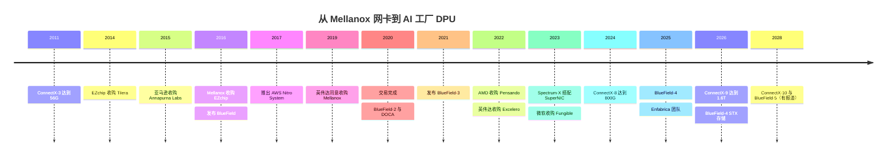
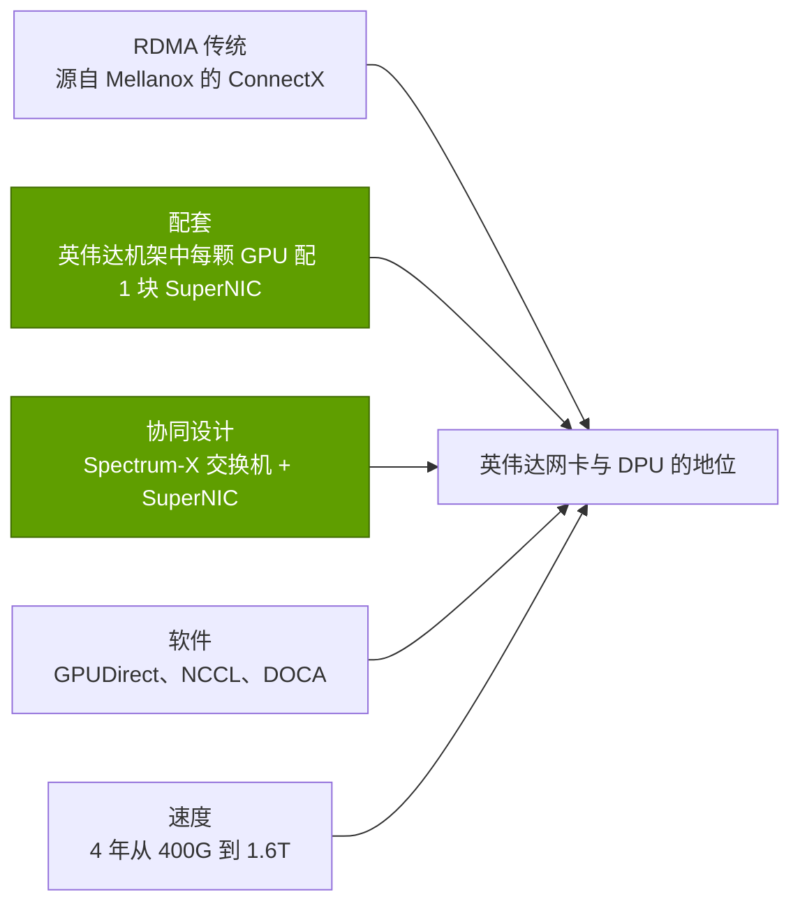

# DPU、SuperNIC、存储与安全：发展历程与英伟达的构建之路
> [!NOTE]
> 本页为英文原文的简体中文参考译文，仅供参考；如有出入，以[英文原文](../../../layers/07-dpu-supernic-storage-security/history-and-how-built.md "English original")为准。

第 07 层 · DPU、SuperNIC、存储与安全 · 阅读约 9 分钟 · 最后核实：2026-11-05

## ⚡ 要点速览

- **英伟达先买下了这一层，然后让它加速。**[ConnectX](../../../glossary.md#connectx) 随 Mellanox 收购而来（$6.9B，2019-03-11 宣布，2020-04-27 完成）；单端口速率从 56 Gb/s（ConnectX-3，2011）提升至 1.6 Tb/s（ConnectX-9，2026）[[S464]](../../../sources/bibliography.md#s464)[[S273]](../../../sources/bibliography.md#s273)[[S33004]](../../../sources/bibliography.md#s33004)。
- **[数据处理器（DPU）](../../../glossary.md#dpu)同样是买来的：**EZchip 收购了 Tilera（2014，最高 $130M），Mellanox 收购了 EZchip（$811M，2016），并在数月后发布了 [BlueField](../../../glossary.md#bluefield) [[S7510]](../../../sources/bibliography.md#s7510)[[S7507]](../../../sources/bibliography.md#s7507)[[S7509]](../../../sources/bibliography.md#s7509)。
- **交易完成后不到六个月，英伟达就推出了 BlueField-2 和 [DOCA](../../../glossary.md#doca) 软件套件**（2020-10-05）[[S270]](../../../sources/bibliography.md#s270)。
- **2023 年，[网卡（NIC）](../../../glossary.md#nic)被重新定位为 GPU 的组成部分：**[Spectrum-X](../../../glossary.md#spectrum-x) 将 Spectrum-4 交换机与 BlueField-3 [SuperNIC](../../../glossary.md#supernic) 配套 [[S271]](../../../sources/bibliography.md#s271)；BlueField-4（2025 年 10 月）将一颗 64 核 Grace 与 ConnectX-9 融为一体，并把 DPU 的方向指向存储 [[S272]](../../../sources/bibliography.md#s272)[[S512]](../../../sources/bibliography.md#s512)[[S7511]](../../../sources/bibliography.md#s7511)。
- **回报：**网络业务在 Q2 FY2027 创下约 $17.5B 的纪录，一个季度的收入就约为 Mellanox 收购价的 2.5× [[S90012]](../../../sources/bibliography.md#s90012)[[S464]](../../../sources/bibliography.md#s464)。
- **[Q4]** 优势更多来自配套与协同设计（在英伟达机架中每颗 GPU 配一块网卡，并与其交换机和软件库联合调优），而非网卡芯片本身——竞争对手如今一年内就能复制后者。
- **[Q6]** 估计 🔴：一块商用 800G AI 网卡约需 3–4 年、约 $0.5–1B；一项 DPU 业务需 5–7 年、约 $1.5–3B；而像 Mellanox 这样的业务已无法再买到第二次。

## 从 RDMA 网卡到 AI 工厂的“前台”

Mellanox 销售的是 [RDMA](../../../glossary.md#rdma) 网卡：服务器之间可以直接写入彼此的内存，到 ConnectX-4（2014，100G）时还能直接写入 GPU 显存（GPUDirect RDMA）[[S273]](../../../sources/bibliography.md#s273)。为了加入通用核心，Mellanox 收购了拥有 Tilera 的 EZchip；第一代 BlueField 将 ConnectX 与一组 Arm A72 核心结合在一起 [[S7510]](../../../sources/bibliography.md#s7510)[[S7507]](../../../sources/bibliography.md#s7507)[[S7509]](../../../sources/bibliography.md#s7509)。

| 日期 | 决策 | 意义 | 来源 |
|---|---|---|---|
| 2016-02-23 | Mellanox 完成对 EZchip 的收购（$811M） | 买下了 BlueField 背后的核心 | [[S7507]](../../../sources/bibliography.md#s7507) |
| 2019-03-11 | 英伟达同意收购 Mellanox（$6.9B） | 将 ConnectX、BlueField 和 InfiniBand 收归旗下 | [[S464]](../../../sources/bibliography.md#s464) |
| 2020-10-05 | BlueField-2 与 DOCA | 一款配备 SDK 的 DPU，即 DPU 的“CUDA” | [[S270]](../../../sources/bibliography.md#s270) |
| 2023-05-29 | Spectrum-X 搭配 BlueField-3 SuperNIC | 网卡作为 AI 以太网网络的组成部分出售 | [[S271]](../../../sources/bibliography.md#s271) |
| 2025-10-28 | BlueField-4：Grace + ConnectX-9，800G | DPU 成为存储与 KV 缓存引擎 | [[S512]](../../../sources/bibliography.md#s512)[[S7530]](../../../sources/bibliography.md#s7530) |
| 2026-03-16 | BlueField-4 STX 参考架构 | 十二家存储厂商基于其协同设计 | [[S7511]](../../../sources/bibliography.md#s7511) |

> [!TIP]
> **算例 —— 收购之后的提速。**在 Mellanox 时期，ConnectX 从 56G（2011）提升至 200G（ConnectX-6，2017）：六年约 3.6× [[S273]](../../../sources/bibliography.md#s273)。在英伟达旗下，它从 400G（ConnectX-7，2022）提升至 1.6T（ConnectX-9，2026）：四年 4× [[S266]](../../../sources/bibliography.md#s266)[[S33004]](../../../sources/bibliography.md#s33004)。一旦网卡搭上 GPU 的年度路线图，翻倍周期就从约 3.3 年缩短到约 2 年。

网络业务包括 NVLink、InfiniBand 和 Spectrum-X 交换机，以及 ConnectX 和 BlueField；英伟达不单独披露网卡或 DPU 收入。见[第 06 层发展历程](../../../layers/06-scale-out-scale-across-networking/history-and-how-built.md)。

## [Q4 · 优势来源] 芯片、配套还是软件？

**答案：**首先是配套与协同设计，其次才是速度。网卡芯片本身并不是护城河：博通在 ConnectX-8 出货当年就送样了 800G 网卡，AMD 则在一年后出货 [[S7529]](../../../sources/bibliography.md#s7529)[[S7500]](../../../sources/bibliography.md#s7500)。竞争对手无法复制的是机架：英伟达在 [HGX](../../../glossary.md#hgx) 和 [NVL72](../../../glossary.md#nvl72) 中规定每颗 GPU 配一块 ConnectX，围绕它调优自己的软件库和交换机，并让 Spectrum-X 的自适应路由依赖 SuperNIC 对数据包重新排序 [[S266]](../../../sources/bibliography.md#s266)[[S264]](../../../sources/bibliography.md#s264)[[S271]](../../../sources/bibliography.md#s271)。在英伟达不设计服务器的地方，网卡就落入了自研芯片之手（见[竞争](competition.md)）。

> [!TIP]
> **算例 —— 配套把 GPU 转化为网卡出货量。**一个 Vera Rubin NVL72 搭载 72 颗 GPU，因此配有 72 块 ConnectX-9 SuperNIC [[S33004]](../../../sources/bibliography.md#s33004)。每 1,000 个机架即 72,000 块网卡；按每块假设 $2,500–4,500 计（估计，本资料库 🔴），就是 $180–324M 的网卡芯片收入，没有任何商用厂商有机会参与竞标。

## [Q6 · 复制成本] 时间、资金与人才

亚马逊的 Annapurna 交易（2015 年 1 月）约 3 年后催生了 Nitro System，约 10 年后催生了 400G 的 Nitro 卡 [[S4540]](../../../sources/bibliography.md#s4540)[[S7533]](../../../sources/bibliography.md#s7533)[[S7503]](../../../sources/bibliography.md#s7503)。微软的 Fungible 交易（2023 年 1 月）约 22 个月后变成了 Azure Boost DPU [[S7506]](../../../sources/bibliography.md#s7506)[[S7504]](../../../sources/bibliography.md#s7504)。AMD 的 Pensando 交易（2022 年 5 月）在 2026 年产出了一款 800G AI 网卡，但仍落后 ConnectX-9 一档 [[S7527]](../../../sources/bibliography.md#s7527)[[S7500]](../../../sources/bibliography.md#s7500)。

| 路径 | 做出有竞争力产品所需时间 | 资金（估计，本资料库 🔴） | 人才（估计，本资料库 🔴） |
|---|---|---|---|
| 自用云卸载卡（Nitro、Azure Boost） | 收购团队后约 2–3 年 [[S7533]](../../../sources/bibliography.md#s7533)[[S7504]](../../../sources/bibliography.md#s7504) | 约 $0.2–0.4B + 持续研发投入 | 150–300 人；需要自有机群 |
| 采用 UEC 传输的商用 800G AI 网卡 | 约 3–4 年（Pensando 2022 → Vulcano 2026）[[S7527]](../../../sources/bibliography.md#s7527)[[S7500]](../../../sources/bibliography.md#s7500) | 约 $0.5–1B | 200–400 人：SerDes、传输协议、驱动 |
| 可编程 DPU + SDK + 存储合作伙伴 | 约 5–7 年（EZchip 2016 → DOCA 2020 → STX 2026）[[S7507]](../../../sources/bibliography.md#s7507)[[S270]](../../../sources/bibliography.md#s270)[[S7511]](../../../sources/bibliography.md#s7511) | 约 $1.5–3B | 500–1,000 人，半数为软件人员 |
| 以 1:1 GPU 配套实现网卡 + DPU + 交换机协同设计 | 10 年以上，外加一个 GPU 平台 | Mellanox 的 $6.9B 外加十年研发 [[S464]](../../../sources/bibliography.md#s464) | 数千名 RDMA 资深工程师 |

> [!TIP]
> **算例 —— 组建一支 800G AI 网卡团队的成本。**300 名工程师按每人约 $0.35M 的全口径成本、为期 4 年计，在流片之前就约需 $0.42B（估计，本资料库 🔴）；再加上两次 3–5 nm 流片和 IP 授权，总额约达 $0.5–1B。Pensando 花了 $1.9B，是因为它附带产品和客户 [[S7527]](../../../sources/bibliography.md#s7527)；Enfabrica 的团队与授权在没有量产产品的情况下花了英伟达 >$900M [[S475]](../../../sources/bibliography.md#s475)。稀缺的投入是传输协议与 [SerDes](../../../glossary.md#serdes) 人才，而不是资金。

🔧 技术细节：为什么做 DPU 需要收购一家 CPU 公司

与网卡不同，DPU 要运行软件：虚拟交换机、存储协议、加密、防火墙规则，以及在云环境中的[虚拟机管理程序（hypervisor）](../../../glossary.md#hypervisor)控制平面。这需要在线路旁边配置通用核心，而 Mellanox 在收购 EZchip 和 Tilera 之前并不具备这一能力 [[S7509]](../../../sources/bibliography.md#s7509)。核心数随任务而变：16 个 Arm A72（BlueField-1）、8 个 A72（BlueField-2）、16 个 A78（BlueField-3），再到 BlueField-4 上的 64 核 Grace，据发布信息算力约为 BlueField-3 的 6×，因为存储和 [KV 缓存](../../../glossary.md#kv-cache)处理都是计算密集型任务 [[S273]](../../../sources/bibliography.md#s273)[[S270]](../../../sources/bibliography.md#s270)[[S269]](../../../sources/bibliography.md#s269)[[S272]](../../../sources/bibliography.md#s272)。

## 反事实推演 —— 如果英伟达当初没有……

- 🔴 **……收购 Mellanox？**英伟达将只能配套第三方网卡，就像 AMD 在收购 Pensando 之前那样：没有 Spectrum-X，没有 1:1 的 SuperNIC 配套，没有 BlueField 的存储布局，而每季度约 $17.5B 的网络业务将由 Mellanox 的最终买家、博通及其他厂商瓜分 [[S90012]](../../../sources/bibliography.md#s90012)。
- 🔴 **……在[超大规模云厂商](../../../glossary.md#hyperscaler)那里输给了自研 DPU？**事实确实如此：AWS（Annapurna）、微软（Fungible）和谷歌（Titanium，与英特尔合作）都选择了自研卡 [[S4540]](../../../sources/bibliography.md#s4540)[[S7504]](../../../sources/bibliography.md#s7504)[[S7520]](../../../sources/bibliography.md#s7520)。若统一采用 BlueField，就等于把它们的云安全交给英伟达的固件，这正是它们没有这样做的原因。
- 🔴 **……进军以太网？**截至 1Q 2026，以太网在 AI 后端交换机销售中的占比已从约 20% 升至约三分之二（Dell'Oro）；一个只做 InfiniBand 的英伟达将眼睁睁看着大部分后端网卡插槽落入博通和 AMD 之手 [[S90053]](../../../sources/bibliography.md#s90053)[[S90054]](../../../sources/bibliography.md#s90054)。

> [!TIP]
> **算例 —— 只做 InfiniBand 战略的代价。**随着 [InfiniBand](../../../glossary.md#infiniband) 在 AI 后端交换机销售中的占比从约 80% 降至约 33%，一个只做 InfiniBand 的英伟达最多只能覆盖三分之一的后端端口及其网卡 [[S90053]](../../../sources/bibliography.md#s90053)[[S90054]](../../../sources/bibliography.md#s90054)。Spectrum-X（Q2 FY2027 同比增长 2.6×）让其余部分仍在英伟达的覆盖范围之内 [[S90012]](../../../sources/bibliography.md#s90012)。

## 🎯 企业发展视角

1. 每一项 DPU 业务都是买来的（Annapurna、EZchip、Pensando、Fungible）：还剩下哪些团队？稀缺的 RDMA 人才是否会让下一笔交易比 Pensando 的 $1.9B 更贵？
2. Mellanox 之所以物有所值，是因为英伟达把网卡与 GPU 绑定配套；没有加速器或云机群可供配套，网卡或 DPU 业务能否成功？
3. BlueField 向存储的转型在存储服务器中创造了一个配套点：这是一块可守住的价值池，还是存储厂商可以基于商用芯片重建的一项功能？
4. 对于新进入的加速器厂商而言，收购一支网卡团队、授权 IP（如英伟达与 Enfabrica 的做法），还是与 [UEC](../../../glossary.md#ultra-ethernet) 商用厂商合作，哪种更划算？

## 📚 来源（Sources）

<!-- Auto-generated from the [S…] citations on this page by `make build`. Edit sources/registry/*.csv, not this list. -->

- [**S264**](../../../sources/bibliography.md#s264) NVIDIA Newsroom, *NVIDIA Announces New Switches Optimized for Trillion-Parameter GPU Computing and AI Infrastructure (Quantum-X800, Spectrum-X800, ConnectX-8)*, 2024-03-18. [Link](https://nvidianews.nvidia.com/news/networking-switches-gpu-computing-ai)
- [**S266**](../../../sources/bibliography.md#s266) NVIDIA Newsroom, *NVIDIA Quantum-2 Takes Supercomputing to New Heights, Into the Cloud*, 2021-11-09. [Link](https://nvidianews.nvidia.com/news/nvidia-quantum-2-takes-supercomputing-to-new-heights-into-the-cloud)
- [**S269**](../../../sources/bibliography.md#s269) NVIDIA Newsroom, *NVIDIA Extends Data Center Infrastructure Processing Roadmap with BlueField-3*, 2021-04-12. [Link](https://nvidianews.nvidia.com/news/nvidia-extends-data-center-infrastructure-processing-roadmap-with-bluefield-3)
- [**S270**](../../../sources/bibliography.md#s270) NVIDIA Newsroom, *NVIDIA Introduces New Family of BlueField DPUs to Bring Breakthrough Networking, Storage and Security Performance to Every Data Center*, 2020-10-05. [Link](https://nvidianews.nvidia.com/news/nvidia-introduces-new-family-of-bluefield-dpus-to-bring-breakthrough-networking-storage-and-security-performance-to-every-data-center)
- [**S271**](../../../sources/bibliography.md#s271) NVIDIA Newsroom, *NVIDIA Launches Accelerated Ethernet Platform for Hyperscale Generative AI (Spectrum-X)*, 2023-05-29. [Link](https://nvidianews.nvidia.com/news/nvidia-launches-accelerated-ethernet-platform-for-hyperscale-generative-ai)
- [**S272**](../../../sources/bibliography.md#s272) NVIDIA, *NVIDIA BlueField Networking Platform / DPU product page (BlueField-4)*, 2025-10. [Link](https://www.nvidia.com/en-us/networking/products/data-processing-unit/)
- [**S273**](../../../sources/bibliography.md#s273) NVIDIA Docs, *NVIDIA Networking documentation hub (ConnectX adapter, Quantum and Spectrum switch product briefs and user manuals)*, 2025. [Link](https://docs.nvidia.com/networking/)
- [**S464**](../../../sources/bibliography.md#s464) NVIDIA Newsroom, *NVIDIA to Acquire Mellanox for $6.9 Billion*, 2019-03-11. [Link](https://nvidianews.nvidia.com/news/nvidia-to-acquire-mellanox-for-6-9-billion)
- [**S475**](../../../sources/bibliography.md#s475) CNBC, *Nvidia spends over $900 million on Enfabrica CEO, AI startup technology*, 2025-09-18. [Link](https://www.cnbc.com/technology/)
- [**S512**](../../../sources/bibliography.md#s512) NVIDIA Blog, *NVIDIA Launches BlueField-4: The Processor Powering the Operating System of AI Factories*, 2025-10-28. [Link](https://blogs.nvidia.com/blog/bluefield-4-ai-factory/)
- [**S4540**](../../../sources/bibliography.md#s4540) Global Venturing, *Arm exits Annapurna Labs in $370m acquisition*, 2015-01-23. [Link](https://globalventuring.com/blog/2015/01/23/arm-exits-annapurna-labs-in-370m-acquisition/)
- [**S7500**](../../../sources/bibliography.md#s7500) AMD, *AMD Pensando Vulcano 800 AI NIC: Built to Scale-Out and Across*, 2026. [Link](https://www.amd.com/en/blogs/2026/amd-pensando-vulcano-800-ai-nic-scale-out-and-across.html)
- [**S7503**](../../../sources/bibliography.md#s7503) Amazon Web Services, *Instances built on the AWS Nitro System (Amazon EC2 documentation)*, 2026. [Link](https://docs.aws.amazon.com/ec2/latest/instancetypes/ec2-nitro-instances.html)
- [**S7504**](../../../sources/bibliography.md#s7504) Blocks & Files, *Microsoft boosts Azure infrastructure with Fungible-derived DPU*, 2024-11-20. [Link](https://blocksandfiles.com/2024/11/20/microsoft-boosts-azure-infrastructure-with-fungible-derived-dpu/)
- [**S7506**](../../../sources/bibliography.md#s7506) TechRadar, *Microsoft snaps up Fungible for Azure cloud and data center boost*, 2023-01. [Link](https://www.techradar.com/news/microsoft-snaps-up-fungible-for-azure-cloud-and-data-center-boost)
- [**S7507**](../../../sources/bibliography.md#s7507) Mellanox Technologies via SEC EDGAR, *Mellanox Technologies Form 8-K exhibit 99.1: Mellanox completes acquisition of EZchip*, 2016-02-23. [Link](https://www.sec.gov/Archives/edgar/data/0001356104/000110465916099040/a16-5002_1ex99d1.htm)
- [**S7509**](../../../sources/bibliography.md#s7509) HPCwire, *Mellanox spins EZchip acquisition into BlueField silicon*, 2016-06-01. [Link](https://www.hpcwire.com/2016/06/01/mellanox-spins-ezchip-acquisition-bluefield-silicon/)
- [**S7510**](../../../sources/bibliography.md#s7510) Converge Digest, *EZchip to acquire Tilera for its multicore processors*, 2014-07. [Link](https://convergedigest.com/ezchip-to-acquire-tilera-for-its-multi/)
- [**S7511**](../../../sources/bibliography.md#s7511) NVIDIA Newsroom, *NVIDIA Launches BlueField-4 STX Storage Architecture With Broad Industry Adoption*, 2026-03-16. [Link](https://nvidianews.nvidia.com/news/nvidia-launches-bluefield-4-stx-storage-architecture-with-broad-industry-adoption)
- [**S7520**](../../../sources/bibliography.md#s7520) Google Cloud, *Titanium (Google Cloud product page)*, 2024. [Link](https://cloud.google.com/titanium)
- [**S7527**](../../../sources/bibliography.md#s7527) AMD Investor Relations, *AMD expands data center solutions capabilities with acquisition of Pensando*, 2022-05-26. [Link](https://ir.amd.com/news-events/press-releases/detail/1071/amd-expands-data-center-solutions-capabilities-with)
- [**S7529**](../../../sources/bibliography.md#s7529) StreetInsider (Broadcom press release), *Broadcom introduces industry's first 800G AI Ethernet NIC (Thor Ultra)*, 2025-10-14. [Link](https://www.streetinsider.com/Press+Releases/Broadcom+Introduces+Industry%E2%80%99s+First+800G+AI+Ethernet+NIC/25451603.html)
- [**S7530**](../../../sources/bibliography.md#s7530) StorageNewsletter (NVIDIA release), *NVIDIA launches BlueField-4, the processor powering the operating system of AI factories*, 2025-11-04. [Link](https://www.storagenewsletter.com/2025/11/04/nvidia-launches-bluefield-4-the-processor-powering-the-operating-system-of-ai-factories/)
- [**S7533**](../../../sources/bibliography.md#s7533) hidekazu-konishi.com (Hidekazu Konishi), *AWS custom silicon history and timeline: Nitro System, Graviton, Inferentia, Trainium*, 2025. [Link](https://hidekazu-konishi.com/entry/aws_history_and_timeline_aws_silicon.html)
- [**S33004**](../../../sources/bibliography.md#s33004) NVIDIA Newsroom, *NVIDIA Kicks Off the Next Generation of AI With Rubin — Six New Chips; One Incredible AI Supercomputer*, 2026-01-05. [Link](https://nvidianews.nvidia.com/news/rubin-platform-ai-supercomputer)
- [**S90012**](../../../sources/bibliography.md#s90012) Tomasz Tunguz (Tomasz Tunguz), *Nvidia Q2 FY27 earnings*, 2026-08. [Link](https://www.tomtunguz.com/nvidia-q2-fy27-earnings/index.md)
- [**S90053**](../../../sources/bibliography.md#s90053) Dell'Oro Group, *Ethernet more than doubles size of InfiniBand as the leading fabric for AI scale-out networks in 2025*, 2026. [Link](https://www.delloro.com/news/ethernet-more-than-doubles-size-of-infiniband-as-the-leading-fabric-for-ai-scale-out-networks-in-2025/)
- [**S90054**](../../../sources/bibliography.md#s90054) Dell'Oro Group, *Ethernet extends lead in AI scale-out networks despite strong InfiniBand rebound*, 2026. [Link](https://www.delloro.com/news/ethernet-extends-lead-in-ai-scale-out-networks-despite-strong-infiniband-rebound/)
