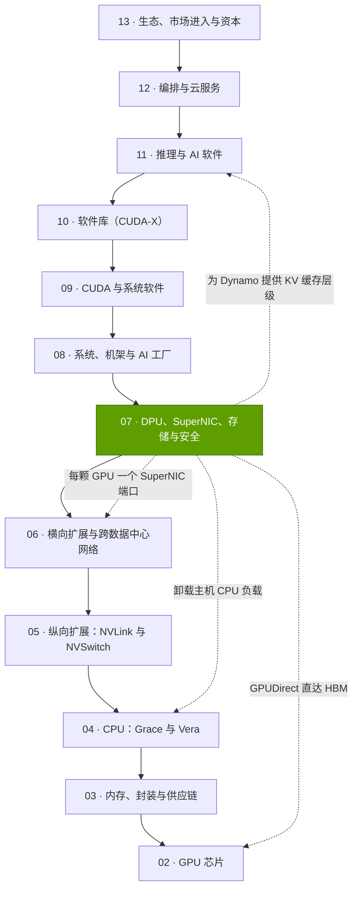
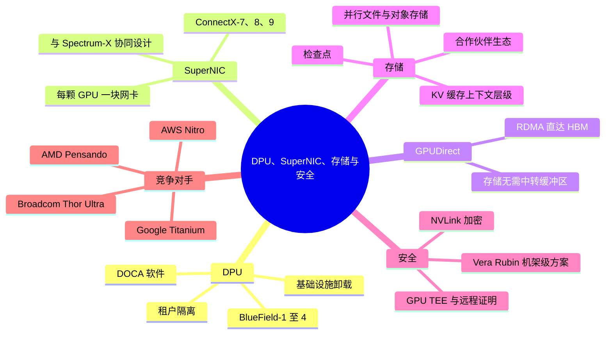

# 第 07 层 —— DPU、SuperNIC、存储与安全
> [!NOTE]
> 本页为英文原文的简体中文参考译文，仅供参考；如有出入，以[英文原文](../../../layers/07-dpu-supernic-storage-security/index.md "English original")为准。

第 07 层（共 12 层）· 围绕每颗 GPU 的 I/O、存储与信任“管线” · 阅读约 6 分钟 · 最后核实：2026-11-05

## ⚡ 要点速览

- **本层是围绕每颗 GPU 的“管线”：**为 GPU 供数的网卡、运行运营方基础设施的[数据处理器（DPU）](../../glossary.md#dpu)、存储通路以及安全边界。如今每颗 GPU 都配有专属的 [SuperNIC](../../glossary.md#supernic)：GB200 为 400 Gb/s，GB300 为 800 Gb/s，Vera Rubin 为 1.6 Tb/s [[S266]](../../../sources/bibliography.md#s266)[[S264]](../../../sources/bibliography.md#s264)[[S33004]](../../../sources/bibliography.md#s33004)。
- **卸载（offload）是核心理念。**没有 DPU 时，基础设施软件估计会占用约 19–33% 的主机 CPU 核心，该估计主要来自英伟达自身 [[S7005]](../../../sources/bibliography.md#s7005)[[S7007]](../../../sources/bibliography.md#s7007)。BlueField-4 配备 64 个 Arm Neoverse V2 核心和 800 Gb/s 带宽；英伟达称其算力为 BlueField-3 的 6× [[S7001]](../../../sources/bibliography.md#s7001)[[S512]](../../../sources/bibliography.md#s512)。
- **数据必须绕过 CPU。**若将网络数据先暂存于主机内存，将消耗 39–150% 的主机内存带宽（估计）[[S7000]](../../../sources/bibliography.md#s7000)；[GPUDirect RDMA](../../glossary.md#gpudirect-rdma) 与 [GPUDirect Storage](../../glossary.md#gpudirect-storage) 将数据直接送入 GPU 显存 [[S7009]](../../../sources/bibliography.md#s7009)。
- **存储正在成为推理内存：**BlueField-4 运行全新的“G3.5”KV 缓存层级，12 家存储合作伙伴正在打造面向 H2 2026 的 STX 系统 🟢 [[S7511]](../../../sources/bibliography.md#s7511)[[S7027]](../../../sources/bibliography.md#s7027)；一个 128K token 的上下文重新加载约需 0.2 s，而重新计算约需 4.7 s（估计）[[S7000]](../../../sources/bibliography.md#s7000)。
- **检查点让存储成为有效吞吐（goodput）的杠杆：**在一个 16,384 颗 GPU 的训练任务中，存储带宽从 100 GB/s 提升至 1 TB/s，每年可节省价值约 $30M 的 GPU 时间（估计）[[S34006]](../../../sources/bibliography.md#s34006)[[S7000]](../../../sources/bibliography.md#s7000)。
- **机密计算已从单颗 GPU（H100）扩展到整个机架（Vera Rubin [NVL72](../../glossary.md#nvl72)）** [[S7012]](../../../sources/bibliography.md#s7012)[[S7028]](../../../sources/bibliography.md#s7028)；实测 H100 开销为吞吐量的 0–7% [[S7011]](../../../sources/bibliography.md#s7011)。
- **弱点与挑战者：**AWS（Nitro）和谷歌（Google，Titanium）自研卸载方案 [[S292]](../../../sources/bibliography.md#s292)[[S7520]](../../../sources/bibliography.md#s7520)；AMD 的 Helios 为每颗 GPU 配置 2.4 Tb/s 的 Pensando 网卡，是 Vera Rubin 的 1.5× [[S228]](../../../sources/bibliography.md#s228)[[S7500]](../../../sources/bibliography.md#s7500)；存储软件的利润归属合作伙伴（VAST Data、DDN、WEKA）；标准化的设备信任机制（TDISP）可能拉平机密计算领域的差距 [[S7015]](../../../sources/bibliography.md#s7015)。

> [!TIP]
> **算例 —— 本层在一个机架中的体量。**SemiAnalysis 估计一个 GB200 NVL72 机架本身约 $3.1M，计入其分摊的[横向扩展（scale-out）](../../glossary.md#scale-out)网络与存储后约 $3.9M [[S324]](../../../sources/bibliography.md#s324)：**约 $0.8M，即全口径成本的约 21%**，落在本层和第 06 层。在 Vera Rubin 上，72 颗 GPU × 1.6 Tb/s = 每机架 **115.2 Tb/s** 的 SuperNIC 带宽，相当于一台满配 144 端口 800G Quantum-X800 交换机 [[S33004]](../../../sources/bibliography.md#s33004)[[S264]](../../../sources/bibliography.md#s264)。英伟达包含网卡和 DPU 的网络业务线在 Q1 FY2027 创下 $14.8B 的纪录 [[S90014]](../../../sources/bibliography.md#s90014)。**结论：**集群支出的五分之一流经这套“管线”，但英伟达只拿下[网卡（NIC）](../../glossary.md#nic)、DPU 和交换机这几块；存储系统归合作伙伴。

## 本层在技术栈中的位置

## 本层导图

## 八个问题一览

| # | 问题 | 简要回答 | 详见 |
|---|---|---|---|
| Q1 | 职能是什么，薄弱会出什么问题？ | 以线速、安全地搬运每颗 GPU 进出的每一个字节；若薄弱，GPU 会停顿，约 19–33% 的主机核心被“管线”占用 [[S7005]](../../../sources/bibliography.md#s7005) | [DPU 的作用](what-a-dpu-does.md)、[面向 AI 的存储](storage-for-ai.md) |
| Q2 | 关键指标？ | 每颗 GPU 的 Gb/s；每 Gb/s 消耗的主机周期；尾延迟；每颗 GPU 的存储 GB/s；机密模式开销 | [SuperNIC 与 GPUDirect](supernics-and-gpudirect.md) |
| Q3 | 代际进步？ | ConnectX 从 56 Gb/s → 1.6 Tb/s；BlueField 从 100 → 800 Gb/s、16 → 64 核；机密计算从单颗 GPU 扩展到整个机架 [[S7001]](../../../sources/bibliography.md#s7001)[[S7012]](../../../sources/bibliography.md#s7012) | [DPU 的作用](what-a-dpu-does.md) |
| Q4 | 优势来源？ | 集成：Mellanox 的网卡基因（$6.9B 交易）[[S464]](../../../sources/bibliography.md#s464)，与交换机、NCCL 和 DOCA 协同设计 | [发展历程与构建方式](history-and-how-built.md) |
| Q5 | 最强挑战者？ | 超大规模云厂商的自研卸载方案（Nitro、Titanium）；AMD 与博通（Broadcom）的 800G 超以太网（Ultra Ethernet）网卡 [[S292]](../../../sources/bibliography.md#s292)[[S280]](../../../sources/bibliography.md#s280)[[S290]](../../../sources/bibliography.md#s290) | [竞争](competition.md) |
| Q6 | 复制成本？ | 800G 网卡芯片可以复制；但网卡、交换机与软件栈的协同设计需要数年 | [发展历程与构建方式](history-and-how-built.md) |
| Q7 | 路线图？ | ConnectX-9 与 BlueField-4 随 Vera Rubin 推出（2026）；STX 系统 H2 2026 🟢；BlueField-5 与 ConnectX-10 于 2028 年 🟡 [[S7511]](../../../sources/bibliography.md#s7511)[[S90004]](../../../sources/bibliography.md#s90004) | [路线图](roadmap.md) |
| Q8 | 价值池与并购？ | 网卡与 DPU 收入随 GPU 出货量增长；存储软件的价值留在合作伙伴手中 | [价值链与企业发展](value-chain-and-corp-dev.md) |

## 本层各页

| 页面 | 你将了解 |
|---|---|
| [DPU 的作用](what-a-dpu-does.md) | 卸载类别、基础设施税及其在每个托盘上的价值、BlueField-1 → 4、DOCA |
| [SuperNIC 与 GPUDirect](supernics-and-gpudirect.md) | SuperNIC 与 DPU 之别、ConnectX-7 → 9、GPUDirect RDMA 与 Storage、关键指标 |
| [面向 AI 的存储](storage-for-ai.md) | 检查点经济学、并行文件系统与对象存储之比较、合作伙伴、KV 缓存层级与 STX |
| [机密计算](confidential-computing.md) | GPU TEE 与远程证明、开销、主权需求、与 AMD/英特尔/Arm 的比较 |
| [竞争](competition.md) | 正面对比与能力热力图 |
| [发展历程：英伟达如何构建本层](history-and-how-built.md) | 时间线、关键决策与交易、复制成本、反事实推演 |
| [路线图](roadmap.md) | 网卡、DPU 与存储路线图（附置信度标签） |
| [价值链与企业发展视角](value-chain-and-corp-dev.md) | 谁获取了价值、私营公司、并购 |

🔧 技术细节：如何阅读网卡与 DPU 规格书

- **按端口计 vs 按 GPU 计：**ConnectX-9 的端口速率最高为 800 Gb/s，而英伟达给出的是每颗 GPU 1.6 Tb/s [[S7535]](../../../sources/bibliography.md#s7535)[[S33004]](../../../sources/bibliography.md#s33004)。
- **主机链路限制：**一条 [PCIe](../../glossary.md#pcie) Gen6 x16 链路单向约可承载 ~128 GB/s（~1.0 Tb/s）[[S222]](../../../sources/bibliography.md#s222)。
- **“等效核心数”说法**（BlueField-2 约 30 个，BlueField-3 最多 300 个）是厂商的表述口径，并非基准测试结果 [[S7008]](../../../sources/bibliography.md#s7008)。

## 🎯 企业发展视角

1. **搭英伟达便车的走量生意。**网卡与 DPU 的配套量随 GPU 出货扩张；商用网卡（博通、AMD）能否在非英伟达机架，或在英伟达卖给[超大规模云厂商](../../glossary.md#hyperscaler)的机架中赢得插槽？
2. **DPU 最好的市场或许是存储。**BlueField-4 作为 KV 缓存闪存机柜的控制器 [[S7511]](../../../sources/bibliography.md#s7511) 是一个全新的插槽；关注哪些合作伙伴会让它成为标配。
3. **护城河在软件，而非芯片。**DOCA、[NCCL](../../glossary.md#nccl)、GPUDirect 和 [Dynamo](../../glossary.md#dynamo) 的 KV 放置策略将网卡绑定在整个技术栈上；超以太网（Ultra Ethernet）和 TDISP 则在反向用力 [[S7015]](../../../sources/bibliography.md#s7015)。
4. **高通（Qualcomm）的问题（仅基于公开信息）：**对于 AI200/AI250 机架 [[S173]](../../../sources/bibliography.md#s173)，本层中的哪些部分（网卡、卸载、上下文存储、远程证明）应当自建、收购或交由合作伙伴？

## 📚 来源（Sources）

<!-- Auto-generated from the [S…] citations on this page by `make build`. Edit sources/registry/*.csv, not this list. -->

- [**S173**](../../../sources/bibliography.md#s173) Qualcomm, *Qualcomm Unveils AI200 and AI250 - Redefining Rack-Scale Data Center Inference*, 2025-10-27. [Link](https://www.qualcomm.com/news/releases/2025/10/qualcomm-unveils-ai200-and-ai250-redefining-rack-scale-data-cent)
- [**S222**](../../../sources/bibliography.md#s222) Tom's Hardware, *PCI Express roadmap: the path to 1TB/s with PCIe 8.0, the challenges of integration, and beyond*, 2025. [Link](https://www.tomshardware.com/pc-components/motherboards/pci-express-roadmap-the-path-to-1tb-s-with-pci-8-0-the-challenges-of-integration-and-beyond)
- [**S228**](../../../sources/bibliography.md#s228) Spheron, *AMD Helios rack-scale AI on GPU cloud: deploy MI455X inference with UALink and Ultra Ethernet (2026 guide)*, 2026. [Link](https://www.spheron.network/blog/amd-helios-rack-scale-mi455x-gpu-cloud/)
- [**S264**](../../../sources/bibliography.md#s264) NVIDIA Newsroom, *NVIDIA Announces New Switches Optimized for Trillion-Parameter GPU Computing and AI Infrastructure (Quantum-X800, Spectrum-X800, ConnectX-8)*, 2024-03-18. [Link](https://nvidianews.nvidia.com/news/networking-switches-gpu-computing-ai)
- [**S266**](../../../sources/bibliography.md#s266) NVIDIA Newsroom, *NVIDIA Quantum-2 Takes Supercomputing to New Heights, Into the Cloud*, 2021-11-09. [Link](https://nvidianews.nvidia.com/news/nvidia-quantum-2-takes-supercomputing-to-new-heights-into-the-cloud)
- [**S280**](../../../sources/bibliography.md#s280) Broadcom, *Broadcom introduces Thor Ultra, the industry's first 800G AI Ethernet NIC*, 2025-10-14. [Link](https://investors.broadcom.com/news-releases/news-release-details/broadcom-introduces-industrys-first-800g-ai-ethernet-nic)
- [**S290**](../../../sources/bibliography.md#s290) AMD, *AMD Advancing AI 2025: Helios rack, MI400 preview and Pensando Vulcano 800G NIC*, 2025-06-12. [Link](https://www.amd.com/en/newsroom.html)
- [**S292**](../../../sources/bibliography.md#s292) Amazon Web Services, *Elastic Fabric Adapter (EFA) and AWS Nitro System documentation*, 2025. [Link](https://aws.amazon.com/hpc/efa/)
- [**S324**](../../../sources/bibliography.md#s324) fal.ai, *NVIDIA GB200 price in 2026: what a GPU, a tray and an NVL72 rack cost*, 2026. [Link](https://fal.ai/learn/serverless/nvidia-gb200-price)
- [**S464**](../../../sources/bibliography.md#s464) NVIDIA Newsroom, *NVIDIA to Acquire Mellanox for $6.9 Billion*, 2019-03-11. [Link](https://nvidianews.nvidia.com/news/nvidia-to-acquire-mellanox-for-6-9-billion)
- [**S512**](../../../sources/bibliography.md#s512) NVIDIA Blog, *NVIDIA Launches BlueField-4: The Processor Powering the Operating System of AI Factories*, 2025-10-28. [Link](https://blogs.nvidia.com/blog/bluefield-4-ai-factory/)
- [**S7000**](../../../sources/bibliography.md#s7000) nvidia_deep_dive_claude repository, *Repo analysis: layer 07 models (DPU offload value per compute tray, checkpoint write time, KV-cache reload time by tier)*, 2026-11-05. [Link](https://github.com/FrankHuang94/nvidia_deep_dive_claude/blob/main/layers/07-dpu-supernic-storage-security/index.md)
- [**S7001**](../../../sources/bibliography.md#s7001) NVIDIA, *NVIDIA BlueField-4 DPU datasheet*, 2026-05. [Link](https://dam-cdn.nvd.orangelogic.com/AssetLink/m8w7t64m2k40j51sx8xb4ok712b743ux.pdf)
- [**S7005**](../../../sources/bibliography.md#s7005) NVIDIA, *NVIDIA DPU Power Efficiency (white paper)*, 2022-11. [Link](https://dcmag.fr/wp-content/uploads/2022/11/nvidia-dpu-power-efficiency-white-paper-2508650.pdf)
- [**S7007**](../../../sources/bibliography.md#s7007) arXiv:2511.06558, *Offloading Data Center Tax*, 2025-11. [Link](https://arxiv.org/html/2511.06558v1)
- [**S7008**](../../../sources/bibliography.md#s7008) SDxCentral, *Nvidia unveils next-gen BlueField DPU*, 2021-04. [Link](https://www.sdxcentral.com/articles/news/nvidia-unveils-next-gen-bluefield-dpu/2021/04)
- [**S7009**](../../../sources/bibliography.md#s7009) NVIDIA Technical Blog, *GPUDirect Storage: A Direct Path Between Storage and GPU Memory*, 2019-08. [Link](https://developer.nvidia.com/blog/gpudirect-storage/)
- [**S7011**](../../../sources/bibliography.md#s7011) arXiv:2409.03992 (Jianwei Zhu et al. (Phala Network)), *Confidential Computing on NVIDIA Hopper GPUs: A Performance Benchmark Study*, 2024-09. [Link](https://arxiv.org/abs/2409.03992)
- [**S7012**](../../../sources/bibliography.md#s7012) NVIDIA, *NVIDIA Confidential Computing (solutions page)*, 2026. [Link](https://www.nvidia.com/en-us/data-center/solutions/confidential-computing/)
- [**S7015**](../../../sources/bibliography.md#s7015) Phoronix (Michael Larabel), *AMD sends out Linux patches for enabling SEV-TIO TDISP with PCIe 6.0*, 2026-09. [Link](https://phoronix.com/news/AMD-SEV-TIO-TDISP-Linux-Patches)
- [**S7027**](../../../sources/bibliography.md#s7027) NAND Research, *Research note: Improving inference with NVIDIA's Inference Context Memory Storage platform*, 2026-01. [Link](https://nand-research.com/research-note-improving-inference-nvidias-inference-context-memory-storage-platform/)
- [**S7028**](../../../sources/bibliography.md#s7028) VentureBeat, *Nvidia Rubin brings rack-scale encryption to enterprise AI security*, 2026-01. [Link](https://venturebeat.com/security/nvidia-rubin-rack-scale-encryption-enterprise-ai-security)
- [**S7500**](../../../sources/bibliography.md#s7500) AMD, *AMD Pensando Vulcano 800 AI NIC: Built to Scale-Out and Across*, 2026. [Link](https://www.amd.com/en/blogs/2026/amd-pensando-vulcano-800-ai-nic-scale-out-and-across.html)
- [**S7511**](../../../sources/bibliography.md#s7511) NVIDIA Newsroom, *NVIDIA Launches BlueField-4 STX Storage Architecture With Broad Industry Adoption*, 2026-03-16. [Link](https://nvidianews.nvidia.com/news/nvidia-launches-bluefield-4-stx-storage-architecture-with-broad-industry-adoption)
- [**S7520**](../../../sources/bibliography.md#s7520) Google Cloud, *Titanium (Google Cloud product page)*, 2024. [Link](https://cloud.google.com/titanium)
- [**S7535**](../../../sources/bibliography.md#s7535) NVIDIA Docs, *NVIDIA ConnectX-9 SuperNIC firmware release notes v82.48.1000 (February 2026 GA release)*, 2026-02. [Link](https://docs.nvidia.com/networking/display/connectx9firmwarev82481000)
- [**S33004**](../../../sources/bibliography.md#s33004) NVIDIA Newsroom, *NVIDIA Kicks Off the Next Generation of AI With Rubin — Six New Chips; One Incredible AI Supercomputer*, 2026-01-05. [Link](https://nvidianews.nvidia.com/news/rubin-platform-ai-supercomputer)
- [**S34006**](../../../sources/bibliography.md#s34006) arXiv:2407.21783 (Llama Team (AI @ Meta)), *The Llama 3 Herd of Models*, 2024-07-31. [Link](https://arxiv.org/abs/2407.21783)
- [**S90004**](../../../sources/bibliography.md#s90004) TrendForce, *Key GTC takeaways: how Samsung, Micron, Intel and more power NVIDIA's Vera Rubin and Feynman*, 2026-03-17. [Link](https://www.trendforce.com/news/2026/03/17/news-key-gtc-takeaways-how-samsung-micron-intel-more-power-nvidias-vera-rubin-and-feynman/)
- [**S90014**](../../../sources/bibliography.md#s90014) Global Data Center Hub, *NVIDIA posts $81.6 billion quarter and splits into two reporting platforms*, 2026-05. [Link](https://www.globaldatacenterhub.com/p/nvidia-posts-816-billion-quarter)
