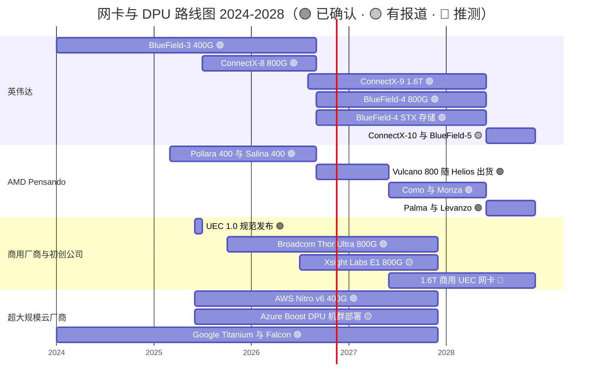

# DPU、SuperNIC、存储与安全：路线图
> [!NOTE]
> 本页为英文原文的简体中文参考译文，仅供参考；如有出入，以[英文原文](../../../layers/07-dpu-supernic-storage-security/roadmap.md "English original")为准。

第 07 层 · DPU、SuperNIC、存储与安全 · 阅读约 10 分钟 · 最后核实：2026-11-05

## ⚡ 要点速览

- **2026 年是“双发”之年：**ConnectX-9 [SuperNIC](../../glossary.md#supernic)（每颗 GPU 1.6 Tb/s）和 BlueField-4 [数据处理器（DPU）](../../glossary.md#dpu)（800 Gb/s，集成 64 核 Grace CPU）随 Vera Rubin 于 H2 2026 出货；ConnectX-9 固件已于 2026 年 2 月正式发布（GA）🟢 [[S33004]](../../../sources/bibliography.md#s33004)[[S7535]](../../../sources/bibliography.md#s7535)[[S512]](../../../sources/bibliography.md#s512)。
- **DPU 正被改作存储之用：**BlueField-4 STX 是一套面向[上下文内存存储](../../glossary.md#context-memory-storage)（将 KV 缓存存放在闪存上）的参考设计，将于 H2 2026 进入合作伙伴的平台；英伟达宣称 token 吞吐量最高提升 5×，但未说明对比基线 🟢 [[S7511]](../../../sources/bibliography.md#s7511)[[S3012]](../../../sources/bibliography.md#s3012)。
- **2028 年只有名字、没有细节：**Feynman 将搭配 ConnectX-10 和 BlueField-5，但尚无公开规格 🟡 [[S109]](../../../sources/bibliography.md#s109)[[S502]](../../../sources/bibliography.md#s502)[[S90004]](../../../sources/bibliography.md#s90004)；二手资料对其速率的说法相互矛盾 🔴 [[S213]](../../../sources/bibliography.md#s213)。
- **只有 AMD 的命名时间跨度与英伟达相当：**Vulcano（2026）、Como/Monza（2027）和 Palma/Levanzo（2028）均已命名，但没有规格 🟢 [[S538]](../../../sources/bibliography.md#s538)[[S7500]](../../../sources/bibliography.md#s7500)。
- **尚无竞争对手发布 1.6T [网卡（NIC）](../../glossary.md#nic)：**博通（Broadcom）的 Thor Ultra（800G）自 2025 年 10 月起送样，AWS 的 Nitro v6 每卡最高 400 Gb/s [[S7529]](../../../sources/bibliography.md#s7529)[[S7503]](../../../sources/bibliography.md#s7503)。
- **[Q7 · 路线图与变数]** 路线图在速度上稳妥；可能改变格局的是商业因素：[超以太网（Ultra Ethernet）](../../glossary.md#ultra-ethernet)网卡在大规模部署中得到验证、网卡被吸收进加速器或光学器件，以及[超大规模云厂商](../../glossary.md#hyperscaler)将[自用芯片（captive silicon）](../../glossary.md#captive-silicon)扩展到[后端网络](../../glossary.md#back-end-network)。

## 2024–2028 路线图

条形从首次上市延伸至预计的后继产品；2027 年“1.6T 商用 UEC 网卡”一条为本资料库的推测。来源：下表，以及 BlueField-3 [[S269]](../../../sources/bibliography.md#s269)、UEC、Azure Boost、Titanium 与 Falcon [[S7528]](../../../sources/bibliography.md#s7528)[[S7504]](../../../sources/bibliography.md#s7504)[[S7520]](../../../sources/bibliography.md#s7520)[[S7519]](../../../sources/bibliography.md#s7519)。

| 项目 | 时间窗口 | 状态 | 置信度 | 来源 |
|---|---|---|---|---|
| ConnectX-8 SuperNIC，800G | 2025，随 GB300 NVL72 | 已出货 | 🟢 | [[S264]](../../../sources/bibliography.md#s264)[[S34015]](../../../sources/bibliography.md#s34015) |
| ConnectX-9 SuperNIC，每 GPU 1.6T | H2 2026，随 Vera Rubin | 已全面量产 | 🟢 | [[S33004]](../../../sources/bibliography.md#s33004)[[S501]](../../../sources/bibliography.md#s501)[[S7535]](../../../sources/bibliography.md#s7535) |
| BlueField-4 DPU，800G，64 核 Grace | H2 2026，早期供货 | 已发布 | 🟢 | [[S512]](../../../sources/bibliography.md#s512)[[S7530]](../../../sources/bibliography.md#s7530) |
| BlueField-4 STX 存储参考设计 | H2 2026，合作伙伴平台 | 已发布 | 🟢 | [[S7511]](../../../sources/bibliography.md#s7511) |
| ConnectX-10 与 BlueField-5 | 2028，随 Feynman | 已命名，无规格 | 🟡 | [[S109]](../../../sources/bibliography.md#s109)[[S502]](../../../sources/bibliography.md#s502)[[S90004]](../../../sources/bibliography.md#s90004) |
| AMD Vulcano 800（每颗 MI455X 配 3 块） | 自 2026 年 Q3 末起 | 随 Helios 出货 | 🟢 | [[S7500]](../../../sources/bibliography.md#s7500)[[S228]](../../../sources/bibliography.md#s228)[[S90020]](../../../sources/bibliography.md#s90020) |
| AMD Como / Monza；Palma / Levanzo | 2027；2028 | 仅有名称 | 🟢 名称 / 🔴 规格 | [[S538]](../../../sources/bibliography.md#s538) |
| Broadcom Thor Ultra，800G UEC | 自 2025-10 起送样 | 送样中 | 🟢 | [[S7529]](../../../sources/bibliography.md#s7529) |
| AWS Nitro v6，每卡最高 400G | 2025 | 已出货（自用） | 🟢 | [[S7503]](../../../sources/bibliography.md#s7503) |
| Xsight Labs E1，800G DPU | 2026 | 获得早期运营商订单 | 🟡 | [[S7517]](../../../sources/bibliography.md#s7517) |

> [!TIP]
> **算例 —— 为什么网卡在设计上就落后于 [NVLink](../../glossary.md#nvlink)。**在 Vera Rubin 上，NVLink 6 为每颗 GPU 提供 3.0 TB/s，ConnectX-9 提供 1.6 Tb/s = 0.2 TB/s，比例为 15:1 [[S90006]](../../../sources/bibliography.md#s90006)[[S33004]](../../../sources/bibliography.md#s33004)。即使 ConnectX-10 翻倍至 3.2 Tb/s（🔴，未经证实 [[S213]](../../../sources/bibliography.md#s213)），只要 NVLink 不同步增长，这一比例仍为 7.5:1。因此，通信最频繁的流量（张量并行与专家并行）留在 NVLink 域内（[第 05 层](../05-scale-up-nvlink-nvswitch/roadmap.md)），网卡只需跟上数据并行与流水线并行的节奏。

## 规格演进

英伟达自身的迭代节奏已经加快（四年从 400G 到 1.6T，而在 Mellanox 时期，上一次 3.6× 的提升用了六年，见[发展历程](history-and-how-built.md)），而竞争对手的滞后时间则从 400G 时的约 3 年缩短到 800G 时的不到一年，因为每通道 200G 的 [SerDes](../../glossary.md#serdes) 和 UEC 传输协议如今已成为行业公共资产，而非 Mellanox 的独门诀窍 [[S7528]](../../../sources/bibliography.md#s7528)[[S7529]](../../../sources/bibliography.md#s7529)。

> [!TIP]
> **算例 —— 用 800G 网卡对标 Rubin 的成本。**一个定制加速器机架若想用 800G 商用网卡实现 Rubin 每芯片 1.6 Tb/s 的带宽，每颗芯片需要两块网卡：72 颗加速器需要 144 块网卡，而不是 72 块。按每块 800G 网卡假设 $1,500–3,000 计（估计，本资料库 🔴），每个机架需 $216–432K，而 72 块 ConnectX-9 按每块 $2,500–4,500 计为 $180–324K（同一套假设，见[价值链](value-chain-and-corp-dev.md)）。落后一档的代价体现在网卡数量、功耗和光学器件上。

🔧 技术细节：为什么 1.6 Tb/s 会把网卡变成一个 PCIe 交换芯片

1.6 Tb/s 即每个方向 200 GB/s。一条 [PCIe](../../glossary.md#pcie) Gen6 x16 链路在扣除开销前单向约承载 ~128 GB/s，因此 1.6T 网卡无法通过一条标准 x16 主机链路以线速运行；它需要更多通道或不同的连接方式（本文所用资料未详述 ConnectX-9 的主机接口）。英伟达已在 ConnectX-8 中内置了 PCIe Gen6 交换芯片，因此网卡位于 GPU 与主机之间，而不是挂在 CPU 下面 [[S264]](../../../sources/bibliography.md#s264)。ConnectX-10 合乎逻辑的下一步是采用直接的裸片间（die-to-die）或 NVLink 级连接，或在网卡封装上集成光学器件（🔴 本资料库推断）；无论哪种，都会让网卡更难被第三方产品替换。

## [Q7 · 路线图与变数]

英伟达的网卡与 DPU 路线图是截至 2028 年命名最完整的，其速度领先是真实的，但只领先一步。可能改变格局的因素大多不在其芯片本身：

- **超以太网在大规模部署中得到验证。**若一个采用 Thor Ultra 或 Vulcano 网卡的 10 万加速器集群达到 [Spectrum-X](../../glossary.md#spectrum-x) 的效果，AI 网卡就会变成标准部件 [[S7528]](../../../sources/bibliography.md#s7528)[[S7529]](../../../sources/bibliography.md#s7529)[[S7500]](../../../sources/bibliography.md#s7500)。
- **超大规模云厂商将自用网卡扩展到后端。**AWS 已在 GPU 实例上使用 EFA；若微软和谷歌跟进，1:1 的 SuperNIC 配套将萎缩到只剩[新兴云服务商（neocloud）](../../glossary.md#neocloud)、主权客户和企业客户 [[S292]](../../../sources/bibliography.md#s292)[[S7504]](../../../sources/bibliography.md#s7504)[[S7520]](../../../sources/bibliography.md#s7520)。
- **网卡消融于其他器件之中。**英特尔的 Gaudi 3 已在裸片上集成 24 × 200 GbE；共封装光学或裸片间网卡连接可能以更高速率实现同样的效果 [[S296]](../../../sources/bibliography.md#s296)。
- **上下文内存成为标准存储层级。**届时 BlueField-4 将在存储服务器中获得配套，除非存储厂商能用商用芯片实现同样的效果 [[S7511]](../../../sources/bibliography.md#s7511)[[S3012]](../../../sources/bibliography.md#s3012)。
- 🔴 **ConnectX-10 的速率。**3.2 Tb/s 将重新拉开差距；1.6 Tb/s 则会让竞争对手追上来。

> [!TIP]
> **算例 —— 有多少网卡收入取决于配套问题。**按每个 Vera Rubin [NVL72](../../glossary.md#nvl72) 机架约 230 kW（Max-P，有报道）计，1 GW 的 IT 功率可容纳约 4,350 个机架、约 313,000 颗 GPU [[S302]](../../../sources/bibliography.md#s302)[[S303]](../../../sources/bibliography.md#s303)。每颗配一块 ConnectX-9、每块 $2,500–4,500（估计，本资料库 🔴），即每吉瓦 $0.8–1.4B 的网卡芯片收入。拥有自用网卡的买家每部署一吉瓦，这笔钱就从英伟达的盘子里移走。

## 🎯 企业发展视角

1. 在尚无竞争对手发布 1.6T 网卡的情况下，2027–2028 年的商用空白是新进入者的机会窗口，还是恰恰证明了 200G 通道 SerDes 加 RDMA 传输协议难以快速构建？
2. 如果网卡迁移进加速器封装或光学器件，哪种 IP（SerDes、传输引擎、PCIe/CXL 交换芯片）会成为值得拥有的稀缺资产？
3. BlueField-4 STX 把存储服务器变成了英伟达的配套点：存储厂商会将其作为合作伙伴计划来拥抱，还是会绕开它？
4. AMD 已为 2027 年和 2028 年命名了后继网卡：对任何销售机架级 AI 系统的厂商而言，一条与之匹配的网卡路线图是否会成为入场门槛？

## 📚 来源（Sources）

<!-- Auto-generated from the [S…] citations on this page by `make build`. Edit sources/registry/*.csv, not this list. -->

- [**S109**](../../../sources/bibliography.md#s109) NVIDIA Blog, *NVIDIA GTC 2026: Live Updates on What's Next in AI*, 2026-03-16. [Link](https://blogs.nvidia.com/blog/gtc-2026-news/)
- [**S213**](../../../sources/bibliography.md#s213) Inside Deep Tech, *NVIDIA Feynman: Full Guide to the 2028 GPU, Rosa and Kyber*, 2026. [Link](https://www.insidedeeptech.com/nvidia-feynman-rosa-kyber-nvl1152-full-guide/)
- [**S228**](../../../sources/bibliography.md#s228) Spheron, *AMD Helios rack-scale AI on GPU cloud: deploy MI455X inference with UALink and Ultra Ethernet (2026 guide)*, 2026. [Link](https://www.spheron.network/blog/amd-helios-rack-scale-mi455x-gpu-cloud/)
- [**S264**](../../../sources/bibliography.md#s264) NVIDIA Newsroom, *NVIDIA Announces New Switches Optimized for Trillion-Parameter GPU Computing and AI Infrastructure (Quantum-X800, Spectrum-X800, ConnectX-8)*, 2024-03-18. [Link](https://nvidianews.nvidia.com/news/networking-switches-gpu-computing-ai)
- [**S269**](../../../sources/bibliography.md#s269) NVIDIA Newsroom, *NVIDIA Extends Data Center Infrastructure Processing Roadmap with BlueField-3*, 2021-04-12. [Link](https://nvidianews.nvidia.com/news/nvidia-extends-data-center-infrastructure-processing-roadmap-with-bluefield-3)
- [**S292**](../../../sources/bibliography.md#s292) Amazon Web Services, *Elastic Fabric Adapter (EFA) and AWS Nitro System documentation*, 2025. [Link](https://aws.amazon.com/hpc/efa/)
- [**S296**](../../../sources/bibliography.md#s296) Intel, *Intel Gaudi 3 AI Accelerator white paper*, 2024-04. [Link](https://www.intel.com/content/www/us/en/content-details/817486/intel-gaudi-3-ai-accelerator-white-paper.html)
- [**S302**](../../../sources/bibliography.md#s302) Hashrate Index, *NVIDIA Vera Rubin NVL72 specs breakdown*, 2026. [Link](https://hashrateindex.com/blog/nvidia-vera-rubin-nvl72-specs-breakdown/)
- [**S303**](../../../sources/bibliography.md#s303) Commercial Times (ctee.com.tw), *Vera Rubin NVL72 Max-Q / Max-P rack power (Commercial Times report)*, 2026-01-07. [Link](https://www.ctee.com.tw/news/20260107701081-430704)
- [**S501**](../../../sources/bibliography.md#s501) eWeek, *Everything Nvidia Just Announced at GTC 2026: 7 Chips, 5 Racks, 1 Giant Bet on Agentic AI*, 2026-03-17. [Link](https://www.eweek.com/news/nvidia-gtc-2026-ai-inference-vera-rubin-neuron/)
- [**S502**](../../../sources/bibliography.md#s502) Tom's Hardware, *Nvidia updates data center roadmap with Rosa CPU and stacked Feynman GPUs; optical NVLink; Groq LPUs with NVFP4 and NVLink also on deck*, 2026-03-17. [Link](https://www.tomshardware.com/pc-components/gpus/nvidia-updates-data-center-roadmap-with-rosa-cpu-and-stacked-feynman-gpus-optical-nvlink-groq-lpus-with-nvfp4-and-nvlink-also-on-deck)
- [**S512**](../../../sources/bibliography.md#s512) NVIDIA Blog, *NVIDIA Launches BlueField-4: The Processor Powering the Operating System of AI Factories*, 2025-10-28. [Link](https://blogs.nvidia.com/blog/bluefield-4-ai-factory/)
- [**S538**](../../../sources/bibliography.md#s538) AMD Investor Relations, *AAI 2026: AMD Delivers Full-Stack Compute for the Agentic AI Era*, 2026-07-23. [Link](https://ir.amd.com/news-events/press-releases/detail/1294/aai-2026-amd-delivers-full-stack-compute-for-the-agentic-ai-era)
- [**S3012**](../../../sources/bibliography.md#s3012) NVIDIA Newsroom, *NVIDIA BlueField-4 Powers New Class of AI-Native Storage Infrastructure for the Next Frontier of AI*, 2026-01-05. [Link](https://nvidianews.nvidia.com/news/nvidia-bluefield-4-powers-new-class-of-ai-native-storage-infrastructure-for-the-next-frontier-of-ai)
- [**S7500**](../../../sources/bibliography.md#s7500) AMD, *AMD Pensando Vulcano 800 AI NIC: Built to Scale-Out and Across*, 2026. [Link](https://www.amd.com/en/blogs/2026/amd-pensando-vulcano-800-ai-nic-scale-out-and-across.html)
- [**S7503**](../../../sources/bibliography.md#s7503) Amazon Web Services, *Instances built on the AWS Nitro System (Amazon EC2 documentation)*, 2026. [Link](https://docs.aws.amazon.com/ec2/latest/instancetypes/ec2-nitro-instances.html)
- [**S7504**](../../../sources/bibliography.md#s7504) Blocks & Files, *Microsoft boosts Azure infrastructure with Fungible-derived DPU*, 2024-11-20. [Link](https://blocksandfiles.com/2024/11/20/microsoft-boosts-azure-infrastructure-with-fungible-derived-dpu/)
- [**S7511**](../../../sources/bibliography.md#s7511) NVIDIA Newsroom, *NVIDIA Launches BlueField-4 STX Storage Architecture With Broad Industry Adoption*, 2026-03-16. [Link](https://nvidianews.nvidia.com/news/nvidia-launches-bluefield-4-stx-storage-architecture-with-broad-industry-adoption)
- [**S7517**](../../../sources/bibliography.md#s7517) StorageNewsletter, *Xsight Labs raises more than $300 million at $2.8 billion valuation to power next-generation AI and cloud networks*, 2026-08-06. [Link](https://www.storagenewsletter.com/2026/08/06/fms-2026-xsight-labs-raises-more-than-300-million-at-2-8-billion-valuation-to-power-next-generation-ai-and-cloud-networks/)
- [**S7519**](../../../sources/bibliography.md#s7519) Converge Digest, *OCP Summit: Google opens Falcon for hardware transport*, 2023-10. [Link](https://convergedigest.com/ocp-summit-google-opens-falcon-for-hardware-transport/)
- [**S7520**](../../../sources/bibliography.md#s7520) Google Cloud, *Titanium (Google Cloud product page)*, 2024. [Link](https://cloud.google.com/titanium)
- [**S7528**](../../../sources/bibliography.md#s7528) Converge Digest, *Ultra Ethernet Consortium releases Specification 1.0*, 2025-06. [Link](https://convergedigest.com/ultra-ethernet-consortium-releases-specification-1-0/)
- [**S7529**](../../../sources/bibliography.md#s7529) StreetInsider (Broadcom press release), *Broadcom introduces industry's first 800G AI Ethernet NIC (Thor Ultra)*, 2025-10-14. [Link](https://www.streetinsider.com/Press+Releases/Broadcom+Introduces+Industry%E2%80%99s+First+800G+AI+Ethernet+NIC/25451603.html)
- [**S7530**](../../../sources/bibliography.md#s7530) StorageNewsletter (NVIDIA release), *NVIDIA launches BlueField-4, the processor powering the operating system of AI factories*, 2025-11-04. [Link](https://www.storagenewsletter.com/2025/11/04/nvidia-launches-bluefield-4-the-processor-powering-the-operating-system-of-ai-factories/)
- [**S7535**](../../../sources/bibliography.md#s7535) NVIDIA Docs, *NVIDIA ConnectX-9 SuperNIC firmware release notes v82.48.1000 (February 2026 GA release)*, 2026-02. [Link](https://docs.nvidia.com/networking/display/connectx9firmwarev82481000)
- [**S33004**](../../../sources/bibliography.md#s33004) NVIDIA Newsroom, *NVIDIA Kicks Off the Next Generation of AI With Rubin — Six New Chips; One Incredible AI Supercomputer*, 2026-01-05. [Link](https://nvidianews.nvidia.com/news/rubin-platform-ai-supercomputer)
- [**S34015**](../../../sources/bibliography.md#s34015) NVIDIA, *NVIDIA InfiniBand adapters (ConnectX-7 NDR 400Gb/s; ConnectX-8 XDR 800Gb/s)*, 2025. [Link](https://www.nvidia.com/en-us/networking/infiniband-adapters/)
- [**S90004**](../../../sources/bibliography.md#s90004) TrendForce, *Key GTC takeaways: how Samsung, Micron, Intel and more power NVIDIA's Vera Rubin and Feynman*, 2026-03-17. [Link](https://www.trendforce.com/news/2026/03/17/news-key-gtc-takeaways-how-samsung-micron-intel-more-power-nvidias-vera-rubin-and-feynman/)
- [**S90006**](../../../sources/bibliography.md#s90006) TweakTown, *Nvidia cuts Vera Rubin's memory bandwidth by up to 26% and AMD's Helios now leads in memory bandwidth*, 2026-10. [Link](https://www.tweaktown.com/news/114304/nvidia-cuts-vera-rubins-memory-bandwidth-by-up-to-26-percent-and-amds-helios-now-leads-in-memory-bandwidth/index.html)
- [**S90020**](../../../sources/bibliography.md#s90020) Shacknews, *AMD Helios AI rack system on track for initial shipments in Q3 2026*, 2026. [Link](https://www.shacknews.com/article/150249/amd-helios-ai-system-shipping-q3-2026)
