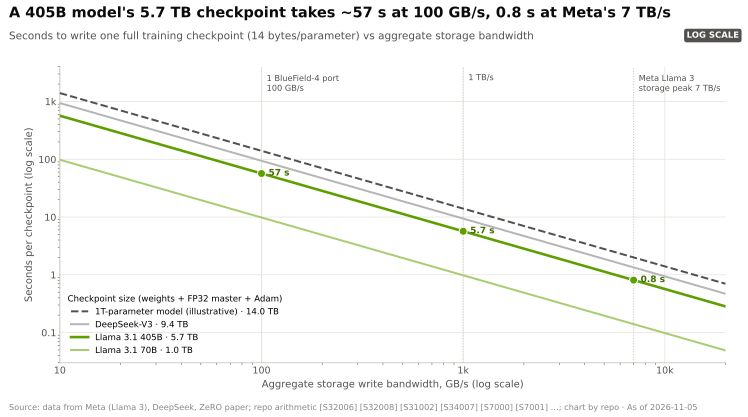
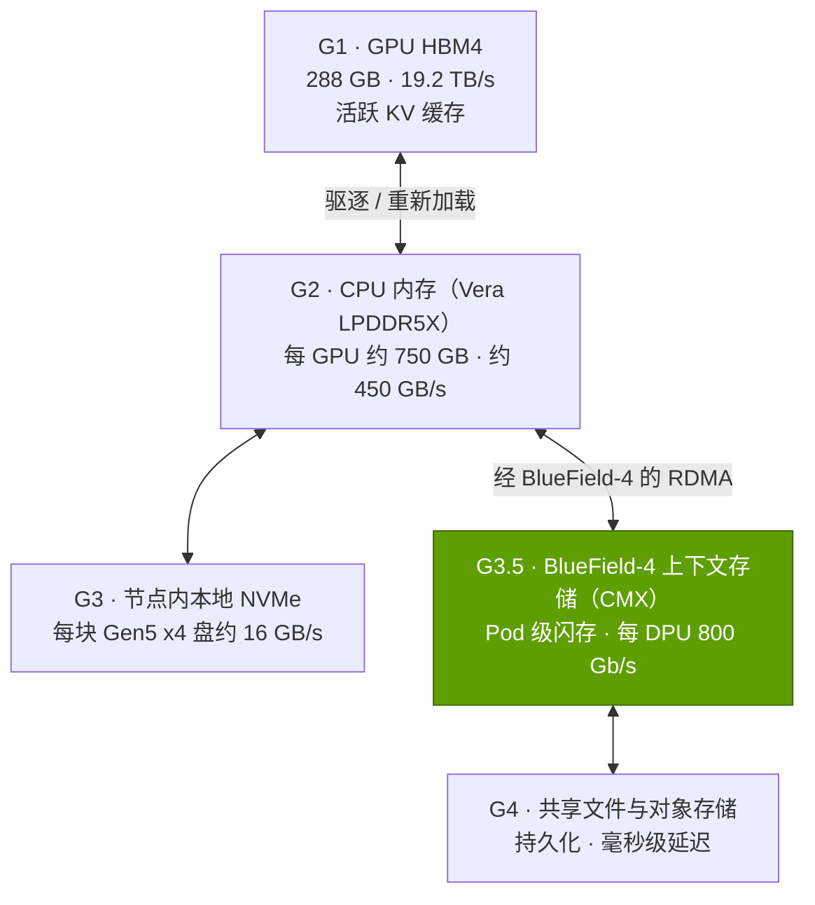

# 面向 AI 的存储
> [!NOTE]
> 本页为英文原文的简体中文参考译文，仅供参考；如有出入，以[英文原文](../../../layers/07-dpu-supernic-storage-security/storage-for-ai.md "English original")为准。

第 07 层 · DPU、SuperNIC、存储与安全 · 阅读约 9 分钟 · 最后核实：2026-11-05

## ⚡ 要点速览

- **AI 存储承担三项职能：**流式供给训练数据、吸收突发性的[检查点](../../glossary.md#checkpoint)写入，以及 2026 年新增的——充当 [KV 缓存](../../glossary.md#kv-cache)的推理“上下文内存” [[S3012]](../../../sources/bibliography.md#s3012)[[S7511]](../../../sources/bibliography.md#s7511)。
- **检查点体量巨大：**权重、FP32 主副本与 Adam 优化器状态合计每参数 14 字节 [[S34004]](../../../sources/bibliography.md#s34004)，因此一个 Llama 3.1 405B 检查点约 5.7 TB：在 100 GB/s 下约需 57 s，在 Meta 的 Llama 3 存储集群（7,500 台服务器、240 PB）约 7 TB/s 的峰值下不到 1 s [[S34006]](../../../sources/bibliography.md#s34006)[[S7000]](../../../sources/bibliography.md#s7000)。
- **故障让速度变得值钱：**Llama 3 在 16,384 颗 GPU 上运行的 54 天里遭遇了 466 次作业中断 [[S34006]](../../../sources/bibliography.md#s34006)。将存储从 100 GB/s 提升到 1 TB/s，可将检查点加返工造成的损失从 GPU 时间的约 10% 降至约 3%，按每 GPU 小时 $2.99 计约合每年 $30M（估计）[[S395]](../../../sources/bibliography.md#s395)[[S7000]](../../../sources/bibliography.md#s7000)。
- **KV 缓存层级新增“G3.5”**：介于本地 SSD 与共享存储之间、由 BlueField-4 管理的 Pod 级闪存 [[S7026]](../../../sources/bibliography.md#s7026)[[S7027]](../../../sources/bibliography.md#s7027)。从该层重新加载一个 128K token 的 70B 模型上下文约需 0.2 s，而重新计算约需 4.7 s（估计）[[S7000]](../../../sources/bibliography.md#s7000)。
- **英伟达不卖存储，但制定参考设计。**AI Data Platform（GTC 2025）和 BlueField-4 STX（GTC 2026）都是提供给合作伙伴的蓝图 [[S7022]](../../../sources/bibliography.md#s7022)[[S7511]](../../../sources/bibliography.md#s7511)[[S7004]](../../../sources/bibliography.md#s7004)；🟢 12 家厂商正在协同设计预计于 H2 2026 推出的 STX 系统，厂商宣称 token 吞吐量提升 5×、能效提升 4× [[S7511]](../../../sources/bibliography.md#s7511)。
- **弱点：**存储软件的利润归属 VAST Data（2026 年估值约 $30B）[[S7512]](../../../sources/bibliography.md#s7512)、DDN 和 WEKA 等合作伙伴。英伟达拿到的是[数据处理器（DPU）](../../glossary.md#dpu)、[网卡（NIC）](../../glossary.md#nic)以及起粘合作用的软件。

## 1. 为什么 AI 需要高速存储

- **数据集流式读取（读）：**token、图像或视频源源不断地流向数据加载器。
- **检查点（突发写入）：**每隔几分钟，所有 GPU 同时转储各自分担的模型和优化器状态；Meta 称每颗 GPU 为 1 MB 至 4 GB，突发流量足以打满存储网络 [[S34006]](../../../sources/bibliography.md#s34006)。
- **上下文内存（低延迟读写）：**推理服务器把会话状态（即 KV 缓存，见 [P2](../../primers/P2-how-ai-inference-works.md)）暂存起来，待用户返回时重新加载。

**[Q1 · 职能与失效后果]** 对存储而言，失效后果就是 GPU 空转：训练要么在检查点写完之前被阻塞，要么在节点故障时丢失自上一个检查点以来的全部工作；推理则要重新计算本可直接重新加载的上下文，使首 token 时间增加数秒。

> [!TIP]
> **算例 —— 存储速度对一个 16,384 颗 GPU 的训练任务价值几何。**一个 405B 检查点为 405B × 14 字节 = **5.67 TB** [[S34004]](../../../sources/bibliography.md#s34004)：在 100 GB/s 下写入需 57 s，在 1 TB/s 下需 5.7 s，在 7 TB/s 下需 0.8 s [[S34006]](../../../sources/bibliography.md#s34006)。Llama 3 的训练任务大约每 3 小时失败一次 [[S34006]](../../../sources/bibliography.md#s34006)[[S31003]](../../../sources/bibliography.md#s31003)。标准经验法则（Young 近似）的检查点间隔为 √(2 × 写入时间 × 平均故障间隔)，在 100 GB/s 下约 18 分钟，在 1 TB/s 下约 6 分钟。由此，写入阻塞加上每次故障平均半个间隔的返工，将分别耗费 GPU 时间的 **约 10.2%、约 3.2% 和约 1.2%**。按每 H100 小时 $2.99 计，该集群每年成本约 $429M [[S395]](../../../sources/bibliography.md#s395)，因此从 100 GB/s 提升到 1 TB/s **每年约值 $30M**（估计）[[S7000]](../../../sources/bibliography.md#s7000)。**结论：**前沿实验室购买存储带宽是为了提升有效吞吐（goodput），而不是容量。

🔧 技术细节：团队如何缩短检查点停顿

- **分片检查点：**每颗 GPU 只写入自己的分片，因此带宽随存储服务器数量扩展。
- **异步检查点：**GPU 在数秒内把状态复制到 CPU 内存后即恢复计算，再由 CPU 将其写入存储，这需要大容量主机内存（见[第 04 层](../04-cpu-grace-vera/index.md)）。

## 2. 并行文件系统、对象存储与合作伙伴生态

**[并行文件系统](../../glossary.md#parallel-file-system)**将每个文件条带化分布到众多存储服务器上，使数千颗 GPU 能同时读写同一个检查点。**[对象存储](../../glossary.md#object-storage)**（S3 接口）按键存储完整对象：每 PB 成本更低、规模几乎无上限，但速度较慢。典型的 AI 工厂将原始数据集放在对象存储上，将检查点放在并行文件系统或全闪存文件层上。

> [!TIP]
> **算例 —— 为什么条带化至关重要。**Meta 的 Llama 3 存储集群由 7,500 台服务器提供约 7 TB/s 的峰值 [[S34006]](../../../sources/bibliography.md#s34006)，约合 **每台服务器 0.93 GB/s**。单台这样的服务器吸收一个 5.67 TB 的检查点需要 **约 1.7 小时**；条带化分布到全部 7,500 台后，**不到一秒**即可完成。**结论：**AI 存储的速度靠“广度”买来（服务器、网卡和闪存并行），因此单端口 DPU 带宽（BlueField-4 为 800 Gb/s）决定了扩展的基本单元 [[S7001]](../../../sources/bibliography.md#s7001)。

英伟达的做法是认证并发布参考设计，而不是销售存储阵列：两条存储认证路线，一条面向云合作伙伴设计，一条面向企业级设计 [[S7021]](../../../sources/bibliography.md#s7021)；AI Data Platform 参考设计（GTC 2025）[[S7022]](../../../sources/bibliography.md#s7022)；以及 BlueField-4 STX（GTC 2026），其首个机架级实现是 CMX 上下文内存平台 [[S7511]](../../../sources/bibliography.md#s7511)[[S7004]](../../../sources/bibliography.md#s7004)。

| 合作伙伴 | 架构（公开信息） | 与英伟达的结合点 |
|---|---|---|
| DDN | 并行文件系统（EXAScaler）；Infinia 2.0 数据平台 | AI Data Platform 集成 [[S7023]](../../../sources/bibliography.md#s7023)；STX 协同设计 [[S7511]](../../../sources/bibliography.md#s7511) |
| VAST Data | 全闪存、解耦式文件与对象存储 | STX 协同设计 [[S7511]](../../../sources/bibliography.md#s7511)；获英伟达投资，估值约 $30B（2026 年 4 月）[[S7512]](../../../sources/bibliography.md#s7512) |
| WEKA | 基于 NVMe 闪存的并行文件系统 | STX 协同设计 [[S7511]](../../../sources/bibliography.md#s7511) |
| NetApp | AIPod（横向扩展 NAS） | NVIDIA-Certified Storage 认证 [[S7023]](../../../sources/bibliography.md#s7023)；STX [[S7511]](../../../sources/bibliography.md#s7511) |
| Everpure（原 Pure Storage） | FlashBlade 全闪存文件与对象存储 | 获认证的高性能存储 [[S7023]](../../../sources/bibliography.md#s7023)；STX [[S7511]](../../../sources/bibliography.md#s7511)[[S7025]](../../../sources/bibliography.md#s7025) |
| Dell、HPE、IBM、Hitachi Vantara | 系统厂商的文件与并行文件产品线 | AI Data Platform 集成 [[S7023]](../../../sources/bibliography.md#s7023)；STX [[S7511]](../../../sources/bibliography.md#s7511) |
| Cloudian、MinIO、Nutanix | S3 对象存储；超融合 | Cloudian 参考架构 [[S7023]](../../../sources/bibliography.md#s7023)；STX [[S7511]](../../../sources/bibliography.md#s7511) |

## 3. KV 缓存层级：存储成为推理内存

智能体需要维持长对话，每个对话都有一个随每个 token 增长的 KV 缓存。重新计算要耗费 GPU 时间；把它们全部放在[高带宽内存（HBM）](../../glossary.md#hbm)中又不可能。英伟达的答案是一套阶梯式层级（[存储分层](../../glossary.md#storage-tiering)），由 [Dynamo](../../glossary.md#dynamo) 和 NIXL 在各层之间搬运 KV 块 [[S3013]](../../../sources/bibliography.md#s3013)[[S7026]](../../../sources/bibliography.md#s7026)：

**G3.5** 是由 BlueField-4 管理、由一个 Pod 内的 GPU 共享的闪存层，存放生命周期短但对延迟敏感的 KV 缓存，长期状态则留在 G4 [[S7026]](../../../sources/bibliography.md#s7026)[[S7027]](../../../sources/bibliography.md#s7027)。英伟达在 CES 2026 上首次以“推理上下文内存存储平台”（Inference Context Memory Storage platform）的名义展示它，宣称每秒 token 数最高提升 5× [[S3012]](../../../sources/bibliography.md#s3012)。分析师指出，所谓“无状态”的说法需要加以限定，因为 Dynamo 和 NIXL 仍需追踪每个 KV 块的存放位置 [[S7027]](../../../sources/bibliography.md#s7027)。

> [!TIP]
> **算例 —— 每个层级能暂存多少个长对话。**Llama 3.1 70B 每个 token 存储 163,840 字节的 [FP8](../../glossary.md#fp8) KV 缓存 [[S32006]](../../../sources/bibliography.md#s32006)，因此一个完整的 131,072 token 上下文为 **21.5 GB**。一颗 Rubin GPU 的 288 GB [HBM4](../../glossary.md#hbm4) 扣除约 70 GB 的 FP8 权重后，可暂存约 **10** 个这样的会话 [[S100]](../../../sources/bibliography.md#s100)。Vera 每颗 GPU 约 750 GB 的 LPDDR5X（每颗 CPU 1.5 TB，各配两颗 GPU）[[S100]](../../../sources/bibliography.md#s100) 可再增加约 **35** 个。1 PB 的 G3.5 闪存可容纳约 **46,500** 个，据报道该层级的容量可达每个 Pod 数 PB [[S7027]](../../../sources/bibliography.md#s7027)。**结论：**上下文层级把一个 GPU 时间问题转化为闪存容量问题，速度比重新计算快约 20×（估计）[[S7000]](../../../sources/bibliography.md#s7000)。

> [!WARNING]
> **误区与事实。***误区：*“英伟达正在进军存储业务。”*事实：*STX 是面向合作伙伴的参考架构，而非英伟达自己销售的系统 [[S7004]](../../../sources/bibliography.md#s7004)。英伟达出售的是其中的 BlueField-4 以及负责放置 KV 块的软件；合作伙伴出售硬盘、软件和支持服务，并保留大部分存储利润。

## 🎯 企业发展视角

1. **英伟达已把自己写进了存储的物料清单。**每个 STX 机柜都需要 BlueField-4 [[S7511]](../../../sources/bibliography.md#s7511)，而英伟达的软件决定由哪个层级保存上下文。相对于硬盘和软件厂商，这能为英伟达攫取多少存储价值？见[价值链](value-chain-and-corp-dev.md)。
2. **上下文内存可能拉动闪存需求。**如果[智能体式（agentic）](../../glossary.md#agentic-ai)推理在每个 Pod 中保留数 PB 的 KV 缓存 [[S7027]](../../../sources/bibliography.md#s7027)，闪存和控制器厂商将受益；但 5× 吞吐量的说法仍有待独立基准测试验证 [[S7511]](../../../sources/bibliography.md#s7511)。
3. **合作伙伴估值已反映这一转变。**VAST Data 约 $30B 的估值 [[S7512]](../../../sources/bibliography.md#s7512) 显示了存储软件蕴含的价值之大，而英伟达正是 VAST 的投资方 [[S482]](../../../sources/bibliography.md#s482)。哪些合作伙伴会成为参考设计中不可或缺的一环？
4. **高通（Qualcomm）的问题（仅基于公开信息）：**每块 AI200 卡配备 768 GB 的 [LPDDR](../../glossary.md#lpddr) [[S173]](../../../sources/bibliography.md#s173)。这种板载容量能否减少对 G3.5 式层级的需求，还是长上下文智能体服务仍然需要这样一层？

## 📚 来源（Sources）

<!-- Auto-generated from the [S…] citations on this page by `make build`. Edit sources/registry/*.csv, not this list. -->

- [**S100**](../../../sources/bibliography.md#s100) NVIDIA Technical Blog, *Inside the NVIDIA Vera Rubin Platform: Six New Chips, One AI Supercomputer*, 2026-01-05. [Link](https://developer.nvidia.com/blog/inside-the-nvidia-rubin-platform-six-new-chips-one-ai-supercomputer/)
- [**S173**](../../../sources/bibliography.md#s173) Qualcomm, *Qualcomm Unveils AI200 and AI250 - Redefining Rack-Scale Data Center Inference*, 2025-10-27. [Link](https://www.qualcomm.com/news/releases/2025/10/qualcomm-unveils-ai200-and-ai250-redefining-rack-scale-data-cent)
- [**S395**](../../../sources/bibliography.md#s395) Lambda, *Lambda GPU cloud pricing*, 2025. [Link](https://lambda.ai/pricing)
- [**S482**](../../../sources/bibliography.md#s482) Various (company announcements; Reuters, Bloomberg), *Reporting on NVIDIA participation in robotics, autonomy, photonics, storage and energy rounds (Figure AI, Wayve, Scale AI, Ayar Labs, Enfabrica, VAST Data, Sakana AI, TerraPower, Commonwealth Fusion Systems, Applied Digital, Recursion)*, 2025-09. [Link](https://www.reuters.com/technology/)
- [**S3012**](../../../sources/bibliography.md#s3012) NVIDIA Newsroom, *NVIDIA BlueField-4 Powers New Class of AI-Native Storage Infrastructure for the Next Frontier of AI*, 2026-01-05. [Link](https://nvidianews.nvidia.com/news/nvidia-bluefield-4-powers-new-class-of-ai-native-storage-infrastructure-for-the-next-frontier-of-ai)
- [**S3013**](../../../sources/bibliography.md#s3013) Blocks and Files, *Nvidia standardizes GPU cluster KV cache offload to NVMe SSDs*, 2026-01-06. [Link](https://blocksandfiles.com/2026/01/06/nvidia-standardizes-gpu-cluster-kv-cache-offload-to-nvme-ssds/)
- [**S7000**](../../../sources/bibliography.md#s7000) nvidia_deep_dive_claude repository, *Repo analysis: layer 07 models (DPU offload value per compute tray, checkpoint write time, KV-cache reload time by tier)*, 2026-11-05. [Link](https://github.com/FrankHuang94/nvidia_deep_dive_claude/blob/main/layers/07-dpu-supernic-storage-security/index.md)
- [**S7001**](../../../sources/bibliography.md#s7001) NVIDIA, *NVIDIA BlueField-4 DPU datasheet*, 2026-05. [Link](https://dam-cdn.nvd.orangelogic.com/AssetLink/m8w7t64m2k40j51sx8xb4ok712b743ux.pdf)
- [**S7004**](../../../sources/bibliography.md#s7004) NAND Research, *NVIDIA STX and CMX: infrastructure for agentic AI context storage (research note)*, 2026-03. [Link](https://nand-research.com/nvidia-stx-cmx-infrastructure-for-agentic-ai-context-storage/)
- [**S7021**](../../../sources/bibliography.md#s7021) NVIDIA Blog, *Full Steam Ahead: NVIDIA-Certified Program Expands to Enterprise Storage for Faster AI Factory Deployment*, 2025-03. [Link](https://blogs.nvidia.com/blog/nvidia-certified-enterprise-storage)
- [**S7022**](../../../sources/bibliography.md#s7022) TechPowerUp (NVIDIA press release), *NVIDIA, Storage Industry Leaders Unveil New Class of Enterprise Infrastructure for the AI Era (AI Data Platform)*, 2025-03-18. [Link](https://techpowerup.com/334386/nvidia-storage-industry-leaders-unveil-new-class-of-enterprise-infrastructure-for-the-ai-era)
- [**S7023**](../../../sources/bibliography.md#s7023) Blocks and Files, *Nvidia storage announcements (GTC 2025)*, 2025-03-18. [Link](https://blocksandfiles.com/2025/03/18/nvidia-storage-announcements/)
- [**S7025**](../../../sources/bibliography.md#s7025) SDxCentral, *Nvidia unveils BlueField-4 STX architecture to power next-gen AI storage*, 2026-03. [Link](https://www.sdxcentral.com/news/nvidia-unveils-bluefield-4-stx-architecture-to-power-next-gen-ai-storage/)
- [**S7026**](../../../sources/bibliography.md#s7026) Solidigm, *Inference Context Memory Storage (ICMS): why AI inference is becoming a problem only flash can solve*, 2026. [Link](https://www.solidigm.com/products/technology/icmsp-ai-inference-is-flash-storage-problem.html)
- [**S7027**](../../../sources/bibliography.md#s7027) NAND Research, *Research note: Improving inference with NVIDIA's Inference Context Memory Storage platform*, 2026-01. [Link](https://nand-research.com/research-note-improving-inference-nvidias-inference-context-memory-storage-platform/)
- [**S7511**](../../../sources/bibliography.md#s7511) NVIDIA Newsroom, *NVIDIA Launches BlueField-4 STX Storage Architecture With Broad Industry Adoption*, 2026-03-16. [Link](https://nvidianews.nvidia.com/news/nvidia-launches-bluefield-4-stx-storage-architecture-with-broad-industry-adoption)
- [**S7512**](../../../sources/bibliography.md#s7512) Bloomberg Law, *Nvidia-backed Vast Data triples value to $30 billion, mulls IPO*, 2026-04. [Link](https://news.bloomberglaw.com/private-equity/nvidia-backed-vast-data-triples-value-to-30-billion-mulls-ipo)
- [**S31003**](../../../sources/bibliography.md#s31003) Tom's Hardware, *Faulty Nvidia H100 GPUs and HBM3 memory caused half of the failures during Llama 3 training — one failure every three hours for Meta's 16,384 GPU training cluster*, 2024-07. [Link](https://www.tomshardware.com/tech-industry/artificial-intelligence/faulty-nvidia-h100-gpus-and-hbm3-memory-caused-half-of-the-failures-during-llama-3-training-one-failure-every-three-hours-for-metas-16384-gpu-training-cluster)
- [**S32006**](../../../sources/bibliography.md#s32006) Meta via Hugging Face, *Llama 3.1 70B configuration (config.json)*, 2024-07-23. [Link](https://huggingface.co/meta-llama/Llama-3.1-70B/blob/main/config.json)
- [**S34004**](../../../sources/bibliography.md#s34004) arXiv:1910.02054 (SC20) (Samyam Rajbhandari, Jeff Rasley, Olatunji Ruwase, Yuxiong He (Microsoft)), *ZeRO: Memory Optimizations Toward Training Trillion Parameter Models*, 2019-10-04. [Link](https://arxiv.org/abs/1910.02054)
- [**S34006**](../../../sources/bibliography.md#s34006) arXiv:2407.21783 (Llama Team (AI @ Meta)), *The Llama 3 Herd of Models*, 2024-07-31. [Link](https://arxiv.org/abs/2407.21783)
