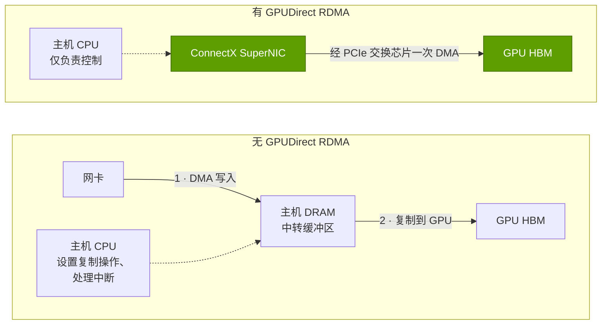
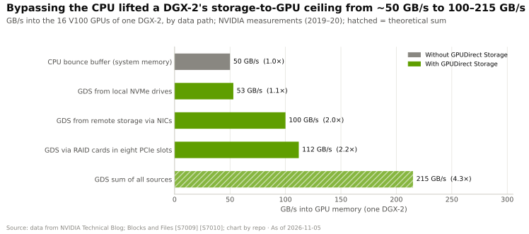

# SuperNIC 与 GPUDirect
> [!NOTE]
> 本页为英文原文的简体中文参考译文，仅供参考；如有出入，以[英文原文](../../../layers/07-dpu-supernic-storage-security/supernics-and-gpudirect.md "English original")为准。

第 07 层 · DPU、SuperNIC、存储与安全 · 阅读约 8 分钟 · 最后核实：2026-11-05

## ⚡ 要点速览

- **每颗 GPU 都有自己的网卡。**每颗 GPU 的[横向扩展（scale-out）](../../glossary.md#scale-out)带宽从 200 Gb/s（DGX A100）→ 400（DGX H100、GB200）→ 800（GB300，ConnectX-8）→ 1,600 Gb/s（Vera Rubin，ConnectX-9）[[S315]](../../../sources/bibliography.md#s315)[[S318]](../../../sources/bibliography.md#s318)[[S264]](../../../sources/bibliography.md#s264)[[S33004]](../../../sources/bibliography.md#s33004)。
- **[ConnectX](../../glossary.md#connectx) 带宽 15 年间提升 29×**，从 56 Gb/s（2011）升至 1.6 Tb/s（2026），大约每三年翻一番 [[S273]](../../../sources/bibliography.md#s273)[[S33004]](../../../sources/bibliography.md#s33004)。
- **[SuperNIC](../../glossary.md#supernic) 是一种针对 GPU 间（[东西向](../../glossary.md#east-west-traffic)）流量优化的[网卡（NIC）](../../glossary.md#nic)**，与 [Spectrum-X](../../glossary.md#spectrum-x) 交换机协同设计 [[S271]](../../../sources/bibliography.md#s271)；[数据处理器（DPU）](../../glossary.md#dpu)则额外配备通用核心来承担基础设施工作。
- **ConnectX-8 内置一个 48 通道的 [PCIe](../../glossary.md#pcie) Gen6 交换芯片**，在部分服务器中取代了分立的 [PCIe 交换芯片](../../glossary.md#pcie-switch) [[S7017]](../../../sources/bibliography.md#s7017)，不过并非所有厂商都采用 [[S7018]](../../../sources/bibliography.md#s7018)。
- **[GPUDirect RDMA](../../glossary.md#gpudirect-rdma) 让网卡直接写入 GPU 显存。**没有它，将入站数据暂存于 CPU 内存将消耗 39–150% 的主机内存带宽（估计）[[S7000]](../../../sources/bibliography.md#s7000)。
- **[GPUDirect Storage](../../glossary.md#gpudirect-storage)** 将 DGX-2 从存储到 GPU 的带宽上限从约 50 GB/s 提升至 100–215 GB/s，并将 CPU 负载降低约 3×（英伟达数据）[[S7009]](../../../sources/bibliography.md#s7009)[[S7010]](../../../sources/bibliography.md#s7010)。
- **最强挑战：**来自博通（Broadcom）和 AMD 的商用 800G 超以太网（Ultra Ethernet）网卡 [[S280]](../../../sources/bibliography.md#s280)[[S289]](../../../sources/bibliography.md#s289)[[S290]](../../../sources/bibliography.md#s290)；AMD 的 Helios 为每颗 GPU 配三块 800G 网卡，即 2.4 Tb/s，而 Vera Rubin 为 1.6 Tb/s [[S228]](../../../sources/bibliography.md#s228)[[S7500]](../../../sources/bibliography.md#s7500)。

## 1. SuperNIC 与 DPU：同一芯片家族的两种职能

**东西向**流量在 GPU 之间流动：突发性强、同步进行的[集合通信操作](../../glossary.md#collective-operation)中，最慢的数据包决定整体节奏（见[第 06 层](../06-scale-out-scale-across-networking/index.md)）。**[南北向](../../glossary.md#north-south-traffic)**流量则将集群与用户、存储和管理系统相连。英伟达为两者分别打造不同的端点。

| | SuperNIC（东西向） | DPU（南北向、基础设施） |
|---|---|---|
| 职能 | 以线速为单颗 GPU 的集合通信供数 | 运行运营方的网络、存储与安全软件栈 |
| 板载算力 | 极少；以数据包引擎为主 | Arm 核心（BlueField-3 为 16 个，BlueField-4 为 64 个）[[S269]](../../../sources/bibliography.md#s269)[[S7001]](../../../sources/bibliography.md#s7001) |
| 产品 | ConnectX-8、ConnectX-9、BlueField-3 SuperNIC [[S264]](../../../sources/bibliography.md#s264)[[S33004]](../../../sources/bibliography.md#s33004)[[S271]](../../../sources/bibliography.md#s271) | BlueField-3、BlueField-4 [[S269]](../../../sources/bibliography.md#s269)[[S7001]](../../../sources/bibliography.md#s7001) |
| 数量 | 每颗 GPU 一块（或更多） | 每台服务器、每个托盘或每个存储机柜一块 |
| 关键特性 | [RoCE](../../glossary.md#roce) 自适应路由，由网卡侧完成重排序，以及拥塞控制 [[S271]](../../../sources/bibliography.md#s271) | 虚拟交换、NVMe-oF、在线加密、租户隔离 [[S7024]](../../../sources/bibliography.md#s7024) |

SuperNIC 的价值来自协同设计：Spectrum-X 交换机把一条流的数据包分散喷洒到所有路径上，SuperNIC 再对其重新排序，并利用交换机的拥塞信号调节发送端速率 [[S271]](../../../sources/bibliography.md#s271)。ConnectX-8 还集成了一个 48 通道的 PCIe Gen6 交换芯片，因此 GPU 与网卡之间无需单独的交换芯片 [[S7017]](../../../sources/bibliography.md#s7017)；ConnectX-9 的规格为最多 48 条 Gen6 通道和 800 Gb/s 端口 [[S7535]](../../../sources/bibliography.md#s7535)。

**[Q2 · 关键指标]** 五个数字即可解释本层：

- **每颗 GPU 的横向扩展 Gb/s** 及每颗 GPU 配置的网卡数：过去三代从 400 → 800 → 1,600 Gb/s [[S266]](../../../sources/bibliography.md#s266)[[S264]](../../../sources/bibliography.md#s264)[[S33004]](../../../sources/bibliography.md#s33004)。
- **每 Gb/s 基础设施流量消耗的主机周期**（无卸载时约占核心的 19–33%），以及每 100 Gb/s 对应的 DPU 核心数（BlueField-3 为 4 个，BlueField-4 为 8 个）[[S7005]](../../../sources/bibliography.md#s7005)[[S7001]](../../../sources/bibliography.md#s7001)。
- **负载下的有效带宽与尾延迟**，二者决定 GPU 在集合通信中的等待时间（第 06 层）。
- **每颗 GPU 的存储 GB/s**：决定检查点耗时（秒）与 KV 缓存重新加载耗时（毫秒）（见[面向 AI 的存储](storage-for-ai.md)）。
- **机密模式开销**，即吞吐量损失百分比与首 token 时间（见[机密计算](confidential-computing.md)）。

> [!TIP]
> **算例 —— 为什么每颗 GPU 1.6 Tb/s 需要不止一条 PCIe 链路。**1.6 Tb/s 即单向 200 GB/s，而一条 PCIe Gen6 x16 链路单向约承载 ~128 GB/s [[S222]](../../../sources/bibliography.md#s222)，会把单颗 GPU 限制在约 1.0 Tb/s。要喂饱 1.6 Tb/s，至少需要两条 x16 链路的通道数，这与 ConnectX-9 的 48 条通道 [[S7535]](../../../sources/bibliography.md#s7535) 以及 🟡 每颗 Rubin GPU 配两块 ConnectX-9 的报道 [[S7020]](../../../sources/bibliography.md#s7020) 相吻合。每个机架 72 颗 GPU × 1.6 Tb/s = **115.2 Tb/s**，相当于一台 144 端口 800G Quantum-X800 交换机的容量 [[S264]](../../../sources/bibliography.md#s264)。**结论：**每个 Vera Rubin 机架都要消耗一台旗舰交换机的全部端口，因此英伟达的网卡和交换机收入随 GPU 同步增长。

## 2. GPUDirect RDMA：网卡直接写入 GPU 显存

[RDMA](../../glossary.md#rdma) 让一台机器的网卡在不经过任一端 CPU 的情况下读写另一台机器的内存。GPUDirect RDMA 则把目标换成 GPU 显存：网卡经 PCIe 以点对点方式直接写入 HBM，理想情况下通过与 GPU 共享的交换芯片完成。没有它，数据就要绕道 CPU 内存中的[中转缓冲区（bounce buffer）](../../glossary.md#bounce-buffer)。

绕道的代价不止于延迟：除了 CPU 自身的工作负载外，每个入站字节都要两次穿过主机 DRAM。

> [!TIP]
> **算例 —— 没有 GPUDirect 的 DGX H100。**八块 400 Gb/s 的 ConnectX-7 最多可提供 **400 GB/s** 入站流量 [[S318]](../../../sources/bibliography.md#s318)[[S266]](../../../sources/bibliography.md#s266)。若经中转缓冲，就意味着写入 400 GB/s、再读出 400 GB/s，合计 **800 GB/s** 的 DRAM 流量，而两颗 Xeon 8480 级主机 CPU 的峰值仅为 **614 GB/s** [[S33022]](../../../sources/bibliography.md#s33022)：在 CPU 做任何其他事情之前就已达 **130%**（估计）[[S7000]](../../../sources/bibliography.md#s7000)。**结论：**在当今的线速下，GPUDirect 是必选项，而将网卡在 PCIe 拓扑上紧邻 GPU 放置（现已内置于 ConnectX-8）是一项设计要求。

🔧 技术细节：GPUDirect RDMA 的实现原理

- **内存注册：**GPU 驱动锁定（pin）GPU 显存，并将其物理地址暴露给网卡驱动，使网卡能够对其执行 DMA。
- **PCIe 拓扑：**当 GPU 与网卡共享同一个 PCIe 交换芯片时，点对点流量最快；穿越 CPU 的根复合体（root complex）可能降低吞吐量，这正是 ConnectX-8 集成交换芯片的原因 [[S7017]](../../../sources/bibliography.md#s7017)。

## 3. GPUDirect Storage：从磁盘读取时绕过 CPU

GPUDirect Storage（GDS）把同样的思路用于文件：不再先读入 CPU 页缓存再复制到 GPU，而是由 NVMe 盘或存储网卡将数据直接 DMA 到 GPU 显存。英伟达的 DGX-2 测试至今仍是最清晰的公开对比：经 CPU 内存约 50 GB/s，使用 GDS 则为 100–215 GB/s，CPU 利用率改善约 3×，cuDF CSV 读取器比朴素路径快 8.8× [[S7009]](../../../sources/bibliography.md#s7009)[[S7010]](../../../sources/bibliography.md#s7010)。

> [!TIP]
> **算例 —— 冷启动一个 405B 推理副本。**[FP8](../../glossary.md#fp8) 格式的 Llama 3.1 405B 权重约 405 GB [[S32008]](../../../sources/bibliography.md#s32008)。按 DGX-2 中转缓冲约 50 GB/s 的上限，加载需 **约 8.1 s**；按 GDS 约 215 GB/s 的上限，则为 **约 1.9 s** [[S7009]](../../../sources/bibliography.md#s7009)。**结论：**根据需求伸缩推理副本的集群在每次[扩容（scale-up）](../../glossary.md#scale-up)时都要付出这一代价，因此 GDS 缩短了新增容量闲置等待的时间。

> [!WARNING]
> **误区与事实。***误区：*“GPUDirect 是英伟达的锁定手段。”*事实：*它建立在标准的 PCIe 点对点和 RDMA 之上，存储厂商也在各自的客户端中实现了 GDS [[S7023]](../../../sources/bibliography.md#s7023)。锁定效应更为隐性：[NCCL](../../glossary.md#nccl)、cuFile、驱动程序和 ConnectX 固件经过联合验证，因此英伟达的路径总是最先跑通。

## 🎯 企业发展视角

1. **网卡收入随 GPU 增长。**每颗 GPU 配一到两个 SuperNIC 端口、每个机架消耗一台旗舰交换机的端口，这使其成为一门搭乘 GPU 出货量的走量生意（见[价值链](value-chain-and-corp-dev.md)）。
2. **PCIe 交换芯片正被吸收整合。**ConnectX-8 集成的 Gen6 交换芯片 [[S7017]](../../../sources/bibliography.md#s7017) 在英伟达设计的服务器中抢走了商用 PCIe 交换芯片厂商的插槽。
3. **商用 800G 网卡正在缩小硬件差距** [[S280]](../../../sources/bibliography.md#s280)[[S289]](../../../sources/bibliography.md#s289)[[S290]](../../../sources/bibliography.md#s290)；英伟达的防线在于交换机与网卡的协同设计以及 NCCL。关注独立的有效带宽测试（见[竞争](competition.md)）。
4. **高通（Qualcomm）的问题（仅基于公开信息）：**对于 AI200/AI250 这类以太网横向扩展机架 [[S173]](../../../sources/bibliography.md#s173)[[S90029]](../../../sources/bibliography.md#s90029)，商用超以太网网卡是否足够，还是规模化推理需要一块能直通加速器内存的协同设计网卡？

## 📚 来源（Sources）

<!-- Auto-generated from the [S…] citations on this page by `make build`. Edit sources/registry/*.csv, not this list. -->

- [**S173**](../../../sources/bibliography.md#s173) Qualcomm, *Qualcomm Unveils AI200 and AI250 - Redefining Rack-Scale Data Center Inference*, 2025-10-27. [Link](https://www.qualcomm.com/news/releases/2025/10/qualcomm-unveils-ai200-and-ai250-redefining-rack-scale-data-cent)
- [**S222**](../../../sources/bibliography.md#s222) Tom's Hardware, *PCI Express roadmap: the path to 1TB/s with PCIe 8.0, the challenges of integration, and beyond*, 2025. [Link](https://www.tomshardware.com/pc-components/motherboards/pci-express-roadmap-the-path-to-1tb-s-with-pci-8-0-the-challenges-of-integration-and-beyond)
- [**S228**](../../../sources/bibliography.md#s228) Spheron, *AMD Helios rack-scale AI on GPU cloud: deploy MI455X inference with UALink and Ultra Ethernet (2026 guide)*, 2026. [Link](https://www.spheron.network/blog/amd-helios-rack-scale-mi455x-gpu-cloud/)
- [**S264**](../../../sources/bibliography.md#s264) NVIDIA Newsroom, *NVIDIA Announces New Switches Optimized for Trillion-Parameter GPU Computing and AI Infrastructure (Quantum-X800, Spectrum-X800, ConnectX-8)*, 2024-03-18. [Link](https://nvidianews.nvidia.com/news/networking-switches-gpu-computing-ai)
- [**S266**](../../../sources/bibliography.md#s266) NVIDIA Newsroom, *NVIDIA Quantum-2 Takes Supercomputing to New Heights, Into the Cloud*, 2021-11-09. [Link](https://nvidianews.nvidia.com/news/nvidia-quantum-2-takes-supercomputing-to-new-heights-into-the-cloud)
- [**S269**](../../../sources/bibliography.md#s269) NVIDIA Newsroom, *NVIDIA Extends Data Center Infrastructure Processing Roadmap with BlueField-3*, 2021-04-12. [Link](https://nvidianews.nvidia.com/news/nvidia-extends-data-center-infrastructure-processing-roadmap-with-bluefield-3)
- [**S271**](../../../sources/bibliography.md#s271) NVIDIA Newsroom, *NVIDIA Launches Accelerated Ethernet Platform for Hyperscale Generative AI (Spectrum-X)*, 2023-05-29. [Link](https://nvidianews.nvidia.com/news/nvidia-launches-accelerated-ethernet-platform-for-hyperscale-generative-ai)
- [**S273**](../../../sources/bibliography.md#s273) NVIDIA Docs, *NVIDIA Networking documentation hub (ConnectX adapter, Quantum and Spectrum switch product briefs and user manuals)*, 2025. [Link](https://docs.nvidia.com/networking/)
- [**S280**](../../../sources/bibliography.md#s280) Broadcom, *Broadcom introduces Thor Ultra, the industry's first 800G AI Ethernet NIC*, 2025-10-14. [Link](https://investors.broadcom.com/news-releases/news-release-details/broadcom-introduces-industrys-first-800g-ai-ethernet-nic)
- [**S289**](../../../sources/bibliography.md#s289) AMD, *AMD Advancing AI 2024: Pensando Pollara 400 AI NIC and Salina DPU*, 2024-10-10. [Link](https://www.amd.com/en/newsroom.html)
- [**S290**](../../../sources/bibliography.md#s290) AMD, *AMD Advancing AI 2025: Helios rack, MI400 preview and Pensando Vulcano 800G NIC*, 2025-06-12. [Link](https://www.amd.com/en/newsroom.html)
- [**S315**](../../../sources/bibliography.md#s315) NVIDIA (mirror), *NVIDIA DGX A100 system (40GB) datasheet*, 2020-05. [Link](https://cdn.shopify.com/s/files/1/0060/8894/9794/files/nvidia-dgx-a100-system-40gb-datasheet-web-us.pdf)
- [**S318**](../../../sources/bibliography.md#s318) NVIDIA (mirror hosted by MEGWARE), *NVIDIA DGX H100 datasheet*, 2023. [Link](https://www.MEGWARE.com/fileadmin/user_upload/LandingPage%20NVIDIA/nvidia-dgx-h100-datasheet.pdf)
- [**S7000**](../../../sources/bibliography.md#s7000) nvidia_deep_dive_claude repository, *Repo analysis: layer 07 models (DPU offload value per compute tray, checkpoint write time, KV-cache reload time by tier)*, 2026-11-05. [Link](https://github.com/FrankHuang94/nvidia_deep_dive_claude/blob/main/layers/07-dpu-supernic-storage-security/index.md)
- [**S7001**](../../../sources/bibliography.md#s7001) NVIDIA, *NVIDIA BlueField-4 DPU datasheet*, 2026-05. [Link](https://dam-cdn.nvd.orangelogic.com/AssetLink/m8w7t64m2k40j51sx8xb4ok712b743ux.pdf)
- [**S7005**](../../../sources/bibliography.md#s7005) NVIDIA, *NVIDIA DPU Power Efficiency (white paper)*, 2022-11. [Link](https://dcmag.fr/wp-content/uploads/2022/11/nvidia-dpu-power-efficiency-white-paper-2508650.pdf)
- [**S7009**](../../../sources/bibliography.md#s7009) NVIDIA Technical Blog, *GPUDirect Storage: A Direct Path Between Storage and GPU Memory*, 2019-08. [Link](https://developer.nvidia.com/blog/gpudirect-storage/)
- [**S7010**](../../../sources/bibliography.md#s7010) Blocks and Files, *Nvidia's GPUDirect Storage software vanquishes AI bounce buffers*, 2020-07-23. [Link](https://blocksandfiles.com/2020/07/23/nvidia-gpudirect-storage-software/)
- [**S7017**](../../../sources/bibliography.md#s7017) NVIDIA Technical Blog, *NVIDIA ConnectX-8 SuperNICs advance AI platform architecture with PCIe Gen6 connectivity*, 2025. [Link](https://developer.nvidia.com/blog/nvidia-connectx-8-supernics-advance-ai-platform-architecture-with-pcie-gen6-connectivity)
- [**S7018**](../../../sources/bibliography.md#s7018) iThome, *NVIDIA RTX PRO server and ConnectX-8 SuperNIC switch board (review)*, 2025. [Link](https://www.ithome.com.tw/review/173167)
- [**S7020**](../../../sources/bibliography.md#s7020) Hashrate Index, *NVIDIA Vera Rubin NVL72 specs breakdown*, 2026. [Link](https://hashrateindex.com/blog/nvidia-vera-rubin-nvl72-specs-breakdown/)
- [**S7023**](../../../sources/bibliography.md#s7023) Blocks and Files, *Nvidia storage announcements (GTC 2025)*, 2025-03-18. [Link](https://blocksandfiles.com/2025/03/18/nvidia-storage-announcements/)
- [**S7024**](../../../sources/bibliography.md#s7024) NVIDIA NGC Catalog, *DOCA Weave Service (dpf-weave Helm chart v26.8.0)*, 2026-10-12. [Link](https://catalog.ngc.nvidia.com/orgs/nvidia/doca/helm-charts/dpf-weave/v26.8.0)
- [**S7500**](../../../sources/bibliography.md#s7500) AMD, *AMD Pensando Vulcano 800 AI NIC: Built to Scale-Out and Across*, 2026. [Link](https://www.amd.com/en/blogs/2026/amd-pensando-vulcano-800-ai-nic-scale-out-and-across.html)
- [**S7535**](../../../sources/bibliography.md#s7535) NVIDIA Docs, *NVIDIA ConnectX-9 SuperNIC firmware release notes v82.48.1000 (February 2026 GA release)*, 2026-02. [Link](https://docs.nvidia.com/networking/display/connectx9firmwarev82481000)
- [**S32008**](../../../sources/bibliography.md#s32008) Meta via Hugging Face, *Llama 3.1 405B configuration (config.json)*, 2024-07-23. [Link](https://huggingface.co/meta-llama/Llama-3.1-405B/blob/main/config.json)
- [**S33004**](../../../sources/bibliography.md#s33004) NVIDIA Newsroom, *NVIDIA Kicks Off the Next Generation of AI With Rubin — Six New Chips; One Incredible AI Supercomputer*, 2026-01-05. [Link](https://nvidianews.nvidia.com/news/rubin-platform-ai-supercomputer)
- [**S33022**](../../../sources/bibliography.md#s33022) NVIDIA Docs, *NVIDIA DGX H100 User Guide — Introduction (system specifications)*, 2023. [Link](https://docs.nvidia.com/dgx/dgxh100-user-guide/introduction-to-dgxh100.html)
- [**S90029**](../../../sources/bibliography.md#s90029) Verdict, *Qualcomm AI200 and AI250 racks for AI inference*, 2025-10. [Link](https://www.verdict.co.uk/qualcomm-ai200-ai250-racks-ai-inference/)
