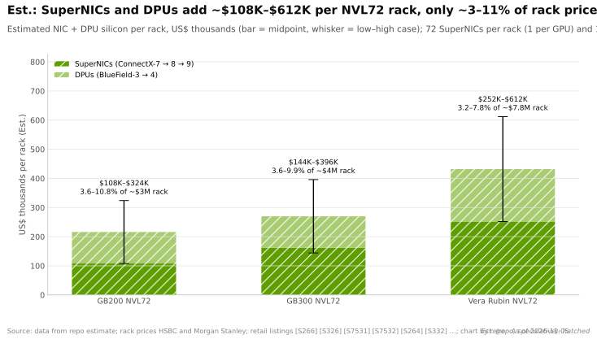
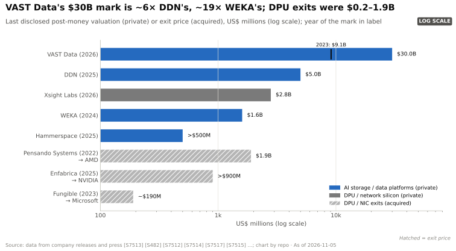

# DPU、SuperNIC、存储与安全：价值链与企业发展视角
> [!NOTE]
> 本页为英文原文的简体中文参考译文，仅供参考；如有出入，以[英文原文](../../../layers/07-dpu-supernic-storage-security/value-chain-and-corp-dev.md "English original")为准。

第 07 层 · DPU、SuperNIC、存储与安全 · 阅读约 9 分钟 · 最后核实：2026-11-05

## ⚡ 要点速览

- **四个价值池，四类主导者：**AI [后端网络](../../glossary.md#back-end-network)[网卡（NIC）](../../glossary.md#nic)（每颗 GPU 一块）、前端[数据处理器（DPU）](../../glossary.md#dpu)、AI 存储与上下文内存，以及安全 / [机密计算](../../glossary.md#confidential-computing)。英伟达只在第一个价值池中占据绝对领先 [[S264]](../../../sources/bibliography.md#s264)[[S7503]](../../../sources/bibliography.md#s7503)[[S7511]](../../../sources/bibliography.md#s7511)。
- **网卡只占机架的一小块：**估计 🔴 每个 [NVL72](../../glossary.md#nvl72) 机架中 [SuperNIC](../../glossary.md#supernic) 与 DPU 的价值为 $0.1–0.6M，约占机架价格的 3–11%，但它决定了机架采用谁的网络、软件和存储通路 [[S326]](../../../sources/bibliography.md#s326)[[S332]](../../../sources/bibliography.md#s332)[[S330]](../../../sources/bibliography.md#s330)。
- **前端 DPU 的支出大多是自用的：**AWS（Nitro）、微软（Microsoft，Azure Boost DPU）和谷歌（Google，Titanium）都自研；[BlueField](../../glossary.md#bluefield) 则销售给[新兴云服务商（neocloud）](../../glossary.md#neocloud)、企业和存储厂商 [[S7503]](../../../sources/bibliography.md#s7503)[[S7504]](../../../sources/bibliography.md#s7504)[[S7520]](../../../sources/bibliography.md#s7520)[[S7530]](../../../sources/bibliography.md#s7530)。
- **私募市场的价值汇聚在存储软件：**VAST Data 在 2026 年 4 月估值 $30B（2023 年约 $9.1B），DDN 估值 $5B，WEKA 估值 $1.6B [[S7512]](../../../sources/bibliography.md#s7512)[[S7513]](../../../sources/bibliography.md#s7513)[[S7514]](../../../sources/bibliography.md#s7514)[[S7515]](../../../sources/bibliography.md#s7515)。
- **几乎所有 DPU 团队都已被收购**（Annapurna、EZchip、Pensando、Fungible、Enfabrica）；Xsight Labs（估值 $2.8B）是少有的独立团队 [[S4540]](../../../sources/bibliography.md#s4540)[[S7507]](../../../sources/bibliography.md#s7507)[[S7527]](../../../sources/bibliography.md#s7527)[[S7504]](../../../sources/bibliography.md#s7504)[[S475]](../../../sources/bibliography.md#s475)[[S7517]](../../../sources/bibliography.md#s7517)。
- **[Q8 · 价值池与并购机会]** 稀缺资产是 RDMA 传输协议与 [SerDes](../../glossary.md#serdes) 团队，而非网卡芯片；按当前估值，存储是一个以合作为主的市场。

## 谁获取了价值

不妨把数据通路想象成一条收费公路：SuperNIC 是每个离开 GPU 的数据包都要经过的**收费站**，DPU 是通往存储与租户的**边境检查站**，存储则是终点的**仓库**。收费站的主人制定传输规则；仓库的主人赚取软件利润。

| 价值池 | 采购内容 | 目前由谁获取 | 英伟达的地位 | 可争夺程度 |
|---|---|---|---|---|
| AI 后端网卡（每 GPU 一块） | ConnectX-8/9、Vulcano、Thor Ultra、EFA | HGX/NVL72 中为英伟达；AWS 自研；Helios 中为 AMD [[S264]](../../../sources/bibliography.md#s264)[[S292]](../../../sources/bibliography.md#s292)[[S7500]](../../../sources/bibliography.md#s7500) | 🟩 在其机架中为默认配置 | 🟡 [超以太网（Ultra Ethernet）](../../glossary.md#ultra-ethernet)降低了切换成本 [[S7528]](../../../sources/bibliography.md#s7528) |
| 前端 DPU / 云卸载 | Nitro、Azure Boost DPU、Titanium、BlueField-3 | 超大规模云厂商的[自用芯片（captive silicon）](../../glossary.md#captive-silicon) [[S7503]](../../../sources/bibliography.md#s7503)[[S7504]](../../../sources/bibliography.md#s7504)[[S7520]](../../../sources/bibliography.md#s7520) | 🟥 被排除在前三大云之外 | 对英伟达而言低 |
| 存储与[上下文内存](../../glossary.md#context-memory-storage) | VAST、DDN、WEKA、NetApp 等；BlueField-4 STX 节点 | 存储厂商（软件利润）[[S7511]](../../../sources/bibliography.md#s7511) | 🟦 赋能者：STX、[GPUDirect Storage](../../glossary.md#gpudirect-storage) | 高；厂商可使用商用网卡 |
| 安全与机密计算 | GPU 可信执行、DPU 隔离、HSM | 平台所有者（英伟达、Azure、AWS）[[S7505]](../../../sources/bibliography.md#s7505)[[S4527]](../../../sources/bibliography.md#s4527) | 🟨 GPU TEE 加 BlueField 隔离 | 不明朗；独立厂商很少 |

> [!TIP]
> **算例 —— 用机架物料清单（BOM）校验网卡估算。**摩根士丹利对一个 Vera Rubin NVL72 的定价约为 $7.8M；扣除其 GPU、CPU 和内存数字以及散热和 ODM 利润后，剩下约 $1.46M 用于 [NVSwitch](../../glossary.md#nvswitch) 托盘、网卡、DPU、PCB、电源和机箱（见[第 04 层价值链](../04-cpu-grace-vera/value-chain-and-corp-dev.md)）[[S330]](../../../sources/bibliography.md#s330)[[S331]](../../../sources/bibliography.md#s331)[[S332]](../../../sources/bibliography.md#s332)。本资料库估算的网卡 + DPU 区间 $252–612K 占这部分的 17–42%（估计，本资料库 🔴），与 36 颗 NVSwitch 芯片、电源架和电路板并列来看是合理的。按中值（约 $430K）计，1,000 个机架承载约 $0.43B 的网卡与 DPU 芯片。

🔧 技术细节：每机架估算是如何构建的

根据英伟达的机架规格，SuperNIC 数量为每颗 GPU 一块（72 块）[[S266]](../../../sources/bibliography.md#s266)[[S264]](../../../sources/bibliography.md#s264)[[S33004]](../../../sources/bibliography.md#s33004)。DPU 数量假设为 18–36 块（每个计算托盘一到两块）。单价为本资料库假设：ConnectX-7 $1.0–2.0K、ConnectX-8 $1.5–3.0K、ConnectX-9 $2.5–4.5K、BlueField-3 $2.0–5.0K、BlueField-4 $4.0–8.0K（它额外集成了一颗 64 核 Grace）。公开锚点：BlueField-3 的零售挂牌价为 $1,949–5,959，高于合同价 [[S7531]](../../../sources/bibliography.md#s7531)[[S7532]](../../../sources/bibliography.md#s7532)。机架价格采用汇丰（GB200，约 $3M）和摩根士丹利（GB300 约 $3.99M，Vera Rubin 约 $7.8M）的估计 [[S326]](../../../sources/bibliography.md#s326)[[S332]](../../../sources/bibliography.md#s332)[[S330]](../../../sources/bibliography.md#s330)。

**供应商与合作伙伴。**思科（Cisco）、DDN、戴尔（Dell）、HPE、IBM、联想（Lenovo）、Supermicro、VAST Data 和 WEKA 正在打造 BlueField-4 平台，OCI 和 xAI 基于 DOCA 进行开发 [[S7530]](../../../sources/bibliography.md#s7530)；STX 又增加了十二家存储协同设计合作伙伴和八家上下文内存采用方 [[S7511]](../../../sources/bibliography.md#s7511)。与 [CUDA](../../glossary.md#cuda) 一样，参考设计由英伟达来写。

## 值得关注的私营公司

| 公司 | 业务 | 阶段 / 最近一次公开融资 | 为何重要 |
|---|---|---|---|
| VAST Data | AI 存储与数据平台 | 约 $1B F 轮，估值 $30B（2026 年 4 月）；正考虑 IPO [[S7512]](../../../sources/bibliography.md#s7512)[[S7513]](../../../sources/bibliography.md#s7513) | 本领域最高的私募估值；英伟达于 2023 年投资 [[S482]](../../../sources/bibliography.md#s482) |
| DDN | AI 与 HPC 并行存储 | 获黑石（Blackstone）$300M 投资，估值 $5B（2025 年 1 月）[[S7514]](../../../sources/bibliography.md#s7514) | GPU 集群存储的老牌厂商；STX 合作伙伴 [[S7511]](../../../sources/bibliography.md#s7511) |
| WEKA | 面向 AI 的并行文件系统 | $140M E 轮，估值 $1.6B（2024 年 5 月）[[S7515]](../../../sources/bibliography.md#s7515) | 未发现此后有定价融资轮次 |
| Hammerspace | 跨数据孤岛的数据编排 | $100M，估值 >$500M（2025 年 4 月）[[S7516]](../../../sources/bibliography.md#s7516) | 位于存储之上的软件层 |
| Xsight Labs | 800G E1 DPU、以太网交换机 | >$300M，估值 $2.8B（2026 年 7 月）[[S7517]](../../../sources/bibliography.md#s7517) | 少有的独立 DPU 团队 |
| Enfabrica（现属英伟达） | SuperNIC / 内存网络 | 团队与授权，>$900M（2025 年 9 月）[[S475]](../../../sources/bibliography.md#s475) | RDMA 网络人才的价格 |
| Fungible（现属微软） | DPU | 约 $190M（2023 年 1 月）[[S7504]](../../../sources/bibliography.md#s7504)[[S7506]](../../../sources/bibliography.md#s7506) | 演变为 Azure Boost DPU |
| Pensando（现属 AMD） | DPU 与 AI 网卡 | 约 $1.9B（2022 年 5 月）[[S7527]](../../../sources/bibliography.md#s7527) | 演变为 AMD 的 AI 网卡产品线 |

> [!TIP]
> **算例 —— VAST 的估值重估说明了什么样的价值获取。**VAST 从约 $9.1B（2023 年末）升至 $30B（2026 年 4 月），约 2.5 年间增长约 3.3×，年复合增长约 60% [[S7513]](../../../sources/bibliography.md#s7513)。对买方而言，存储是按平台定价的（宜合作）；独立的网卡与 DPU 芯片资源稀缺，是按人才定价的（宜收购或授权）。

## 本层的并购历史

| 年份 | 交易 | 金额 | 后续演变 |
|---|---|---|---|
| 2014 | EZchip 收购 Tilera | 最高 $130M [[S7510]](../../../sources/bibliography.md#s7510) | BlueField 背后的众核处理器 |
| 2015 | 亚马逊收购 Annapurna Labs | 据报道约 $350–370M [[S4540]](../../../sources/bibliography.md#s4540) | Nitro，之后是 Graviton 和 Trainium |
| 2016 | Mellanox 收购 EZchip | $811M [[S7507]](../../../sources/bibliography.md#s7507) | BlueField DPU 产品线 |
| 2019–20 | 英伟达收购 Mellanox | $6.9B [[S464]](../../../sources/bibliography.md#s464) | ConnectX、BlueField、InfiniBand、Spectrum |
| 2022 | 英伟达收购 Excelero | 未披露 [[S478]](../../../sources/bibliography.md#s478) | NVMesh 存储软件 |
| 2022 | AMD 收购 Pensando | 约 $1.9B [[S7527]](../../../sources/bibliography.md#s7527) | Salina DPU、Pollara 和 Vulcano 网卡 |
| 2023 | 微软收购 Fungible | 据报道约 $190M [[S7504]](../../../sources/bibliography.md#s7504) | Azure Boost DPU |
| 2025 | 英伟达招揽 Enfabrica 团队并获得 IP 授权 | 据报道 >$900M [[S475]](../../../sources/bibliography.md#s475) | SuperNIC 与内存网络技术积累 |
| 2025 | 高通收购 Alphawave Semi | $2.4B [[S4513]](../../../sources/bibliography.md#s4513)[[S4514]](../../../sources/bibliography.md#s4514) | SerDes 与芯粒（chiplet）互连 IP |

交易金额图表见[发展历程：英伟达如何构建本层](history-and-how-built.md)。

## [Q8 · 价值池与并购机会]

**价值在哪里。**后端网卡在 BOM 中只是一个不大的条目，却是传输协议与配套的控制点；前端 DPU 价值池被三大云厂商自用芯片锁定；存储与上下文内存是私募价值的积聚之处，也是 STX 试图制定参考设计的领域 [[S7511]](../../../sources/bibliography.md#s7511)；安全则大多被捆绑在平台之中。

**机会（仅基于公开信息，以备选方案形式呈现）。**由于独立的 RDMA 与网卡团队稀缺，可选路径包括高溢价收购、以 Enfabrica 模式进行 IP 授权加团队招揽，或与博通、AMD 或美满电子（Marvell）开展商用合作 [[S7517]](../../../sources/bibliography.md#s7517)[[S475]](../../../sources/bibliography.md#s475)[[S7529]](../../../sources/bibliography.md#s7529)。以高通（Qualcomm）为例，它通过 Alphawave 拥有 SerDes IP，并已发布 AI200/AI250 机架以及采用 [UALink](../../glossary.md#ualink) 和 [ESUN](../../glossary.md#esun) 进行[纵向扩展（scale-up）](../../glossary.md#scale-up)的 Dragonfly AI300；高通尚未发布任何[横向扩展（scale-out）](../../glossary.md#scale-out)网卡 [[S4513]](../../../sources/bibliography.md#s4513)[[S90028]](../../../sources/bibliography.md#s90028)[[S90060]](../../../sources/bibliography.md#s90060)。

> [!TIP]
> **算例 —— 横向扩展网卡：自建、授权还是合作。**AMD 收购 Pensando 花了约 $1.9B，并用了约 4 年才做出 800G AI 网卡 [[S7527]](../../../sources/bibliography.md#s7527)[[S7500]](../../../sources/bibliography.md#s7500)；英伟达为 Enfabrica 的团队与授权花了 >$900M [[S475]](../../../sources/bibliography.md#s475)。若改为每颗加速器采购两块商用 800G 网卡，每个 72 加速器机架约需 $0.2–0.4M（估计，本资料库 🔴；见[路线图](roadmap.md)），按 1,000 个机架计每年 $0.2–0.4B：与组建一支团队的成本处于同一量级。答案取决于出货量，以及掌控网卡能否帮助赢得机架订单。

## 🎯 企业发展视角

1. 后端网卡是利润池还是控制点？如果超以太网让网卡可以互换，价值是否会转移到编写机架参考设计的一方？
2. 在 Annapurna、EZchip、Pensando、Fungible 和 Enfabrica 均已被吸收之后，还剩下哪些独立的 RDMA、SerDes 或 DPU 团队？Xsight Labs $2.8B 的估值对它们的价格意味着什么？
3. 存储软件（估值 $30B 的 VAST）不造芯片，却紧挨着 GPU：在上下文内存设计上开展合作，是否比拥有芯片更廉价地切入 AI 数据通路？
4. 对于拥有 SerDes IP 的加速器新进入者（例如通过 Alphawave 获得该能力的高通），自研 UEC 网卡与同博通或 AMD 合作相比，成本和时间各是多少？
5. GPU 和 DPU 上的机密计算目前由平台所有者捆绑提供；独立安全层是否还有空间，还是它将始终只是一项功能？

## 📚 来源（Sources）

<!-- Auto-generated from the [S…] citations on this page by `make build`. Edit sources/registry/*.csv, not this list. -->

- [**S264**](../../../sources/bibliography.md#s264) NVIDIA Newsroom, *NVIDIA Announces New Switches Optimized for Trillion-Parameter GPU Computing and AI Infrastructure (Quantum-X800, Spectrum-X800, ConnectX-8)*, 2024-03-18. [Link](https://nvidianews.nvidia.com/news/networking-switches-gpu-computing-ai)
- [**S266**](../../../sources/bibliography.md#s266) NVIDIA Newsroom, *NVIDIA Quantum-2 Takes Supercomputing to New Heights, Into the Cloud*, 2021-11-09. [Link](https://nvidianews.nvidia.com/news/nvidia-quantum-2-takes-supercomputing-to-new-heights-into-the-cloud)
- [**S292**](../../../sources/bibliography.md#s292) Amazon Web Services, *Elastic Fabric Adapter (EFA) and AWS Nitro System documentation*, 2025. [Link](https://aws.amazon.com/hpc/efa/)
- [**S326**](../../../sources/bibliography.md#s326) TweakTown, *NVIDIA's new GB200 Superchip costs up to $70,000: full B200 NVL72 AI server costs $3 million*, 2024-05. [Link](https://www.tweaktown.com/news/98292/nvidias-new-gb200-superchip-costs-up-to-70-000-full-b200-nvl72-ai-server-3-million/index.html)
- [**S330**](../../../sources/bibliography.md#s330) PC Gamer, *A single Nvidia Vera Rubin rack is estimated to cost $7,803,148 with over $2 million of that figure spent on memory alone*, 2026-05. [Link](https://pcgamer.com/hardware/a-single-nvidia-vera-rubin-rack-is-estimated-to-cost-usd7-803-148-with-over-usd2-million-of-that-figure-spent-on-memory-alone)
- [**S331**](../../../sources/bibliography.md#s331) Wccftech, *NVIDIA's Vera Rubin rack hit with 435% memory price surge, pushing HBM4 & LPDDR5X bill to $2M of $7.8M total*, 2026-05. [Link](https://wccftech.com/nvidia-vera-rubin-rack-hit-with-memory-price-surge-pushing-hbm4-lpddr5x-bill-to-2m-of-7-8m-total/)
- [**S332**](../../../sources/bibliography.md#s332) Tiger Brokers (iTiger), *Morgan Stanley's BOM analysis of NVIDIA's Rubin: GPU share declines; PCB, MLCC and ABF substrate values soar*, 2026-05-20. [Link](https://www.itiger.com/news/1188068712)
- [**S464**](../../../sources/bibliography.md#s464) NVIDIA Newsroom, *NVIDIA to Acquire Mellanox for $6.9 Billion*, 2019-03-11. [Link](https://nvidianews.nvidia.com/news/nvidia-to-acquire-mellanox-for-6-9-billion)
- [**S475**](../../../sources/bibliography.md#s475) CNBC, *Nvidia spends over $900 million on Enfabrica CEO, AI startup technology*, 2025-09-18. [Link](https://www.cnbc.com/technology/)
- [**S478**](../../../sources/bibliography.md#s478) NVIDIA, *NVIDIA Blog and Newsroom acquisition announcements (Cumulus, SwiftStack, DeepMap, Bright Computing, Excelero, Shoreline, Brev.dev, OctoAI, VinBrain, Gretel, Lepton AI, CentML, SchedMD)*, 2025-12. [Link](https://blogs.nvidia.com/)
- [**S482**](../../../sources/bibliography.md#s482) Various (company announcements; Reuters, Bloomberg), *Reporting on NVIDIA participation in robotics, autonomy, photonics, storage and energy rounds (Figure AI, Wayve, Scale AI, Ayar Labs, Enfabrica, VAST Data, Sakana AI, TerraPower, Commonwealth Fusion Systems, Applied Digital, Recursion)*, 2025-09. [Link](https://www.reuters.com/technology/)
- [**S4513**](../../../sources/bibliography.md#s4513) I-Connect007, *Qualcomm completes acquisition of Alphawave Semi*, 2025-12-18. [Link](https://iconnect007.com/article/148161/qualcomm-completes-acquisition-of-alphawave-semi/148158/ein)
- [**S4514**](../../../sources/bibliography.md#s4514) CRN Asia, *Qualcomm: US$2.4 billion Alphawave Semi buy to boost data center push*, 2025-06. [Link](https://www.crnasia.com/news-network/2025/qualcomm-us-2)
- [**S4527**](../../../sources/bibliography.md#s4527) Converge Digest, *AWS debuts Graviton5: 192 cores, bigger caches and new Nitro security*, 2025-12. [Link](https://convergedigest.com/aws-debuts-graviton5-192-cores-bigger-caches-and-new-nitro-security/?amp=1)
- [**S4540**](../../../sources/bibliography.md#s4540) Global Venturing, *Arm exits Annapurna Labs in $370m acquisition*, 2015-01-23. [Link](https://globalventuring.com/blog/2015/01/23/arm-exits-annapurna-labs-in-370m-acquisition/)
- [**S7500**](../../../sources/bibliography.md#s7500) AMD, *AMD Pensando Vulcano 800 AI NIC: Built to Scale-Out and Across*, 2026. [Link](https://www.amd.com/en/blogs/2026/amd-pensando-vulcano-800-ai-nic-scale-out-and-across.html)
- [**S7503**](../../../sources/bibliography.md#s7503) Amazon Web Services, *Instances built on the AWS Nitro System (Amazon EC2 documentation)*, 2026. [Link](https://docs.aws.amazon.com/ec2/latest/instancetypes/ec2-nitro-instances.html)
- [**S7504**](../../../sources/bibliography.md#s7504) Blocks & Files, *Microsoft boosts Azure infrastructure with Fungible-derived DPU*, 2024-11-20. [Link](https://blocksandfiles.com/2024/11/20/microsoft-boosts-azure-infrastructure-with-fungible-derived-dpu/)
- [**S7505**](../../../sources/bibliography.md#s7505) InfoQ, *Microsoft's Azure Boost DPU and in-house security chip*, 2024-12. [Link](https://www.infoq.com/news/2024/12/azure-boost-dpu-inhouse-chips)
- [**S7506**](../../../sources/bibliography.md#s7506) TechRadar, *Microsoft snaps up Fungible for Azure cloud and data center boost*, 2023-01. [Link](https://www.techradar.com/news/microsoft-snaps-up-fungible-for-azure-cloud-and-data-center-boost)
- [**S7507**](../../../sources/bibliography.md#s7507) Mellanox Technologies via SEC EDGAR, *Mellanox Technologies Form 8-K exhibit 99.1: Mellanox completes acquisition of EZchip*, 2016-02-23. [Link](https://www.sec.gov/Archives/edgar/data/0001356104/000110465916099040/a16-5002_1ex99d1.htm)
- [**S7510**](../../../sources/bibliography.md#s7510) Converge Digest, *EZchip to acquire Tilera for its multicore processors*, 2014-07. [Link](https://convergedigest.com/ezchip-to-acquire-tilera-for-its-multi/)
- [**S7511**](../../../sources/bibliography.md#s7511) NVIDIA Newsroom, *NVIDIA Launches BlueField-4 STX Storage Architecture With Broad Industry Adoption*, 2026-03-16. [Link](https://nvidianews.nvidia.com/news/nvidia-launches-bluefield-4-stx-storage-architecture-with-broad-industry-adoption)
- [**S7512**](../../../sources/bibliography.md#s7512) Bloomberg Law, *Nvidia-backed Vast Data triples value to $30 billion, mulls IPO*, 2026-04. [Link](https://news.bloomberglaw.com/private-equity/nvidia-backed-vast-data-triples-value-to-30-billion-mulls-ipo)
- [**S7513**](../../../sources/bibliography.md#s7513) Built In, *VAST Data raises $1B Series F at $30B valuation*, 2026-04-23. [Link](https://builtin.com/articles/vast-data-raises-1b-series-f-30b-valuation-20260423)
- [**S7514**](../../../sources/bibliography.md#s7514) Blackstone, *Blackstone invests $300 million at a $5 billion valuation in DDN*, 2025-01-08. [Link](https://www.blackstone.com/news/press/blackstone-invests-300-million-at-a-5-billion-valuation-in-ddn-ai-and-data-intelligence-solutions-leader-to-fuel-further-rapid-growth/)
- [**S7515**](../../../sources/bibliography.md#s7515) Data Phoenix, *WEKA reached unicorn status after raising its Series E at a $1.6B valuation*, 2024-05. [Link](https://dataphoenix.info/weka-reached-unicorn-status-after-raising-its-series-e-at-a-1-6b-valuation)
- [**S7516**](../../../sources/bibliography.md#s7516) TechCrunch, *Hammerspace, an unstructured data wrangler used by Nvidia, Meta and Tesla, raises $100M at $500M+ valuation*, 2025-04-16. [Link](https://techcrunch.com/2025/04/16/hammerspace-an-unstructured-data-wrangler-100m/)
- [**S7517**](../../../sources/bibliography.md#s7517) StorageNewsletter, *Xsight Labs raises more than $300 million at $2.8 billion valuation to power next-generation AI and cloud networks*, 2026-08-06. [Link](https://www.storagenewsletter.com/2026/08/06/fms-2026-xsight-labs-raises-more-than-300-million-at-2-8-billion-valuation-to-power-next-generation-ai-and-cloud-networks/)
- [**S7520**](../../../sources/bibliography.md#s7520) Google Cloud, *Titanium (Google Cloud product page)*, 2024. [Link](https://cloud.google.com/titanium)
- [**S7527**](../../../sources/bibliography.md#s7527) AMD Investor Relations, *AMD expands data center solutions capabilities with acquisition of Pensando*, 2022-05-26. [Link](https://ir.amd.com/news-events/press-releases/detail/1071/amd-expands-data-center-solutions-capabilities-with)
- [**S7528**](../../../sources/bibliography.md#s7528) Converge Digest, *Ultra Ethernet Consortium releases Specification 1.0*, 2025-06. [Link](https://convergedigest.com/ultra-ethernet-consortium-releases-specification-1-0/)
- [**S7529**](../../../sources/bibliography.md#s7529) StreetInsider (Broadcom press release), *Broadcom introduces industry's first 800G AI Ethernet NIC (Thor Ultra)*, 2025-10-14. [Link](https://www.streetinsider.com/Press+Releases/Broadcom+Introduces+Industry%E2%80%99s+First+800G+AI+Ethernet+NIC/25451603.html)
- [**S7530**](../../../sources/bibliography.md#s7530) StorageNewsletter (NVIDIA release), *NVIDIA launches BlueField-4, the processor powering the operating system of AI factories*, 2025-11-04. [Link](https://www.storagenewsletter.com/2025/11/04/nvidia-launches-bluefield-4-the-processor-powering-the-operating-system-of-ai-factories/)
- [**S7531**](../../../sources/bibliography.md#s7531) NADDOD, *NVIDIA BlueField-3 DPUs and SuperNICs (distributor listings)*, 2026. [Link](https://www.naddod.com/ko/collections/nvidia-networking/nvidia-bluefield-3-dpus-and-supernics)
- [**S7532**](../../../sources/bibliography.md#s7532) ICD, *NVIDIA BlueField-3 B3220 DPU 200GbE listing (900-9D3B6-00SV-AA0)*, 2026. [Link](https://icd3s.com/product/900-9d3b6-00sv-aa0-nvidia-bluefield-3-b3220-dpu-200gbendr200-vpi-dual-port-qsfp112-pcie-50-x16-crypto-disabled-16-core-arm-32gb-ddr5/)
- [**S33004**](../../../sources/bibliography.md#s33004) NVIDIA Newsroom, *NVIDIA Kicks Off the Next Generation of AI With Rubin — Six New Chips; One Incredible AI Supercomputer*, 2026-01-05. [Link](https://nvidianews.nvidia.com/news/rubin-platform-ai-supercomputer)
- [**S90028**](../../../sources/bibliography.md#s90028) TechRepublic, *Qualcomm unveils AI chips to rival Nvidia, AMD*, 2025-10-27. [Link](https://techrepublic.com/article/news-qualcomm-unveils-ai-chips-to-rival-nvidia-amd)
- [**S90060**](../../../sources/bibliography.md#s90060) Qualcomm, *Qualcomm Dragonfly AI300 (product page)*, 2026-06. [Link](https://www.qualcomm.com/data-center/products/qualcomm-dragonfly-ai300)
