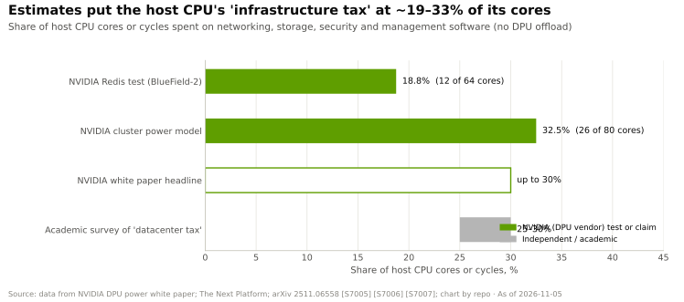
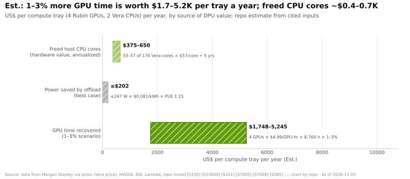

# DPU 的作用
> [!NOTE]
> 本页为英文原文的简体中文参考译文，仅供参考；如有出入，以[英文原文](../../../layers/07-dpu-supernic-storage-security/what-a-dpu-does.md "English original")为准。

第 07 层 · DPU、SuperNIC、存储与安全 · 阅读约 8 分钟 · 最后核实：2026-11-05

## ⚡ 要点速览

- **[数据处理器（DPU）](../../glossary.md#dpu)就是一块自带“板载计算机”的网卡**：它用 Arm 核心、内存和固定功能引擎来运行云运营方的基础设施“管线”，而不再占用主机 CPU [[S270]](../../../sources/bibliography.md#s270)[[S7001]](../../../sources/bibliography.md#s7001)。
- **这套“管线”用软件实现代价高昂：**各方估计这项[基础设施税](../../glossary.md#infrastructure-tax)约占主机 CPU 核心的 19–33%；四项估计中有三项来自出售 DPU 的英伟达 [[S7005]](../../../sources/bibliography.md#s7005)[[S7006]](../../../sources/bibliography.md#s7006)[[S7007]](../../../sources/bibliography.md#s7007)。
- **在 GPU 服务器中，释放出来的 CPU 核心并不值钱：**每个 Vera Rubin 计算托盘每年约 $375–650（估计），而每挽回 1–3% 的 GPU 时间就值 $1.7–5.2K [[S7000]](../../../sources/bibliography.md#s7000)。AI 场景下 DPU 的价值在于隔离和线速数据搬运。
- **BlueField-4**（2025-10-28 发布）：64 个 Arm Neoverse V2 核心（即 Grace 所用的核心）、128 GB LPDDR5、800 Gb/s、[PCIe](../../glossary.md#pcie) Gen6 x16；英伟达称其算力为 BlueField-3 的 6× [[S7001]](../../../sources/bibliography.md#s7001)[[S512]](../../../sources/bibliography.md#s512)。🟢 在 GTC 2026 上被列为已全面量产，放量与 H2 2026 的 Vera Rubin 挂钩 [[S501]](../../../sources/bibliography.md#s501)[[S7511]](../../../sources/bibliography.md#s7511)。
- **弱点：**AWS（Nitro）和谷歌（Google，Titanium）自研卸载方案 [[S292]](../../../sources/bibliography.md#s292)[[S7520]](../../../sources/bibliography.md#s7520)，AMD 和英特尔（Intel）销售支持 P4 编程的替代产品 [[S289]](../../../sources/bibliography.md#s289)[[S291]](../../../sources/bibliography.md#s291)，而英伟达“可替代 30 至 300 个 CPU 核心”的说法属于营销话术，而非基准测试结果 [[S7008]](../../../sources/bibliography.md#s7008)。

## 1. DPU 卸载了什么

不妨把它想象成一栋写字楼。总得有人管理大堂：安保、收发室、总机。没有 DPU 时，这些员工就在租户自己的工位上办公。DPU 把“大堂”搬到楼下，由房东在租户无法进入的硬件上运营。它承担五类工作：

- **网络：**[虚拟交换机](../../glossary.md#virtual-switch)和[覆盖网络（overlay）](../../glossary.md#overlay-network)让每个租户在共享线缆上拥有私有网络。
- **存储：**DPU 通过 [NVMe-oF](../../glossary.md#nvme-of) 访问远端闪存，并将其以本地 [NVMe](../../glossary.md#nvme) 盘的形式呈现给主机。
- **安全：**在线 [IPsec](../../glossary.md#ipsec)/TLS 加密、有状态防火墙以及[硬件信任根](../../glossary.md#root-of-trust)。
- **[多租户](../../glossary.md#multi-tenancy)：**运营方的控制平面驻留在 DPU 上，因此即便[裸金属](../../glossary.md#bare-metal)租户掌控主机操作系统，也无法修改网络策略；BlueField-4 的 ASTRA 设计由 DPU 执行策略 [[S7024]](../../../sources/bibliography.md#s7024)。
- **[遥测](../../glossary.md#telemetry)：**以线速采集流量与拥塞计数器，用于找出拖慢整体的“掉队者”（straggler）。

**[Q1 · 职能与失效后果]** 本层的职能是以线速、安全且在租户相互隔离的前提下，将每一个字节搬进搬出每颗 GPU，同时不消耗 GPU 或主机 CPU 周期。若这一层薄弱，GPU 会等待 I/O，约 19–33% 的主机核心消耗在“管线”上，云厂商无法安全地出租裸金属，检查点与上下文重新加载变慢（见[面向 AI 的存储](storage-for-ai.md)），使用中的数据也会暴露（见[机密计算](confidential-computing.md)）。

> [!TIP]
> **算例 —— 没有卸载时，一个 Vera Rubin 托盘会损失多少主机核心。**一个计算托盘有 2 颗 Vera CPU × 88 核 = **176 个主机核心** [[S100]](../../../sources/bibliography.md#s100)。按英伟达实测的 18.75% 到模型推算的 32.5% [[S7005]](../../../sources/bibliography.md#s7005)[[S7006]](../../../sources/bibliography.md#s7006)，基础设施软件将吞掉 **33–57 个核心**。按每颗 Vera 约 $5,000（估计，摩根士丹利）[[S331]](../../../sources/bibliography.md#s331)、即每核约 $57 计，**每个托盘约合 $1,900–3,250 的 CPU 芯片成本**。**结论：**相对于每个计算托盘约 $430K 的机架价格（估计，$7.8M ÷ 18）[[S330]](../../../sources/bibliography.md#s330)，CPU 节省不到硬件账单的 1%。

🔧 技术细节：DPU 内部的快速路径与慢速路径

- **慢速路径：**新连接的首个数据包交给 Arm 核心处理，由其查询租户策略，并将一条规则写入[网卡（NIC）](../../glossary.md#nic)的硬件交换单元。
- **快速路径：**该数据流的后续数据包命中规则后，由固定功能硬件完成改写、加密或转发，无需经过任何核心。
- **原因：**在 800 Gb/s 下，每约 15 ns 就到达一个 1,500 字节的数据包，软件逐包检查根本来不及。
- **可编程性：**英伟达通过 [DOCA](../../glossary.md#doca) 开放这一能力；AMD Pensando 和英特尔的 IPU 则开放 P4 流水线 [[S289]](../../../sources/bibliography.md#s289)[[S291]](../../../sources/bibliography.md#s291)。

## 2. 为什么它在 AI 云中更重要

与通用云相比，AI 云有三点不同。**GPU 时数远超 CPU 时数：**按 Lambda 每 GPU 小时 $4.99 的挂牌价，四颗 Blackwell 级 GPU 一年租金约 $175K [[S395]](../../../sources/bibliography.md#s395)。**裸金属成为常态：**[新兴云服务商（neocloud）](../../glossary.md#neocloud)整台出租服务器，因此运营方的控制软件必须驻留在租户触及不到的地方，这正是 DPU 的[零信任](../../glossary.md#zero-trust)角色。**线速已超出软件能力：**在 400–800 Gb/s 下，加密和存储协议必须由硬件实现。

> [!TIP]
> **算例 —— DPU 每托盘、每机架价值几何。**按 5 年服务器寿命 [[S385]](../../../sources/bibliography.md#s385)，释放的核心每个托盘**每年约值 $375–650**。英伟达最佳情形下的节电（247 W）[[S7005]](../../../sources/bibliography.md#s7005)，按 $0.081/kWh 电价 [[S389]](../../../sources/bibliography.md#s389) 和 1.15 的 [PUE](../../glossary.md#pue) [[S387]](../../../sources/bibliography.md#s387)[[S388]](../../../sources/bibliography.md#s388) 计，每年约值 $200。四颗按每小时 $4.99 计价的 GPU [[S395]](../../../sources/bibliography.md#s395) 挽回 1–3% 的 GPU 时间，**每年值 $1,750–5,250**。在一个 18 托盘的 [NVL72](../../glossary.md#nvl72) 上，核心带来的价值约 $7–12K，而 **GPU 时间带来的价值约 $31–94K**（估计）[[S7000]](../../../sources/bibliography.md#s7000)。**结论：**应以 DPU 消除的 GPU 空闲时间和租户风险来评判它，而厂商很少独立测量这些指标。

> [!WARNING]
> **误区与事实。***误区：*“DPU 靠释放 CPU 核心就能收回成本。”*事实：*在 GPU 服务器中，释放的核心每个托盘每年只值几百美元；真正的价值在于隔离、线速加密与存储，以及更少的 GPU 停顿，而这些更难证明。英伟达自己的白皮书也没有为释放的核心估值 [[S7006]](../../../sources/bibliography.md#s7006)。

## 3. BlueField 各代产品与 DOCA

**[Q3 · 代际进步]** 带宽每代翻倍，从 100 → 800 Gb/s。单位比特的算力则不然：BlueField-2 和 -3 都是每 100 Gb/s 配 4 个 Arm 核心，BlueField-4 则以服务器级核心将其翻倍至 8 个 [[S7001]](../../../sources/bibliography.md#s7001)。DPU 已不再只是数据包引擎；BlueField-4 还运行存储和 KV 缓存服务（见[面向 AI 的存储](storage-for-ai.md)）。

| 代际（年份） | Arm 核心 | 网络 | 主机链路 | 英伟达的说法 |
|---|---|---|---|---|
| BlueField-1 (2018) | 16 × Cortex-A72 | 2 × 100 Gb/s | PCIe Gen3/4 | Mellanox 设计 [[S273]](../../../sources/bibliography.md#s273) |
| BlueField-2 (2020) | 8 × Cortex-A72 | 最高 200 Gb/s | PCIe Gen4 | 约 30 个等效核心；推出 DOCA [[S270]](../../../sources/bibliography.md#s270)[[S7008]](../../../sources/bibliography.md#s7008) |
| BlueField-3 (2022) | 16 × Cortex-A78 | 400 Gb/s | PCIe Gen5 | 最多 300 个等效核心（安全场景）[[S269]](../../../sources/bibliography.md#s269)[[S7008]](../../../sources/bibliography.md#s7008) |
| BlueField-4 (2026) | 64 × Neoverse V2，128 GB | 800 Gb/s | PCIe Gen6 x16 | 算力为 BlueField-3 的 6× [[S7001]](../../../sources/bibliography.md#s7001)[[S512]](../../../sources/bibliography.md#s512) |
| BlueField-5 (2028) | 未披露 | 未披露 | 未披露 | 🟡 列于 Feynman 路线图 [[S90004]](../../../sources/bibliography.md#s90004)[[S502]](../../../sources/bibliography.md#s502) |

**DOCA** 之于 DPU，正如 [CUDA](../../glossary.md#cuda) 之于 GPU：它提供一系列库和服务，让运营方无需编写网卡固件即可对卸载功能编程。截至 2026 年 10 月，英伟达已推出 Weave 等 DOCA 微服务，可借助硬件 VXLAN 在 BlueField-4 和 ConnectX-9 上隔离各租户的流量 [[S7024]](../../../sources/bibliography.md#s7024)。每多一个基于 DOCA 编写的服务，迁移到采用 P4 编程的 AMD 或英特尔产品的成本就更高一分 [[S289]](../../../sources/bibliography.md#s289)[[S291]](../../../sources/bibliography.md#s291)。

> [!TIP]
> **算例 —— 为什么 64 个核心仍无法逐包处理。**在 800 Gb/s 下，满尺寸 1,500 字节数据包的到达速率约为**每秒 6,700 万个**：每个核心每秒约 100 万个，即**每包约 1 µs**，在典型的 2–3 GHz 主频下相当于几千个周期（估计；BlueField-4 的主频未披露）[[S7001]](../../../sources/bibliography.md#s7001)[[S7000]](../../../sources/bibliography.md#s7000)。**结论：**数据包由硬件转发；64 个核心服务于控制、存储和 KV 缓存软件，因此核心数量跟随的是新增的软件任务，而非带宽。

🔧 技术细节：BlueField-4 的具体规格与悬而未决的问题

- **构成：**一颗 Grace 级 CPU 加上 ConnectX-9 网络；64 个 Neoverse V2 核心、128 GB LPDDR5、800 Gb/s、PCIe 6.0 x16 [[S7001]](../../../sources/bibliography.md#s7001)[[S7002]](../../../sources/bibliography.md#s7002)。
- **未解之处：**报道的晶体管数量相互矛盾（64B 与 126B）[[S7002]](../../../sources/bibliography.md#s7002)；主频、功耗和价格均未披露。

## 🎯 企业发展视角

1. **配套率是关键变量。**AWS 和谷歌使用自研卸载芯片 [[S292]](../../../sources/bibliography.md#s292)[[S7520]](../../../sources/bibliography.md#s7520)；有多少新兴云服务商、主权客户和企业将 BlueField-4 作为标准配置，将决定这块价值池的大小（见[竞争](competition.md)）。
2. **DOCA 与 P4 之争是对软件护城河的检验。**以 DOCA 服务形式编写的基础设施让 [BlueField](../../glossary.md#bluefield) 具有黏性；开放的 P4 与 Linux 工具链则会把它变成一块“带核心的普通网卡”。
3. **DPU 正在变成存储服务器的 CPU。**BlueField-4 驱动 STX 存储机柜 [[S7511]](../../../sources/bibliography.md#s7511)，而这个插槽过去由 [x86](../../glossary.md#x86) CPU 占据（见[价值链](value-chain-and-corp-dev.md)）。
4. **高通（Qualcomm）的问题（仅基于公开信息）：**AI200/AI250 机架采用以太网[横向扩展（scale-out）](../../glossary.md#scale-out) [[S173]](../../../sources/bibliography.md#s173)[[S90029]](../../../sources/bibliography.md#s90029)。机架级推理是否需要自己的卸载与隔离方案、合作伙伴的 DPU，还是客户现有的网卡即可？

## 📚 来源（Sources）

<!-- Auto-generated from the [S…] citations on this page by `make build`. Edit sources/registry/*.csv, not this list. -->

- [**S100**](../../../sources/bibliography.md#s100) NVIDIA Technical Blog, *Inside the NVIDIA Vera Rubin Platform: Six New Chips, One AI Supercomputer*, 2026-01-05. [Link](https://developer.nvidia.com/blog/inside-the-nvidia-rubin-platform-six-new-chips-one-ai-supercomputer/)
- [**S173**](../../../sources/bibliography.md#s173) Qualcomm, *Qualcomm Unveils AI200 and AI250 - Redefining Rack-Scale Data Center Inference*, 2025-10-27. [Link](https://www.qualcomm.com/news/releases/2025/10/qualcomm-unveils-ai200-and-ai250-redefining-rack-scale-data-cent)
- [**S269**](../../../sources/bibliography.md#s269) NVIDIA Newsroom, *NVIDIA Extends Data Center Infrastructure Processing Roadmap with BlueField-3*, 2021-04-12. [Link](https://nvidianews.nvidia.com/news/nvidia-extends-data-center-infrastructure-processing-roadmap-with-bluefield-3)
- [**S270**](../../../sources/bibliography.md#s270) NVIDIA Newsroom, *NVIDIA Introduces New Family of BlueField DPUs to Bring Breakthrough Networking, Storage and Security Performance to Every Data Center*, 2020-10-05. [Link](https://nvidianews.nvidia.com/news/nvidia-introduces-new-family-of-bluefield-dpus-to-bring-breakthrough-networking-storage-and-security-performance-to-every-data-center)
- [**S273**](../../../sources/bibliography.md#s273) NVIDIA Docs, *NVIDIA Networking documentation hub (ConnectX adapter, Quantum and Spectrum switch product briefs and user manuals)*, 2025. [Link](https://docs.nvidia.com/networking/)
- [**S289**](../../../sources/bibliography.md#s289) AMD, *AMD Advancing AI 2024: Pensando Pollara 400 AI NIC and Salina DPU*, 2024-10-10. [Link](https://www.amd.com/en/newsroom.html)
- [**S291**](../../../sources/bibliography.md#s291) Intel, *Intel Infrastructure Processing Unit (IPU) E2100 (Mount Evans)*, 2022. [Link](https://www.intel.com/content/www/us/en/products/details/network-io/ipu.html)
- [**S292**](../../../sources/bibliography.md#s292) Amazon Web Services, *Elastic Fabric Adapter (EFA) and AWS Nitro System documentation*, 2025. [Link](https://aws.amazon.com/hpc/efa/)
- [**S330**](../../../sources/bibliography.md#s330) PC Gamer, *A single Nvidia Vera Rubin rack is estimated to cost $7,803,148 with over $2 million of that figure spent on memory alone*, 2026-05. [Link](https://pcgamer.com/hardware/a-single-nvidia-vera-rubin-rack-is-estimated-to-cost-usd7-803-148-with-over-usd2-million-of-that-figure-spent-on-memory-alone)
- [**S331**](../../../sources/bibliography.md#s331) Wccftech, *NVIDIA's Vera Rubin rack hit with 435% memory price surge, pushing HBM4 & LPDDR5X bill to $2M of $7.8M total*, 2026-05. [Link](https://wccftech.com/nvidia-vera-rubin-rack-hit-with-memory-price-surge-pushing-hbm4-lpddr5x-bill-to-2m-of-7-8m-total/)
- [**S385**](../../../sources/bibliography.md#s385) Amazon via SEC EDGAR, *Amazon.com Form 10-K filings (FY2019-FY2024) - useful lives of servers*, 2025-02-07. [Link](https://www.sec.gov/cgi-bin/browse-edgar?action=getcompany&CIK=0001018724&type=10-K&dateb=&owner=include&count=40)
- [**S387**](../../../sources/bibliography.md#s387) Uptime Institute, *Uptime Institute Global Data Center Survey 2024*, 2024-07. [Link](https://uptimeinstitute.com/resources/research-and-reports/uptime-institute-global-data-center-survey-results-2024)
- [**S388**](../../../sources/bibliography.md#s388) Google, *Google data centers: efficiency (fleet-wide PUE)*, 2025. [Link](https://datacenters.google/efficiency/)
- [**S389**](../../../sources/bibliography.md#s389) U.S. Energy Information Administration, *EIA Electric Power Monthly, Table 5.6.A: average price of electricity to ultimate customers by end-use sector*, 2025. [Link](https://www.eia.gov/electricity/monthly/epm_table_grapher.php?t=epmt_5_6_a)
- [**S395**](../../../sources/bibliography.md#s395) Lambda, *Lambda GPU cloud pricing*, 2025. [Link](https://lambda.ai/pricing)
- [**S501**](../../../sources/bibliography.md#s501) eWeek, *Everything Nvidia Just Announced at GTC 2026: 7 Chips, 5 Racks, 1 Giant Bet on Agentic AI*, 2026-03-17. [Link](https://www.eweek.com/news/nvidia-gtc-2026-ai-inference-vera-rubin-neuron/)
- [**S502**](../../../sources/bibliography.md#s502) Tom's Hardware, *Nvidia updates data center roadmap with Rosa CPU and stacked Feynman GPUs; optical NVLink; Groq LPUs with NVFP4 and NVLink also on deck*, 2026-03-17. [Link](https://www.tomshardware.com/pc-components/gpus/nvidia-updates-data-center-roadmap-with-rosa-cpu-and-stacked-feynman-gpus-optical-nvlink-groq-lpus-with-nvfp4-and-nvlink-also-on-deck)
- [**S512**](../../../sources/bibliography.md#s512) NVIDIA Blog, *NVIDIA Launches BlueField-4: The Processor Powering the Operating System of AI Factories*, 2025-10-28. [Link](https://blogs.nvidia.com/blog/bluefield-4-ai-factory/)
- [**S7000**](../../../sources/bibliography.md#s7000) nvidia_deep_dive_claude repository, *Repo analysis: layer 07 models (DPU offload value per compute tray, checkpoint write time, KV-cache reload time by tier)*, 2026-11-05. [Link](https://github.com/FrankHuang94/nvidia_deep_dive_claude/blob/main/layers/07-dpu-supernic-storage-security/index.md)
- [**S7001**](../../../sources/bibliography.md#s7001) NVIDIA, *NVIDIA BlueField-4 DPU datasheet*, 2026-05. [Link](https://dam-cdn.nvd.orangelogic.com/AssetLink/m8w7t64m2k40j51sx8xb4ok712b743ux.pdf)
- [**S7002**](../../../sources/bibliography.md#s7002) ServeTheHome, *NVIDIA BlueField-4 with 64 Arm cores and 800G networking announced for 2026*, 2025-10-28. [Link](https://www.servethehome.com/nvidia-bluefield-4-with-64-arm-cores-and-800g-networking-announced-for-2026/)
- [**S7005**](../../../sources/bibliography.md#s7005) NVIDIA, *NVIDIA DPU Power Efficiency (white paper)*, 2022-11. [Link](https://dcmag.fr/wp-content/uploads/2022/11/nvidia-dpu-power-efficiency-white-paper-2508650.pdf)
- [**S7006**](../../../sources/bibliography.md#s7006) The Next Platform, *Economics and the inevitability of the DPU*, 2022-11-03. [Link](https://www.nextplatform.com/connect/2022/11/03/economics-and-the-inevitability-of-the-dpu/1635681)
- [**S7007**](../../../sources/bibliography.md#s7007) arXiv:2511.06558, *Offloading Data Center Tax*, 2025-11. [Link](https://arxiv.org/html/2511.06558v1)
- [**S7008**](../../../sources/bibliography.md#s7008) SDxCentral, *Nvidia unveils next-gen BlueField DPU*, 2021-04. [Link](https://www.sdxcentral.com/articles/news/nvidia-unveils-next-gen-bluefield-dpu/2021/04)
- [**S7024**](../../../sources/bibliography.md#s7024) NVIDIA NGC Catalog, *DOCA Weave Service (dpf-weave Helm chart v26.8.0)*, 2026-10-12. [Link](https://catalog.ngc.nvidia.com/orgs/nvidia/doca/helm-charts/dpf-weave/v26.8.0)
- [**S7511**](../../../sources/bibliography.md#s7511) NVIDIA Newsroom, *NVIDIA Launches BlueField-4 STX Storage Architecture With Broad Industry Adoption*, 2026-03-16. [Link](https://nvidianews.nvidia.com/news/nvidia-launches-bluefield-4-stx-storage-architecture-with-broad-industry-adoption)
- [**S7520**](../../../sources/bibliography.md#s7520) Google Cloud, *Titanium (Google Cloud product page)*, 2024. [Link](https://cloud.google.com/titanium)
- [**S90004**](../../../sources/bibliography.md#s90004) TrendForce, *Key GTC takeaways: how Samsung, Micron, Intel and more power NVIDIA's Vera Rubin and Feynman*, 2026-03-17. [Link](https://www.trendforce.com/news/2026/03/17/news-key-gtc-takeaways-how-samsung-micron-intel-more-power-nvidias-vera-rubin-and-feynman/)
- [**S90029**](../../../sources/bibliography.md#s90029) Verdict, *Qualcomm AI200 and AI250 racks for AI inference*, 2025-10. [Link](https://www.verdict.co.uk/qualcomm-ai200-ai250-racks-ai-inference/)
