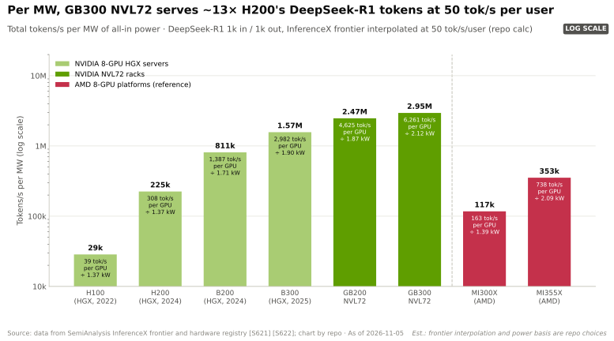
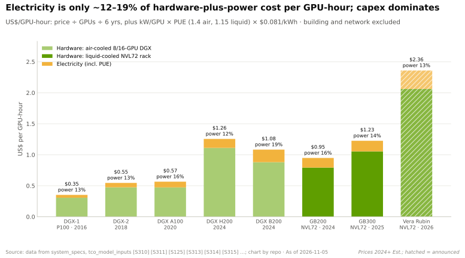
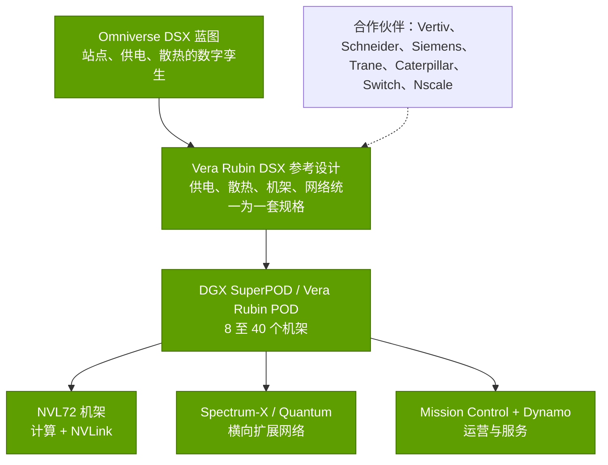
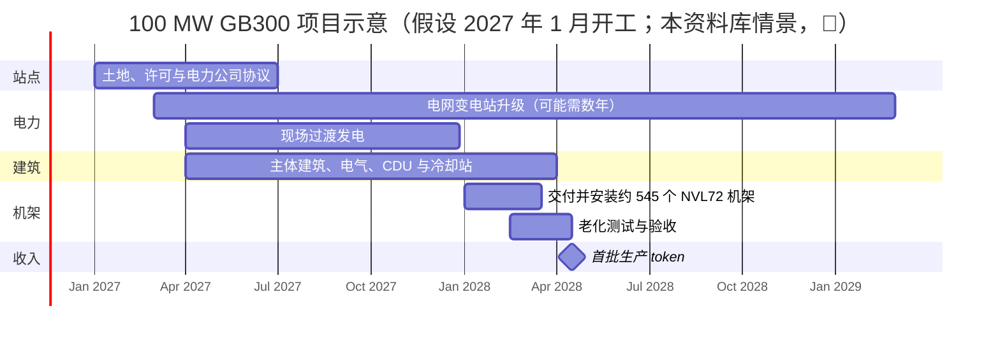

# AI 工厂：每兆瓦 token 数、蓝图与建设速度

> [!NOTE]
> 本页为英文原文的简体中文参考译文，仅供参考；如有出入，以[英文原文](../../../layers/08-systems-racks-ai-factories/ai-factories.md "English original")为准。

第 08 层 · 系统、机架与 AI 工厂 · 约 11 分钟阅读 · 最后核实：2026-11-05

## ⚡ 要点速览

- **[AI 工厂](../../glossary.md#ai-factory)是以单位电力产出来衡量的数据中心。** 英伟达（NVIDIA）的核心指标是[每兆瓦每秒 token 数](../../glossary.md#tokens-per-megawatt)：它给出的数字是 GB300 [NVL72](../../glossary.md#nvl72) 为 2.8M，[HGX](../../glossary.md#hgx) H200 为 54K，即在其自选工作点上宣称的 50 倍 [[S8021]](../../../sources/bibliography.md#s8021)[[S32004]](../../../sources/bibliography.md#s32004)。
- **独立数据缩小了差距，但证实了差距的存在：** 根据 InferenceX 的 DeepSeek-R1 数据，在每用户 50 tok/s 时，GB300 NVL72 每兆瓦产出约 2.95M tokens/s，而 H200 约为 225K，约 13 倍（本资料库估计）[[S621]](../../../sources/bibliography.md#s621)[[S622]](../../../sources/bibliography.md#s622)。
- **Vera Rubin 进一步拉大差距：** SemiAnalysis 基于早期工程样品测得，在每用户 100 tok/s 以内，其每兆瓦 token 数约为 GB300 的 2 倍，在接近 200 tok/s 时约为 4 倍 [[S626]](../../../sources/bibliography.md#s626)。
- **蓝图卖的是整个站点：** DGX SuperPOD（8 个 GB200 机架）、40 个机架的 Vera Rubin POD、配有 Omniverse DSX 数字孪生的 Vera Rubin DSX 参考设计，以及用于运营的 Mission Control 软件 [[S396]](../../../sources/bibliography.md#s396)[[S511]](../../../sources/bibliography.md#s511)[[S8017]](../../../sources/bibliography.md#s8017)[[S8019]](../../../sources/bibliography.md#s8019)。
- **速度是稀缺投入：** xAI 用 122 天建成 Colossus 1（100k 颗 Hopper GPU）；Stargate Abilene 的首批 200+ MW 用了约 15 个月；而新增电网供电可能需要 4–7 年 [[S6000]](../../../sources/bibliography.md#s6000)[[S8012]](../../../sources/bibliography.md#s8012)[[S8013]](../../../sources/bibliography.md#s8013)[[S8009]](../../../sources/bibliography.md#s8009)[[S8010]](../../../sources/bibliography.md#s8010)。
- **看空观点：** 每兆瓦 token 数取决于模型、上下文和交互速度；CoreWeave 宣称 Vera Rubin 提升 10 倍，所用的 GB200 软件基线已是一年前的版本 [[S626]](../../../sources/bibliography.md#s626)。

## 1. AI 工厂的框架：输入电力，输出 token

对 AI 数据中心而言，稀缺的投入是**兆瓦**（电网接入需要数年，参见[电力与散热](power-and-cooling.md)），产出是 **token**。衡量标准是*在给定的每用户速度下*（[交互速度](../../glossary.md#interactivity)）每兆瓦每秒的 token 数，因为批处理更多用户会提高吞吐量，但会拖慢每个用户（即[帕累托前沿](../../glossary.md#pareto-frontier)）。

**[Q2 · 关键指标]** 五个数字决定了这一层的经济性：（1）在给定交互速度下的**每兆瓦 tokens/s**；（2）**每机架 kW 与每 GPU [全口径功耗](../../glossary.md#all-in-power)**（GB300：约 132 kW、约 2.12 kW）[[S337]](../../../sources/bibliography.md#s337)[[S622]](../../../sources/bibliography.md#s622)；（3）**[PUE](../../glossary.md#pue)**（2025 年行业平均 1.54，最佳超大规模机群约 1.1）[[S8007]](../../../sources/bibliography.md#s8007)[[S388]](../../../sources/bibliography.md#s388)；（4）**通电时间与首个 token 产出时间**；（5）**每 [GPU 小时](../../glossary.md#gpu-hour)成本**，即每百万 token 美元成本的分母（[第 14 章](../../cross-cutting/14-training-vs-inference-economics.md)）。

> [!TIP]
> **算例 —— 100 MW 能产出什么。** 按每颗 GB300 GPU 全口径约 2.12 kW 计 [[S622]](../../../sources/bibliography.md#s622)，100 MW 可运行**约 47,000 颗 GPU**。按每兆瓦约 2.95M tokens/s（DeepSeek-R1，每用户 50 tok/s，估计）计，该站点每秒产出**约 295M 个 token**，满负荷利用下每年约 **9.3 千万亿（quadrillion）个 token**。同样 100 MW 的 H200（每兆瓦约 225K）每秒只产出约 22M 个 token，**约少 13 倍** [[S621]](../../../sources/bibliography.md#s621)[[S622]](../../../sources/bibliography.md#s622)。GPU 小时数则方向相反：1 MW 可容纳 472 颗 GB300（**每年 4.1M GPU 小时**），而 H200 为 730 颗（6.4M），但每个 GB300 GPU 小时产出约 22.5M 个 token，H200 仅约 1.1M（本资料库测算）。**结论：**在电力受限的站点中，一兆瓦旧 GPU 只能赚到零头的 token。

> [!WARNING]
> **误区与事实：**“GB300 是 Hopper 的 50 倍。”英伟达的 50 倍是在单一工作点上，将每用户速度约 10 倍的提升乘以每兆瓦吞吐量约 5 倍的提升 [[S32004]](../../../sources/bibliography.md#s32004)；根据 InferenceX 数据，本资料库发现在每用户 50 tok/s 时约为 H200 的 13 倍，而在每用户约 100 tok/s 时，GB300 相对 8 GPU B300 服务器的领先几乎消失（估计）[[S621]](../../../sources/bibliography.md#s621)。任何倍数都只是曲线上的一个点。

电力约束的是*数量*，而非成本：电费仅占每 GPU 小时“硬件 + 电力”成本的约 12–19%（本资料库估计，按 6 年寿命、8.1¢/kWh 计）[[S389]](../../../sources/bibliography.md#s389)[[S382]](../../../sources/bibliography.md#s382)。

🔧 技术细节：每兆瓦 token 数图表如何计算

- **吞吐量：** 取 InferenceX 公布的各系统最佳前沿点（DeepSeek-R1，1k 输入 / 1k 输出，不使用投机解码），在每用户 50 tok/s 处做对数线性插值 [[S621]](../../../sources/bibliography.md#s621)。
- **功耗：** 采用 InferenceX 注册表中 SemiAnalysis 给出的每 GPU 全口径功耗（H200 1.37 kW，GB300 2.12，Vera Rubin 3.30）[[S622]](../../../sources/bibliography.md#s622)。
- **注意事项：** 统计的是总 token 数（输入 + 输出），仅一个模型，前沿点稀疏；SemiAnalysis 自己的每兆瓦图表只统计输出 token [[S626]](../../../sources/bibliography.md#s626)。

## 2. 蓝图与参考架构

英伟达以层层嵌套的参考设计来出售工厂：

- **[DGX SuperPOD](../../glossary.md#superpod)：** 8 个 GB200 NVL72 机架，576 颗 GPU，稀疏 [FP4](../../glossary.md#fp4) 算力 11.5 EF [[S396]](../../../sources/bibliography.md#s396)；Vera Rubin POD 跨 40 个机架，约 60 EF [[S511]](../../../sources/bibliography.md#s511)。
- **[Omniverse DSX](../../glossary.md#digital-twin)：** 面向吉瓦级站点的数字孪生蓝图（2025 年 10 月）[[S8018]](../../../sources/bibliography.md#s8018)，自 GTC 2026 起随 Vera Rubin DSX 参考设计全面推出，目标是提升每瓦 token 数并缩短投产时间。维谛（Vertiv，预制化 OneCore Rubin DSX）、Switch 以及携手卡特彼勒（Caterpillar）的 Nscale 均基于它进行建设 [[S8017]](../../../sources/bibliography.md#s8017)[[S90063]](../../../sources/bibliography.md#s90063)。
- **[Mission Control](../../glossary.md#mission-control)**（GTC 2025）将 Base Command Manager 与 Run:ai 相结合，实现资源调配、监控和故障诊断的自动化，英伟达称其可将利用率最高提升 5 倍（厂商说法）[[S8019]](../../../sources/bibliography.md#s8019)[[S8020]](../../../sources/bibliography.md#s8020)；[Dynamo](../../glossary.md#dynamo) 1.0 负责推理调度 [[S90066]](../../../sources/bibliography.md#s90066)（[第 11 层](../11-inference-and-ai-software/index.md)）。

> [!TIP]
> **算例 —— 1 吉瓦中有多少属于英伟达。** 英伟达 CEO 估计一座 1 GW 的 AI 工厂全部投入约 $50–60B，其中约 $35B 为英伟达的产品 [[S398]](../../../sources/bibliography.md#s398)：**约 58–70%**。我们假设的 100,000 颗 GPU 的 GB300 站点（约 255 MW，见[电力与散热](power-and-cooling.md)）按摩根士丹利的价格计，机架约 $5.5B，其中仅 GPU 就约 $3.5B（估计）[[S332]](../../../sources/bibliography.md#s332)。**结论：**参考设计让英伟达能够把剩下的 30–40%（供电、散热、建筑、网络）引导给符合其规格的合作伙伴。

### 是什么把价值从 OEM 和 ODM 转移给英伟达

1. **BOM 规格：** 英伟达固定了托盘、交换机、背板、供电和散热接口；摩根士丹利预计 ODM 毛利率将从约 2.7%（GB300）降至约 1.9%（Vera Rubin）[[S332]](../../../sources/bibliography.md#s332)。
2. **预装托盘：** 据报道，英伟达将交付 [L10](../../glossary.md#l6-l10-l11) 级 Vera Rubin 计算托盘，约占服务器成本的 90%（🟡）[[S8022]](../../../sources/bibliography.md#s8022)[[S329]](../../../sources/bibliography.md#s329)。
3. **蓝图与软件：** 设施按 DSX 设计，而 Mission Control 和 Dynamo 占据了过去 OEM 管理工具的位置 [[S8017]](../../../sources/bibliography.md#s8017)[[S8019]](../../../sources/bibliography.md#s8019)。

OEM 保留了企业服务和融资业务，[超大规模云厂商](../../glossary.md#hyperscaler)则为自研芯片设计机架；具体的美元分配见[价值链与企业发展](value-chain-and-corp-dev.md)。

## 3. 首个 token 产出时间：从选址到投产

对一个集群而言，“首个 token 产出时间”是指从选定站点到开始出售 token 所需的月数。链条为**选址与许可 → 电力 → 主体建筑与冷却站 → 机架交付 → [老化测试](../../glossary.md#burn-in) → 投产**，而电力通常是耗时最长的环节。

**xAI Colossus 1** 将孟菲斯一栋现有建筑改造成 100,000 颗 Hopper GPU 的集群，用时 122 天，从首个机架到开始训练仅 19 天（公司说法）[[S6000]](../../../sources/bibliography.md#s6000)。**Stargate Abilene**（Crusoe 为甲骨文（Oracle）和 OpenAI 建设）约于 2024 年 6 月开工，约 2025 年 6 月收到首批 GB200 机架，2025 年 9 月已有两栋建筑、200+ MW 投入运行 [[S8012]](../../../sources/bibliography.md#s8012)[[S8013]](../../../sources/bibliography.md#s8013)；1.2 GW 园区的目标是 2026 年年中（Epoch AI 估计为 2026 年第四季度）[[S8013]](../../../sources/bibliography.md#s8013)[[S8014]](../../../sources/bibliography.md#s8014)。

> [!TIP]
> **算例 —— 一座 100 MW 的 GB300 机房，从开工到产出 token。** 100 MW 在 PUE 1.15 下留出约 87 MW 的 IT 负载；按每机架含网络分摊约 160 kW（132 kW × 145/120）计，可容纳**约 545 个机架、约 39,000 颗 GPU**（本资料库测算）[[S337]](../../../sources/bibliography.md#s337)[[S340]](../../../sources/bibliography.md#s340)。若电力已到位，参照 Abilene 的速度（约 12 个月到首批机架，约 15 个月投产）是可信的目标 [[S8012]](../../../sources/bibliography.md#s8012)[[S8013]](../../../sources/bibliography.md#s8013)；若需等待新的电网供应，则要再加上**超过四年**的中位排队时间 [[S8009]](../../../sources/bibliography.md#s8009)。按每 100 MW 约 295M tokens/s（估计）计，每推迟一个月就少产出约 0.8 千万亿个 token。**结论：**凡是能缩短工期的东西，买家都愿意付钱：预制化供电与散热、现场发电、数字孪生、更快的托盘组装。

🔧 技术细节：老化测试对机架级系统为何重要

一台 NVL72 必须以整机架形式通过 [NVLink](../../glossary.md#nvlink)、液冷回路和供电测试，才能开始创收。SemiAnalysis 指出，GB200 铜缆背板在上量期间出现过可靠性问题，并预计得益于无线缆托盘，Vera Rubin 的上量会更快；CoreWeave 首批 Vera Rubin 结果来自一个没有[横向扩展](../../glossary.md#scale-out)网络的试产机架 [[S626]](../../../sources/bibliography.md#s626)。

## 🎯 企业发展视角

1. **指标即市场。** 如果买家把每兆瓦 token 数作为采购标准，竞争对手就必须公布可比的每兆瓦曲线；AMD、TPU 和 Trainium 的宣传数据很少以固定交互速度下的全口径每兆瓦来表述。
2. **通电时间是可交易的资产。** 已通电的土地、现场发电和预制化电站（Vertiv OneCore、Switch EVO）正是基础设施资本流向之处 [[S8017]](../../../sources/bibliography.md#s8017)[[S8015]](../../../sources/bibliography.md#s8015)。
3. **参考设计与运营软件把议价权转移**给了英伟达：哪些设施供应商会成为“DSX 认证”供应商？对挑战者而言，一份厂商中立的蓝图或跨厂商的运营层，是否比一颗更快的芯片更重要？
4. **高通（Qualcomm）的问题（仅基于公开信息）：** HUMAIN 计划自 2026 年起部署 200 MW 的高通 AI200/AI250 机架 [[S173]](../../../sources/bibliography.md#s173)；在给定交互速度下，什么样的每兆瓦 token 数据才能让这类机架在电力受限的站点中具有说服力？合作伙伴蓝图能否缩短其首个 token 产出时间？

## 📚 来源（Sources）

<!-- Auto-generated from the [S…] citations on this page by `make build`. Edit sources/registry/*.csv, not this list. -->

- [**S173**](../../../sources/bibliography.md#s173) Qualcomm, *Qualcomm Unveils AI200 and AI250 - Redefining Rack-Scale Data Center Inference*, 2025-10-27. [Link](https://www.qualcomm.com/news/releases/2025/10/qualcomm-unveils-ai200-and-ai250-redefining-rack-scale-data-cent)
- [**S329**](../../../sources/bibliography.md#s329) Tom's Hardware, *Price of Nvidia's Vera Rubin NVL72 racks skyrockets to as much as $8.8 million apiece, but server makers' margins will be tight*, 2026. [Link](https://www.tomshardware.com/tech-industry/artificial-intelligence/price-of-nvidias-vera-rubin-nvl72-racks-skyrockets-to-as-much-as-usd8-8-million-apiece-but-server-makers-margins-will-be-tight-nvidia-is-moving-closer-to-shipping-entire-full-scale-systems)
- [**S332**](../../../sources/bibliography.md#s332) Tiger Brokers (iTiger), *Morgan Stanley's BOM analysis of NVIDIA's Rubin: GPU share declines; PCB, MLCC and ABF substrate values soar*, 2026-05-20. [Link](https://www.itiger.com/news/1188068712)
- [**S337**](../../../sources/bibliography.md#s337) Spheron, *NVIDIA GB300 (rental and specifications)*, 2026. [Link](https://spheron.network/gpu-rental/gb300/)
- [**S340**](../../../sources/bibliography.md#s340) SemiAnalysis (Dylan Patel et al.), *Huawei AI CloudMatrix 384 - China's answer to Nvidia GB200 NVL72*, 2025-04-16. [Link](https://newsletter.semianalysis.com/p/huawei-ai-cloudmatrix-384-chinas-answer-to-nvidia-gb200-nvl72)
- [**S382**](../../../sources/bibliography.md#s382) Microsoft via SEC EDGAR, *Microsoft Corporation Form 10-K filings (FY2021, FY2023) - property and equipment useful lives*, 2023-07-27. [Link](https://www.sec.gov/cgi-bin/browse-edgar?action=getcompany&CIK=0000789019&type=10-K&dateb=&owner=include&count=40)
- [**S388**](../../../sources/bibliography.md#s388) Google, *Google data centers: efficiency (fleet-wide PUE)*, 2025. [Link](https://datacenters.google/efficiency/)
- [**S389**](../../../sources/bibliography.md#s389) U.S. Energy Information Administration, *EIA Electric Power Monthly, Table 5.6.A: average price of electricity to ultimate customers by end-use sector*, 2025. [Link](https://www.eia.gov/electricity/monthly/epm_table_grapher.php?t=epmt_5_6_a)
- [**S396**](../../../sources/bibliography.md#s396) NVIDIA Newsroom, *NVIDIA Blackwell platform arrives to power a new era of computing*, 2024-03-18. [Link](https://nvidianews.nvidia.com/news/nvidia-blackwell-platform-arrives-to-power-a-new-era-of-computing)
- [**S398**](../../../sources/bibliography.md#s398) NVIDIA Investor Relations, *NVIDIA Q2 FY2026 earnings call (2025-08-27): AI factory economics commentary*, 2025-08-27. [Link](https://investor.nvidia.com/events-and-presentations/events-and-presentations/default.aspx)
- [**S511**](../../../sources/bibliography.md#s511) Tom's Hardware, *Examining Nvidia's 60 exaflop Vera Rubin POD — how seven chips underpin company's 40 rack AI factory supercomputer*, 2026-03. [Link](https://www.tomshardware.com/tech-industry/artificial-intelligence/nvidias-seven-chip-vera-rubin-platforms-turns-the-data-center-into-an-ai-factory)
- [**S621**](../../../sources/bibliography.md#s621) SemiAnalysis (InferenceX-app repository), *InferenceX public API snapshot (benchmarks.json and benchmarks-history.json fixtures)*, 2026-10-17. [Link](https://github.com/SemiAnalysisAI/InferenceX-app/tree/main/packages/app/cypress/fixtures/api)
- [**S622**](../../../sources/bibliography.md#s622) SemiAnalysis (InferenceX-app repository), *InferenceX hardware registry: TCO per GPU-hour by SKU (SemiAnalysis July 2026 pricing surveys and AI Cloud TCO Model)*, 2026-07. [Link](https://github.com/SemiAnalysisAI/InferenceX-app/blob/main/packages/constants/src/gpu-keys.ts)
- [**S626**](../../../sources/bibliography.md#s626) SemiAnalysis, *Vera Rubin NVL72 vs GB200 NVL72? Inference TCO & Architecture Analysis*, 2026-07-23. [Link](https://github.com/SemiAnalysisAI/InferenceX-app/blob/main/packages/app/content/blog/vera-rubin-nvl72-vs-gb200-nvl72-inference.mdx)
- [**S6000**](../../../sources/bibliography.md#s6000) TechPowerUp (NVIDIA press release), *NVIDIA Ethernet Networking Accelerates World's Largest AI Supercomputer, Built by xAI*, 2024-10-29. [Link](https://techpowerup.com/328227/nvidia-ethernet-networking-accelerates-worlds-largest-ai-supercomputer-built-by-xai)
- [**S8007**](../../../sources/bibliography.md#s8007) Uptime Institute, *Uptime Institute Global Data Center Survey 2025*, 2025-07. [Link](https://intelligence.uptimeinstitute.com/resource/uptime-institute-global-data-center-survey-2025)
- [**S8009**](../../../sources/bibliography.md#s8009) Lawrence Berkeley National Laboratory, *Queued Up: 2025 Edition, Characteristics of Power Plants Seeking Transmission Interconnection As of the End of 2024*, 2025-12-15. [Link](https://emp.lbl.gov/sites/default/files/2025-12/Queued%20Up%202025%20Edition%20-%2012.15.2025.pdf)
- [**S8010**](../../../sources/bibliography.md#s8010) Bloomberg, *Data Centers Face Seven-Year Wait for Dominion Power Hookups*, 2024-08-29. [Link](https://www.bloomberg.com/news/articles/2024-08-29/data-centers-face-seven-year-wait-for-power-hookups-in-virginia)
- [**S8012**](../../../sources/bibliography.md#s8012) Glenn K. Lockwood (Glenn K. Lockwood), *Stargate (system notes)*, 2026. [Link](https://www.glennklockwood.com/garden/stargate)
- [**S8013**](../../../sources/bibliography.md#s8013) DatacenterDynamics, *Crusoe's Abilene data center officially live, serving Oracle and OpenAI's Stargate*, 2025-09. [Link](https://datacenterdynamics.com/en/news/crusoes-abilene-data-center-officially-live-serving-oracle-and-openais-stargate)
- [**S8014**](../../../sources/bibliography.md#s8014) Epoch AI (Substack), *OpenAI Stargate: where the US sites stand*, 2026. [Link](https://epochai.substack.com/p/openai-stargate-where-the-us-sites)
- [**S8015**](../../../sources/bibliography.md#s8015) Cleanview, *Behind-the-meter data centers: Colossus (xAI) report*, 2026-05. [Link](https://cleanview.co/reports/behind-the-meter-data-centers/full-report/colossus)
- [**S8017**](../../../sources/bibliography.md#s8017) NVIDIA Newsroom, *NVIDIA Releases Vera Rubin DSX AI Factory Reference Design and Omniverse DSX Digital Twin Blueprint With Broad Industry Support*, 2026-03. [Link](https://investor.nvidia.com/news/press-release-details/2026/NVIDIA-Releases-Vera-Rubin-DSX-AI-Factory-Reference-Design-and-Omniverse-DSX-Digital-Twin-Blueprint-With-Broad-Industry-Support/default.aspx)
- [**S8018**](../../../sources/bibliography.md#s8018) The Register, *Nvidia Omniverse DSX: the future of the datacenter*, 2025-10-29. [Link](https://theregister.com/2025/10/29/nvidia_omniverse_dsx)
- [**S8019**](../../../sources/bibliography.md#s8019) NVIDIA Blog, *New NVIDIA Software for Blackwell Infrastructure Runs AI Factories at Light Speed (Mission Control)*, 2025-03-18. [Link](https://blogs.nvidia.com/blog/mission-control-software)
- [**S8020**](../../../sources/bibliography.md#s8020) NVIDIA Docs, *DGX SuperPOD reference architecture (GB200): DGX SuperPOD software*, 2025. [Link](https://docs.nvidia.com/dgx-superpod/reference-architecture-scalable-infrastructure-gb200/latest/dgx-software.html)
- [**S8021**](../../../sources/bibliography.md#s8021) NVIDIA, *NVIDIA AI inference solutions page (AI factory metrics)*, 2026. [Link](https://www.nvidia.com/en-us/solutions/ai/inference/)
- [**S8022**](../../../sources/bibliography.md#s8022) Tom's Hardware, *JP Morgan says Nvidia is gearing up to sell entire AI servers instead of just AI GPUs and componentry*, 2025. [Link](https://www.tomshardware.com/tech-industry/artificial-intelligence/jp-morgan-says-nvidia-is-gearing-up-to-sell-entire-ai-servers-instead-of-just-ai-gpus-and-componentry-jensens-master-plan-of-vertical-integration-will-boost-profits-purportedly-starting-with-vera-rubin)
- [**S32004**](../../../sources/bibliography.md#s32004) NVIDIA, *NVIDIA GB300 NVL72 / Blackwell Ultra (product page)*, 2025-03. [Link](https://www.nvidia.com/en-us/data-center/gb300-nvl72/)
- [**S90063**](../../../sources/bibliography.md#s90063) Converge Digest, *The megawatt shift: NVIDIA's 800 VDC strategy*, 2026. [Link](https://convergedigest.com/the-megawatt-shift-nvidias-800-vdc-strategy/)
- [**S90066**](../../../sources/bibliography.md#s90066) HPCwire (NVIDIA press release), *NVIDIA enters production with Dynamo, the broadly adopted inference operating system for AI factories*, 2026-03-17. [Link](https://www.hpcwire.com/aiwire/tag/dynamo-1-0/)
