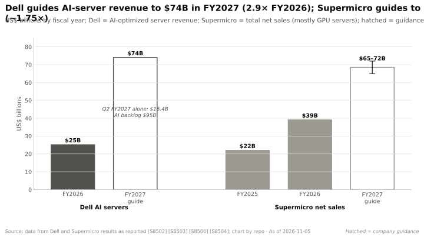
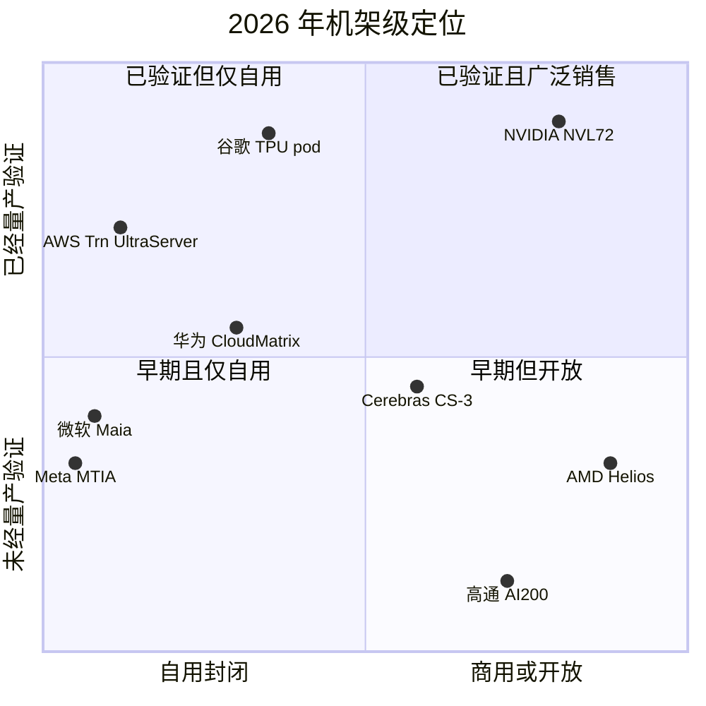

# 系统、机架与 AI 工厂：竞争格局

> [!NOTE]
> 本页为英文原文的简体中文参考译文，仅供参考；如有出入，以[英文原文](../../../layers/08-systems-racks-ai-factories/competition.md "English original")为准。

第 08 层 · 系统、机架与 AI 工厂 · 约 12 分钟阅读 · 最后核实：2026-11-05

## ⚡ 要点速览

- **机架如今是竞争的基本单元。** GB200 [NVL72](../../../glossary.md#nvl72)（72 颗 GPU、约 120 kW、液冷）在 2024 年确立了范式；TrendForce 预计英伟达（NVIDIA）GB/VR [机架级系统](../../../glossary.md#rack-scale-system)的出货量将在 2026 年大致翻倍 [[S121]](../../../sources/bibliography.md#s121)[[S336]](../../../sources/bibliography.md#s336)[[S8528]](../../../sources/bibliography.md#s8528)。
- **[Q5 · 最强挑战者]** AMD 的 Helios 是最强的*商用*对手：纸面上稠密 [FP8](../../../glossary.md#fp8) 算力达 1.4 EF、[HBM4](../../../glossary.md#hbm4) 容量 31.1 TB，而 Vera Rubin NVL72 为 1.26 EF 和 20.7 TB，且采用开放的 [OCP](../../../glossary.md#ocp) 机架 [[S344]](../../../sources/bibliography.md#s344)[[S102]](../../../sources/bibliography.md#s102)。但首批出货直到 2026 年第三季度末前后才开始 🟡 [[S90020]](../../../sources/bibliography.md#s90020)。
- **谷歌（Google）TPU 是最强的*系统级*对手。** Ironwood 把 9,216 颗芯片放进一个光交换域（英伟达为 72 颗），谷歌超过 80% 的 AI 服务器采用液冷，而且 TPU 如今已开始向谷歌以外的客户销售 🟡 [[S350]](../../../sources/bibliography.md#s350)[[S8528]](../../../sources/bibliography.md#s8528)[[S552]](../../../sources/bibliography.md#s552)[[S90027]](../../../sources/bibliography.md#s90027)。
- **域规模是英伟达落后的地方。** AWS 每台 UltraServer 达到 144 颗芯片，华为达到 384 至 8,192 颗 [[S353]](../../../sources/bibliography.md#s353)[[S340]](../../../sources/bibliography.md#s340)[[S341]](../../../sources/bibliography.md#s341)。英伟达的回应 Kyber NVL144 官方定于 2027 年下半年；有报道称将推迟到 2028 年，但已被否认 🟡 [[S502]](../../../sources/bibliography.md#s502)[[S507]](../../../sources/bibliography.md#s507)[[S508]](../../../sources/bibliography.md#s508)。
- **英伟达的弱点：其领先靠的是执行力，而执行可能出现偏差。** 据报道，其首款液冷机架出现过过热和链路故障，导致部分[超大规模云厂商](../../../glossary.md#hyperscaler)削减了 GB200 订单 [[S5500]](../../../sources/bibliography.md#s5500)[[S5501]](../../../sources/bibliography.md#s5501)。2026 年 Rubin 规格下调后，Helios 在纸面 [HBM](../../../glossary.md#hbm) 带宽上反超 [[S90006]](../../../sources/bibliography.md#s90006)。
- **OEM 和 ODM 是合作伙伴，同时也在争夺价值。** 戴尔给出 FY2027 AI 服务器收入 $74B 的指引 [[S8500]](../../../sources/bibliography.md#s8500)。富士康称其占 AI 服务器约 40% [[S3014]](../../../sources/bibliography.md#s3014)。HPE 销售搭配自家 Juniper 纵向扩展交换机的 AMD Helios [[S5523]](../../../sources/bibliography.md#s5523)。

## 机架级竞争如何评分

可以把一个 NVL72 级机架想象成一艘集装箱船，而不是一支卡车车队。买家会权衡载货量（每机架算力与内存）、泊位大小（供电与散热）、多少集装箱能作为一个整体移动（[纵向扩展](../../../glossary.md#scale-up)域），以及船能否准时到港。

| 对手（口径）对比 Vera Rubin NVL72 | 每机架算力 | 每机架内存 | 每机架功耗 | 纵向扩展域 | 液冷 | 部署时间 | 开放性 |
|---|---|---|---|---|---|---|---|
| AMD Helios（72 × MI455X） | 🟩 1.4 对 1.26 EF FP8 | 🟩 31.1 对 20.7 TB | 🟨 约 235 kW（估计）对 190–230 | 🟨 72 = 72 | 🟥 AMD 首款液冷机架 | 🟥 约 2026 年第三季度末出货 | 🟩 OCP 双宽 |
| 谷歌 Ironwood superpod | 🟦 每机架 295 PF | 🟦 每机架 12.3 TB | 🟦 未披露 | 🟩 9,216 颗芯片 | 🟩 机群中超过 80% | 🟨 2025 年 11 月全面上市 | 🟥 谷歌技术栈 |
| AWS Trn3 UltraServer | 🟥 362 PF | 🟨 20.7 TB | 🟦 未披露 | 🟩 144 颗芯片 | 🟦 未披露 | 🟨 2025 年 12 月全面上市 | 🟥 仅限 AWS |
| 华为 CloudMatrix 384 | 🟥 300 PF BF16，跨 16 个机架 | 🟦 49.2 TB，跨 16 个机架 | 🟥 559 kW | 🟩 384 颗芯片 | 🟦 未披露 | 🟥 Atlas 950 未经证实 | 🟥 专有 |
| 高通 AI200 机架 | 🟦 未披露 | 🟦 每卡 768 GB LPDDR | 🟩 160 kW | 🟥 PCIe | 🟨 直接液冷 | 🟥 未确认 2026 年量产 | 🟩 PCIe + 以太网 |

🟩 对手领先 · 🟨 持平 · 🟥 对手落后 · 🟦 路线不同或未披露。来源：[[S344]](../../../sources/bibliography.md#s344)[[S346]](../../../sources/bibliography.md#s346)[[S102]](../../../sources/bibliography.md#s102)[[S302]](../../../sources/bibliography.md#s302)[[S350]](../../../sources/bibliography.md#s350)[[S8528]](../../../sources/bibliography.md#s8528)[[S547]](../../../sources/bibliography.md#s547)[[S353]](../../../sources/bibliography.md#s353)[[S340]](../../../sources/bibliography.md#s340)[[S567]](../../../sources/bibliography.md#s567)[[S173]](../../../sources/bibliography.md#s173)[[S90028]](../../../sources/bibliography.md#s90028)[[S90029]](../../../sources/bibliography.md#s90029)。全部七个对手的评分见上方热力图。

> [!TIP]
> **算例 —— 每机架多出 10 TB HBM 能换来什么。** 加载一个 [FP4](../../../glossary.md#fp4) 权重约 1 TB 的模型。Vera Rubin NVL72 有 20.7 TB HBM4，留给 [KV 缓存](../../../glossary.md#kv-cache)约 19.7 TB；Helios 有 31.1 TB，剩余约 30.1 TB [[S102]](../../../sources/bibliography.md#s102)[[S344]](../../../sources/bibliography.md#s344)。在相近功耗（约 190–245 kW）下，每机架可支持的并发长上下文会话约为 1.5 倍 [[S302]](../../../sources/bibliography.md#s302)[[S346]](../../../sources/bibliography.md#s346)。若机架价格相同，Helios 的每会话成本约低 35%：这正是 AMD 的销售话术。

🔧 技术细节：为何“部署时间”是一项真实指标

一个 120–230 kW 的液冷机架重量远超一吨（GB200 NVL72 约 1.36 吨）[[S335]](../../../sources/bibliography.md#s335)。它内含超过 2 英里的铜质 [NVLink](../../../glossary.md#nvlink) 线缆，通过盲插背板连接 [[S5516]](../../../sources/bibliography.md#s5516)。每个机架都要作为一个整体进行泄漏测试和老化测试，然后与 [CDU](../../../glossary.md#cdu) 及设施冷却水回路一起调试投运。GB200 早期的问题是散热和链路故障，而非 GPU 缺陷 [[S5500]](../../../sources/bibliography.md#s5500)。一个芯片更好但尚无实际部署机架的对手，仍需经历 12–18 个月的这类学习过程（🔴 本资料库估计）。

## 逐一审视挑战者

**AMD Helios：最强的商用挑战者。** Helios 将 72 颗 MI455X 与 18 颗 EPYC Venice CPU 以及基于以太网的 UALink（UALink-over-Ethernet）交换托盘相结合 [[S538]](../../../sources/bibliography.md#s538)[[S5524]](../../../sources/bibliography.md#s5524)。买家包括 OpenAI（6 GW，首个吉瓦自 2026 年下半年起）、甲骨文（Oracle，50,000 颗 MI450）和 Anthropic（最高 2 GW）🟡 [[S546]](../../../sources/bibliography.md#s546)[[S90022]](../../../sources/bibliography.md#s90022)[[S538]](../../../sources/bibliography.md#s538)。2026 年第三季度，AMD 数据中心收入同比增长 97% [[S542]](../../../sources/bibliography.md#s542)。**最有力的论据：**每机架内存更多、机架开放、是可信的第二供应商。**差距弥合程度：**纸面上已完全弥合；但在实际部署的机架上，AMD 约落后 1.5–2 年（🔴 本资料库估计）[[S121]](../../../sources/bibliography.md#s121)[[S90020]](../../../sources/bibliography.md#s90020)。

**谷歌 TPU：系统级挑战者。** 一个 Ironwood superpod 通过 ICI 与[光路交换机（OCS）](../../../glossary.md#optical-circuit-switch)连接 9,216 颗芯片：FP8 算力 42.5 EF，HBM 1.77 PB [[S350]](../../../sources/bibliography.md#s350)[[S650]](../../../sources/bibliography.md#s650)。TPU 8t pod（9,600 颗芯片，FP4 算力 121 EF）将于 2026 年晚些时候推出 [[S550]](../../../sources/bibliography.md#s550)。Anthropic 可使用最多 1M 颗 TPU，TPU 也即将登陆甲骨文云 [[S90026]](../../../sources/bibliography.md#s90026)[[S552]](../../../sources/bibliography.md#s552)。**弱点：**仅限谷歌的技术栈，对外销售才刚刚起步。

**超大规模云厂商的自用方案。** AWS 的 144 芯片 Trn3 UltraServer 于 2025 年 12 月全面上市 [[S353]](../../../sources/bibliography.md#s353)。不过 Trainium4 将采用 [NVLink Fusion](../../../glossary.md#nvlink-fusion) 和 [MGX](../../../glossary.md#mgx) 机架，这对英伟达而言是部分胜利 [[S518]](../../../sources/bibliography.md#s518)。微软（Microsoft）的 Maia 200 通过以太网扩展至 6,144 颗芯片，Maia 300 将于 2027 年推出 [[S158]](../../../sources/bibliography.md#s158)[[S90046]](../../../sources/bibliography.md#s90046)。Meta 的 MTIA 400 采用 72 颗加速器的域 [[S562]](../../../sources/bibliography.md#s562)。

**华为：以功耗换制程。** CloudMatrix 384 将 384 颗昇腾（Ascend）910C 芯片分布在 16 个机架中，[BF16](../../../glossary.md#bf16) 算力约为 GB200 NVL72 的 1.7 倍（300 对 180 PF）。其功耗约 559 kW，约为 NVL72 全口径 145 kW 的 3.9 倍 [[S340]](../../../sources/bibliography.md#s340)。华为称 8,192 颗芯片的 Atlas 950 SuperPoD 已投入商用，但尚无独立证实 🔴 [[S341]](../../../sources/bibliography.md#s341)[[S567]](../../../sources/bibliography.md#s567)。

**高通与 Cerebras（公开信息）。** 高通（Qualcomm）的 AI200 机架：160 kW、直接液冷、[PCIe](../../../glossary.md#pcie) 纵向扩展、每卡 768 GB [LPDDR](../../../glossary.md#lpddr)；HUMAIN 计划自 2026 年起部署 200 MW [[S173]](../../../sources/bibliography.md#s173)[[S90029]](../../../sources/bibliography.md#s90029)[[S90030]](../../../sources/bibliography.md#s90030)。AI300（2028）将加入 [UALink](../../../glossary.md#ualink) 和 [ESUN](../../../glossary.md#esun) 🟢 [[S90060]](../../../sources/bibliography.md#s90060)。Cerebras 销售晶圆级 CS-3 系统（晶圆上 44 GB [SRAM](../../../glossary.md#sram)）[[S166]](../../../sources/bibliography.md#s166)，并于 2026 年 5 月通过 IPO 募资约 $5.5B [[S2504]](../../../sources/bibliography.md#s2504)。

> [!TIP]
> **算例 —— 机架价格 10% 的差距为何价值数十亿美元。** 一个 1 GW 的 Vera Rubin NVL72 园区按每机架约 230 kW 计，可容纳约 4,350 个机架（仅计 IT 负载）[[S302]](../../../sources/bibliography.md#s302)。按每机架约 $7.8M（估计，摩根士丹利）计，合计约 $34B [[S330]](../../../sources/bibliography.md#s330)。若对手在同等吞吐量下便宜 10%，每吉瓦可节省约 $3.4B；英伟达对整个吉瓦级工厂的估算为 $50–60B [[S398]](../../../sources/bibliography.md#s398)。

## 亦敌亦友的合作伙伴：OEM 与 ODM

[OEM](../../../glossary.md#oem)（戴尔、HPE、Supermicro、联想）掌握企业客户；[ODM](../../../glossary.md#odm) 和 [EMS](../../../glossary.md#ems) 厂商（富士康、广达、纬颖、天弘（Celestica）、Sanmina）掌握工厂车间。它们都依赖英伟达的配额，也都在对冲。HPE 出货搭配 Juniper 交换机的 Helios [[S5523]](../../../sources/bibliography.md#s5523)。据 Dell'Oro 数据，2026 年第一季度天弘（Celestica）在 AI 后端交换机销售中位居第一 [[S90054]](../../../sources/bibliography.md#s90054)。

> [!TIP]
> **算例 —— 收入不等于利润。** 戴尔在 Q2 FY2027 录得 $16.4B 的 AI 服务器收入 [[S8500]](../../../sources/bibliography.md#s8500)。管理层对 AI 服务器的营业利润率目标为个位数中段 [[S8502]](../../../sources/bibliography.md#s8502)[[S8503]](../../../sources/bibliography.md#s8503)：按约 5% 计约为 $0.8B 的利润（估计）。同一季度，英伟达在 $96.2B 收入上实现了约 $72B 的毛利 [[S405]](../../../sources/bibliography.md#s405)。OEM 赢得了规模；芯片所有者保住了利润（参见[价值链](value-chain-and-corp-dev.md)）。

> [!NOTE]
> **🐂 看多观点。** 英伟达自 2025 年起已批量出货 NVL72 机架，并正转向 Vera Rubin，自 2026 年 8 月起量产出货 [[S500]](../../../sources/bibliography.md#s500)。就连 AWS 的 Trainium4 也将采用 MGX 机架 [[S518]](../../../sources/bibliography.md#s518)。

> [!WARNING]
> **🐻 看空观点。** Helios 在开放机架中，纸面内存和 FP8 算力已超过 Vera Rubin NVL72 [[S344]](../../../sources/bibliography.md#s344)。谷歌证明了 9,216 颗芯片的域可以在机群规模上运行 [[S350]](../../../sources/bibliography.md#s350)。如果 Kyber 推迟到 2028 年 🟡 [[S507]](../../../sources/bibliography.md#s507)，英伟达在域规模上的差距将再延续一代。

## 🎯 企业发展视角

1. 如果 Helios 按时出货，第二款商用机架会压低英伟达的定价，还是 HBM 和 [CoWoS](../../../glossary.md#cowos) 的短缺会让两者都供不应求？
2. 谷歌如今在自家云之外提供 TPU [[S552]](../../../sources/bibliography.md#s552)[[S90027]](../../../sources/bibliography.md#s90027)：哪些买家（[新兴云服务商（neocloud）](../../../glossary.md#neocloud)、主权客户、企业）能够接受仅限谷歌的技术栈？
3. 哪些 ODM 或 EMS 厂商有空闲的机架级[新产品导入（NPI）](../../../glossary.md#npi)产能来承接第三款商用机架？
4. 对于高通 AI200 这样的 160 kW 推理机架（公开信息），一旦 800 V 直流站点到来，“能装入现有机房”还会是持久的优势吗？

## 📚 来源（Sources）

<!-- Auto-generated from the [S…] citations on this page by `make build`. Edit sources/registry/*.csv, not this list. -->

- [**S102**](../../../sources/bibliography.md#s102) NVIDIA, *NVIDIA DGX Vera Rubin NVL72*, 2026. [Link](https://www.nvidia.com/en-us/data-center/dgx-vera-rubin-nvl72/)
- [**S121**](../../../sources/bibliography.md#s121) NVIDIA, *NVIDIA GB200 NVL72*, 2024-03. [Link](https://www.nvidia.com/en-us/data-center/gb200-nvl72/)
- [**S158**](../../../sources/bibliography.md#s158) Microsoft, *Maia 200: Microsoft's AI accelerator built for inference*, 2026-01. [Link](https://blogs.microsoft.com/blog/2026/01/26/maia-200-the-ai-accelerator-built-for-inference/)
- [**S166**](../../../sources/bibliography.md#s166) Cerebras, *Cerebras Systems Unveils World's Fastest AI Chip with 4 Trillion Transistors (WSE-3)*, 2024-03-13. [Link](https://www.cerebras.ai/press-release/cerebras-announces-third-generation-wafer-scale-engine)
- [**S173**](../../../sources/bibliography.md#s173) Qualcomm, *Qualcomm Unveils AI200 and AI250 - Redefining Rack-Scale Data Center Inference*, 2025-10-27. [Link](https://www.qualcomm.com/news/releases/2025/10/qualcomm-unveils-ai200-and-ai250-redefining-rack-scale-data-cent)
- [**S302**](../../../sources/bibliography.md#s302) Hashrate Index, *NVIDIA Vera Rubin NVL72 specs breakdown*, 2026. [Link](https://hashrateindex.com/blog/nvidia-vera-rubin-nvl72-specs-breakdown/)
- [**S330**](../../../sources/bibliography.md#s330) PC Gamer, *A single Nvidia Vera Rubin rack is estimated to cost $7,803,148 with over $2 million of that figure spent on memory alone*, 2026-05. [Link](https://pcgamer.com/hardware/a-single-nvidia-vera-rubin-rack-is-estimated-to-cost-usd7-803-148-with-over-usd2-million-of-that-figure-spent-on-memory-alone)
- [**S335**](../../../sources/bibliography.md#s335) Spheron, *NVIDIA GB200 NVL72 guide*, 2026. [Link](https://www.spheron.network/blog/nvidia-gb200-nvl72-guide/)
- [**S336**](../../../sources/bibliography.md#s336) eeNews Europe, *Nvidia offers 120kW liquid-cooled Blackwell rack as industry standard*, 2024-10. [Link](https://www.eenewseurope.com/en/nvidia-offers-120kw-liquid-cooled-blackwell-rack-as-industry-standard)
- [**S340**](../../../sources/bibliography.md#s340) SemiAnalysis (Dylan Patel et al.), *Huawei AI CloudMatrix 384 - China's answer to Nvidia GB200 NVL72*, 2025-04-16. [Link](https://newsletter.semianalysis.com/p/huawei-ai-cloudmatrix-384-chinas-answer-to-nvidia-gb200-nvl72)
- [**S341**](../../../sources/bibliography.md#s341) Converge Digest, *Huawei unveils next-gen Ascend chips, SuperPoDs and UnifiedBus interconnect*, 2025-09-18. [Link](https://convergedigest.com/huawei-unveils-next-gen-ascend-chips-superpods-and-unifiedbus-interconnect/)
- [**S344**](../../../sources/bibliography.md#s344) AMD, *AMD Helios rack-scale AI infrastructure (product page)*, 2026. [Link](https://www.amd.com/ja/products/rackscale-solutions/helios.html)
- [**S346**](../../../sources/bibliography.md#s346) Kad8, *AMD Helios AI rack: MI455X, Zen 6 EPYC and Pensando*, 2026. [Link](https://www.kad8.com/server/amd-helios-ai-rack-mi455x-zen-6-epyc-and-pensando/)
- [**S350**](../../../sources/bibliography.md#s350) Google Cloud, *TPU7x (Ironwood) documentation*, 2025-11. [Link](https://docs.cloud.google.com/tpu/docs/tpu7x)
- [**S353**](../../../sources/bibliography.md#s353) AWS, *Announcing Amazon EC2 Trn3 UltraServers for faster, lower-cost generative AI training*, 2025-12-02. [Link](https://aws.amazon.com/about-aws/whats-new/2025/12/amazon-ec2-trn3-ultraservers/)
- [**S398**](../../../sources/bibliography.md#s398) NVIDIA Investor Relations, *NVIDIA Q2 FY2026 earnings call (2025-08-27): AI factory economics commentary*, 2025-08-27. [Link](https://investor.nvidia.com/events-and-presentations/events-and-presentations/default.aspx)
- [**S405**](../../../sources/bibliography.md#s405) NVIDIA Corporation via SEC EDGAR, *NVIDIA Announces Financial Results for Second Quarter Fiscal 2027 (Form 8-K exhibit 99.1)*, 2026-08-26. [Link](https://www.sec.gov/Archives/edgar/data/0001045810/000104581026000073/q2fy27pr.htm)
- [**S500**](../../../sources/bibliography.md#s500) NVIDIA Corporation, *NVIDIA Q2 Fiscal 2027 Quarterly Presentation (CFO commentary deck)*, 2026-08-26. [Link](https://s201.q4cdn.com/141608511/files/doc_financials/2027/Q227/NVDA-F2Q27-Quarterly-Presentation-final-1.pdf)
- [**S502**](../../../sources/bibliography.md#s502) Tom's Hardware, *Nvidia updates data center roadmap with Rosa CPU and stacked Feynman GPUs; optical NVLink; Groq LPUs with NVFP4 and NVLink also on deck*, 2026-03-17. [Link](https://www.tomshardware.com/pc-components/gpus/nvidia-updates-data-center-roadmap-with-rosa-cpu-and-stacked-feynman-gpus-optical-nvlink-groq-lpus-with-nvfp4-and-nvlink-also-on-deck)
- [**S507**](../../../sources/bibliography.md#s507) Tom's Hardware, *Nvidia's Kyber rack for Rubin Ultra slips to 2028*, 2026-07-06. [Link](https://www.tomshardware.com/pc-components/gpus/nvidias-kyber-rack-for-rubin-ultra-slips-to-2028)
- [**S508**](../../../sources/bibliography.md#s508) Wccftech, *NVIDIA Quashes Rubin & Kyber Rack Delay Rumors, Says 'Chip Roadmap Is Intact'*, 2026-07. [Link](https://wccftech.com/nvidia-quashes-rubin-kyber-rack-delay-rumors-says-chip-roadmap-is-intact/)
- [**S518**](../../../sources/bibliography.md#s518) ServeTheHome, *NVIDIA NVLink Fusion tapped for future AWS Trainium4 deployments*, 2025-12-02. [Link](https://www.servethehome.com/nvidia-nvlink-fusion-tapped-for-future-aws-trainium4-deployments/)
- [**S538**](../../../sources/bibliography.md#s538) AMD Investor Relations, *AAI 2026: AMD Delivers Full-Stack Compute for the Agentic AI Era*, 2026-07-23. [Link](https://ir.amd.com/news-events/press-releases/detail/1294/aai-2026-amd-delivers-full-stack-compute-for-the-agentic-ai-era)
- [**S542**](../../../sources/bibliography.md#s542) AMD via SEC EDGAR, *AMD Reports Third Quarter 2026 Financial Results (Form 8-K Exhibit 99.1)*, 2026-11-03. [Link](https://www.sec.gov/Archives/edgar/data/0000002488/000000248826000188/q32026991.htm)
- [**S546**](../../../sources/bibliography.md#s546) TechWire Asia, *AMD Advancing AI 2026: Helios, OpenAI, Meta, Anthropic*, 2026-07. [Link](https://techwireasia.com/2026/07/amd-advancing-ai-2026-helios-openai-meta-anthropic/)
- [**S547**](../../../sources/bibliography.md#s547) Google Cloud Blog, *Ironwood TPUs and new Axion-based VMs for your AI workloads*, 2025-11-06. [Link](https://cloud.google.com/blog/products/compute/ironwood-tpus-and-new-axion-based-vms-for-your-ai-workloads)
- [**S550**](../../../sources/bibliography.md#s550) SiliconANGLE, *Google Cloud unveils eighth-generation TPUs (TPU 8t and TPU 8i)*, 2026-04-22. [Link](https://siliconangle.com/?p=740999)
- [**S552**](../../../sources/bibliography.md#s552) Google Cloud Blog (Karan Batta), *Bringing Google TPUs to Oracle Cloud Infrastructure*, 2026-10-27. [Link](https://cloud.google.com/blog/products/infrastructure/bringing-google-tpus-to-oracle-cloud-infrastructure)
- [**S562**](../../../sources/bibliography.md#s562) ServeTheHome, *Meta MTIA 400 at Hot Chips 2026*, 2026-08. [Link](https://www.servethehome.com/?p=104026)
- [**S567**](../../../sources/bibliography.md#s567) Huawei, *Huawei Connect 2026: Ascend 960 SuperNode*, 2026-09. [Link](https://www.huawei.com/br/news/2026/9/hc-ascend960-supernode)
- [**S650**](../../../sources/bibliography.md#s650) Google Cloud Blog, *Inside the Ironwood TPU codesigned AI stack*, 2025-11-06. [Link](https://cloud.google.com/blog/products/compute/inside-the-ironwood-tpu-codesigned-ai-stack)
- [**S2504**](../../../sources/bibliography.md#s2504) TechCrunch, *Cerebras raises $5.5B kicking off 2026's IPO season with a bang*, 2026-05-14. [Link](https://techcrunch.com/2026/05/14/cerebras-raises-5-5b-kicking-off-2026s-ipo-season-with-a-bang)
- [**S3014**](../../../sources/bibliography.md#s3014) Focus Taiwan (CNA), *Foxconn expects AI server rack shipments to double in 2026*, 2026-03-16. [Link](https://focustaiwan.tw/business/202603160022)
- [**S5500**](../../../sources/bibliography.md#s5500) TrendForce, *NVIDIA GB200 racks reportedly overheat, major clients cut orders*, 2025-01-14. [Link](https://www.trendforce.com/news/2025/01/14/news-nvidia-gb200-racks-reportedly-overheat-major-clients-cut-orders/)
- [**S5501**](../../../sources/bibliography.md#s5501) TechPowerUp, *NVIDIA's GB200 'Blackwell' racks face overheating issues*, 2025-01-14. [Link](https://techpowerup.com/331105/nvidias-gb200-blackwell-racks-face-overheating-issues)
- [**S5516**](../../../sources/bibliography.md#s5516) The Register, *Nvidia's DGX GB200 NVL72 rack (GTC 2024 coverage)*, 2024-03-21. [Link](https://www.theregister.com/2024/03/21/nvidia_dgx_gb200_nvk72)
- [**S5523**](../../../sources/bibliography.md#s5523) The Register, *HPE backs AMD's Helios AI rack with Juniper's scale-up switch*, 2025-12-02. [Link](https://www.theregister.com/2025/12/02/hpe_amd_helios_racks/)
- [**S5524**](../../../sources/bibliography.md#s5524) Fierce Network, *AMD's Helios bets AI networking on open Ethernet*, 2026. [Link](https://www.fierce-network.com/cloud/amds-helios-bets-ai-networking-open-ethernet)
- [**S8500**](../../../sources/bibliography.md#s8500) Pulse 2.0, *Dell Technologies Q2 revenue hits record $47 billion as AI server backlog reaches $95 billion and FY27 outlook rises to $192 billion*, 2026-09. [Link](https://pulse2.com/dell-technologies-q2-revenue-hits-record-47-billion-as-ai-server-backlog-reaches-95-billion-and-fy27-outlook-rises-to-192-billion/)
- [**S8502**](../../../sources/bibliography.md#s8502) Futurum Group, *Dell Q4 FY 2026 earnings highlight AI-optimized server ramp*, 2026-02-27. [Link](https://futurumgroup.com/insights/dell-q4-fy-2026-earnings-highlight-ai-optimized-server-ramp/)
- [**S8503**](../../../sources/bibliography.md#s8503) MarketBeat, *Dell Technologies Q4 earnings call highlights*, 2026-02-27. [Link](https://www.marketbeat.com/instant-alerts/dell-technologies-q4-earnings-call-highlights-2026-02-27/)
- [**S8528**](../../../sources/bibliography.md#s8528) TrendForce, *Liquid cooling to reach 53% of high-end AI infrastructure in 2026 (TrendForce press release)*, 2026-08-17. [Link](https://www.trendforce.com/presscenter/news/20260817-13183.html)
- [**S90006**](../../../sources/bibliography.md#s90006) TweakTown, *Nvidia cuts Vera Rubin's memory bandwidth by up to 26% and AMD's Helios now leads in memory bandwidth*, 2026-10. [Link](https://www.tweaktown.com/news/114304/nvidia-cuts-vera-rubins-memory-bandwidth-by-up-to-26-percent-and-amds-helios-now-leads-in-memory-bandwidth/index.html)
- [**S90020**](../../../sources/bibliography.md#s90020) Shacknews, *AMD Helios AI rack system on track for initial shipments in Q3 2026*, 2026. [Link](https://www.shacknews.com/article/150249/amd-helios-ai-system-shipping-q3-2026)
- [**S90022**](../../../sources/bibliography.md#s90022) Tom's Hardware, *AMD and Oracle partner to deploy 50,000 MI450 Instinct GPUs*, 2025-10. [Link](https://www.tomshardware.com/tech-industry/artificial-intelligence/amd-and-oracle-partner-to-deploy-50-000-mi450-instinct-gpus-in-new-ai-superclusters-deployment-of-expansion-set-for-2026-powered-by-amds-helios-rack)
- [**S90026**](../../../sources/bibliography.md#s90026) Maginative, *Anthropic secures 1M Google TPUs while keeping Amazon as primary training partner*, 2025-10. [Link](https://www.maginative.com/anthropic-secures-1m-google-tpus-while-keeping-amazon-as-primary-training-partner)
- [**S90027**](../../../sources/bibliography.md#s90027) The Next Web, *Google is building a four-partner chip supply chain to challenge Nvidia in AI inference*, 2026. [Link](https://thenextweb.com/news/google-inference-chips-nvidia-challenge-supply-chain)
- [**S90028**](../../../sources/bibliography.md#s90028) TechRepublic, *Qualcomm unveils AI chips to rival Nvidia, AMD*, 2025-10-27. [Link](https://techrepublic.com/article/news-qualcomm-unveils-ai-chips-to-rival-nvidia-amd)
- [**S90029**](../../../sources/bibliography.md#s90029) Verdict, *Qualcomm AI200 and AI250 racks for AI inference*, 2025-10. [Link](https://www.verdict.co.uk/qualcomm-ai200-ai250-racks-ai-inference/)
- [**S90030**](../../../sources/bibliography.md#s90030) Morningstar, *Qualcomm: Humain deal provides some AI upside*, 2025-10. [Link](https://www.morningstar.com/stocks/qualcomm-humain-deal-provides-some-ai-upside)
- [**S90046**](../../../sources/bibliography.md#s90046) IT Brief UK, *Microsoft unveils Maia 300 for 2027 AI deployments*, 2026-10. [Link](https://itbrief.co.uk/story/microsoft-unveils-maia-300-for-2027-ai-deployments)
- [**S90054**](../../../sources/bibliography.md#s90054) Dell'Oro Group, *Ethernet extends lead in AI scale-out networks despite strong InfiniBand rebound*, 2026. [Link](https://www.delloro.com/news/ethernet-extends-lead-in-ai-scale-out-networks-despite-strong-infiniband-rebound/)
- [**S90060**](../../../sources/bibliography.md#s90060) Qualcomm, *Qualcomm Dragonfly AI300 (product page)*, 2026-06. [Link](https://www.qualcomm.com/data-center/products/qualcomm-dragonfly-ai300)
