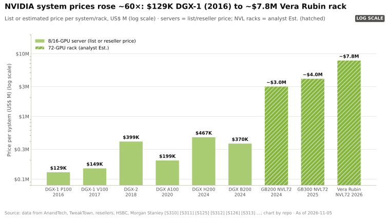
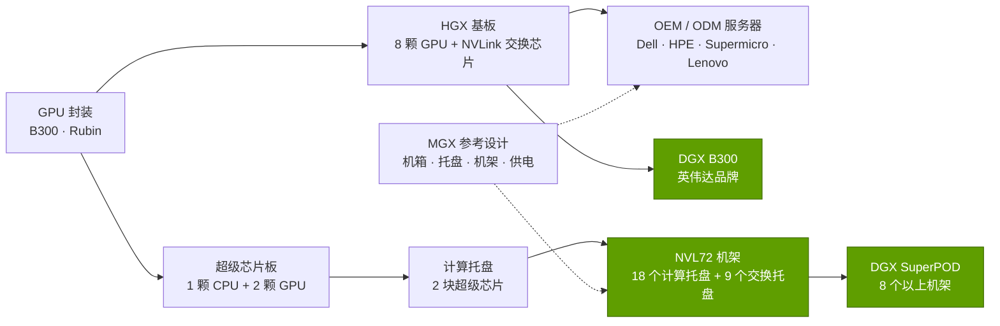

# HGX、DGX、MGX 与 NVL 机架：从芯片到机架级系统

> [!NOTE]
> 本页为英文原文的简体中文参考译文，仅供参考；如有出入，以[英文原文](../../../layers/08-systems-racks-ai-factories/hgx-dgx-mgx-nvl.md "English original")为准。

第 08 层 · 系统、机架与 AI 工厂 · 约 10 分钟阅读 · 最后核实：2026-11-05

## ⚡ 要点速览

- **四个产品名词，四种商业模式。** [HGX](../../glossary.md#hgx) 是供服务器厂商围绕其打造整机的 GPU 基板；[DGX](../../glossary.md#dgx) 是英伟达（NVIDIA）自有品牌的系统；[MGX](../../glossary.md#mgx) 是面向合作伙伴的模块化参考架构；NVL 机架（[NVL72](../../glossary.md#nvl72)）则是由 ODM 按英伟达规格制造的整机架级计算机 [[S101]](../../../sources/bibliography.md#s101)[[S8524]](../../../sources/bibliography.md#s8524)[[S396]](../../../sources/bibliography.md#s396)。
- **销售单元十年间扩大约 60 倍：** 2016 年 DGX-1 标价 $129K [[S310]](../../../sources/bibliography.md#s310)；GB300 NVL72 机架约 $4.0M（估计，摩根士丹利），Vera Rubin NVL72 约 $7.8M（估计）[[S332]](../../../sources/bibliography.md#s332)[[S330]](../../../sources/bibliography.md#s330)。
- **英伟达如今几乎规定了机架中的一切：** 计算托盘、NVLink 交换托盘、铜缆背板、电源架、母排和液冷接口；2024 年，英伟达将 GB200 NVL72 机架设计贡献给开放计算项目（OCP）[[S5001]](../../../sources/bibliography.md#s5001)[[S8000]](../../../sources/bibliography.md#s8000)。
- **MGX 作为合作伙伴渠道迅速扩张：** 从 2023 年 6 家合作伙伴的 14 款系统，增至 2024 年年中 25 家以上合作伙伴的 90 余款系统 [[S8024]](../../../sources/bibliography.md#s8024)；AWS 将把 Trainium4 放入采用 NVLink 的 MGX 机架 [[S518]](../../../sources/bibliography.md#s518)。
- **ODM 负责制造，英伟达负责设计并拿走利润：** 在摩根士丹利的拆解中，72 颗 GPU 约占 GB300 机架价格的 63%，而 ODM 的毛利率约为 2.7%，到 Vera Rubin 时降至约 1.9%（估计）[[S332]](../../../sources/bibliography.md#s332)。
- **弱点：** 机架级锁定会招致抵触：买家保留 8 GPU 的 HGX 以维持供应商选择权，而 AMD 收购了 ZT Systems 的机架设计团队，用于其 72 GPU 的 Helios（2026 年下半年）[[S8527]](../../../sources/bibliography.md#s8527)[[S90020]](../../../sources/bibliography.md#s90020)。

## 1. 四条产品线及其嵌套关系

可以把这几条产品线想象成尺寸逐级增大的乐高标准件。**HGX**（始于 2017 年与微软（Microsoft）合作的 HGX-1 [[S8525]](../../../sources/bibliography.md#s8525)）是一块承载 8 颗 GPU 及其 NVLink 交换芯片的基板，戴尔、HPE、联想、Supermicro 及各 ODM 将其装入自己的机箱，并搭配自选的 CPU 和网卡 [[S101]](../../../sources/bibliography.md#s101)。**DGX** 是英伟达的品牌版本，连同软件与支持服务一并销售，同时也是整个行业的参考设计 [[S310]](../../../sources/bibliography.md#s310)[[S319]](../../../sources/bibliography.md#s319)。**MGX** 将基板周围的机箱、托盘、机架和供电标准化，可组合出 100 多种配置，最大可至整机架 [[S8524]](../../../sources/bibliography.md#s8524)[[S8025]](../../../sources/bibliography.md#s8025)。**NVL 机架**把 72 个 GPU 封装和 36 颗 CPU 连成一个[纵向扩展](../../glossary.md#scale-up)域，作为一台整机来构建 [[S396]](../../../sources/bibliography.md#s396)[[S102]](../../../sources/bibliography.md#s102)。

| | HGX | DGX | MGX | NVL 机架（NVL72） |
|---|---|---|---|---|
| 是什么 | 面向合作伙伴的 GPU 基板 | 英伟达品牌系统 | 模块化参考架构 | 整机架即一台计算机 |
| 由谁制造 | OEM 与 ODM | 为英伟达代工的合同制造商 | 25 家以上合作伙伴 [[S8024]](../../../sources/bibliography.md#s8024) | ODM/OEM 按英伟达设计制造；也有 DGX 版本 |
| 每个 [NVLink](../../glossary.md#nvlink) 域的 GPU 数 | 8 | 8（DGX GB300 为 72） | 不定 | 72；Kyber（2027）为 144 [[S305]](../../../sources/bibliography.md#s305) |
| 功耗与散热 | 约 10–14 kW，风冷或液冷 [[S318]](../../../sources/bibliography.md#s318)[[S321]](../../../sources/bibliography.md#s321) | 同左 | 1U 至整机架 | 约 120–230 kW，仅液冷 [[S336]](../../../sources/bibliography.md#s336)[[S303]](../../../sources/bibliography.md#s303) |
| 价格区间 | 8× H200 约 $0.32–0.40M [[S322]](../../../sources/bibliography.md#s322) | 约 $0.37–0.47M [[S320]](../../../sources/bibliography.md#s320)[[S322]](../../../sources/bibliography.md#s322) | 不适用 | 约 $3.0–7.8M（估计）[[S326]](../../../sources/bibliography.md#s326)[[S330]](../../../sources/bibliography.md#s330) |
| 买家保留的选择权 | 最多（CPU、网卡、机箱） | 很少 | 在英伟达框架内选择 | 最少：英伟达的 BOM |

> [!TIP]
> **算例 —— 销售单元为何跃升。** 一台 DGX H200 搭载 8 颗 GPU，售价约 $467K，每颗 GPU 约 $58K [[S322]](../../../sources/bibliography.md#s322)。一台 GB300 NVL72 搭载 72 颗 GPU，售价约 $3.99M，每颗 GPU 约 $55K（估计）[[S332]](../../../sources/bibliography.md#s332)。按单颗 GPU 计，价格几乎没变；变化在于值得购买的最小单元变成了一个 72 GPU、约 132 kW 的机架 [[S337]](../../../sources/bibliography.md#s337)。**结论：**英伟达放大的是*采购决策的规模*，并随之扩大了由它设计的账单份额。

**[Q3 · 代际进步]** 每机架 [HBM](../../glossary.md#hbm) 从 13.8 TB（GB200）增至 20.7 TB（GB300、Vera Rubin），稠密 [FP8](../../glossary.md#fp8) 算力从 360 PF 增至约 1,260 PF（Vera Rubin）[[S121]](../../../sources/bibliography.md#s121)[[S337]](../../../sources/bibliography.md#s337)[[S102]](../../../sources/bibliography.md#s102)。

🔧 技术细节：阅读规格表时的命名陷阱

- **NVL 后的数字含义变了。** 在 GTC 2025 上，英伟达按 GPU 裸片计数（“Vera Rubin NVL144”）；到 CES 2026 又改回按封装计数，因此同一机架如今称为 Vera Rubin NVL72 [[S102]](../../../sources/bibliography.md#s102)[[S33006]](../../../sources/bibliography.md#s33006)。HGX B300 仍以“NVL16”名义销售（16 个裸片、8 个封装）[[S101]](../../../sources/bibliography.md#s101)。
- **“Oberon”与“Kyber”** 是机架架构而非产品：Oberon 是 GB200、GB300 和 Vera Rubin 使用的水平托盘式 NVL72 机架；Kyber 是为 Rubin Ultra NVL144 设计的垂直刀片式机架，功耗约 600 kW [[S305]](../../../sources/bibliography.md#s305)[[S108]](../../../sources/bibliography.md#s108)。

## 2. 英伟达为何从卖芯片转向规定机架

原因在于纵向扩展带宽。混合专家模型（MoE）把专家分布在许多 GPU 上，每个 token 都会在它们之间产生流量，而这种流量只有在同一个 NVLink 域内才廉价（[为何域规模至关重要](../05-scale-up-nvlink-nvswitch/why-domain-size-matters.md)）。要让 72 颗 GPU 像一台机器那样工作，就必须把背板、交换托盘、信号完整性、供电和散热作为一个整体设计来掌控 [[S5000]](../../../sources/bibliography.md#s5000)[[S5001]](../../../sources/bibliography.md#s5001)。如今英伟达交给合作伙伴的是一份近乎完整的物料清单：带有两块[超级芯片](../../glossary.md#superchip)板以及[网卡](../../glossary.md#nic)和 [DPU](../../glossary.md#dpu) 插槽的计算托盘 [[S8000]](../../../sources/bibliography.md#s8000)[[S8001]](../../../sources/bibliography.md#s8001)；交换托盘（GB300 机架有 18 颗 NVLink 交换芯片，Vera Rubin 为 36 颗）[[S332]](../../../sources/bibliography.md#s332)；约 5,000 根线缆的背板 [[S5000]](../../../sources/bibliography.md#s5000)；电源架、母排以及即将到来的 800 V 直流接口 [[S90063]](../../../sources/bibliography.md#s90063)；还有冷板、分液歧管和冷却液温度 [[S8002]](../../../sources/bibliography.md#s8002)。

就 Vera Rubin 而言，摩根大通报告称，英伟达将交付完全组装好的 [L10](../../glossary.md#l6-l10-l11) 计算托盘，约占服务器成本的 90%，ODM 主要只剩机架集成工作（🟡 有报道）[[S8022]](../../../sources/bibliography.md#s8022)[[S329]](../../../sources/bibliography.md#s329)。

> [!WARNING]
> **误区与事实：**“机架级意味着英伟达自己造机架。”并非如此。富士康称其占全球 AI 服务器市场约 40% [[S3014]](../../../sources/bibliography.md#s3014)，其余由广达、纬创等厂商制造。英伟达设计机架并出售芯片；ODM 负责运营托盘和机架产线、泄漏测试与老化测试（burn-in），利润率约 2–3%，不过随着机架价格翻倍，其以美元计的增值额也在上升 [[S332]](../../../sources/bibliography.md#s332)。

> [!TIP]
> **算例 —— 设计方与制造方的经济账（以单个 GB300 机架计）。** 摩根士丹利测算的约 $3.99M 机架中，GPU 约 $2.52M，[HBM3E](../../glossary.md#hbm3e) 与 LPDDR5X 约 $0.37M，液冷约 $50K；ODM 2.7% 的毛利率对应**约 $108K** [[S332]](../../../sources/bibliography.md#s332)[[S334]](../../../sources/bibliography.md#s334)。仅 GPU 一项为英伟达带来的收入就约为 ODM 毛利的 23 倍（本资料库测算）。**结论：**机架级的利润在于编写规格，而不在于钣金加工。

## 3. 算例：超大规模云厂商购买 1,000 颗 GB300 GPU 时买到了什么

资金沿一条链条流动：[超大规模云厂商](../../glossary.md#hyperscaler)向 ODM 订购经过测试的 [L11](../../glossary.md#l6-l10-l11) 机架；英伟达向 ODM 出售超级芯片、NVLink 交换芯片和网卡（这也是英伟达在财报文件中将 ODM 列为直接客户、将云服务商列为间接客户的原因 [[S90069]](../../../sources/bibliography.md#s90069)）；内存厂商把 HBM 卖给英伟达用于其 GPU 封装；英伟达也可能直接出售[横向扩展](../../glossary.md#scale-out)交换机。

> [!TIP]
> **算例 —— 1,000 颗 GB300 GPU，钱都付给了谁。** 1,000 ÷ 72 = 13.9，因此订单为 **14 个机架（1,008 颗 GPU）**。按每机架约 $3.99M（摩根士丹利口径的 ODM 对云服务商价格；Wolfe Research 为约 $4.3M）计，机架总价**约 $56M**（估计）[[S332]](../../../sources/bibliography.md#s332)[[S325]](../../../sources/bibliography.md#s325)。仅 GPU（每机架约 $2.52M）就为**英伟达带来约 $35M**，还不含 Grace CPU、NVLink 交换芯片和网卡；ODM 约 2.7% 的利润为**约 $1.5M**；散热部件（每机架约 $50K）为**约 $0.7M** [[S332]](../../../sources/bibliography.md#s332)[[S334]](../../../sources/bibliography.md#s334)。网络与存储大约再增加四分之一（SemiAnalysis：GB200 机架 $3.1M，全部计入约 $3.9M）[[S324]](../../../sources/bibliography.md#s324)：合计**约 $70M（估计）**。电力：14 × 约 132 kW ≈ **1.85 MW** 的机架 IT 负载 [[S337]](../../../sources/bibliography.md#s337)。**结论：**超大规模云厂商与 ODM 签约，但远超一半的资金最终流向英伟达。

🔧 技术细节：为何仍有买家选择 8 GPU 的 HGX

HGX 让买家自行选择 CPU、网卡和机箱，并能在约 14 kW 的风冷机房中运行 [[S321]](../../../sources/bibliography.md#s321)；代价是只有 8 颗 GPU 的纵向扩展域，这在大型混合专家模型推理上伤害最大（[纵向扩展与横向扩展](../05-scale-up-nvlink-nvswitch/scale-up-vs-scale-out.md)）。

## 🎯 企业发展视角

1. **谁掌握机架标准？** 英伟达对 OCP 的贡献和 MGX 让其机架成为行业默认标准；AMD 的回应是收购 ZT Systems 的设计团队，并在 Helios 上采用 OCP 双宽机架 [[S8527]](../../../sources/bibliography.md#s8527)[[S344]](../../../sources/bibliography.md#s344)。是否还有空间容纳第三种开放的机架级参考设计？
2. **HGX 是对冲市场。** 希望自选 CPU 和网卡的买家停留在 8 GPU 基板上；这正是替代 CPU 和网卡仍能赢得插槽的地方。
3. **高通（Qualcomm）的问题（仅基于公开信息）：** 高通的 AI200/AI250 定位为机架级、直接液冷系统，每机架约 160 kW [[S173]](../../../sources/bibliography.md#s173)。应与 ODM 合作自建、通过 MGX 式生态合作，还是像 AMD 那样收购机架设计能力？

## 📚 来源（Sources）

<!-- Auto-generated from the [S…] citations on this page by `make build`. Edit sources/registry/*.csv, not this list. -->

- [**S101**](../../../sources/bibliography.md#s101) NVIDIA, *NVIDIA HGX Platform (HGX Rubin NVL8, HGX B300, HGX B200 specifications)*, 2026. [Link](https://www.nvidia.com/en-us/data-center/hgx/)
- [**S102**](../../../sources/bibliography.md#s102) NVIDIA, *NVIDIA DGX Vera Rubin NVL72*, 2026. [Link](https://www.nvidia.com/en-us/data-center/dgx-vera-rubin-nvl72/)
- [**S108**](../../../sources/bibliography.md#s108) HPCwire / AIwire, *Huang Shares Nvidia Roadmap Showing More Chips, NVL1152, Scale-Up CPO*, 2026-03-18. [Link](https://www.hpcwire.com/aiwire/2026/03/18/huang-shares-nvidia-roadmap-showing-more-chips-nvl1152-scale-up-cpo/)
- [**S121**](../../../sources/bibliography.md#s121) NVIDIA, *NVIDIA GB200 NVL72*, 2024-03. [Link](https://www.nvidia.com/en-us/data-center/gb200-nvl72/)
- [**S173**](../../../sources/bibliography.md#s173) Qualcomm, *Qualcomm Unveils AI200 and AI250 - Redefining Rack-Scale Data Center Inference*, 2025-10-27. [Link](https://www.qualcomm.com/news/releases/2025/10/qualcomm-unveils-ai200-and-ai250-redefining-rack-scale-data-cent)
- [**S303**](../../../sources/bibliography.md#s303) Commercial Times (ctee.com.tw), *Vera Rubin NVL72 Max-Q / Max-P rack power (Commercial Times report)*, 2026-01-07. [Link](https://www.ctee.com.tw/news/20260107701081-430704)
- [**S305**](../../../sources/bibliography.md#s305) DatacenterDynamics, *Nvidia's Rubin Ultra NVL576 rack expected to be 600kW, coming second half of 2027*, 2025-03-19. [Link](https://datacenterdynamics.com/en/news/nvidias-rubin-ultra-nvl576-rack-expected-to-be-600kw-coming-second-half-of-2027)
- [**S310**](../../../sources/bibliography.md#s310) AnandTech (Ryan Smith), *NVIDIA unveils the DGX-1 HPC server: 8 Teslas, 3U, Q2 2016*, 2016-04-05. [Link](https://www.anandtech.com/show/10229)
- [**S318**](../../../sources/bibliography.md#s318) NVIDIA (mirror hosted by MEGWARE), *NVIDIA DGX H100 datasheet*, 2023. [Link](https://www.MEGWARE.com/fileadmin/user_upload/LandingPage%20NVIDIA/nvidia-dgx-h100-datasheet.pdf)
- [**S319**](../../../sources/bibliography.md#s319) NVIDIA (mirror hosted by OpenZeka), *NVIDIA DGX B200 datasheet*, 2024. [Link](https://openzeka.com/wp-content/uploads/2024/11/dgx-scale-ai-infrastructure-dgx-b200-datasheet-nvidia-web-1-1.pdf)
- [**S320**](../../../sources/bibliography.md#s320) Hydra Host, *NVIDIA DGX B200 (configuration and pricing page)*, 2026. [Link](https://hydrahost.com/nvidia/dgx-b200)
- [**S321**](../../../sources/bibliography.md#s321) Colfax International, *NVIDIA DGX B300 (specification page)*, 2025. [Link](https://www.colfax-intl.com/nvidia/nvidia-dgx-b300)
- [**S322**](../../../sources/bibliography.md#s322) GPUPerHour, *NVIDIA GPU prices (H100/H200 and DGX/HGX system listings)*, 2026-09. [Link](https://gpuperhour.com/blog/nvidia-gpu-prices)
- [**S324**](../../../sources/bibliography.md#s324) fal.ai, *NVIDIA GB200 price in 2026: what a GPU, a tray and an NVL72 rack cost*, 2026. [Link](https://fal.ai/learn/serverless/nvidia-gb200-price)
- [**S325**](../../../sources/bibliography.md#s325) Spheron, *GB300 NVL72 vs GB200 NVL72: pricing and availability 2026*, 2026. [Link](https://www.spheron.network/blog/gb300-nvl72-vs-gb200-nvl72-pricing-availability-2026/)
- [**S326**](../../../sources/bibliography.md#s326) TweakTown, *NVIDIA's new GB200 Superchip costs up to $70,000: full B200 NVL72 AI server costs $3 million*, 2024-05. [Link](https://www.tweaktown.com/news/98292/nvidias-new-gb200-superchip-costs-up-to-70-000-full-b200-nvl72-ai-server-3-million/index.html)
- [**S329**](../../../sources/bibliography.md#s329) Tom's Hardware, *Price of Nvidia's Vera Rubin NVL72 racks skyrockets to as much as $8.8 million apiece, but server makers' margins will be tight*, 2026. [Link](https://www.tomshardware.com/tech-industry/artificial-intelligence/price-of-nvidias-vera-rubin-nvl72-racks-skyrockets-to-as-much-as-usd8-8-million-apiece-but-server-makers-margins-will-be-tight-nvidia-is-moving-closer-to-shipping-entire-full-scale-systems)
- [**S330**](../../../sources/bibliography.md#s330) PC Gamer, *A single Nvidia Vera Rubin rack is estimated to cost $7,803,148 with over $2 million of that figure spent on memory alone*, 2026-05. [Link](https://pcgamer.com/hardware/a-single-nvidia-vera-rubin-rack-is-estimated-to-cost-usd7-803-148-with-over-usd2-million-of-that-figure-spent-on-memory-alone)
- [**S332**](../../../sources/bibliography.md#s332) Tiger Brokers (iTiger), *Morgan Stanley's BOM analysis of NVIDIA's Rubin: GPU share declines; PCB, MLCC and ABF substrate values soar*, 2026-05-20. [Link](https://www.itiger.com/news/1188068712)
- [**S334**](../../../sources/bibliography.md#s334) Tom's Hardware, *Cooling system for a single Nvidia Blackwell Ultra NVL72 rack costs $50,000 - set to increase to $56,000 with next-generation NVL144 racks*, 2025-09. [Link](https://www.tomshardware.com/pc-components/cooling/cooling-system-for-a-single-nvidia-blackwell-ultra-nvl72-rack-costs-a-staggering-usd50-000-set-to-increase-to-usd56-000-with-next-generation-nvl144-racks)
- [**S336**](../../../sources/bibliography.md#s336) eeNews Europe, *Nvidia offers 120kW liquid-cooled Blackwell rack as industry standard*, 2024-10. [Link](https://www.eenewseurope.com/en/nvidia-offers-120kw-liquid-cooled-blackwell-rack-as-industry-standard)
- [**S337**](../../../sources/bibliography.md#s337) Spheron, *NVIDIA GB300 (rental and specifications)*, 2026. [Link](https://spheron.network/gpu-rental/gb300/)
- [**S344**](../../../sources/bibliography.md#s344) AMD, *AMD Helios rack-scale AI infrastructure (product page)*, 2026. [Link](https://www.amd.com/ja/products/rackscale-solutions/helios.html)
- [**S396**](../../../sources/bibliography.md#s396) NVIDIA Newsroom, *NVIDIA Blackwell platform arrives to power a new era of computing*, 2024-03-18. [Link](https://nvidianews.nvidia.com/news/nvidia-blackwell-platform-arrives-to-power-a-new-era-of-computing)
- [**S518**](../../../sources/bibliography.md#s518) ServeTheHome, *NVIDIA NVLink Fusion tapped for future AWS Trainium4 deployments*, 2025-12-02. [Link](https://www.servethehome.com/nvidia-nvlink-fusion-tapped-for-future-aws-trainium4-deployments/)
- [**S3014**](../../../sources/bibliography.md#s3014) Focus Taiwan (CNA), *Foxconn expects AI server rack shipments to double in 2026*, 2026-03-16. [Link](https://focustaiwan.tw/business/202603160022)
- [**S5000**](../../../sources/bibliography.md#s5000) SemiAnalysis, *Nvidia's Optical Boogeyman - NVL72, InfiniBand Scale Out, 800G & 1.6T Ramp*, 2024-03. [Link](https://newsletter.semianalysis.com/p/nvidias-optical-boogeyman-nvl72-infiniband)
- [**S5001**](../../../sources/bibliography.md#s5001) SiliconANGLE, *Nvidia aims to boost Blackwell by donating platform design to the Open Compute Project*, 2024-10-15. [Link](https://siliconangle.com/2024/10/15/nvidia-aims-boost-blackwell-donating-platform-design-open-compute-project)
- [**S8000**](../../../sources/bibliography.md#s8000) NVIDIA Docs, *NVIDIA DGX GB200 User Guide: hardware overview*, 2025. [Link](https://docs.nvidia.com/dgx/dgxgb200-user-guide/hardware.html)
- [**S8001**](../../../sources/bibliography.md#s8001) NVIDIA Docs, *NVIDIA Enterprise Reference Architecture: NVL72 AI factory - system hardware and components*, 2025. [Link](https://docs.nvidia.com/enterprise-reference-architectures/nvl72-ai-factory/latest/components.html)
- [**S8002**](../../../sources/bibliography.md#s8002) COMPUTEX Taipei (TAITRA), *NVIDIA Vera Rubin NVL72 (COMPUTEX 2026 Best Choice Award entry)*, 2026-05. [Link](https://bcaward.computex.biz/download/2026/winnerPdf/10905.pdf)
- [**S8022**](../../../sources/bibliography.md#s8022) Tom's Hardware, *JP Morgan says Nvidia is gearing up to sell entire AI servers instead of just AI GPUs and componentry*, 2025. [Link](https://www.tomshardware.com/tech-industry/artificial-intelligence/jp-morgan-says-nvidia-is-gearing-up-to-sell-entire-ai-servers-instead-of-just-ai-gpus-and-componentry-jensens-master-plan-of-vertical-integration-will-boost-profits-purportedly-starting-with-vera-rubin)
- [**S8024**](../../../sources/bibliography.md#s8024) DataCentreNews UK, *NVIDIA to build AI factories and data centres for the next industrial revolution (Computex 2024)*, 2024-06-02. [Link](https://datacentrenews.uk/story/nvidia-to-build-ai-factories-and-data-centres-for-the-next-industrial-revolution)
- [**S8025**](../../../sources/bibliography.md#s8025) NVIDIA, *NVIDIA MGX (product page)*, 2026. [Link](https://www.nvidia.com/en-us/data-center/products/mgx/)
- [**S8524**](../../../sources/bibliography.md#s8524) NVIDIA Newsroom, *NVIDIA MGX gives system makers modular architecture to meet diverse accelerated computing needs of world's data centers*, 2023-05-28. [Link](https://nvidianews.nvidia.com/news/nvidia-mgx-server-specification)
- [**S8525**](../../../sources/bibliography.md#s8525) DatacenterDynamics, *OCP Summit: Nvidia, Microsoft announce HGX-1 hyperscale GPU accelerator*, 2017-03. [Link](https://www.datacenterdynamics.com/en/news/ocp-summit-nvidia-microsoft-announce-hgx-1-hyperscale-gpu-accelerator/)
- [**S8527**](../../../sources/bibliography.md#s8527) AMD Investor Relations, *AMD completes acquisition of ZT Systems*, 2025-03-31. [Link](https://ir.amd.com/news-events/press-releases/detail/1240/amd-completes-acquisition-of-zt-systems)
- [**S33006**](../../../sources/bibliography.md#s33006) Tom's Hardware, *Nvidia launches Vera Rubin NVL72 AI supercomputer at CES*, 2026-01-05. [Link](https://www.tomshardware.com/pc-components/gpus/nvidia-launches-vera-rubin-nvl72-ai-supercomputer-at-ces-promises-up-to-5x-greater-inference-performance-and-10x-lower-cost-per-token-than-blackwell-coming-2h-2026)
- [**S90020**](../../../sources/bibliography.md#s90020) Shacknews, *AMD Helios AI rack system on track for initial shipments in Q3 2026*, 2026. [Link](https://www.shacknews.com/article/150249/amd-helios-ai-system-shipping-q3-2026)
- [**S90063**](../../../sources/bibliography.md#s90063) Converge Digest, *The megawatt shift: NVIDIA's 800 VDC strategy*, 2026. [Link](https://convergedigest.com/the-megawatt-shift-nvidias-800-vdc-strategy/)
- [**S90069**](../../../sources/bibliography.md#s90069) NVIDIA Corporation via SEC EDGAR, *NVIDIA Form 10-Q for the quarter ended July 26, 2026 (Q2 FY2027)*, 2026-08. [Link](https://www.sec.gov/Archives/edgar/data/0001045810/000104581026000075/nvda-20260726.htm)
