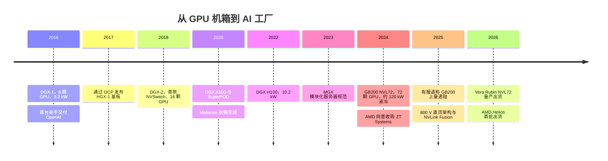
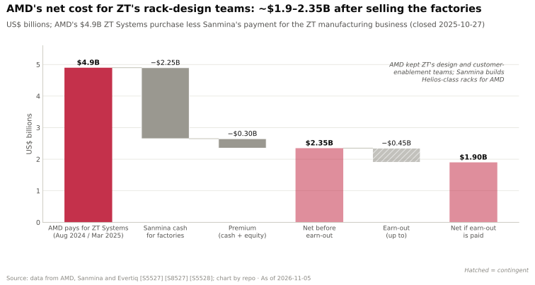

# 系统、机架与 AI 工厂：历史与英伟达的构建过程

> [!NOTE]
> 本页为英文原文的简体中文参考译文，仅供参考；如有出入，以[英文原文](../../../layers/08-systems-racks-ai-factories/history-and-how-built.md "English original")为准。

第 08 层 · 系统、机架与 AI 工厂 · 约 11 分钟阅读 · 最后核实：2026-11-05

## ⚡ 要点速览

- **英伟达（NVIDIA）销售系统已有十年。** 第一台 [DGX](../../../glossary.md#dgx)-1（8 颗 GPU、3.2 kW、$129,000）于 2016 年出货，黄仁勋于当年 8 月亲手将其中一台交付给 OpenAI [[S310]](../../../sources/bibliography.md#s310)[[S8522]](../../../sources/bibliography.md#s8522)[[S8523]](../../../sources/bibliography.md#s8523)。
- **OEM 标准诞生于 2017 年。** [HGX](../../../glossary.md#hgx)-1 与微软（Microsoft）及富士康旗下的 Ingrasys 共同打造，并通过 OCP 发布，让所有服务器厂商都使用同一块 GPU 基板 [[S8525]](../../../sources/bibliography.md#s8525)[[S8526]](../../../sources/bibliography.md#s8526)。
- **每一步都扩大了英伟达的设计范围。** DGX-2（2018）加入了 [NVSwitch](../../../glossary.md#nvswitch) [[S313]](../../../sources/bibliography.md#s313)。[MGX](../../../glossary.md#mgx)（2023）将服务器模块化 [[S8524]](../../../sources/bibliography.md#s8524)。GB200 [NVL72](../../../glossary.md#nvl72)（2024）让 120 kW 液冷机架本身成为产品 [[S396]](../../../sources/bibliography.md#s396)[[S336]](../../../sources/bibliography.md#s336)。
- **机架级即便对英伟达也非易事。** 据报道，早期 GB200 机架出现过热和链路故障，部分[超大规模云厂商](../../../glossary.md#hyperscaler)削减了订单 [[S5500]](../../../sources/bibliography.md#s5500)[[S5501]](../../../sources/bibliography.md#s5501)。
- **[Q4 · 优势来源]** 优势在于集成与统筹，而非任何单颗芯片：英伟达设计机架及其网络，并组织协调合作伙伴。2025 年，约 20 家电力合作伙伴展示了 800 V 直流部件 [[S90061]](../../../sources/bibliography.md#s90061)。
- **[Q6 · 复制成本]** AMD 的应对是以 $4.9B 收购 ZT Systems，再将其工厂转售给 Sanmina，为一支机架设计团队净付出约 $1.9–2.35B [[S5527]](../../../sources/bibliography.md#s5527)[[S8527]](../../../sources/bibliography.md#s8527)。首批 Helios 机架在交易宣布约 2 年后才出货 🟡 [[S90020]](../../../sources/bibliography.md#s90020)。

## 从机箱到机架：关键决策

| 日期 | 决策 | 意义 | 来源 |
|---|---|---|---|
| 2016-04 | DGX-1：英伟达出售完整的 8 GPU 服务器 | 英伟达开始出货整机系统 | [[S310]](../../../sources/bibliography.md#s310) |
| 2017-03 | 通过 OCP 发布 HGX-1 基板 | 所有 OEM 共用一块基板；黄仁勋将其比作 PC 的 ATX 标准 | [[S8525]](../../../sources/bibliography.md#s8525) |
| 2018-03 | 搭载 NVSwitch 的 DGX-2 | 16 GPU 全互连域，10 kW，$399,000 | [[S313]](../../../sources/bibliography.md#s313)[[S314]](../../../sources/bibliography.md#s314) |
| 2019-03 | 收购 Mellanox（$6.9B，2020 年完成） | 掌握横向扩展网络 | [[S464]](../../../sources/bibliography.md#s464) |
| 2023-05 | MGX 模块化规范 | 用共享部件组合出 100 多种服务器型号 | [[S8524]](../../../sources/bibliography.md#s8524) |
| 2024-03 | GB200 NVL72 机架 | 机架成为产品 | [[S396]](../../../sources/bibliography.md#s396)[[S121]](../../../sources/bibliography.md#s121) |
| 2024-10 | 将 NVL72 设计贡献给 OCP | 培育兼容的供应链 | [[S5001]](../../../sources/bibliography.md#s5001)[[S336]](../../../sources/bibliography.md#s336) |
| 2025-05 | 800 V 直流供电架构 | 为约 600 kW–1 MW 的机架做好站点准备 | [[S33019]](../../../sources/bibliography.md#s33019)[[S90061]](../../../sources/bibliography.md#s90061) |
| 2026-03 | Vera Rubin POD、Kyber、Groq 3 LPX 机架 | 出售 40 个机架组成的“AI 工厂”单元 | [[S511]](../../../sources/bibliography.md#s511)[[S90003]](../../../sources/bibliography.md#s90003) |

> [!TIP]
> **算例 —— 从 DGX-1 到 NVL72 发生了什么变化。** 一台 DGX-1 为 8 颗 GPU 消耗 3.2 kW（每 GPU 0.4 kW），售价 $129,000，即每 GPU 约 $16,000 [[S310]](../../../sources/bibliography.md#s310)。一台 GB200 NVL72 为 72 颗 GPU 消耗约 120 kW（每 GPU 约 1.7 kW），售价约 $3.0M（估计，汇丰），即每 GPU 约 $42,000 [[S336]](../../../sources/bibliography.md#s336)[[S326]](../../../sources/bibliography.md#s326)。每 GPU 功耗上升约 4 倍，每 GPU 价格上升约 2.6 倍。按美元计，采购单元扩大了约 23 倍；在这种规模下，散热、供电和布线成了英伟达而非 OEM 的设计问题。

🔧 技术细节：GB200 上量过程中出了什么问题

2025 年 1 月有报道称，首批 GB200 NVL72 机架出现过热以及芯片间链路故障；英伟达修改了机架设计。据报道，超大规模云厂商削减了部分订单，OpenAI 据称转而要求采购 Hopper [[S5500]](../../../sources/bibliography.md#s5500)[[S5501]](../../../sources/bibliography.md#s5501)。英伟达曾否认此前的过热报道，一位谷歌（Google）方面的消息人士也表示其订单按计划进行 [[S5501]](../../../sources/bibliography.md#s5501)。

## [Q4 · 优势来源] 集成、统筹与网络

**[Q4 · 优势来源]** 英伟达在这一层的领先建立在三项相互强化的能力之上：

1. **系统集成。** 英伟达规定托盘、铜缆背板、电源架和冷却回路；ODM 按此设计制造。一台 Vera Rubin NVL72 包含 72 颗 Rubin GPU、36 颗 Vera CPU 和 36 颗 [NVLink](../../../glossary.md#nvlink) 交换芯片，全部是英伟达芯片 [[S102]](../../../sources/bibliography.md#s102)[[S332]](../../../sources/bibliography.md#s332)。
2. **供应链统筹。** 2026 年年中，英伟达持有 $279B 的供应与产能承诺 [[S407]](../../../sources/bibliography.md#s407)。它在富士康（约占 AI 服务器的 40%）等 ODM 之间分配稀缺的、基于 [CoWoS](../../../glossary.md#cowos) 封装的 GPU [[S3014]](../../../sources/bibliography.md#s3014)。约 20 家合作伙伴按其路线图打造了 800 V 直流部件 [[S90061]](../../../sources/bibliography.md#s90061)。
3. **协同设计的网络。** 拥有 NVLink、网卡和交换机，使英伟达能够对机架和集群进行协同调优。Q1 FY2027 网络业务收入创下 $14.8B 的纪录 [[S90014]](../../../sources/bibliography.md#s90014)[[S464]](../../../sources/bibliography.md#s464)。

单纯的技术*不是*护城河：Helios 在纸面上已追平或超越 Vera Rubin NVL72 [[S344]](../../../sources/bibliography.md#s344)。执行速度才是：英伟达大约每年推出新一代机架 [[S500]](../../../sources/bibliography.md#s500)。

> [!TIP]
> **算例 —— 唯一责任方。** 一个约 60 EF、由 40 个机架组成的 Vera Rubin POD 由七种英伟达芯片构建 [[S511]](../../../sources/bibliography.md#s511)。替代方案则是五家供应商、五套需要调试的固件栈。当一个 1 GW 站点耗资 $50–60B 时 [[S398]](../../../sources/bibliography.md#s398)，延误一个月就相当于约 $4–5B 的资本闲置（🔴 本资料库测算）。买家愿意为一个可问责的集成商买单。

## [Q6 · 复制成本] 部署一个 100+ kW 机架需要什么

**[Q6 · 复制成本]** 最清晰的市场价格来自 AMD 收购 ZT 的交易。AMD 支付了 $4.9B（2024 年 8 月宣布，2025 年 3 月完成），并保留了设计团队和客户赋能团队 [[S8527]](../../../sources/bibliography.md#s8527)[[S5527]](../../../sources/bibliography.md#s5527)。随后，它将 ZT 的工厂以 $2.25B 现金、$0.30B 溢价和最高 $0.45B 的业绩对赌付款（earn-out）出售给 Sanmina [[S5527]](../../../sources/bibliography.md#s5527)[[S5528]](../../../sources/bibliography.md#s5528)。Helios 首批出货约在 2026 年第三季度末，距交易宣布约 2 年 [[S90020]](../../../sources/bibliography.md#s90020)。

| 起点 | 时间 | 资金 | 人才 | 依据 |
|---|---|---|---|---|
| 已有具竞争力的加速器、CPU 和网卡（类似 AMD） | 2–3 年 | $2–4B | 数百至一两千名系统、散热、电源和信号工程师，外加一家 ODM | ZT 净成本约 $2B；Helios 在交易后约 2 年出货 [[S5527]](../../../sources/bibliography.md#s5527)[[S90020]](../../../sources/bibliography.md#s90020) |
| 有加速器，但没有纵向扩展网络或机架团队 | 4–5 年 | $5–10B | 同上，另需交换芯片 | 首先需要纵向扩展交换机 [[S5524]](../../../sources/bibliography.md#s5524) |
| 希望达到英伟达的年度节奏与供应覆盖面 | 短期内不可能 | $100B+ 的承诺 | 数百家供应商 | 英伟达持有 $279B [[S407]](../../../sources/bibliography.md#s407) |

所有估计均为基于所引事实的 🔴 本资料库分析。

> [!TIP]
> **算例 —— 收购 ZT 值不值？** OpenAI 的第一个 Helios 吉瓦约为 4,250 个机架，每个约 235 kW（估计）[[S346]](../../../sources/bibliography.md#s346)[[S546]](../../../sources/bibliography.md#s546)。AMD 未公布机架价格；若假设每机架 $5M（🔴），这一吉瓦约对应 $21B 的系统收入。AMD 为 ZT 团队净付出的约 $2B，约为一个吉瓦收入的 10%。如果这支团队能让 Helios 按时出货，投资回收会很快。

## 反事实推演 —— 如果英伟达当初没有……

1. 🔴 **……超越芯片本身（没有 DGX、HGX 或 NVL72）。** OEM 会继续制造 8 GPU 机箱，也就不会有 72 GPU 的域。英伟达称 [MoE](../../../glossary.md#mixture-of-experts) 模型在 GB200 NVL72 上的运行速度比 HGX H200 快约 10 倍（厂商说法）[[S5002]](../../../sources/bibliography.md#s5002)。那样的话，TPU pod 在前沿 MoE 工作负载上将没有对手，OEM 也会在每一美元系统支出中保留更多份额。
2. 🔴 **……成为拥有自有工厂的完整 OEM。** 它将获得 ODM 约 2–3% 的机架利润 [[S332]](../../../sources/bibliography.md#s332)。但它将不得不承担库存和现场服务，并把戴尔、HPE 和 Supermicro 变成竞争对手。设计主导、ODM 制造（即“苹果模式”）保护了约 75% 的毛利率 [[S405]](../../../sources/bibliography.md#s405)。
3. 🔴 **……如此迅速地解决 GB200 机架问题（即修复得更慢）。** 如果客户像 OpenAI 据称所要求的那样大规模转回 Hopper [[S5501]](../../../sources/bibliography.md#s5501)，AMD 和谷歌将在 2025 年赢得一个 12 个月的窗口期。

> [!TIP]
> **算例 —— 量化反事实 1。** 从 HGX 服务器到 NVL72 机架，英伟达产品在系统价格中的占比上升了约 10–20 个百分点（[价值链](value-chain-and-corp-dev.md)）。在一个吉瓦的 Vera Rubin 机架（约 $34B，估计）中 [[S330]](../../../sources/bibliography.md#s330)[[S302]](../../../sources/bibliography.md#s302)，10 个百分点约为 $3.4B，否则这部分会留在集成商手中（🔴）。

## 🎯 企业发展视角

1. ZT 交易为一支机架设计团队定出了约 $2B 的净价格 [[S5527]](../../../sources/bibliography.md#s5527)。还有哪些独立的系统设计公司？谁会为它们支付类似的价格？
2. Sanmina 为 AMD 的机架工厂支付了最高 $3.0B [[S5528]](../../../sources/bibliography.md#s5528)：机架级 NPI 与测试产能本身是否就是一项稀缺资产？
3. 英伟达在这里的护城河是统筹能力。挑战者可以率先锁定哪些供应商（散热、供电、连接器），以拖慢英伟达的下一次上量？
4. 如果 GB200 的上量问题在 Kyber 约 600 kW 的功耗下再次出现 🟡 [[S90061]](../../../sources/bibliography.md#s90061)，谁最有可能在空窗期抢占份额？

## 📚 来源（Sources）

<!-- Auto-generated from the [S…] citations on this page by `make build`. Edit sources/registry/*.csv, not this list. -->

- [**S102**](../../../sources/bibliography.md#s102) NVIDIA, *NVIDIA DGX Vera Rubin NVL72*, 2026. [Link](https://www.nvidia.com/en-us/data-center/dgx-vera-rubin-nvl72/)
- [**S121**](../../../sources/bibliography.md#s121) NVIDIA, *NVIDIA GB200 NVL72*, 2024-03. [Link](https://www.nvidia.com/en-us/data-center/gb200-nvl72/)
- [**S302**](../../../sources/bibliography.md#s302) Hashrate Index, *NVIDIA Vera Rubin NVL72 specs breakdown*, 2026. [Link](https://hashrateindex.com/blog/nvidia-vera-rubin-nvl72-specs-breakdown/)
- [**S310**](../../../sources/bibliography.md#s310) AnandTech (Ryan Smith), *NVIDIA unveils the DGX-1 HPC server: 8 Teslas, 3U, Q2 2016*, 2016-04-05. [Link](https://www.anandtech.com/show/10229)
- [**S313**](../../../sources/bibliography.md#s313) NVIDIA (mirror hosted by M Computers), *NVIDIA DGX-2 datasheet*, 2018. [Link](https://mcomputers.cz/wp-content/uploads/2018/12/nvidia-dgx-2-datasheet-uk.pdf)
- [**S314**](../../../sources/bibliography.md#s314) TweakTown, *NVIDIA's DGX-2: 16 x Tesla V100s, total of 512GB HBM2, $399K*, 2018-03-27. [Link](https://www.tweaktown.com/news/61345/nvidias-dgx-2-16-tesla-v100s-total-512gb-hbm2-399k/index.html)
- [**S326**](../../../sources/bibliography.md#s326) TweakTown, *NVIDIA's new GB200 Superchip costs up to $70,000: full B200 NVL72 AI server costs $3 million*, 2024-05. [Link](https://www.tweaktown.com/news/98292/nvidias-new-gb200-superchip-costs-up-to-70-000-full-b200-nvl72-ai-server-3-million/index.html)
- [**S330**](../../../sources/bibliography.md#s330) PC Gamer, *A single Nvidia Vera Rubin rack is estimated to cost $7,803,148 with over $2 million of that figure spent on memory alone*, 2026-05. [Link](https://pcgamer.com/hardware/a-single-nvidia-vera-rubin-rack-is-estimated-to-cost-usd7-803-148-with-over-usd2-million-of-that-figure-spent-on-memory-alone)
- [**S332**](../../../sources/bibliography.md#s332) Tiger Brokers (iTiger), *Morgan Stanley's BOM analysis of NVIDIA's Rubin: GPU share declines; PCB, MLCC and ABF substrate values soar*, 2026-05-20. [Link](https://www.itiger.com/news/1188068712)
- [**S336**](../../../sources/bibliography.md#s336) eeNews Europe, *Nvidia offers 120kW liquid-cooled Blackwell rack as industry standard*, 2024-10. [Link](https://www.eenewseurope.com/en/nvidia-offers-120kw-liquid-cooled-blackwell-rack-as-industry-standard)
- [**S344**](../../../sources/bibliography.md#s344) AMD, *AMD Helios rack-scale AI infrastructure (product page)*, 2026. [Link](https://www.amd.com/ja/products/rackscale-solutions/helios.html)
- [**S346**](../../../sources/bibliography.md#s346) Kad8, *AMD Helios AI rack: MI455X, Zen 6 EPYC and Pensando*, 2026. [Link](https://www.kad8.com/server/amd-helios-ai-rack-mi455x-zen-6-epyc-and-pensando/)
- [**S396**](../../../sources/bibliography.md#s396) NVIDIA Newsroom, *NVIDIA Blackwell platform arrives to power a new era of computing*, 2024-03-18. [Link](https://nvidianews.nvidia.com/news/nvidia-blackwell-platform-arrives-to-power-a-new-era-of-computing)
- [**S398**](../../../sources/bibliography.md#s398) NVIDIA Investor Relations, *NVIDIA Q2 FY2026 earnings call (2025-08-27): AI factory economics commentary*, 2025-08-27. [Link](https://investor.nvidia.com/events-and-presentations/events-and-presentations/default.aspx)
- [**S405**](../../../sources/bibliography.md#s405) NVIDIA Corporation via SEC EDGAR, *NVIDIA Announces Financial Results for Second Quarter Fiscal 2027 (Form 8-K exhibit 99.1)*, 2026-08-26. [Link](https://www.sec.gov/Archives/edgar/data/0001045810/000104581026000073/q2fy27pr.htm)
- [**S407**](../../../sources/bibliography.md#s407) NVIDIA Corporation via SEC EDGAR, *NVIDIA Corporation Form 10-Q for quarter ended July 26, 2026*, 2026-08-28. [Link](https://www.sec.gov/Archives/edgar/data/1045810/000104581026000075/nvda-20260726.htm)
- [**S464**](../../../sources/bibliography.md#s464) NVIDIA Newsroom, *NVIDIA to Acquire Mellanox for $6.9 Billion*, 2019-03-11. [Link](https://nvidianews.nvidia.com/news/nvidia-to-acquire-mellanox-for-6-9-billion)
- [**S500**](../../../sources/bibliography.md#s500) NVIDIA Corporation, *NVIDIA Q2 Fiscal 2027 Quarterly Presentation (CFO commentary deck)*, 2026-08-26. [Link](https://s201.q4cdn.com/141608511/files/doc_financials/2027/Q227/NVDA-F2Q27-Quarterly-Presentation-final-1.pdf)
- [**S511**](../../../sources/bibliography.md#s511) Tom's Hardware, *Examining Nvidia's 60 exaflop Vera Rubin POD — how seven chips underpin company's 40 rack AI factory supercomputer*, 2026-03. [Link](https://www.tomshardware.com/tech-industry/artificial-intelligence/nvidias-seven-chip-vera-rubin-platforms-turns-the-data-center-into-an-ai-factory)
- [**S546**](../../../sources/bibliography.md#s546) TechWire Asia, *AMD Advancing AI 2026: Helios, OpenAI, Meta, Anthropic*, 2026-07. [Link](https://techwireasia.com/2026/07/amd-advancing-ai-2026-helios-openai-meta-anthropic/)
- [**S3014**](../../../sources/bibliography.md#s3014) Focus Taiwan (CNA), *Foxconn expects AI server rack shipments to double in 2026*, 2026-03-16. [Link](https://focustaiwan.tw/business/202603160022)
- [**S5001**](../../../sources/bibliography.md#s5001) SiliconANGLE, *Nvidia aims to boost Blackwell by donating platform design to the Open Compute Project*, 2024-10-15. [Link](https://siliconangle.com/2024/10/15/nvidia-aims-boost-blackwell-donating-platform-design-open-compute-project)
- [**S5002**](../../../sources/bibliography.md#s5002) NVIDIA Blog, *Mixture of Experts Powers the Most Intelligent Frontier AI Models, Runs 10x Faster on NVIDIA Blackwell NVL72*, 2025-12-03. [Link](https://blogs.nvidia.com/blog/mixture-of-experts-frontier-models/)
- [**S5500**](../../../sources/bibliography.md#s5500) TrendForce, *NVIDIA GB200 racks reportedly overheat, major clients cut orders*, 2025-01-14. [Link](https://www.trendforce.com/news/2025/01/14/news-nvidia-gb200-racks-reportedly-overheat-major-clients-cut-orders/)
- [**S5501**](../../../sources/bibliography.md#s5501) TechPowerUp, *NVIDIA's GB200 'Blackwell' racks face overheating issues*, 2025-01-14. [Link](https://techpowerup.com/331105/nvidias-gb200-blackwell-racks-face-overheating-issues)
- [**S5524**](../../../sources/bibliography.md#s5524) Fierce Network, *AMD's Helios bets AI networking on open Ethernet*, 2026. [Link](https://www.fierce-network.com/cloud/amds-helios-bets-ai-networking-open-ethernet)
- [**S5527**](../../../sources/bibliography.md#s5527) Evertiq, *AMD completes sale of ZT Systems manufacturing unit to Sanmina*, 2025-10-27. [Link](https://evertiq.com/design/2025-10-27-amd-completes-sale-of-zt-systems-manufacturing-unit-to-sanmina)
- [**S5528**](../../../sources/bibliography.md#s5528) Sanmina, *Sanmina completes acquisition of ZT Systems data center infrastructure manufacturing business from AMD*, 2025-10-27. [Link](https://s201.q4cdn.com/209924174/files/doc_news/SANMINA-COMPLETES-ACQUISITION-OF-ZT-SYSTEMS-DATA-CENTER-INFRASTRUCTURE-MANUFACTURING-BUSINESS-FROM-AMD-2025.pdf)
- [**S8522**](../../../sources/bibliography.md#s8522) TOP500, *NVIDIA delivers DGX-1 'supercomputer in a box' to OpenAI*, 2016-08-15. [Link](https://top500.org/news/nvidia-delivers-dgx-1-supercomputer-in-a-box-to-openai/)
- [**S8523**](../../../sources/bibliography.md#s8523) insideHPC, *Nvidia donates DGX-1 machine learning supercomputer to OpenAI non-profit*, 2016-08. [Link](https://insidehpc.com/2016/08/dgx-1-donation-openai)
- [**S8524**](../../../sources/bibliography.md#s8524) NVIDIA Newsroom, *NVIDIA MGX gives system makers modular architecture to meet diverse accelerated computing needs of world's data centers*, 2023-05-28. [Link](https://nvidianews.nvidia.com/news/nvidia-mgx-server-specification)
- [**S8525**](../../../sources/bibliography.md#s8525) DatacenterDynamics, *OCP Summit: Nvidia, Microsoft announce HGX-1 hyperscale GPU accelerator*, 2017-03. [Link](https://www.datacenterdynamics.com/en/news/ocp-summit-nvidia-microsoft-announce-hgx-1-hyperscale-gpu-accelerator/)
- [**S8526**](../../../sources/bibliography.md#s8526) Tom's Hardware, *Nvidia joins Open Compute Project with HGX-1 hyperscale GPU accelerator*, 2017-03. [Link](https://tomshardware.com/news/nvidia-hgx1-open-compute-project)
- [**S8527**](../../../sources/bibliography.md#s8527) AMD Investor Relations, *AMD completes acquisition of ZT Systems*, 2025-03-31. [Link](https://ir.amd.com/news-events/press-releases/detail/1240/amd-completes-acquisition-of-zt-systems)
- [**S33019**](../../../sources/bibliography.md#s33019) NVIDIA Technical Blog, *NVIDIA 800 V HVDC Architecture Will Power the Next Generation of AI Factories*, 2025-05-20. [Link](https://developer.nvidia.com/blog/nvidia-800-v-hvdc-architecture-will-power-the-next-generation-of-ai-factories/)
- [**S90003**](../../../sources/bibliography.md#s90003) eWeek, *Everything Nvidia Just Announced at GTC 2026: 7 Chips, 5 Racks, 1 Giant Bet on Agentic AI*, 2026-03-17. [Link](https://www.eweek.com/news/nvidia-gtc-2026-ai-inference-vera-rubin-neuron/)
- [**S90014**](../../../sources/bibliography.md#s90014) Global Data Center Hub, *NVIDIA posts $81.6 billion quarter and splits into two reporting platforms*, 2026-05. [Link](https://www.globaldatacenterhub.com/p/nvidia-posts-816-billion-quarter)
- [**S90020**](../../../sources/bibliography.md#s90020) Shacknews, *AMD Helios AI rack system on track for initial shipments in Q3 2026*, 2026. [Link](https://www.shacknews.com/article/150249/amd-helios-ai-system-shipping-q3-2026)
- [**S90061**](../../../sources/bibliography.md#s90061) DatacenterDynamics, *NVIDIA prepares data center industry for 1MW racks and 800 volt DC power architectures*, 2025-10. [Link](https://www.datacenterdynamics.com/en/news/nvidia-prepares-data-center-industry-for-1mw-racks-and-800-volt-dc-power-architectures/)
