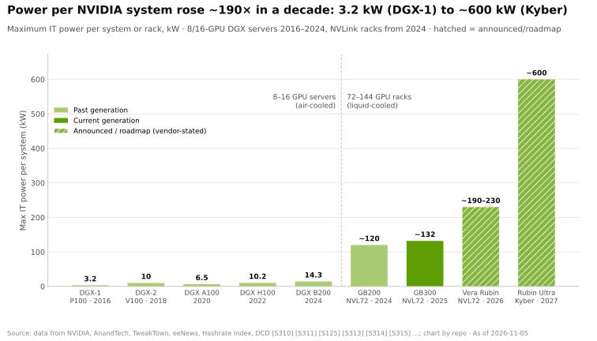
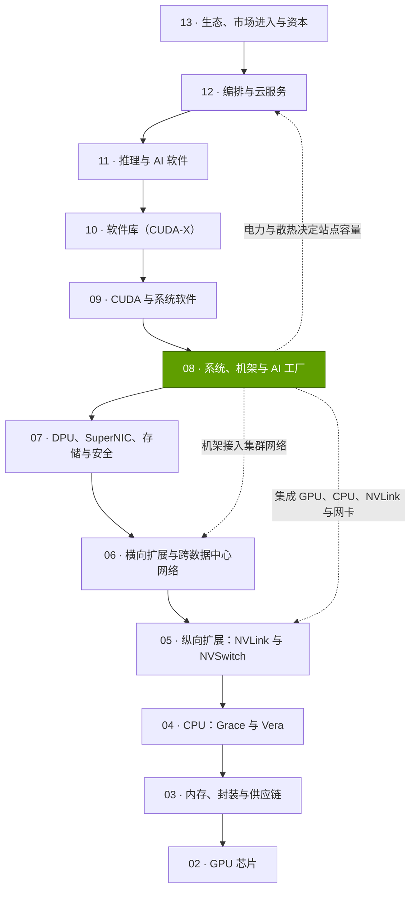
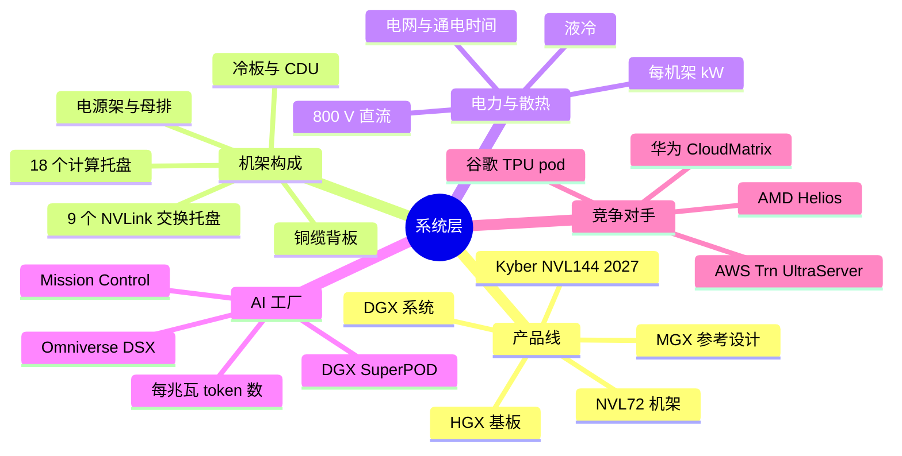

# 第 08 层 —— 系统、机架与 AI 工厂

> [!NOTE]
> 本页为英文原文的简体中文参考译文，仅供参考；如有出入，以[英文原文](../../../layers/08-systems-racks-ai-factories/index.md "English original")为准。

第 08 层（共 12 层）· 芯片如何组成机架、机架如何组成 AI 工厂，以及为何电力如今决定节奏 · 约 8 分钟阅读 · 最后核实：2026-11-05

## ⚡ 要点速览

- **产品已变成整个机架。** 英伟达（NVIDIA）的销售单元从 2016 年售价 $129K 的 DGX-1 服务器，扩大到约 $4.0M 的 GB300 NVL72 机架，以及约 $7.8M 的 Vera Rubin NVL72（估计，摩根士丹利），72 颗 GPU 处于同一个 [NVLink](../../glossary.md#nvlink) 域（[NVL72](../../glossary.md#nvl72)）中 [[S310]](../../../sources/bibliography.md#s310)[[S332]](../../../sources/bibliography.md#s332)[[S330]](../../../sources/bibliography.md#s330)。
- **几乎全部由英伟达设计，由 ODM 制造。** 英伟达规定计算托盘、交换托盘、约 5,000 根线缆组成的铜缆背板（spine）、电源架和液冷方案；富士康（约占 AI 服务器的 40%）等 [ODM](../../glossary.md#odm) 负责组装，毛利率仅约 2–3% [[S5000]](../../../sources/bibliography.md#s5000)[[S3014]](../../../sources/bibliography.md#s3014)[[S332]](../../../sources/bibliography.md#s332)。
- **单系统功耗十年间上升约 190 倍：** 从 3.2 kW（DGX-1）到约 132 kW（GB300 NVL72）、约 190–230 kW（Vera Rubin，🟡 有报道），以及 2027 年 Kyber 计划的约 600 kW（🟢 已发布）；因此[液冷](../../glossary.md#liquid-cooling)成为必选项，并催生了 [800 V 直流](../../glossary.md#hvdc-800v)供电标准 [[S310]](../../../sources/bibliography.md#s310)[[S337]](../../../sources/bibliography.md#s337)[[S303]](../../../sources/bibliography.md#s303)[[S305]](../../../sources/bibliography.md#s305)[[S90063]](../../../sources/bibliography.md#s90063)。
- **产出指标是[每兆瓦 token 数](../../glossary.md#tokens-per-megawatt)：** 在每用户 50 tokens/s 的速度下，GB300 NVL72 运行 DeepSeek-R1 的每兆瓦 token 数约为 H200 的 13 倍（本资料库根据 InferenceX 估计）；在中等速度下，Vera Rubin 还能再提升约 2 倍 [[S621]](../../../sources/bibliography.md#s621)[[S622]](../../../sources/bibliography.md#s622)[[S626]](../../../sources/bibliography.md#s626)。
- **真正的约束往往是电力而非芯片：** 文中引用的 AI 工厂在 4–15 个月内建成，但美国新增发电项目在并网排队中要等待四年以上，北弗吉尼亚的接电等待期最长可达七年 [[S6000]](../../../sources/bibliography.md#s6000)[[S8013]](../../../sources/bibliography.md#s8013)[[S8009]](../../../sources/bibliography.md#s8009)[[S8010]](../../../sources/bibliography.md#s8010)。
- **英伟达如今出售整座 [AI 工厂](../../glossary.md#ai-factory)：** 包括 DGX SuperPOD、Vera Rubin DSX 参考设计、Omniverse DSX 数字孪生以及 Mission Control 软件 [[S396]](../../../sources/bibliography.md#s396)[[S8017]](../../../sources/bibliography.md#s8017)[[S8019]](../../../sources/bibliography.md#s8019)。
- **弱点与最强挑战者：** 72 颗 GPU 的机架是一个巨大的故障域，并被锁定在英伟达的物料清单（BOM）上。AMD 的 Helios 机架（72 颗 MI455X、31 TB [HBM4](../../glossary.md#hbm4)，约为 Vera Rubin [HBM](../../glossary.md#hbm) 容量的 1.5 倍）约从 2026 年第三季度末开始出货；谷歌（Google）的 TPU pod 可扩展至 9,216 颗芯片 [[S90021]](../../../sources/bibliography.md#s90021)[[S90020]](../../../sources/bibliography.md#s90020)[[S350]](../../../sources/bibliography.md#s350)。

> [!TIP]
> **算例 —— 用英伟达的口径看 1 吉瓦。** 在 [PUE](../../glossary.md#pue) 为 1.15 时，1 GW 可留出约 870 MW 给 IT 负载 [[S387]](../../../sources/bibliography.md#s387)[[S388]](../../../sources/bibliography.md#s388)。一个 GB300 NVL72 机架需要约 132 kW，再加上约 21% 分摊的网络与存储功耗，合计约 160 kW [[S337]](../../../sources/bibliography.md#s337)[[S340]](../../../sources/bibliography.md#s340)，因此 1 GW 可容纳**约 5,400 个机架、约 390,000 颗 GPU**（本资料库测算）。英伟达 CEO 对这样一座工厂的报价为 **$50–60B，其中约 $35B 属于英伟达的产品**含量 [[S398]](../../../sources/bibliography.md#s398)。**结论：**在这一层，英伟达出售的是以兆瓦计的成品算力，1 吉瓦预算中约 58–70% 流向英伟达。

## 本层在技术栈中的位置

## 本层结构图

## 八个问题一览

| # | 问题 | 简要回答 | 详见 |
|---|---|---|---|
| Q1 | 职能是什么？薄弱时会出什么问题？ | **[Q1 · 职能与失效后果]** 把芯片变成一台能通电、能散热、能运转的计算机；一旦背板、供电或散热失效，整个 72 颗 GPU 的域都会停摆 [[S626]](../../../sources/bibliography.md#s626) | [NVL72 机架解剖](anatomy-of-an-nvl72-rack.md) |
| Q2 | 关键指标？ | **[Q2 · 关键指标]** 在给定每用户速度下的每兆瓦 tokens/s、每机架与每 GPU 的 kW、PUE、通电时间、每 GPU 小时成本 | [AI 工厂](ai-factories.md) |
| Q3 | 代际进步？ | **[Q3 · 代际进步]** 单系统功耗 3.2 kW → 约 600 kW；每机架 HBM 13.8 → 20.7 TB；GB300 上每兆瓦 token 数约为 H200 的 13 倍（估计）[[S310]](../../../sources/bibliography.md#s310)[[S305]](../../../sources/bibliography.md#s305)[[S337]](../../../sources/bibliography.md#s337)[[S621]](../../../sources/bibliography.md#s621) | [电力与散热](power-and-cooling.md)、[从 HGX 到 NVL](hgx-dgx-mgx-nvl.md) |
| Q4 | 优势来源？ | 将芯片、NVLink、供电与散热整合进每年一代的机架设计，并有一个围绕该设计进行制造的 ODM 生态 [[S3014]](../../../sources/bibliography.md#s3014) | [历史与构建过程](history-and-how-built.md) |
| Q5 | 最强挑战者？ | AMD Helios 机架（72 颗 MI455X、31 TB HBM4），2026 年下半年起供货；谷歌 TPU pod 达 9,216 颗芯片 [[S90021]](../../../sources/bibliography.md#s90021)[[S350]](../../../sources/bibliography.md#s350) | [竞争](competition.md) |
| Q6 | 复制成本？ | 需要数年时间和数十亿美元：AMD 为 ZT Systems 的机架设计团队支付了 $4.9B [[S8527]](../../../sources/bibliography.md#s8527) | [历史与构建过程](history-and-how-built.md) |
| Q7 | 路线图？ | Vera Rubin 于 2026 年第四季度上量；Kyber NVL144（约 600 kW）定于 2027 年下半年（有推迟的报道）；800 V 直流机柜排于 2027 年落地 [[S90009]](../../../sources/bibliography.md#s90009)[[S305]](../../../sources/bibliography.md#s305)[[S309]](../../../sources/bibliography.md#s309)[[S90063]](../../../sources/bibliography.md#s90063) | [路线图](roadmap.md) |
| Q8 | 价值池与并购？ | 在 $50–60B 的 1 吉瓦工厂中英伟达约占 $35B；ODM 利润率约 2–3%；其余归电力、散热与设施供应商 [[S398]](../../../sources/bibliography.md#s398)[[S332]](../../../sources/bibliography.md#s332) | [价值链与企业发展](value-chain-and-corp-dev.md) |

## 本层页面

| 页面 | 你将了解 |
|---|---|
| [HGX、DGX、MGX 与 NVL 机架](hgx-dgx-mgx-nvl.md) | 四条产品线、英伟达为何转向机架、1,000 颗 GB300 GPU 的钱都付给了谁 |
| [NVL72 机架解剖](anatomy-of-an-nvl72-rack.md) | 托盘、背板、母排、散热；计算托盘示意图；重量、功耗与部件 |
| [电力与散热](power-and-cooling.md) | 每机架 kW 的演进轨迹、液冷为何必不可少、800 V 直流、电网限制、100k GPU 设施示例 |
| [AI 工厂](ai-factories.md) | 每兆瓦 token 数、蓝图（SuperPOD、DSX）、价值从 OEM 转移、首个 token 产出时间 |
| [竞争](competition.md) | 对比各家机架级系统，并附能力热力图 |
| [历史与英伟达的构建过程](history-and-how-built.md) | 从 DGX-1 到 Kyber：时间线、关键决策、复制成本 |
| [路线图](roadmap.md) | Vera Rubin、Kyber、800 V 直流及竞争对手机架，附置信度标签 |
| [价值链与企业发展视角](value-chain-and-corp-dev.md) | 谁拿走了机架上的钱、私营公司、并购 |

🔧 技术细节：本层如何与相邻层衔接

机架封装了[第 05 层](../05-scale-up-nvlink-nvswitch/index.md)的 NVLink 交换机、[第 04 层](../04-cpu-grace-vera/index.md)的 CPU 以及[第 07 层](../07-dpu-supernic-storage-security/index.md)的 SuperNIC；它接入[第 06 层](../06-scale-out-scale-across-networking/index.md)的网络；电力与机架数量决定了[第 12 层](../12-orchestration-and-cloud-services/index.md)中云服务商可出租的算力上限（[第 14 章](../../cross-cutting/14-training-vs-inference-economics.md)对每 token 成本进行建模）。

## 🎯 企业发展视角

1. **价值已转移到 BOM 规格之中。** 谁来编写机架的物料清单，谁就拿走利润；ODM 仅保留约 2–3%（估计）[[S332]](../../../sources/bibliography.md#s332)。哪些机架部件（电源、散热、连接器）仍向独立供应商开放？
2. **电力成为新的配额货币。** 在许多地区，已通电的站点、现场发电和 800 V 直流设备比 GPU 更稀缺 [[S8009]](../../../sources/bibliography.md#s8009)[[S90061]](../../../sources/bibliography.md#s90061)；基础设施合作的重要性可能不亚于芯片设计。
3. **进入机架级市场需要制造与集成能力：** AMD 选择了收购（ZT Systems）而非自建 [[S8527]](../../../sources/bibliography.md#s8527)。
4. **高通（Qualcomm）的问题（仅基于公开信息）：** 鉴于 AI200/AI250 机架功耗约 160 kW 并采用直接液冷 [[S173]](../../../sources/bibliography.md#s173)，更好的路径是融入与英伟达兼容的机架生态（MGX、[NVLink Fusion](../../glossary.md#nvlink-fusion)），还是打造一款以每兆瓦 token 数论成败的独立推理机架？

## 📚 来源（Sources）

<!-- Auto-generated from the [S…] citations on this page by `make build`. Edit sources/registry/*.csv, not this list. -->

- [**S173**](../../../sources/bibliography.md#s173) Qualcomm, *Qualcomm Unveils AI200 and AI250 - Redefining Rack-Scale Data Center Inference*, 2025-10-27. [Link](https://www.qualcomm.com/news/releases/2025/10/qualcomm-unveils-ai200-and-ai250-redefining-rack-scale-data-cent)
- [**S303**](../../../sources/bibliography.md#s303) Commercial Times (ctee.com.tw), *Vera Rubin NVL72 Max-Q / Max-P rack power (Commercial Times report)*, 2026-01-07. [Link](https://www.ctee.com.tw/news/20260107701081-430704)
- [**S305**](../../../sources/bibliography.md#s305) DatacenterDynamics, *Nvidia's Rubin Ultra NVL576 rack expected to be 600kW, coming second half of 2027*, 2025-03-19. [Link](https://datacenterdynamics.com/en/news/nvidias-rubin-ultra-nvl576-rack-expected-to-be-600kw-coming-second-half-of-2027)
- [**S309**](../../../sources/bibliography.md#s309) Spheron, *NVIDIA Kyber rack delayed to 2028: what it means for Rubin Ultra*, 2026. [Link](https://www.spheron.network/blog/nvidia-kyber-rack-delayed-to-2028-what-it-means-for-rubin-ul/)
- [**S310**](../../../sources/bibliography.md#s310) AnandTech (Ryan Smith), *NVIDIA unveils the DGX-1 HPC server: 8 Teslas, 3U, Q2 2016*, 2016-04-05. [Link](https://www.anandtech.com/show/10229)
- [**S330**](../../../sources/bibliography.md#s330) PC Gamer, *A single Nvidia Vera Rubin rack is estimated to cost $7,803,148 with over $2 million of that figure spent on memory alone*, 2026-05. [Link](https://pcgamer.com/hardware/a-single-nvidia-vera-rubin-rack-is-estimated-to-cost-usd7-803-148-with-over-usd2-million-of-that-figure-spent-on-memory-alone)
- [**S332**](../../../sources/bibliography.md#s332) Tiger Brokers (iTiger), *Morgan Stanley's BOM analysis of NVIDIA's Rubin: GPU share declines; PCB, MLCC and ABF substrate values soar*, 2026-05-20. [Link](https://www.itiger.com/news/1188068712)
- [**S337**](../../../sources/bibliography.md#s337) Spheron, *NVIDIA GB300 (rental and specifications)*, 2026. [Link](https://spheron.network/gpu-rental/gb300/)
- [**S340**](../../../sources/bibliography.md#s340) SemiAnalysis (Dylan Patel et al.), *Huawei AI CloudMatrix 384 - China's answer to Nvidia GB200 NVL72*, 2025-04-16. [Link](https://newsletter.semianalysis.com/p/huawei-ai-cloudmatrix-384-chinas-answer-to-nvidia-gb200-nvl72)
- [**S350**](../../../sources/bibliography.md#s350) Google Cloud, *TPU7x (Ironwood) documentation*, 2025-11. [Link](https://docs.cloud.google.com/tpu/docs/tpu7x)
- [**S387**](../../../sources/bibliography.md#s387) Uptime Institute, *Uptime Institute Global Data Center Survey 2024*, 2024-07. [Link](https://uptimeinstitute.com/resources/research-and-reports/uptime-institute-global-data-center-survey-results-2024)
- [**S388**](../../../sources/bibliography.md#s388) Google, *Google data centers: efficiency (fleet-wide PUE)*, 2025. [Link](https://datacenters.google/efficiency/)
- [**S396**](../../../sources/bibliography.md#s396) NVIDIA Newsroom, *NVIDIA Blackwell platform arrives to power a new era of computing*, 2024-03-18. [Link](https://nvidianews.nvidia.com/news/nvidia-blackwell-platform-arrives-to-power-a-new-era-of-computing)
- [**S398**](../../../sources/bibliography.md#s398) NVIDIA Investor Relations, *NVIDIA Q2 FY2026 earnings call (2025-08-27): AI factory economics commentary*, 2025-08-27. [Link](https://investor.nvidia.com/events-and-presentations/events-and-presentations/default.aspx)
- [**S621**](../../../sources/bibliography.md#s621) SemiAnalysis (InferenceX-app repository), *InferenceX public API snapshot (benchmarks.json and benchmarks-history.json fixtures)*, 2026-10-17. [Link](https://github.com/SemiAnalysisAI/InferenceX-app/tree/main/packages/app/cypress/fixtures/api)
- [**S622**](../../../sources/bibliography.md#s622) SemiAnalysis (InferenceX-app repository), *InferenceX hardware registry: TCO per GPU-hour by SKU (SemiAnalysis July 2026 pricing surveys and AI Cloud TCO Model)*, 2026-07. [Link](https://github.com/SemiAnalysisAI/InferenceX-app/blob/main/packages/constants/src/gpu-keys.ts)
- [**S626**](../../../sources/bibliography.md#s626) SemiAnalysis, *Vera Rubin NVL72 vs GB200 NVL72? Inference TCO & Architecture Analysis*, 2026-07-23. [Link](https://github.com/SemiAnalysisAI/InferenceX-app/blob/main/packages/app/content/blog/vera-rubin-nvl72-vs-gb200-nvl72-inference.mdx)
- [**S3014**](../../../sources/bibliography.md#s3014) Focus Taiwan (CNA), *Foxconn expects AI server rack shipments to double in 2026*, 2026-03-16. [Link](https://focustaiwan.tw/business/202603160022)
- [**S5000**](../../../sources/bibliography.md#s5000) SemiAnalysis, *Nvidia's Optical Boogeyman - NVL72, InfiniBand Scale Out, 800G & 1.6T Ramp*, 2024-03. [Link](https://newsletter.semianalysis.com/p/nvidias-optical-boogeyman-nvl72-infiniband)
- [**S6000**](../../../sources/bibliography.md#s6000) TechPowerUp (NVIDIA press release), *NVIDIA Ethernet Networking Accelerates World's Largest AI Supercomputer, Built by xAI*, 2024-10-29. [Link](https://techpowerup.com/328227/nvidia-ethernet-networking-accelerates-worlds-largest-ai-supercomputer-built-by-xai)
- [**S8009**](../../../sources/bibliography.md#s8009) Lawrence Berkeley National Laboratory, *Queued Up: 2025 Edition, Characteristics of Power Plants Seeking Transmission Interconnection As of the End of 2024*, 2025-12-15. [Link](https://emp.lbl.gov/sites/default/files/2025-12/Queued%20Up%202025%20Edition%20-%2012.15.2025.pdf)
- [**S8010**](../../../sources/bibliography.md#s8010) Bloomberg, *Data Centers Face Seven-Year Wait for Dominion Power Hookups*, 2024-08-29. [Link](https://www.bloomberg.com/news/articles/2024-08-29/data-centers-face-seven-year-wait-for-power-hookups-in-virginia)
- [**S8013**](../../../sources/bibliography.md#s8013) DatacenterDynamics, *Crusoe's Abilene data center officially live, serving Oracle and OpenAI's Stargate*, 2025-09. [Link](https://datacenterdynamics.com/en/news/crusoes-abilene-data-center-officially-live-serving-oracle-and-openais-stargate)
- [**S8017**](../../../sources/bibliography.md#s8017) NVIDIA Newsroom, *NVIDIA Releases Vera Rubin DSX AI Factory Reference Design and Omniverse DSX Digital Twin Blueprint With Broad Industry Support*, 2026-03. [Link](https://investor.nvidia.com/news/press-release-details/2026/NVIDIA-Releases-Vera-Rubin-DSX-AI-Factory-Reference-Design-and-Omniverse-DSX-Digital-Twin-Blueprint-With-Broad-Industry-Support/default.aspx)
- [**S8019**](../../../sources/bibliography.md#s8019) NVIDIA Blog, *New NVIDIA Software for Blackwell Infrastructure Runs AI Factories at Light Speed (Mission Control)*, 2025-03-18. [Link](https://blogs.nvidia.com/blog/mission-control-software)
- [**S8527**](../../../sources/bibliography.md#s8527) AMD Investor Relations, *AMD completes acquisition of ZT Systems*, 2025-03-31. [Link](https://ir.amd.com/news-events/press-releases/detail/1240/amd-completes-acquisition-of-zt-systems)
- [**S90009**](../../../sources/bibliography.md#s90009) GamesBeat, *Nvidia Vera Rubin ramps into full production for fall launch*, 2026. [Link](https://gamesbeat.com/nvidia-vera-rubin-ramps-into-full-production-for-fall-launch-again/)
- [**S90020**](../../../sources/bibliography.md#s90020) Shacknews, *AMD Helios AI rack system on track for initial shipments in Q3 2026*, 2026. [Link](https://www.shacknews.com/article/150249/amd-helios-ai-system-shipping-q3-2026)
- [**S90021**](../../../sources/bibliography.md#s90021) Igor's Lab, *AMD Helios in production: MI455X, EPYC Venice and OpenAI challenge Nvidia AI racks*, 2026. [Link](https://www.igorslab.de/en/amd-helios-in-production-mi455x-epyc-venice-openai-challenge-nvidia-ai-racks/)
- [**S90061**](../../../sources/bibliography.md#s90061) DatacenterDynamics, *NVIDIA prepares data center industry for 1MW racks and 800 volt DC power architectures*, 2025-10. [Link](https://www.datacenterdynamics.com/en/news/nvidia-prepares-data-center-industry-for-1mw-racks-and-800-volt-dc-power-architectures/)
- [**S90063**](../../../sources/bibliography.md#s90063) Converge Digest, *The megawatt shift: NVIDIA's 800 VDC strategy*, 2026. [Link](https://convergedigest.com/the-megawatt-shift-nvidias-800-vdc-strategy/)
