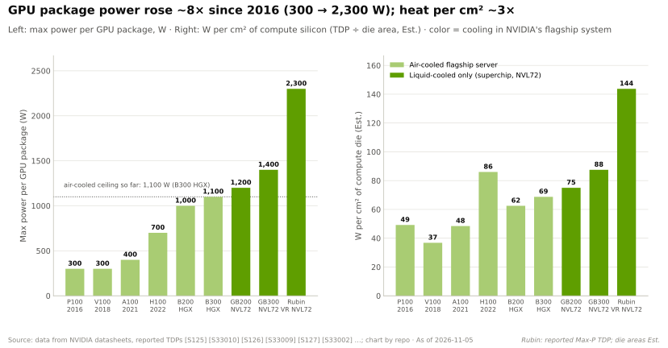
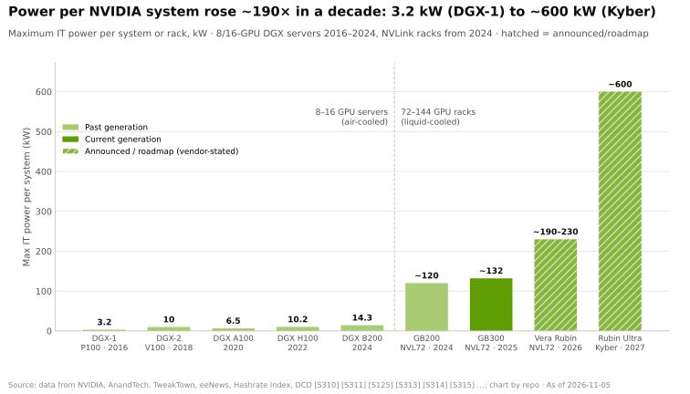
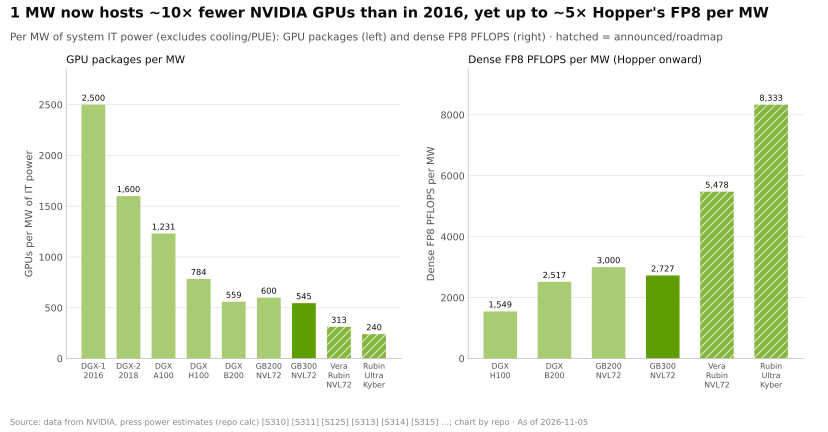
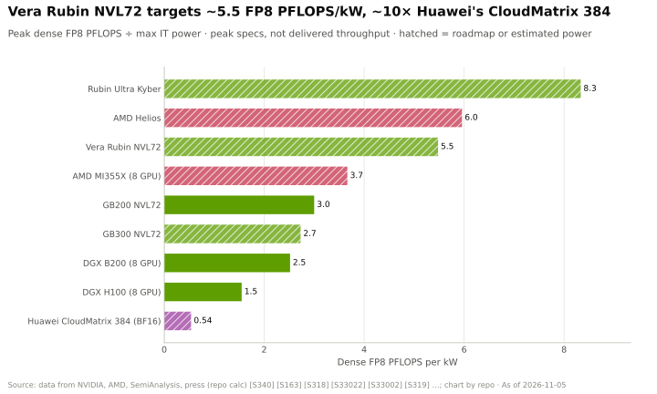
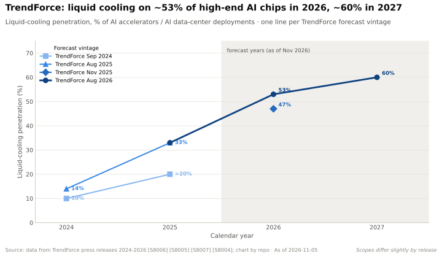
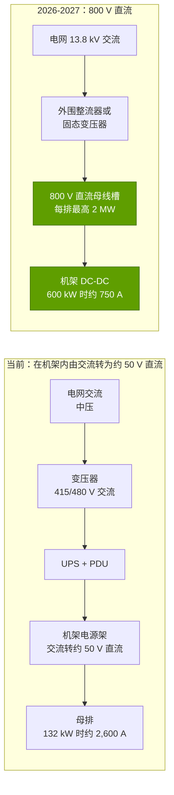

# 电力与散热：如今决定节奏的物理规律

> [!NOTE]
> 本页为英文原文的简体中文参考译文，仅供参考；如有出入，以[英文原文](../../../layers/08-systems-racks-ai-factories/power-and-cooling.md "English original")为准。

第 08 层 · 系统、机架与 AI 工厂 · 约 11 分钟阅读 · 最后核实：2026-11-05

## ⚡ 要点速览

- **机架功耗十年间上升约 190 倍：** 从 DGX-1（2016）的 3.2 kW，到 GB200/GB300 [NVL72](../../../glossary.md#nvl72) 的约 120–132 kW、Vera Rubin NVL72 的约 190–230 kW（有报道），以及 Kyber（2027）计划的约 600 kW [[S310]](../../../sources/bibliography.md#s310)[[S336]](../../../sources/bibliography.md#s336)[[S337]](../../../sources/bibliography.md#s337)[[S303]](../../../sources/bibliography.md#s303)[[S305]](../../../sources/bibliography.md#s305)。
- **风冷已无余地。** 超过 80% 的运营商最高密度机架低于 30 kW [[S8008]](../../../sources/bibliography.md#s8008)；而单个 GPU 封装如今功耗最高可达约 2.3 kW（Rubin Max-P，有报道）[[S106]](../../../sources/bibliography.md#s106)，因此每一台 NVL72 都采用[直接芯片液冷](../../../glossary.md#direct-to-chip-cooling)。
- **液冷正在成为主流：** TrendForce 将高端 AI 芯片的液冷渗透率预估上调至 2026 年约 53%、2027 年约 60%，而 2024 年仅为 14% [[S8528]](../../../sources/bibliography.md#s8528)[[S8004]](../../../sources/bibliography.md#s8004)。
- **[800 V 直流](../../../glossary.md#hvdc-800v)是英伟达（NVIDIA）的下一个标准：** 约 20 家电力合作伙伴，2026 年下半年推出 MGX 800 VDC 电源机架，2027 年推出每排 2 MW 的电力中心；若采用 54 V，一个兆瓦级机架需要多达 64U 的电源架 [[S90061]](../../../sources/bibliography.md#s90061)[[S90063]](../../../sources/bibliography.md#s90063)[[S8016]](../../../sources/bibliography.md#s8016)。
- **对许多项目而言，真正的约束是电力而非芯片：** 美国新增发电项目在并网排队中要等待四年以上，Dominion 对大型数据中心接电给出的等待期最长达七年 [[S8009]](../../../sources/bibliography.md#s8009)[[S8010]](../../../sources/bibliography.md#s8010)。
- **看空要点：** Dell'Oro 认为 800 V 直流目前是一种参考架构，尚非通用标准 [[S90062]](../../../sources/bibliography.md#s90062)；为 130 kW 机架建造的设施可能需要改造才能承载 600 kW。

## 1. 每机架 kW 的演进轨迹

**[Q3 · 代际进步]** 在英伟达销售 8 GPU 服务器的阶段（2016–2024），单系统功耗从 3.2 kW 缓慢爬升到 14.3 kW；当产品变成整个机架后，功耗跃升了十倍 [[S310]](../../../sources/bibliography.md#s310)[[S319]](../../../sources/bibliography.md#s319)[[S336]](../../../sources/bibliography.md#s336)。GPU 封装功耗上升约 8 倍，逻辑芯片每平方厘米的[热流密度](../../../glossary.md#heat-flux)上升约 3 倍（估计）[[S125]](../../../sources/bibliography.md#s125)[[S106]](../../../sources/bibliography.md#s106)。

> [!TIP]
> **算例 —— 1 MW IT 电力能容纳什么。** 2016 年，1 MW 可供 1,000 ÷ 3.2 ≈ **312 台 DGX-1，约 2,500 颗 GPU** [[S310]](../../../sources/bibliography.md#s310)。2025 年，它可供 1,000 ÷ 132 ≈ **7.6 个 GB300 机架，约 545 颗 GPU** [[S337]](../../../sources/bibliography.md#s337)。但这 545 颗 GPU 的产出要多得多：从 DGX H100 到 Vera Rubin NVL72，每兆瓦稠密 [FP8](../../../glossary.md#fp8) 算力提升约 3.5 倍（估计）[[S318]](../../../sources/bibliography.md#s318)[[S102]](../../../sources/bibliography.md#s102)。**结论：**数据中心的容量单位如今是兆瓦，而英伟达每年在每兆瓦上出售的算力都在增加。

## 2. 液冷为何成为必选项

散热本质上是一个热量输运问题：带走的热量 = 流量 × 热容 × 温升；每升水能携带的热量约为空气的 **3,500 倍**（每立方米每摄氏度 4.19 MJ 对 1.2 kJ；物理常数）。在每机架 100 kW 以上时，风冷所需的气流相当于一场飓风。

> [!TIP]
> **算例 —— 为一个 132 kW 的 GB300 机架散热。** 若用空气、温升 15 °C：132,000 W ÷（1.2 kg/m³ × 1,005 J/kg·°C × 15 °C）= 单个机架需要 **7.3 m³/s，约 15,500 CFM** 的风量（本资料库测算）[[S337]](../../../sources/bibliography.md#s337)。若用水、温升 10 °C：132,000 ÷（4,186 × 10）= **每秒 3.2 升（约每分钟 50 美制加仑）**，流经一根直径几厘米的管道。**结论：**在 NVL72 的密度下，风冷所需风量是如今机房为约 30 kW 机架所提供风量的数倍 [[S8008]](../../../sources/bibliography.md#s8008)；液冷不是高端选项，而是唯一选项。

| 方案 | 热量去向 | 适用范围 | 使用者 | 问题 |
|---|---|---|---|---|
| 风冷（配合通道封闭） | 风扇 → 室内空气 → 冷水机组 | 大多数现有机架（超过 80% 运营商的最高密度机架低于 30 kW）[[S8008]](../../../sources/bibliography.md#s8008) | 最高约 14 kW 的 HGX 服务器 [[S321]](../../../sources/bibliography.md#s321) | 风扇功耗、风量上限 |
| [直接芯片](../../../glossary.md#direct-to-chip-cooling)冷板 | 冷却液回路 → [CDU](../../../glossary.md#cdu) → 设施冷却水 | 目前约 120–230 kW，计划约 600 kW [[S336]](../../../sources/bibliography.md#s336)[[S303]](../../../sources/bibliography.md#s303)[[S305]](../../../sources/bibliography.md#s305) | NVL72 机架、MI355X DLC、谷歌（Google）TPU [[S347]](../../../sources/bibliography.md#s347)[[S8528]](../../../sources/bibliography.md#s8528) | 需要设施冷却水或[液-气（L2A）](../../../glossary.md#liquid-to-air-cooling)侧柜 |
| [浸没式](../../../glossary.md#immersion-cooling) | 槽内液体 → 换热器 | 极高密度 | 小众（HPC、加密货币挖矿） | 维护难度、冷却液成本、供应商认证 |

CDU 驱动洁净的冷却液回路流经机架冷板，再把热量交给设施冷却水；没有设施冷却水的机房使用液-气侧柜过渡，直到 2027 年起液-液方案普及 [[S8528]](../../../sources/bibliography.md#s8528)。无风扇的 Vera Rubin 托盘使用 45 °C 的水运行，在许多气候条件下温度足够高，可以用干冷器替代冷水机组（英伟达的说法）[[S8002]](../../../sources/bibliography.md#s8002)。

🔧 技术细节：PUE 能反映什么、不能反映什么

[PUE](../../../glossary.md#pue) 等于设施总功耗 ÷ IT 功耗。2025 年行业平均值为 1.54，六年来基本持平 [[S8007]](../../../sources/bibliography.md#s8007)；谷歌机群约为 1.09 [[S388]](../../../sources/bibliography.md#s388)。液冷能降低 PUE，因为水泵搬运热量比风扇和冷水机组更便宜；但它也把风扇功耗*计入*了 IT 功耗，因此 PUE 可能会略微美化液冷机房。本资料库对新建液冷 AI 机房取 1.15，对风冷取 1.4（均为假设而非实测）[[S387]](../../../sources/bibliography.md#s387)[[S388]](../../../sources/bibliography.md#s388)。

## 3. 800 V 直流供电架构

目前电力要经过多次转换，最后一步在机架的[电源架](../../../glossary.md#power-shelf)中完成，由电源架向[母排](../../../glossary.md#busbar)输出约 50 V 直流电 [[S8000]](../../../sources/bibliography.md#s8000)。低电压意味着大电流，而大电流意味着大量铜材。英伟达的方案是在设施边界将 13.8 kV 交流电转换为 800 V 直流电，再通过直流母线槽送到各机柜排 [[S8016]](../../../sources/bibliography.md#s8016)[[S90063]](../../../sources/bibliography.md#s90063)。

> [!TIP]
> **算例 —— 电压对 Kyber 为何重要。** 一个约 600 kW 的 Kyber 机架 [[S305]](../../../sources/bibliography.md#s305) 在 54 V 下需要 600,000 ÷ 54 ≈ **11,100 A** 电流；在 800 V 下为 **750 A**，约为前者的十五分之一。铜导体截面积随电流增大，电阻损耗随电流平方增大，因此要在 54 V 下达到相同的母排损耗，需要约 15 倍的铜材（本资料库测算）。英伟达称，这样一个机架所需的 54 V 电源架可能占满 **64U**，即整个机架 [[S8016]](../../../sources/bibliography.md#s8016)。**结论：**800 V 直流是兆瓦级机架在物理上得以实现的前提，而不只是锦上添花的能效改进。

现状（🟢 已发布）：包括台达、施耐德、维谛（Vertiv）、ABB、伊顿和西门子在内的约 20 家合作伙伴在 GTC DC 2025 上展示了 800 V 直流部件，CoreWeave、Lambda、Nebius、OCI 和 Together AI 正在按此进行设计 [[S90061]](../../../sources/bibliography.md#s90061)[[S90063]](../../../sources/bibliography.md#s90063)。

🔧 技术细节：800 V 直流尚待解决的问题

- **标准：** Dell'Oro 将其视为高密度 AI 机房的参考架构，尚非通用标准 [[S90062]](../../../sources/bibliography.md#s90062)。
- **安全：** 直流电弧不像交流电那样会在过零点自行熄灭，因此断路器和人员培训都需要改变。
- **改造：** 为约 130 kW 机架建造的机房需要新的配电系统才能承载 Kyber 级机架。

## 4. 电网约束与通电时间

数据中心可以在几个月内建成，电力却可能需要数年（[AI 工厂](ai-factories.md)）。在美国，2018–2024 年建成的发电项目，从提交并网申请到投运的中位时间**超过四年**，而 2000–2007 年还不到两年 [[S8009]](../../../sources/bibliography.md#s8009)。Dominion 告知北弗吉尼亚的大型（>100 MW）数据中心客户，接电等待期**最长可达七年** [[S8010]](../../../sources/bibliography.md#s8010)；截至 2026 年 4 月，ERCOT 跟踪的大型负荷接入申请达**约 410 GW**，其中约 87% 来自数据中心 [[S8011]](../../../sources/bibliography.md#s8011)；PJM 预测 2024–2030 年夏季峰值负荷将增长约 32 GW，主要来自数据中心 [[S33018]](../../../sources/bibliography.md#s33018)。

建设方的应对是采用[表后（behind-the-meter）](../../../glossary.md#behind-the-meter)发电，以燃料成本、审批许可和当地反对为代价换取更短的[通电时间](../../../glossary.md#time-to-power)：xAI 的 Colossus 2 依靠现场燃气轮机运行，而关于其电网供电情况各方说法不一（🟡）[[S8015]](../../../sources/bibliography.md#s8015)。

> [!TIP]
> **算例 —— 100,000 颗 GB300 GPU 的设施电力。** GPU 按约 1.4 kW 计：**140 MW** [[S32004]](../../../sources/bibliography.md#s32004)；1,389 个机架按约 132 kW 计：**183 MW** [[S337]](../../../sources/bibliography.md#s337)；网络与存储（+21%，SemiAnalysis 的 GB200 全部计入比例）：**约 38 MW** [[S340]](../../../sources/bibliography.md#s340)；PUE 1.15 下的散热与转换损耗：**约 33 MW**，因此电表处合计**约 255 MW**，若按行业平均 PUE 则为**约 340–346 MW** [[S8007]](../../../sources/bibliography.md#s8007)[[S387]](../../../sources/bibliography.md#s387)。满负荷用电量：255 MW × 8,760 h = **每年 2.2 TWh**，按美国工业平均电价 8.1¢/kWh 计**约 $181M**，按 5¢ 的购电协议计 $112M，按 10¢ 计 $223M [[S389]](../../../sources/bibliography.md#s389)[[S390]](../../../sources/bibliography.md#s390)。**结论：**一个 100k GPU 的 GB300 站点是四分之一吉瓦级的负荷；其年电费约为约 $5.5B 机架采购额的 3%（估计）[[S332]](../../../sources/bibliography.md#s332)。

## 🎯 企业发展视角

1. **电力设备是 AI 基建的第二条供应链。** 维谛（Vertiv）、施耐德、伊顿和台达都在英伟达 800 V 直流合作伙伴名单上 [[S90061]](../../../sources/bibliography.md#s90061)；固态变压器、直流断路器和 CDU 是初创公司与收购方活跃的领域（[价值链](value-chain-and-corp-dev.md)）。
2. **通电时间是竞争武器。** 谁能率先让站点通电，谁就能赢得下一批 GPU 配额；现场发电和已获审批的园区可以获得溢价 [[S8015]](../../../sources/bibliography.md#s8015)[[S8013]](../../../sources/bibliography.md#s8013)。
3. **高通（Qualcomm）的问题（仅基于公开信息）：** 高通的 AI200 机架功耗约 160 kW，采用直接液冷 [[S173]](../../../sources/bibliography.md#s173)；一款能装入现有液冷就绪机房、无需等待 800 V 直流的低功耗推理机架，能否开辟一个被英伟达兆瓦级路线图甩在身后的细分市场？

## 📚 来源（Sources）

<!-- Auto-generated from the [S…] citations on this page by `make build`. Edit sources/registry/*.csv, not this list. -->

- [**S102**](../../../sources/bibliography.md#s102) NVIDIA, *NVIDIA DGX Vera Rubin NVL72*, 2026. [Link](https://www.nvidia.com/en-us/data-center/dgx-vera-rubin-nvl72/)
- [**S106**](../../../sources/bibliography.md#s106) SemiAnalysis, *Vera Rubin - Extreme Co-Design: An Evolution*, 2026. [Link](https://newsletter.semianalysis.com/p/vera-rubin-extreme-co-design-an-evolution)
- [**S125**](../../../sources/bibliography.md#s125) NVIDIA, *NVIDIA Tesla P100 (Pascal GP100) Architecture Whitepaper*, 2016-04. [Link](https://images.nvidia.com/content/pdf/tesla/whitepaper/pascal-architecture-whitepaper.pdf)
- [**S173**](../../../sources/bibliography.md#s173) Qualcomm, *Qualcomm Unveils AI200 and AI250 - Redefining Rack-Scale Data Center Inference*, 2025-10-27. [Link](https://www.qualcomm.com/news/releases/2025/10/qualcomm-unveils-ai200-and-ai250-redefining-rack-scale-data-cent)
- [**S303**](../../../sources/bibliography.md#s303) Commercial Times (ctee.com.tw), *Vera Rubin NVL72 Max-Q / Max-P rack power (Commercial Times report)*, 2026-01-07. [Link](https://www.ctee.com.tw/news/20260107701081-430704)
- [**S305**](../../../sources/bibliography.md#s305) DatacenterDynamics, *Nvidia's Rubin Ultra NVL576 rack expected to be 600kW, coming second half of 2027*, 2025-03-19. [Link](https://datacenterdynamics.com/en/news/nvidias-rubin-ultra-nvl576-rack-expected-to-be-600kw-coming-second-half-of-2027)
- [**S310**](../../../sources/bibliography.md#s310) AnandTech (Ryan Smith), *NVIDIA unveils the DGX-1 HPC server: 8 Teslas, 3U, Q2 2016*, 2016-04-05. [Link](https://www.anandtech.com/show/10229)
- [**S318**](../../../sources/bibliography.md#s318) NVIDIA (mirror hosted by MEGWARE), *NVIDIA DGX H100 datasheet*, 2023. [Link](https://www.MEGWARE.com/fileadmin/user_upload/LandingPage%20NVIDIA/nvidia-dgx-h100-datasheet.pdf)
- [**S319**](../../../sources/bibliography.md#s319) NVIDIA (mirror hosted by OpenZeka), *NVIDIA DGX B200 datasheet*, 2024. [Link](https://openzeka.com/wp-content/uploads/2024/11/dgx-scale-ai-infrastructure-dgx-b200-datasheet-nvidia-web-1-1.pdf)
- [**S321**](../../../sources/bibliography.md#s321) Colfax International, *NVIDIA DGX B300 (specification page)*, 2025. [Link](https://www.colfax-intl.com/nvidia/nvidia-dgx-b300)
- [**S332**](../../../sources/bibliography.md#s332) Tiger Brokers (iTiger), *Morgan Stanley's BOM analysis of NVIDIA's Rubin: GPU share declines; PCB, MLCC and ABF substrate values soar*, 2026-05-20. [Link](https://www.itiger.com/news/1188068712)
- [**S336**](../../../sources/bibliography.md#s336) eeNews Europe, *Nvidia offers 120kW liquid-cooled Blackwell rack as industry standard*, 2024-10. [Link](https://www.eenewseurope.com/en/nvidia-offers-120kw-liquid-cooled-blackwell-rack-as-industry-standard)
- [**S337**](../../../sources/bibliography.md#s337) Spheron, *NVIDIA GB300 (rental and specifications)*, 2026. [Link](https://spheron.network/gpu-rental/gb300/)
- [**S340**](../../../sources/bibliography.md#s340) SemiAnalysis (Dylan Patel et al.), *Huawei AI CloudMatrix 384 - China's answer to Nvidia GB200 NVL72*, 2025-04-16. [Link](https://newsletter.semianalysis.com/p/huawei-ai-cloudmatrix-384-chinas-answer-to-nvidia-gb200-nvl72)
- [**S347**](../../../sources/bibliography.md#s347) AMD, *AMD Instinct MI355X platform brochure*, 2025-06. [Link](https://www.amd.com/content/dam/amd/en/documents/instinct-tech-docs/product-briefs/amd-instinct-miI355x-platform-brochure.pdf)
- [**S387**](../../../sources/bibliography.md#s387) Uptime Institute, *Uptime Institute Global Data Center Survey 2024*, 2024-07. [Link](https://uptimeinstitute.com/resources/research-and-reports/uptime-institute-global-data-center-survey-results-2024)
- [**S388**](../../../sources/bibliography.md#s388) Google, *Google data centers: efficiency (fleet-wide PUE)*, 2025. [Link](https://datacenters.google/efficiency/)
- [**S389**](../../../sources/bibliography.md#s389) U.S. Energy Information Administration, *EIA Electric Power Monthly, Table 5.6.A: average price of electricity to ultimate customers by end-use sector*, 2025. [Link](https://www.eia.gov/electricity/monthly/epm_table_grapher.php?t=epmt_5_6_a)
- [**S390**](../../../sources/bibliography.md#s390) LevelTen Energy, *LevelTen Energy PPA Price Index (North America)*, 2025. [Link](https://www.leveltenenergy.com/ppa)
- [**S8000**](../../../sources/bibliography.md#s8000) NVIDIA Docs, *NVIDIA DGX GB200 User Guide: hardware overview*, 2025. [Link](https://docs.nvidia.com/dgx/dgxgb200-user-guide/hardware.html)
- [**S8002**](../../../sources/bibliography.md#s8002) COMPUTEX Taipei (TAITRA), *NVIDIA Vera Rubin NVL72 (COMPUTEX 2026 Best Choice Award entry)*, 2026-05. [Link](https://bcaward.computex.biz/download/2026/winnerPdf/10905.pdf)
- [**S8004**](../../../sources/bibliography.md#s8004) TrendForce, *Liquid Cooling to Scale in AI Data Centers, Penetration to Surpass 30% in 2025*, 2025-08-21. [Link](https://www.trendforce.com/presscenter/news/20250821-12682.html)
- [**S8007**](../../../sources/bibliography.md#s8007) Uptime Institute, *Uptime Institute Global Data Center Survey 2025*, 2025-07. [Link](https://intelligence.uptimeinstitute.com/resource/uptime-institute-global-data-center-survey-2025)
- [**S8008**](../../../sources/bibliography.md#s8008) The Register, *Capacity planning a rising concern for datacenter operators as AI grows*, 2025-08-03. [Link](https://www.theregister.com/2025/08/03/capacity_planning_concern_datacenter_ops/)
- [**S8009**](../../../sources/bibliography.md#s8009) Lawrence Berkeley National Laboratory, *Queued Up: 2025 Edition, Characteristics of Power Plants Seeking Transmission Interconnection As of the End of 2024*, 2025-12-15. [Link](https://emp.lbl.gov/sites/default/files/2025-12/Queued%20Up%202025%20Edition%20-%2012.15.2025.pdf)
- [**S8010**](../../../sources/bibliography.md#s8010) Bloomberg, *Data Centers Face Seven-Year Wait for Dominion Power Hookups*, 2024-08-29. [Link](https://www.bloomberg.com/news/articles/2024-08-29/data-centers-face-seven-year-wait-for-power-hookups-in-virginia)
- [**S8011**](../../../sources/bibliography.md#s8011) ERCOT, *ERCOT Large Load Update (April 2026 hearing)*, 2026-04-01. [Link](https://www.ercot.com/files/docs/2026/04/01/ERCOT_LargeLoad_Update_April2026_B-C_-Hearing.pdf)
- [**S8013**](../../../sources/bibliography.md#s8013) DatacenterDynamics, *Crusoe's Abilene data center officially live, serving Oracle and OpenAI's Stargate*, 2025-09. [Link](https://datacenterdynamics.com/en/news/crusoes-abilene-data-center-officially-live-serving-oracle-and-openais-stargate)
- [**S8015**](../../../sources/bibliography.md#s8015) Cleanview, *Behind-the-meter data centers: Colossus (xAI) report*, 2026-05. [Link](https://cleanview.co/reports/behind-the-meter-data-centers/full-report/colossus)
- [**S8016**](../../../sources/bibliography.md#s8016) NVIDIA Technical Blog, *NVIDIA 800 V HVDC Architecture Will Power the Next Generation of AI Factories*, 2025-05-20. [Link](https://developer.nvidia.com/blog/nvidia-800-v-hvdc-architecture-will-power-the-next-generation-of-ai-factories/)
- [**S8528**](../../../sources/bibliography.md#s8528) TrendForce, *Liquid cooling to reach 53% of high-end AI infrastructure in 2026 (TrendForce press release)*, 2026-08-17. [Link](https://www.trendforce.com/presscenter/news/20260817-13183.html)
- [**S32004**](../../../sources/bibliography.md#s32004) NVIDIA, *NVIDIA GB300 NVL72 / Blackwell Ultra (product page)*, 2025-03. [Link](https://www.nvidia.com/en-us/data-center/gb300-nvl72/)
- [**S33018**](../../../sources/bibliography.md#s33018) PJM Interconnection, *2025 Long-Term Load Forecast Report*, 2025-01. [Link](https://www.pjm.com/-/media/DotCom/library/reports-notices/load-forecast/2025-load-report.pdf)
- [**S90061**](../../../sources/bibliography.md#s90061) DatacenterDynamics, *NVIDIA prepares data center industry for 1MW racks and 800 volt DC power architectures*, 2025-10. [Link](https://www.datacenterdynamics.com/en/news/nvidia-prepares-data-center-industry-for-1mw-racks-and-800-volt-dc-power-architectures/)
- [**S90062**](../../../sources/bibliography.md#s90062) Dell'Oro Group, *GTC 2026: moving from chip launches to infrastructure architecture*, 2026-03. [Link](https://www.delloro.com/gtc-2026-moving-from-chip-launches-to-infrastructure-architecture/)
- [**S90063**](../../../sources/bibliography.md#s90063) Converge Digest, *The megawatt shift: NVIDIA's 800 VDC strategy*, 2026. [Link](https://convergedigest.com/the-megawatt-shift-nvidias-800-vdc-strategy/)
