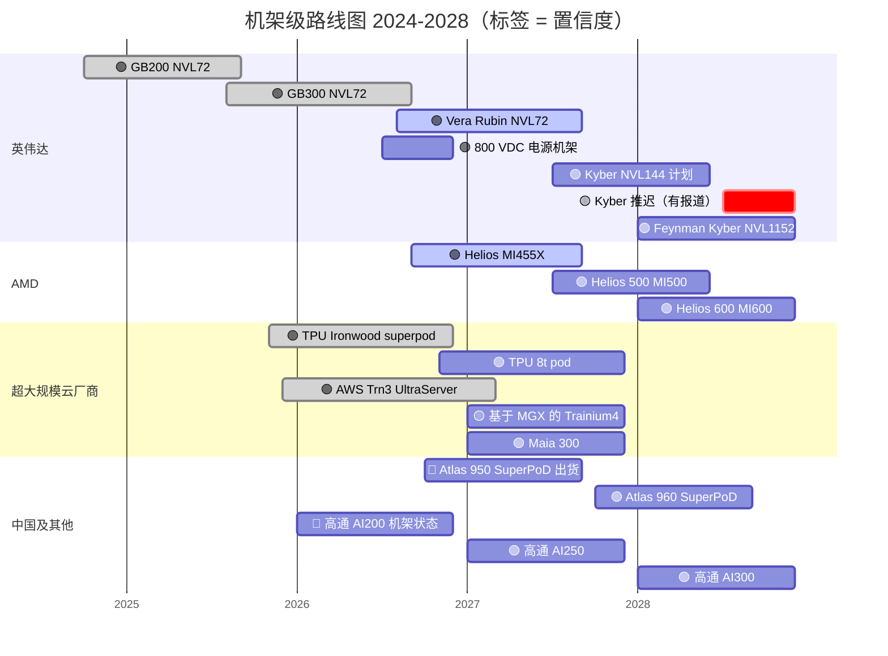
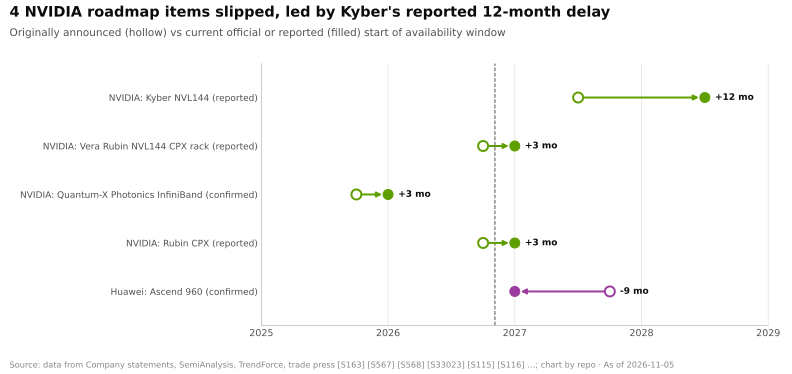

# 系统、机架与 AI 工厂：路线图

> [!NOTE]
> 本页为英文原文的简体中文参考译文，仅供参考；如有出入，以[英文原文](../../../layers/08-systems-racks-ai-factories/roadmap.md "English original")为准。

第 08 层 · 系统、机架与 AI 工厂 · 约 10 分钟阅读 · 最后核实：2026-11-05

## ⚡ 要点速览

- **Vera Rubin [NVL72](../../glossary.md#nvl72) 是 2026 年的主力机架。** 量产出货于 2026 年 8 月开始，第四季度放量 🟢 [[S500]](../../../sources/bibliography.md#s500)[[S90009]](../../../sources/bibliography.md#s90009)。谷歌云（Google Cloud）预计基于它的 A5X 实例将于 2026 年 11 月全面上市 [[S554]](../../../sources/bibliography.md#s554)。
- **Kyber 的时间点存在争议。** 这款 144 个封装、约 600 kW 的 Rubin Ultra 机架官方定于 2027 年下半年。SemiAnalysis 报道称，由于中板（midplane）的可制造性问题，其将推迟 12 个月以上，英伟达（NVIDIA）予以否认 🟡 [[S510]](../../../sources/bibliography.md#s510)[[S507]](../../../sources/bibliography.md#s507)[[S508]](../../../sources/bibliography.md#s508)。
- **按每机架计，从 GB200 到 Kyber，功耗约增至 5 倍（120 → 约 600 kW），换来约 14 倍的稠密 [FP8](../../glossary.md#fp8) 算力和约 10 倍的 [HBM](../../glossary.md#hbm)**（按已发布数据）[[S121]](../../../sources/bibliography.md#s121)[[S336]](../../../sources/bibliography.md#s336)[[S305]](../../../sources/bibliography.md#s305)。
- **[800 V 直流](../../glossary.md#hvdc-800v)是起支撑作用的路线图。** 兼容 MGX 的 800 V 直流电源机架将于 2026 年下半年推出，机柜排级电力中心（每排最高 2 MW）将于 2027 年推出 [[S90063]](../../../sources/bibliography.md#s90063)。Dell'Oro 认为它目前是一种参考架构，尚非标准 [[S90062]](../../../sources/bibliography.md#s90062)。
- **竞争对手跟上了英伟达的年度节奏。** AMD：Helios（2026）、Helios 500（2027）、Helios 600（2028）[[S538]](../../../sources/bibliography.md#s538)。谷歌的 TPU 8t pod 定于 2026 年底推出 [[S550]](../../../sources/bibliography.md#s550)，Maia 300 定于 2027 年 [[S90046]](../../../sources/bibliography.md#s90046)，华为 Atlas 960 定于 2027 年第四季度 [[S567]](../../../sources/bibliography.md#s567)。
- **[Q7 · 路线图与变数]** 有三件事比下一份规格表更重要：电网电力、液冷供应链（2025–27 年在 AI 芯片中的渗透率 33% → 53% → 约 60%），以及 600 kW 下的可靠性 🟡 [[S8528]](../../../sources/bibliography.md#s8528)。

## 2024–2028 年路线图一览

| 项目 | 时间窗口 | 状态 | 置信度 | 来源 |
|---|---|---|---|---|
| GB300 NVL72 | 2025 年下半年 → 2026 年 | 出货中 | 🟢 | [[S32004]](../../../sources/bibliography.md#s32004)[[S554]](../../../sources/bibliography.md#s554) |
| Vera Rubin NVL72（72 颗 Rubin + 36 颗 Vera，20.7 TB HBM4） | 2026 年 8 月量产；2026 年第四季度放量 | 出货中 | 🟢 | [[S500]](../../../sources/bibliography.md#s500)[[S102]](../../../sources/bibliography.md#s102) |
| 与 Vera Rubin 并列部署的 Groq 3 LPX 机架 | 2026 年下半年 | 已发布 | 🟢 | [[S113]](../../../sources/bibliography.md#s113)[[S114]](../../../sources/bibliography.md#s114) |
| 800 V 直流 MGX 电源机架 / 机柜排级电力中心 | 2026 年下半年 / 2027 年 | 路线图 | 🟢 | [[S90063]](../../../sources/bibliography.md#s90063) |
| Kyber NVL144（Rubin Ultra，约 600 kW） | 官方为 2027 年下半年；有报道称 2028 年 | 存在争议 | 🟡 | [[S510]](../../../sources/bibliography.md#s510)[[S507]](../../../sources/bibliography.md#s507)[[S508]](../../../sources/bibliography.md#s508) |
| Feynman、Kyber NVL1152（铜缆 + 光互连） | 2028 年 | 路线图 | 🟢 | [[S108]](../../../sources/bibliography.md#s108)[[S109]](../../../sources/bibliography.md#s109) |
| AMD Helios → Helios 500 → Helios 600 | 2026 / 2027 / 2028 | 出货中 / 路线图 | 🟢 | [[S538]](../../../sources/bibliography.md#s538)[[S90020]](../../../sources/bibliography.md#s90020) |
| 谷歌 TPU 8t pod（9,600 颗芯片，121 EF FP4） | 2026 年底 | 已发布 | 🟢 | [[S550]](../../../sources/bibliography.md#s550) |
| 采用 NVLink Fusion 和 MGX 的 AWS Trainium4 | 约 2027 年（AWS 未给出日期） | 已发布 | 🟡 | [[S518]](../../../sources/bibliography.md#s518)[[S156]](../../../sources/bibliography.md#s156) |
| 微软 Maia 300 | 2027 年 | 已发布 | 🟢 | [[S90046]](../../../sources/bibliography.md#s90046) |
| 华为 Atlas 950 → Atlas 960 SuperPoD | 2026 年第四季度 / 2027 年第四季度 | 出货未经证实 | 🔴 / 🟢 | [[S341]](../../../sources/bibliography.md#s341)[[S567]](../../../sources/bibliography.md#s567) |
| 高通 AI200 → AI250 → AI300（公开信息） | 2026 / 2027 / 2028 | 已发布；2026 年量产未经证实 | 🟢 / 🔴 | [[S173]](../../../sources/bibliography.md#s173)[[S90060]](../../../sources/bibliography.md#s90060)[[S90028]](../../../sources/bibliography.md#s90028) |

> [!TIP]
> **算例 —— 如何解读一次推迟。** Kyber 的官方时间窗口是 2027 年下半年 [[S510]](../../../sources/bibliography.md#s510)。如果 SemiAnalysis 关于推迟 12 个月以上的报道属实 [[S507]](../../../sources/bibliography.md#s507)，2027 年的买家拿到的将是装在现有 Oberon NVL72 机架中的 Rubin Ultra，GTC 2026 已将其列为一个选项 [[S108]](../../../sources/bibliography.md#s108)。推迟的代价在于域规模而非算力：每个 [NVLink](../../glossary.md#nvlink) 域停留在 72 颗 GPU 的时间将再延长一年。与此同时，AWS 提供 144 颗，谷歌提供 9,216 颗 [[S353]](../../../sources/bibliography.md#s353)[[S350]](../../../sources/bibliography.md#s350)。

## 为何供电决定节奏

每一代机架都受限于单个机架能输送多少电力、排出多少热量。如今的机架从电源架向托盘分配约 54 V 直流电。在 600 kW 下，这需要大量铜材，并以热量形式浪费电能。英伟达的 [800 V 直流](../../glossary.md#hvdc-800v)方案把电能转换移到建筑边界，并以高电压向机架供电 [[S33019]](../../../sources/bibliography.md#s33019)。Heron Power 等初创公司的[固态变压器](../../glossary.md#solid-state-transformer)可将中压电网电力直接转换为 800 V [[S8519]](../../../sources/bibliography.md#s8519)。

> [!TIP]
> **算例 —— 600 kW 下 800 V 为何重要。** 电流 = 功率 ÷ 电压。一个 600 kW 的 Kyber 机架在 54 V 下需要约 11,100 A 电流；在 800 V 下约 750 A，约为前者的十五分之一 [[S305]](../../../sources/bibliography.md#s305)[[S33019]](../../../sources/bibliography.md#s33019)。电阻损耗与电流平方成正比，因此同一母排在 800 V 下的发热损耗约少 200 倍（🔴 本资料库的物理测算，未计转换损耗）。一个 2 MW 的机柜排级电力中心大约可为三个这样的机架供电 [[S90063]](../../../sources/bibliography.md#s90063)。

🔧 技术细节：800 V 直流生态必须交付什么

2025 年 10 月的 GTC DC 上，约 20 家合作伙伴展示了 800 V 直流部件，范围涵盖芯片（英飞凌、意法半导体、纳微（Navitas）、德州仪器）、电力设备（台达、伊顿、施耐德、维谛（Vertiv）、ABB）以及电网设备（GE Vernova、日立能源、西门子）[[S90061]](../../../sources/bibliography.md#s90061)。包括 CoreWeave、Lambda 和 Nebius 在内的[新兴云服务商（neocloud）](../../glossary.md#neocloud)正在按 800 V 进行设计 [[S90061]](../../../sources/bibliography.md#s90061)。尚待解决的问题：机房白区（white space）内高压直流的安全规范，以及[超大规模云厂商](../../glossary.md#hyperscaler)是否会采用英伟达的版本 [[S90062]](../../../sources/bibliography.md#s90062)。

## [Q7 · 路线图与变数]

**[Q7 · 路线图与变数]** 纸面上各家路线图正在趋同：每家都会每年推出一款配备约 20–30 TB HBM 的机架。可能改变格局的因素：

- **电力可得性。** 机架功耗从约 120 kW 升至约 600 kW，1 MW 已在视野之内 [[S90061]](../../../sources/bibliography.md#s90061)；已并网、具备 800 V 条件的机房决定了所有厂商的节奏。
- **液冷供应。** TrendForce 预计液冷在 AI 芯片中的渗透率 2026 年约为 53%，2027 年约为 60% 🟡 [[S8528]](../../../sources/bibliography.md#s8528)。冷板和 CDU 可能会像当年的 [CoWoS](../../glossary.md#cowos) 一样成为机架的瓶颈。
- **机架可靠性。** 据报道，Kyber 的问题出在中板，是制造问题而非芯片问题 [[S507]](../../../sources/bibliography.md#s507)。Helios 若能顺利上量，缩小英伟达领先优势的速度将快于任何规格提升。
- **内存成本。** 内存已升至 Vera Rubin 机架物料清单的约 26%（估计，摩根士丹利），伯恩斯坦（Bernstein）预计机架价格约 $9.1M 🟡 [[S332]](../../../sources/bibliography.md#s332)[[S333]](../../../sources/bibliography.md#s333)。
- **开放的[纵向扩展](../../glossary.md#scale-up)。** [UALink](../../glossary.md#ualink) 1.0 产品预计于 2027 年推出 🟡 [[S90051]](../../../sources/bibliography.md#s90051)。届时商用机架将获得一种非英伟达的纵向扩展网络。

> [!TIP]
> **算例 —— 散热成本不高，散热供应却是大问题。** 摩根士丹利估计每个 GB300 NVL72 机架的液冷成本约 $50K，每个 Vera Rubin 机架约 $56K，不到 $7.8M 机架价格的 1% [[S334]](../../../sources/bibliography.md#s334)[[S330]](../../../sources/bibliography.md#s330)。但缺少一台 $56K 的 CDU，就会让价值 $7.8M 的算力闲置。正是这种不对称，促使伊顿以 $9.5B 收购了 Boyd Thermal [[S8508]](../../../sources/bibliography.md#s8508)。

## 🎯 企业发展视角

1. 如果 Kyber 推迟到 2028 年 🟡 [[S507]](../../../sources/bibliography.md#s507)，AMD 的 Helios 500（2027）或谷歌的 TPU 8t pod 是否会吸引那些需要更大域的前沿买家？
2. 哪些 800 V 直流部件（固态变压器、直流断路器、GaN/SiC 功率级）目前还缺少规模化供应商？
3. 超大规模云厂商会像 AWS 在 Trainium4 上那样采用英伟达的 MGX 与 800 V 设计 [[S518]](../../../sources/bibliography.md#s518)，还是坚持自研机架？
4. 对于 2027–28 年进入市场的推理机架厂商（例如高通（Qualcomm）AI250/AI300，公开信息），设计应瞄准当前的 160 kW 机房，还是 800 V 站点？

## 📚 来源（Sources）

<!-- Auto-generated from the [S…] citations on this page by `make build`. Edit sources/registry/*.csv, not this list. -->

- [**S102**](../../../sources/bibliography.md#s102) NVIDIA, *NVIDIA DGX Vera Rubin NVL72*, 2026. [Link](https://www.nvidia.com/en-us/data-center/dgx-vera-rubin-nvl72/)
- [**S108**](../../../sources/bibliography.md#s108) HPCwire / AIwire, *Huang Shares Nvidia Roadmap Showing More Chips, NVL1152, Scale-Up CPO*, 2026-03-18. [Link](https://www.hpcwire.com/aiwire/2026/03/18/huang-shares-nvidia-roadmap-showing-more-chips-nvl1152-scale-up-cpo/)
- [**S109**](../../../sources/bibliography.md#s109) NVIDIA Blog, *NVIDIA GTC 2026: Live Updates on What's Next in AI*, 2026-03-16. [Link](https://blogs.nvidia.com/blog/gtc-2026-news/)
- [**S113**](../../../sources/bibliography.md#s113) Tom's Hardware, *How Nvidia's $20 billion Groq 3 LPU deal reshapes the Nvidia Vera Rubin Platform*, 2026-03. [Link](https://www.tomshardware.com/tech-industry/semiconductors/nvidias-20-billion-groq-deal-produces-its-first-chip)
- [**S114**](../../../sources/bibliography.md#s114) StorageReview, *NVIDIA Groq 3 LPX: Everything we know*, 2026-03. [Link](https://www.storagereview.com/news/nvidia-groq-3-lpx-everything-we-know)
- [**S121**](../../../sources/bibliography.md#s121) NVIDIA, *NVIDIA GB200 NVL72*, 2024-03. [Link](https://www.nvidia.com/en-us/data-center/gb200-nvl72/)
- [**S156**](../../../sources/bibliography.md#s156) About Amazon, *AWS re:Invent 2025: top announcements (Trainium3 GA, Trainium4 preview, Graviton5)*, 2025-12-02. [Link](https://www.aboutamazon.com/news/aws/aws-re-invent-2025-ai-news-updates)
- [**S173**](../../../sources/bibliography.md#s173) Qualcomm, *Qualcomm Unveils AI200 and AI250 - Redefining Rack-Scale Data Center Inference*, 2025-10-27. [Link](https://www.qualcomm.com/news/releases/2025/10/qualcomm-unveils-ai200-and-ai250-redefining-rack-scale-data-cent)
- [**S305**](../../../sources/bibliography.md#s305) DatacenterDynamics, *Nvidia's Rubin Ultra NVL576 rack expected to be 600kW, coming second half of 2027*, 2025-03-19. [Link](https://datacenterdynamics.com/en/news/nvidias-rubin-ultra-nvl576-rack-expected-to-be-600kw-coming-second-half-of-2027)
- [**S330**](../../../sources/bibliography.md#s330) PC Gamer, *A single Nvidia Vera Rubin rack is estimated to cost $7,803,148 with over $2 million of that figure spent on memory alone*, 2026-05. [Link](https://pcgamer.com/hardware/a-single-nvidia-vera-rubin-rack-is-estimated-to-cost-usd7-803-148-with-over-usd2-million-of-that-figure-spent-on-memory-alone)
- [**S332**](../../../sources/bibliography.md#s332) Tiger Brokers (iTiger), *Morgan Stanley's BOM analysis of NVIDIA's Rubin: GPU share declines; PCB, MLCC and ABF substrate values soar*, 2026-05-20. [Link](https://www.itiger.com/news/1188068712)
- [**S333**](../../../sources/bibliography.md#s333) Wccftech, *Bernstein warns NVIDIA's Vera Rubin racks will hit $9.1 million as HBM4 prices triple to $53 per gigabyte*, 2026-07. [Link](https://wccftech.com/bernstein-warns-nvidias-vera-rubin-racks-will-hit-9-1-million-as-hbm4-prices-triple-to-53-per-gigabyte/)
- [**S334**](../../../sources/bibliography.md#s334) Tom's Hardware, *Cooling system for a single Nvidia Blackwell Ultra NVL72 rack costs $50,000 - set to increase to $56,000 with next-generation NVL144 racks*, 2025-09. [Link](https://www.tomshardware.com/pc-components/cooling/cooling-system-for-a-single-nvidia-blackwell-ultra-nvl72-rack-costs-a-staggering-usd50-000-set-to-increase-to-usd56-000-with-next-generation-nvl144-racks)
- [**S336**](../../../sources/bibliography.md#s336) eeNews Europe, *Nvidia offers 120kW liquid-cooled Blackwell rack as industry standard*, 2024-10. [Link](https://www.eenewseurope.com/en/nvidia-offers-120kw-liquid-cooled-blackwell-rack-as-industry-standard)
- [**S341**](../../../sources/bibliography.md#s341) Converge Digest, *Huawei unveils next-gen Ascend chips, SuperPoDs and UnifiedBus interconnect*, 2025-09-18. [Link](https://convergedigest.com/huawei-unveils-next-gen-ascend-chips-superpods-and-unifiedbus-interconnect/)
- [**S350**](../../../sources/bibliography.md#s350) Google Cloud, *TPU7x (Ironwood) documentation*, 2025-11. [Link](https://docs.cloud.google.com/tpu/docs/tpu7x)
- [**S353**](../../../sources/bibliography.md#s353) AWS, *Announcing Amazon EC2 Trn3 UltraServers for faster, lower-cost generative AI training*, 2025-12-02. [Link](https://aws.amazon.com/about-aws/whats-new/2025/12/amazon-ec2-trn3-ultraservers/)
- [**S500**](../../../sources/bibliography.md#s500) NVIDIA Corporation, *NVIDIA Q2 Fiscal 2027 Quarterly Presentation (CFO commentary deck)*, 2026-08-26. [Link](https://s201.q4cdn.com/141608511/files/doc_financials/2027/Q227/NVDA-F2Q27-Quarterly-Presentation-final-1.pdf)
- [**S507**](../../../sources/bibliography.md#s507) Tom's Hardware, *Nvidia's Kyber rack for Rubin Ultra slips to 2028*, 2026-07-06. [Link](https://www.tomshardware.com/pc-components/gpus/nvidias-kyber-rack-for-rubin-ultra-slips-to-2028)
- [**S508**](../../../sources/bibliography.md#s508) Wccftech, *NVIDIA Quashes Rubin & Kyber Rack Delay Rumors, Says 'Chip Roadmap Is Intact'*, 2026-07. [Link](https://wccftech.com/nvidia-quashes-rubin-kyber-rack-delay-rumors-says-chip-roadmap-is-intact/)
- [**S510**](../../../sources/bibliography.md#s510) KGI Securities, *NVIDIA GTC 2026 (research note)*, 2026-03-19. [Link](https://www.kgi.com.hk/zh-hk/-/media/files/kgishk/research-reports/tw-reports/nvidia-gtc-2026_19032026e.pdf)
- [**S518**](../../../sources/bibliography.md#s518) ServeTheHome, *NVIDIA NVLink Fusion tapped for future AWS Trainium4 deployments*, 2025-12-02. [Link](https://www.servethehome.com/nvidia-nvlink-fusion-tapped-for-future-aws-trainium4-deployments/)
- [**S538**](../../../sources/bibliography.md#s538) AMD Investor Relations, *AAI 2026: AMD Delivers Full-Stack Compute for the Agentic AI Era*, 2026-07-23. [Link](https://ir.amd.com/news-events/press-releases/detail/1294/aai-2026-amd-delivers-full-stack-compute-for-the-agentic-ai-era)
- [**S550**](../../../sources/bibliography.md#s550) SiliconANGLE, *Google Cloud unveils eighth-generation TPUs (TPU 8t and TPU 8i)*, 2026-04-22. [Link](https://siliconangle.com/?p=740999)
- [**S554**](../../../sources/bibliography.md#s554) Google Cloud Blog (Mark Lohmeyer), *Google Cloud and NVIDIA expand co-engineering collaboration to scale infrastructure for the agentic era (NVIDIA GTC Berlin 2026)*, 2026-10-21. [Link](https://cloud.google.com/blog/topics/ai-infrastructure/google-cloud-infrastructure-at-nvidia-gtc-berlin-2026)
- [**S567**](../../../sources/bibliography.md#s567) Huawei, *Huawei Connect 2026: Ascend 960 SuperNode*, 2026-09. [Link](https://www.huawei.com/br/news/2026/9/hc-ascend960-supernode)
- [**S8508**](../../../sources/bibliography.md#s8508) Business Wire (Eaton), *Eaton completes acquisition of leading liquid-cooling solutions provider Boyd Thermal*, 2026-03-12. [Link](https://www.businesswire.com/news/home/20260312582488/en)
- [**S8519**](../../../sources/bibliography.md#s8519) TechCrunch, *Heron Power raises $140M to ramp production of grid-altering tech*, 2026-02-18. [Link](https://techcrunch.com/2026/02/18/heron-power-raises-140m-to-ramp-production-of-grid-altering-tech/)
- [**S8528**](../../../sources/bibliography.md#s8528) TrendForce, *Liquid cooling to reach 53% of high-end AI infrastructure in 2026 (TrendForce press release)*, 2026-08-17. [Link](https://www.trendforce.com/presscenter/news/20260817-13183.html)
- [**S32004**](../../../sources/bibliography.md#s32004) NVIDIA, *NVIDIA GB300 NVL72 / Blackwell Ultra (product page)*, 2025-03. [Link](https://www.nvidia.com/en-us/data-center/gb300-nvl72/)
- [**S33019**](../../../sources/bibliography.md#s33019) NVIDIA Technical Blog, *NVIDIA 800 V HVDC Architecture Will Power the Next Generation of AI Factories*, 2025-05-20. [Link](https://developer.nvidia.com/blog/nvidia-800-v-hvdc-architecture-will-power-the-next-generation-of-ai-factories/)
- [**S90009**](../../../sources/bibliography.md#s90009) GamesBeat, *Nvidia Vera Rubin ramps into full production for fall launch*, 2026. [Link](https://gamesbeat.com/nvidia-vera-rubin-ramps-into-full-production-for-fall-launch-again/)
- [**S90020**](../../../sources/bibliography.md#s90020) Shacknews, *AMD Helios AI rack system on track for initial shipments in Q3 2026*, 2026. [Link](https://www.shacknews.com/article/150249/amd-helios-ai-system-shipping-q3-2026)
- [**S90028**](../../../sources/bibliography.md#s90028) TechRepublic, *Qualcomm unveils AI chips to rival Nvidia, AMD*, 2025-10-27. [Link](https://techrepublic.com/article/news-qualcomm-unveils-ai-chips-to-rival-nvidia-amd)
- [**S90046**](../../../sources/bibliography.md#s90046) IT Brief UK, *Microsoft unveils Maia 300 for 2027 AI deployments*, 2026-10. [Link](https://itbrief.co.uk/story/microsoft-unveils-maia-300-for-2027-ai-deployments)
- [**S90051**](../../../sources/bibliography.md#s90051) SDxCentral, *UALink Consortium takes another swing at Nvidia's NVLink supremacy with specification 2.0*, 2026-04. [Link](https://www.sdxcentral.com/news/ualink-consortium-takes-another-swing-at-nvidias-nvlink-supremacy-with-specification-20/)
- [**S90060**](../../../sources/bibliography.md#s90060) Qualcomm, *Qualcomm Dragonfly AI300 (product page)*, 2026-06. [Link](https://www.qualcomm.com/data-center/products/qualcomm-dragonfly-ai300)
- [**S90061**](../../../sources/bibliography.md#s90061) DatacenterDynamics, *NVIDIA prepares data center industry for 1MW racks and 800 volt DC power architectures*, 2025-10. [Link](https://www.datacenterdynamics.com/en/news/nvidia-prepares-data-center-industry-for-1mw-racks-and-800-volt-dc-power-architectures/)
- [**S90062**](../../../sources/bibliography.md#s90062) Dell'Oro Group, *GTC 2026: moving from chip launches to infrastructure architecture*, 2026-03. [Link](https://www.delloro.com/gtc-2026-moving-from-chip-launches-to-infrastructure-architecture/)
- [**S90063**](../../../sources/bibliography.md#s90063) Converge Digest, *The megawatt shift: NVIDIA's 800 VDC strategy*, 2026. [Link](https://convergedigest.com/the-megawatt-shift-nvidias-800-vdc-strategy/)
