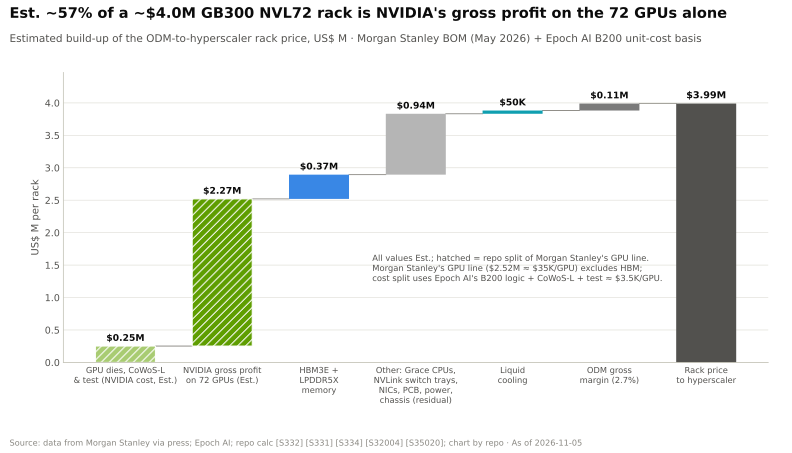
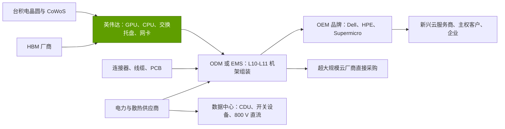
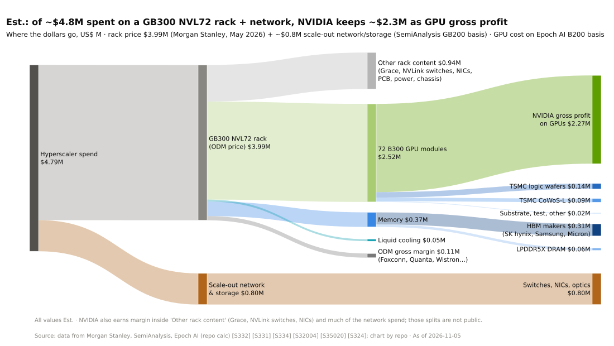
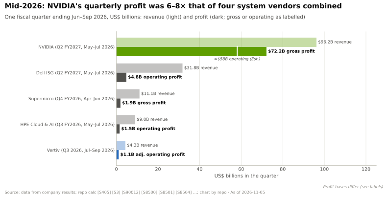

# 系统、机架与 AI 工厂：价值链与企业发展视角

> [!NOTE]
> 本页为英文原文的简体中文参考译文，仅供参考；如有出入，以[英文原文](../../../layers/08-systems-racks-ai-factories/value-chain-and-corp-dev.md "English original")为准。

第 08 层 · 系统、机架与 AI 工厂 · 约 12 分钟阅读 · 最后核实：2026-11-05

## ⚡ 要点速览

- **英伟达（NVIDIA）拿走了一个机架的大部分价值。** 在一个估计价值 $3.99M 的 GB300 [NVL72](../../glossary.md#nvl72) 中，约 $2.27M（约 57%）是英伟达在 GPU 上的毛利。[ODM](../../glossary.md#odm) 保留约 $108K（2.7%），液冷成本约 $50K（估计，摩根士丹利）[[S332]](../../../sources/bibliography.md#s332)[[S334]](../../../sources/bibliography.md#s334)。
- **集成商靠微薄的利润运营。** 在 Vera Rubin 机架上，ODM 毛利率降至约 1.9%（估计）[[S332]](../../../sources/bibliography.md#s332)。广达的 GB 机架服务器毛利率约 5%（凯基证券）[[S8529]](../../../sources/bibliography.md#s8529)[[S8530]](../../../sources/bibliography.md#s8530)；戴尔对 AI 服务器的营业利润率目标为个位数中段 [[S8502]](../../../sources/bibliography.md#s8502)[[S8503]](../../../sources/bibliography.md#s8503)。
- **价值从 OEM 转移到了英伟达。** 英伟达产品在系统中的占比，从 HGX 服务器的约 50–75% 升至 NVL72 机架的约 71–84%（🔴 本资料库根据分析师的[物料清单](../../glossary.md#bill-of-materials)估计）。
- **内存是新的分利者。** 内存在机架物料清单中的占比从约 9%（GB300）升至约 26%（Vera Rubin）（估计，摩根士丹利）[[S332]](../../../sources/bibliography.md#s332)[[S331]](../../../sources/bibliography.md#s331)。
- **电力与散热是高利润的基础设施价值池。** 2026 年第三季度，维谛（Vertiv）销售额增长 61%，调整后营业利润率为 25.2% [[S8507]](../../../sources/bibliography.md#s8507)。伊顿（Boyd Thermal，$9.5B）、施耐德（Motivair）和维谛（PurgeRite）正在进行整合 [[S8508]](../../../sources/bibliography.md#s8508)[[S8513]](../../../sources/bibliography.md#s8513)[[S8510]](../../../sources/bibliography.md#s8510)。
- **[Q8 · 价值池与并购机会]** 有三类资产以溢价成交：机架设计团队（ZT，AMD 净付出约 $2B）、散热与电力业务，以及数据中心主体建筑（Aligned，$40B）[[S5527]](../../../sources/bibliography.md#s5527)[[S8521]](../../../sources/bibliography.md#s8521)。

## 机架中的钱被谁拿走了

英伟达采购晶圆、封装和 [HBM](../../glossary.md#hbm)，出售 GPU 模组、CPU、交换托盘和网卡。ODM 在 L10–L11 层级（[集成层级](../../glossary.md#l6-l10-l11)）组装并测试机架；OEM 则提供服务和融资。

| 价值池（GB300 NVL72，估计） | 归属方 | 每机架金额 | 占比 | 龙头企业利润率 |
|---|---|---|---|---|
| GPU 毛利 | 英伟达 | 约 $2.27M | 约 57% | 毛利率 75.0% [[S405]](../../../sources/bibliography.md#s405) |
| GPU 裸片、CoWoS-L、测试 | 台积电（TSMC）、封测厂（OSAT） | 约 $0.25M | 约 6% | 台积电毛利率 66.4% [[S3538]](../../../sources/bibliography.md#s3538) |
| HBM3E + LPDDR5X | SK 海力士、三星、美光（Micron） | 约 $0.37M | 约 9%（Vera Rubin 上 → 约 26%） | 美光毛利率 86.8% [[S3533]](../../../sources/bibliography.md#s3533) |
| 其他部件（Grace、交换托盘、网卡、PCB、电源架、线缆） | 英伟达、安费诺（Amphenol）、台达等 | 约 $0.94M | 约 24% | 安费诺销售额同比 +65% [[S5503]](../../../sources/bibliography.md#s5503) |
| 液冷 | 冷板与 [CDU](../../glossary.md#cdu) 厂商 | 约 $50K | 约 1% | 维谛调整后营业利润率 25.2% [[S8507]](../../../sources/bibliography.md#s8507) |
| 组装与测试 | 富士康、广达、纬创/纬颖 | 约 $108K | 约 2.7% | 富士康毛利率 6.3% [[S3522]](../../../sources/bibliography.md#s3522) |

机架拆分数据来自摩根士丹利 2026 年 5 月的 BOM，图表见 [[S332]](../../../sources/bibliography.md#s332)[[S331]](../../../sources/bibliography.md#s331)[[S334]](../../../sources/bibliography.md#s334)；横向扩展网络与存储在本表之外每机架另增约 $0.8M（估计）[[S324]](../../../sources/bibliography.md#s324)。

> [!TIP]
> **算例 —— 散热只占账单的 1%，却是一个增长市场。** 液冷约占 $3.99M GB300 机架中的 $50K（约 1.3%），以及 $7.8M Vera Rubin 机架中的约 $56K（约 0.7%）[[S334]](../../../sources/bibliography.md#s334)[[S330]](../../../sources/bibliography.md#s330)。建筑侧的 CDU、管道和冷水机组不在这份账单之内。驱动市场的是机架数量，而非每机架价格。TrendForce 预计英伟达 GB/VR 机架出货量将在 2026 年大致翻倍，液冷在 AI 芯片中的渗透率将达约 53% [[S8528]](../../../sources/bibliography.md#s8528)。

## 有多少价值从 OEM 转移到了英伟达

在 [HGX](../../glossary.md#hgx) 时代，OEM 购买一块 GPU 基板，再围绕它设计服务器。到了 NVL72 时代，英伟达规定整个机架，并出售其中的大部分芯片；OEM 的角色缩减为品牌、服务和融资。

下一步已在进行中：摩根大通报告称，英伟达将交付完全组装好的 L10 级 Vera Rubin 计算托盘，约占服务器成本的 90%，ODM 只剩机架级工作 🟡 [[S8022]](../../../sources/bibliography.md#s8022)。机架结构详见 [NVL72 机架解剖](anatomy-of-an-nvl72-rack.md)。

**估计（🔴 本资料库分析）：**从 HGX 服务器到 NVL72 机架，约 10–20 个百分点的系统价值转移到了英伟达。集成商毛利率从约 11%（Supermicro，FY2025）降至机架上的约 2–5% [[S8504]](../../../sources/bibliography.md#s8504)[[S8529]](../../../sources/bibliography.md#s8529)[[S332]](../../../sources/bibliography.md#s332)。在 Vera Rubin 上，由于每机架内存成本上升约 435%（估计），内存厂商从英伟达的产品占比中夺回了约 10 个百分点 [[S331]](../../../sources/bibliography.md#s331)。

> [!TIP]
> **算例 —— 一个季度的利润池。** 在截至 2026 年 7 月的季度中，英伟达在 $96.2B 的收入上实现了约 $72B 的毛利 [[S405]](../../../sources/bibliography.md#s405)。戴尔 ISG 在 $31.8B 收入上实现营业利润 $4.8B [[S8500]](../../../sources/bibliography.md#s8500)。Supermicro 在 $11.1B 收入上实现毛利约 $1.9B [[S8504]](../../../sources/bibliography.md#s8504)，HPE 云与 AI 业务在 $9.0B 收入上实现 $1.5B [[S8505]](../../../sources/bibliography.md#s8505)，维谛在 $4.3B 收入上实现 $1.1B [[S8507]](../../../sources/bibliography.md#s8507)。四家合计约 $9.3B，比英伟达少 6–8 倍。2026 年 OEM 各业务分部利润率有所上升，但 HPE 将其归因于售价提高 [[S8506]](../../../sources/bibliography.md#s8506)；AI 服务器利润率仍停留在个位数。

🔧 技术细节：产品占比估计是如何构建的

HGX：8 颗 GPU，每颗 $25–30K（2023 年市场价）[[S356]](../../../sources/bibliography.md#s356)，除以 OEM 8× H200 服务器 $319–398K 的挂牌价 [[S322]](../../../sources/bibliography.md#s322)。GB200：36 块超级芯片，每块 $60–70K，除以约 $3.0M 的机架价格 [[S326]](../../../sources/bibliography.md#s326)。GB300：GPU（$2.52M）加 HBM（约 $0.31M），再加最多一半的其他部件，除以 $3.99M [[S332]](../../../sources/bibliography.md#s332)。Vera Rubin：GPU（$3.96M）、Vera（$0.18M）、[HBM4](../../glossary.md#hbm4)（约 $0.7–1.1M，推算）和交换芯片，除以 $7.8M [[S332]](../../../sources/bibliography.md#s332)[[S331]](../../../sources/bibliography.md#s331)。

## 并购历史与值得关注的私营公司

规律在于：芯片厂商收购设计团队、出售工厂（AMD、ZT、Sanmina）[[S5527]](../../../sources/bibliography.md#s5527)。电气巨头收购液冷业务（伊顿–Boyd 于 2026-03-12 完成；施耐德以 $850M 收购 Motivair 75% 股权）[[S8508]](../../../sources/bibliography.md#s8508)[[S8513]](../../../sources/bibliography.md#s8513)。基础设施资本收购数据中心建筑：英伟达参与共同创立的 AIP 以 $40B 完成了对 Aligned（51 个园区，>6.4 GW）的收购 [[S8521]](../../../sources/bibliography.md#s8521)。英伟达自身与系统相关的交易仍是 Mellanox（$6.9B）[[S464]](../../../sources/bibliography.md#s464)。

> [!TIP]
> **算例 —— 收购冷却服务要花多少钱。** 维谛以约 $1.0B 收购了 PurgeRite（一家为冷却液回路提供冲洗与过滤服务的公司），约为其 2026 年预期 EBITDA 的 10 倍，隐含 EBITDA 约 $100M。若达成 2026 年目标，还需再支付最高 $250M [[S8510]](../../../sources/bibliography.md#s8510)[[S8511]](../../../sources/bibliography.md#s8511)。一家没有硬件的服务公司获得了基础设施级的估值倍数，因为每一座液冷机房都需要它。

| 公司（私营） | 业务 | 最近一轮公开融资 | 重要性 |
|---|---|---|---|
| ZutaCore | 无水两相直接芯片冷却 | $100M（2026 年 6 月）[[S8515]](../../../sources/bibliography.md#s8515) | 水冷[冷板](../../glossary.md#cold-plate)的替代方案 |
| Accelsius | 两相直接芯片冷却 | $65M B 轮，江森自控领投（有报道）[[S8518]](../../../sources/bibliography.md#s8518) | 楼宇系统巨头作为投资方 |
| Frore Systems | 芯片级与机架级液冷托盘 | $143M D 轮，估值 $1.64B（2026 年 3 月）[[S8517]](../../../sources/bibliography.md#s8517) | 散热硬件公司获独角兽估值 |
| Iceotope | 精密浸没式冷却 | $26M B 轮（2026 年 5 月）[[S8516]](../../../sources/bibliography.md#s8516) | 高密度机架的浸没式选项 |
| Heron Power | 输出 800 V 直流的[固态变压器](../../glossary.md#solid-state-transformer) | $140M（2026 年 2 月）[[S8519]](../../../sources/bibliography.md#s8519) | 为英伟达式 800 V 机架而打造 |
| DG Matrix、Amperesand | 固态电能转换 | 与 Heron 合计融资约 $280M 中的一部分（有报道）[[S8520]](../../../sources/bibliography.md#s8520) | 800 V 链条中的第二供应商 |
| Upscale AI | 面向 UALink 的纵向扩展交换芯片 | $200M A 轮，估值 >$1B（2026 年 1 月）[[S5506]](../../../sources/bibliography.md#s5506) | 非英伟达的纵向扩展域 |

**[Q8 · 价值池与并购机会]** 最大的价值池仍属于英伟达：约占 GB300 机架的 57%（估计）。增长最快的价值池是内存（约占 Vera Rubin 机架的 26%）以及设施电力与散热，后者中维谛的内生订单已翻倍 [[S332]](../../../sources/bibliography.md#s332)[[S8507]](../../../sources/bibliography.md#s8507)。组装是一个规模池，而非利润池。并购机会：（1）机架设计团队（ZT：净约 $2B）；（2）散热与 800 V 电力业务（服务类约 10 倍 EBITDA，规模化业务 $9.5B）[[S8510]](../../../sources/bibliography.md#s8510)[[S8508]](../../../sources/bibliography.md#s8508)；（3）数据中心容量，$40B 的收购已设定了标杆 [[S8521]](../../../sources/bibliography.md#s8521)。

## 🎯 企业发展视角

1. 对于一个新的机架级推理市场进入者（公开案例：高通（Qualcomm）为 HUMAIN 提供的 AI200/AI250 机架 [[S173]](../../../sources/bibliography.md#s173)[[S90030]](../../../sources/bibliography.md#s90030)），哪条路更快：ZT 式设计团队（净约 $2B）[[S5527]](../../../sources/bibliography.md#s5527)、ODM 或 EMS 合作（Sanmina 式）[[S5528]](../../../sources/bibliography.md#s5528)，还是授权使用 MGX 这样的参考机架？
2. 加速器之外还有哪里留有利润：800 V 电能转换、冷却液服务，还是连接器（安费诺由 AI 驱动的增长 [[S5503]](../../../sources/bibliography.md#s5503)）？
3. 内存正走向约占 Vera Rubin 机架的 26%（估计）[[S332]](../../../sources/bibliography.md#s332)。[LPDDR](../../glossary.md#lpddr) 大容量设计（每张 AI200 卡 768 GB）的每 GB 成本是否更低，还是同样暴露于 DRAM 周期之中？
4. 鉴于 OEM 的 AI 服务器利润率仅为个位数 [[S8502]](../../../sources/bibliography.md#s8502)，戴尔、HPE 或 Supermicro 是否会支持一个能为它们留下更多系统价值的第二来源加速器？
5. 像 Aligned 这样的数据中心所有者（由包括英伟达参与共同创立的 AIP 在内的财团收购）[[S8521]](../../../sources/bibliography.md#s8521)，是否会成为偏向某一种机架架构的守门人？

## 📚 来源（Sources）

<!-- Auto-generated from the [S…] citations on this page by `make build`. Edit sources/registry/*.csv, not this list. -->

- [**S173**](../../../sources/bibliography.md#s173) Qualcomm, *Qualcomm Unveils AI200 and AI250 - Redefining Rack-Scale Data Center Inference*, 2025-10-27. [Link](https://www.qualcomm.com/news/releases/2025/10/qualcomm-unveils-ai200-and-ai250-redefining-rack-scale-data-cent)
- [**S322**](../../../sources/bibliography.md#s322) GPUPerHour, *NVIDIA GPU prices (H100/H200 and DGX/HGX system listings)*, 2026-09. [Link](https://gpuperhour.com/blog/nvidia-gpu-prices)
- [**S324**](../../../sources/bibliography.md#s324) fal.ai, *NVIDIA GB200 price in 2026: what a GPU, a tray and an NVL72 rack cost*, 2026. [Link](https://fal.ai/learn/serverless/nvidia-gb200-price)
- [**S326**](../../../sources/bibliography.md#s326) TweakTown, *NVIDIA's new GB200 Superchip costs up to $70,000: full B200 NVL72 AI server costs $3 million*, 2024-05. [Link](https://www.tweaktown.com/news/98292/nvidias-new-gb200-superchip-costs-up-to-70-000-full-b200-nvl72-ai-server-3-million/index.html)
- [**S330**](../../../sources/bibliography.md#s330) PC Gamer, *A single Nvidia Vera Rubin rack is estimated to cost $7,803,148 with over $2 million of that figure spent on memory alone*, 2026-05. [Link](https://pcgamer.com/hardware/a-single-nvidia-vera-rubin-rack-is-estimated-to-cost-usd7-803-148-with-over-usd2-million-of-that-figure-spent-on-memory-alone)
- [**S331**](../../../sources/bibliography.md#s331) Wccftech, *NVIDIA's Vera Rubin rack hit with 435% memory price surge, pushing HBM4 & LPDDR5X bill to $2M of $7.8M total*, 2026-05. [Link](https://wccftech.com/nvidia-vera-rubin-rack-hit-with-memory-price-surge-pushing-hbm4-lpddr5x-bill-to-2m-of-7-8m-total/)
- [**S332**](../../../sources/bibliography.md#s332) Tiger Brokers (iTiger), *Morgan Stanley's BOM analysis of NVIDIA's Rubin: GPU share declines; PCB, MLCC and ABF substrate values soar*, 2026-05-20. [Link](https://www.itiger.com/news/1188068712)
- [**S334**](../../../sources/bibliography.md#s334) Tom's Hardware, *Cooling system for a single Nvidia Blackwell Ultra NVL72 rack costs $50,000 - set to increase to $56,000 with next-generation NVL144 racks*, 2025-09. [Link](https://www.tomshardware.com/pc-components/cooling/cooling-system-for-a-single-nvidia-blackwell-ultra-nvl72-rack-costs-a-staggering-usd50-000-set-to-increase-to-usd56-000-with-next-generation-nvl144-racks)
- [**S356**](../../../sources/bibliography.md#s356) Tom's Hardware, *Nvidia makes nearly 1,000% profit on H100 GPUs: report*, 2023-08. [Link](https://www.tomshardware.com/news/nvidia-makes-1000-profit-on-h100-gpus-report)
- [**S405**](../../../sources/bibliography.md#s405) NVIDIA Corporation via SEC EDGAR, *NVIDIA Announces Financial Results for Second Quarter Fiscal 2027 (Form 8-K exhibit 99.1)*, 2026-08-26. [Link](https://www.sec.gov/Archives/edgar/data/0001045810/000104581026000073/q2fy27pr.htm)
- [**S464**](../../../sources/bibliography.md#s464) NVIDIA Newsroom, *NVIDIA to Acquire Mellanox for $6.9 Billion*, 2019-03-11. [Link](https://nvidianews.nvidia.com/news/nvidia-to-acquire-mellanox-for-6-9-billion)
- [**S3522**](../../../sources/bibliography.md#s3522) AI CERTS News, *Foxconn results and AI server margin pressure*, 2026. [Link](https://www.aicerts.ai/news/?p=29781)
- [**S3533**](../../../sources/bibliography.md#s3533) Micron Technology via SEC EDGAR, *Micron Technology fiscal Q4 2026 results (Form 8-K exhibit 99.1)*, 2026-09. [Link](https://www.sec.gov/Archives/edgar/data/0000723125/000072312526000018/a2026q4ex991-pressrelease.htm)
- [**S3538**](../../../sources/bibliography.md#s3538) TSMC, *TSMC reports third quarter 2026 results*, 2026-10. [Link](https://pr.tsmc.com/english/news/3346)
- [**S5503**](../../../sources/bibliography.md#s5503) MarketBeat, *Transcript: Amphenol Q3 2026 earnings call highlights*, 2026-10-28. [Link](https://www.marketbeat.com/instant-alerts/transcript-amphenol-q3-earnings-call-highlights-2026-10-28/)
- [**S5506**](../../../sources/bibliography.md#s5506) The Register, *AI networking startup Upscale AI scores $200M to challenge Nvidia's NVSwitch*, 2026-01-22. [Link](https://www.theregister.com/2026/01/22/upscale_skyhammer_nvidia/)
- [**S5527**](../../../sources/bibliography.md#s5527) Evertiq, *AMD completes sale of ZT Systems manufacturing unit to Sanmina*, 2025-10-27. [Link](https://evertiq.com/design/2025-10-27-amd-completes-sale-of-zt-systems-manufacturing-unit-to-sanmina)
- [**S5528**](../../../sources/bibliography.md#s5528) Sanmina, *Sanmina completes acquisition of ZT Systems data center infrastructure manufacturing business from AMD*, 2025-10-27. [Link](https://s201.q4cdn.com/209924174/files/doc_news/SANMINA-COMPLETES-ACQUISITION-OF-ZT-SYSTEMS-DATA-CENTER-INFRASTRUCTURE-MANUFACTURING-BUSINESS-FROM-AMD-2025.pdf)
- [**S8022**](../../../sources/bibliography.md#s8022) Tom's Hardware, *JP Morgan says Nvidia is gearing up to sell entire AI servers instead of just AI GPUs and componentry*, 2025. [Link](https://www.tomshardware.com/tech-industry/artificial-intelligence/jp-morgan-says-nvidia-is-gearing-up-to-sell-entire-ai-servers-instead-of-just-ai-gpus-and-componentry-jensens-master-plan-of-vertical-integration-will-boost-profits-purportedly-starting-with-vera-rubin)
- [**S8500**](../../../sources/bibliography.md#s8500) Pulse 2.0, *Dell Technologies Q2 revenue hits record $47 billion as AI server backlog reaches $95 billion and FY27 outlook rises to $192 billion*, 2026-09. [Link](https://pulse2.com/dell-technologies-q2-revenue-hits-record-47-billion-as-ai-server-backlog-reaches-95-billion-and-fy27-outlook-rises-to-192-billion/)
- [**S8502**](../../../sources/bibliography.md#s8502) Futurum Group, *Dell Q4 FY 2026 earnings highlight AI-optimized server ramp*, 2026-02-27. [Link](https://futurumgroup.com/insights/dell-q4-fy-2026-earnings-highlight-ai-optimized-server-ramp/)
- [**S8503**](../../../sources/bibliography.md#s8503) MarketBeat, *Dell Technologies Q4 earnings call highlights*, 2026-02-27. [Link](https://www.marketbeat.com/instant-alerts/dell-technologies-q4-earnings-call-highlights-2026-02-27/)
- [**S8504**](../../../sources/bibliography.md#s8504) Super Micro Computer via SEC EDGAR, *Supermicro announces fourth quarter and full fiscal year 2026 financial results (Form 8-K Exhibit 99.1)*, 2026-08. [Link](https://www.sec.gov/Archives/edgar/data/0001375365/000137536526000021/exhibit991_20260630.htm)
- [**S8505**](../../../sources/bibliography.md#s8505) Hewlett Packard Enterprise via SEC EDGAR, *Hewlett Packard Enterprise Q3 fiscal 2026 results (Form 8-K Exhibit 99.1)*, 2026-09-02. [Link](https://www.sec.gov/Archives/edgar/data/0001645590/000164559026000078/ex-991x922026x8k.htm)
- [**S8506**](../../../sources/bibliography.md#s8506) Constellation Research, *HPE delivers strong Q3, ups fiscal 2026 outlook due to AI demand*, 2026-09. [Link](https://www.constellationr.com/insights/news/hpe-delivers-strong-q3-ups-fiscal-2026-outlook-due-ai-demand)
- [**S8507**](../../../sources/bibliography.md#s8507) Vertiv Holdings via investors.vertiv.com, *Vertiv reports strong third quarter 2026 with net sales growth of 61%, organic orders growth over 100%*, 2026-10-28. [Link](https://investors.vertiv.com/news/news-details/2026/Vertiv-Reports-Strong-Third-Quarter-2026-with-Net-Sales-Growth-of-61-Organic-Orders-Growth-over-100-and-Diluted-EPS-Growth-of-91-Adjusted-Diluted-EPS-Growth-of-78-Raises-Full-Year-2026-Guidance-Across-All-Key-Metrics/)
- [**S8508**](../../../sources/bibliography.md#s8508) Business Wire (Eaton), *Eaton completes acquisition of leading liquid-cooling solutions provider Boyd Thermal*, 2026-03-12. [Link](https://www.businesswire.com/news/home/20260312582488/en)
- [**S8510**](../../../sources/bibliography.md#s8510) Vertiv Holdings via investors.vertiv.com, *Vertiv announces intent to acquire PurgeRite (specialized fluid management services for liquid cooling)*, 2025-11-03. [Link](https://investors.vertiv.com/news/news-details/2025/Vertiv-Announces-Intent-to-Acquire-PurgeRite-a-Leading-Provider-of-Specialized-Fluid-Management-Services-to-Expand-Liquid-Cooling-Services-Portfolio/default.aspx)
- [**S8511**](../../../sources/bibliography.md#s8511) Vertiv Holdings via investors.vertiv.com, *Vertiv completes acquisition of PurgeRite, expanding leadership in liquid cooling services*, 2025-12-04. [Link](https://investors.vertiv.com/news/news-details/2025/Vertiv-Completes-Acquisition-of-PurgeRite-Expanding-Leadership-in-Liquid-Cooling-Services/default.aspx)
- [**S8513**](../../../sources/bibliography.md#s8513) The Star (Reuters), *Schneider Electric to buy data centre cooling firm Motivair for $850 million*, 2024-10-17. [Link](https://www.thestar.com.my/tech/tech-news/2024/10/17/schneider-electric-to-buy-data-centre-cooling-firm-motivair-for-850-million)
- [**S8515**](../../../sources/bibliography.md#s8515) SiliconANGLE, *ZutaCore raises $100M to scale waterless cooling for AI data centers*, 2026-06-02. [Link](https://siliconangle.com/2026/06/02/zutacore-raises-100m-scale-waterless-cooling-ai-data-centers/)
- [**S8516**](../../../sources/bibliography.md#s8516) SiliconANGLE, *Data center cooling tech startup Iceotope aims to scale after raising $26M*, 2026-05-14. [Link](https://siliconangle.com/2026/05/14/data-center-cooling-tech-startup-icetope-aims-scale-raising-26m/)
- [**S8517**](../../../sources/bibliography.md#s8517) Pulse.bot (aggregator), *Frore Systems raises $143M Series D, valued at $1.64B to cool AI chips*, 2026-03. [Link](https://www.pulse.bot/venture-capital/news/frore-systems-raises-143m-series-d-valued-at-164b-to-cool-ai-chips-78a500b9-8fdc-41e2-bce5-cd5154633c1c/)
- [**S8518**](../../../sources/bibliography.md#s8518) Pulse.bot (aggregator), *Accelsius raises $65M in Series B funding*, 2026. [Link](https://www.pulse.bot/venture-capital/news/accelsius-raises-65m-in-series-b-funding-4383f39e-5cce-412f-b0a3-ea95e4944865)
- [**S8519**](../../../sources/bibliography.md#s8519) TechCrunch, *Heron Power raises $140M to ramp production of grid-altering tech*, 2026-02-18. [Link](https://techcrunch.com/2026/02/18/heron-power-raises-140m-to-ramp-production-of-grid-altering-tech/)
- [**S8520**](../../../sources/bibliography.md#s8520) Data Center Richness (Substack), *Solid-state transformers could reshape data center power (VC firms pour $280 million into Heron Power, DG Matrix and Amperesand)*, 2026-06-16. [Link](https://datacenterrichness.substack.com/p/solid-state-transformers-could-reshape)
- [**S8521**](../../../sources/bibliography.md#s8521) DatacenterDynamics, *MGX, AIP and BlackRock's GIP complete $40bn acquisition of Aligned Data Centers*, 2026-07. [Link](https://www.datacenterdynamics.com/en/news/mgx-aip-and-blackrocks-gip-complete-40bn-acquisition-of-aligned-data-centers/)
- [**S8528**](../../../sources/bibliography.md#s8528) TrendForce, *Liquid cooling to reach 53% of high-end AI infrastructure in 2026 (TrendForce press release)*, 2026-08-17. [Link](https://www.trendforce.com/presscenter/news/20260817-13183.html)
- [**S8529**](../../../sources/bibliography.md#s8529) KGI Securities, *Quanta Computer (2382 TT) company update*, 2026-02-26. [Link](https://www.kgi.com.hk/en/-/media/files/kgishk/research-reports/tw-reports/quanta-computer_2382-tt_26022026.pdf)
- [**S8530**](../../../sources/bibliography.md#s8530) DIGITIMES Asia, *Quanta posts record Q1 2026 results as AI server shift squeezes gross margin*, 2026-05-14. [Link](https://apps.digitimes.com/news/a20260514PD244.html)
- [**S90030**](../../../sources/bibliography.md#s90030) Morningstar, *Qualcomm: Humain deal provides some AI upside*, 2025-10. [Link](https://www.morningstar.com/stocks/qualcomm-humain-deal-provides-some-ai-upside)
