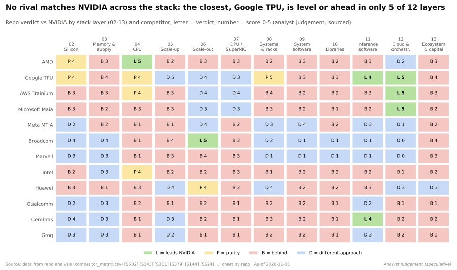
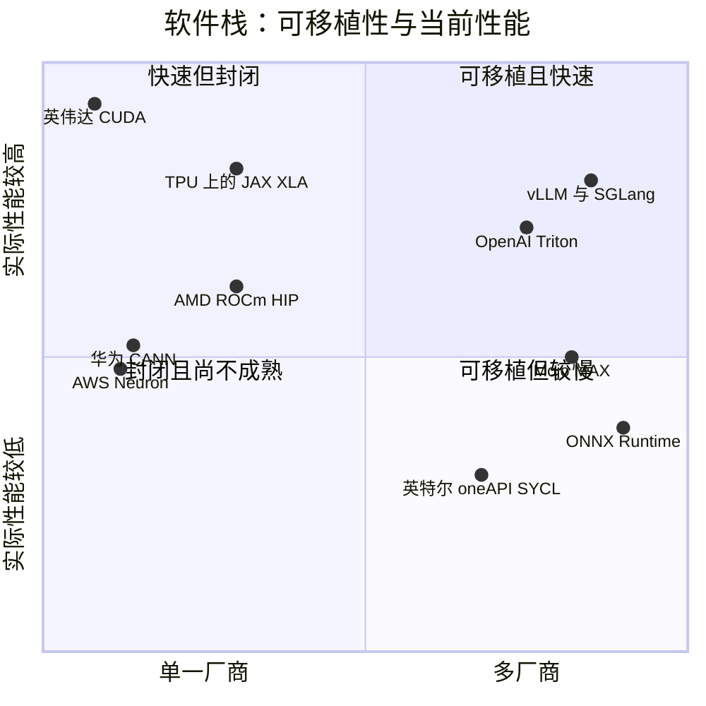

# CUDA 与系统软件：竞争格局

> [!NOTE]
> 本页为英文原文的简体中文参考译文，仅供参考；如有出入，以[英文原文](../../../layers/09-cuda-and-system-software/competition.md "English original")为准。

第 09 层 · CUDA 与系统软件 · 阅读约 13 分钟 · 最后核实：2026-11-05

## ⚡ 要点速览

- **覆盖广度仍属于英伟达。** 在本资料库跟踪的全部 12 个主流 AI 框架中，[CUDA](../../glossary.md#cuda) 均获原生支持（36/36 分）；[ROCm](../../glossary.md#rocm) 得分为 26，英特尔（Intel）18，华为 [CANN](../../glossary.md#cann) 17，谷歌（Google）TPU 14，AWS Neuron 7，高通（Qualcomm）Cloud AI 4 [[S587]](../../../sources/bibliography.md#s587)[[S580]](../../../sources/bibliography.md#s580)[[S586]](../../../sources/bibliography.md#s586)[[S596]](../../../sources/bibliography.md#s596)。
- **差距已从“能不能跑？”转向“首日（Day 0）能跑多快？”** DeepSeek-V4 发布时（2026-04-24），[vLLM](../../glossary.md#vllm) 和 [SGLang](../../glossary.md#sglang) 中的 CUDA 方案在发布当天即可使用。MI355X 只能运行 [FP8](../../glossary.md#fp8)，速度不到每用户 1 token/s，花了 26 天、31 个内核 PR 才达到每 GPU 2,256 tokens/s [[S633]](../../../sources/bibliography.md#s633)[[S631]](../../../sources/bibliography.md#s631)。
- **差距在软件，而不在芯片。** MI355X 的[高带宽内存（HBM）](../../glossary.md#hbm)容量是 B200 的 1.60 倍，稠密 [FP4](../../glossary.md#fp4)/FP8 算力是其 1.12 倍 [[S631]](../../../sources/bibliography.md#s631)。结果有输有赢：在 GLM-5 FP8 上，MI355X 每 token 成本最多比 B200 低 29.6%；而在每用户 150 tokens/s 的 GLM 5.3 上，英伟达最多便宜 5 倍 [[S637]](../../../sources/bibliography.md#s637)[[S636]](../../../sources/bibliography.md#s636)。
- **最强挑战者是一个软件层，而不是一家公司。** [PyTorch](../../glossary.md#pytorch)、[Triton](../../glossary.md#triton)、vLLM 和 SGLang 如今都已在主代码树内支持 AMD GPU，Triton 还有英特尔和华为的后端 [[S578]](../../../sources/bibliography.md#s578)[[S580]](../../../sources/bibliography.md#s580)[[S582]](../../../sources/bibliography.md#s582)[[S597]](../../../sources/bibliography.md#s597)[[S592]](../../../sources/bibliography.md#s592)。对于从不编写[内核](../../glossary.md#gpu-kernel)的团队而言，CUDA 变成了一个实现细节。
- **[超大规模云厂商](../../glossary.md#hyperscaler)正在开源自家软件栈。** TorchTPU（与 Meta 合作，2026 年 10 月）取代了 PyTorch/XLA；AWS 开源了 TorchNeuron 和 [NKI](../../glossary.md#nki) 编译器；华为于 2025 年开源了 CANN [[S553]](../../../sources/bibliography.md#s553)[[S595]](../../../sources/bibliography.md#s595)[[S9525]](../../../sources/bibliography.md#s9525)[[S9524]](../../../sources/bibliography.md#s9524)。
- **高通买下了中立选项。** 它于 2026-07-29 完成了对 Modular 约 $3.9B 的收购，并于 2026 年 8 月开源了 [Mojo](../../glossary.md#mojo) 编译器（Apache 2.0）[[S9511]](../../../sources/bibliography.md#s9511)[[S9512]](../../../sources/bibliography.md#s9512)[[S9513]](../../../sources/bibliography.md#s9513)。
- **[Q5 · 最强挑战者]** PyTorch/Triton/vLLM 这一层，加上作为第二后端、证明可移植性行得通的 ROCm。侵蚀[切换成本](../../glossary.md#switching-cost)的是抽象层，而不是任何一家厂商的软件栈。

按厂商划分的框架支持热力图见[长尾护城河](the-long-tail-moat.md)。

## 软件竞争如何评分

不妨把 CUDA 想象成一张道路网。竞争对手可以修一份**道路的复制品**（AMD 的 [HIP](../../glossary.md#hip) 逐个调用地镜像 CUDA）；可以修一条**绕城环路**（Triton、[torch.compile](../../glossary.md#torch-compile)、[XLA](../../glossary.md#xla) 或 Mojo 等抽象层，可为任何芯片生成内核）；也可以另建**一座新城**，配套自己的道路（谷歌的 JAX/TPU、AWS Neuron、华为 CANN）。复制品总是落后一个版本；环路承载了大部分交通；新城主要服务于其所有者。

| 软件栈（所有者） | 框架覆盖广度 | 内核性能 | 工具 | 向后兼容 | 社区 | 开放程度 |
|---|---|---|---|---|---|---|
| ROCm / HIP（AMD） | 🟨 26/36，已进入 PyTorch 和 vLLM 主代码树 | 🟥 首日支持存在缺口 | 🟥 性能分析工具仍在成熟中 | 🟥 支持的 GPU 代际较少 | 🟥 规模远小于约 600 万 CUDA 开发者 | 🟩 开源 |
| JAX/XLA + TorchTPU（谷歌） | 🟥 谷歌之外 14/36 | 🟦 在谷歌内部达到前沿水平 | 🟦 优先服务谷歌内部 | 🟨 编译器屏蔽芯片变化 | 🟦 以实验室为主，而非爱好者 | 🟩 开源 |
| Neuron + NKI（AWS） | 🟥 7/36 | 🟦 为锚定客户调优 | 🟥 尚不成熟 | 🟨 仅 Trn2/Trn3 | 🟥 小 | 🟨 编译器开放，芯片封闭 |
| CANN / MindSpore（华为） | 🟥 17/36 | 🟨 首日支持 DeepSeek-V4 | 🟥 碎片化 | 🟥 每代都有变化 | 🟦 局限于中国市场 | 🟩 2025 年开源 |
| oneAPI / SYCL（英特尔，UXL） | 🟥 18/36 | 🟥 在大语言模型中采用有限 | 🟨 成熟的 HPC 工具 | 🟨 基于标准 | 🟥 小 | 🟩 开放标准 |
| Triton（OpenAI，多厂商） | 🟦 位于 PyTorch 之下的一层 | 🟨 在许多算子上接近手工调优水平 | 🟥 调试能力薄弱 | 🟨 每款芯片需重新编译 | 🟩 torch.compile 的默认选择 | 🟩 开源 |
| Mojo / MAX（高通） | 🟥 自有框架，用户少 | 🟦 厂商宣称已追平 | 🟥 尚不成熟 | 🟨 基于编译器 | 🟥 小 | 🟩 自 2026 年起采用 Apache 2.0 |

评级为本资料库的判断 🔴，即截至 2026-11-05 竞争对手相对英伟达 CUDA 的表现。证据：框架评分 [[S587]](../../../sources/bibliography.md#s587)[[S586]](../../../sources/bibliography.md#s586)；首日支持与内核 [[S633]](../../../sources/bibliography.md#s633)[[S627]](../../../sources/bibliography.md#s627)；开放程度 [[S9524]](../../../sources/bibliography.md#s9524)[[S9525]](../../../sources/bibliography.md#s9525)[[S9512]](../../../sources/bibliography.md#s9512)[[S9526]](../../../sources/bibliography.md#s9526)；开发者 [[S528]](../../../sources/bibliography.md#s528)。

> [!TIP]
> **算例 —— 31 个拉取请求值多少钱。** InferenceX 估计 MI355X 的拥有成本约为每 [GPU 小时](../../glossary.md#gpu-hour) $1.50 [[S622]](../../../sources/bibliography.md#s622)。在 DeepSeek-V4 发布首日，其峰值为每 GPU 67.4 tokens/s，因此 $1.50 ÷ (67.4 × 3,600) × 10⁶ ≈ **每百万 token $6.18**。经过 26 天的内核工作，峰值达到 2,256 tokens/s，即 **约每百万 token $0.18**：同样的芯片便宜了 33 倍 [[S631]](../../../sources/bibliography.md#s631)。在可用的每用户 15 tokens/s 条件下，成本从约 $4.01 降至约 $0.33。在 CUDA 上，B200 方案首日即可运行，此后的软件增益约为 1.7 倍（到第 42 天，每兆瓦从约 300k 提升到约 500k tokens/s）[[S633]](../../../sources/bibliography.md#s633)。对买家而言，切换成本就是损失的这一个月，而且每出一个新模型就要重来一遍。

🔧 技术细节：为什么“直接替换”的 CUDA 克隆从来不能真正直接替换

[HIPIFY](../../glossary.md#hipify) 把 `cudaMalloc` 改写为 `hipMalloc`，大部分代码都能编译通过。真正耗时的是剩下的部分：内联 [PTX](../../glossary.md#ptx) 汇编；针对英伟达 warp 大小调优的内核（AMD 数据中心 GPU 的 warp 大小不同）；对英伟达专有软件库的调用（[cuDNN](../../glossary.md#cudnn)、CUTLASS、TensorRT-LLM）；以及缺失的 API。例如，vLLM 的批量 CPU 卸载路径直到 ROCm 7.14（2026 年 7 月）才有 `hipMemcpyBatchAsync` 可用 [[S627]](../../../sources/bibliography.md#s627)。ZLUDA 等[转译层](../../glossary.md#translation-layer)则另辟蹊径，直接运行未经修改的 CUDA 二进制文件 [[S9502]](../../../sources/bibliography.md#s9502)。至少从 2024 年起，英伟达的许可协议就禁止将 CUDA 输出转译到其他硬件上运行 [[S9500]](../../../sources/bibliography.md#s9500)。

## 逐一审视挑战者

### AMD ROCm：广度最接近，首日支持落后

ROCm 比 CUDA 晚起步九年，但如今与 CUDA 一样每年发布 3–4 个功能版本 [[S586]](../../../sources/bibliography.md#s586)[[S525]](../../../sources/bibliography.md#s525)。ROCm 7.0（2025 年 9 月）新增了 AITER 调优算子、FP4/FP6 和 Windows 支持 [[S90064]](../../../sources/bibliography.md#s90064)。ROCm 10.0（2026 年 8 月）已通过 PyTorch 2.13、vLLM 0.27 和 SGLang 0.5.15 的验证 [[S586]](../../../sources/bibliography.md#s586)。AMD 在吸引了 2,000 多名开发者参会的 Advancing AI 2026 上推出了 ROCm.ai 助手 [[S9518]](../../../sources/bibliography.md#s9518)[[S9519]](../../../sources/bibliography.md#s9519)。它还与 Anthropic 达成协议，使用 Claude 加速 ROCm 开发 🟡 [[S9538]](../../../sources/bibliography.md#s9538)。**最有力的论据：** 开源，且已进入所有重要框架的主代码树。**差距：** AMD 自家的引擎（ATOM）在某条[智能体（agentic）](../../glossary.md#agentic-ai)曲线的部分区间上，每 token 成本优于运行 vLLM 的 GB300 [NVL72](../../glossary.md#nvl72)，但很少有实验室在生产中运行 ATOM；而上游 vLLM 在发布第一周内无法在 MI355X 上处理长上下文任务 [[S627]](../../../sources/bibliography.md#s627)。

> [!TIP]
> **算例 —— 5 倍的每 token 差距意味着什么。** SemiAnalysis 发现，在每用户 150 tokens/s 的 GLM 5.3 上，英伟达每 token 成本最多比 MI355X 低 5 倍 [[S636]](../../../sources/bibliography.md#s636)。MI355X 的拥有成本约为每 GPU 小时 $1.50 [[S622]](../../../sources/bibliography.md#s622)。在吞吐量相同的前提下，要弥合 5 倍差距，每小时成本需降至约 $0.30。这就是 SemiAnalysis 得出“即使硬件免费也无法弥合差距”这一结论的原因 [[S627]](../../../sources/bibliography.md#s627)。在其他场景下，排名则会反转 [[S637]](../../../sources/bibliography.md#s637)。

### 谷歌 JAX/XLA 与 TorchTPU：完整的第二生态，主要服务谷歌的客户

[JAX](../../glossary.md#jax) 在 TPU 上是一等公民；TorchTPU（2026 年 10 月与 Meta 共同开源）取代了 PyTorch/XLA [[S577]](../../../sources/bibliography.md#s577)[[S553]](../../../sources/bibliography.md#s553)[[S595]](../../../sources/bibliography.md#s595)。Anthropic 最多 100 万颗 TPU 的承诺表明，前沿实验室可以在 CUDA 之外运转 [[S90026]](../../../sources/bibliography.md#s90026)。**差距：** 这套软件栈服务于 TPU，而不是商用芯片。

### AWS Neuron、华为 CANN、英特尔 oneAPI

- **AWS：** TorchNeuron 是开源的原生 PyTorch 后端（在 Neuron 2.33 中进入公开 beta）。NKI 的编译器采用 Apache 2.0 许可，构建于 [MLIR](../../glossary.md#mlir) 之上 [[S9525]](../../../sources/bibliography.md#s9525)。
- **华为：** CANN 于 2025 年 8 月开源，配有 torch_npu、MindSpeed、triton-ascend 和 vllm-ascend 适配器。昇腾（Ascend）有公开记录的 DeepSeek-V4 首日支持 [[S9524]](../../../sources/bibliography.md#s9524)[[S592]](../../../sources/bibliography.md#s592)[[S581]](../../../sources/bibliography.md#s581)[[S633]](../../../sources/bibliography.md#s633)。出口管制使其成为中国的默认选择。
- **英特尔：** [oneAPI](../../glossary.md#oneapi)/[SYCL](../../glossary.md#sycl) 归属 UXL 基金会，其创始成员包括 Arm、Google Cloud 和高通。该基金会 2026 年的计划从演示转向实用指南 [[S9526]](../../../sources/bibliography.md#s9526)[[S9527]](../../../sources/bibliography.md#s9527)。

### 抽象层：Triton、PyTorch、vLLM 与 SGLang

Triton 在主代码树内支持英伟达（计算能力 8.0+）和 AMD（ROCm 6.2+）[[S578]](../../../sources/bibliography.md#s578)。Meta 的 Helion 现为 PyTorch 基金会项目，可将类 PyTorch 内核编译为 Triton，*也可以*编译为英伟达的 TileIR [[S9522]](../../../sources/bibliography.md#s9522)[[S9523]](../../../sources/bibliography.md#s9523)。英伟达的反制之道是成为每一层的最佳目标平台：CUDA Tile 和 cuTile Python（CUDA 13.1）以英伟达自己的方式为 Python 开发者提供 tile 编程模型 [[S9521]](../../../sources/bibliography.md#s9521)。

### Modular/Mojo（高通）及其他开放软件栈——仅基于公开信息

截至 2025 年，Modular 共融资 $380M（最近一次估值 $1.6B），后被高通以约 $3.9B 收购 [[S9510]](../../../sources/bibliography.md#s9510)[[S90057]](../../../sources/bibliography.md#s90057)。Mojo 1.0 及其开源于 2026 年 8 月相继推出 [[S9512]](../../../sources/bibliography.md#s9512)[[S9513]](../../../sources/bibliography.md#s9513)。高通现有的 Cloud AI SDK 通过 vLLM 容器和 ONNX 模型导入提供服务 [[S596]](../../../sources/bibliography.md#s596)。Tenstorrent 以 Apache 2.0 许可发布 TT-Metalium [[S9535]](../../../sources/bibliography.md#s9535)。

各点位置为本资料库的判断 🔴，参考了上文的框架矩阵和 InferenceX 结果。

> [!NOTE]
> **🐂 看多观点。** 新架构总是率先落地 CUDA，因此每次模型发布都会让竞争对手的计时器归零。即使英伟达自家的 [TensorRT-LLM](../../glossary.md#tensorrt-llm) 在 DeepSeek-V4 发布时出了故障，开源的 CUDA 引擎依然正常工作 [[S633]](../../../sources/bibliography.md#s633)。凭借约 600 万开发者，这条护城河如今通过*支持速度*而不仅仅是广度来实现复利增长 [[S528]](../../../sources/bibliography.md#s528)。

> [!WARNING]
> **🐻 看空观点。** 客户买的是 token，不是 CUDA。前沿实验室自己编写内核，AMD 在一个月内就让 DeepSeek-V4 达到了可用的吞吐量，超大规模云厂商正在开源自家软件栈，而推理服务层是中立的 [[S631]](../../../sources/bibliography.md#s631)[[S553]](../../../sources/bibliography.md#s553)[[S9525]](../../../sources/bibliography.md#s9525)[[S580]](../../../sources/bibliography.md#s580)。如果大语言模型编写了大部分新内核，手工调优 CUDA 的长尾就不再稀缺。

## 🎯 企业发展视角

1. 对挑战者的前五个客户而言，哪个更重要：对顶级开源模型的首日支持，还是覆盖 12 个框架的广度？
2. 资助上游维护者（vLLM 背后的 Inferact、SGLang 背后的 RadixArk [[S633]](../../../sources/bibliography.md#s633)），是否比 ATOM 这类专有引擎能以每一美元换取更多的可移植性？
3. Mojo 现已采用 Apache 2.0 许可，高通在优先为自家推理芯片调优的同时，如何让 AMD 和英伟达用户仍然相信其中立性？
4. AMD 与 Anthropic 关于在 ROCm 上使用 Claude 的协议，预示着 AI 编写内核的趋势。内核生成能力应当自建、授权还是合作获取？

## 📚 来源（Sources）

<!-- Auto-generated from the [S…] citations on this page by `make build`. Edit sources/registry/*.csv, not this list. -->

- [**S525**](../../../sources/bibliography.md#s525) NVIDIA Developer, *CUDA Toolkit Archive*, 2026. [Link](https://developer.nvidia.com/cuda-toolkit-archive)
- [**S528**](../../../sources/bibliography.md#s528) NVIDIA Developer Forums, *20 Years of CUDA: Honoring the Architects of the Accelerated Age*, 2026-03. [Link](https://forums.developer.nvidia.com/t/20-years-of-cuda-honoring-the-architects-of-the-accelerated-age/364654)
- [**S553**](../../../sources/bibliography.md#s553) Google Cloud Blog (Alex Barrett), *What's new in AI infrastructure and orchestration in October*, 2026-11. [Link](https://cloud.google.com/blog/topics/ai-infrastructure/whats-new-in-ai-infrastructure-this-month)
- [**S577**](../../../sources/bibliography.md#s577) JAX (GitHub: jax-ml/jax docs/installation.md), *JAX installation guide — supported platforms*, 2026-11. [Link](https://github.com/jax-ml/jax/blob/main/docs/installation.md)
- [**S578**](../../../sources/bibliography.md#s578) OpenAI Triton (GitHub), *Triton (triton-lang/triton) README — supported hardware*, 2026-11. [Link](https://github.com/triton-lang/triton/blob/main/README.md)
- [**S580**](../../../sources/bibliography.md#s580) vLLM project (GitHub), *vLLM README and installation docs — supported hardware*, 2026-11. [Link](https://github.com/vllm-project/vllm/blob/main/docs/getting_started/installation/README.md)
- [**S581**](../../../sources/bibliography.md#s581) vLLM project (GitHub), *vLLM hardware plugin repositories (tpu-inference/vLLM JAX, vllm-gaudi, vllm-ascend, vllm-neuron)*, 2026-11. [Link](https://github.com/vllm-project)
- [**S582**](../../../sources/bibliography.md#s582) SGLang project (GitHub: sgl-project/sglang), *SGLang README — supported hardware*, 2026-11. [Link](https://github.com/sgl-project/sglang/blob/main/README.md)
- [**S586**](../../../sources/bibliography.md#s586) AMD (GitHub: ROCm/ROCm docs), *ROCm documentation sources: release history, AI-ecosystem compatibility matrix, consolidated changelog*, 2026-08-26. [Link](https://github.com/ROCm/ROCm/blob/develop/docs/release/versions.rst)
- [**S587**](../../../sources/bibliography.md#s587) PyTorch (GitHub: pytorch/pytorch), *PyTorch README — building with CUDA, ROCm and Intel GPU support*, 2026-11. [Link](https://github.com/pytorch/pytorch/blob/main/README.md)
- [**S592**](../../../sources/bibliography.md#s592) Huawei Ascend (GitHub: Ascend org), *Huawei Ascend open-source adapters: torch_npu, MindSpeed, triton-ascend*, 2026-11. [Link](https://github.com/Ascend/pytorch)
- [**S595**](../../../sources/bibliography.md#s595) PyTorch (GitHub: pytorch/xla), *PyTorch/XLA README (deprecation notice)*, 2026-11. [Link](https://github.com/pytorch/xla/blob/master/README.md)
- [**S596**](../../../sources/bibliography.md#s596) Qualcomm (GitHub: quic), *Qualcomm Cloud AI SDK and Efficient Transformers repositories*, 2026-11. [Link](https://github.com/quic/cloud-ai-sdk)
- [**S597**](../../../sources/bibliography.md#s597) Intel (GitHub: intel/intel-xpu-backend-for-triton), *Intel XPU backend for Triton*, 2026-11. [Link](https://github.com/intel/intel-xpu-backend-for-triton)
- [**S622**](../../../sources/bibliography.md#s622) SemiAnalysis (InferenceX-app repository), *InferenceX hardware registry: TCO per GPU-hour by SKU (SemiAnalysis July 2026 pricing surveys and AI Cloud TCO Model)*, 2026-07. [Link](https://github.com/SemiAnalysisAI/InferenceX-app/blob/main/packages/constants/src/gpu-keys.ts)
- [**S627**](../../../sources/bibliography.md#s627) SemiAnalysis, *AgentX - InferenceXv3: Does the CUDA Moat Hold Up in Agentic Inferencing?*, 2026-08-24. [Link](https://github.com/SemiAnalysisAI/InferenceX-app/blob/main/packages/app/content/blog/agentx-inferencexv3-does-cuda-moat.mdx)
- [**S631**](../../../sources/bibliography.md#s631) SemiAnalysis, *MI355X DeepSeek-V4-Pro on SGLang: 110.5x Throughput per GPU in 26 Days*, 2026-05-26. [Link](https://github.com/SemiAnalysisAI/InferenceX-app/blob/main/packages/app/content/blog/mi355x-deepseek-v4-pro-sglang-110x-in-26-days.mdx)
- [**S633**](../../../sources/bibliography.md#s633) SemiAnalysis, *DeepSeekV4 1.6T Day 0 to Day 43 Performance Over Time — Huawei, GB300 NVL72, MI355X, B200*, 2026-06-09. [Link](https://github.com/SemiAnalysisAI/InferenceX-app/blob/main/packages/app/content/blog/deepseekv4-16t-day-0-to-day-43-performance.mdx)
- [**S636**](../../../sources/bibliography.md#s636) SemiAnalysis, *GLM 5.3 on AgentX: NVIDIA Is Up to 5x Cheaper per Token at 150 tok/s/user*, 2026-08-25. [Link](https://github.com/SemiAnalysisAI/InferenceX-app/blob/main/packages/app/content/blog/glm-5-3-agentx-nvidia-vs-amd-sglang-150-toks.mdx)
- [**S637**](../../../sources/bibliography.md#s637) SemiAnalysis, *AMD MI355X GLM-5 Inference: Up to 29.6% Lower Cost per Million Tokens than B200 on SGLang FP8*, 2026-05-25. [Link](https://github.com/SemiAnalysisAI/InferenceX-app/blob/main/packages/app/content/blog/mi355x-glm5-fp8-sglang-40-cheaper-than-b200.mdx)
- [**S9500**](../../../sources/bibliography.md#s9500) Tom's Hardware, *Nvidia bans using translation layers for CUDA software to run on other chips; new restriction apparently targets ZLUDA and some Chinese GPU makers*, 2024-03-05. [Link](https://www.tomshardware.com/pc-components/gpus/nvidia-bans-using-translation-layers-for-cuda-software-to-run-on-other-chips-new-restriction-apparently-targets-zluda-and-some-chinese-gpu-makers)
- [**S9502**](../../../sources/bibliography.md#s9502) vosen/ZLUDA (GitHub) (Andrzej Janik), *ZLUDA README (drop-in CUDA replacement for non-NVIDIA GPUs)*, 2026-11. [Link](https://github.com/vosen/ZLUDA)
- [**S9510**](../../../sources/bibliography.md#s9510) SDxCentral, *Modular raises $250M for AI's unified compute layer at $1.6B valuation*, 2025-09-24. [Link](https://www.sdxcentral.com/news/modular-raises-250m-for-ais-unified-compute-layer-at-16b-valuation/)
- [**S9511**](../../../sources/bibliography.md#s9511) Nasdaq (Qualcomm press release), *Qualcomm Completes Acquisition of Modular*, 2026-07-29. [Link](https://www.nasdaq.com/press-release/qualcomm-completes-acquisition-modular-2026-07-29)
- [**S9512**](../../../sources/bibliography.md#s9512) Phoronix (Michael Larabel), *Modular's Mojo Language Now Open-Source Following Qualcomm Acquisition*, 2026-08-18. [Link](https://www.phoronix.com/news/Modular-Mojo-Open-Source)
- [**S9513**](../../../sources/bibliography.md#s9513) modular/modular (GitHub), *Modular Platform repository README (MAX framework and Mojo language)*, 2026-11. [Link](https://github.com/modular/modular)
- [**S9518**](../../../sources/bibliography.md#s9518) StorageNewsletter, *AMD AAI 2026: AMD ROCm.ai accelerates AI development across AMD platforms*, 2026-07-27. [Link](https://storagenewsletter.com/2026/07/27/amd-aai-2026-amd-rocm-ai-accelerates-ai-development-across-amd-platforms)
- [**S9519**](../../../sources/bibliography.md#s9519) Blockchain.news, *AMD's Advancing AI 2026 draws 2,000+ developers; launches ROCm.ai*, 2026-07. [Link](https://blockchain.news/news/amd-advancing-ai-2026-rocm-ai-launch)
- [**S9521**](../../../sources/bibliography.md#s9521) Hackster.io, *NVIDIA makes GPU acceleration easier and more portable with CUDA Tiles and cuTile Python*, 2025-12. [Link](https://www.hackster.io/news/nvidia-makes-gpu-acceleration-easier-more-portable-with-cuda-tiles-cutile-python-b808c1ad7e4d)
- [**S9522**](../../../sources/bibliography.md#s9522) PyTorch Blog, *Helion: a high-level DSL for performant and portable ML kernels*, 2025-10. [Link](https://pytorch.org/blog/helion/)
- [**S9523**](../../../sources/bibliography.md#s9523) PyTorch Foundation, *Helion (PyTorch Foundation project page)*, 2026. [Link](https://pytorch.org/projects/helion/)
- [**S9524**](../../../sources/bibliography.md#s9524) TrendForce, *Huawei open-sources CANN toolkit for Ascend AI GPUs; taking aim at Nvidia's CUDA*, 2025-08-07. [Link](https://www.trendforce.com/news/2025/08/07/news-huawei-open-sources-cann-toolkit-for-ascend-ai-gpus-taking-aim-at-nvidias-cuda/)
- [**S9525**](../../../sources/bibliography.md#s9525) AWS Neuron SDK docs, *AWS Neuron documentation: PyTorch on Neuron (TorchNeuron) and NKI*, 2026. [Link](https://awsdocs-neuron.readthedocs-hosted.com/en/latest/_sources/torch/index.rst)
- [**S9526**](../../../sources/bibliography.md#s9526) Intel Developer, *Open Source, Open Standard, Open Governance: happy birthday UXL Foundation*, 2024-09. [Link](https://www.intel.com/content/www/us/en/developer/articles/technical/birthday-uxl-foundation.html)
- [**S9527**](../../../sources/bibliography.md#s9527) UXL Foundation, *UXL Foundation: advancing portable acceleration across architectures in 2025 and what's next for 2026*, 2026-03-10. [Link](https://uxlfoundation.org/blog/uxl-foundation-advancing-portable-acceleration-across-architectures-in-2025-and-whats-next-for-2026/)
- [**S9535**](../../../sources/bibliography.md#s9535) Tenstorrent (GitHub), *tt-metal README and Apache-2.0 licence (TT-NN / TT-Metalium)*, 2026-11. [Link](https://github.com/tenstorrent/tt-metal)
- [**S9538**](../../../sources/bibliography.md#s9538) The Next Web, *AMD is investing $5 billion in Anthropic and deploying 2 gigawatts of Helios GPUs to run Claude*, 2026. [Link](https://thenextweb.com/news/amd-anthropic-5-billion-investment-2gw-helios-mi450)
- [**S90026**](../../../sources/bibliography.md#s90026) Maginative, *Anthropic secures 1M Google TPUs while keeping Amazon as primary training partner*, 2025-10. [Link](https://www.maginative.com/anthropic-secures-1m-google-tpus-while-keeping-amazon-as-primary-training-partner)
- [**S90057**](../../../sources/bibliography.md#s90057) StorageReview, *Qualcomm unveils Dragonfly data center roadmap: C1000 CPU, AI300 accelerator and Modular acquisition*, 2026-06-24. [Link](https://www.storagereview.com/es/news/qualcomm-unveils-dragonfly-data-center-roadmap-c1000-cpu-ai300-accelerator-and-modular-acquisition)
- [**S90064**](../../../sources/bibliography.md#s90064) The Register, *ROCm 7: AMD tries to catch CUDA with performance-boosting software*, 2025-09-17. [Link](https://www.theregister.com/2025/09/17/amd_rocm_7_chases_nvidia_cuda/)
