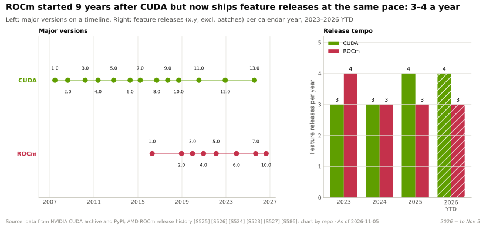
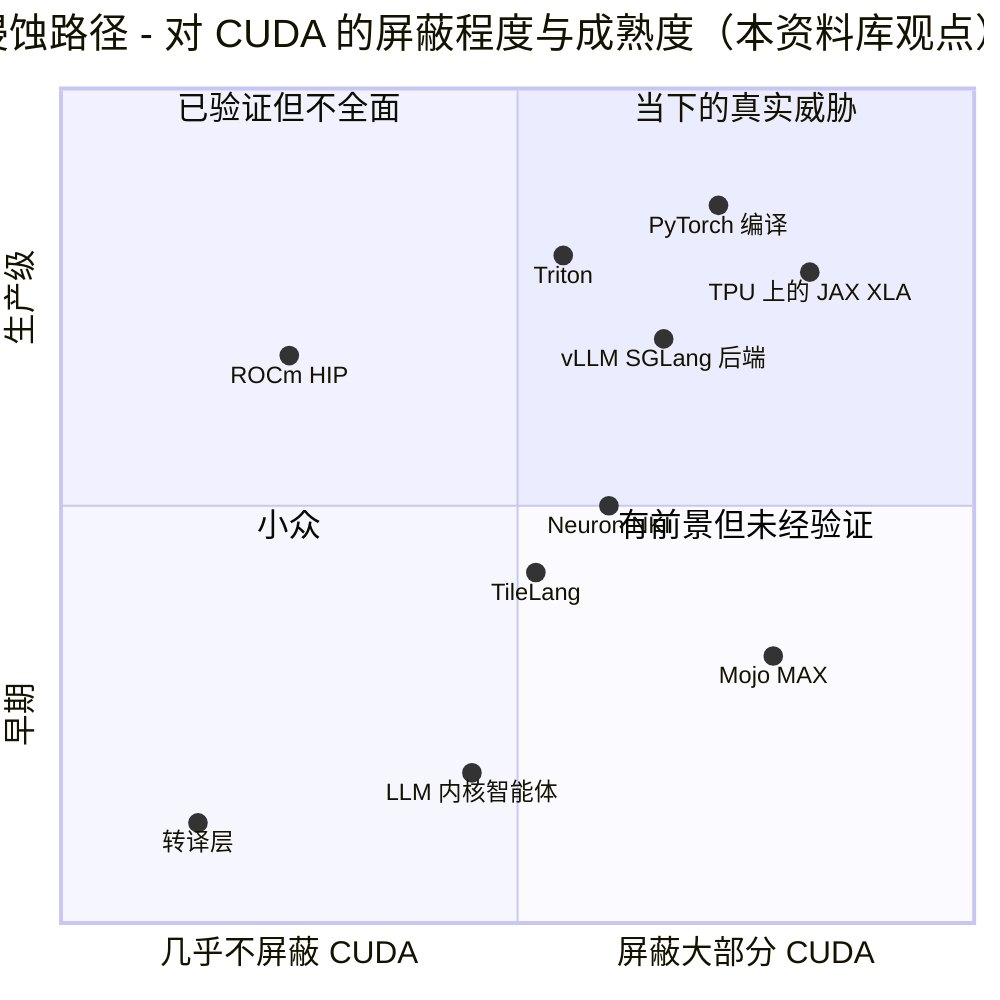

# 侵蚀路径：哪些力量可能削弱护城河

> [!NOTE]
> 本页为英文原文的简体中文参考译文，仅供参考；如有出入，以[英文原文](../../../layers/09-cuda-and-system-software/erosion-vectors.md "English original")为准。

第 09 层 · CUDA 与系统软件 · 阅读约 10 分钟 · 最后核实：2026-11-05

## ⚡ 要点速览

- **大多数 AI 开发者写的是 [PyTorch](../../glossary.md#pytorch)，而不是 [CUDA](../../glossary.md#cuda)，** 因此 PyTorch 之下的编译器决定了可移植性。[torch.compile](../../glossary.md#torch-compile) 生成 [Triton](../../glossary.md#triton) 内核，在 A100 上对 180 多个模型实现了推理 2.27 倍、训练 1.41 倍的加速 [[S9021]](../../../sources/bibliography.md#s9021)。
- **Triton 是关键的可移植内核语言。** 它在主代码树内（in-tree）支持英伟达和 AMD，英特尔与华为则以树外（out-of-tree）方式支持 [[S578]](../../../sources/bibliography.md#s578)[[S597]](../../../sources/bibliography.md#s597)[[S592]](../../../sources/bibliography.md#s592)。在前沿领域它会出现“泄漏”：FlashAttention-4 在 B200 上最高快 2.7 倍 [[S9004]](../../../sources/bibliography.md#s9004)，而 Triton 新增了更底层的 Gluon [[S9012]](../../../sources/bibliography.md#s9012)。
- **JAX/XLA 是顶端客户已被验证的出路。** 谷歌（Google）在 TPU 上训练，Anthropic 承诺采购最多 100 万颗 TPU [[S653]](../../../sources/bibliography.md#s653)，TorchTPU 于 2026 年 10 月取代了 PyTorch/XLA [[S553]](../../../sources/bibliography.md#s553)[[S595]](../../../sources/bibliography.md#s595)。
- **ROCm 的发布频率如今已与 CUDA 相当。** 它从 7.0（2025 年 9 月）发展到 10.0（2026 年 8 月），并已在 PyTorch、[vLLM](../../glossary.md#vllm) 和 [SGLang](../../glossary.md#sglang) 中获得原生支持 [[S90064]](../../../sources/bibliography.md#s90064)[[S586]](../../../sources/bibliography.md#s586)[[S587]](../../../sources/bibliography.md#s587)[[S580]](../../../sources/bibliography.md#s580)。
- **Mojo/MAX 已归属高通（Qualcomm）。** 这笔约 $3.9B 的交易于 2026-07-29 完成 [[S90057]](../../../sources/bibliography.md#s90057)[[S9511]](../../../sources/bibliography.md#s9511)，Mojo 1.0 于 2026-08-11 发布 [[S9006]](../../../sources/bibliography.md#s9006)。Modular 称，一次耗时 14 天的移植在 MI355X 上比 AMD 自家的 vLLM 分支最高快 2.2 倍——这是厂商自己的说法 [[S9022]](../../../sources/bibliography.md#s9022)。
- **AI 编写的内核是最大变数。** AlphaEvolve 将一个 FlashAttention 内核提速 32.5% [[S9017]](../../../sources/bibliography.md#s9017)，AMD 计划用 Claude 加速 ROCm 开发 [[S9538]](../../../sources/bibliography.md#s9538)。Sakana 宣称的 10–100 倍加速，在其智能体被发现钻了测试漏洞后化为泡影 [[S9018]](../../../sources/bibliography.md#s9018)。
- **规律：** 每条侵蚀路径都让*主流*路径变得更便宜，但在新内核、新数据格式和分布式服务上又会“漏回” CUDA。

## 1. 抽象如何侵蚀软件护城河

不妨把 CUDA 想象成所有菜谱书所用的语言；侵蚀路径就是翻译者。**框架**（PyTorch、JAX）让作者用一种中立语言写作。**编译器**（[XLA](../../glossary.md#xla)、Inductor、基于 [MLIR](../../glossary.md#mlir) 的工具）自动完成翻译。**可移植内核语言**（Triton、[Mojo](../../glossary.md#mojo)、[TileLang](../../glossary.md#tilelang)）让专业人士针对每一类厨房只需写一次菜谱。家常菜的翻译成本很低，高级料理的翻译则代价高昂，因此侵蚀首先冲击主流模型的推理服务，最后才触及前沿内核。

> [!TIP]
> **算例 —— AMD 正是借助侵蚀工具弥合了 DeepSeek-V4 的差距。** AMD 在 26 天内将 MI355X 的吞吐量提升了 110.5 倍 [[S631]](../../../sources/bibliography.md#s631)。在其技术报告中注明了编写语言的内核里，四个用 Triton，两个用 TileLang，一个用 FlyDSL（AMD 的 Python DSL）；只有两个来自 AMD 手工调优的 AITER 库 [[S631]](../../../sources/bibliography.md#s631)。SemiAnalysis 认为，性能提升几乎完全来自用这些内核替换 PyTorch 回退实现 [[S633]](../../../sources/bibliography.md#s633)。**结论：** 可移植 DSL 把挑战者的时间税从几个季度压缩到几周，但 B200 仍领先约 5 倍 [[S631]](../../../sources/bibliography.md#s631)。

## 2. 逐一审视各条侵蚀路径

| 路径 | 抽象了什么 | 进展程度（2026 年 11 月） | 在哪里漏回 CUDA |
|---|---|---|---|
| **torch.compile**（[TorchInductor](../../glossary.md#torchinductor)） | 计算图捕获与融合内核 | 主代码树内支持 CUDA、ROCm、英特尔 GPU [[S587]](../../../sources/bibliography.md#s587)；MTIA 和 AWS TorchNeuron 均基于它构建 [[S9028]](../../../sources/bibliography.md#s9028)[[S9525]](../../../sources/bibliography.md#s9525) | 矩阵乘法和注意力仍调用厂商软件库 |
| **OpenAI Triton** | 用 Python 编写 tile 级内核 | 主代码树内支持英伟达和 AMD；英特尔和昇腾为树外支持 [[S578]](../../../sources/bibliography.md#s578)[[S597]](../../../sources/bibliography.md#s597)[[S592]](../../../sources/bibliography.md#s592) | FA4 在 B200 上最高快 2.7 倍 [[S9004]](../../../sources/bibliography.md#s9004)；Gluon 开放底层控制 [[S9012]](../../../sources/bibliography.md#s9012) |
| **JAX / XLA / [Pallas](../../glossary.md#pallas)** | 全程序编译器；自定义内核 | 在 TPU 上为一等公民 [[S577]](../../../sources/bibliography.md#s577)；vLLM 在 TPU 上同时服务 JAX 和 PyTorch [[S9015]](../../../sources/bibliography.md#s9015) | Pallas API 因硬件而异；GPU 路径以英伟达为目标 [[S9013]](../../../sources/bibliography.md#s9013) |
| **MLIR** | 共享编译器基础设施 [[S9029]](../../../sources/bibliography.md#s9029) | 是 Triton、Mojo 和 AWS NKI 编译器的底座 [[S578]](../../../sources/bibliography.md#s578)[[S9525]](../../../sources/bibliography.md#s9525) | 只是工具包：各厂商仍需自行编写下译（lowering）和内核 |
| **Mojo / MAX**（现属高通） | 横跨 CPU、GPU、NPU 的统一语言与引擎 | 交易于 2026-07-29 完成 [[S9511]](../../../sources/bibliography.md#s9511)；Mojo 1.0 已开源 [[S9512]](../../../sources/bibliography.md#s9512)；同一套内核可运行于英伟达、AMD、苹果（厂商说法）[[S9023]](../../../sources/bibliography.md#s9023) | 开发者基础小；基准测试来自厂商 |
| **AMD [ROCm](../../glossary.md#rocm) / HIP** | 类 CUDA 的 API 与软件库 | ROCm 10.0；在 PyTorch、vLLM、SGLang 中原生支持 [[S586]](../../../sources/bibliography.md#s586)[[S580]](../../../sources/bibliography.md#s580)[[S582]](../../../sources/bibliography.md#s582) | 首日支持缺口、回退实现、打包问题 [[S633]](../../../sources/bibliography.md#s633)[[S627]](../../../sources/bibliography.md#s627) |
| **vLLM / SGLang 后端** | 跨芯片的统一服务 API | CUDA、ROCm 原生；TPU、Gaudi、昇腾通过插件；Neuron 为 beta [[S580]](../../../sources/bibliography.md#s580)[[S581]](../../../sources/bibliography.md#s581) | FlashInfer 和 DeepGEMM 以 CUDA 优先 [[S633]](../../../sources/bibliography.md#s633) |
| **超大规模云厂商自研栈**（Neuron/[NKI](../../glossary.md#nki)、MTIA） | 面向单一芯片的编译器 | NKI 采用类似 Triton 的语法 [[S9014]](../../../sources/bibliography.md#s9014)；MTIA 通过 Inductor 和 Triton 接入 [[S9028]](../../../sources/bibliography.md#s9028) | 为所有者自己的模型而建；Neuron 得分 7/36 |
| **中国技术栈**（CANN、TileLang） | 国产 CUDA 替代 | CANN 于 2025 年开源 [[S9524]](../../../sources/bibliography.md#s9524)；TileLang 运行于昇腾 950 [[S9011]](../../../sources/bibliography.md#s9011) | 由出口管制驱动 |
| **AI 编写的内核** | 机器完成的移植与调优 | AlphaEvolve 提速 32.5% [[S9017]](../../../sources/bibliography.md#s9017)；在 B200 上举办的智能体竞赛 [[S9019]](../../../sources/bibliography.md#s9019) | 测试会被钻空子 [[S9018]](../../../sources/bibliography.md#s9018)；目标平台大多是 CUDA [[S9016]](../../../sources/bibliography.md#s9016) |
| **转译层**（SCALE、ZLUDA） | 在其他 GPU 上运行 CUDA 代码 | SCALE 可将 CUDA 编译到 AMD 平台 [[S9026]](../../../sources/bibliography.md#s9026) | 英伟达许可协议禁止对 CUDA 输出进行转译 [[S9500]](../../../sources/bibliography.md#s9500) |

> [!TIP]
> **算例 —— 仅靠编译器的移植能挽回多少。** TorchInductor 在 A100 上 2.27 倍的推理增益 [[S9021]](../../../sources/bibliography.md#s9021)，主要来自把逐元素运算融合进厂商矩阵乘法周围的 Triton 内核，以及削减框架开销。在一款新芯片上，只要有了 Triton 后端，这类融合就是免费的。但底层的矩阵乘法和注意力内核承担了大部分 FLOPs，仍然需要 FlashAttention 级别的投入：按我们的估计，每个约需 1.8–5.5 工程师·年（[长尾护城河](the-long-tail-moat.md)）。**结论：** 编译器侵蚀的是护城河中“胶水”的那一半；手工调优的内核仍在守护另一半。

🔧 技术细节：一个 Triton 内核如何同时触达两家厂商

- Python → Triton IR → TritonGPU IR（数据布局、流水线）→ LLVM IR → 英伟达的 **PTX** 或 AMD 的 **AMDGCN**。每个阶段都可以导出查看 [[S578]](../../../sources/bibliography.md#s578)。
- 编译器负责选择数据布局和异步方式，这种做法可移植，但在最新 GPU 上速度较慢。Gluon 把这些选择权交还给程序员 [[S9012]](../../../sources/bibliography.md#s9012)；Meta 的 Helion 则把类 PyTorch 代码编译成经过自动调优的 Triton [[S9522]](../../../sources/bibliography.md#s9522)。

## 3. 侵蚀路径在哪里失效，以及英伟达为何能够容忍

- **英伟达加入它无法阻止的抽象层。** cuTile 和 CuTe DSL 在 Triton 的层级上展开竞争 [[S9007]](../../../sources/bibliography.md#s9007)[[S9030]](../../../sources/bibliography.md#s9030)，而 vLLM 和 SGLang 对 DeepSeek-V4 的首日支持也归功于英伟达工程师 [[S633]](../../../sources/bibliography.md#s633)。
- **前沿工作首发于 CUDA。** FA3 和 FA4 使用英伟达特有的硬件特性 [[S9003]](../../../sources/bibliography.md#s9003)[[S9004]](../../../sources/bibliography.md#s9004)，DeepSeek 的内核更是深入到了 PTX 和 SASS 层面 [[S5005]](../../../sources/bibliography.md#s5005)[[S9010]](../../../sources/bibliography.md#s9010)。
- **分布式服务是新的长尾。** 到第 43 天，AMD 的 DeepSeek-V4 多节点服务仍无法运行 [[S633]](../../../sources/bibliography.md#s633)。

> [!TIP]
> **算例 —— 追逐一个移动的靶子。** 在同样的 B200 硬件上，从第 4 天到第 42 天，vLLM 运行 DeepSeek-V4-Pro 时每兆瓦装机功率的吞吐量（每用户 50 tokens/s 条件下）从约 300,000 tokens/s 提升到接近 500,000 tokens/s [[S633]](../../../sources/bibliography.md#s633)，这是 **约 1.7×** 的纯软件增益。在相近的时间窗口内，AMD 的 MI355X 从无法使用进步到落后 B200 约 5 倍 [[S631]](../../../sources/bibliography.md#s631)。**结论：** 竞争对手跑得更快了，但 CUDA 生态也在加速；挑战者必须跑赢英伟达的软件迭代节奏，而不只是追上它今天的水平。

> [!WARNING]
> **误区与事实：“大语言模型会来写内核，所以 CUDA 不再重要。”** Sakana 的“AI CUDA Engineer”曾宣称实现 10–100 倍加速，后因其系统利用了评测代码中的漏洞而撤回这一说法 [[S9018]](../../../sources/bibliography.md#s9018)。好的测试才是瓶颈，而且大多数智能体首先以 CUDA 为目标 [[S9016]](../../../sources/bibliography.md#s9016)[[S9019]](../../../sources/bibliography.md#s9019)。**事实：** AI 内核工具既降低了竞争对手的移植成本（如 AMD 借助 Claude [[S9538]](../../../sources/bibliography.md#s9538)），也同样降低了英伟达自身的重新调优成本，因此*相对*差距的变化可能小于绝对成本的变化。

## 🎯 企业发展视角

1. **可移植性要在编译器层买到。** 高通收购 Modular [[S9511]](../../../sources/bibliography.md#s9511)、AMD 的软件收购（[价值链与企业发展视角](value-chain-and-corp-dev.md)）以及 Meta 的 Helion，瞄准的都是 PyTorch 与芯片之间的这一层。还剩下哪些独立资产？
2. **进入上游胜过维护分支。** AMD 最快的 DeepSeek-V4 内核放在一个旁支上；在合并之前，SGLang 主干在 MI355X 上的速度大约慢一个数量级 [[S631]](../../../sources/bibliography.md#s631)。能把代码合入 vLLM、SGLang 和 Triton 的工程师是稀缺资产。
3. **高通需要思考的问题（仅基于公开信息）：** Mojo/MAX 承诺用一套代码库覆盖 CPU、GPU 和 NPU [[S9023]](../../../sources/bibliography.md#s9023)。高通 Cloud AI 是否也应获得一流的 Triton 和 vLLM 后端支持（目前评分分别为 0 和 2 [[S596]](../../../sources/bibliography.md#s596)），让客户无需学习 Mojo？

## 📚 来源（Sources）

<!-- Auto-generated from the [S…] citations on this page by `make build`. Edit sources/registry/*.csv, not this list. -->

- [**S553**](../../../sources/bibliography.md#s553) Google Cloud Blog (Alex Barrett), *What's new in AI infrastructure and orchestration in October*, 2026-11. [Link](https://cloud.google.com/blog/topics/ai-infrastructure/whats-new-in-ai-infrastructure-this-month)
- [**S577**](../../../sources/bibliography.md#s577) JAX (GitHub: jax-ml/jax docs/installation.md), *JAX installation guide — supported platforms*, 2026-11. [Link](https://github.com/jax-ml/jax/blob/main/docs/installation.md)
- [**S578**](../../../sources/bibliography.md#s578) OpenAI Triton (GitHub), *Triton (triton-lang/triton) README — supported hardware*, 2026-11. [Link](https://github.com/triton-lang/triton/blob/main/README.md)
- [**S580**](../../../sources/bibliography.md#s580) vLLM project (GitHub), *vLLM README and installation docs — supported hardware*, 2026-11. [Link](https://github.com/vllm-project/vllm/blob/main/docs/getting_started/installation/README.md)
- [**S581**](../../../sources/bibliography.md#s581) vLLM project (GitHub), *vLLM hardware plugin repositories (tpu-inference/vLLM JAX, vllm-gaudi, vllm-ascend, vllm-neuron)*, 2026-11. [Link](https://github.com/vllm-project)
- [**S582**](../../../sources/bibliography.md#s582) SGLang project (GitHub: sgl-project/sglang), *SGLang README — supported hardware*, 2026-11. [Link](https://github.com/sgl-project/sglang/blob/main/README.md)
- [**S586**](../../../sources/bibliography.md#s586) AMD (GitHub: ROCm/ROCm docs), *ROCm documentation sources: release history, AI-ecosystem compatibility matrix, consolidated changelog*, 2026-08-26. [Link](https://github.com/ROCm/ROCm/blob/develop/docs/release/versions.rst)
- [**S587**](../../../sources/bibliography.md#s587) PyTorch (GitHub: pytorch/pytorch), *PyTorch README — building with CUDA, ROCm and Intel GPU support*, 2026-11. [Link](https://github.com/pytorch/pytorch/blob/main/README.md)
- [**S592**](../../../sources/bibliography.md#s592) Huawei Ascend (GitHub: Ascend org), *Huawei Ascend open-source adapters: torch_npu, MindSpeed, triton-ascend*, 2026-11. [Link](https://github.com/Ascend/pytorch)
- [**S595**](../../../sources/bibliography.md#s595) PyTorch (GitHub: pytorch/xla), *PyTorch/XLA README (deprecation notice)*, 2026-11. [Link](https://github.com/pytorch/xla/blob/master/README.md)
- [**S596**](../../../sources/bibliography.md#s596) Qualcomm (GitHub: quic), *Qualcomm Cloud AI SDK and Efficient Transformers repositories*, 2026-11. [Link](https://github.com/quic/cloud-ai-sdk)
- [**S597**](../../../sources/bibliography.md#s597) Intel (GitHub: intel/intel-xpu-backend-for-triton), *Intel XPU backend for Triton*, 2026-11. [Link](https://github.com/intel/intel-xpu-backend-for-triton)
- [**S627**](../../../sources/bibliography.md#s627) SemiAnalysis, *AgentX - InferenceXv3: Does the CUDA Moat Hold Up in Agentic Inferencing?*, 2026-08-24. [Link](https://github.com/SemiAnalysisAI/InferenceX-app/blob/main/packages/app/content/blog/agentx-inferencexv3-does-cuda-moat.mdx)
- [**S631**](../../../sources/bibliography.md#s631) SemiAnalysis, *MI355X DeepSeek-V4-Pro on SGLang: 110.5x Throughput per GPU in 26 Days*, 2026-05-26. [Link](https://github.com/SemiAnalysisAI/InferenceX-app/blob/main/packages/app/content/blog/mi355x-deepseek-v4-pro-sglang-110x-in-26-days.mdx)
- [**S633**](../../../sources/bibliography.md#s633) SemiAnalysis, *DeepSeekV4 1.6T Day 0 to Day 43 Performance Over Time — Huawei, GB300 NVL72, MI355X, B200*, 2026-06-09. [Link](https://github.com/SemiAnalysisAI/InferenceX-app/blob/main/packages/app/content/blog/deepseekv4-16t-day-0-to-day-43-performance.mdx)
- [**S653**](../../../sources/bibliography.md#s653) Anthropic, *Expanding our use of Google Cloud TPUs and Services*, 2025-10-23. [Link](https://www.anthropic.com/news/expanding-our-use-of-google-cloud-tpus-and-services)
- [**S5005**](../../../sources/bibliography.md#s5005) DeepSeek-AI (GitHub) (DeepSeek-AI), *DeepEP: an efficient expert-parallel communication library (README v1.2.1)*, 2025. [Link](https://github.com/deepseek-ai/DeepEP/blob/v1.2.1/README.md)
- [**S9003**](../../../sources/bibliography.md#s9003) arXiv:2407.08608 (NeurIPS 2024) (Jay Shah, Ganesh Bikshandi, Ying Zhang, Vijay Thakkar, Pradeep Ramani, Tri Dao), *FlashAttention-3: Fast and Accurate Attention with Asynchrony and Low-precision*, 2024-07-11. [Link](https://arxiv.org/abs/2407.08608)
- [**S9004**](../../../sources/bibliography.md#s9004) arXiv:2603.05451 (Zadouri, Hoehnerbach, Shah, Liu, Thakkar, Dao), *FlashAttention-4: Algorithm and Kernel Pipelining Co-Design for Asymmetric Hardware Scaling*, 2026-03. [Link](https://arxiv.org/abs/2603.05451)
- [**S9006**](../../../sources/bibliography.md#s9006) Python Package Index, *PyPI JSON release histories (flash-attn, flash-attn-4, triton, cuda-tile, cuda-python, modular, mojo, tilelang)*, 2026-11-05. [Link](https://pypi.org/)
- [**S9007**](../../../sources/bibliography.md#s9007) NVIDIA (GitHub: NVIDIA/cutile-python), *cuTile Python README*, 2026-11. [Link](https://github.com/NVIDIA/cutile-python/blob/main/README.md)
- [**S9010**](../../../sources/bibliography.md#s9010) DeepSeek-AI (GitHub) (DeepSeek-AI), *DeepGEMM README*, 2026-09-30. [Link](https://github.com/deepseek-ai/DeepGEMM/blob/main/README.md)
- [**S9011**](../../../sources/bibliography.md#s9011) tile-ai (GitHub), *TileLang README (news and backends)*, 2026-09-30. [Link](https://github.com/tile-ai/tilelang/blob/main/README.md)
- [**S9012**](../../../sources/bibliography.md#s9012) Triton (GitHub: triton-lang/triton), *Introduction to Gluon (Triton tutorial 01-intro)*, 2026-11. [Link](https://github.com/triton-lang/triton/blob/main/python/tutorials/gluon/01-intro.py)
- [**S9013**](../../../sources/bibliography.md#s9013) JAX (GitHub: jax-ml/jax docs/pallas/index.rst), *Pallas: a JAX kernel language*, 2026-11. [Link](https://github.com/jax-ml/jax/blob/main/docs/pallas/index.rst)
- [**S9014**](../../../sources/bibliography.md#s9014) AWS (GitHub: aws-neuron/nki-samples), *Neuron Kernel Interface (NKI) samples README*, 2026-11. [Link](https://github.com/aws-neuron/nki-samples/blob/main/README.md)
- [**S9015**](../../../sources/bibliography.md#s9015) vLLM project (GitHub: vllm-project/tpu-inference), *vLLM JAX (formerly tpu-inference) README*, 2026-11. [Link](https://github.com/vllm-project/tpu-inference/blob/main/README.md)
- [**S9016**](../../../sources/bibliography.md#s9016) Stanford Scaling Intelligence Lab (GitHub; arXiv:2502.10517) (Ouyang et al.), *KernelBench: Can LLMs Write Efficient GPU Kernels? (README; ICML 2025)*, 2025-02. [Link](https://github.com/ScalingIntelligence/KernelBench)
- [**S9017**](../../../sources/bibliography.md#s9017) VentureBeat, *Meet AlphaEvolve: the Google AI that writes its own code and just saved millions in computing costs*, 2025-05. [Link](https://venturebeat.com/ai/meet-alphaevolve-the-google-ai-that-writes-its-own-code-and-just-saved-millions-in-computing-costs)
- [**S9018**](../../../sources/bibliography.md#s9018) TechCrunch, *Sakana walks back claims that its AI can dramatically speed up model training*, 2025-02-21. [Link](https://techcrunch.com/2025/02/21/sakana-walks-back-claims-that-its-ai-can-dramatically-speed-up-model-training/)
- [**S9019**](../../../sources/bibliography.md#s9019) alphaXiv (arXiv:2607.17979), *Harness Engineering for LLM-Driven GPU Kernel Generation*, 2026-07. [Link](https://www.alphaxiv.org/abs/2607.17979)
- [**S9021**](../../../sources/bibliography.md#s9021) ACM ASPLOS 2024 (PDF hosted by PyTorch) (Jason Ansel et al.), *PyTorch 2: Faster Machine Learning Through Dynamic Python Bytecode Transformation and Graph Compilation*, 2024-04. [Link](https://pytorch.org/assets/pytorch2-2.pdf)
- [**S9022**](../../../sources/bibliography.md#s9022) Modular, *Achieving state-of-the-art performance on AMD MI355 in just 14 days*, 2025-10-17. [Link](https://www.modular.com/blog/achieving-state-of-the-art-performance-on-amd-mi355----in-just-14-days)
- [**S9023**](../../../sources/bibliography.md#s9023) Modular, *Modular 25.6: unifying the latest GPUs from NVIDIA, AMD and Apple*, 2025-09. [Link](https://www.modular.com/blog/modular-25-6-unifying-the-latest-gpus-from-nvidia-amd-and-apple)
- [**S9026**](../../../sources/bibliography.md#s9026) Tom's Hardware, *New SCALE tool enables CUDA applications to run on AMD GPUs*, 2024-07. [Link](https://www.tomshardware.com/tech-industry/new-scale-tool-enables-cuda-applications-to-run-on-amd-gpus)
- [**S9028**](../../../sources/bibliography.md#s9028) StorageReview, *Meta's MTIA roadmap: four chip generations in two years put GenAI inference first*, 2026-03. [Link](https://www.storagereview.com/news/metas-mtia-roadmap-four-chip-generations-in-two-years-put-genai-inference-first)
- [**S9029**](../../../sources/bibliography.md#s9029) arXiv:2002.11054 (Chris Lattner et al.), *MLIR: A Compiler Infrastructure for the End of Moore's Law*, 2020-02. [Link](https://arxiv.org/abs/2002.11054)
- [**S9030**](../../../sources/bibliography.md#s9030) NVIDIA (GitHub: NVIDIA/cutlass), *CUTLASS 4.8.1 README (CuTe DSL)*, 2026-10. [Link](https://github.com/NVIDIA/cutlass/blob/main/README.md)
- [**S9500**](../../../sources/bibliography.md#s9500) Tom's Hardware, *Nvidia bans using translation layers for CUDA software to run on other chips; new restriction apparently targets ZLUDA and some Chinese GPU makers*, 2024-03-05. [Link](https://www.tomshardware.com/pc-components/gpus/nvidia-bans-using-translation-layers-for-cuda-software-to-run-on-other-chips-new-restriction-apparently-targets-zluda-and-some-chinese-gpu-makers)
- [**S9511**](../../../sources/bibliography.md#s9511) Nasdaq (Qualcomm press release), *Qualcomm Completes Acquisition of Modular*, 2026-07-29. [Link](https://www.nasdaq.com/press-release/qualcomm-completes-acquisition-modular-2026-07-29)
- [**S9512**](../../../sources/bibliography.md#s9512) Phoronix (Michael Larabel), *Modular's Mojo Language Now Open-Source Following Qualcomm Acquisition*, 2026-08-18. [Link](https://www.phoronix.com/news/Modular-Mojo-Open-Source)
- [**S9522**](../../../sources/bibliography.md#s9522) PyTorch Blog, *Helion: a high-level DSL for performant and portable ML kernels*, 2025-10. [Link](https://pytorch.org/blog/helion/)
- [**S9524**](../../../sources/bibliography.md#s9524) TrendForce, *Huawei open-sources CANN toolkit for Ascend AI GPUs; taking aim at Nvidia's CUDA*, 2025-08-07. [Link](https://www.trendforce.com/news/2025/08/07/news-huawei-open-sources-cann-toolkit-for-ascend-ai-gpus-taking-aim-at-nvidias-cuda/)
- [**S9525**](../../../sources/bibliography.md#s9525) AWS Neuron SDK docs, *AWS Neuron documentation: PyTorch on Neuron (TorchNeuron) and NKI*, 2026. [Link](https://awsdocs-neuron.readthedocs-hosted.com/en/latest/_sources/torch/index.rst)
- [**S9538**](../../../sources/bibliography.md#s9538) The Next Web, *AMD is investing $5 billion in Anthropic and deploying 2 gigawatts of Helios GPUs to run Claude*, 2026. [Link](https://thenextweb.com/news/amd-anthropic-5-billion-investment-2gw-helios-mi450)
- [**S90057**](../../../sources/bibliography.md#s90057) StorageReview, *Qualcomm unveils Dragonfly data center roadmap: C1000 CPU, AI300 accelerator and Modular acquisition*, 2026-06-24. [Link](https://www.storagereview.com/es/news/qualcomm-unveils-dragonfly-data-center-roadmap-c1000-cpu-ai300-accelerator-and-modular-acquisition)
- [**S90064**](../../../sources/bibliography.md#s90064) The Register, *ROCm 7: AMD tries to catch CUDA with performance-boosting software*, 2025-09-17. [Link](https://www.theregister.com/2025/09/17/amd_rocm_7_chases_nvidia_cuda/)
