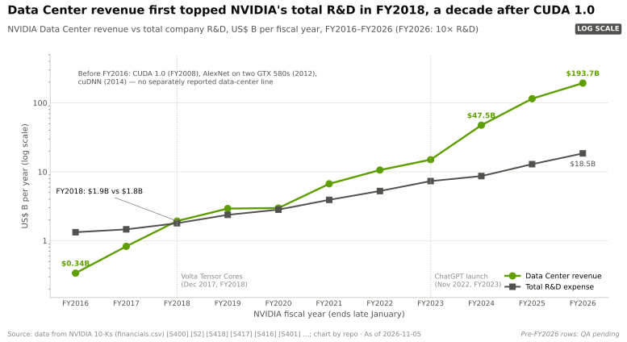
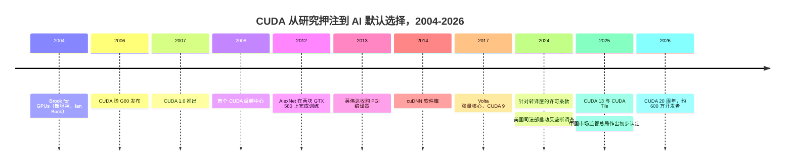

# CUDA 与系统软件：发展历程与英伟达的构建方式

> [!NOTE]
> 本页为英文原文的简体中文参考译文，仅供参考；如有出入，以[英文原文](../../../layers/09-cuda-and-system-software/history-and-how-built.md "English original")为准。

第 09 层 · CUDA 与系统软件 · 阅读约 12 分钟 · 最后核实：2026-11-05

## ⚡ 要点速览

- **[CUDA](../../../glossary.md#cuda) 起步于一个研究项目。** Ian Buck 的 [Brook](../../../glossary.md#brook) 语言（斯坦福大学，2004 年）证明了类 C 代码可以在图形芯片上运行 [[S9532]](../../../sources/bibliography.md#s9532)。英伟达于 2006-11-08 随 G80 GPU 发布 CUDA，并于 2007 年 6 月推出 CUDA 1.0 [[S9528]](../../../sources/bibliography.md#s9528)[[S525]](../../../sources/bibliography.md#s525)。
- **英伟达花钱创造了自己的市场。** 其首个 CUDA 卓越中心（伊利诺伊大学，2008 年）获得了 $500,000 资金和一套价值约 $800,000 的集群；到 2008 年年中，已有 41 所大学开设 CUDA 课程 [[S9529]](../../../sources/bibliography.md#s9529)。
- **回报花了十年。** 2012 年，AlexNet 在两块 GTX 580 游戏 GPU 上完成训练 [[S9530]](../../../sources/bibliography.md#s9530)；2014 年，[cuDNN](../../../glossary.md#cudnn) 把深度学习内核打包成库 [[S9531]](../../../sources/bibliography.md#s9531)。直到 FY2018，数据中心营收才首次超过英伟达的研发总支出 [[S400]](../../../sources/bibliography.md#s400)。
- **[Q4 · 优势来源]** 时间在存量装机基础上的复利：18 年内 13 个 CUDA 大版本，通过 [PTX](../../../glossary.md#ptx) 保持兼容，并随每一款英伟达 GPU 交付，因此研究成果率先落地 CUDA [[S525]](../../../sources/bibliography.md#s525)[[S529]](../../../sources/bibliography.md#s529)。
- **护城河如今既在建设，也在防守。** 2024 年的一项许可条款禁止旨在让 CUDA 软件运行于竞争对手芯片的[转译层](../../../glossary.md#translation-layer) [[S9500]](../../../sources/bibliography.md#s9500)。美国司法部（DOJ）于 2024 年启动反垄断调查，中国监管机构于 2025 年 9 月就 Mellanox 收购附加条件问题作出初步违法认定 🟡 [[S9504]](../../../sources/bibliography.md#s9504)[[S9503]](../../../sources/bibliography.md#s9503)[[S9505]](../../../sources/bibliography.md#s9505)。
- **[Q6 · 复制成本]** 估计 🔴：要在主流框架上实现推理级别的对等，需要 5–8 年和累计 $5–10B 的软件投入；要达到 CUDA 的完整广度则需 10 年以上。参照指标：已有十年历史的 [ROCm](../../../glossary.md#rocm) 在框架支持上得分 26/36；高通（Qualcomm）为 Modular 支付了约 $3.9B，约为其融资额的 10 倍 [[S586]](../../../sources/bibliography.md#s586)[[S90057]](../../../sources/bibliography.md#s90057)[[S9510]](../../../sources/bibliography.md#s9510)。

## 从图形“取巧”到平台

在 CUDA 出现之前，[通用 GPU 计算（GPGPU）](../../../glossary.md#gpgpu)研究者把数学运算伪装成像素着色（矩阵被当作纹理）。Brook 用一种类 C 语言把这种技巧隐藏起来 [[S9532]](../../../sources/bibliography.md#s9532)。CUDA 走得更远：从 G80 起，每一块 GeForce 都配备了 C 编译器、硬件线程调度器和共享内存 [[S9528]](../../../sources/bibliography.md#s9528)[[S2503]](../../../sources/bibliography.md#s2503)。这直接触达了学生和研究者：到 2020 年，支持 CUDA 的 GPU 已超过 10 亿颗，其中大部分是游戏显卡 [[S529]](../../../sources/bibliography.md#s529)。

> [!TIP]
> **算例 —— 播种成本有多低。** 伊利诺伊大学获得了约 $1.3M 的现金和硬件（$500,000 + 约 $800,000）[[S9529]](../../../sources/bibliography.md#s9529)。即使 2008 年开设 CUDA 课程的全部 41 所大学都获得同等金额，总花费也仅约 $53M。这大约相当于英伟达 FY2016 研发支出 $1.33B 的 4%，不到 FY2026 研发支出 $18.5B 的 0.3% [[S400]](../../../sources/bibliography.md#s400)[[S401]](../../../sources/bibliography.md#s401)。

### 关键决策与交易

| 日期 | 决策 | 重要意义 | 来源 |
|---|---|---|---|
| 2006-11 | 让每一块 G80 级 GPU 都能用 C 语言编程 | 到 2020 年 CUDA GPU 装机量超过 10 亿颗 | [[S9528]](../../../sources/bibliography.md#s9528)[[S529]](../../../sources/bibliography.md#s529) |
| 2008 | 资助 CUDA 教学与研究中心 | 到 2008 年年中已有 41 所大学开设 CUDA 课程 | [[S9529]](../../../sources/bibliography.md#s9529) |
| 2013-07 | 收购 PGI（OpenACC、CUDA Fortran） | 把高性能计算（HPC）领域的 Fortran 代码库带到英伟达平台 | [[S484]](../../../sources/bibliography.md#s484) |
| 2014 | 发布 cuDNN | 框架直接调用英伟达内核，而不再自行编写 | [[S9531]](../../../sources/bibliography.md#s9531) |
| 2017-09 | CUDA 9 开放 Volta 张量核心 | 此后硬件与软件开始协同设计 | [[S525]](../../../sources/bibliography.md#s525) |
| 2024-03 | 针对转译层的许可条款 | 提高了 ZLUDA 类克隆方案的法律风险 | [[S9500]](../../../sources/bibliography.md#s9500)[[S9502]](../../../sources/bibliography.md#s9502) |
| 2025-12 | CUDA 13.1 新增 CUDA Tile 和 cuTile Python | 英伟达对 Triton 式 tile 编程的回应 | [[S523]](../../../sources/bibliography.md#s523)[[S9521]](../../../sources/bibliography.md#s9521) |
| 2026-03 | Dynamo 1.0，Apache 2.0 许可 | 开源推理服务层，以保持其英伟达优先 | [[S90066]](../../../sources/bibliography.md#s90066) |

## [Q4] 优势从何而来

**[Q4 · 优势来源]** 五种机制相互强化：

1. **时间与存量装机。** 十八年的版本迭代，每一版都与新的 GPU 特性绑定 [[S525]](../../../sources/bibliography.md#s525)。
2. **向后兼容。** 代码以 PTX 形式交付，驱动程序为每款新 GPU 重新翻译，因此旧内核能继续运行。
3. **协同设计。** 新的数值格式在发布首日就配有内核；竞争对手要过后才能移植。
4. **研究引力。** 新技术首先在 CUDA 上编写和进行基准测试，因此[首日（Day 0）](../../../glossary.md#day-zero-support)优势随每次模型发布而延续（[竞争格局](competition.md)）。
5. **防守。** 许可条款与捆绑策略，这也招来了监管机构：美国司法部的调查关注英伟达是否让切换变得更困难 [[S9503]](../../../sources/bibliography.md#s9503)。

> [!TIP]
> **算例 —— 回报来临前的十年。** 从 FY2016 到 FY2020，英伟达研发支出合计 $9.8B（$1.33B + $1.46B + $1.80B + $2.38B + $2.83B）。同期五年的数据中心营收合计为 $9.0B [[S400]](../../../sources/bibliography.md#s400)[[S2]](../../../sources/bibliography.md#s2)。直到 FY2018，单年数据中心营收才足以覆盖公司的研发支出，此时距 CUDA 1.0 发布已过去十年。

🔧 技术细节：2024 年许可条款能做什么、不能做什么

该条款禁止对 CUDA 输出进行逆向工程或转译，使其运行于非英伟达平台。据报道，它出现在 CUDA 11.6 及之后版本安装时附带的最终用户许可协议（EULA）中；另有一家媒体称，在线许可协议自 2021 年起就已包含该条款 [[S9500]](../../../sources/bibliography.md#s9500)[[S9501]](../../../sources/bibliography.md#s9501)。按多数解读，它并不禁止源代码级移植（HIPIFY 改写的是源代码，而非二进制文件）或净室重新实现 🔴。ZLUDA 早先由 AMD 资助的代码应 AMD 要求被撤下，随后重新构建 [[S9502]](../../../sources/bibliography.md#s9502)。其效果是给任何销售二进制兼容方案的人带来法律风险。

## [Q6] 复制需要多大代价

**[Q6 · 复制成本]** 估计 🔴：一个资金充足的挑战者若从现在起步，要在主流框架上实现推理级别的对等，需要 **5–8 年、累计 $5–10B 和 1,000–3,000 名软件工程师**。这比 AMD 用的十年要快，因为抽象层和 AI 辅助的内核编写如今已经存在。要追平 CUDA 的完整广度（HPC、图形、机器人软件库）则需要 10 年以上。

| 路径 | 时间 | 资金（估计 🔴） | 人才（估计 🔴） | 证据 |
|---|---|---|---|---|
| 克隆 API（HIP 方式） | 10 年以上且仍在继续 | 每年约 $0.5–1B | 1,000–3,000 名软件工程师 | ROCm 从 2016 年到 2026 年达到 26/36 [[S586]](../../../sources/bibliography.md#s586) |
| 收购团队与语言 | 初创公司 3–4 年的工作积累，之后还需整合 | 收购价 $0.7–3.9B | 数百人 | Run:ai 约 $700M；Silo AI $665M；Modular 约 $3.9B [[S479]](../../../sources/bibliography.md#s479)[[S9506]](../../../sources/bibliography.md#s9506)[[S90057]](../../../sources/bibliography.md#s90057) |
| 借力抽象层 | 推理场景 2–3 年 | 每年 $0.2–0.5B | 200–500 名上游贡献者 | Triton、vLLM 和 SGLang 后端 [[S578]](../../../sources/bibliography.md#s578)[[S580]](../../../sources/bibliography.md#s580)[[S582]](../../../sources/bibliography.md#s582) |
| 追平 CUDA 的完整广度 | 10 年以上 | 英伟达级别：FY2026 研发总支出 $18.5B | 数千人 | 英伟达 FY2026 研发支出 [[S401]](../../../sources/bibliography.md#s401) |

> [!TIP]
> **算例 —— 把高通的收购价当作市场标尺。** Modular 经三轮融资共募集 $380M，2025 年 9 月估值为 $1.6B [[S9510]](../../../sources/bibliography.md#s9510)。九个月后，高通同意支付约 $3.9B [[S90057]](../../../sources/bibliography.md#s90057)。这相当于投入资本的约 10 倍、最近一次私募估值的约 2.4 倍：买家如今为节省的时间付费，而不是为营收付费。

🔧 技术细节：为何估计是一个区间而不是一个数字

公开文件不会把软件研发和硬件研发分开披露，AMD 也没有公布 ROCm 的人员规模。分析师称，AMD 在 2025 年对软件进入了“战时状态”，但其 AI 软件工程师的薪酬低于英伟达和各大实验室 [[S9537]](../../../sources/bibliography.md#s9537)。因此，上述区间以可观察的结果为锚：已经过的年数、框架评分和交易价格。它们并非自下而上的成本测算。

## 反事实推演——如果英伟达当初没有……

| 如果…… | 会有什么变化 | 可能的结果（🔴 分析） |
|---|---|---|
| ……在 2010 年开源 CUDA？ | AMD 和英特尔推出兼容 CUDA 的编译器 | 英伟达保住软件库和协同设计上的领先，但随着切换变得轻而易举，利润率会被压缩 |
| ……输给了 [OpenCL](../../../glossary.md#opencl)？ | 出现一个统一的可移植标准 | AI 仍会走向 GPU，但硬件将像 CPU 一样靠价格竞争 |
| ……只在 Tesla 计算卡上提供 CUDA？ | 支撑 AlexNet 的 GTX 580 上没有 CUDA [[S9530]](../../../sources/bibliography.md#s9530) | 深度学习会在 CPU 上停留更久；研究习惯会在别处形成 |

> [!TIP]
> **算例 —— 开放兼容会让多少利益面临风险。** 兼容 CUDA 的竞争对手每从 FY2026 数据中心营收（$193.7B）中夺走 5%，就相当于每年约 $9.7B [[S1]](../../../sources/bibliography.md#s1)。考虑到英伟达在 Q2 FY2027 的 GAAP 毛利率为 75.0% [[S3]](../../../sources/bibliography.md#s3)，首先受到冲击的将是价格，而不仅仅是份额 🔴。

完整案例研究见 [CS2 · CUDA：十五年的赌注](../../../case-studies/CS2-cuda-the-15-year-bet.md)。硬件里程碑见[第 02 层发展历程](../../../layers/02-gpu-silicon/history-and-how-built.md)；跨层全景见[英伟达如何建成今日格局](../../../cross-cutting/16-how-nvidia-built-it-timeline.md)。

## 🎯 企业发展视角

1. 在学术界播种只花了英伟达数千万美元，却造就了行业默认标准。如今哪个渠道（开源模型、智能体框架、AI 编程工具）的播种成本依然低廉？
2. 挑战者可以买到时间，却买不到习惯。在完成 Modular 交易之后，还需要什么：上游贡献、开发者关系，还是捆绑的云服务额度？
3. 2024 年的许可条款与反垄断调查方向相反。一项要求 CUDA 互操作性的和解令（consent decree）会如何改变可移植软件栈资产的价值？
4. 如果 AI 编写的内核把“十年”缩短到几年，哪些资产仍能保值：硬件行为数据、基准测试框架，还是编译器团队？

## 📚 来源（Sources）

<!-- Auto-generated from the [S…] citations on this page by `make build`. Edit sources/registry/*.csv, not this list. -->

- [**S1**](../../../sources/bibliography.md#s1) NVIDIA Corporation via SEC EDGAR, *NVIDIA Announces Financial Results for Fourth Quarter and Fiscal 2026 (Form 8-K exhibit 99.1)*, 2026-02-25. [Link](https://www.sec.gov/Archives/edgar/data/1045810/000104581026000019/q4fy26pr.htm)
- [**S2**](../../../sources/bibliography.md#s2) U.S. Securities and Exchange Commission (EDGAR), *NVIDIA Corporation Form 10-K annual reports FY2020–FY2025 (filing index)*, 2025-02-26. [Link](https://www.sec.gov/cgi-bin/browse-edgar?action=getcompany&CIK=0001045810&type=10-K&dateb=&owner=include&count=40)
- [**S3**](../../../sources/bibliography.md#s3) StorageNewsletter, *NVIDIA Q2 Fiscal 2027 results coverage: revenue $96.2B*, 2026-08-27. [Link](https://www.storagenewsletter.com/2026/08/27/nvidia-fiscal-2q27-financial-results/)
- [**S400**](../../../sources/bibliography.md#s400) U.S. Securities and Exchange Commission (EDGAR), *NVIDIA Corporation Form 10-K annual reports FY2001–FY2019 (EDGAR filing index)*, 2019-02-21. [Link](https://www.sec.gov/cgi-bin/browse-edgar?action=getcompany&CIK=0001045810&type=10-K&dateb=&owner=include&count=40)
- [**S401**](../../../sources/bibliography.md#s401) NVIDIA Corporation via SEC EDGAR, *NVIDIA Corporation Form 10-K for fiscal year ended January 25, 2026*, 2026-02-25. [Link](https://www.sec.gov/Archives/edgar/data/1045810/000104581026000021/nvda-20260125.htm)
- [**S479**](../../../sources/bibliography.md#s479) Various (press), *Reporting on NVIDIA tuck-in acquisition prices (Run:ai, Deci, Shoreline, OctoAI, Gretel, Lepton, CentML) — The Information, Calcalist, Reuters, CNBC*, 2025-06. [Link](https://www.reuters.com/technology/)
- [**S484**](../../../sources/bibliography.md#s484) NVIDIA press releases as summarised in NVIDIA 10-K filings and contemporaneous press, *History of NVIDIA acquisitions 2000–2013 (3dfx assets, MediaQ, ULi, Hybrid Graphics, PortalPlayer, mental images, Ageia, Icera, The Portland Group)*, 2013-07. [Link](https://en.wikipedia.org/wiki/Nvidia)
- [**S523**](../../../sources/bibliography.md#s523) Python Package Index (NVIDIA), *nvidia-cuda-runtime (CUDA 13.x runtime wheels) release history*, 2026-11-04. [Link](https://pypi.org/project/nvidia-cuda-runtime/#history)
- [**S525**](../../../sources/bibliography.md#s525) NVIDIA Developer, *CUDA Toolkit Archive*, 2026. [Link](https://developer.nvidia.com/cuda-toolkit-archive)
- [**S529**](../../../sources/bibliography.md#s529) NVIDIA Blog (Will Ramey), *2 Million Registered Developers, Countless Breakthroughs*, 2020. [Link](https://blogs.nvidia.com/blog/2-million-registered-developers-breakthroughs/)
- [**S578**](../../../sources/bibliography.md#s578) OpenAI Triton (GitHub), *Triton (triton-lang/triton) README — supported hardware*, 2026-11. [Link](https://github.com/triton-lang/triton/blob/main/README.md)
- [**S580**](../../../sources/bibliography.md#s580) vLLM project (GitHub), *vLLM README and installation docs — supported hardware*, 2026-11. [Link](https://github.com/vllm-project/vllm/blob/main/docs/getting_started/installation/README.md)
- [**S582**](../../../sources/bibliography.md#s582) SGLang project (GitHub: sgl-project/sglang), *SGLang README — supported hardware*, 2026-11. [Link](https://github.com/sgl-project/sglang/blob/main/README.md)
- [**S586**](../../../sources/bibliography.md#s586) AMD (GitHub: ROCm/ROCm docs), *ROCm documentation sources: release history, AI-ecosystem compatibility matrix, consolidated changelog*, 2026-08-26. [Link](https://github.com/ROCm/ROCm/blob/develop/docs/release/versions.rst)
- [**S2503**](../../../sources/bibliography.md#s2503) TechSpot, *TechSpot's History of the GPU, Part 4: the coming of general-purpose GPUs*, 2013. [Link](https://www.techspot.com/article/659-history-of-the-gpu-part-4/)
- [**S9500**](../../../sources/bibliography.md#s9500) Tom's Hardware, *Nvidia bans using translation layers for CUDA software to run on other chips; new restriction apparently targets ZLUDA and some Chinese GPU makers*, 2024-03-05. [Link](https://www.tomshardware.com/pc-components/gpus/nvidia-bans-using-translation-layers-for-cuda-software-to-run-on-other-chips-new-restriction-apparently-targets-zluda-and-some-chinese-gpu-makers)
- [**S9501**](../../../sources/bibliography.md#s9501) Wccftech, *NVIDIA Halts The Use of CUDA On Other Platforms; Lists New Warning in the EULA*, 2024-03. [Link](https://wccftech.com/nvidia-halts-use-of-cuda-on-other-platforms-lists-new-warning-in-the-eula/)
- [**S9502**](../../../sources/bibliography.md#s9502) vosen/ZLUDA (GitHub) (Andrzej Janik), *ZLUDA README (drop-in CUDA replacement for non-NVIDIA GPUs)*, 2026-11. [Link](https://github.com/vosen/ZLUDA)
- [**S9503**](../../../sources/bibliography.md#s9503) Business Standard (Bloomberg), *Nvidia gets subpoena from US Justice Dept as antitrust probe deepens*, 2024-09-04. [Link](https://www.business-standard.com/world-news/nvidia-gets-subpoena-from-us-justice-dept-as-antitrust-probe-deepens-124090400121_1.html)
- [**S9504**](../../../sources/bibliography.md#s9504) Business Standard, *US launches antitrust investigation into Nvidia over sales practices*, 2024-08-02. [Link](https://www.business-standard.com/world-news/us-launches-antitrust-investigation-into-nvidia-over-sales-practices-124080201689_1.html)
- [**S9505**](../../../sources/bibliography.md#s9505) JURIST, *China finds Nvidia violated antimonopoly law in preliminary probe*, 2025-09-15. [Link](https://www.jurist.org/news/2025/09/china-finds-nvidia-violated-antimonopoly-law-in-preliminary-probe/)
- [**S9506**](../../../sources/bibliography.md#s9506) Converge Digest, *AMD completes $665 million acquisition of Silo AI*, 2024-08. [Link](https://convergedigest.com/amd-completes-665-million-acquisition-of-silo-ai/?amp=1)
- [**S9510**](../../../sources/bibliography.md#s9510) SDxCentral, *Modular raises $250M for AI's unified compute layer at $1.6B valuation*, 2025-09-24. [Link](https://www.sdxcentral.com/news/modular-raises-250m-for-ais-unified-compute-layer-at-16b-valuation/)
- [**S9521**](../../../sources/bibliography.md#s9521) Hackster.io, *NVIDIA makes GPU acceleration easier and more portable with CUDA Tiles and cuTile Python*, 2025-12. [Link](https://www.hackster.io/news/nvidia-makes-gpu-acceleration-easier-more-portable-with-cuda-tiles-cutile-python-b808c1ad7e4d)
- [**S9528**](../../../sources/bibliography.md#s9528) Digital Engineering 24/7 (NVIDIA press release), *NVIDIA Unveils CUDA - The GPU Computing Revolution Begins*, 2006-11-08. [Link](https://www.digitalengineering247.com/article/nvidia-unveils-cuda)
- [**S9529**](../../../sources/bibliography.md#s9529) TechPowerUp, *NVIDIA appoints first CUDA Center of Excellence*, 2008-07-01. [Link](https://techpowerup.com/64493/nvidia-appoints-first-cuda-center-of-excellence)
- [**S9530**](../../../sources/bibliography.md#s9530) NeurIPS 2012 (Advances in Neural Information Processing Systems 25) (Alex Krizhevsky, Ilya Sutskever, Geoffrey E. Hinton), *ImageNet Classification with Deep Convolutional Neural Networks*, 2012-12. [Link](https://papers.nips.cc/paper/4824-imagenet-classification-with-deep-convolutional-neural-networks)
- [**S9531**](../../../sources/bibliography.md#s9531) arXiv:1410.0759 (Sharan Chetlur, Cliff Woolley, Philippe Vandermersch, Jonathan Cohen, John Tran, Bryan Catanzaro, Evan Shelhamer), *cuDNN: Efficient Primitives for Deep Learning*, 2014-10-03. [Link](https://arxiv.org/abs/1410.0759)
- [**S9532**](../../../sources/bibliography.md#s9532) Stanford Graphics Lab (SIGGRAPH 2004) (Ian Buck, Tim Foley, Daniel Horn, Jeremy Sugerman, Kayvon Fatahalian, Mike Houston, Pat Hanrahan), *Brook for GPUs: Stream Computing on Graphics Hardware*, 2004-08. [Link](https://graphics.stanford.edu/papers/brookgpu/)
- [**S9537**](../../../sources/bibliography.md#s9537) SemiAnalysis, *AMD 2.0: new sense of urgency; MI450X chance to beat Nvidia; Nvidia's new moat*, 2025-04. [Link](https://newsletter.semianalysis.com/p/amd-2-0-new-sense-of-urgency-mi450x-chance-to-beat-nvidia-nvidias-new-moat)
- [**S90057**](../../../sources/bibliography.md#s90057) StorageReview, *Qualcomm unveils Dragonfly data center roadmap: C1000 CPU, AI300 accelerator and Modular acquisition*, 2026-06-24. [Link](https://www.storagereview.com/es/news/qualcomm-unveils-dragonfly-data-center-roadmap-c1000-cpu-ai300-accelerator-and-modular-acquisition)
- [**S90066**](../../../sources/bibliography.md#s90066) HPCwire (NVIDIA press release), *NVIDIA enters production with Dynamo, the broadly adopted inference operating system for AI factories*, 2026-03-17. [Link](https://www.hpcwire.com/aiwire/tag/dynamo-1-0/)
