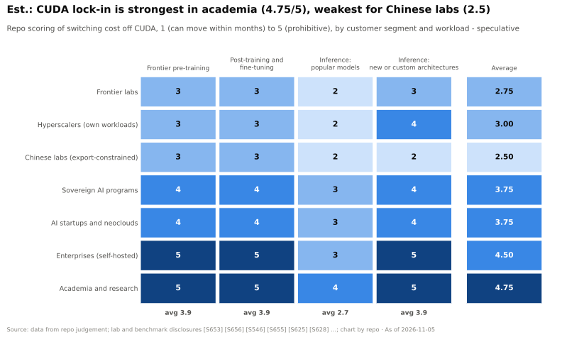

# 客观评估：CUDA 护城河到底有多强？

> [!NOTE]
> 本页为英文原文的简体中文参考译文，仅供参考；如有出入，以[英文原文](../../../layers/09-cuda-and-system-software/honest-assessment.md "English original")为准。

第 09 层 · CUDA 与系统软件 · 阅读约 9 分钟 · 最后核实：2026-11-05

## ⚡ 要点速览

- **🔴 结论：真实存在，但强弱不均。** 按我们的评分，锁定程度在学术界（4.75/5）和自建部署的企业（4.5）中最高，在前沿实验室（2.75）和受出口管制约束的中国实验室（2.5）中最低。
- **主流模型的推理是最薄弱的环节**（2.7/5，而训练和新架构约为 3.9）。它所需的内核少、对成本敏感，而且运行规模大到足以覆盖移植成本。
- **顶端的侵蚀是真实的。** Anthropic 承诺采购最多 100 万颗 TPU [[S653]](../../../sources/bibliography.md#s653)；OpenAI 签下了 6 GW 的 AMD 产能 [[S546]](../../../sources/bibliography.md#s546) 以及 10 GW 由博通（Broadcom）打造的加速器 [[S174]](../../../sources/bibliography.md#s174)；Meta 运行 MTIA 并租用 TPU [[S561]](../../../sources/bibliography.md#s561)[[S90025]](../../../sources/bibliography.md#s90025)。
- **英伟达的吸引力同样真实。** Q2 FY2027 营收为 $96.2B，其中数据中心约 $89.0B [[S3]](../../../sources/bibliography.md#s3)[[S90011]](../../../sources/bibliography.md#s90011)。Anthropic 也采购了最多 1 GW 的英伟达系统 [[S654]](../../../sources/bibliography.md#s654)，Meta 同意购买数百万颗英伟达芯片 [[S4006]](../../../sources/bibliography.md#s4006)。
- **DeepSeek 是一把双刃剑。** 它深入到 [CUDA](../../glossary.md#cuda) *之下*的 PTX 和 SASS 层面 [[S5005]](../../../sources/bibliography.md#s5005)[[S9010]](../../../sources/bibliography.md#s9010)，随后又于 2026 年 9 月发布了其内核库的昇腾版本 [[S9009]](../../../sources/bibliography.md#s9009)[[S9010]](../../../sources/bibliography.md#s9010)。
- **软件只是领先优势的一部分。** GB300 [NVL72](../../glossary.md#nvl72) 在每用户 50 tokens/s 下以每百万输出 token 约 $0.156 的成本服务 DeepSeek-V4-Pro，这得益于其 72-GPU 的 [NVLink](../../glossary.md#nvlink) 域 [[S633]](../../../sources/bibliography.md#s633)。

## 1. 训练与推理之别

**训练**周期长且脆弱：内核、[NCCL](../../glossary.md#nccl) 集合通信与数值行为必须连续数月保持稳定，因此在一代模型训练中途切换平台风险很高。谷歌和 Anthropic 之所以能做到，完全是靠芯片、编译器和模型的协同设计 [[S653]](../../../sources/bibliography.md#s653)[[S656]](../../../sources/bibliography.md#s656)。

**主流模型推理**范围窄：单一模型、固定的内核集合、可度量的每 token 成本，以及规模大到足以为移植买单的机群。AMD 的 DeepSeek-V4 冲刺、Modular 的 MI355X 移植以及 [vLLM](../../glossary.md#vllm) 的 TPU 后端，瞄准的都是推理服务 [[S631]](../../../sources/bibliography.md#s631)[[S9022]](../../../sources/bibliography.md#s9022)[[S9015]](../../../sources/bibliography.md#s9015)。**新模型与[智能体（agentic）](../../glossary.md#agentic-ai)推理**则重新倒向英伟达：首日内核和 KV 卸载库都是在 CUDA 上成熟起来的 [[S627]](../../../sources/bibliography.md#s627)。

> [!TIP]
> **算例 —— 谁负担得起出走？** 在每用户 100 tokens/s 条件下，Ironwood TPU 服务 Qwen3.5 397B 的成本为每百万 token **$0.181**，B200 为 **$0.222** [[S625]](../../../sources/bibliography.md#s625)，**便宜约 18%**。一家每年在推理上花费 $10B 的实验室（🔴 仅为示意）可节省 **约 $1.8B**。一支 200 人的移植团队按人均约 $0.6M 计算 [[S401]](../../../sources/bibliography.md#s401)，成本 **约 $0.12B**，几周就能回本。一家支出 $5M 的企业只能节省约 $0.9M，仅够雇约 1.5 名工程师，远不足以完成一次约需 1.8–5.5 工程师·年的内核移植。**结论：** 算力支出越高，锁定越弱，因此英伟达最大的客户恰恰最有动力出走。

## 2. 按客户类型划分

- **前沿实验室（2.75）和[超大规模云厂商](../../glossary.md#hyperscaler)（3.0）** 同时运行多套软件栈：Anthropic 使用 TPU、Trainium 和英伟达 [[S653]](../../../sources/bibliography.md#s653)，微软（Microsoft）用 Maia 200 支撑 Copilot [[S90044]](../../../sources/bibliography.md#s90044)。它们对英伟达的依赖集中在研究原型阶段，而这一阶段仍从英伟达起步。
- **中国实验室（2.5）** 被出口管制推离英伟达。DeepSeek-V4 实现了昇腾首日支持 [[S633]](../../../sources/bibliography.md#s633)，TileLang 也新增了昇腾 950 后端 [[S9011]](../../../sources/bibliography.md#s9011)。
- **主权 AI（3.75）** 在 FY2026 采购了超过 $30B 的英伟达系统（管理层表述）[[S90071]](../../../sources/bibliography.md#s90071)，且很少雇用内核工程师。
- **初创公司与[新兴云服务商（neocloud）](../../glossary.md#neocloud)（3.75）** 在主流模型上会因价格而切换（在 GLM-5 [FP8](../../glossary.md#fp8) 上，MI355X 每 token 成本最多比 B200 低 29.6% [[S637]](../../../sources/bibliography.md#s637)），但任何新东西仍留在英伟达上运行。
- **企业（4.5）和学术界（4.75）** 依赖长尾、教程和工具；对它们而言，这条护城河几乎是绝对的。

> [!TIP]
> **算例 —— 一次软件库移植如何改变一个客户群体。** DeepSeek-V3 在 2,048 块 H800 GPU 上训练 [[S34007]](../../../sources/bibliography.md#s34007)，其通信库中使用了手工调优的 PTX [[S5005]](../../../sources/bibliography.md#s5005)。2026 年，DeepEP 宣布推出“API 相同、性能完整”的昇腾版本 [[S9009]](../../../sources/bibliography.md#s9009)，DeepGEMM-Ascend 随后于 2026-09-30 推出 [[S9010]](../../../sources/bibliography.md#s9010)。**结论：** 一旦软件库完成移植，基于它们构建的模型无需修改代码即可迁移。软件库护城河是一个库接一个库地失守的，这就是为什么尽管 DeepSeek 对英伟达做了深度调优，中国实验室的得分仍只有 2–3。

## 3. 正反两方面的证据

| 参与者 | 侵蚀的证据 | 反面证据 |
|---|---|---|
| Anthropic | 最多 100 万颗 TPU，2026 年超过 1 GW [[S653]](../../../sources/bibliography.md#s653)；Trainium 作为主要训练合作伙伴 [[S656]](../../../sources/bibliography.md#s656)；2 GW AMD Helios 计划 [[S9538]](../../../sources/bibliography.md#s9538) | 最多 1 GW 的英伟达 Grace Blackwell / Vera Rubin，并开展联合工程 [[S654]](../../../sources/bibliography.md#s654) |
| OpenAI | 从 MI450 起的 6 GW AMD [[S546]](../../../sources/bibliography.md#s546)；10 GW 由博通打造的加速器 [[S174]](../../../sources/bibliography.md#s174)；自研 ASIC 对标 Rubin [[S628]](../../../sources/bibliography.md#s628) | 英伟达约 $30B 的股权投资（有报道）[[S90015]](../../../sources/bibliography.md#s90015) |
| Meta | MTIA 300 已投产，至 2027 年还有三代 [[S561]](../../../sources/bibliography.md#s561)；租用 TPU [[S90025]](../../../sources/bibliography.md#s90025) | 同意购买数百万颗英伟达芯片（2026 年 2 月）[[S4006]](../../../sources/bibliography.md#s4006) |
| DeepSeek / 中国 | DeepEP 和 DeepGEMM 的昇腾移植版 [[S9009]](../../../sources/bibliography.md#s9009)[[S9010]](../../../sources/bibliography.md#s9010) | DeepGEMM 仍是 CUDA 代码库 [[S9010]](../../../sources/bibliography.md#s9010) |
| AMD 软件 | 在 vLLM 和 SGLang 中原生支持 [[S580]](../../../sources/bibliography.md#s580)[[S582]](../../../sources/bibliography.md#s582)；MiniMax-M3 分离式服务首日落地 [[S627]](../../../sources/bibliography.md#s627) | 26 天后在 DeepSeek-V4 上 B200 仍约为 MI355X 的 5 倍 [[S631]](../../../sources/bibliography.md#s631)；在智能体场景的 GLM 5.3 上，英伟达每 token 成本最多低 5 倍 [[S636]](../../../sources/bibliography.md#s636) |
| 谷歌 TPU | 在 Qwen3.5 上每 token 成本比 B200 低约 18% [[S625]](../../../sources/bibliography.md#s625)；已销售进入客户自有数据中心 [[S90027]](../../../sources/bibliography.md#s90027) | 框架覆盖广度 14/36，而 CUDA 为 36/36 [[S577]](../../../sources/bibliography.md#s577)[[S587]](../../../sources/bibliography.md#s587) |

> [!WARNING]
> **误区与事实：“CUDA 就是护城河。”** 在 DeepSeek-V4 上，GB300 NVL72 的领先在很大程度上来自把专家并行流量限制在单个 72-GPU NVLink 域内 [[S633]](../../../sources/bibliography.md#s633)，而且据报道英伟达握有台积电（TSMC）约 60% 的 [CoWoS](../../glossary.md#cowos) 产能分配 [[S90039]](../../../sources/bibliography.md#s90039)。**事实：** 护城河是软件 + [纵向扩展（scale-up）](../../glossary.md#scale-up)网络 + 供应能力的组合。即使追平 CUDA，若没有 NVLink 级别的机架或 CoWoS 产能，依然会丢单（[第 05 层](../05-scale-up-nvlink-nvswitch/index.md)、[第 03 层](../03-memory-packaging-supply-chain/index.md)）。

> [!WARNING]
> **误区与事实：“DeepSeek 证明了不需要 CUDA。”** DeepSeek 2025 年的代码*更深地*依赖英伟达特有的 PTX 和 SASS [[S5005]](../../../sources/bibliography.md#s5005)[[S9010]](../../../sources/bibliography.md#s9010)；其昇腾移植版是 2026 年在出口管制下才推出的。**事实：** 它证明的是效率胜过 GPU 数量（[CS5](../../case-studies/CS5-deepseek-moment-and-efficiency-shock.md)），而不是 CUDA 可有可无。

> [!NOTE]
> **🐂 看多观点。** 每条侵蚀路径在前沿都会漏回 CUDA，新模型也总是先在 CUDA 上运行 [[S633]](../../../sources/bibliography.md#s633)。英伟达选择拥抱而非对抗抽象层，而每季度约 $89B 的数据中心营收 [[S90011]](../../../sources/bibliography.md#s90011) 足以供养比任何竞争对手都多的内核工程师。

> [!WARNING]
> **🐻 看空观点。** 最大的买家已不再需要这条护城河：Anthropic、谷歌、Meta 和 OpenAI 都在运行或构建非英伟达软件栈 [[S653]](../../../sources/bibliography.md#s653)[[S561]](../../../sources/bibliography.md#s561)[[S174]](../../../sources/bibliography.md#s174)。可移植 DSL 把 AMD 的适配周期从数月缩短到数周 [[S631]](../../../sources/bibliography.md#s631)[[S627]](../../../sources/bibliography.md#s627)，AI 智能体还可能进一步缩短 [[S9538]](../../../sources/bibliography.md#s9538)。随着推理占据大部分算力，护城河所覆盖的支出份额正在缩小。

> [!TIP]
> **算例 —— 是多源采购，而不是出走。** 把表中已公布的非英伟达承诺加总：Anthropic 2026 年超过 1 GW 的 TPU [[S653]](../../../sources/bibliography.md#s653) 加 2 GW 的 AMD [[S9538]](../../../sources/bibliography.md#s9538)，OpenAI 6 GW 的 AMD [[S546]](../../../sources/bibliography.md#s546) 加 10 GW 由博通打造的芯片 [[S174]](../../../sources/bibliography.md#s174)。合计 **≥19 GW**，分数年交付。同样这些实验室也与英伟达签了约（Anthropic 最多 1 GW [[S654]](../../../sources/bibliography.md#s654)），而英伟达估计截至 2027 年 Blackwell 加 Vera Rubin 的需求规模达 **$1 trillion** [[S90001]](../../../sources/bibliography.md#s90001)。**结论：** 前沿实验室是在增加第二、第三供应源，而不是离开；侵蚀首先体现为*增量份额*和定价权的流失。

> [!IMPORTANT]
> **核心结论。** 🔴 我们的评估：CUDA 护城河是一种**时间税加广度税**，而不是一堵墙。前沿实验室、超大规模云厂商和中国实验室如今在价格、供应或政治因素足够有利时可以支付这笔税；对其他所有人而言则代价过高，这使英伟达仍是默认选择。如果高流量推理收敛到少数几种架构、每个竞争对手只需调优一次，护城河就会最快削弱。

🔧 技术细节：客户群体评分的构建方法

- 评分（1 = 数月内即可迁移，5 = 代价过高）综合考量内核工程能力、头部与长尾工作负载、替代软件栈以及迁移的公开证据；每一行的依据和来源见 `data/l09_moat_by_segment.csv`（均为推测）。
- 评分是相对的：2 分意味着这部分业务*能够*迁移，并不代表英伟达会失去它。

## 🎯 企业发展视角

1. **细分机会。** 挑战者只需拿下锁定程度低的单元格：超大规模云厂商、前沿实验室和价格敏感型新兴云服务商的主流模型推理。在没有顶级实验室作为锚定客户的情况下，新进入者能触达其中哪些？
2. **买广度，而不只是买速度。** 适配差距以周计；广度差距（36 vs 26 vs 4）以年计。上游维护者和打包/CI 团队的复利效应最强。
3. **高通需要思考的问题（仅基于公开信息）：** 在完成 Modular 交易之后 [[S9511]](../../../sources/bibliography.md#s9511)，目标是在开源软件栈（vLLM、[Triton](../../glossary.md#triton)、[PyTorch](../../glossary.md#pytorch)）中获得一等公民地位，还是打造一套平行的 Mojo/MAX 软件栈？前者可以借力侵蚀路径；后者则必须从零开始争取开发者。
4. **关注锚定交易。** 每一笔 1–10 GW 的交易（Anthropic–TPU、OpenAI–AMD、OpenAI–博通）都在为软件开发提供资金，从而降低后来者面临的锁定程度。

## 📚 来源（Sources）

<!-- Auto-generated from the [S…] citations on this page by `make build`. Edit sources/registry/*.csv, not this list. -->

- [**S3**](../../../sources/bibliography.md#s3) StorageNewsletter, *NVIDIA Q2 Fiscal 2027 results coverage: revenue $96.2B*, 2026-08-27. [Link](https://www.storagenewsletter.com/2026/08/27/nvidia-fiscal-2q27-financial-results/)
- [**S174**](../../../sources/bibliography.md#s174) OpenAI, *OpenAI and Broadcom announce strategic collaboration to deploy 10 gigawatts of OpenAI-designed AI accelerators*, 2025-10-13. [Link](https://openai.com/index/openai-and-broadcom-announce-strategic-collaboration/)
- [**S401**](../../../sources/bibliography.md#s401) NVIDIA Corporation via SEC EDGAR, *NVIDIA Corporation Form 10-K for fiscal year ended January 25, 2026*, 2026-02-25. [Link](https://www.sec.gov/Archives/edgar/data/1045810/000104581026000021/nvda-20260125.htm)
- [**S546**](../../../sources/bibliography.md#s546) TechWire Asia, *AMD Advancing AI 2026: Helios, OpenAI, Meta, Anthropic*, 2026-07. [Link](https://techwireasia.com/2026/07/amd-advancing-ai-2026-helios-openai-meta-anthropic/)
- [**S561**](../../../sources/bibliography.md#s561) DatacenterDynamics, *Meta unveils next four generations of its MTIA chip*, 2026-03-11. [Link](https://www.datacenterdynamics.com/en/news/meta-unveils-next-four-generations-of-its-mtia-chip/)
- [**S577**](../../../sources/bibliography.md#s577) JAX (GitHub: jax-ml/jax docs/installation.md), *JAX installation guide — supported platforms*, 2026-11. [Link](https://github.com/jax-ml/jax/blob/main/docs/installation.md)
- [**S580**](../../../sources/bibliography.md#s580) vLLM project (GitHub), *vLLM README and installation docs — supported hardware*, 2026-11. [Link](https://github.com/vllm-project/vllm/blob/main/docs/getting_started/installation/README.md)
- [**S582**](../../../sources/bibliography.md#s582) SGLang project (GitHub: sgl-project/sglang), *SGLang README — supported hardware*, 2026-11. [Link](https://github.com/sgl-project/sglang/blob/main/README.md)
- [**S587**](../../../sources/bibliography.md#s587) PyTorch (GitHub: pytorch/pytorch), *PyTorch README — building with CUDA, ROCm and Intel GPU support*, 2026-11. [Link](https://github.com/pytorch/pytorch/blob/main/README.md)
- [**S625**](../../../sources/bibliography.md#s625) SemiAnalysis, *TPU Inference Externalization Full Steam Ahead*, 2026-09-07. [Link](https://github.com/SemiAnalysisAI/InferenceX-app/blob/main/packages/app/content/blog/tpu-inferencex-full-steam.mdx)
- [**S627**](../../../sources/bibliography.md#s627) SemiAnalysis, *AgentX - InferenceXv3: Does the CUDA Moat Hold Up in Agentic Inferencing?*, 2026-08-24. [Link](https://github.com/SemiAnalysisAI/InferenceX-app/blob/main/packages/app/content/blog/agentx-inferencexv3-does-cuda-moat.mdx)
- [**S628**](../../../sources/bibliography.md#s628) SemiAnalysis, *OpenAI Jalapeño: Better Than Nvidia Blackwell*, 2026-08-25. [Link](https://github.com/SemiAnalysisAI/InferenceX-app/blob/main/packages/app/content/blog/openai-jalapeno-better-than-nvidia.mdx)
- [**S631**](../../../sources/bibliography.md#s631) SemiAnalysis, *MI355X DeepSeek-V4-Pro on SGLang: 110.5x Throughput per GPU in 26 Days*, 2026-05-26. [Link](https://github.com/SemiAnalysisAI/InferenceX-app/blob/main/packages/app/content/blog/mi355x-deepseek-v4-pro-sglang-110x-in-26-days.mdx)
- [**S633**](../../../sources/bibliography.md#s633) SemiAnalysis, *DeepSeekV4 1.6T Day 0 to Day 43 Performance Over Time — Huawei, GB300 NVL72, MI355X, B200*, 2026-06-09. [Link](https://github.com/SemiAnalysisAI/InferenceX-app/blob/main/packages/app/content/blog/deepseekv4-16t-day-0-to-day-43-performance.mdx)
- [**S636**](../../../sources/bibliography.md#s636) SemiAnalysis, *GLM 5.3 on AgentX: NVIDIA Is Up to 5x Cheaper per Token at 150 tok/s/user*, 2026-08-25. [Link](https://github.com/SemiAnalysisAI/InferenceX-app/blob/main/packages/app/content/blog/glm-5-3-agentx-nvidia-vs-amd-sglang-150-toks.mdx)
- [**S637**](../../../sources/bibliography.md#s637) SemiAnalysis, *AMD MI355X GLM-5 Inference: Up to 29.6% Lower Cost per Million Tokens than B200 on SGLang FP8*, 2026-05-25. [Link](https://github.com/SemiAnalysisAI/InferenceX-app/blob/main/packages/app/content/blog/mi355x-glm5-fp8-sglang-40-cheaper-than-b200.mdx)
- [**S653**](../../../sources/bibliography.md#s653) Anthropic, *Expanding our use of Google Cloud TPUs and Services*, 2025-10-23. [Link](https://www.anthropic.com/news/expanding-our-use-of-google-cloud-tpus-and-services)
- [**S654**](../../../sources/bibliography.md#s654) Anthropic, *Microsoft, NVIDIA, and Anthropic announce strategic partnerships*, 2025-11-18. [Link](https://www.anthropic.com/news/microsoft-nvidia-anthropic-announce-strategic-partnerships)
- [**S656**](../../../sources/bibliography.md#s656) Anthropic, *Powering the next generation of AI development with AWS (expanded Amazon partnership and Trainium)*, 2024-11-22. [Link](https://www.anthropic.com/news/anthropic-amazon-trainium)
- [**S4006**](../../../sources/bibliography.md#s4006) SiliconANGLE, *Meta agrees to buy millions of AI chips from Nvidia, raising doubts about its in-house hardware*, 2026-02-17. [Link](https://siliconangle.com/2026/02/17/meta-agrees-buy-millions-ai-chips-nvidia-raising-doubts-house-hardware/)
- [**S5005**](../../../sources/bibliography.md#s5005) DeepSeek-AI (GitHub) (DeepSeek-AI), *DeepEP: an efficient expert-parallel communication library (README v1.2.1)*, 2025. [Link](https://github.com/deepseek-ai/DeepEP/blob/v1.2.1/README.md)
- [**S9009**](../../../sources/bibliography.md#s9009) DeepSeek-AI (GitHub) (DeepSeek-AI), *DeepEP README (main branch: V2.5 and Ascend version)*, 2026-11. [Link](https://github.com/deepseek-ai/DeepEP/blob/main/README.md)
- [**S9010**](../../../sources/bibliography.md#s9010) DeepSeek-AI (GitHub) (DeepSeek-AI), *DeepGEMM README*, 2026-09-30. [Link](https://github.com/deepseek-ai/DeepGEMM/blob/main/README.md)
- [**S9011**](../../../sources/bibliography.md#s9011) tile-ai (GitHub), *TileLang README (news and backends)*, 2026-09-30. [Link](https://github.com/tile-ai/tilelang/blob/main/README.md)
- [**S9015**](../../../sources/bibliography.md#s9015) vLLM project (GitHub: vllm-project/tpu-inference), *vLLM JAX (formerly tpu-inference) README*, 2026-11. [Link](https://github.com/vllm-project/tpu-inference/blob/main/README.md)
- [**S9022**](../../../sources/bibliography.md#s9022) Modular, *Achieving state-of-the-art performance on AMD MI355 in just 14 days*, 2025-10-17. [Link](https://www.modular.com/blog/achieving-state-of-the-art-performance-on-amd-mi355----in-just-14-days)
- [**S9511**](../../../sources/bibliography.md#s9511) Nasdaq (Qualcomm press release), *Qualcomm Completes Acquisition of Modular*, 2026-07-29. [Link](https://www.nasdaq.com/press-release/qualcomm-completes-acquisition-modular-2026-07-29)
- [**S9538**](../../../sources/bibliography.md#s9538) The Next Web, *AMD is investing $5 billion in Anthropic and deploying 2 gigawatts of Helios GPUs to run Claude*, 2026. [Link](https://thenextweb.com/news/amd-anthropic-5-billion-investment-2gw-helios-mi450)
- [**S34007**](../../../sources/bibliography.md#s34007) arXiv:2412.19437 (DeepSeek-AI), *DeepSeek-V3 Technical Report*, 2024-12-27. [Link](https://arxiv.org/abs/2412.19437)
- [**S90001**](../../../sources/bibliography.md#s90001) The Star (Reuters), *Nvidia bets on AI inference as chip revenue opportunity hits $1 trillion (Reuters)*, 2026-03-17. [Link](https://www.thestar.com.my/tech/tech-news/2026/03/17/nvidia-bets-on-ai-inference-as-chip-revenue-opportunity-hits-1-trillion)
- [**S90011**](../../../sources/bibliography.md#s90011) Nasdaq (Zacks), *NVIDIA Q2 earnings beat on Blackwell Ultra and Data Center strength*, 2026-08-27. [Link](https://www.nasdaq.com/articles/nvidia-q2-earnings-beat-blackwell-ultra-data-center-strength)
- [**S90015**](../../../sources/bibliography.md#s90015) DatacenterDynamics, *Nvidia plans $30bn investment in upcoming OpenAI funding round*, 2026-02. [Link](https://www.datacenterdynamics.com/en/news/nvidia-plans-30bn-investment-in-upcoming-openai-funding-round/)
- [**S90025**](../../../sources/bibliography.md#s90025) SiliconANGLE, *Google and Meta reportedly strike new multibillion-dollar AI chip deal*, 2026-02-26. [Link](https://siliconangle.com/2026/02/26/google-meta-reportedly-strike-new-multibillion-dollar-ai-chip-deal/)
- [**S90027**](../../../sources/bibliography.md#s90027) The Next Web, *Google is building a four-partner chip supply chain to challenge Nvidia in AI inference*, 2026. [Link](https://thenextweb.com/news/google-inference-chips-nvidia-challenge-supply-chain)
- [**S90039**](../../../sources/bibliography.md#s90039) TrendForce, *Samsung, SK hynix reportedly tapped as NVIDIA Rubin HBM4 suppliers; shipments could start in March*, 2026-03-09. [Link](https://www.trendforce.com/news/2026/03/09/news-samsung-sk%E2%80%AFhynix-reportedly-tapped-as-nvidia-rubin-hbm4-suppliers-shipments-could-start-in-march/)
- [**S90044**](../../../sources/bibliography.md#s90044) eWeek, *Microsoft introduces Maia 200, its most powerful AI chip yet*, 2026-01-27. [Link](https://www.eweek.com/news/microsoft-maia-200-ai-chip/)
- [**S90071**](../../../sources/bibliography.md#s90071) Crypto Briefing, *Nvidia CFO emphasizes neutral partnership with AI customers as company diversifies beyond hyperscalers*, 2026. [Link](https://cryptobriefing.com/nvidia-cfo-neutral-ai-partnership/)
