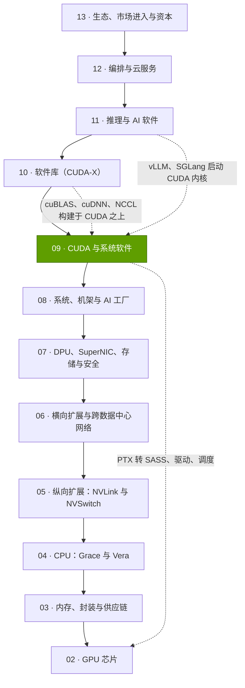
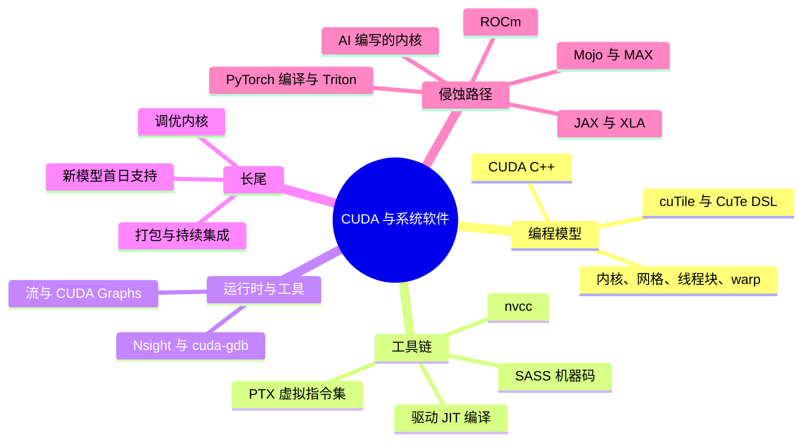

# 第 09 层 —— CUDA 与系统软件

> [!NOTE]
> 本页为英文原文的简体中文参考译文，仅供参考；如有出入，以[英文原文](../../../layers/09-cuda-and-system-software/index.md "English original")为准。

共 12 层中的第 09 层 · 位于 AI 框架与英伟达 GPU 之间的编程模型、编译器、运行时、驱动程序与工具 · 阅读约 6 分钟 · 最后核实：2026-11-05

## ⚡ 要点速览

- **[CUDA](../../glossary.md#cuda) 把 AI 代码翻译成英伟达芯片可以执行的工作。** 它集编程模型、nvcc 编译器、[PTX](../../glossary.md#ptx) 虚拟指令集（ISA）、运行时、驱动程序与工具于一体。首个工具包于 2007 年 6 月发布 [[S525]](../../../sources/bibliography.md#s525)；英伟达称开发者约有 600 万 [[S528]](../../../sources/bibliography.md#s528)。
- **护城河在于长尾。** 在本资料库跟踪的全部 12 个主流框架与推理引擎中，CUDA 均获原生支持（36/36）；[ROCm](../../glossary.md#rocm) 得分为 26，高通 Cloud AI 为 4 [[S587]](../../../sources/bibliography.md#s587)[[S580]](../../../sources/bibliography.md#s580)[[S586]](../../../sources/bibliography.md#s586)[[S596]](../../../sources/bibliography.md#s596)。
- **首日（Day 0）表现即是明证。** DeepSeek-V4-Pro 发布当天即可在 CUDA 上原生运行。AMD MI355X 用了 8 天才支持 [FP4](../../glossary.md#fp4)，用了 27 天才达到每用户 50 tokens/s 的服务水平，且仍落后 B200 约 5 倍 [[S633]](../../../sources/bibliography.md#s633)[[S631]](../../../sources/bibliography.md#s631)。
- **每一代 GPU 都需要重写内核，英伟达自家的也不例外。** FlashAttention-2 在 A100 上最高可达峰值的 73%，到 H100 上降至 35%，直到 FA3 将其提升至 75% [[S9002]](../../../sources/bibliography.md#s9002)[[S9003]](../../../sources/bibliography.md#s9003)。FA4 在 B200 上达到 71% [[S9004]](../../../sources/bibliography.md#s9004)。
- **侵蚀确实存在。** torch.compile 与 [Triton](../../glossary.md#triton) 可同时运行于英伟达和 AMD 平台 [[S9021]](../../../sources/bibliography.md#s9021)[[S578]](../../../sources/bibliography.md#s578)，ROCm 已发展到 10.0 版 [[S586]](../../../sources/bibliography.md#s586)，高通（Qualcomm）已于 2026-07-29 完成对 Modular（Mojo/MAX）约 $3.9B 的收购 [[S90057]](../../../sources/bibliography.md#s90057)[[S9511]](../../../sources/bibliography.md#s9511)。
- **弱点与最强挑战者：** 最大的买家有能力出走。Anthropic 承诺采购最多 100 万颗 TPU [[S653]](../../../sources/bibliography.md#s653)，OpenAI 承诺采购 6 GW 的 AMD GPU [[S546]](../../../sources/bibliography.md#s546)。🔴 我们对前沿实验室的锁定程度评分为 2.75/5，对企业客户则为 4.5。
- **英伟达的反制手段是 Python：** cuTile 与 CuTe DSL 正面迎战 Triton 和 Mojo 所争夺的开发者群体 [[S9007]](../../../sources/bibliography.md#s9007)[[S9030]](../../../sources/bibliography.md#s9030)。

> [!TIP]
> **算例 —— 5 倍软件差距的代价。** 在第 27 天，运行 DeepSeek-V4-Pro 时 B200 的单 GPU token 产出约为 MI355X 的 5 倍 [[S631]](../../../sources/bibliography.md#s631)。即使 MI355X 的拥有成本只有一半（🔴 仅为示意），在软件追上之前，其每 token 成本仍会高出 5 ÷ 2 = **2.5 倍**。**结论：** 这条护城河的代价，体现为每次新模型发布后数周内更差的 token 经济性。

## 本层在技术栈中的位置

## 本层导图

## 八个问题一览

| # | 问题 | 简答 | 详见 |
|---|---|---|---|
| Q1 | 职能是什么？薄弱时会出什么问题？ | 从首日起就把模型数学运算转化为在每款 GPU 上都快速运行的内核；若薄弱，峰值算力无法发挥，新模型迟迟跑不起来 | [CUDA 是什么](what-cuda-is.md) |
| Q2 | 关键指标？ | 首日覆盖率、关键内核达到峰值的百分比、框架覆盖广度、同等交互速度下的差距、重新调优的滞后时间 | [长尾护城河](the-long-tail-moat.md) |
| Q3 | 代际进步？ | 18 年内 13 个大版本，13.x 小版本按季度发布 [[S525]](../../../sources/bibliography.md#s525)[[S523]](../../../sources/bibliography.md#s523)；每一代都重新夺回注意力计算效率 | [CUDA 是什么](what-cuda-is.md) |
| Q4 | 优势来源？ | 二十年的复利积累：到 2020 年 CUDA GPU 超过 10 亿颗 [[S529]](../../../sources/bibliography.md#s529)，加上软件库、学术研究与首日生态 | [发展历程与构建方式](history-and-how-built.md) |
| Q5 | 最强挑战者？ | 商用 GPU 领域是 AMD ROCm；前沿实验室中是运行于 TPU 的谷歌 JAX/XLA | [竞争格局](competition.md) |
| Q6 | 复制成本？ | 🔴 估计每个前沿内核约需 1.8–5.5 工程师·年，关键长尾约需 90–275 工程师·年，外加赢得开发者所需的数年时间 | [发展历程与构建方式](history-and-how-built.md) |
| Q7 | 路线图？ | CUDA 推进 tile 编程与 Python 化；ROCm 10；高通旗下的 Mojo 1.0；TorchTPU；AI 内核智能体 | [路线图](roadmap.md) |
| Q8 | 价值池与并购机会？ | CUDA 免费；价值通过硬件利润率和授权费实现（有人提出每 GPU 每年约 $2,000 [[S9517]](../../../sources/bibliography.md#s9517)）；并购目标聚焦编译器 | [价值链与企业发展视角](value-chain-and-corp-dev.md) |

## 本层页面

| 页面 | 你将了解 |
|---|---|
| [CUDA 究竟是什么](what-cuda-is.md) | 内核类比、nvcc/PTX/SASS、`torch.matmul` 如何变成一次内核启动、CUDA 13.x |
| [为何护城河在于长尾](the-long-tail-moat.md) | 框架覆盖广度、首日支持、研究成果率先落地、移植成本 |
| [侵蚀路径](erosion-vectors.md) | torch.compile、Triton、JAX/XLA、MLIR、Mojo、ROCm、vLLM 后端、AI 编写的内核 |
| [客观评估](honest-assessment.md) | 训练与推理之别、分细分市场的护城河强度、正反两方面证据 |
| [竞争格局](competition.md) | 各软件栈的正面对比 |
| [发展历程与英伟达的构建方式](history-and-how-built.md) | 时间线、关键决策、复制成本 |
| [路线图](roadmap.md) | CUDA、ROCm 及竞争对手的软件路线图 |
| [价值链与企业发展视角](value-chain-and-corp-dev.md) | 软件价值池、非上市公司、并购 |

🔧 技术细节：一分钟了解 CUDA 术语

- **内核（kernel）：** 在由线程块组成的网格上启动的 GPU 函数，以 32 个线程为一组的 warp 执行。
- **PTX 与 SASS：** PTX 是可移植的中间代码；SASS 是某一 GPU 系列专属的机器码。
- **软件库与 DSL：** cuBLAS 和 cuDNN 是预先调优的内核（[第 10 层](../10-libraries-cuda-x/index.md)）；Triton、CuTe DSL 和 cuTile 则是用于编写新内核的语言。

## 🎯 企业发展视角

1. **护城河是一种时间税。** 竞争对手能在数周内弥合新模型的大部分差距 [[S631]](../../../sources/bibliography.md#s631)，但每一个新模型、每一款新 GPU 都会让计时重新开始。
2. **支出越高，锁定越弱。** 最大的客户有能力出资自建软件栈；企业长尾客户则不能（[客观评估](honest-assessment.md)）。
3. **高通需要思考的问题（仅基于公开信息）：** 在 Modular 已纳入麾下 [[S9511]](../../../sources/bibliography.md#s9511)、AI200/AI250 机架已发布 [[S90028]](../../../sources/bibliography.md#s90028) 的情况下，哪个细分市场的锁定程度最低？在那里做到“首日就绪”需要什么？

## 📚 来源（Sources）

<!-- Auto-generated from the [S…] citations on this page by `make build`. Edit sources/registry/*.csv, not this list. -->

- [**S523**](../../../sources/bibliography.md#s523) Python Package Index (NVIDIA), *nvidia-cuda-runtime (CUDA 13.x runtime wheels) release history*, 2026-11-04. [Link](https://pypi.org/project/nvidia-cuda-runtime/#history)
- [**S525**](../../../sources/bibliography.md#s525) NVIDIA Developer, *CUDA Toolkit Archive*, 2026. [Link](https://developer.nvidia.com/cuda-toolkit-archive)
- [**S528**](../../../sources/bibliography.md#s528) NVIDIA Developer Forums, *20 Years of CUDA: Honoring the Architects of the Accelerated Age*, 2026-03. [Link](https://forums.developer.nvidia.com/t/20-years-of-cuda-honoring-the-architects-of-the-accelerated-age/364654)
- [**S529**](../../../sources/bibliography.md#s529) NVIDIA Blog (Will Ramey), *2 Million Registered Developers, Countless Breakthroughs*, 2020. [Link](https://blogs.nvidia.com/blog/2-million-registered-developers-breakthroughs/)
- [**S546**](../../../sources/bibliography.md#s546) TechWire Asia, *AMD Advancing AI 2026: Helios, OpenAI, Meta, Anthropic*, 2026-07. [Link](https://techwireasia.com/2026/07/amd-advancing-ai-2026-helios-openai-meta-anthropic/)
- [**S578**](../../../sources/bibliography.md#s578) OpenAI Triton (GitHub), *Triton (triton-lang/triton) README — supported hardware*, 2026-11. [Link](https://github.com/triton-lang/triton/blob/main/README.md)
- [**S580**](../../../sources/bibliography.md#s580) vLLM project (GitHub), *vLLM README and installation docs — supported hardware*, 2026-11. [Link](https://github.com/vllm-project/vllm/blob/main/docs/getting_started/installation/README.md)
- [**S586**](../../../sources/bibliography.md#s586) AMD (GitHub: ROCm/ROCm docs), *ROCm documentation sources: release history, AI-ecosystem compatibility matrix, consolidated changelog*, 2026-08-26. [Link](https://github.com/ROCm/ROCm/blob/develop/docs/release/versions.rst)
- [**S587**](../../../sources/bibliography.md#s587) PyTorch (GitHub: pytorch/pytorch), *PyTorch README — building with CUDA, ROCm and Intel GPU support*, 2026-11. [Link](https://github.com/pytorch/pytorch/blob/main/README.md)
- [**S596**](../../../sources/bibliography.md#s596) Qualcomm (GitHub: quic), *Qualcomm Cloud AI SDK and Efficient Transformers repositories*, 2026-11. [Link](https://github.com/quic/cloud-ai-sdk)
- [**S631**](../../../sources/bibliography.md#s631) SemiAnalysis, *MI355X DeepSeek-V4-Pro on SGLang: 110.5x Throughput per GPU in 26 Days*, 2026-05-26. [Link](https://github.com/SemiAnalysisAI/InferenceX-app/blob/main/packages/app/content/blog/mi355x-deepseek-v4-pro-sglang-110x-in-26-days.mdx)
- [**S633**](../../../sources/bibliography.md#s633) SemiAnalysis, *DeepSeekV4 1.6T Day 0 to Day 43 Performance Over Time — Huawei, GB300 NVL72, MI355X, B200*, 2026-06-09. [Link](https://github.com/SemiAnalysisAI/InferenceX-app/blob/main/packages/app/content/blog/deepseekv4-16t-day-0-to-day-43-performance.mdx)
- [**S653**](../../../sources/bibliography.md#s653) Anthropic, *Expanding our use of Google Cloud TPUs and Services*, 2025-10-23. [Link](https://www.anthropic.com/news/expanding-our-use-of-google-cloud-tpus-and-services)
- [**S9002**](../../../sources/bibliography.md#s9002) arXiv:2307.08691 (ICLR 2024) (Tri Dao), *FlashAttention-2: Faster Attention with Better Parallelism and Work Partitioning*, 2023-07-17. [Link](https://arxiv.org/abs/2307.08691)
- [**S9003**](../../../sources/bibliography.md#s9003) arXiv:2407.08608 (NeurIPS 2024) (Jay Shah, Ganesh Bikshandi, Ying Zhang, Vijay Thakkar, Pradeep Ramani, Tri Dao), *FlashAttention-3: Fast and Accurate Attention with Asynchrony and Low-precision*, 2024-07-11. [Link](https://arxiv.org/abs/2407.08608)
- [**S9004**](../../../sources/bibliography.md#s9004) arXiv:2603.05451 (Zadouri, Hoehnerbach, Shah, Liu, Thakkar, Dao), *FlashAttention-4: Algorithm and Kernel Pipelining Co-Design for Asymmetric Hardware Scaling*, 2026-03. [Link](https://arxiv.org/abs/2603.05451)
- [**S9007**](../../../sources/bibliography.md#s9007) NVIDIA (GitHub: NVIDIA/cutile-python), *cuTile Python README*, 2026-11. [Link](https://github.com/NVIDIA/cutile-python/blob/main/README.md)
- [**S9021**](../../../sources/bibliography.md#s9021) ACM ASPLOS 2024 (PDF hosted by PyTorch) (Jason Ansel et al.), *PyTorch 2: Faster Machine Learning Through Dynamic Python Bytecode Transformation and Graph Compilation*, 2024-04. [Link](https://pytorch.org/assets/pytorch2-2.pdf)
- [**S9030**](../../../sources/bibliography.md#s9030) NVIDIA (GitHub: NVIDIA/cutlass), *CUTLASS 4.8.1 README (CuTe DSL)*, 2026-10. [Link](https://github.com/NVIDIA/cutlass/blob/main/README.md)
- [**S9511**](../../../sources/bibliography.md#s9511) Nasdaq (Qualcomm press release), *Qualcomm Completes Acquisition of Modular*, 2026-07-29. [Link](https://www.nasdaq.com/press-release/qualcomm-completes-acquisition-modular-2026-07-29)
- [**S9517**](../../../sources/bibliography.md#s9517) TechSpot, *Nvidia's AI chips already make billions; now Jensen Huang wants $2,000 per GPU in annual software fees*, 2026-10. [Link](https://www.techspot.com/news/114333-nvidia-ai-chips-already-make-billions-now-jensen.html)
- [**S90028**](../../../sources/bibliography.md#s90028) TechRepublic, *Qualcomm unveils AI chips to rival Nvidia, AMD*, 2025-10-27. [Link](https://techrepublic.com/article/news-qualcomm-unveils-ai-chips-to-rival-nvidia-amd)
- [**S90057**](../../../sources/bibliography.md#s90057) StorageReview, *Qualcomm unveils Dragonfly data center roadmap: C1000 CPU, AI300 accelerator and Modular acquisition*, 2026-06-24. [Link](https://www.storagereview.com/es/news/qualcomm-unveils-dragonfly-data-center-roadmap-c1000-cpu-ai300-accelerator-and-modular-acquisition)
