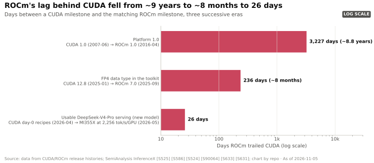
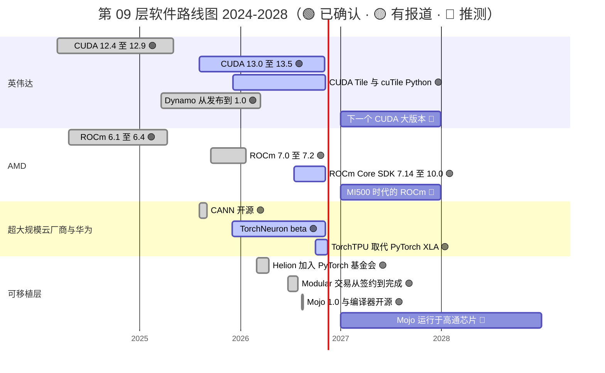

# CUDA 与系统软件：路线图

> [!NOTE]
> 本页为英文原文的简体中文参考译文，仅供参考；如有出入，以[英文原文](../../../layers/09-cuda-and-system-software/roadmap.md "English original")为准。

第 09 层 · CUDA 与系统软件 · 阅读约 10 分钟 · 最后核实：2026-11-05

## ⚡ 要点速览

- **CUDA 如今按季度节奏发布。** [CUDA](../../../glossary.md#cuda) 13.0 于 2025-08-04 推出，此后又发布了五个 13.x 小版本，13.5 于 2026-11-04 发布 [[S523]](../../../sources/bibliography.md#s523)。CUDA 13 放弃了对 Maxwell、Pascal 和 Volta 的支持 🟡 [[S90065]](../../../sources/bibliography.md#s90065)。
- **英伟达正把正门搬到 Python。** CUDA 13.1 推出了 CUDA Tile 和 cuTile Python，13.2 把 tile 编程扩展到 Ampere 和 Ada [[S9521]](../../../sources/bibliography.md#s9521)[[S527]](../../../sources/bibliography.md#s527)。推理服务层 [Dynamo](../../../glossary.md#dynamo) 于 2026 年 3 月以 Apache 2.0 许可发布 1.0 版 [[S90066]](../../../sources/bibliography.md#s90066)。
- **AMD 追平了节奏，但没有追平内容。** [ROCm](../../../glossary.md#rocm) 从 7.0（2025 年 9 月）起，经由新的 Core SDK 发布线，于 2026-08-26 发展到 10.0 [[S586]](../../../sources/bibliography.md#s586)。新功能相对 CUDA 的滞后已从约九年缩短到数周，但长尾依然落后（[竞争格局](competition.md)；发布节奏图见[侵蚀路径](erosion-vectors.md)）。
- **竞争对手 2026 年的动作都围绕开放展开。** 谷歌（Google）的 TorchTPU 取代了 [PyTorch](../../../glossary.md#pytorch)/XLA（后者于 2026-11-15 归档）；AWS 的 TorchNeuron 处于公开 beta；[Mojo](../../../glossary.md#mojo) 的编译器于 2026 年 8 月开源 [[S553]](../../../sources/bibliography.md#s553)[[S595]](../../../sources/bibliography.md#s595)[[S9525]](../../../sources/bibliography.md#s9525)[[S9512]](../../../sources/bibliography.md#s9512)。
- **[Q7 · 路线图与变数]** 预计英伟达会在添加自有 Python 层的同时，让 CUDA 继续成为每个可移植层（Triton、Helion、[vLLM](../../../glossary.md#vllm)）支持最好的目标平台。如果 AI 编写的内核让移植变得廉价，或者某家[超大规模云厂商](../../../glossary.md#hyperscaler)把开放软件栈与商用硬件结合起来，格局就会改变 🔴。

## 软件路线图，2024–2028

下表未列出的条形图来源：CUDA 12.4–12.9 发布日期 [[S524]](../../../sources/bibliography.md#s524)；ROCm 6.1–6.4 [[S586]](../../../sources/bibliography.md#s586)；MI500 于 2027 年推出，据此设定 🔴 ROCm 时间窗 [[S538]](../../../sources/bibliography.md#s538)；CANN 开源 [[S9524]](../../../sources/bibliography.md#s9524)；Modular 交易于 2026-07-29 完成 [[S9511]](../../../sources/bibliography.md#s9511)。

| 事项 | 时间窗口 | 状态 | 可信度 | 来源 |
|---|---|---|---|---|
| CUDA 13.x 小版本，大约每季度一个 | 2025-08 → 2026-11（13.5） | 已发布 | 🟢 | [[S523]](../../../sources/bibliography.md#s523) |
| CUDA Tile / cuTile Python；13.2 扩展至 Ampere 和 Ada | 2025-12 → 2026-03 | 已发布 | 🟢 | [[S9521]](../../../sources/bibliography.md#s9521)[[S527]](../../../sources/bibliography.md#s527) |
| Dynamo 1.0；1.5.1 是首个提供企业级支持的版本 | 2026-03 → 2026-10 | 已发布 | 🟢 | [[S90066]](../../../sources/bibliography.md#s90066)[[S521]](../../../sources/bibliography.md#s521) |
| ROCm 10.0，已通过 PyTorch 2.13 和 vLLM 0.27 验证 | 2026-08-26 | 已发布 | 🟢 | [[S586]](../../../sources/bibliography.md#s586) |
| TorchTPU 取代 PyTorch/XLA（后者于 2026-11-15 归档） | 2026-10 → 2026-11 | 已发布 | 🟢 | [[S553]](../../../sources/bibliography.md#s553)[[S595]](../../../sources/bibliography.md#s595) |
| TorchNeuron 正式发布（GA） | 尚未宣布（自 2025-12 起处于 beta） | beta | 🔴 | [[S9525]](../../../sources/bibliography.md#s9525) |
| Helion 可编译为 Triton 和英伟达 TileIR | 2026 | 已发布 | 🟢 | [[S9523]](../../../sources/bibliography.md#s9523) |
| Mojo/MAX 运行于高通 Dragonfly AI300（2028 年产品） | 尚未宣布（AI300 预计 2028 年推出） | — | 🔴 | [[S90056]](../../../sources/bibliography.md#s90056)[[S9511]](../../../sources/bibliography.md#s9511) |
| 英伟达在 GTC DC 上的软件发布（主题演讲 2026-12-01） | 2026-12-01，晚于本页日期 | — | 🔴 | [[S90047]](../../../sources/bibliography.md#s90047) |

> [!TIP]
> **算例 —— 滞后缩短得有多快。** ROCm 1.0 比 CUDA 1.0 晚了 **106 个月**（2007 年 6 月 → 2016 年 4 月）[[S525]](../../../sources/bibliography.md#s525)[[S586]](../../../sources/bibliography.md#s586)。[FP4](../../../glossary.md#fp4) 支持晚了 **约 8 个月**：CUDA 12.8（2025 年 1 月）对 ROCm 7.0（2025 年 9 月）[[S524]](../../../sources/bibliography.md#s524)[[S90064]](../../../sources/bibliography.md#s90064)。DeepSeek-V4 的可用服务比 CUDA 的首日方案晚了 **约 26 天** [[S631]](../../../sources/bibliography.md#s631)[[S633]](../../../sources/bibliography.md#s633)。每一步都缩短了约十倍，但买家要为*最后*那段差距买单，而且每次重要模型发布时它都会重现。

长尾依然落后：vLLM 用于 KV 缓存卸载的批量主机到设备拷贝，直到 ROCm 7.14（2026 年 7 月）才可用；框架支持得分为 36 分中的 26 分，而 CUDA 为 36 分 [[S627]](../../../sources/bibliography.md#s627)[[S586]](../../../sources/bibliography.md#s586)[[S587]](../../../sources/bibliography.md#s587)。

对两家厂商而言，仅靠软件就能在固定硬件上提升实际性能：

🔧 技术细节：为何 tile 编程是英伟达路线图上对 Triton 的回应

[Triton](../../../glossary.md#triton) 让程序员以 *tile*（矩阵分块）为单位描述工作，由编译器把 tile 映射到线程上，这正是它能跨厂商移植的原因 [[S578]](../../../sources/bibliography.md#s578)。CUDA Tile 在英伟达自己的软件栈内做同样的事。cuTile Python 编译为 Tile IR——一种由驱动程序针对每款 GPU 即时编译的虚拟指令集，类似于经典 CUDA 中的 [PTX](../../../glossary.md#ptx) [[S9521]](../../../sources/bibliography.md#s9521)。如果 Helion 和其他前端在英伟达硬件上生成 TileIR，那么即使源代码是可移植的，英伟达也能保住性能优势 [[S9523]](../../../sources/bibliography.md#s9523)。

## 什么会改变格局

**[Q7 · 路线图与变数]**

- **能编写可移植且高速内核的 AI。** MI355X 在 DeepSeek-V4 上的追赶主要依靠新的 TileLang、Triton 和 FlyDSL 内核 [[S631]](../../../sources/bibliography.md#s631)。AMD 和 Anthropic 计划使用 Claude 加速 ROCm 开发 🟡 [[S9538]](../../../sources/bibliography.md#s9538)，SemiAnalysis 估计 GitHub 上约 4% 的公开提交已由 Claude Code 编写 [[S627]](../../../sources/bibliography.md#s627)。如果一个月的内核工作缩短为一天，CUDA 的首日优势也会随之缩小 🔴。
- **PyTorch 在所有平台上默认采用 Triton 或 Helion**（通过 [torch.compile](../../../glossary.md#torch-compile)）。一次编写的内核可为任何后端编译；英伟达的反制在于 Helion 同样以 TileIR 为目标 [[S9523]](../../../sources/bibliography.md#s9523)。
- **超大规模云厂商同时开放软件栈和芯片。** TorchTPU 和 NKI 都已开源 [[S553]](../../../sources/bibliography.md#s553)[[S9525]](../../../sources/bibliography.md#s9525)，另据报道谷歌正在向客户自有数据中心销售 TPU 🟡 [[S90027]](../../../sources/bibliography.md#s90027)。运行于商用硬件上的开放软件，将是第一个兼具规模与开放性的竞争对手。
- **监管救济。** 来自美国司法部或中国市场监管总局（SAMR）的互操作性要求，将以行政命令的方式降低切换成本 🔴 [[S9503]](../../../sources/bibliography.md#s9503)[[S9505]](../../../sources/bibliography.md#s9505)。

> [!TIP]
> **算例 —— “AI 编写内核”会如何影响复制成本。** AMD 的 DeepSeek-V4 冲刺由四名主要贡献者在 26 天内提交了 31 个 PR [[S631]](../../../sources/bibliography.md#s631)。如果编程智能体把这一周期缩短到一周，同一支团队就能支持约 4 倍数量的模型发布，而[发展历程页面](history-and-how-built.md)中 5–8 年实现对等的估计 🔴 将受制于硬件获取和基准测试数据，而不是工程师·年。

## 🎯 企业发展视角

1. 英伟达在开源推理服务层（Dynamo）的同时，保持编译器栈（CUDA、Tile IR）封闭。挑战者应当首先开放哪一层，才能赢得最多的开发者好感？
2. 高通的 Mojo 路线图是否需要 AI300 时代的芯片（2028 年）来证明自己，还是可以先在英伟达和 AMD GPU 上赢得用户 [[S90056]](../../../sources/bibliography.md#s90056)[[S9513]](../../../sources/bibliography.md#s9513)？
3. 由于 GTC DC（2026-12-01）晚于本页的截止日期，哪些发布会改变上述判断：新的 CUDA 大版本、Tile IR 覆盖更多 GPU，还是 Dynamo 的定价？
4. 如果编程智能体压缩了移植时间，那么稀缺资产是内核编写人才、基准测试基础设施（InferenceX 式），还是对模型的抢先获取权？

## 📚 来源（Sources）

<!-- Auto-generated from the [S…] citations on this page by `make build`. Edit sources/registry/*.csv, not this list. -->

- [**S521**](../../../sources/bibliography.md#s521) NVIDIA Docs, *NVIDIA Dynamo release notes*, 2026-10. [Link](https://docs.nvidia.com/dynamo/zh-CN/latest/reference/releases)
- [**S523**](../../../sources/bibliography.md#s523) Python Package Index (NVIDIA), *nvidia-cuda-runtime (CUDA 13.x runtime wheels) release history*, 2026-11-04. [Link](https://pypi.org/project/nvidia-cuda-runtime/#history)
- [**S524**](../../../sources/bibliography.md#s524) Python Package Index (NVIDIA), *nvidia-cuda-runtime-cu12 (CUDA 12.x runtime wheels) release history*, 2025-06-05. [Link](https://pypi.org/project/nvidia-cuda-runtime-cu12/#history)
- [**S525**](../../../sources/bibliography.md#s525) NVIDIA Developer, *CUDA Toolkit Archive*, 2026. [Link](https://developer.nvidia.com/cuda-toolkit-archive)
- [**S527**](../../../sources/bibliography.md#s527) NVIDIA Docs, *CUDA Toolkit 13.2 Release Notes*, 2026-03-05. [Link](https://docs.nvidia.com/cuda/archive/13.2.0/cuda-toolkit-release-notes/index.html)
- [**S538**](../../../sources/bibliography.md#s538) AMD Investor Relations, *AAI 2026: AMD Delivers Full-Stack Compute for the Agentic AI Era*, 2026-07-23. [Link](https://ir.amd.com/news-events/press-releases/detail/1294/aai-2026-amd-delivers-full-stack-compute-for-the-agentic-ai-era)
- [**S553**](../../../sources/bibliography.md#s553) Google Cloud Blog (Alex Barrett), *What's new in AI infrastructure and orchestration in October*, 2026-11. [Link](https://cloud.google.com/blog/topics/ai-infrastructure/whats-new-in-ai-infrastructure-this-month)
- [**S578**](../../../sources/bibliography.md#s578) OpenAI Triton (GitHub), *Triton (triton-lang/triton) README — supported hardware*, 2026-11. [Link](https://github.com/triton-lang/triton/blob/main/README.md)
- [**S586**](../../../sources/bibliography.md#s586) AMD (GitHub: ROCm/ROCm docs), *ROCm documentation sources: release history, AI-ecosystem compatibility matrix, consolidated changelog*, 2026-08-26. [Link](https://github.com/ROCm/ROCm/blob/develop/docs/release/versions.rst)
- [**S587**](../../../sources/bibliography.md#s587) PyTorch (GitHub: pytorch/pytorch), *PyTorch README — building with CUDA, ROCm and Intel GPU support*, 2026-11. [Link](https://github.com/pytorch/pytorch/blob/main/README.md)
- [**S595**](../../../sources/bibliography.md#s595) PyTorch (GitHub: pytorch/xla), *PyTorch/XLA README (deprecation notice)*, 2026-11. [Link](https://github.com/pytorch/xla/blob/master/README.md)
- [**S627**](../../../sources/bibliography.md#s627) SemiAnalysis, *AgentX - InferenceXv3: Does the CUDA Moat Hold Up in Agentic Inferencing?*, 2026-08-24. [Link](https://github.com/SemiAnalysisAI/InferenceX-app/blob/main/packages/app/content/blog/agentx-inferencexv3-does-cuda-moat.mdx)
- [**S631**](../../../sources/bibliography.md#s631) SemiAnalysis, *MI355X DeepSeek-V4-Pro on SGLang: 110.5x Throughput per GPU in 26 Days*, 2026-05-26. [Link](https://github.com/SemiAnalysisAI/InferenceX-app/blob/main/packages/app/content/blog/mi355x-deepseek-v4-pro-sglang-110x-in-26-days.mdx)
- [**S633**](../../../sources/bibliography.md#s633) SemiAnalysis, *DeepSeekV4 1.6T Day 0 to Day 43 Performance Over Time — Huawei, GB300 NVL72, MI355X, B200*, 2026-06-09. [Link](https://github.com/SemiAnalysisAI/InferenceX-app/blob/main/packages/app/content/blog/deepseekv4-16t-day-0-to-day-43-performance.mdx)
- [**S9503**](../../../sources/bibliography.md#s9503) Business Standard (Bloomberg), *Nvidia gets subpoena from US Justice Dept as antitrust probe deepens*, 2024-09-04. [Link](https://www.business-standard.com/world-news/nvidia-gets-subpoena-from-us-justice-dept-as-antitrust-probe-deepens-124090400121_1.html)
- [**S9505**](../../../sources/bibliography.md#s9505) JURIST, *China finds Nvidia violated antimonopoly law in preliminary probe*, 2025-09-15. [Link](https://www.jurist.org/news/2025/09/china-finds-nvidia-violated-antimonopoly-law-in-preliminary-probe/)
- [**S9511**](../../../sources/bibliography.md#s9511) Nasdaq (Qualcomm press release), *Qualcomm Completes Acquisition of Modular*, 2026-07-29. [Link](https://www.nasdaq.com/press-release/qualcomm-completes-acquisition-modular-2026-07-29)
- [**S9512**](../../../sources/bibliography.md#s9512) Phoronix (Michael Larabel), *Modular's Mojo Language Now Open-Source Following Qualcomm Acquisition*, 2026-08-18. [Link](https://www.phoronix.com/news/Modular-Mojo-Open-Source)
- [**S9513**](../../../sources/bibliography.md#s9513) modular/modular (GitHub), *Modular Platform repository README (MAX framework and Mojo language)*, 2026-11. [Link](https://github.com/modular/modular)
- [**S9521**](../../../sources/bibliography.md#s9521) Hackster.io, *NVIDIA makes GPU acceleration easier and more portable with CUDA Tiles and cuTile Python*, 2025-12. [Link](https://www.hackster.io/news/nvidia-makes-gpu-acceleration-easier-more-portable-with-cuda-tiles-cutile-python-b808c1ad7e4d)
- [**S9523**](../../../sources/bibliography.md#s9523) PyTorch Foundation, *Helion (PyTorch Foundation project page)*, 2026. [Link](https://pytorch.org/projects/helion/)
- [**S9524**](../../../sources/bibliography.md#s9524) TrendForce, *Huawei open-sources CANN toolkit for Ascend AI GPUs; taking aim at Nvidia's CUDA*, 2025-08-07. [Link](https://www.trendforce.com/news/2025/08/07/news-huawei-open-sources-cann-toolkit-for-ascend-ai-gpus-taking-aim-at-nvidias-cuda/)
- [**S9525**](../../../sources/bibliography.md#s9525) AWS Neuron SDK docs, *AWS Neuron documentation: PyTorch on Neuron (TorchNeuron) and NKI*, 2026. [Link](https://awsdocs-neuron.readthedocs-hosted.com/en/latest/_sources/torch/index.rst)
- [**S9538**](../../../sources/bibliography.md#s9538) The Next Web, *AMD is investing $5 billion in Anthropic and deploying 2 gigawatts of Helios GPUs to run Claude*, 2026. [Link](https://thenextweb.com/news/amd-anthropic-5-billion-investment-2gw-helios-mi450)
- [**S90027**](../../../sources/bibliography.md#s90027) The Next Web, *Google is building a four-partner chip supply chain to challenge Nvidia in AI inference*, 2026. [Link](https://thenextweb.com/news/google-inference-chips-nvidia-challenge-supply-chain)
- [**S90047**](../../../sources/bibliography.md#s90047) NVIDIA, *NVIDIA GTC DC 2026 (November 30 – December 3, 2026)*, 2026. [Link](https://www.nvidia.com/en-us/gtc-dc/topics/ai-policy/)
- [**S90056**](../../../sources/bibliography.md#s90056) HPCwire (Qualcomm press release), *Qualcomm unveils data center roadmap for the agentic AI era with new Dragonfly portfolio*, 2026-06-24. [Link](https://www.hpcwire.com/off-the-wire/qualcomm-unveils-data-center-roadmap-for-the-agentic-ai-era-with-new-dragonfly-portfolio/)
- [**S90064**](../../../sources/bibliography.md#s90064) The Register, *ROCm 7: AMD tries to catch CUDA with performance-boosting software*, 2025-09-17. [Link](https://www.theregister.com/2025/09/17/amd_rocm_7_chases_nvidia_cuda/)
- [**S90065**](../../../sources/bibliography.md#s90065) Spheron, *CUDA news today: NVIDIA toolkit, AMD ROCm and AI frameworks 2026*, 2026. [Link](https://www.spheron.network/blog/cuda-news-today-nvidia-toolkit-amd-rocm-ai-frameworks-2026/)
- [**S90066**](../../../sources/bibliography.md#s90066) HPCwire (NVIDIA press release), *NVIDIA enters production with Dynamo, the broadly adopted inference operating system for AI factories*, 2026-03-17. [Link](https://www.hpcwire.com/aiwire/tag/dynamo-1-0/)
