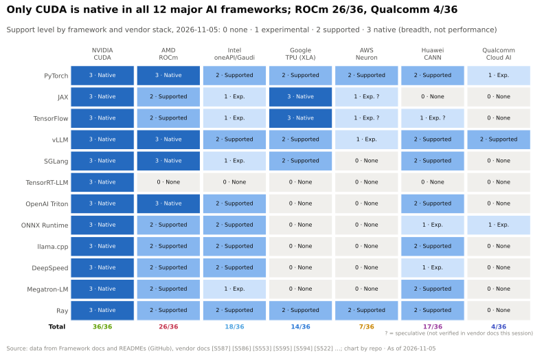
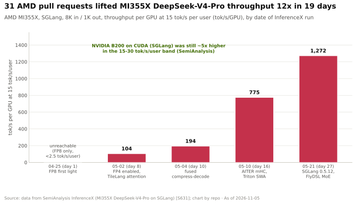
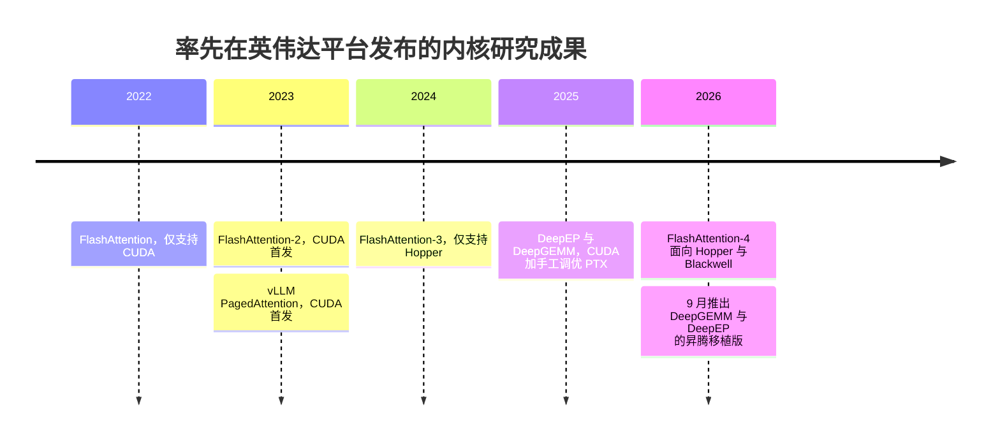
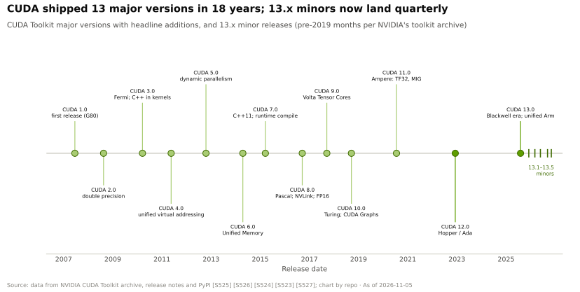
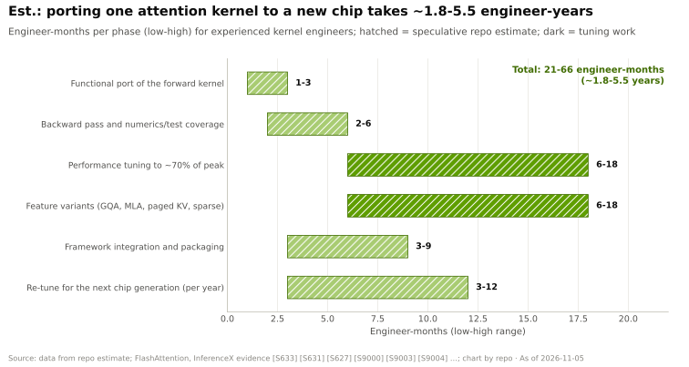

# 为何护城河在于长尾

> [!NOTE]
> 本页为英文原文的简体中文参考译文，仅供参考；如有出入，以[英文原文](../../../layers/09-cuda-and-system-software/the-long-tail-moat.md "English original")为准。

第 09 层 · CUDA 与系统软件 · 阅读约 10 分钟 · 最后核实：2026-11-05

## ⚡ 要点速览

- **护城河在于覆盖广度。** 在本资料库跟踪的全部 12 个主流 AI 框架与推理引擎中，[CUDA](../../../glossary.md#cuda) 均获原生支持（36/36）；[ROCm](../../../glossary.md#rocm) 得分为 26，华为 CANN 为 17，谷歌（Google）TPU 为 14，高通（Qualcomm）Cloud AI 为 4 [[S587]](../../../sources/bibliography.md#s587)[[S580]](../../../sources/bibliography.md#s580)[[S582]](../../../sources/bibliography.md#s582)[[S586]](../../../sources/bibliography.md#s586)[[S596]](../../../sources/bibliography.md#s596)。
- **新模型首日（Day 0）即可在 CUDA 上运行。** DeepSeek-V4-Pro（2026-04-24 发布）在 vLLM 和 [SGLang](../../../glossary.md#sglang) 中原生运行于 CUDA。在 AMD MI355X 上，[FP4](../../../glossary.md#fp4) 用了 8 天才可用，达到每用户 50 tokens/s 的服务水平用了 27 天 [[S633]](../../../sources/bibliography.md#s633)[[S631]](../../../sources/bibliography.md#s631)。
- **竞争对手如今只需数周而非数个季度就能追上。** AMD 在 26 天内通过 31 个拉取请求（pull request）将 MI355X 的吞吐量提升了 110 倍，但在同等交互速度下，B200 仍领先约 5 倍 [[S631]](../../../sources/bibliography.md#s631)。
- **研究成果率先落地英伟达平台。** FlashAttention 1–4 全部首发于英伟达 GPU。FA4 面向 Hopper 和 Blackwell，在 B200 上最高比 [Triton](../../../glossary.md#triton) 快 2.7 倍；AMD 有 FA2 级别的内核，但没有 FA4 [[S9000]](../../../sources/bibliography.md#s9000)[[S9004]](../../../sources/bibliography.md#s9004)。
- **移植工作主要是调优。** 🔴 估计：一个 FlashAttention 级别的内核，每款新芯片约需 1.8–5.5 工程师·年，外加每年的重新调优。
- **弱点：** 自 GTC 2025 以来，英伟达公布的开发者数量一直持平于约 600 万 [[S536]](../../../sources/bibliography.md#s536)[[S528]](../../../sources/bibliography.md#s528)，且在预算充足的领域长尾正在变薄。AMD 对 MiniMax-M3 的分离式服务在首日就已落地；而当年追平 DeepSeek-R1 用了数月 [[S627]](../../../sources/bibliography.md#s627)。

## 1. 数以千计的内核，且每个模型都在增加

一个模型是由数百个算子构成的计算图，而每一种“算子 × 数据类型 × 形状 × GPU 代际”的组合都是一个独立的调优问题。所有厂商都能覆盖头部（稠密矩阵乘法、标准注意力）。**长尾**则是竞争对手退回到缓慢通用代码的地方：新的注意力变体、[混合专家模型（MoE）](../../../glossary.md#mixture-of-experts)路由、FP4 格式、KV 缓存传输，以及让这一切能够顺利安装的打包工作。在 DeepSeek-V4-Pro 发布首日，AMD 的 ATOM 引擎几乎所有热点路径都在走回退（fallback）实现 [[S633]](../../../sources/bibliography.md#s633)。

> [!TIP]
> **算例 —— 为何小小的长尾决定胜负。** 某挑战者在占运行时间 90% 的矩阵乘法上与英伟达打平，但其余 10% 回退到慢 10 倍的内核上。运行时间就变成英伟达的 0.9 + 10 × 0.1 = **1.9×**。**结论：** 买家以最慢的那个重要内核来评判平台，而决定是哪一个的，正是长尾。

需要注意的是：英伟达自家的 [TensorRT-LLM](../../../glossary.md#tensorrt-llm) 在一周多的时间里悄无声息地输出了损坏的 V4-Pro 结果，因此 CUDA 的领先实际上是由开源引擎撑起的；华为之所以能做到首日支持，是因为该模型部分针对昇腾（Ascend）进行了协同设计 [[S633]](../../../sources/bibliography.md#s633)。

> [!TIP]
> **算例 —— 一个模型在第二平台上的成本。** AMD 的冲刺由四名主要贡献者在 **26 天**内提交了 **31 个拉取请求**，把首次跑通时每 GPU 20.4 tokens/s 的速度提升到 2,256 tokens/s（**110.5×**）[[S631]](../../../sources/bibliography.md#s631)。这相当于约 4 × 26 ÷ 365 ≈ **0.3 工程师·年**，仅针对一款芯片上的一个模型，还不包括合并到上游的工作，且仍落后 B200 约 5 倍。**结论：** AMD 能在数周内弥合大部分差距，但前沿模型每隔几周就会发布一个。这条护城河不是一堵墙，而是对每个模型征收的*时间税*。

🔧 技术细节：长尾为何如此之长

- **融合让内核数量成倍增加。** 每一种融合组合（RoPE 与 Hadamard 融合、归一化与量化融合）都是一个新内核；AMD 的分支为此新增了五六个 [[S631]](../../../sources/bibliography.md#s631)。
- **系统层代码同样重要。** LMCache 的 CacheBlend 依赖仅支持 CUDA 的 FlashInfer，Mooncake 没有 ROCm wheel 包，而 vLLM 卸载功能所需的批量拷贝 API 直到 ROCm 7.14 才可用 [[S627]](../../../sources/bibliography.md#s627)。
- **正确性问题会让人吃亏。** AMD 的 [FP8](../../../glossary.md#fp8) 编码（e4m3fnuz）与英伟达的（e4m3fn）不同，在首日导致 MiniMax-M3 的 [KV 缓存](../../../glossary.md#kv-cache)损坏，直到修复为止 [[S627]](../../../sources/bibliography.md#s627)。

## 2. 新研究成果率先落地 CUDA

| 创新成果 | 首发平台 | 其他平台情况（2026 年 11 月） |
|---|---|---|
| [FlashAttention](../../../glossary.md#flashattention)-2（2023） | 英伟达 Ampere–Hopper [[S9000]](../../../sources/bibliography.md#s9000) | AMD 通过 Composable Kernel 和 Triton 支持 [[S9000]](../../../sources/bibliography.md#s9000) |
| FlashAttention-3（2024） | 仅英伟达 Hopper [[S9003]](../../../sources/bibliography.md#s9003) | 在 AMD 上仅通过 Triton 提供 FP8 接口 [[S9000]](../../../sources/bibliography.md#s9000) |
| FlashAttention-4（2026） | 英伟达 Hopper 与 Blackwell；2026 年 11 月为 beta 4.0.0b38 [[S9006]](../../../sources/bibliography.md#s9006) | 无 |
| PagedAttention / [vLLM](../../../glossary.md#vllm)（2023） | CUDA [[S32011]](../../../sources/bibliography.md#s32011) | ROCm 原生；TPU、Gaudi、昇腾通过插件支持 [[S580]](../../../sources/bibliography.md#s580)[[S581]](../../../sources/bibliography.md#s581) |
| DeepEP / DeepGEMM（2025） | CUDA 加 PTX 调优 [[S5005]](../../../sources/bibliography.md#s5005)[[S9010]](../../../sources/bibliography.md#s9010) | 昇腾版本，2026 年 9 月 [[S9009]](../../../sources/bibliography.md#s9009)[[S9010]](../../../sources/bibliography.md#s9010) |

> [!TIP]
> **算例 —— 连英伟达也要等自己的长尾。** B200 于 2024 年第四季度开始批量出货 [[S33003]](../../../sources/bibliography.md#s33003)；FlashAttention-4 的首个 beta 版于 2026-03-05 发布 [[S9006]](../../../sources/bibliography.md#s9006)。FA3 比 H100（2022 年第四季度起出货）晚了约 20 个月 [[S33002]](../../../sources/bibliography.md#s33002)[[S9003]](../../../sources/bibliography.md#s9003)。**结论：** 即使在自家平台上，前沿内核也需要约 15–20 个月。竞争对手的版本起步更晚，而 FA3/FA4 至今根本没有 AMD 移植版。

## 3. 工具、兼容性与使用习惯

- **工具：** Nsight Systems（全系统时间线）、Nsight Compute（对照硬件上限分析单个内核）、cuda-gdb 和 compute-sanitizer，现在也可以从 Python 中调用 [[S9008]](../../../sources/bibliography.md#s9008)。AMD 也有 rocprof 和 ROCgdb [[S586]](../../../sources/bibliography.md#s586)，但在教程和持续集成（CI）中的渗透程度较低。
- **兼容性：** PTX 让旧代码能在新 GPU 上继续运行（[CUDA 是什么](what-cuda-is.md)），功能版本大约每季度发布一次 [[S523]](../../../sources/bibliography.md#s523)。
- **使用习惯：** 英伟达花了十年时间在高校播种；截至 2017 年，其深度学习学院（Deep Learning Institute）已培训超过 10,000 名开发者 [[S9027]](../../../sources/bibliography.md#s9027)。AI 编写内核的基准测试也从 CUDA 起步 [[S9016]](../../../sources/bibliography.md#s9016)。🔴 基于公开代码训练的 AI 编程助手可能会*强化* CUDA 优先的格局。

**[Q2 · 关键指标]**

1. **首日覆盖：** 从重要模型发布到投入生产服务所需的天数。CUDA 为 0；ROCm 对 DeepSeek-V4-Pro 为 8–27 天 [[S633]](../../../sources/bibliography.md#s633)[[S631]](../../../sources/bibliography.md#s631)。
2. **内核效率：** 关键内核达到峰值的比例。FA3 在 H100 上为 75%，FA4 在 B200 上为 71% [[S9003]](../../../sources/bibliography.md#s9003)[[S9004]](../../../sources/bibliography.md#s9004)。
3. **框架覆盖广度：** CUDA 36/36，ROCm 26/36（见上图）。
4. **同等交互速度下的差距：** 第 27 天时 MI355X 落后 B200 约 5 倍 [[S631]](../../../sources/bibliography.md#s631)。
5. **重新调优滞后：** 从 GPU 批量出货到推出调优完成的前沿内核约需 15–20 个月。
6. **开发者与发布节奏：** 约 600 万开发者 [[S528]](../../../sources/bibliography.md#s528)；CUDA 与 ROCm 每年均发布 3–4 个功能版本 [[S523]](../../../sources/bibliography.md#s523)[[S586]](../../../sources/bibliography.md#s586)。

> [!TIP]
> **算例 —— 解读开发者数量图。** 英伟达用了 13 年才达到 100 万开发者，到 2020 年达到 200 万 [[S529]](../../../sources/bibliography.md#s529)，随后到 2025 年增长两倍至约 600 万 [[S536]](../../../sources/bibliography.md#s536)。此后一直引用约 600 万这一数字 [[S528]](../../../sources/bibliography.md#s528)。**结论：** 这一标题漏斗已停止增长，原因可能是新一代 AI 开发者用 [PyTorch](../../../glossary.md#pytorch) 写代码，从不注册 CUDA。🔴

## 4. 算例：移植一个新的注意力内核

> [!TIP]
> **算例 —— 移植长尾所需的工程师·年与资金（估计，🔴）。** 一个 FlashAttention 级别的内核约需 21–66 工程师·月，即 **约 1.8–5.5 工程师·年**。英伟达 FY2026 研发支出 $18.5B，研发人员约 31,000 人 [[S401]](../../../sources/bibliography.md#s401)，意味着 **每名研发人员每年约 $0.6M**（作为上限），因此一个内核在每个平台上的成本为 **约 $1.1–3.3M**。按约 50 个性能关键的内核族（🔴）计算，合计 **约 90–275 工程师·年，即约 $50–165M**，外加每年的重新调优。AMD 在 2024 日历年（CY2024）的研发支出为 $6.5B [[S450]](../../../sources/bibliography.md#s450)。**结论：** 资金不是约束，时间（每个前沿内核 15 个月以上）和稀缺的内核工程师才是。

🔧 技术细节：为何调优占估计工作量的大头

- 一个快速的注意力内核需要在 tile 大小、寄存器压力、共享内存分级暂存，以及数据搬运与张量核心计算的重叠之间取得平衡，例如 FA3 在 Hopper 上的 warp 专用化（warp specialisation）[[S9003]](../../../sources/bibliography.md#s9003)。
- 新硬件会改变最优点（Hopper 的 TMA、Blackwell 的张量内存），这就是 FA2 在 H100 上降至 35% 的原因 [[S9003]](../../../sources/bibliography.md#s9003)。各种变体（分组查询注意力、潜在注意力和稀疏注意力、分页 KV 缓存）都需要各自的快速路径 [[S9000]](../../../sources/bibliography.md#s9000)[[S631]](../../../sources/bibliography.md#s631)。

## 🎯 企业发展视角

1. **买时间，而不是买代码。** 这条护城河是对每个模型、每款芯片征收的时间税。对挑战者而言，内核自动调优工具、编译器团队和 AI 内核智能体比任何单个软件库都更有价值。
2. **瞄准头部。** 专注于少数高流量推理模型的挑战者，可以在关键之处追平 CUDA，并跳过长尾。哪些客户的需求集中到足以支撑这种做法？
3. **关注开源引擎。** 在 DeepSeek-V4 上撑起 CUDA 首日领先优势的是 vLLM 和 SGLang，而不是 TensorRT-LLM，它们的维护者如今都在经营获得融资的公司（Inferact、RadixArk）[[S633]](../../../sources/bibliography.md#s633)。它们是任何硬件厂商的天然合作伙伴。

## 📚 来源（Sources）

<!-- Auto-generated from the [S…] citations on this page by `make build`. Edit sources/registry/*.csv, not this list. -->

- [**S401**](../../../sources/bibliography.md#s401) NVIDIA Corporation via SEC EDGAR, *NVIDIA Corporation Form 10-K for fiscal year ended January 25, 2026*, 2026-02-25. [Link](https://www.sec.gov/Archives/edgar/data/1045810/000104581026000021/nvda-20260125.htm)
- [**S450**](../../../sources/bibliography.md#s450) U.S. Securities and Exchange Commission (EDGAR), *Advanced Micro Devices Form 10-K / 10-Q filings (EDGAR index)*, 2025-02-05. [Link](https://www.sec.gov/cgi-bin/browse-edgar?action=getcompany&CIK=0000002488&type=10-&dateb=&owner=include&count=40)
- [**S523**](../../../sources/bibliography.md#s523) Python Package Index (NVIDIA), *nvidia-cuda-runtime (CUDA 13.x runtime wheels) release history*, 2026-11-04. [Link](https://pypi.org/project/nvidia-cuda-runtime/#history)
- [**S528**](../../../sources/bibliography.md#s528) NVIDIA Developer Forums, *20 Years of CUDA: Honoring the Architects of the Accelerated Age*, 2026-03. [Link](https://forums.developer.nvidia.com/t/20-years-of-cuda-honoring-the-architects-of-the-accelerated-age/364654)
- [**S529**](../../../sources/bibliography.md#s529) NVIDIA Blog (Will Ramey), *2 Million Registered Developers, Countless Breakthroughs*, 2020. [Link](https://blogs.nvidia.com/blog/2-million-registered-developers-breakthroughs/)
- [**S536**](../../../sources/bibliography.md#s536) TechRadar, *Nvidia GTC 2025 — all the news and updates from Jensen Huang's keynote (live blog)*, 2025-03-18. [Link](https://www.techradar.com/pro/live/nvidia-gtc-2025-all-the-news-and-updates-from-jensen-huang-keynote-as-it-happens)
- [**S580**](../../../sources/bibliography.md#s580) vLLM project (GitHub), *vLLM README and installation docs — supported hardware*, 2026-11. [Link](https://github.com/vllm-project/vllm/blob/main/docs/getting_started/installation/README.md)
- [**S581**](../../../sources/bibliography.md#s581) vLLM project (GitHub), *vLLM hardware plugin repositories (tpu-inference/vLLM JAX, vllm-gaudi, vllm-ascend, vllm-neuron)*, 2026-11. [Link](https://github.com/vllm-project)
- [**S582**](../../../sources/bibliography.md#s582) SGLang project (GitHub: sgl-project/sglang), *SGLang README — supported hardware*, 2026-11. [Link](https://github.com/sgl-project/sglang/blob/main/README.md)
- [**S586**](../../../sources/bibliography.md#s586) AMD (GitHub: ROCm/ROCm docs), *ROCm documentation sources: release history, AI-ecosystem compatibility matrix, consolidated changelog*, 2026-08-26. [Link](https://github.com/ROCm/ROCm/blob/develop/docs/release/versions.rst)
- [**S587**](../../../sources/bibliography.md#s587) PyTorch (GitHub: pytorch/pytorch), *PyTorch README — building with CUDA, ROCm and Intel GPU support*, 2026-11. [Link](https://github.com/pytorch/pytorch/blob/main/README.md)
- [**S596**](../../../sources/bibliography.md#s596) Qualcomm (GitHub: quic), *Qualcomm Cloud AI SDK and Efficient Transformers repositories*, 2026-11. [Link](https://github.com/quic/cloud-ai-sdk)
- [**S627**](../../../sources/bibliography.md#s627) SemiAnalysis, *AgentX - InferenceXv3: Does the CUDA Moat Hold Up in Agentic Inferencing?*, 2026-08-24. [Link](https://github.com/SemiAnalysisAI/InferenceX-app/blob/main/packages/app/content/blog/agentx-inferencexv3-does-cuda-moat.mdx)
- [**S631**](../../../sources/bibliography.md#s631) SemiAnalysis, *MI355X DeepSeek-V4-Pro on SGLang: 110.5x Throughput per GPU in 26 Days*, 2026-05-26. [Link](https://github.com/SemiAnalysisAI/InferenceX-app/blob/main/packages/app/content/blog/mi355x-deepseek-v4-pro-sglang-110x-in-26-days.mdx)
- [**S633**](../../../sources/bibliography.md#s633) SemiAnalysis, *DeepSeekV4 1.6T Day 0 to Day 43 Performance Over Time — Huawei, GB300 NVL72, MI355X, B200*, 2026-06-09. [Link](https://github.com/SemiAnalysisAI/InferenceX-app/blob/main/packages/app/content/blog/deepseekv4-16t-day-0-to-day-43-performance.mdx)
- [**S5005**](../../../sources/bibliography.md#s5005) DeepSeek-AI (GitHub) (DeepSeek-AI), *DeepEP: an efficient expert-parallel communication library (README v1.2.1)*, 2025. [Link](https://github.com/deepseek-ai/DeepEP/blob/v1.2.1/README.md)
- [**S9000**](../../../sources/bibliography.md#s9000) Dao-AILab (GitHub) (Tri Dao et al.), *FlashAttention repository README (FlashAttention-2, -3 and -4; NVIDIA CUDA and AMD ROCm support)*, 2026-11. [Link](https://github.com/Dao-AILab/flash-attention/blob/main/README.md)
- [**S9003**](../../../sources/bibliography.md#s9003) arXiv:2407.08608 (NeurIPS 2024) (Jay Shah, Ganesh Bikshandi, Ying Zhang, Vijay Thakkar, Pradeep Ramani, Tri Dao), *FlashAttention-3: Fast and Accurate Attention with Asynchrony and Low-precision*, 2024-07-11. [Link](https://arxiv.org/abs/2407.08608)
- [**S9004**](../../../sources/bibliography.md#s9004) arXiv:2603.05451 (Zadouri, Hoehnerbach, Shah, Liu, Thakkar, Dao), *FlashAttention-4: Algorithm and Kernel Pipelining Co-Design for Asymmetric Hardware Scaling*, 2026-03. [Link](https://arxiv.org/abs/2603.05451)
- [**S9006**](../../../sources/bibliography.md#s9006) Python Package Index, *PyPI JSON release histories (flash-attn, flash-attn-4, triton, cuda-tile, cuda-python, modular, mojo, tilelang)*, 2026-11-05. [Link](https://pypi.org/)
- [**S9008**](../../../sources/bibliography.md#s9008) NVIDIA (GitHub: NVIDIA/cuda-python), *CUDA Python README (cuda-python metapackage)*, 2026-11. [Link](https://github.com/NVIDIA/cuda-python/blob/main/README.md)
- [**S9009**](../../../sources/bibliography.md#s9009) DeepSeek-AI (GitHub) (DeepSeek-AI), *DeepEP README (main branch: V2.5 and Ascend version)*, 2026-11. [Link](https://github.com/deepseek-ai/DeepEP/blob/main/README.md)
- [**S9010**](../../../sources/bibliography.md#s9010) DeepSeek-AI (GitHub) (DeepSeek-AI), *DeepGEMM README*, 2026-09-30. [Link](https://github.com/deepseek-ai/DeepGEMM/blob/main/README.md)
- [**S9016**](../../../sources/bibliography.md#s9016) Stanford Scaling Intelligence Lab (GitHub; arXiv:2502.10517) (Ouyang et al.), *KernelBench: Can LLMs Write Efficient GPU Kernels? (README; ICML 2025)*, 2025-02. [Link](https://github.com/ScalingIntelligence/KernelBench)
- [**S9027**](../../../sources/bibliography.md#s9027) NVIDIA Newsroom, *NVIDIA to Train 100,000 Developers on Deep Learning in 2017*, 2017-05. [Link](https://nvidianews.nvidia.com/news/nvidia-to-train-100-000-developers-on-deep-learning-in-2017)
- [**S32011**](../../../sources/bibliography.md#s32011) SOSP 2023 (arXiv 2309.06180) (Kwon et al.), *Efficient Memory Management for Large Language Model Serving with PagedAttention (vLLM)*, 2023-09. [Link](https://arxiv.org/abs/2309.06180)
- [**S33002**](../../../sources/bibliography.md#s33002) NVIDIA, *NVIDIA H100 Tensor Core GPU (product page and datasheet)*, 2022-03-22. [Link](https://www.nvidia.com/en-us/data-center/h100/)
- [**S33003**](../../../sources/bibliography.md#s33003) Lenovo Press, *ThinkSystem NVIDIA B200 180GB 1000W GPU product guide*, 2025. [Link](https://lenovopress.lenovo.com/lp2226-thinksystem-nvidia-b200-180gb-1000w-gpu)
