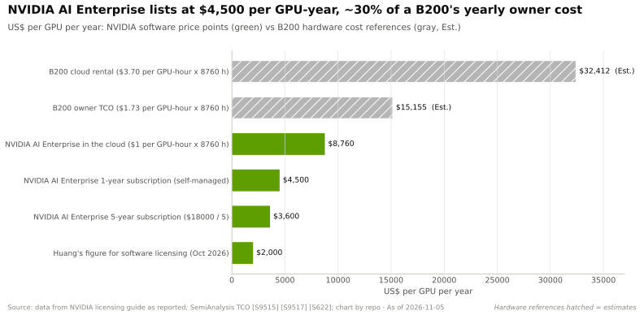
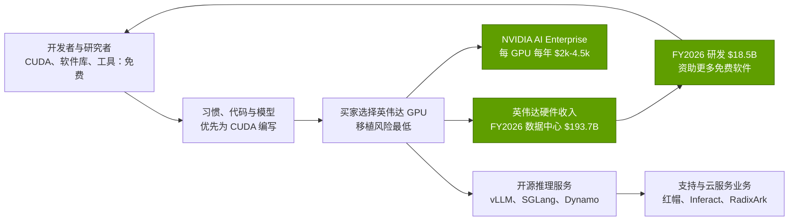

# CUDA 与系统软件：价值链与企业发展视角

> [!NOTE]
> 本页为英文原文的简体中文参考译文，仅供参考；如有出入，以[英文原文](../../../layers/09-cuda-and-system-software/value-chain-and-corp-dev.md "English original")为准。

第 09 层 · CUDA 与系统软件 · 阅读约 11 分钟 · 最后核实：2026-11-05

## ⚡ 要点速览

- **[CUDA](../../../glossary.md#cuda) 是免费的，这正是关键所在。** 英伟达通过[硬件带动销售（pull-through）](../../../glossary.md#pull-through)间接从中获利：FY2026 数据中心营收达 $193.7B [[S1]](../../../sources/bibliography.md#s1)[[S402]](../../../sources/bibliography.md#s402)。
- **直接软件收入很小。** 软件与服务在 Q4 FY2024 达到约 $1B 的年化收入水平 [[S9516]](../../../sources/bibliography.md#s9516)。NVIDIA AI Enterprise 的标价为每 GPU 每年 $4,500（云上为每 [GPU 小时](../../../glossary.md#gpu-hour) $1），黄仁勋在 2026 年 10 月将软件授权费定在每 GPU 每年约 $2,000 [[S9515]](../../../sources/bibliography.md#s9515)[[S9517]](../../../sources/bibliography.md#s9517)。
- **软件层已成为一个并购市场。** 2023 至 2026 年间，芯片厂商完成了 15 笔 AI 软件交易，而 2008–2022 年间本资料库跟踪到的仅有 3 笔。仅 AMD 一家就收购了 Nod.ai、Silo AI（$665M）、Brium、MK1 以及 Untether AI 团队 [[S9508]](../../../sources/bibliography.md#s9508)[[S9506]](../../../sources/bibliography.md#s9506)[[S9507]](../../../sources/bibliography.md#s9507)[[S9509]](../../../sources/bibliography.md#s9509)。
- **价格正在快速上涨。** 高通（Qualcomm）为 Modular 支付的约 $3.9B，约为英伟达最大一笔软件补强收购（Run:ai，据报道约 $700M）的 5.6 倍，约为 Modular 2025 年 9 月估值的 2.4 倍 [[S90057]](../../../sources/bibliography.md#s90057)[[S479]](../../../sources/bibliography.md#s479)[[S9510]](../../../sources/bibliography.md#s9510)。
- **独立标的所剩无几。** 英伟达收购了 OctoAI、Deci 和 CentML；红帽（Red Hat）收购了 Neural Magic。剩下的主要是开源维护者（[vLLM](../../../glossary.md#vllm) 的 Inferact、[SGLang](../../../glossary.md#sglang) 的 RadixArk）和早期编译器初创公司 [[S478]](../../../sources/bibliography.md#s478)[[S9533]](../../../sources/bibliography.md#s9533)[[S633]](../../../sources/bibliography.md#s633)。
- **[Q8 · 价值池与并购机会]** 价值围绕英伟达硬件聚集，而不是软件本身。对挑战者而言，软件是*入场成本*：值得拥有的资产是那些能缩短[首日（Day 0）](../../../glossary.md#day-zero-support)差距的资产（编译器团队、内核库、对上游维护的影响力），而不是能产生授权收入的资产 🔴。

## 谁拿走了钱

数据来源：[[S1]](../../../sources/bibliography.md#s1)[[S401]](../../../sources/bibliography.md#s401)[[S9515]](../../../sources/bibliography.md#s9515)[[S9517]](../../../sources/bibliography.md#s9517)；开源公司 [[S9533]](../../../sources/bibliography.md#s9533)[[S633]](../../../sources/bibliography.md#s633)。

| 价值池 | 由谁获取 | 规模参照 | 趋势 |
|---|---|---|---|
| 硬件带动销售 | 英伟达 | FY2026 数据中心 $193.7B [[S1]](../../../sources/bibliography.md#s1) | 🟢 增长中；在可移植层让 GPU 变得可替换的领域面临风险 |
| 企业软件授权 | 英伟达（AI Enterprise） | Q4 FY2024 年化收入约 $1B [[S9516]](../../../sources/bibliography.md#s9516)；每 GPU 每年 $2,000–4,500 [[S9517]](../../../sources/bibliography.md#s9517)[[S9515]](../../../sources/bibliography.md#s9515) | 🟡 规模小，依附于企业和主权客户 |
| 开源推理服务支持 | 红帽（Neural Magic）、Inferact、RadixArk | 维护者融资达“数亿美元” [[S633]](../../../sources/bibliography.md#s633) | 🟡 由厂商中立的引擎催生的新价值池 |
| 编译器与语言平台 | Modular → 高通；Triton（非商业） | 收购价约 $3.9B [[S90057]](../../../sources/bibliography.md#s90057) | 🔴 作为战略资产而非收入来源来估值 |
| 超大规模云厂商内部软件栈 | 谷歌、AWS、华为 | 无直接收入；降低芯片总拥有成本（TCO） | 🟢 已于 2025–2026 年开源 [[S553]](../../../sources/bibliography.md#s553)[[S9525]](../../../sources/bibliography.md#s9525)[[S9524]](../../../sources/bibliography.md#s9524) |
| GPU 云市场 | 英伟达 DGX Cloud Lepton、新兴云服务商 | 该市场于 2025 年 5 月上线 [[S598]](../../../sources/bibliography.md#s598) | 🟡 让开发者留在英伟达优先的云上 |

> [!TIP]
> **算例 —— 为什么英伟达不需要为 CUDA 收费。** 按黄仁勋提出的每 GPU 每年约 $2,000 计算，100 万颗获得授权的 GPU 每年可带来约 $2B 收入 [[S9517]](../../../sources/bibliography.md#s9517)。这只相当于 FY2026 数据中心营收（$193.7B）的约 1% [[S1]](../../../sources/bibliography.md#s1)。按单颗 GPU 计，AI Enterprise 的标价（$4,500）约相当于 B200 每年约 $15,155 所有者成本的 30% [[S9515]](../../../sources/bibliography.md#s9515)[[S622]](../../../sources/bibliography.md#s622)。如此大范围收费会促使客户去比较各家软件栈，而硬件已经赚到了此类授权费约 100 倍的收入。

🔧 技术细节：AI Enterprise 实际卖的是什么

该授权将英伟达 AI 软件中受支持、经过安全补丁的构建版本与企业级支持打包，按 GPU 定价 [[S9515]](../../../sources/bibliography.md#s9515)。CUDA、cuDNN 以及开源项目（[Dynamo](../../../glossary.md#dynamo)、[TensorRT-LLM](../../../glossary.md#tensorrt-llm)、Megatron）仍可免费下载。企业付费购买的是*支持与认证*，就像购买红帽 Linux 一样，而不是代码本身。因此买家很可能是企业和主权项目，而不是能够自我支持的[超大规模云厂商](../../../glossary.md#hyperscaler) 🔴。

## 软件层的并购历史

三家收购方遵循不同的策略：

- **英伟达收购“消除摩擦者”：** 让其 GPU 更易于调度（Run:ai、SchedMD）、更易于优化（Deci、OctoAI、CentML）或更易于租用（Brev.dev、Lepton）的工具；Run:ai 在欧盟审查后被开源 [[S476]](../../../sources/bibliography.md#s476)[[S478]](../../../sources/bibliography.md#s478)。
- **AMD 收购“追赶能力”：** 编译器与推理团队（Nod.ai、Brium、MK1），以及在 AMD 平台上构建开源模型的实验室 Silo AI（$665M）[[S9508]](../../../sources/bibliography.md#s9508)[[S9507]](../../../sources/bibliography.md#s9507)[[S9509]](../../../sources/bibliography.md#s9509)[[S9506]](../../../sources/bibliography.md#s9506)。
- **高通下了一个大注：** 一门语言（[Mojo](../../../glossary.md#mojo)）、一个推理框架（MAX），以及创始人 Chris Lattner——他现任高通执行副总裁 [[S9511]](../../../sources/bibliography.md#s9511)。

> [!TIP]
> **算例 —— 一支软件团队的价格。** Silo AI 花费了 AMD $665M [[S9506]](../../../sources/bibliography.md#s9506)；Modular 花费了高通约 $3.9B，约为其累计融资 $380M 的 10 倍 [[S90057]](../../../sources/bibliography.md#s90057)[[S9510]](../../../sources/bibliography.md#s9510)。据报道，英伟达同类补强收购的单笔金额在 $250–700M 之间 [[S479]](../../../sources/bibliography.md#s479)。Modular 的溢价买到的是一门语言和运行时，而不只是工程师；这是否值 Run:ai 的约 5.6 倍，取决于其采用情况，而目前采用规模仍然很小（[竞争格局](competition.md)）。

### 值得关注的非上市公司（仅基于公开信息）

| 公司 | 业务 | 阶段 / 最近一次公开融资 | 重要意义 |
|---|---|---|---|
| Tenstorrent | 采用开源软件栈（TT-Metalium、TT-NN）的 RISC-V AI 芯片 | $693M D 轮（2024 年 12 月）[[S2509]](../../../sources/bibliography.md#s2509)；据报道约 $1.5B E 轮，估值约 $6.2B 🟡 [[S4535]](../../../sources/bibliography.md#s4535) | 检验开源内核能否吸引外部开发者 [[S9535]](../../../sources/bibliography.md#s9535) |
| Inferact（vLLM） | 由 vLLM 维护者创立的公司 | 融资“数亿美元” 🟡 [[S633]](../../../sources/bibliography.md#s633) | 掌控使用最广泛的中立推理服务引擎 [[S580]](../../../sources/bibliography.md#s580) |
| RadixArk（SGLang） | 由 SGLang 维护者创立的公司 | 融资“数亿美元” 🟡 [[S633]](../../../sources/bibliography.md#s633) | 第二个中立引擎；在大型 MoE 模型上表现突出 [[S582]](../../../sources/bibliography.md#s582) |
| Luminal | 加速 PyTorch 推理的机器学习编译器 | $5.3M 种子轮（2025 年 11 月）🟡 [[S9534]](../../../sources/bibliography.md#s9534) | 面向 PyTorch 用户的种子期编译器团队 |
| tiny corp（tinygrad） | 极简的端到端深度学习软件栈与编译器 | 融资情况未经核实 | 展示了极小团队也能写出完整软件栈 [[S9536]](../../../sources/bibliography.md#s9536) |
| Groq（授权交易后） | 推理芯片与编译器；核心团队已加入英伟达 | 在英伟达约 $20B 授权交易前估值约 $6.9B（2025 年 9 月）🟡 [[S90019]](../../../sources/bibliography.md#s90019) | 一种英伟达选择授权获取的编译器优先设计 [[S90018]](../../../sources/bibliography.md#s90018) |

**[Q8 · 价值池与并购机会]** 在这一层，资金流向拥有*默认地位*的一方：英伟达，通过硬件带动销售获利。对其他所有人而言，软件是一种需要获取的能力（通常以[收购式招聘（acquihire）](../../../glossary.md#acquihire)的方式），而非利润池。其价值以消除了多少天的首日滞后、支持了多少框架来衡量。独立团队的供给正在萎缩：自 2023 年以来，至少有九支推理优化和编译器团队归入了英伟达、AMD、红帽或高通 [[S478]](../../../sources/bibliography.md#s478)[[S9508]](../../../sources/bibliography.md#s9508)[[S9507]](../../../sources/bibliography.md#s9507)[[S9509]](../../../sources/bibliography.md#s9509)[[S9533]](../../../sources/bibliography.md#s9533)[[S9511]](../../../sources/bibliography.md#s9511)。剩下的独立资产是维护者公司和小型编译器初创公司。与它们合作（资助上游、联合 CI、共同维护）可能比控制它们更重要 🔴。

## 🎯 企业发展视角

1. **自建、收购还是合作？** 在收购 Modular 之后，还剩下什么差距：首日模型支持、框架覆盖广度，还是开发者触达？三者中哪一项仍然可以买到而不必自建？
2. **中立引擎。** 入股或赞助 Inferact 或 RadixArk，能否比 AMD ATOM 这样的自研分支以更低成本换取对新芯片的早期支持？这又是否会让这些项目所服务的其他硬件厂商感到警惕？
3. **变现方式。** 挑战者应当完全免费提供软件栈（CUDA 模式），还是像 NVIDIA AI Enterprise 那样按每个加速器收费（每 GPU 每年 $2,000–4,500）？
4. **人才留存。** AMD 的追赶型交易大多是编译器团队；什么样的留任安排能在整合后留住他们？
5. **监管带来的期权价值。** 如果反垄断救济措施强制要求 CUDA 互操作性，哪些资产（转译层、编译器、基准测试）的价值提升最大？

## 📚 来源（Sources）

<!-- Auto-generated from the [S…] citations on this page by `make build`. Edit sources/registry/*.csv, not this list. -->

- [**S1**](../../../sources/bibliography.md#s1) NVIDIA Corporation via SEC EDGAR, *NVIDIA Announces Financial Results for Fourth Quarter and Fiscal 2026 (Form 8-K exhibit 99.1)*, 2026-02-25. [Link](https://www.sec.gov/Archives/edgar/data/1045810/000104581026000019/q4fy26pr.htm)
- [**S401**](../../../sources/bibliography.md#s401) NVIDIA Corporation via SEC EDGAR, *NVIDIA Corporation Form 10-K for fiscal year ended January 25, 2026*, 2026-02-25. [Link](https://www.sec.gov/Archives/edgar/data/1045810/000104581026000021/nvda-20260125.htm)
- [**S402**](../../../sources/bibliography.md#s402) NVIDIA Corporation via SEC EDGAR (Colette Kress), *CFO Commentary on Fourth Quarter and Fiscal 2026 Results (Form 8-K exhibit 99.2)*, 2026-02-25. [Link](https://www.sec.gov/Archives/edgar/data/1045810/000104581026000019/q4fy26cfocommentary.htm)
- [**S476**](../../../sources/bibliography.md#s476) NVIDIA Blog, *NVIDIA to Acquire GPU Orchestration Software Provider Run:ai*, 2024-04-24. [Link](https://blogs.nvidia.com/blog/runai/)
- [**S478**](../../../sources/bibliography.md#s478) NVIDIA, *NVIDIA Blog and Newsroom acquisition announcements (Cumulus, SwiftStack, DeepMap, Bright Computing, Excelero, Shoreline, Brev.dev, OctoAI, VinBrain, Gretel, Lepton AI, CentML, SchedMD)*, 2025-12. [Link](https://blogs.nvidia.com/)
- [**S479**](../../../sources/bibliography.md#s479) Various (press), *Reporting on NVIDIA tuck-in acquisition prices (Run:ai, Deci, Shoreline, OctoAI, Gretel, Lepton, CentML) — The Information, Calcalist, Reuters, CNBC*, 2025-06. [Link](https://www.reuters.com/technology/)
- [**S553**](../../../sources/bibliography.md#s553) Google Cloud Blog (Alex Barrett), *What's new in AI infrastructure and orchestration in October*, 2026-11. [Link](https://cloud.google.com/blog/topics/ai-infrastructure/whats-new-in-ai-infrastructure-this-month)
- [**S580**](../../../sources/bibliography.md#s580) vLLM project (GitHub), *vLLM README and installation docs — supported hardware*, 2026-11. [Link](https://github.com/vllm-project/vllm/blob/main/docs/getting_started/installation/README.md)
- [**S582**](../../../sources/bibliography.md#s582) SGLang project (GitHub: sgl-project/sglang), *SGLang README — supported hardware*, 2026-11. [Link](https://github.com/sgl-project/sglang/blob/main/README.md)
- [**S598**](../../../sources/bibliography.md#s598) NVIDIA Newsroom, *NVIDIA Announces DGX Cloud Lepton to Connect Developers to NVIDIA's Global Compute Ecosystem*, 2025-05-18. [Link](https://nvidianews.nvidia.com/news/nvidia-announces-dgx-cloud-lepton-to-connect-developers-to-nvidias-global-compute-ecosystem)
- [**S622**](../../../sources/bibliography.md#s622) SemiAnalysis (InferenceX-app repository), *InferenceX hardware registry: TCO per GPU-hour by SKU (SemiAnalysis July 2026 pricing surveys and AI Cloud TCO Model)*, 2026-07. [Link](https://github.com/SemiAnalysisAI/InferenceX-app/blob/main/packages/constants/src/gpu-keys.ts)
- [**S633**](../../../sources/bibliography.md#s633) SemiAnalysis, *DeepSeekV4 1.6T Day 0 to Day 43 Performance Over Time — Huawei, GB300 NVL72, MI355X, B200*, 2026-06-09. [Link](https://github.com/SemiAnalysisAI/InferenceX-app/blob/main/packages/app/content/blog/deepseekv4-16t-day-0-to-day-43-performance.mdx)
- [**S2509**](../../../sources/bibliography.md#s2509) TechPowerUp, *Tenstorrent closes $693M+ of Series D funding led by Samsung Securities and AFW Partners*, 2024-12-02. [Link](https://techpowerup.com/329396/tenstorrent-closes-usd-693m-of-series-d-funding-led-by-samsung-securities-and-afw-partners)
- [**S4535**](../../../sources/bibliography.md#s4535) GCN, *Tenstorrent raises $1.5 billion to challenge Nvidia on AI chips*, 2026. [Link](https://gcn.com/?p=22745)
- [**S9506**](../../../sources/bibliography.md#s9506) Converge Digest, *AMD completes $665 million acquisition of Silo AI*, 2024-08. [Link](https://convergedigest.com/amd-completes-665-million-acquisition-of-silo-ai/?amp=1)
- [**S9507**](../../../sources/bibliography.md#s9507) DatacenterDynamics, *AMD extends acquisition run: brings software optimization firm Brium and staff from recently shuttered Untether AI into the fold*, 2025-06. [Link](https://www.datacenterdynamics.com/en/news/amd-extends-acquisition-run-brings-software-optimization-firm-brium-and-staff-from-recently-shuttered-untether-ai-into-the-fold/)
- [**S9508**](../../../sources/bibliography.md#s9508) PrivSource (deal record of AMD press release), *AMD to Acquire Nod.ai to Expand Open-Source AI Software Capabilities*, 2023-10. [Link](https://www.privsource.com/acquisitions/deal/amd-to-acquire-nod-ai-to-expand-open-source-ai-software-capabilities-bWSr8y)
- [**S9509**](../../../sources/bibliography.md#s9509) PrivSource (deal record), *AMD Acquires MK1*, 2025-11. [Link](https://www.privsource.com/acquisitions/deal/y3S4jb)
- [**S9510**](../../../sources/bibliography.md#s9510) SDxCentral, *Modular raises $250M for AI's unified compute layer at $1.6B valuation*, 2025-09-24. [Link](https://www.sdxcentral.com/news/modular-raises-250m-for-ais-unified-compute-layer-at-16b-valuation/)
- [**S9511**](../../../sources/bibliography.md#s9511) Nasdaq (Qualcomm press release), *Qualcomm Completes Acquisition of Modular*, 2026-07-29. [Link](https://www.nasdaq.com/press-release/qualcomm-completes-acquisition-modular-2026-07-29)
- [**S9515**](../../../sources/bibliography.md#s9515) The Register (Tobias Mann), *Nvidia's software empire (NVIDIA AI Enterprise licensing)*, 2024-08-06. [Link](https://www.theregister.com/2024/08/06/nvidia_software_empire/)
- [**S9516**](../../../sources/bibliography.md#s9516) MarketBeat, *NVIDIA Q4 FY2024 earnings call transcript*, 2024-02-21. [Link](https://www.marketbeat.com/earnings/reports/2024-2-21-nvidia-co-stock)
- [**S9517**](../../../sources/bibliography.md#s9517) TechSpot, *Nvidia's AI chips already make billions; now Jensen Huang wants $2,000 per GPU in annual software fees*, 2026-10. [Link](https://www.techspot.com/news/114333-nvidia-ai-chips-already-make-billions-now-jensen.html)
- [**S9524**](../../../sources/bibliography.md#s9524) TrendForce, *Huawei open-sources CANN toolkit for Ascend AI GPUs; taking aim at Nvidia's CUDA*, 2025-08-07. [Link](https://www.trendforce.com/news/2025/08/07/news-huawei-open-sources-cann-toolkit-for-ascend-ai-gpus-taking-aim-at-nvidias-cuda/)
- [**S9525**](../../../sources/bibliography.md#s9525) AWS Neuron SDK docs, *AWS Neuron documentation: PyTorch on Neuron (TorchNeuron) and NKI*, 2026. [Link](https://awsdocs-neuron.readthedocs-hosted.com/en/latest/_sources/torch/index.rst)
- [**S9533**](../../../sources/bibliography.md#s9533) Red Hat Blog, *FAQ: Red Hat to acquire Neural Magic*, 2024-11-12. [Link](https://www.redhat.com/en/blog/red-hat-acquire-neural-magic-FAQ)
- [**S9534**](../../../sources/bibliography.md#s9534) Pulse (venture deals), *Luminal secures $5.3M seed round led by Felicis*, 2025-11-20. [Link](https://www.pulse.bot/venture-capital/deals/luminal-secures-53m-seed-round-led-by-felicis-78d26e9e-5e3c-454a-b29c-ee001f227446)
- [**S9535**](../../../sources/bibliography.md#s9535) Tenstorrent (GitHub), *tt-metal README and Apache-2.0 licence (TT-NN / TT-Metalium)*, 2026-11. [Link](https://github.com/tenstorrent/tt-metal)
- [**S9536**](../../../sources/bibliography.md#s9536) tiny corp (GitHub: tinygrad/tinygrad), *tinygrad README*, 2026-11. [Link](https://github.com/tinygrad/tinygrad)
- [**S90018**](../../../sources/bibliography.md#s90018) Constellation Research, *Nvidia's Groq deal: acquisition, acquihire or creative licensing deal?*, 2025-12. [Link](https://www.constellationr.com/insights/news/nvidias-groq-deal-acquisition-acquihire-or-creative-licensing-deal)
- [**S90019**](../../../sources/bibliography.md#s90019) TechSpot, *Nvidia's $20 billion Groq deal looks a lot like an acquisition*, 2025-12. [Link](https://www.techspot.com/news/110723-nvidia-20-billion-groq-deal-looks-lot-like.html)
- [**S90057**](../../../sources/bibliography.md#s90057) StorageReview, *Qualcomm unveils Dragonfly data center roadmap: C1000 CPU, AI300 accelerator and Modular acquisition*, 2026-06-24. [Link](https://www.storagereview.com/es/news/qualcomm-unveils-dragonfly-data-center-roadmap-c1000-cpu-ai300-accelerator-and-modular-acquisition)
