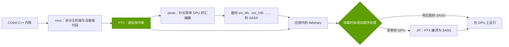
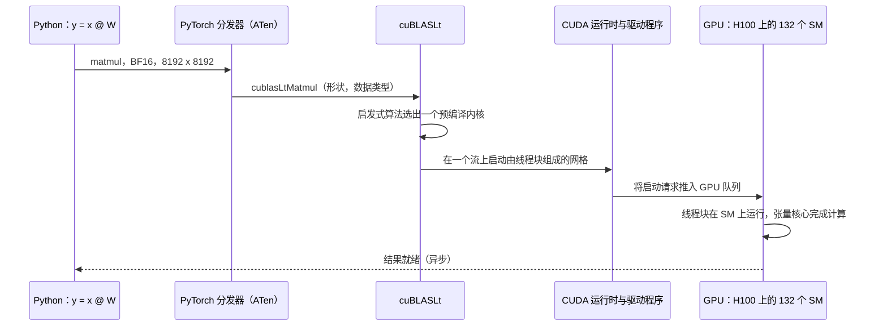
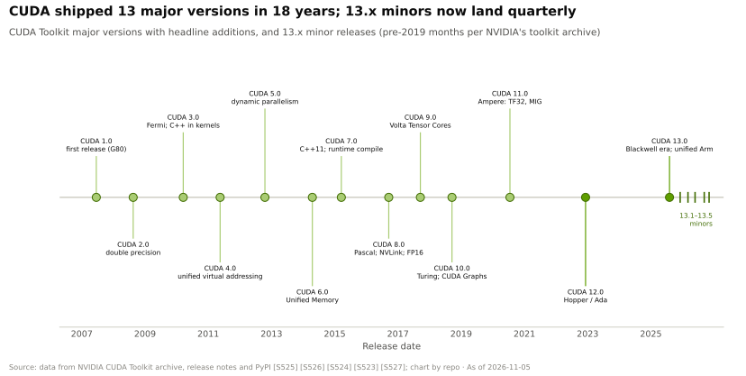

# CUDA 究竟是什么

> [!NOTE]
> 本页为英文原文的简体中文参考译文，仅供参考；如有出入，以[英文原文](../../../layers/09-cuda-and-system-software/what-cuda-is.md "English original")为准。

第 09 层 · CUDA 与系统软件 · 阅读约 9 分钟 · 最后核实：2026-11-05

## ⚡ 要点速览

- **[CUDA](../../../glossary.md#cuda) 是一整套软件栈，而不是一门语言：** 它包括编程模型、C++ 扩展、[nvcc](../../../glossary.md#nvcc) 编译器、[PTX](../../../glossary.md#ptx) 虚拟指令集、运行时、驱动程序、工具和软件库。首个工具包于 2007 年 6 月发布 [[S525]](../../../sources/bibliography.md#s525)。
- **核心思想：** 一个[内核（kernel）](../../../glossary.md#gpu-kernel)就是一份菜谱，由成千上万名厨师同时执行，每人处理自己的那一份食材。一颗 H100 可在 132 个[流式多处理器（SM）](../../../glossary.md#streaming-multiprocessor)上同时驻留约 270,000 个这样的线程 [[S33024]](../../../sources/bibliography.md#s33024)[[S2022]](../../../sources/bibliography.md#s2022)。
- **PTX 是兼容性引擎。** 应用程序在机器码（[SASS](../../../glossary.md#sass)）旁一并附带 PTX，这样较新的驱动程序就能为发布时尚不存在的 GPU 编译它。针对 `sm_90a`/`sm_100a` 张量核心特性构建的代码是例外 [[S9025]](../../../sources/bibliography.md#s9025)。
- **兼容不等于性能。** FlashAttention-2 在 A100 上最高可用到峰值的 73%，在 H100 上却只有 35%，直到 FA3 达到 75% [[S9002]](../../../sources/bibliography.md#s9002)[[S9003]](../../../sources/bibliography.md#s9003)。
- **CUDA 13.x：** 13.0 于 2025 年 8 月发布，13.5 于 2026-11-04 发布 [[S523]](../../../sources/bibliography.md#s523)。它放弃了对 Maxwell、Pascal 和 Volta 的支持 [[S90065]](../../../sources/bibliography.md#s90065)，13.1 新增了基于 tile（分块）的 cuTile 语言 [[S9007]](../../../sources/bibliography.md#s9007)。
- **英伟达正把 CUDA 迁入 Python**（CUDA Python、cuTile、CuTe DSL）[[S9008]](../../../sources/bibliography.md#s9008)[[S9030]](../../../sources/bibliography.md#s9030)，而这正是 Triton 和 Mojo 展开竞争的层级（[侵蚀路径](erosion-vectors.md)）。

## 1. 内核类比：一份菜谱，一个巨型厨房

CPU 就像一位厨师依次做一百万份煎蛋卷。GPU 则把同一份菜谱——即**内核**——交给数万名厨师，每人只负责一个鸡蛋。这些厨师分为四个层级：

- **线程（thread）：** 一名厨师，处理一个数据元素。
- **[Warp](../../../glossary.md#warp)：** 32 名厨师步调一致地执行同一步骤。如果其中一些人走了不同的分支，其余的人就得等待。
- **[线程块（thread block）](../../../glossary.md#thread-block)：** 最多 1,024 名厨师共用一个操作台（[共享内存](../../../glossary.md#shared-memory)），并且可以相互同步 [[S2022]](../../../sources/bibliography.md#s2022)。
- **[网格（grid）](../../../glossary.md#cuda-grid)：** 一次启动中的全部线程块。硬件在 SM 空闲时把线程块分派给它们，因此同一份代码可以从笔记本 GPU 一路扩展到 B200。

语法本身很少（用 `<<<blocks, threads>>>` 启动的 `__global__` 函数）；难的是语法之外的一切。

> [!TIP]
> **算例 —— 在 H100 上将两个十亿元素的向量相加。** 每个元素一个线程、每个线程块 256 个线程，共得到约 390 万个线程块。每个 SM 最多驻留 2,048 个线程，共 132 个 SM [[S33024]](../../../sources/bibliography.md#s33024)[[S2022]](../../../sources/bibliography.md#s2022)，这些线程块需要约 3,700 波次才能执行完毕。每个元素的数据量为 12 字节，合计 12 GB，按 3.35 TB/s 的[高带宽内存（HBM）](../../../glossary.md#hbm)带宽计算需 **约 3.6 ms** [[S33002]](../../../sources/bibliography.md#s33002)。**结论：** 即使是极简单的内核，瓶颈也在内存而非计算，因此调优比语法更重要。

**[Q1 · 职能与失效后果]** 本层把模型的数学运算转化为能让张量核心和 HBM 保持满负荷的指令，覆盖每一代 GPU，且从新模型或新芯片面世的第一天起就要做到。如果这一层薄弱，峰值算力就会被闲置：FlashAttention-2 在 H100 上浪费了 65% 的注意力计算峰值 [[S9003]](../../../sources/bibliography.md#s9003)。新模型也会卡住：在 AMD 的首日软件栈上，DeepSeek-V4-Pro 的速度仅为每用户 1–2 tokens/s [[S633]](../../../sources/bibliography.md#s633)。

## 2. 编译器、PTX、SASS、运行时与驱动程序

**nvcc** 将 GPU 代码编译为 **PTX**——一份用通用厨房语言写成的菜谱。**ptxas** 再把它翻译成面向某一 GPU 系列的 **SASS**，应用程序随附一个同时包含两者的 [fatbinary](../../../glossary.md#fatbinary)。**运行时**负责内存、[流（stream）](../../../glossary.md#cuda-stream)、[CUDA Graphs](../../../glossary.md#cuda-graphs) 与内核启动。**驱动程序**负责加载代码、为新 GPU [即时编译（JIT）](../../../glossary.md#jit-compilation) PTX，并调度工作。

| 层级 | 英伟达 | AMD ROCm 对应组件 |
|---|---|---|
| 语言 | CUDA C++、CuTe DSL、cuTile [[S9030]](../../../sources/bibliography.md#s9030)[[S9007]](../../../sources/bibliography.md#s9007) | [HIP](../../../glossary.md#hip)，语法几乎相同 [[S586]](../../../sources/bibliography.md#s586) |
| 编译器 | nvcc → PTX → ptxas → SASS | hipcc / LLVM → 面向各目标的代码（gfx942、gfx950）[[S586]](../../../sources/bibliography.md#s586) |
| 稳定的虚拟指令集 | PTX（`a` 目标除外）[[S9025]](../../../sources/bibliography.md#s9025) | 无直接对应物；代码需按每个 GPU 目标分别构建 |
| 调优内核 | cuBLAS、cuDNN、CUTLASS、NCCL | hipBLASLt、Composable Kernel、AITER、RCCL [[S9000]](../../../sources/bibliography.md#s9000)[[S586]](../../../sources/bibliography.md#s586) |
| 工具 | Nsight Systems/Compute、cuda-gdb | rocprof、ROCgdb [[S586]](../../../sources/bibliography.md#s586) |

> [!TIP]
> **算例 —— PTX 为客户带来了什么。** 一个 2023 年为 H100 编译的模型服务器（含 `sm_90` 的 SASS 和 PTX）仍能在 B200 上加载：驱动程序会即时编译其中的 PTX [[S2022]](../../../sources/bibliography.md#s2022)。它能正确运行，但无法使用 Blackwell 新增的张量核心指令，因为这些指令需要 `sm_100a` 代码 [[S9025]](../../../sources/bibliography.md#s9025)。**结论：** PTX 保护的是*代码*的存量基础，降低了迁移到下一代英伟达 GPU 的风险。但要达到峰值速度，仍需重新调优内核。

🔧 技术细节：深入到 CUDA 之下

- 自 Hopper 起，少数张量核心特性只存在于单一架构上（`sm_90a`、`sm_100a`）。CUDA 12.9 新增了系列目标（`sm_100f`），可在同一系列内向后延续 [[S9025]](../../../sources/bibliography.md#s9025)。
- DeepSeek 的 DeepEP 使用一条行为未见文档说明的 PTX 加载指令读取 volatile 数据，该做法在 Hopper 上经过测试，并提供开关以便在其他平台上禁用 [[S5005]](../../../sources/bibliography.md#s5005)。DeepGEMM 曾在 SASS 层面手工交错 FFMA 指令，直到 nvcc 12.9 能自动完成这一操作 [[S9010]](../../../sources/bibliography.md#s9010)。
- 优化越深入，与某一代英伟达硬件的绑定就越紧。

## 3. 算例：`torch.matmul` 如何变成一次内核启动

在 eager（即时执行）模式下，[PyTorch](../../../glossary.md#pytorch) 调用 [cuBLAS](../../../glossary.md#cublas)/cuBLASLt，后者通过启发式算法从众多预编译内核中选出一个，这些内核在 tile 形状和流水线深度上各不相同。在 [torch.compile](../../../glossary.md#torch-compile) 下，[TorchInductor](../../../glossary.md#torchinductor) 可能仍调用 cuBLAS 完成矩阵乘法，但会在其周围生成融合的 [Triton](../../../glossary.md#triton) 内核 [[S9021]](../../../sources/bibliography.md#s9021)。这些内核经由 LLVM 编译为 PTX 和 SASS。

> [!TIP]
> **算例 —— 在 H100 上执行一次 8,192³ 的 [BF16](../../../glossary.md#bf16) 矩阵乘法。** 计算量为 2 × 8,192³ ≈ **1.1 × 10¹² FLOPs**：按 989 dense BF16 TFLOPS 计算需 1.1 ms [[S33002]](../../../sources/bibliography.md#s33002)，按更现实的 75% 利用率计算约需 1.5 ms。采用 128 × 256 的输出 tile 时，网格共有 **2,048 个线程块**，在 132 个 SM 上需 15.5 波次 [[S33024]](../../../sources/bibliography.md#s33024)。最后一波只有一半负载，约损失 3%；改用 128 × 128 的 tile 则为 31.0 波次，没有尾部浪费。**结论：** 最优内核取决于形状 × 数据类型 × GPU 的组合，这就是 [CUTLASS](../../../glossary.md#cutlass) 和 cuBLAS 要提供如此多变体的原因，也是竞争对手必须匹配整个内核目录的原因。

🔧 技术细节：由谁来选内核

- cuBLASLt 在每次调用时对候选内核进行排序；应用程序可以先做一次基准测试，再缓存胜出者（[自动调优](../../../glossary.md#autotuning)）。
- TorchInductor 在 GPU 上生成 Triton 代码，在 CPU 上生成 C++ 代码 [[S9021]](../../../sources/bibliography.md#s9021)。CUTLASS 4.8.1 以 CuTe DSL 的形式在 Python 中开放英伟达的构建模块，FlashAttention-4 正是用它编写的 [[S9030]](../../../sources/bibliography.md#s9030)[[S9000]](../../../sources/bibliography.md#s9000)。

## 4. CUDA 13.x 与转向 Python

**[Q3 · 代际进步]** 进步体现为两种形式。一是版本发布带来新的硬件支持和编程模型：18 年间共 13 个大版本，13.x 小版本大约每季度发布一次 [[S525]](../../../sources/bibliography.md#s525)[[S523]](../../../sources/bibliography.md#s523)。二是内核重写，在每款新 GPU 上重新夺回峰值性能。

- **13.0 → 13.5：** wheel 包分别于 2025-08-04（13.0）、2025-12-05（13.1）、2026-05-26（13.3）、2026-09-09（13.4）和 2026-11-04（13.5）上线 [[S523]](../../../sources/bibliography.md#s523)。英伟达将 13.2 的发布日期标为 2026-03-05 [[S527]](../../../sources/bibliography.md#s527)；某二手来源称其“于 2026 年 5 月进入稳定版”，与之矛盾 [[S90065]](../../../sources/bibliography.md#s90065)。
- **精简支持范围：** CUDA 13 不再将 Maxwell、Pascal 和 Volta 作为构建目标 [[S90065]](../../../sources/bibliography.md#s90065)，因此向后兼容的期限大约为十年。
- **CUDA Tile / cuTile：** 开发者以数据块为单位编程，由编译器将其映射到线程和张量核心上，抽象层级与 Triton 相当。cuTile 1.0 于 2025-12-04 发布，1.8 于 2026-11-04 发布 [[S9006]](../../../sources/bibliography.md#s9006)；对 Hopper 的支持尚未推出 [[S9007]](../../../sources/bibliography.md#s9007)。
- **CUDA Python** 打包了 `cuda.core`、`cuda.bindings`、`cuda.tile`、`numba-cuda` 和 Nsight Python [[S9008]](../../../sources/bibliography.md#s9008)。

> [!TIP]
> **算例 —— 将 4.7 倍的加速拆分为硬件与软件贡献。** FlashAttention-2 在 H100 上的运行速度约为 989 TFLOPS 的 35%，≈ **346 TFLOPS** [[S9003]](../../../sources/bibliography.md#s9003)[[S33002]](../../../sources/bibliography.md#s33002)；FlashAttention-4 在 B200 上达到 **1,613 TFLOPS** [[S9004]](../../../sources/bibliography.md#s9004)，高出 **4.7×**。硬件峰值提升了 2,250 ÷ 989 = **2.3×** [[S33003]](../../../sources/bibliography.md#s33003)；其余 **约 2.0×**（71% ÷ 35%）来自重写的内核。**结论：** 一代产品的性能增益约有一半依赖软件，而软件总是率先在英伟达平台上落地。

## 🎯 企业发展视角

1. **控制点在哪里？** 不在语法——[HIP](../../../glossary.md#hip) 已经照搬了语法——而在 PTX 兼容性、调优内核目录和驱动程序。挑战者可以授权获取、自行重建，或者让其中哪一项变得无关紧要？
2. **Python 是新的正门。** 如果 cuTile 和 CuTe DSL 赢得开发者心智 [[S9007]](../../../sources/bibliography.md#s9007)[[S9030]](../../../sources/bibliography.md#s9030)，可移植 DSL 在英伟达硬件上就失去了存在的理由。
3. **高通需要思考的问题（仅基于公开信息）：** 在 Modular 的编译器栈已纳入麾下的情况下 [[S9511]](../../../sources/bibliography.md#s9511)，图中哪些层必须自有，哪些可以借用开源成果（Triton、[vLLM](../../../glossary.md#vllm)、PyTorch）？

## 📚 来源（Sources）

<!-- Auto-generated from the [S…] citations on this page by `make build`. Edit sources/registry/*.csv, not this list. -->

- [**S523**](../../../sources/bibliography.md#s523) Python Package Index (NVIDIA), *nvidia-cuda-runtime (CUDA 13.x runtime wheels) release history*, 2026-11-04. [Link](https://pypi.org/project/nvidia-cuda-runtime/#history)
- [**S525**](../../../sources/bibliography.md#s525) NVIDIA Developer, *CUDA Toolkit Archive*, 2026. [Link](https://developer.nvidia.com/cuda-toolkit-archive)
- [**S527**](../../../sources/bibliography.md#s527) NVIDIA Docs, *CUDA Toolkit 13.2 Release Notes*, 2026-03-05. [Link](https://docs.nvidia.com/cuda/archive/13.2.0/cuda-toolkit-release-notes/index.html)
- [**S586**](../../../sources/bibliography.md#s586) AMD (GitHub: ROCm/ROCm docs), *ROCm documentation sources: release history, AI-ecosystem compatibility matrix, consolidated changelog*, 2026-08-26. [Link](https://github.com/ROCm/ROCm/blob/develop/docs/release/versions.rst)
- [**S633**](../../../sources/bibliography.md#s633) SemiAnalysis, *DeepSeekV4 1.6T Day 0 to Day 43 Performance Over Time — Huawei, GB300 NVL72, MI355X, B200*, 2026-06-09. [Link](https://github.com/SemiAnalysisAI/InferenceX-app/blob/main/packages/app/content/blog/deepseekv4-16t-day-0-to-day-43-performance.mdx)
- [**S2022**](../../../sources/bibliography.md#s2022) NVIDIA Docs, *CUDA C++ Programming Guide (compute capabilities; shared memory)*, 2025. [Link](https://docs.nvidia.com/cuda/cuda-c-programming-guide/)
- [**S5005**](../../../sources/bibliography.md#s5005) DeepSeek-AI (GitHub) (DeepSeek-AI), *DeepEP: an efficient expert-parallel communication library (README v1.2.1)*, 2025. [Link](https://github.com/deepseek-ai/DeepEP/blob/v1.2.1/README.md)
- [**S9000**](../../../sources/bibliography.md#s9000) Dao-AILab (GitHub) (Tri Dao et al.), *FlashAttention repository README (FlashAttention-2, -3 and -4; NVIDIA CUDA and AMD ROCm support)*, 2026-11. [Link](https://github.com/Dao-AILab/flash-attention/blob/main/README.md)
- [**S9002**](../../../sources/bibliography.md#s9002) arXiv:2307.08691 (ICLR 2024) (Tri Dao), *FlashAttention-2: Faster Attention with Better Parallelism and Work Partitioning*, 2023-07-17. [Link](https://arxiv.org/abs/2307.08691)
- [**S9003**](../../../sources/bibliography.md#s9003) arXiv:2407.08608 (NeurIPS 2024) (Jay Shah, Ganesh Bikshandi, Ying Zhang, Vijay Thakkar, Pradeep Ramani, Tri Dao), *FlashAttention-3: Fast and Accurate Attention with Asynchrony and Low-precision*, 2024-07-11. [Link](https://arxiv.org/abs/2407.08608)
- [**S9004**](../../../sources/bibliography.md#s9004) arXiv:2603.05451 (Zadouri, Hoehnerbach, Shah, Liu, Thakkar, Dao), *FlashAttention-4: Algorithm and Kernel Pipelining Co-Design for Asymmetric Hardware Scaling*, 2026-03. [Link](https://arxiv.org/abs/2603.05451)
- [**S9006**](../../../sources/bibliography.md#s9006) Python Package Index, *PyPI JSON release histories (flash-attn, flash-attn-4, triton, cuda-tile, cuda-python, modular, mojo, tilelang)*, 2026-11-05. [Link](https://pypi.org/)
- [**S9007**](../../../sources/bibliography.md#s9007) NVIDIA (GitHub: NVIDIA/cutile-python), *cuTile Python README*, 2026-11. [Link](https://github.com/NVIDIA/cutile-python/blob/main/README.md)
- [**S9008**](../../../sources/bibliography.md#s9008) NVIDIA (GitHub: NVIDIA/cuda-python), *CUDA Python README (cuda-python metapackage)*, 2026-11. [Link](https://github.com/NVIDIA/cuda-python/blob/main/README.md)
- [**S9010**](../../../sources/bibliography.md#s9010) DeepSeek-AI (GitHub) (DeepSeek-AI), *DeepGEMM README*, 2026-09-30. [Link](https://github.com/deepseek-ai/DeepGEMM/blob/main/README.md)
- [**S9021**](../../../sources/bibliography.md#s9021) ACM ASPLOS 2024 (PDF hosted by PyTorch) (Jason Ansel et al.), *PyTorch 2: Faster Machine Learning Through Dynamic Python Bytecode Transformation and Graph Compilation*, 2024-04. [Link](https://pytorch.org/assets/pytorch2-2.pdf)
- [**S9025**](../../../sources/bibliography.md#s9025) NVIDIA Technical Blog, *NVIDIA Blackwell and NVIDIA CUDA 12.9 introduce family-specific architecture features*, 2025-05. [Link](https://developer.nvidia.com/blog/?p=98753)
- [**S9030**](../../../sources/bibliography.md#s9030) NVIDIA (GitHub: NVIDIA/cutlass), *CUTLASS 4.8.1 README (CuTe DSL)*, 2026-10. [Link](https://github.com/NVIDIA/cutlass/blob/main/README.md)
- [**S9511**](../../../sources/bibliography.md#s9511) Nasdaq (Qualcomm press release), *Qualcomm Completes Acquisition of Modular*, 2026-07-29. [Link](https://www.nasdaq.com/press-release/qualcomm-completes-acquisition-modular-2026-07-29)
- [**S33002**](../../../sources/bibliography.md#s33002) NVIDIA, *NVIDIA H100 Tensor Core GPU (product page and datasheet)*, 2022-03-22. [Link](https://www.nvidia.com/en-us/data-center/h100/)
- [**S33003**](../../../sources/bibliography.md#s33003) Lenovo Press, *ThinkSystem NVIDIA B200 180GB 1000W GPU product guide*, 2025. [Link](https://lenovopress.lenovo.com/lp2226-thinksystem-nvidia-b200-180gb-1000w-gpu)
- [**S33024**](../../../sources/bibliography.md#s33024) NVIDIA, *NVIDIA H100 Tensor Core GPU Architecture (whitepaper)*, 2022. [Link](https://resources.nvidia.com/en-us-tensor-core)
- [**S90065**](../../../sources/bibliography.md#s90065) Spheron, *CUDA news today: NVIDIA toolkit, AMD ROCm and AI frameworks 2026*, 2026. [Link](https://www.spheron.network/blog/cuda-news-today-nvidia-toolkit-amd-rocm-ai-frameworks-2026/)
