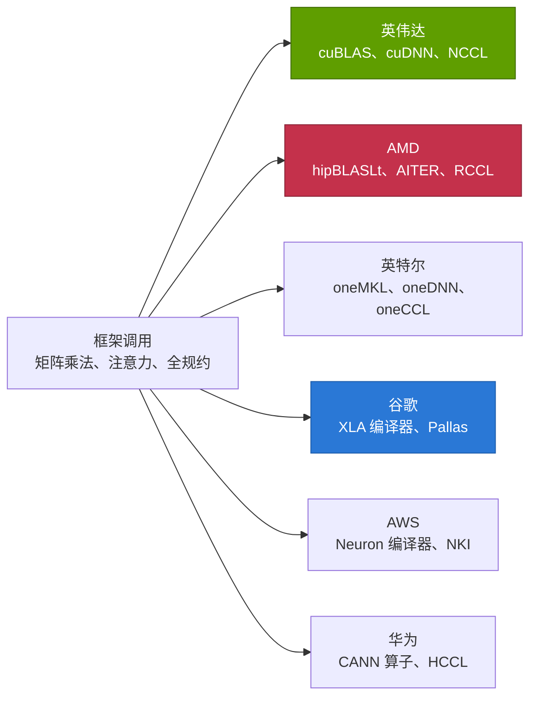
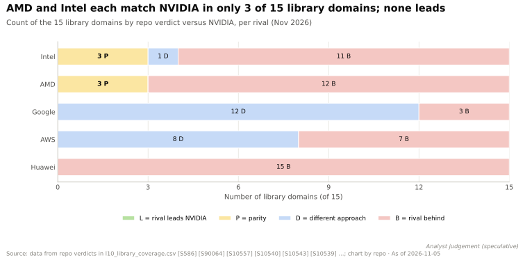
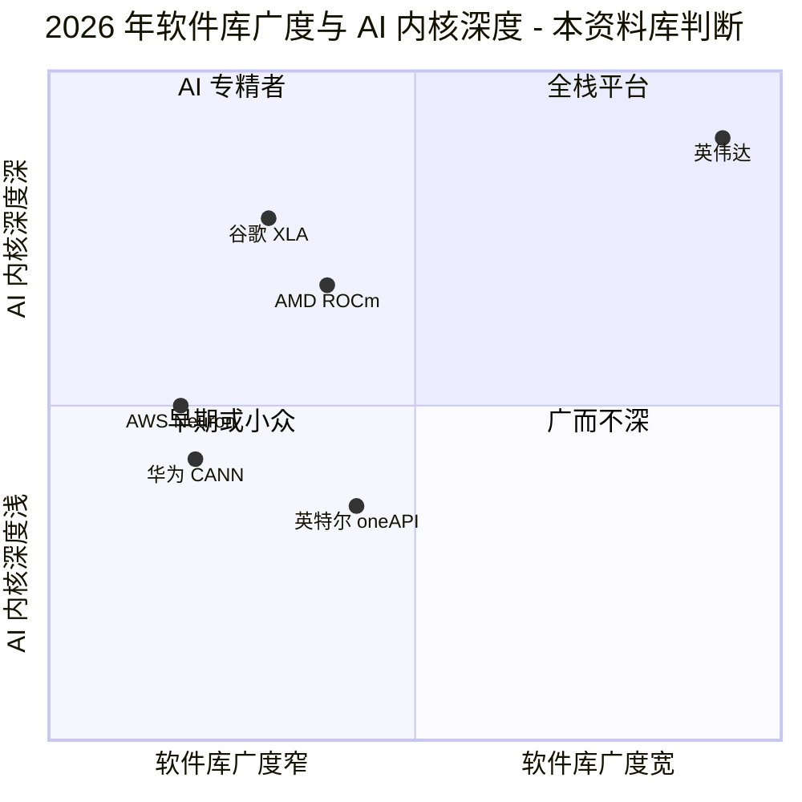

# 软件库（CUDA-X）：竞争格局

> [!NOTE]
> 本页为英文原文的简体中文参考译文，仅供参考；如有出入，以[英文原文](../../../layers/10-libraries-cuda-x/competition.md "English original")为准。

第 10 层 · 软件库（CUDA-X） · 约 12 分钟阅读 · 最近核实：2026-11-05

## ⚡ 要点速览

- **在本资料库对比矩阵的 15 个软件库领域中，没有任何竞争对手在任一领域领先英伟达（NVIDIA）；**AMD 和英特尔（Intel）各在 3 个领域达到持平，且都集中在数学运算、DNN 原语或集合通信 [[S586]](../../../sources/bibliography.md#s586)[[S10509]](../../../sources/bibliography.md#s10509)[[S10557]](../../../sources/bibliography.md#s10557)[[S10554]](../../../sources/bibliography.md#s10554)。
- **[Q5 · 最强挑战者] AMD 的 [ROCm](../../glossary.md#rocm)。** 其策略是通过[软件移植（port）](../../glossary.md#software-port)复制英伟达的接口，且已缩短了复制滞后：在 ROCm 6.4（2025 年 4 月）中，[RCCL](../../glossary.md#rccl) 落后 [NCCL](../../glossary.md#nccl) 296 天；到 ROCm 7.1（2025 年 10 月）时只落后 98 天 [[S10509]](../../../sources/bibliography.md#s10509)[[S10506]](../../../sources/bibliography.md#s10506)[[S586]](../../../sources/bibliography.md#s586)。
- **谷歌（Google）的挑战并非更小，而是路线不同：**[XLA](../../glossary.md#xla) 编译整个模型而不是调用软件库，[Pallas](../../glossary.md#pallas) 则取代了 CUTLASS 式内核；在 15 个领域中，谷歌有 12 个走的是不同路线 [[S10543]](../../../sources/bibliography.md#s10543)[[S578]](../../../sources/bibliography.md#s578)。
- **广度差距位于 AI 训练之外。** 只有英伟达在优化（[cuOpt](../../glossary.md#cuopt)）、光刻（[cuLitho](../../glossary.md#culitho)）、基因组学（Parabricks）和图分析（cuGraph）领域提供自研 GPU 软件库 [[S10026]](../../../sources/bibliography.md#s10026)[[S10031]](../../../sources/bibliography.md#s10031)[[S10047]](../../../sources/bibliography.md#s10047)。
- **英伟达的弱点：开放降低了切换成本。** NCCL（自 2026 年 2 月起）和 cuOpt 均采用 Apache 2.0 许可，因此移植版可以跟进每一次发布；而 ROCm 上的 [vLLM](../../glossary.md#vllm) 默认使用 AMD 自己的 [AITER](../../glossary.md#aiter) 内核 [[S10507]](../../../sources/bibliography.md#s10507)[[S10026]](../../../sources/bibliography.md#s10026)[[S10514]](../../../sources/bibliography.md#s10514)。
- **竞争格局正在开放：**华为正在开源 [CANN](../../glossary.md#cann)（2025 年 8 月宣布）；据报道，AMD 于 2026 年 10 月以指导委员会成员身份加入了 [oneAPI](../../glossary.md#oneapi) 标准组织（UXL）🟡 [[S10537]](../../../sources/bibliography.md#s10537)[[S10542]](../../../sources/bibliography.md#s10542)。

## 与软件库目录竞争的三种方式

软件库是一盒预先调优的 GPU 例程。[PyTorch](../../glossary.md#pytorch) 这样的框架决定*算什么*；软件库则决定*如何*在某一款特定芯片上算得快（参见 [CUDA-X 目录](the-cuda-x-catalog.md)）。竞争对手选择了以下三种策略之一：

1. **移植（AMD，部分包括华为）。** 在兼容接口之下重新实现英伟达的软件库，就像翻唱乐队演奏同一份曲目单：[HIP](../../glossary.md#hip) 对应 [CUDA](../../glossary.md#cuda)，RCCL 对应 NCCL（其许可证注明包含英伟达贡献的代码），hipDF 则是 cuDF 的分叉版本 [[S10002]](../../../sources/bibliography.md#s10002)[[S10511]](../../../sources/bibliography.md#s10511)。
2. **编译（谷歌、AWS）。** 绕开大多数软件库：由编译器（XLA、Neuron 编译器）为每个模型生成内核，其余部分由专家在 Pallas 或 AWS 的 [NKI](../../glossary.md#nki) 中手工调优 [[S10543]](../../../sources/bibliography.md#s10543)[[S10539]](../../../sources/bibliography.md#s10539)。
3. **标准化（英特尔）。** 发布一项开放规范（oneAPI，现归属 [UXL 基金会](../../glossary.md#uxl-foundation)），寄望于他人采用 [[S10540]](../../../sources/bibliography.md#s10540)[[S10541]](../../../sources/bibliography.md#s10541)。

移植能让客户的代码继续运行，但会让移植方永远处于追随者地位。编译路线可以避免追随，但只在厂商掌控整个技术栈（TPU、Trainium）时才行得通。

> [!TIP]
> **算例 —— 移植滞后的代价。** RCCL 2.22.3 于 2025-04-11 随 ROCm 6.4.0 发布，比英伟达标记 NCCL 2.22.3（2024-06-19）晚了 296 天；而那时 NCCL 已更新到 2.26 [[S10509]](../../../sources/bibliography.md#s10509)[[S10506]](../../../sources/bibliography.md#s10506)[[S586]](../../../sources/bibliography.md#s586)。由于两家厂商都按年度节奏推出 GPU，约 10 个月的滞后意味着 AMD 客户得到一项集合通信功能时，大约晚了一代 GPU。到 ROCm 7.1.0（2025-10-30）时，相对 NCCL 2.27.7 的滞后缩短至 98 天，约一个季度。

🔧 技术细节：为什么移植会滞后，而编译器不会

移植版必须先匹配 NCCL 或 cuDF 的接口，再针对不同硬件重新调优每一个例程（用 xGMI 链路代替 [NVLink](../../glossary.md#nvlink)，用 64 宽的 wavefront 代替 32 线程的 warp，矩阵单元形状也不同）。RCCL 保留了 NCCL 的 `nccl*` 函数名，因此框架无需修改即可调用；但每个 NCCL 版本都必须先合并、重新调优并重新验证，才能随下一个 ROCm 版本发布 [[S10002]](../../../sources/bibliography.md#s10002)[[S10509]](../../../sources/bibliography.md#s10509)。以编译器为先的技术栈没有可供复制的上游；相应地，新型模型在编译器学会处理之前可能运行缓慢，因此需要 Pallas 来手写内核 [[S578]](../../../sources/bibliography.md#s578)。

## 覆盖矩阵

评级均从各竞争对手的角度、相对英伟达的软件库给出（🟩 领先 · 🟨 持平 · 🟥 落后 · 🟦 路线不同）。“未找到”指截至 2026-11-05 未出现在该厂商的软件库索引中。

| 领域 | 英伟达（参照） | AMD | 英特尔 | 谷歌 | AWS | 华为 |
|---|---|---|---|---|---|---|
| 稠密数学运算（[GEMM](../../glossary.md#gemm)） | cuBLAS、cuBLASLt | 🟨 rocBLAS、hipBLASLt | 🟨 oneMKL | 🟦 XLA 编译器 | 🟦 Neuron + NKI | 🟥 CANN 算子 |
| DNN 原语 | cuDNN | 🟥 MIOpen（+AITER） | 🟨 oneDNN（x86） | 🟦 XLA 融合 | 🟦 Neuron 编译器 | 🟥 CANN 算子 |
| 内核模板 | [CUTLASS](../../glossary.md#cutlass)、CuTe DSL | 🟥 [Composable Kernel](../../glossary.md#composable-kernel) | 🟥 [SYCL](../../glossary.md#sycl)、Triton XPU | 🟦 Pallas | 🟦 NKI Library | 🟥 Ascend C |
| 集合通信 | NCCL | 🟨 RCCL（移植版） | 🟥 oneCCL | 🟦 基于 ICI 的 XLA | 🟦 Neuron CC | 🟥 HCCL |
| 推理引擎 | TensorRT-LLM、Dynamo | 🟥 vLLM/SGLang + AITER | 🟥 OpenVINO | 🟦 vLLM-TPU、llm-d | 🟥 vLLM Neuron（beta） | 🟥 vllm-ascend |
| 数据框 / ETL | [cuDF](../../glossary.md#cudf)、Spark 插件 | 🟥 hipDF（分叉） | 🟥 GPU 上无 | 🟦 BigQuery | 🟥 无 | 🟥 未找到 |
| 经典机器学习 | cuML | 🟥 无移植版 | 🟦 oneDAL（CPU） | 🟦 BigQuery ML | 🟥 无 | 🟥 未找到 |
| 图分析 | cuGraph | 🟥 hipGRAPH（早期） | 🟥 无 | 🟥 无 | 🟦 Neptune | 🟥 未找到 |
| 优化 | cuOpt | 🟥 无 | 🟥 无 | 🟦 OR-Tools（CPU） | 🟥 无 | 🟥 未找到 |
| FFT / 稀疏 / 求解器 | cuFFT、cuSPARSE | 🟨 rocFFT、rocSPARSE | 🟨 oneMKL | 🟥 仅 XLA FFT | 🟥 无 | 🟥 有限 |
| 量子仿真 | cuQuantum、CUDA-Q | 🟥 无 | 🟥 无 | 🟦 qsim + 自有 QPU | 🟦 Braket | 🟥 未找到 |
| 光刻 | cuLitho | 🟥 无 | 🟥 无 | 🟥 无 | 🟥 无 | 🟥 未找到 |
| 基因组学 | Parabricks | 🟥 无 | 🟥 无 | 🟦 DeepVariant | 🟦 HealthOmics | 🟥 未找到 |
| 仿真、物理机器学习 | Warp、PhysicsNeMo | 🟥 无自研软件库 | 🟥 无自研软件库 | 🟦 Brax（JAX） | 🟥 无 | 🟥 未找到 |
| 向量检索 | [cuVS](../../glossary.md#cuvs) | 🟥 hipVS（移植版） | 🟥 GPU 上无 | 🟦 ScaNN（CPU） | 🟦 OpenSearch | 🟥 未找到 |

各单元格来源见 `data/l10_library_coverage.csv`：[[S10047]](../../../sources/bibliography.md#s10047)[[S586]](../../../sources/bibliography.md#s586)[[S10511]](../../../sources/bibliography.md#s10511)[[S10512]](../../../sources/bibliography.md#s10512)[[S10514]](../../../sources/bibliography.md#s10514)[[S10540]](../../../sources/bibliography.md#s10540)[[S10557]](../../../sources/bibliography.md#s10557)[[S10543]](../../../sources/bibliography.md#s10543)[[S10539]](../../../sources/bibliography.md#s10539)[[S10538]](../../../sources/bibliography.md#s10538)[[S10570]](../../../sources/bibliography.md#s10570)。所有竞争对手评级均为本资料库判断（🔴）。

> [!TIP]
> **算例 —— 如何解读 🟦。** 英伟达的 NVLink 域是一台 Vera Rubin [NVL72](../../glossary.md#nvl72) 中的 72 块 GPU；而一个 [TPU](../../glossary.md#tpu) Ironwood 超级集群（superpod）通过 [ICI](../../glossary.md#ici) 连接 9,216 颗芯片 [[S90009]](../../../sources/bibliography.md#s90009)[[S547]](../../../sources/bibliography.md#s547)。在 TPU 上，XLA 在编译模型时插入[全规约（all-reduce）](../../glossary.md#all-reduce)，因此根本没有 NCCL 需要移植：从 GPU 迁移过来的团队需要改写的是分片配置，而不是软件库调用。[纵向扩展（scale-up）](../../glossary.md#scale-up)规模大 128 倍（9,216 ÷ 72），但团队需要放弃英伟达的软件库生态，这就是“路线不同”不等于“落后”的原因。

## 逐一审视挑战者

### AMD ROCm：最强挑战者

ROCm 7.0（2025 年 9 月）新增了 AITER 算子以及 [FP4](../../glossary.md#fp4)/FP6 格式；ROCm 10.0 于 2026 年 8 月接踵而至 [[S90064]](../../../sources/bibliography.md#s90064)[[S586]](../../../sources/bibliography.md#s586)。ROCm-DS 是 AMD 对 [RAPIDS](../../glossary.md#rapids) 的分叉版本，于 2025 年 10 月正式发布，其中 hipDF 与 cuDF 25.02 的 API 对齐；hipGRAPH 到 2026 年 3 月仍处于早期访问阶段 [[S10511]](../../../sources/bibliography.md#s10511)[[S10512]](../../../sources/bibliography.md#s10512)。AMD 通过收购软件团队来加快进度：Mipsology 和 Nod.ai（2023 年）、Silo AI（$665M，2024 年）以及 Brium（2025 年）[[S10529]](../../../sources/bibliography.md#s10529)[[S10530]](../../../sources/bibliography.md#s10530)[[S10531]](../../../sources/bibliography.md#s10531)[[S10532]](../../../sources/bibliography.md#s10532)。SemiAnalysis 在 2024 年 12 月曾提出严厉批评，到 2025 年 4 月则看到了新的紧迫感，但仍认为 AMD 给 AI 软件工程师的薪酬偏低 [[S10536]](../../../sources/bibliography.md#s10536)[[S10535]](../../../sources/bibliography.md#s10535)。

**最有力的论据：**AI 支出集中在少数几类运算上（GEMM、注意力、集合通信），而前沿实验室无论如何都会自己编写内核；3 个领域的持平，加上对 vLLM 和 [SGLang](../../glossary.md#sglang) 的一流支持，覆盖了大部分加速器支出 [[S580]](../../../sources/bibliography.md#s580)[[S582]](../../../sources/bibliography.md#s582)。**已缩小的差距：**集合通信缩小到约 3 个月；数据框约 8 个月；[分离式推理服务（disaggregated serving）](../../glossary.md#disaggregated-serving)和 KV 分层存储在 2025 年仍有滞后（分析师观点）[[S10570]](../../../sources/bibliography.md#s10570)；15 个领域中仍有 12 个落后。CUDA 与 ROCm 的平台层面对比，参见[第 09 层竞争格局](../09-cuda-and-system-software/competition.md)。

> [!TIP]
> **算例 —— AMD 的追赶预算。** AMD 的研发支出从 $5.0B（2022 年）增至 $6.5B（2024 年），每年增加 $1.45B，仅 Silo AI 一项就花费 $665M [[S450]](../../../sources/bibliography.md#s450)[[S10531]](../../../sources/bibliography.md#s10531)。若研发增量的三分之一投向软件（本资料库假设 🔴），每年可提供约 $0.5B，按每人 $0.4M 计约可供养 1,200 名工程师：接近本资料库对一个 AI 核心软件库栈所需约 1,500 名工程师的估计（[发展历程](history-and-how-built.md)）。资金是有的；悬而未决的是，这笔钱买到的是广度，还是只有 AI 核心。

### 谷歌：编译，而非调用

TPU 从来不需要 [CUDA-X](../../glossary.md#cuda-x) 的对应物。XLA 负责算子融合并调度集合通信；Pallas 覆盖自定义内核；PyTorch/XLA 正被一个原生的 TorchTPU 栈取代，后者于 2026 年 10 月与 Meta 共同开源 [[S10543]](../../../sources/bibliography.md#s10543)[[S578]](../../../sources/bibliography.md#s578)[[S553]](../../../sources/bibliography.md#s553)[[S595]](../../../sources/bibliography.md#s595)。**最有力的论据：**编译器无需为每个领域配备软件库团队即可适配新模型。**差距：**在 AI 之外，谷歌销售的是服务（BigQuery）而非软件库，因此无法把非 AI 工作负载拉到商用硬件上 [[S10552]](../../../sources/bibliography.md#s10552)。参见 [CS3](../../case-studies/CS3-google-tpu-the-credible-alternative.md)。

### 英特尔：一个寻找 GPU 的开放标准

oneMKL 和 oneDNN 已经成熟；oneDNN 被 PyTorch、TensorFlow、ONNX Runtime 和 OpenVINO 采用，2026 版 oneAPI 仍包含 oneMKL、oneDAL、oneDNN、MPI 和 oneCCL [[S10542]](../../../sources/bibliography.md#s10542)[[S10540]](../../../sources/bibliography.md#s10540)[[S10554]](../../../sources/bibliography.md#s10554)。oneMKL 2026.0 还移除了大部分旧版稀疏 BLAS API [[S10557]](../../../sources/bibliography.md#s10557)。**最有力的论据：**一项厂商中立的标准；据报道，AMD 已以指导委员会成员身份加入 UXL，并支持将 oneDNN 作为 PyTorch 在 [x86](../../glossary.md#x86) 上的默认后端（单一二手来源）🟡 [[S10542]](../../../sources/bibliography.md#s10542)。**差距：**英特尔的数据中心加速器产品单薄，因此 oneAPI 的 GPU 软件库鲜有大规模部署。

### AWS 与华为：垂直技术栈

AWS 将其 Neuron 编译器与预置内核的 NKI Library 以及负责集合通信的 NeuronX Distributed 搭配使用；其 vLLM 插件仍标注为 beta [[S10539]](../../../sources/bibliography.md#s10539)[[S594]](../../../sources/bibliography.md#s594)[[S581]](../../../sources/bibliography.md#s581)。华为的 CANN 承载了算子库与 HCCL；torch_npu、MindSpeed 和 triton-ascend 将昇腾（Ascend）与开放框架相连，CANN 也正在开源 [[S10538]](../../../sources/bibliography.md#s10538)[[S592]](../../../sources/bibliography.md#s592)[[S10537]](../../../sources/bibliography.md#s10537)。

> [!NOTE]
> **🐂 看多观点。** 广度会产生复利：每一个非 AI 领域（Spark、光刻、基因组学、优化）都会把 GPU 拉进 AMD 和谷歌够不着的预算中，而英伟达能在芯片推出后数周内就发布 Rubin 软件库（参见[发展历程](history-and-how-built.md)）。

> [!WARNING]
> **🐻 看空观点。** 资金集中在 3–4 个 AI 领域，而 AMD 在这些领域已经持平或接近持平；开放引擎（vLLM、SGLang、[Triton](../../glossary.md#triton)）如今代替用户选择内核。每一个 NCCL 或 cuOpt 版本都采用 Apache 2.0 许可，可在一个季度内被移植，因此软件库护城河正收窄至长尾领域。

**[Q5 · 最强挑战者]** AMD ROCm，因为它攻击的是资金所在的领域（数学运算、集合通信、推理），且已将跟进滞后缩短到约一个季度；从长期看，谷歌的编译器路线对软件库*存在必要性*的威胁更大，但仅限于谷歌自家的芯片。

## 🎯 企业发展视角

1. 15 个领域中仅 3 个持平看似薄弱，但这 3 个领域占据了大部分 AI 加速器支出。对于推理领域的新进入者（例如高通（Qualcomm）的 AI200/AI250，基于公开信息），哪些领域必须在第一天就达到持平，哪些可以借助 vLLM 等开放引擎 [[S90028]](../../../sources/bibliography.md#s90028)[[S596]](../../../sources/bibliography.md#s596)？
2. AMD 的移植滞后已从约 10 个月降至约 3 个月。如果滞后接近于零（共享同一上游），英伟达的软件库溢价会受到什么影响？
3. 高通宣布的 Modular 交易，是一场与谷歌类似的编译路线押注 [[S90057]](../../../sources/bibliography.md#s90057)。可移植编译器能否免去逐个领域追平 CUDA-X 的需要，还是只对 AI 内核有效？
4. 光刻、优化和基因组学领域没有第二供应商。它们更适合作为与 ISV 合作的目标，而非自建目标吗？
5. 如果 AMD 加入 UXL 的报道得到证实，oneAPI 是否会成为新进入者可以加入、而无需自建的中立标准？

## 📚 来源（Sources）

<!-- Auto-generated from the [S…] citations on this page by `make build`. Edit sources/registry/*.csv, not this list. -->

- [**S450**](../../../sources/bibliography.md#s450) U.S. Securities and Exchange Commission (EDGAR), *Advanced Micro Devices Form 10-K / 10-Q filings (EDGAR index)*, 2025-02-05. [Link](https://www.sec.gov/cgi-bin/browse-edgar?action=getcompany&CIK=0000002488&type=10-&dateb=&owner=include&count=40)
- [**S547**](../../../sources/bibliography.md#s547) Google Cloud Blog, *Ironwood TPUs and new Axion-based VMs for your AI workloads*, 2025-11-06. [Link](https://cloud.google.com/blog/products/compute/ironwood-tpus-and-new-axion-based-vms-for-your-ai-workloads)
- [**S553**](../../../sources/bibliography.md#s553) Google Cloud Blog (Alex Barrett), *What's new in AI infrastructure and orchestration in October*, 2026-11. [Link](https://cloud.google.com/blog/topics/ai-infrastructure/whats-new-in-ai-infrastructure-this-month)
- [**S578**](../../../sources/bibliography.md#s578) OpenAI Triton (GitHub), *Triton (triton-lang/triton) README — supported hardware*, 2026-11. [Link](https://github.com/triton-lang/triton/blob/main/README.md)
- [**S580**](../../../sources/bibliography.md#s580) vLLM project (GitHub), *vLLM README and installation docs — supported hardware*, 2026-11. [Link](https://github.com/vllm-project/vllm/blob/main/docs/getting_started/installation/README.md)
- [**S581**](../../../sources/bibliography.md#s581) vLLM project (GitHub), *vLLM hardware plugin repositories (tpu-inference/vLLM JAX, vllm-gaudi, vllm-ascend, vllm-neuron)*, 2026-11. [Link](https://github.com/vllm-project)
- [**S582**](../../../sources/bibliography.md#s582) SGLang project (GitHub: sgl-project/sglang), *SGLang README — supported hardware*, 2026-11. [Link](https://github.com/sgl-project/sglang/blob/main/README.md)
- [**S586**](../../../sources/bibliography.md#s586) AMD (GitHub: ROCm/ROCm docs), *ROCm documentation sources: release history, AI-ecosystem compatibility matrix, consolidated changelog*, 2026-08-26. [Link](https://github.com/ROCm/ROCm/blob/develop/docs/release/versions.rst)
- [**S592**](../../../sources/bibliography.md#s592) Huawei Ascend (GitHub: Ascend org), *Huawei Ascend open-source adapters: torch_npu, MindSpeed, triton-ascend*, 2026-11. [Link](https://github.com/Ascend/pytorch)
- [**S594**](../../../sources/bibliography.md#s594) AWS (GitHub: aws-neuron/neuronx-distributed), *NeuronX Distributed (NxD) README*, 2026-11. [Link](https://github.com/aws-neuron/neuronx-distributed)
- [**S595**](../../../sources/bibliography.md#s595) PyTorch (GitHub: pytorch/xla), *PyTorch/XLA README (deprecation notice)*, 2026-11. [Link](https://github.com/pytorch/xla/blob/master/README.md)
- [**S596**](../../../sources/bibliography.md#s596) Qualcomm (GitHub: quic), *Qualcomm Cloud AI SDK and Efficient Transformers repositories*, 2026-11. [Link](https://github.com/quic/cloud-ai-sdk)
- [**S10002**](../../../sources/bibliography.md#s10002) AMD (GitHub: ROCm/rccl), *RCCL README and LICENSE (develop branch)*, 2026-11. [Link](https://github.com/ROCm/rccl/blob/develop/README.md)
- [**S10026**](../../../sources/bibliography.md#s10026) NVIDIA (GitHub: NVIDIA/cuopt), *cuOpt README and LICENSE*, 2026-11. [Link](https://github.com/NVIDIA/cuopt/blob/main/README.md)
- [**S10031**](../../../sources/bibliography.md#s10031) NVIDIA Newsroom, *TSMC and Synopsys Bring Breakthrough NVIDIA Computational Lithography Platform to Production*, 2024-03-18. [Link](https://nvidianews.nvidia.com/news/tsmc-synopsys-nvidia-culitho)
- [**S10047**](../../../sources/bibliography.md#s10047) NVIDIA Developer, *NVIDIA CUDA-X Libraries (developer page)*, 2026. [Link](https://developer.nvidia.com/cuda/cuda-x-libraries)
- [**S10506**](../../../sources/bibliography.md#s10506) GitHub (NVIDIA), *NVIDIA/nccl tags*, 2026-09-17. [Link](https://github.com/NVIDIA/nccl/tags)
- [**S10507**](../../../sources/bibliography.md#s10507) GitHub (NVIDIA), *NVIDIA/nccl releases (release notes v2.28.3 to v2.32.3)*, 2026-09-17. [Link](https://github.com/NVIDIA/nccl/releases)
- [**S10509**](../../../sources/bibliography.md#s10509) GitHub (ROCm/rccl), *RCCL CHANGELOG*, 2026. [Link](https://github.com/ROCm/rccl/blob/develop/CHANGELOG.md)
- [**S10511**](../../../sources/bibliography.md#s10511) AMD ROCm Documentation, *ROCm-DS 25.10 release notes*, 2025-10. [Link](https://rocm.docs.amd.com/projects/rocm-ds/en/latest/about/release-notes.html)
- [**S10512**](../../../sources/bibliography.md#s10512) AMD ROCm Documentation, *ROCm-DS 26.03 release notes*, 2026-03. [Link](https://rocm.docs.amd.com/projects/rocm-ds/en/docs-26.03/about/release-notes.html)
- [**S10514**](../../../sources/bibliography.md#s10514) GitHub (ROCm/aiter), *AITER README*, 2026-04. [Link](https://github.com/ROCm/aiter)
- [**S10529**](../../../sources/bibliography.md#s10529) CB Insights, *Mipsology company profile*, 2023-08. [Link](https://www.cbinsights.com/company/mipsology)
- [**S10530**](../../../sources/bibliography.md#s10530) PrivSource, *AMD Acquires Nod.ai*, 2023-10-10. [Link](https://www.privsource.com/acquisitions/deal/bWSr8y)
- [**S10531**](../../../sources/bibliography.md#s10531) Converge Digest, *AMD completes $665 million acquisition of Silo AI*, 2024-08-12. [Link](https://convergedigest.com/amd-completes-665-million-acquisition-of-silo-ai/?amp=1)
- [**S10532**](../../../sources/bibliography.md#s10532) I-Connect007, *AMD Acquires Brium to Strengthen Open AI Software Ecosystem*, 2025-06-05. [Link](https://iconnect007.com/article/145627/amd-acquires-brium-to-strengthen-open-ai-software-ecosystem/145624)
- [**S10535**](../../../sources/bibliography.md#s10535) SemiAnalysis, *AMD 2.0 – New Sense of Urgency / MI450X Chance to Beat Nvidia / Nvidia's New Moat*, 2025-04. [Link](https://newsletter.semianalysis.com/p/amd-2-0-new-sense-of-urgency-mi450x-chance-to-beat-nvidia-nvidias-new-moat)
- [**S10536**](../../../sources/bibliography.md#s10536) TechPowerUp, *AMD's Pain Point is ROCm Software, NVIDIA's CUDA Software is Still Superior for AI Development: Report*, 2024-12-23. [Link](https://techpowerup.com/330155/amds-pain-point-is-rocm-software-nvidias-cuda-software-is-still-superior-for-ai-development-report)
- [**S10537**](../../../sources/bibliography.md#s10537) TrendForce, *Huawei Open-Sources CANN Toolkit for Ascend AI GPUs, Taking Aim at NVIDIA's CUDA*, 2025-08-07. [Link](https://www.trendforce.com/news/2025/08/07/news-huawei-open-sources-cann-toolkit-for-ascend-ai-gpus-taking-aim-at-nvidias-cuda/)
- [**S10538**](../../../sources/bibliography.md#s10538) Huawei Ascend (hiascend.com), *CANN Ascend operator library (AOL) API reference*, 2026. [Link](https://www.hiascend.com/document/detail/en/CANNCommunityEdition/latest/API/aolapi)
- [**S10539**](../../../sources/bibliography.md#s10539) AWS Neuron Documentation, *About the NKI Library*, 2026. [Link](https://awsdocs-neuron.readthedocs-hosted.com/en/latest/nki/library/about/index.html)
- [**S10540**](../../../sources/bibliography.md#s10540) Intel, *Intel oneAPI Toolkit Release Notes (2026)*, 2026. [Link](https://www.intel.com/content/www/us/en/developer/articles/release-notes/oneapi-toolkit/2026.html)
- [**S10541**](../../../sources/bibliography.md#s10541) UXL Foundation, *UXL Foundation: advancing portable acceleration across architectures in 2025 and what's next for 2026*, 2025-12. [Link](https://uxlfoundation.org/blog/uxl-foundation-advancing-portable-acceleration-across-architectures-in-2025-and-whats-next-for-2026/)
- [**S10542**](../../../sources/bibliography.md#s10542) Crypto Briefing, *AMD joins UXL Foundation as steering member, backs oneDNN for PyTorch*, 2026-10-20. [Link](https://cryptobriefing.com/amd-joins-uxl-foundation-onednn-pytorch/)
- [**S10543**](../../../sources/bibliography.md#s10543) OpenXLA (GitHub), *OpenXLA XLA compiler*, 2026. [Link](https://github.com/openxla/xla)
- [**S10552**](../../../sources/bibliography.md#s10552) Google Cloud, *BigQuery (incl. BigQuery ML)*, 2026. [Link](https://cloud.google.com/bigquery)
- [**S10554**](../../../sources/bibliography.md#s10554) UXL Foundation (GitHub), *oneDNN*, 2026. [Link](https://github.com/uxlfoundation/oneDNN)
- [**S10557**](../../../sources/bibliography.md#s10557) Intel, *Intel oneAPI Math Kernel Library (oneMKL) Release Notes and System Requirements*, 2026. [Link](https://www.intel.com/content/www/us/en/developer/articles/release-notes/onemkl.html)
- [**S10570**](../../../sources/bibliography.md#s10570) SemiAnalysis, *AMD's lack of disaggregated prefill inferencing and NVMe KV cache tiering (article section)*, 2025. [Link](https://newsletter.semianalysis.com/i/174558631/amds-lack-of-disaggregated-prefill-inferencing-and-nvme-kv-cache-tiering)
- [**S90009**](../../../sources/bibliography.md#s90009) GamesBeat, *Nvidia Vera Rubin ramps into full production for fall launch*, 2026. [Link](https://gamesbeat.com/nvidia-vera-rubin-ramps-into-full-production-for-fall-launch-again/)
- [**S90028**](../../../sources/bibliography.md#s90028) TechRepublic, *Qualcomm unveils AI chips to rival Nvidia, AMD*, 2025-10-27. [Link](https://techrepublic.com/article/news-qualcomm-unveils-ai-chips-to-rival-nvidia-amd)
- [**S90057**](../../../sources/bibliography.md#s90057) StorageReview, *Qualcomm unveils Dragonfly data center roadmap: C1000 CPU, AI300 accelerator and Modular acquisition*, 2026-06-24. [Link](https://www.storagereview.com/es/news/qualcomm-unveils-dragonfly-data-center-roadmap-c1000-cpu-ai300-accelerator-and-modular-acquisition)
- [**S90064**](../../../sources/bibliography.md#s90064) The Register, *ROCm 7: AMD tries to catch CUDA with performance-boosting software*, 2025-09-17. [Link](https://www.theregister.com/2025/09/17/amd_rocm_7_chases_nvidia_cuda/)
