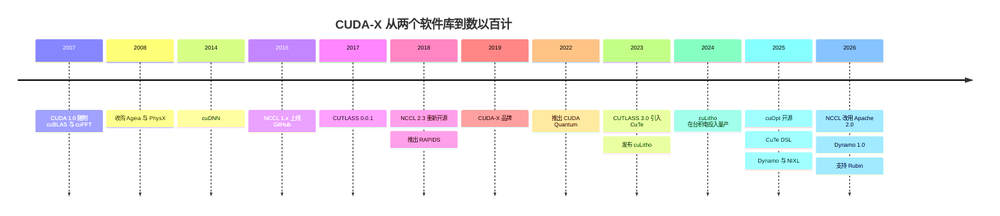

# 软件库（CUDA-X）：发展历程与英伟达的构建方式

> [!NOTE]
> 本页为英文原文的简体中文参考译文，仅供参考；如有出入，以[英文原文](../../../layers/10-libraries-cuda-x/history-and-how-built.md "English original")为准。

第 10 层 · 软件库（CUDA-X） · 约 11 分钟阅读 · 最近核实：2026-11-05

## ⚡ 要点速览

- **软件库从第一天起就随 [CUDA](../../glossary.md#cuda) 一同发布：**CUDA 1.0（2007 年 6 月）即包含 cuBLAS 和 cuFFT [[S525]](../../../sources/bibliography.md#s525)。此后每当出现新的工作负载，英伟达（NVIDIA）就会增加一个软件库：cuDNN（2014 年）、[NCCL](../../glossary.md#nccl)（2016 年 4 月起上线 GitHub）、CUTLASS（2017 年 12 月）和 RAPIDS（2018 年 10 月）[[S10039]](../../../sources/bibliography.md#s10039)[[S10506]](../../../sources/bibliography.md#s10506)[[S10010]](../../../sources/bibliography.md#s10010)[[S10517]](../../../sources/bibliography.md#s10517)。
- **“[CUDA-X](../../glossary.md#cuda-x)”是 2019 年才推出的品牌**，而英伟达的计数口径不断变化：2022 年称“550 个 SDK 和 AI 模型”，2025 年 10 月称约 350 个软件库 [[S10502]](../../../sources/bibliography.md#s10502)[[S532]](../../../sources/bibliography.md#s532)[[S10501]](../../../sources/bibliography.md#s10501)。
- **开放程度几经摇摆。** NCCL 2 自 2017 年起仅以二进制形式发布，直到 v2.3.5（2018 年 9 月），并于 2026 年 2 月改用 Apache 2.0；cuOpt 于 2025 年改用 Apache 2.0 [[S10506]](../../../sources/bibliography.md#s10506)[[S10507]](../../../sources/bibliography.md#s10507)[[S10027]](../../../sources/bibliography.md#s10027)。
- **[Q4 · 优势来源]** 持续执行了二十年的软硬件协同设计：CUTLASS 在每款新数据中心 GPU 首次批量出货后 24–71 天内即提供支持，而 Rubin 在同一天获得了 CUTLASS 和 NCCL 的支持 [[S10010]](../../../sources/bibliography.md#s10010)[[S10507]](../../../sources/bibliography.md#s10507)。
- **[Q6 · 复制成本]** 估计：构建一个 AI 核心软件库栈约需 $3B、约 1,500 名工程师和约 5 年；覆盖英伟达的全部广度则需约 10 年、约 $16B 🔴。真正的约束是时间和专业人才，而非资金 [[S401]](../../../sources/bibliography.md#s401)[[S10535]](../../../sources/bibliography.md#s10535)。
- **反事实推演：**如果英伟达把软件库留给第三方，各框架就会像谷歌（Google）打造 [XLA](../../glossary.md#xla) 那样自建编译器，CUDA 的护城河也会更浅 🔴。

## 软件库目录是如何建成的

有三个习惯反复出现。**芯片与软件库同步发布：**cuBLAS 随首批 CUDA GPU 一同问世，如今 CUTLASS 会在每种新架构推出后数周内跟进。**跟随工作负载：**深度学习（cuDNN）、多 GPU 训练（NCCL）、数据科学（RAPIDS）、芯片制造（cuLitho）和量子计算（CUDA-Q），都是在需求显现后才各自获得了一个软件库 [[S10039]](../../../sources/bibliography.md#s10039)[[S10506]](../../../sources/bibliography.md#s10506)[[S10517]](../../../sources/bibliography.md#s10517)[[S10032]](../../../sources/bibliography.md#s10032)[[S10520]](../../../sources/bibliography.md#s10520)。**开放具有战略意义的部分，保留形成差异化的部分：**NCCL、CUTLASS、cuOpt 和 Warp 是开源的，而 cuBLAS 和 cuDNN 以专有二进制形式发布 [[S10507]](../../../sources/bibliography.md#s10507)[[S10038]](../../../sources/bibliography.md#s10038)[[S10028]](../../../sources/bibliography.md#s10028)。其中的机制参见[广度为何产生复利](why-library-breadth-compounds.md)。

| 日期 | 决策 | 意义 | 来源 |
|---|---|---|---|
| 2007-06 | 在 CUDA 1.0 中捆绑 cuBLAS 和 cuFFT | 第一天就提供调优过的数学库 | [[S525]](../../../sources/bibliography.md#s525) |
| 2008-02 | 收购 Ageia（PhysX） | 第一个通过收购而非自建获得的领域软件库 | [[S484]](../../../sources/bibliography.md#s484) |
| 2014-10 | 发布 cuDNN | 各深度学习框架以其为标准 | [[S10039]](../../../sources/bibliography.md#s10039) |
| 2016-04 | 将 NCCL 1.x 发布到 GitHub | 免费的多 GPU 集合通信 | [[S10506]](../../../sources/bibliography.md#s10506) |
| 2017-12-04 | 发布 CUTLASS 模板 | 客户可以自己编写张量核心内核，但运行在英伟达硬件上 | [[S10010]](../../../sources/bibliography.md#s10010) |
| 2018-09-25 | 重新开源 NCCL 2（v2.3.5） | 多节点训练确立以 NCCL 为标准 | [[S10506]](../../../sources/bibliography.md#s10506) |
| 2018-10-10 | 与 Databricks、IBM、甲骨文（Oracle）共同推出 RAPIDS | CUDA 进入数据科学领域 | [[S10517]](../../../sources/bibliography.md#s10517) |
| 2024-03-18 | cuLitho 在台积电（TSMC）投入量产 | GPU 进入芯片制造环节 | [[S10031]](../../../sources/bibliography.md#s10031) |
| 2025-03 | 开源 cuOpt（Apache 2.0） | 优化领域加入开放的 CUDA-X | [[S10027]](../../../sources/bibliography.md#s10027) |
| 2026-02-27 | 将 NCCL 重新许可为 Apache 2.0 | 降低用户与移植方的使用门槛 | [[S10507]](../../../sources/bibliography.md#s10507) |

| 日期 | 英伟达的说法 | 来源 |
|---|---|---|
| 2021-04 | CUDA 和 CUDA-X 加速了 >2,000 个应用 | [[S537]](../../../sources/bibliography.md#s537) |
| 2022-03 | CUDA-X 软件库 60 项更新 | [[S530]](../../../sources/bibliography.md#s530) |
| 2022-09 | 550 个 SDK 和 AI 模型 | [[S532]](../../../sources/bibliography.md#s532) |
| 2023-05 | >3,000 个应用 | [[S533]](../../../sources/bibliography.md#s533) |
| 2025-10 | 约 350 个 CUDA-X 软件库 | [[S10501]](../../../sources/bibliography.md#s10501) |
| 2026-03 | “数以百计”的软件库；cuDF 和 cuVS 被定位为基础 | [[S10047]](../../../sources/bibliography.md#s10047)[[S10504]](../../../sources/bibliography.md#s10504) |

> [!TIP]
> **算例 —— 为什么软件库数量不是 KPI。** 英伟达对外宣传的数字从 550 个“SDK 和 AI 模型”（2022 年 9 月）降至约 350 个“软件库”（2025 年 10 月），降幅 36%；而加速应用数量从 2,000 个（2021 年）增至 3,000 个（2023 年），增长 50% [[S532]](../../../sources/bibliography.md#s532)[[S10501]](../../../sources/bibliography.md#s10501)[[S537]](../../../sources/bibliography.md#s537)[[S533]](../../../sources/bibliography.md#s533)。前一个序列改变了口径（剔除了模型）；后一个衡量的是采用程度。做尽职调查时，应统计第三方集成（Snowflake、Spark、Faiss），而不是英伟达自己的计数。

## [Q4 · 优势来源] 持续执行了二十年的协同设计

在软件库将其开放出来之前，新的硬件特性毫无价值。Volta 的[张量核心](../../glossary.md#tensor-core)、Hopper 的张量内存加速器（[TMA](../../glossary.md#tma)）以及 Blackwell 的 [NVFP4](../../glossary.md#nvfp4) 块缩放格式，都各自需要新的内核。由于指令集由英伟达定义，其软件库团队可以在产品发布前就构建好内核（这是根据发布日期做出的推断 🔴）：CUTLASS 3.0（2023 年 1 月）随附基于全新 CuTe 抽象构建的 TMA 内核，CUTLASS 3.8.0（2025 年 1 月）随附 Blackwell 的张量内存指令与 NVFP4，CUTLASS 4.8.0（2026 年 9 月）则随附对 Rubin 的支持以及新的 UE5M3 缩放格式 [[S10010]](../../../sources/bibliography.md#s10010)。竞争对手只能在发布之后才看到这些特性。

**答案：**优势在于集成加上执行速度，并且持续得足够久，以至于成为了生态。单纯的技术是可以复制的：RCCL 复制了 NCCL 的接口，hipDF 是 cuDF 的分叉 [[S10002]](../../../sources/bibliography.md#s10002)[[S10511]](../../../sources/bibliography.md#s10511)。难以复制的，是一个每年在 15 个领域同时交付软件库、编译器和 GPU 的组织。

> [!TIP]
> **算例 —— Rubin 的首日就绪度。** Rubin 于 2026 年 8 月初开始量产出货 [[S500]](../../../sources/bibliography.md#s500)。均新增 Rubin 初步支持的 CUTLASS 4.8.0 和 NCCL 2.32.3 于 2026-09-17 打上版本标签，距 8 月中旬的参考日期约 33 天 [[S10010]](../../../sources/bibliography.md#s10010)[[S10507]](../../../sources/bibliography.md#s10507)。AMD 的 [FP4](../../glossary.md#fp4) 路径耗时更长：CUDA 12.8 于 2025 年 1 月支持 FP4，[ROCm](../../glossary.md#rocm) 7.0 则于 2025 年 9 月支持，晚了 236 天 [[S524]](../../../sources/bibliography.md#s524)[[S586]](../../../sources/bibliography.md#s586)。

## [Q6 · 复制成本] 时间、资金与人才

| 范围 | 时间 | 资金（估计，本资料库 🔴） | 人才 |
|---|---|---|---|
| AI 核心：GEMM、DNN、内核模板、集合通信、推理引擎 | 约 5 年 | 约 $3B（1,500 × $0.4M × 5） | 约 1,500 名工程师，含内核与编译器专家 |
| CUDA-X 全部广度（15 个领域） | 约 10 年 | 约 $16B（4,000 × $0.4M × 10） | 约 4,000 人，另需领域科学家与 ISV 合作伙伴 |
| 佐证：AMD ROCm | 2016 年起步 → 2025–26 年 AI 核心接近持平 | 研发每年 +$1.45B（2022 → 2024） | AI 工程师薪酬偏低（SemiAnalysis，2025 年） |

输入数据：英伟达 FY2026 研发支出 $18.5B，约 42,000 名员工中约 31,000 人从事研发（人均约 $0.6M）[[S401]](../../../sources/bibliography.md#s401)；AMD 研发 [[S450]](../../../sources/bibliography.md#s450)；ROCm 1.0 于 2016 年发布 [[S586]](../../../sources/bibliography.md#s586)；[[S10535]](../../../sources/bibliography.md#s10535)。

> [!TIP]
> **算例 —— 算术。** 1,500 名工程师 × $0.4M 全口径人力成本 × 5 年 = $3.0B，约相当于英伟达 FY2026 研发支出 2 个月的金额（$18.5B ÷ 12 × 2 ≈ $3.1B）[[S401]](../../../sources/bibliography.md#s401)。人均成本为本资料库的假设，低于英伟达约 $0.6M 的人均全口径研发支出，因为软件库不需要光掩模。真正起约束作用的投入是时间：AMD 从 ROCm 1.0（2016 年）到集合通信滞后缩短至约 3 个月（2025 年），用了约 9 年 [[S586]](../../../sources/bibliography.md#s586)[[S10509]](../../../sources/bibliography.md#s10509)；而收购一个团队（Silo AI，$665M）买到的是人，而不是多年的调优积累 [[S10531]](../../../sources/bibliography.md#s10531)。

## 反事实推演 —— 如果英伟达当初没有……

- 🔴 **……自建软件库，而是依赖 MKL 式的第三方？** 各框架团队就会像谷歌打造 XLA 那样，自行编写内核和编译器。代码将面向某种抽象层，而不是 CUDA，AMD 也就根本不需要做移植。
- 🔴 **……在 2017 年之后继续闭源 NCCL？** 多节点训练可能会以 MPI 或 Gloo 为标准。RCCL 的许可证注明其包含英伟达贡献的代码，而在那种情况下它就无法从 NCCL 的代码起步 [[S10002]](../../../sources/bibliography.md#s10002)。
- 🔴 **……跳过 RAPIDS 和非 AI 领域？** GPU 将成为只用于 AI 的采购。也就不会有 Snowflake 或 Spark 集成把数据分析预算拉到 GPU 上 [[S10521]](../../../sources/bibliography.md#s10521)[[S10517]](../../../sources/bibliography.md#s10517)。

> [!TIP]
> **算例 —— 外包软件库的代价。** 假设由第三方按 NVIDIA AI Enterprise 的标价（每 GPU 每年 $4,500）收取软件库费用 [[S10526]](../../../sources/bibliography.md#s10526)。一台 72 GPU 的机架每年将承担 72 × $4,500 = $324,000，约为一台约 $7.8M 的 Vera Rubin [NVL72](../../glossary.md#nvl72) 机架（估计，摩根士丹利）[[S331]](../../../sources/bibliography.md#s331) 价格的 4%/年。免费捆绑软件库消除了这一摩擦，并把利润留在 GPU 中。

🔧 技术细节：软件库版本如何送达用户

软件库通过三种方式发布：内置于 CUDA Toolkit（cuBLAS、cuFFT；自 1.0 起与 CUDA 同步版本化）、作为单独下载包和 Python wheel 发布（cuDNN、NCCL、cuDF；PyPI 记录给出了首次上传日期），以及在 GitHub 上以源代码形式发布（CUTLASS、NCCL、cuOpt）[[S525]](../../../sources/bibliography.md#s525)[[S10038]](../../../sources/bibliography.md#s10038)[[S10010]](../../../sources/bibliography.md#s10010)。许可证各不相同：PyPI 将 cuBLAS 和 cuDNN 列为英伟达专有，CUTLASS 为 BSD-3-Clause，Warp 为 Apache 2.0 [[S10038]](../../../sources/bibliography.md#s10038)[[S10028]](../../../sources/bibliography.md#s10028)。开源有助于推广采用，但也让移植方得以复制；专有二进制则把调优程度最高的内核留在英伟达硬件上。

## 🎯 企业发展视角

1. 英伟达开源了 NCCL、CUTLASS 和 cuOpt，但让 cuBLAS 和 cuDNN 保持二进制形式。挑战者需要开源哪些软件库才能建立信任？哪些可以保持闭源？
2. 如果稀缺的投入是工程师人年而非资金，那么收购一个软件库团队（Silo AI、Modular）主要是在购买时间吗？能买到多少时间？
3. CUTLASS 会在每款英伟达 GPU 推出后约 1–2 个月内跟进。在新进入者的芯片上实现首日软件库支持需要多久？由谁来构建？
4. RAPIDS 表明，英伟达借助一个免费软件库加上合作伙伴进入了一个新市场（数据科学）。新进入者可以用同样的方式进入哪个相邻市场？

## 📚 来源（Sources）

<!-- Auto-generated from the [S…] citations on this page by `make build`. Edit sources/registry/*.csv, not this list. -->

- [**S331**](../../../sources/bibliography.md#s331) Wccftech, *NVIDIA's Vera Rubin rack hit with 435% memory price surge, pushing HBM4 & LPDDR5X bill to $2M of $7.8M total*, 2026-05. [Link](https://wccftech.com/nvidia-vera-rubin-rack-hit-with-memory-price-surge-pushing-hbm4-lpddr5x-bill-to-2m-of-7-8m-total/)
- [**S401**](../../../sources/bibliography.md#s401) NVIDIA Corporation via SEC EDGAR, *NVIDIA Corporation Form 10-K for fiscal year ended January 25, 2026*, 2026-02-25. [Link](https://www.sec.gov/Archives/edgar/data/1045810/000104581026000021/nvda-20260125.htm)
- [**S450**](../../../sources/bibliography.md#s450) U.S. Securities and Exchange Commission (EDGAR), *Advanced Micro Devices Form 10-K / 10-Q filings (EDGAR index)*, 2025-02-05. [Link](https://www.sec.gov/cgi-bin/browse-edgar?action=getcompany&CIK=0000002488&type=10-&dateb=&owner=include&count=40)
- [**S484**](../../../sources/bibliography.md#s484) NVIDIA press releases as summarised in NVIDIA 10-K filings and contemporaneous press, *History of NVIDIA acquisitions 2000–2013 (3dfx assets, MediaQ, ULi, Hybrid Graphics, PortalPlayer, mental images, Ageia, Icera, The Portland Group)*, 2013-07. [Link](https://en.wikipedia.org/wiki/Nvidia)
- [**S500**](../../../sources/bibliography.md#s500) NVIDIA Corporation, *NVIDIA Q2 Fiscal 2027 Quarterly Presentation (CFO commentary deck)*, 2026-08-26. [Link](https://s201.q4cdn.com/141608511/files/doc_financials/2027/Q227/NVDA-F2Q27-Quarterly-Presentation-final-1.pdf)
- [**S524**](../../../sources/bibliography.md#s524) Python Package Index (NVIDIA), *nvidia-cuda-runtime-cu12 (CUDA 12.x runtime wheels) release history*, 2025-06-05. [Link](https://pypi.org/project/nvidia-cuda-runtime-cu12/#history)
- [**S525**](../../../sources/bibliography.md#s525) NVIDIA Developer, *CUDA Toolkit Archive*, 2026. [Link](https://developer.nvidia.com/cuda-toolkit-archive)
- [**S530**](../../../sources/bibliography.md#s530) NVIDIA press release via Stockhouse, *NVIDIA Introduces 60 Updates to CUDA-X Libraries, Opening New Science and Industries to Accelerated Computing*, 2022-03-22. [Link](https://stockhouse.com/news/press-releases/2022/03/22/nvidia-introduces-60-updates-to-cuda-x-libraries-opening-new-science-and)
- [**S532**](../../../sources/bibliography.md#s532) NVIDIA, *NVIDIA GTC 2022 Fall Highlights*, 2022-09-20. [Link](https://images.nvidia.com/nvimages/gtc/pdf/NVIDIA_GTC2022_Fall_Highlights.pdf)
- [**S533**](../../../sources/bibliography.md#s533) TechCrunch, *Jensen Huang at Nvidia's Computex 2023 keynote*, 2023-05-29. [Link](https://techcrunch.com/?p=2549988)
- [**S537**](../../../sources/bibliography.md#s537) NVIDIA press release via Yahoo Finance, *NVIDIA Announces CPU for Giant AI and High Performance Computing Workloads*, 2021-04-12. [Link](https://sg.finance.yahoo.com/news/nvidia-announces-cpu-giant-ai-161900753.html)
- [**S586**](../../../sources/bibliography.md#s586) AMD (GitHub: ROCm/ROCm docs), *ROCm documentation sources: release history, AI-ecosystem compatibility matrix, consolidated changelog*, 2026-08-26. [Link](https://github.com/ROCm/ROCm/blob/develop/docs/release/versions.rst)
- [**S10002**](../../../sources/bibliography.md#s10002) AMD (GitHub: ROCm/rccl), *RCCL README and LICENSE (develop branch)*, 2026-11. [Link](https://github.com/ROCm/rccl/blob/develop/README.md)
- [**S10010**](../../../sources/bibliography.md#s10010) NVIDIA (GitHub: NVIDIA/cutlass), *CUTLASS CHANGELOG*, 2026-10-15. [Link](https://github.com/NVIDIA/cutlass/blob/main/CHANGELOG.md)
- [**S10027**](../../../sources/bibliography.md#s10027) It's FOSS News, *NVIDIA cuOpt goes open source (with COIN-OR)*, 2025-03-19. [Link](https://news.itsfoss.com/nvidia-cuopt-open-source/)
- [**S10028**](../../../sources/bibliography.md#s10028) NVIDIA (GitHub: NVIDIA/warp), *NVIDIA Warp README and CHANGELOG*, 2026-11-02. [Link](https://github.com/NVIDIA/warp/blob/main/CHANGELOG.md)
- [**S10031**](../../../sources/bibliography.md#s10031) NVIDIA Newsroom, *TSMC and Synopsys Bring Breakthrough NVIDIA Computational Lithography Platform to Production*, 2024-03-18. [Link](https://nvidianews.nvidia.com/news/tsmc-synopsys-nvidia-culitho)
- [**S10032**](../../../sources/bibliography.md#s10032) AnandTech, *NVIDIA's 'cuLitho' Computational Lithography Adopted By TSMC and Synopsys For Production Use*, 2024-03-18. [Link](https://www.anandtech.com/show/21309/nvidias-culitho-gains-support-from-tsmc-and-synopsys)
- [**S10038**](../../../sources/bibliography.md#s10038) Python Package Index, *PyPI JSON release histories for NVIDIA library packages (nvidia-nccl-cu11/cu12/cu13, cudf-cu12, cudf-polars-cu12, cuml-cu12, cugraph-cu12, cuvs-cu12, warp-lang, cuquantum-python, cuda-quantum, cudaq, cuopt-cu12, nvidia-cutlass-dsl, earth2studio, nvmath-python, cuequivariance, nvidia-cudss-cu12, nvidia-modulus, nvidia-physicsnemo)*, 2026-11-05. [Link](https://pypi.org/)
- [**S10039**](../../../sources/bibliography.md#s10039) arXiv:1410.0759 (Sharan Chetlur, Cliff Woolley, Philippe Vandermersch et al. (NVIDIA)), *cuDNN: Efficient Primitives for Deep Learning*, 2014-10. [Link](https://arxiv.org/abs/1410.0759)
- [**S10047**](../../../sources/bibliography.md#s10047) NVIDIA Developer, *NVIDIA CUDA-X Libraries (developer page)*, 2026. [Link](https://developer.nvidia.com/cuda/cuda-x-libraries)
- [**S10501**](../../../sources/bibliography.md#s10501) Investing.com, *NVIDIA at GTC October: Accelerating AI and Computing Innovation (keynote transcript)*, 2025-10-28. [Link](https://www.investing.com/news/transcripts/nvidia-at-gtc-october-accelerating-ai-and-computing-innovation-93CH-4314585)
- [**S10502**](../../../sources/bibliography.md#s10502) NVIDIA Developer, *NVIDIA Announces CUDA-X AI SDK*, 2019-03-18. [Link](https://www.developer.nvidia.com/nvidia-announces-cuda-x-ai-sdk)
- [**S10504**](../../../sources/bibliography.md#s10504) Quartr, *NVIDIA (NVDA) GTC 2026 Keynote summary*, 2026-03-16. [Link](https://quartr.com/events/nvidia-corporation-nvda-gtc-2026-keynote_33dRogl4)
- [**S10506**](../../../sources/bibliography.md#s10506) GitHub (NVIDIA), *NVIDIA/nccl tags*, 2026-09-17. [Link](https://github.com/NVIDIA/nccl/tags)
- [**S10507**](../../../sources/bibliography.md#s10507) GitHub (NVIDIA), *NVIDIA/nccl releases (release notes v2.28.3 to v2.32.3)*, 2026-09-17. [Link](https://github.com/NVIDIA/nccl/releases)
- [**S10509**](../../../sources/bibliography.md#s10509) GitHub (ROCm/rccl), *RCCL CHANGELOG*, 2026. [Link](https://github.com/ROCm/rccl/blob/develop/CHANGELOG.md)
- [**S10511**](../../../sources/bibliography.md#s10511) AMD ROCm Documentation, *ROCm-DS 25.10 release notes*, 2025-10. [Link](https://rocm.docs.amd.com/projects/rocm-ds/en/latest/about/release-notes.html)
- [**S10517**](../../../sources/bibliography.md#s10517) Phoronix, *NVIDIA Announces "RAPIDS" Open-Source Data Analytics / Machine Learning Platform*, 2018-10-10. [Link](https://www.phoronix.com/news/NVIDIA-Open-Source-RAPIDS)
- [**S10520**](../../../sources/bibliography.md#s10520) Quantum Computing Report, *NVIDIA's NVQLink unites quantum ecosystem for real-time error correction*, 2025-10. [Link](https://quantumcomputingreport.com/nvidias-nvqlink-unites-quantum-ecosystem-for-real-time-error-correction/)
- [**S10521**](../../../sources/bibliography.md#s10521) Snowflake via Business Wire, *Snowflake Supercharges Machine Learning for Enterprises with Native Integration of NVIDIA CUDA-X Libraries*, 2025-11-18. [Link](https://www.businesswire.com/news/home/20251118211131/en/Snowflake-Supercharges-Machine-Learning-for-Enterprises-with-Native-Integration-of-NVIDIA-CUDA-X-Libraries)
- [**S10526**](../../../sources/bibliography.md#s10526) Benzinga, *Jensen Huang Predicts Every Enterprise On The Planet Will Eventually Run On Nvidia's 'Operating System For AI'*, 2024-02. [Link](https://in.benzinga.com/markets/equities/24/02/37255204/jensen-huang-predicts-every-enterprise-on-the-planet-will-eventually-run-on-nvidias-operating-sy)
- [**S10531**](../../../sources/bibliography.md#s10531) Converge Digest, *AMD completes $665 million acquisition of Silo AI*, 2024-08-12. [Link](https://convergedigest.com/amd-completes-665-million-acquisition-of-silo-ai/?amp=1)
- [**S10535**](../../../sources/bibliography.md#s10535) SemiAnalysis, *AMD 2.0 – New Sense of Urgency / MI450X Chance to Beat Nvidia / Nvidia's New Moat*, 2025-04. [Link](https://newsletter.semianalysis.com/p/amd-2-0-new-sense-of-urgency-mi450x-chance-to-beat-nvidia-nvidias-new-moat)
