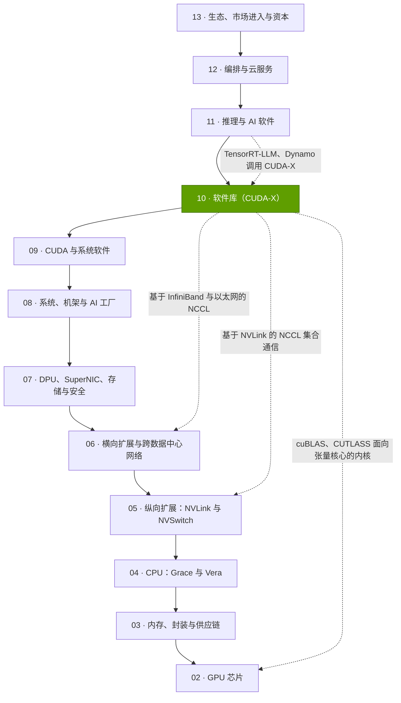
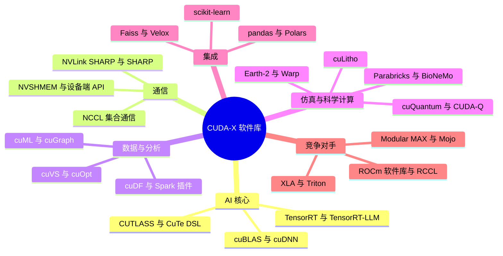

# 第 10 层 —— 软件库（CUDA-X）

> [!NOTE]
> 本页为英文原文的简体中文参考译文，仅供参考；如有出入，以[英文原文](../../../layers/10-libraries-cuda-x/index.md "English original")为准。

共 12 层中的第 10 层 · 将英伟达 GPU 变为数学、AI、数据、仿真与科学计算“现成引擎”的领域软件库 · 约 8 分钟阅读 · 最近核实：2026-11-05

## ⚡ 要点速览

- **[CUDA](../../glossary.md#cuda) 是编程语言；[CUDA-X](../../glossary.md#cuda-x) 则是大多数客户实际调用的、预先构建并调优的软件库货架：**[cuBLAS](../../glossary.md#cublas) 负责矩阵运算，[cuDNN](../../glossary.md#cudnn) 负责神经网络层，[NCCL](../../glossary.md#nccl) 负责多 GPU 通信，[TensorRT](../../glossary.md#tensorrt) 负责推理，[RAPIDS](../../glossary.md#rapids) 负责数据科学。英伟达（NVIDIA）称其拥有“数以百计的软件库” [[S10047]](../../../sources/bibliography.md#s10047)；本资料库对其中 29 个主要软件库进行了发布年份考证，其中 18 个于 2018 年以来推出。
- **[Q1 · 职能与失效后果]** 这一层的职能，是把每一代新 GPU 数据手册上的 FLOPS 转化为特定工作负载上的实际速度。Rubin 的稠密 [FP4](../../glossary.md#fp4) 算力是其 [BF16](../../glossary.md#bf16) 算力的 8.75 倍 [[S100]](../../../sources/bibliography.md#s100)，但在软件库推出 FP4 矩阵内核之前，这部分增益为零；[CUTLASS](../../glossary.md#cutlass) 已支持 [NVFP4](../../glossary.md#nvfp4) 与 MXFP4 [[S10009]](../../../sources/bibliography.md#s10009)。
- **NCCL 是多 GPU AI 的“隐形黏合剂”。** 在 GB200 [NVL72](../../glossary.md#nvl72) 上，交换机内规约可将一次理想化的 70B 梯度[全规约（all-reduce）](../../glossary.md#all-reduce)耗时从 0.31 s 减半至 0.16 s [[S34011]](../../../sources/bibliography.md#s34011)[[S200]](../../../sources/bibliography.md#s200)。NCCL 在 50 个月内发布了 19 个次版本 [[S10038]](../../../sources/bibliography.md#s10038)。
- **软件库让既有硬件持续变快：**仅凭软件，B200 上 DeepSeek-R1 的吞吐量就在 2025 年的四个月内从每 GPU 约 2,000 tokens/s 提升至 4,600 tokens/s [[S646]](../../../sources/bibliography.md#s646)。
- **广度创造 AI 以外的需求。** 样本中 2018 年以来推出的 18 个软件库里，有 12 个服务于数据、优化、检索、仿真、光刻、气候或量子计算。台积电（TSMC）已在量产中使用 [cuLitho](../../glossary.md#culitho)，英伟达及其合作伙伴称其在曲线掩模流程上可提速约 45 倍 [[S10031]](../../../sources/bibliography.md#s10031)。
- **重在集成，而非新 API：**无需修改的 pandas、Polars、scikit-learn、Spark 和 Faiss 代码，现已可在 GPU 上运行 [[S10013]](../../../sources/bibliography.md#s10013)[[S10017]](../../../sources/bibliography.md#s10017)[[S10015]](../../../sources/bibliography.md#s10015)[[S10019]](../../../sources/bibliography.md#s10019)[[S10025]](../../../sources/bibliography.md#s10025)。
- **弱点与看空情景：**加速效果参差不齐。在 AWS 运行的一项 1 TB Spark 测试中，GPU 仅比原生 Spark 快 1.06 倍，且慢于向量化 CPU 引擎，不过成本低约 80% [[S10020]](../../../sources/bibliography.md#s10020)。AI 核心是最容易被复制的部分：AMD 的 [RCCL](../../glossary.md#rccl) 正是基于 NCCL 自身代码构建 [[S10002]](../../../sources/bibliography.md#s10002)；而高通（Qualcomm）以约 $3.9B 收购 Modular（已于 2026-07-29 完成交割），瞄准的恰恰就是这一层 [[S90057]](../../../sources/bibliography.md#s90057)[[S9511]](../../../sources/bibliography.md#s9511)。

> [!TIP]
> **算例 —— 一次软件库更新值多少钱。** 2025 年 2 月至 5 月间，英伟达 [TensorRT-LLM](../../glossary.md#tensorrt-llm) 团队在没有任何新硬件的情况下，将 B200 上 DeepSeek-R1 的最大吞吐量从每 GPU 约 2,000 tokens/s 提升至约 4,600 tokens/s [[S646]](../../../sources/bibliography.md#s646)。按示意性的每 B200 小时 $4.99 计算（为 2025 年报道的公开价格，有待复核）[[S395]](../../../sources/bibliography.md#s395)，更新前一个 [GPU 小时](../../glossary.md#gpu-hour)产出 2,000 × 3,600 = 7.2M 个 token，每百万 token 成本约 $0.69；更新后产出 16.6M 个 token，每百万 token 成本约 $0.30。**结论：**这次软件库更新使每 token 服务成本下降约 57%，通常需要一代新芯片才能实现这样的提升。

## 本层在技术栈中的位置

## 本层全景图

## 八个问题一览

| # | 问题 | 简要回答 | 详见 |
|---|---|---|---|
| Q1 | 这一层承担什么职能？若薄弱会出什么问题？ | 把原始 FLOPS 与带宽转化为实际交付的速度；没有调优过的内核，新 GPU 或新格式就会闲置 | [CUDA-X 目录](the-cuda-x-catalog.md) |
| Q2 | 哪些指标重要？ | 峰值达成率、集合通信总线带宽与延迟、支持新硬件所需时间、相对 CPU 的端到端成本、集成广度 | 本页（下文）及 [NCCL](nccl-the-hidden-glue.md) |
| Q3 | 代际进步如何？ | 样本从 11 个软件库（2017 年）增至 29 个（2025 年）；NCCL 在 50 个月内从 2.13 升至 2.32；同一 GPU 上的软件增益达 2.3 倍 | [广度为何产生复利](why-library-breadth-compounds.md)、[NCCL](nccl-the-hidden-glue.md) |
| Q4 | 优势来源？ | 历代 GPU 上积累的调优成果，加上广度与框架集成 | [发展历程与构建方式](history-and-how-built.md) |
| Q5 | 最强挑战者？ | AI 领域是 AMD 的 ROCm 软件库（含 RCCL）；XLA、Triton 等编译器栈正在蚕食内核层 | [竞争格局](competition.md) |
| Q6 | 复制成本？ | AI 核心可在数年内重建；长尾的领域软件库才是代价高昂的部分 | [发展历程与构建方式](history-and-how-built.md) |
| Q7 | 路线图？ | 🟡 CuTe DSL 即将结束 beta（目标已推迟），🟢 NCCL GPU 发起式网络通信已发布，零代码修改集成持续增加 | [路线图](roadmap.md) |
| Q8 | 价值池与并购？ | 软件库大多免费，通过 GPU 与软件许可变现；可移植性层是并购标的 | [价值链与企业发展](value-chain-and-corp-dev.md) |

## 关键指标

**[Q2 · 关键指标]** 评判一个软件库，看它能把多少硬件能力转化为完成的工作，以及代价几何：

| 指标 | 衡量什么 | 为何重要 | 示例 |
|---|---|---|---|
| 峰值达成率 | 实际交付 FLOPS ÷ 数据手册 FLOPS（整个作业层面即 [MFU](../../glossary.md#mfu)） | 每 FLOP 的实际价格 | Llama 3 405B 在 16,384 块 H100 上以 38–41% MFU 运行 [[S34006]](../../../sources/bibliography.md#s34006) |
| 集合通信[总线带宽](../../glossary.md#bus-bandwidth)与延迟 | 全规约期间每 GPU 持续的 GB/s；小消息每条的 µs | 能否扩展到单台服务器之外 | H100 集群的验收标准约为 400–450 GB/s 的全规约总线带宽 [[S10022]](../../../sources/bibliography.md#s10022) |
| 支持新芯片所需时间 | 从新 GPU 或新数值格式发布到推出调优内核所需的周数 | 延迟会让 FLOPS 闲置 | CUTLASS 已覆盖 NVFP4 与 MXFP4 [[S10009]](../../../sources/bibliography.md#s10009) |
| 相对 CPU 的端到端速度与成本 | 真实流水线上的作业运行时间与作业成本 | 非 AI 买家按作业付费 | Spark：快 1.06 倍，便宜约 5 倍 [[S10020]](../../../sources/bibliography.md#s10020) |
| 广度 | 可原生在 GPU 上运行的领域与框架 | 每增加一项都会带来 GPU 需求 | 2020 年以来 5 项零代码修改集成 |

**[Q3 · 代际进步]** 这一层的进步既体现为新的软件库，也体现为既有硬件上的软件增益：

## 本层各页

| 页面 | 你将了解 |
|---|---|
| [CUDA-X 目录](the-cuda-x-catalog.md) | 每个主要软件库做什么，以及谁为其工作负载买单 |
| [NCCL：隐形黏合剂](nccl-the-hidden-glue.md) | 集合通信，环形、树形与交换机内规约的对比，一个 70B 算例，以及替代方案 |
| [软件库广度为何产生复利](why-library-breadth-compounds.md) | 新的 GPU 工作负载、Spark 与 pandas 示例、集成情况、软件库数量 |
| [竞争格局](competition.md) | ROCm、oneAPI、XLA 等软件库栈与 CUDA-X 的对比 |
| [发展历程与英伟达的构建方式](history-and-how-built.md) | 时间线、关键决策、复制成本、反事实推演 |
| [路线图](roadmap.md) | 软件库即将推出的内容，以及哪些因素会改变格局 |
| [价值链与企业发展视角](value-chain-and-corp-dev.md) | 谁攫取了免费软件库的价值、非上市公司、并购 |

🔧 技术细节：开放的外围，封闭的核心

许可分为两个层级：PyPI 将 cuBLAS 和 cuDNN 列为英伟达专有软件 [[S10038]](../../../sources/bibliography.md#s10038)。外围则是开放的：CUTLASS（BSD-3）[[S10038]](../../../sources/bibliography.md#s10038)、cuDF（Apache 2.0）[[S10011]](../../../sources/bibliography.md#s10011)、cuOpt（Apache 2.0）[[S10026]](../../../sources/bibliography.md#s10026)，以及 Warp（自 2025 年 3 月起采用 Apache 2.0）[[S10028]](../../../sources/bibliography.md#s10028)。NCCL 当前的源文件带有 Apache-2.0 许可标记 [[S10000]](../../../sources/bibliography.md#s10000)。第 09 层介绍其下一层：[CUDA 与系统软件](../09-cuda-and-system-software/index.md)。

## 🎯 企业发展视角

1. **一款带动硬件销售的免费产品。** 大多数 CUDA-X 软件库是免费的；其价值体现在 GPU 定价与 AI Enterprise 许可中。英伟达的溢价中，有多少来自软件库广度而非芯片本身？
2. **开放外围，封闭核心。** 开源 cuDF、cuOpt 和 Warp 吸引了外部贡献者，而 cuBLAS 和 cuDNN 仍保持闭源。对挑战者而言，是追平封闭的 AI 核心更便宜，还是瞄准英伟达软件库已开源、因而可移植的领域更划算？
3. **高通视角的问题（仅基于公开信息）：**鉴于 Modular（Mojo 与 MAX）正以 $3.9B 被收购 [[S90057]](../../../sources/bibliography.md#s90057)，且 AI200/AI250 推理机架已经发布 [[S90028]](../../../sources/bibliography.md#s90028)，一个以推理为先的平台在第一天就必须对标哪些 CUDA-X 软件库家族（GEMM、注意力、集合通信、推理服务），又可以跳过哪些（光刻、基因组学、数据科学）？
4. **NCCL API 已成事实标准。** RCCL 沿用了 NCCL 的 API [[S10002]](../../../sources/bibliography.md#s10002)，因此各框架几乎无需改代码即可切换厂商。一种新的[纵向扩展（scale-up）](../../glossary.md#scale-up)互连架构（[UALink](../../glossary.md#ualink)、[ESUN](../../glossary.md#esun)）是否需要一个兼容 NCCL 的软件库才具有可信度？又由谁来提供？

## 📚 来源（Sources）

<!-- Auto-generated from the [S…] citations on this page by `make build`. Edit sources/registry/*.csv, not this list. -->

- [**S100**](../../../sources/bibliography.md#s100) NVIDIA Technical Blog, *Inside the NVIDIA Vera Rubin Platform: Six New Chips, One AI Supercomputer*, 2026-01-05. [Link](https://developer.nvidia.com/blog/inside-the-nvidia-rubin-platform-six-new-chips-one-ai-supercomputer/)
- [**S200**](../../../sources/bibliography.md#s200) NVIDIA, *NVIDIA NVLink and NVLink Switch (product page with NVLink and NVLink Switch specification tables)*, 2026-09. [Link](https://www.nvidia.com/en-us/data-center/nvlink/)
- [**S395**](../../../sources/bibliography.md#s395) Lambda, *Lambda GPU cloud pricing*, 2025. [Link](https://lambda.ai/pricing)
- [**S646**](../../../sources/bibliography.md#s646) NVIDIA TensorRT-LLM team, *Optimizing DeepSeek R1 Throughput on NVIDIA Blackwell GPUs: A Deep Dive for Developers (TensorRT-LLM tech blog 3)*, 2025-05-30. [Link](https://github.com/NVIDIA/TensorRT-LLM/blob/main/docs/source/blogs/tech_blog/blog03_Optimizing_DeepSeek_R1_Throughput_on_NVIDIA_Blackwell_GPUs.md)
- [**S9511**](../../../sources/bibliography.md#s9511) Nasdaq (Qualcomm press release), *Qualcomm Completes Acquisition of Modular*, 2026-07-29. [Link](https://www.nasdaq.com/press-release/qualcomm-completes-acquisition-modular-2026-07-29)
- [**S10000**](../../../sources/bibliography.md#s10000) NVIDIA (GitHub: NVIDIA/nccl), *NCCL README and makefiles/version.mk (master)*, 2026-11. [Link](https://github.com/NVIDIA/nccl/blob/master/README.md)
- [**S10002**](../../../sources/bibliography.md#s10002) AMD (GitHub: ROCm/rccl), *RCCL README and LICENSE (develop branch)*, 2026-11. [Link](https://github.com/ROCm/rccl/blob/develop/README.md)
- [**S10009**](../../../sources/bibliography.md#s10009) NVIDIA (GitHub: NVIDIA/cutlass), *CUTLASS README (4.8.1)*, 2026-10. [Link](https://github.com/NVIDIA/cutlass/blob/main/README.md)
- [**S10011**](../../../sources/bibliography.md#s10011) NVIDIA RAPIDS (GitHub: rapidsai/cudf), *cuDF README*, 2026-11. [Link](https://github.com/rapidsai/cudf/blob/main/README.md)
- [**S10013**](../../../sources/bibliography.md#s10013) NVIDIA RAPIDS (GitHub: rapidsai/cudf docs), *cudf.pandas documentation (index and benchmarks)*, 2026-11. [Link](https://github.com/rapidsai/cudf/blob/main/docs/cudf/source/cudf_pandas/index.rst)
- [**S10015**](../../../sources/bibliography.md#s10015) NVIDIA RAPIDS (GitHub: rapidsai/cuml docs), *cuml.accel overview and benchmarks*, 2026. [Link](https://github.com/rapidsai/cuml/blob/main/docs/source/cuml-accel/benchmarks.rst)
- [**S10017**](../../../sources/bibliography.md#s10017) Polars (GitHub: pola-rs/polars docs), *Polars user guide: GPU Support [Open Beta]*, 2026-11. [Link](https://github.com/pola-rs/polars/blob/main/docs/source/user-guide/gpu-support.md)
- [**S10019**](../../../sources/bibliography.md#s10019) NVIDIA (GitHub: NVIDIA/cudf-spark), *NVIDIA cuDF plugin for Apache Spark README and docs index*, 2026-11. [Link](https://github.com/NVIDIA/cudf-spark/blob/main/README.md)
- [**S10020**](../../../sources/bibliography.md#s10020) AWS Labs (GitHub: awslabs/data-on-eks), *Apache Spark with NVIDIA RAPIDS GPU Acceleration Benchmarks (data-on-eks)*, 2026-01-12. [Link](https://github.com/awslabs/data-on-eks/blob/main/website/docs/benchmarks/spark-rapids-gpu-benchmark.md)
- [**S10022**](../../../sources/bibliography.md#s10022) Saturn Cloud, *Crusoe NCCL cluster validation (guide)*, 2025. [Link](https://saturncloud.io/blog/crusoe-nccl-cluster-validation/)
- [**S10025**](../../../sources/bibliography.md#s10025) Engineering at Meta, *Accelerating GPU indexes in Faiss with NVIDIA cuVS*, 2025-05-08. [Link](https://engineering.fb.com/2025/05/08/data-infrastructure/accelerating-gpu-indexes-in-faiss-with-nvidia-cuvs/)
- [**S10026**](../../../sources/bibliography.md#s10026) NVIDIA (GitHub: NVIDIA/cuopt), *cuOpt README and LICENSE*, 2026-11. [Link](https://github.com/NVIDIA/cuopt/blob/main/README.md)
- [**S10028**](../../../sources/bibliography.md#s10028) NVIDIA (GitHub: NVIDIA/warp), *NVIDIA Warp README and CHANGELOG*, 2026-11-02. [Link](https://github.com/NVIDIA/warp/blob/main/CHANGELOG.md)
- [**S10031**](../../../sources/bibliography.md#s10031) NVIDIA Newsroom, *TSMC and Synopsys Bring Breakthrough NVIDIA Computational Lithography Platform to Production*, 2024-03-18. [Link](https://nvidianews.nvidia.com/news/tsmc-synopsys-nvidia-culitho)
- [**S10038**](../../../sources/bibliography.md#s10038) Python Package Index, *PyPI JSON release histories for NVIDIA library packages (nvidia-nccl-cu11/cu12/cu13, cudf-cu12, cudf-polars-cu12, cuml-cu12, cugraph-cu12, cuvs-cu12, warp-lang, cuquantum-python, cuda-quantum, cudaq, cuopt-cu12, nvidia-cutlass-dsl, earth2studio, nvmath-python, cuequivariance, nvidia-cudss-cu12, nvidia-modulus, nvidia-physicsnemo)*, 2026-11-05. [Link](https://pypi.org/)
- [**S10047**](../../../sources/bibliography.md#s10047) NVIDIA Developer, *NVIDIA CUDA-X Libraries (developer page)*, 2026. [Link](https://developer.nvidia.com/cuda/cuda-x-libraries)
- [**S34006**](../../../sources/bibliography.md#s34006) arXiv:2407.21783 (Llama Team (AI @ Meta)), *The Llama 3 Herd of Models*, 2024-07-31. [Link](https://arxiv.org/abs/2407.21783)
- [**S34011**](../../../sources/bibliography.md#s34011) Journal of Parallel and Distributed Computing (Pitch Patarasuk, Xin Yuan), *Bandwidth optimal all-reduce algorithms for clusters of workstations*, 2009-02. [Link](https://doi.org/10.1016/j.jpdc.2008.09.002)
- [**S90028**](../../../sources/bibliography.md#s90028) TechRepublic, *Qualcomm unveils AI chips to rival Nvidia, AMD*, 2025-10-27. [Link](https://techrepublic.com/article/news-qualcomm-unveils-ai-chips-to-rival-nvidia-amd)
- [**S90057**](../../../sources/bibliography.md#s90057) StorageReview, *Qualcomm unveils Dragonfly data center roadmap: C1000 CPU, AI300 accelerator and Modular acquisition*, 2026-06-24. [Link](https://www.storagereview.com/es/news/qualcomm-unveils-dragonfly-data-center-roadmap-c1000-cpu-ai300-accelerator-and-modular-acquisition)
