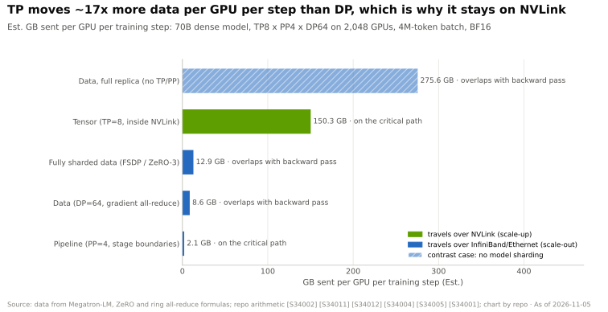
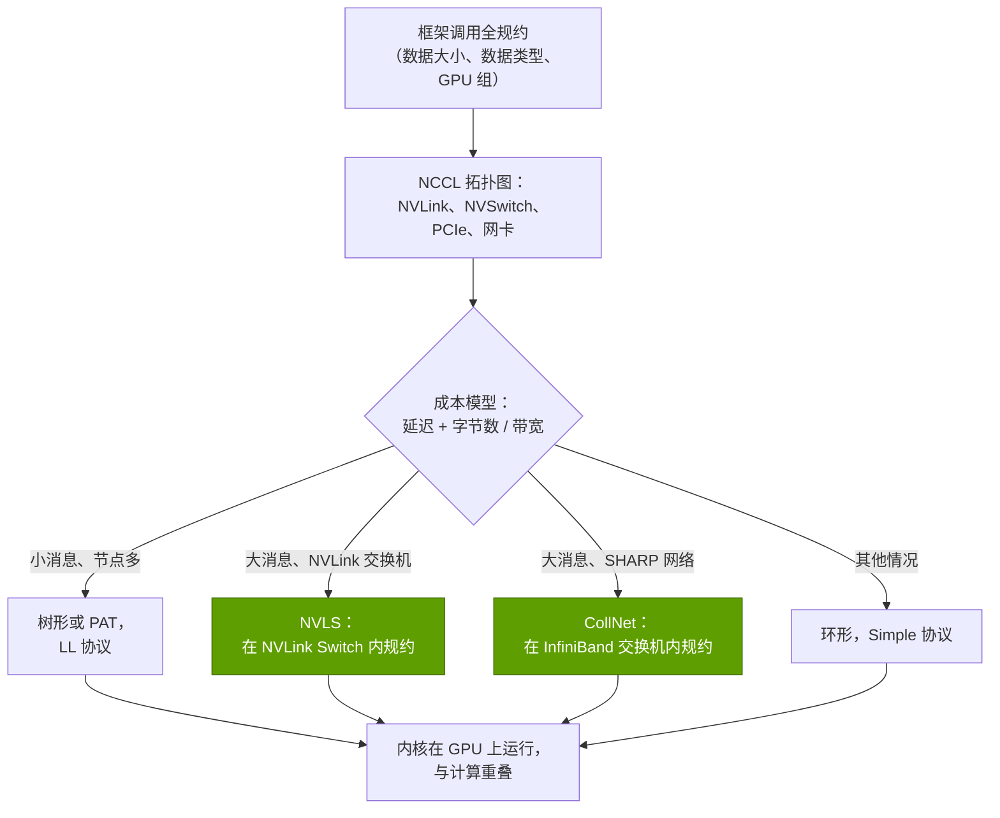
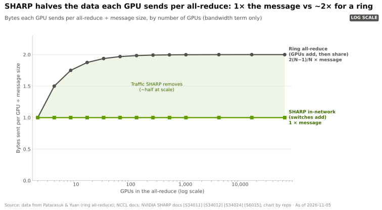
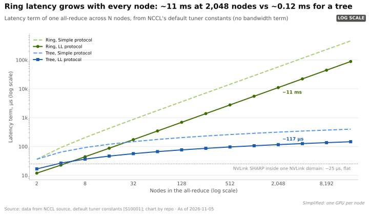
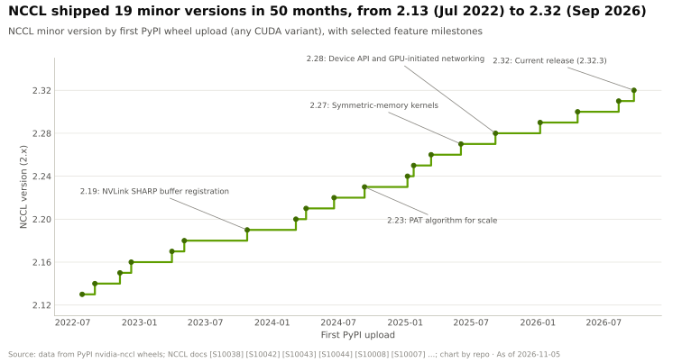

# NCCL：多 GPU AI 的隐形黏合剂

> [!NOTE]
> 本页为英文原文的简体中文参考译文，仅供参考；如有出入，以[英文原文](../../../layers/10-libraries-cuda-x/nccl-the-hidden-glue.md "English original")为准。

第 10 层 · 软件库（CUDA-X） · 约 12 分钟阅读 · 最近核实：2026-11-05

## ⚡ 要点速览

- **[NCCL](../../glossary.md#nccl)（读作“nickel”）负责在 GPU 之间搬运数据。** 它在 [PCIe](../../glossary.md#pcie)、[NVLink](../../glossary.md#nvlink)、[NVSwitch](../../glossary.md#nvswitch)、[InfiniBand](../../glossary.md#infiniband) 和 TCP/IP 套接字之上运行全规约（all-reduce）、全收集（all-gather）、规约散射（reduce-scatter）、广播以及发送/接收等通信模式，既可在单台服务器内，也可跨越数千台服务器 [[S10000]](../../../sources/bibliography.md#s10000)。
- **它能感知拓扑。** NCCL 会探测 GPU 与网卡之间的链路，然后依据内置的成本模型选择一种算法（环形、树形、CollNet/SHARP、NVLS、PAT）和一种协议 [[S10001]](../../../sources/bibliography.md#s10001)。
- **交换机内规约是英伟达（NVIDIA）的软硬件优势所在。** 借助 InfiniBand 交换机中的 [SHARP](../../glossary.md#sharp) 或 NVLink 交换机中的 [NVLink SHARP](../../glossary.md#nvlink-sharp)（NVLS），每块 GPU 只需发送约一次数据，而不是约两次。在 GB200 [NVL72](../../glossary.md#nvl72) 上，一次理想化的 70B 梯度全规约耗时从 0.31 s 降至 0.16 s [[S34011]](../../../sources/bibliography.md#s34011)[[S200]](../../../sources/bibliography.md#s200)。
- **在大规模场景和推理中，瓶颈是延迟而非带宽。** 按 NCCL 自身的成本模型，环形算法的固定延迟在 2,048 个节点时达到约 11 ms，而[树形算法](../../glossary.md#tree-all-reduce)约为 0.12 ms [[S10001]](../../../sources/bibliography.md#s10001)。在下文的[解码（decode）](../../glossary.md#decode)算例中，小规模全规约占每个 token（词元）耗时的约 14%。
- **NCCL 迭代迅速：**从 2.13（2022 年 7 月）到 2.32（2026 年 9 月），50 个月内发布了 19 个次版本，新增了对称内存内核与 GPU 发起式网络通信 [[S10038]](../../../sources/bibliography.md#s10038)[[S10007]](../../../sources/bibliography.md#s10007)。
- **代码是开源的，竞争对手也在用。** NCCL 的源代码带有 Apache-2.0 许可标记 [[S10000]](../../../sources/bibliography.md#s10000)。AMD 的 [RCCL](../../glossary.md#rccl) 基于 NCCL 的代码构建并沿用其 API [[S10002]](../../../sources/bibliography.md#s10002)；微软（Microsoft）的 [MSCCL++](../../glossary.md#msccl) 称在小消息上可达 NCCL 速度的 2.8 倍（🟡 厂商基准测试）[[S10004]](../../../sources/bibliography.md#s10004)。真正难以复制的是它与英伟达交换机的协同设计。

## NCCL 做什么

**类比。** 想象一场有 72 位厨师参加的百家宴。在[全规约（all-reduce）](../../glossary.md#all-reduce)中，每人带来一道菜，离开时都带走汇总后的整桌饭菜（数据并行梯度）。在[全收集（all-gather）](../../glossary.md#all-gather)中，每人离开时都带走每道菜的一份副本（分片权重）。在[规约散射（reduce-scatter）](../../glossary.md#reduce-scatter)中，每位厨师离开时带走一道做好的菜。[全交换（all-to-all）](../../glossary.md#all-to-all)则像邮件分拣：每位厨师都要把不同的东西分别送给其他每位厨师，就像混合专家模型中 token 被分发给各自专家那样。入门篇 [P4](../../primers/P4-parallelism-explained.md) 将每种并行策略与其对应的集合通信一一对应。下图说明了各自数据量为何相差如此之大：

**拓扑感知。** 启动时，NCCL 会绘制出哪些 GPU 共享同一台 NVLink 交换机、哪块[网卡（NIC）](../../glossary.md#nic)离每块 GPU 最近，以及共有多少条网络轨道（rail）。它构建多条并行的环和树（即“通道”），使每条链路同时承载流量，并针对每种算法和协议，以“延迟 + 字节数 ÷ 带宽”为每次调用估算代价。代价最低者胜出 [[S10001]](../../../sources/bibliography.md#s10001)。

> [!TIP]
> **算例 —— 为什么推理中的全规约受限于延迟。** 在一台 NVLink 5 服务器上，以 8 路张量并行部署一个 70B 模型（80 层，隐藏维度 8,192）。Megatron 式张量并行在每次前向传播中每层需要两次全规约 [[S34001]](../../../sources/bibliography.md#s34001)。为 64 位用户的批次解码一个 token 时，每条消息为 64 × 8,192 × 2 字节 ≈ 1 MB。环形算法的带宽项为 1.75 × 1 MB ÷ 900 GB/s ≈ 2 µs [[S200]](../../../sources/bibliography.md#s200)。按 NCCL 在 NVLink 上 LL 协议的默认常数，其延迟项为 6.6 + 14 × 0.6 ≈ 15 µs [[S10001]](../../../sources/bibliography.md#s10001)。因此每次全规约约 17 µs，其中近 90% 是固定延迟。每个 token 需要 160 次全规约，合计约 2.7 ms，在每用户 50 tokens/s（每 token 20 ms）的速度下约占 14%。**结论：**对于推理，NCCL 的微秒级延迟比其 GB/s 带宽更重要，这正是 NCCL 2.27 推出低延迟对称内存内核的原因 [[S10044]](../../../sources/bibliography.md#s10044)。

## 环形、树形与交换机内规约

| 算法 | 工作原理 | 每块 GPU 发送的数据量 | 延迟随什么增长 | 最适用于 |
|---|---|---|---|---|
| **[环形（Ring）](../../glossary.md#ring-all-reduce)** | 数据块沿环路传递，途中累加，然后再循环传回 [[S34011]](../../../sources/bibliography.md#s34011) | 约为消息的 2 倍 | GPU 数量（2(N−1) 跳） | 大消息、中等规模 |
| **[树形（Tree）](../../glossary.md#tree-all-reduce)** | 沿树向上求和，再向下广播；NCCL 使用两棵互补的树 [[S10041]](../../../sources/bibliography.md#s10041) | 约为消息的 2 倍 | log2(N) | 大规模下的小消息 |
| **CollNet / SHARP** | 由 InfiniBand 交换机在传输途中累加数据 [[S34024]](../../../sources/bibliography.md#s34024) | 约 1 倍 | 交换机跳数 | 支持 SHARP 网络的大型集群 |
| **NVLS** | NVLink Switch 在纵向扩展域内执行规约与多播 [[S10042]](../../../sources/bibliography.md#s10042) | 约 1 倍 | 基本恒定（模型中约 25 µs）[[S10001]](../../../sources/bibliography.md#s10001) | NVL8 或 NVL72 域内的大消息 |
| **[PAT](../../glossary.md#pat-algorithm)** | 用于全收集与规约散射的对数级调度（NCCL 2.23）[[S10043]](../../../sources/bibliography.md#s10043) | 与环形相同 | log2(N) | 每 GPU 分片很小的超大型作业 |

第一张图展示带宽一侧（网络内规约使每块 GPU 的发送量减半），第二张图展示延迟一侧（环形算法的延迟随节点数增加而增长）。

> [!TIP]
> **算例 —— 一次 70B 梯度全规约：环形对比 NVLink SHARP。** 70B 参数 × 2 字节（[BF16](../../glossary.md#bf16)）= 140 GB 梯度。*在 GB200 NVL72 上采用环形算法：*每块 GPU 需以单向 900 GB/s（NVLink 5）[[S200]](../../../sources/bibliography.md#s200) 发送 2 × 71/72 × 140 ≈ 276 GB，耗时 **0.31 s**。*在同一机架上采用 NVLS：*每块 GPU 只需发送一次 140 GB，由交换机返回求和结果，耗时 140 ÷ 900 = **0.16 s**。在 800 Gb/s InfiniBand（100 GB/s）上跨 64 块 GPU，同样的对比为 2.8 s 对比使用 SHARP 后的 1.4 s [[S251]](../../../sources/bibliography.md#s251)。**结论：**交换机内规约的价值约相当于一条快 2 倍的链路，且无需额外的网卡或交换机端口。实际运行会更慢，大部分开销会被反向传播掩盖，且通信量会被分片（FSDP）（[P4](../../primers/P4-parallelism-explained.md)）。

🔧 技术细节：协议、通道与设备端 API

- **协议。** *LL*（低延迟）为每 4 字节附加一个标志位，使接收方无需额外同步即可轮询：延迟最低，带宽约为一半。*LL128* 以每 128 字节为单位做同样的事；*Simple* 则使用大缓冲区和内存栅栏（fence）以获得峰值带宽 [[S10001]](../../../sources/bibliography.md#s10001)。
- **通道。** 一条消息被拆分到多个环或树上，每个环或树由各自的线程块驱动，以填满每条 NVLink 和每条网卡轨道。
- **总线带宽。** 对于全规约，nccl-tests 报告的[总线带宽](../../glossary.md#bus-bandwidth) = 算法带宽 × 2(N−1)/N，从而使结果可与链路速度直接比较 [[S34012]](../../../sources/bibliography.md#s34012)。
- **设备端 API（2.28）。** 内核自行发起通信：通过 NVLink 执行 load/store，通过 NVLink SHARP 执行 multimem 操作，并通过 InfiniBand/RoCE 进行 [GPU 发起式网络通信](../../glossary.md#gpu-initiated-networking)（GIN）。它面向[混合专家模型（MoE）](../../glossary.md#mixture-of-experts)的分发场景，因为在这类场景中 CPU 往返的代价过高 [[S10007]](../../../sources/bibliography.md#s10007)[[S10008]](../../../sources/bibliography.md#s10008)。

## 为什么 NCCL 性能成了事实上的基准

**[Q2 · 关键指标]** 对集群买家而言，两个 NCCL 数字就能概括整个网络：大消息下的全规约总线带宽，以及小消息下的延迟。云厂商及其客户在验收集群前都会运行 `nccl-tests`。一份公开的验证指南将配备 NVLink 与 400G InfiniBand 的 H100 节点的全规约总线带宽目标定为约 400–450 GB/s [[S10022]](../../../sources/bibliography.md#s10022)。每个主流框架都通过 NCCL 或其 API 克隆访问网络，因此这些结果可直接映射为训练时间；而英伟达既拥有这个软件库，也拥有衡量它所用的硬件。

**[Q3 · 代际进步]** NCCL 一直紧跟硬件路线图：2.19（2023 年 10 月）支持 NVLink SHARP [[S10042]](../../../sources/bibliography.md#s10042)，🟡 2.23 引入 PAT [[S10043]](../../../sources/bibliography.md#s10043)，2.27 推出对称内存内核 [[S10044]](../../../sources/bibliography.md#s10044)（博客日期凭记忆给出，未重新查证），2.28 推出带有 GPU 发起式网络通信的设备端 API [[S10008]](../../../sources/bibliography.md#s10008)：

## 替代方案

| 软件库 | 所有者 | 是什么 | 与 NCCL 相比的结论 |
|---|---|---|---|
| **RCCL** | AMD | 面向 Instinct GPU 的集合通信库：环形与树形，可选 MSCCL++ 路径；LICENSE 文件注明使用了英伟达代码 [[S10002]](../../../sources/bibliography.md#s10002) | 🟨 有意采用相同 API；针对 AMD 的链路调优，未列出交换机内规约 |
| **MSCCL++** | 微软 | 面向英伟达和 AMD GPU、用于构建自定义集合通信的 GPU 驱动单边原语 [[S10003]](../../../sources/bibliography.md#s10003)；称比 NCCL 快最高 2.8 倍（小消息）和 2.4 倍（大消息）[[S10004]](../../../sources/bibliography.md#s10004) | 🟦 用于自定义算法的工具包；在小消息上最强 |
| **[Gloo](../../glossary.md#gloo)** | Meta（PyTorch） | 基于 TCP 的集合通信，主要面向 CPU 张量 [[S10006]](../../../sources/bibliography.md#s10006) | 🟥 并非 GPU 速度层面的对手；只是后备方案 |
| **[MPI](../../glossary.md#mpi) / [UCC](../../glossary.md#ucc)** | 开放标准 / UCF 联盟 | HPC 消息传递；UCC 优先使用硬件集合通信 [[S10005]](../../../sources/bibliography.md#s10005)；NCCL 可在 MPI 程序内运行 [[S10000]](../../../sources/bibliography.md#s10000) | 🟦 在 HPC 中心形成互补 |
| **谷歌 ICI 集合通信** | 谷歌（Google） | 由 XLA 在 TPU 环面拓扑上调度集合通信，每个 v4 pod 含 4,096 颗芯片 [[S236]](../../../sources/bibliography.md#s236)[[S237]](../../../sources/bibliography.md#s237) | 🟦 由编译器调度，与 TPU 绑定 |
| **DeepEP** | DeepSeek | 开源 MoE 全交换内核：在 H800 上，NVLink 节点内约 153 GB/s，经 RDMA 约 43–58 GB/s [[S5005]](../../../sources/bibliography.md#s5005) | 🟦 与 NCCL 并行使用的专用工具 |

> [!NOTE]
> **🐂 看多观点：**NCCL 是开源的，但其最佳路径（NVLS、CollNet/SHARP、GPU 发起式网络通信）都需要英伟达的交换机和网卡，因此每次发布都会抬高竞争对手的硬件门槛 [[S10001]](../../../sources/bibliography.md#s10001)[[S10007]](../../../sources/bibliography.md#s10007)。

> [!WARNING]
> **🐻 看空观点：**集合通信是一个已被充分研究的问题。RCCL 已在复用 NCCL 的代码与 API [[S10002]](../../../sources/bibliography.md#s10002)，MSCCL++ 报告其性能超过 NCCL [[S10004]](../../../sources/bibliography.md#s10004)，DeepSeek 也自行编写了 MoE 内核 [[S5005]](../../../sources/bibliography.md#s5005)。开放的[纵向扩展（scale-up）](../../glossary.md#scale-up)互连架构（[UALink](../../glossary.md#ualink)、[ESUN](../../glossary.md#esun)）为竞争对手提供了可瞄准的硬件。如果集合通信库变得可互换，NCCL 的护城河就会收缩到英伟达的交换机本身。参见[竞争格局](competition.md)。

## 🎯 企业发展视角

1. **API 就是标准。** RCCL 沿用了 NCCL 的接口 [[S10002]](../../../sources/bibliography.md#s10002)。新的加速器在第一天就需要一个兼容 NCCL 的软件库：自建、授权，还是采用 MSCCL++ 或 UCC？
2. **网络内计算才是具备防御性的部分。** 软件库代码是开源的 [[S10000]](../../../sources/bibliography.md#s10000)；价值在于能对数据执行规约的交换芯片（NVLink Switch、Quantum、[Spectrum-X](../../glossary.md#spectrum-x)）。哪些商用交换芯片厂商能为 UALink 或 ESUN 网络提供同等的规约能力？参见[第 06 层](../06-scale-out-scale-across-networking/index.md)。
3. **推理把衡量指标转向微秒。** 小消息延迟如今与带宽同等重要，因此拥有低延迟集合通信 IP（MoE 分发内核、GPU 发起式网络通信）的团队，是潜在的收购式招聘（acquihire）标的。
4. **高通视角的问题（仅基于公开信息）：**AI300 被描述为采用 UALink 和 ESUN 纵向扩展 [[S90060]](../../../sources/bibliography.md#s90060)。哪个集合通信库将运行在这一互连架构上？它是否需要交换机内规约，才能在 70B 级全规约上具备竞争力？

## 📚 来源（Sources）

<!-- Auto-generated from the [S…] citations on this page by `make build`. Edit sources/registry/*.csv, not this list. -->

- [**S200**](../../../sources/bibliography.md#s200) NVIDIA, *NVIDIA NVLink and NVLink Switch (product page with NVLink and NVLink Switch specification tables)*, 2026-09. [Link](https://www.nvidia.com/en-us/data-center/nvlink/)
- [**S236**](../../../sources/bibliography.md#s236) Google Cloud, *TPU v4 - Cloud TPU documentation*, 2022. [Link](https://docs.cloud.google.com/tpu/docs/v4)
- [**S237**](../../../sources/bibliography.md#s237) arXiv (Norman P. Jouppi et al.), *TPU v4: An Optically Reconfigurable Supercomputer for Machine Learning with Hardware Support for Embeddings (ISCA 2023)*, 2023-04. [Link](https://arxiv.org/abs/2304.01433)
- [**S251**](../../../sources/bibliography.md#s251) InfiniBand Trade Association, *InfiniBand Roadmap: charting speeds for future needs*, 2023. [Link](https://www.infinibandta.org/infiniband-roadmap-charting-speeds-for-future-needs)
- [**S5005**](../../../sources/bibliography.md#s5005) DeepSeek-AI (GitHub) (DeepSeek-AI), *DeepEP: an efficient expert-parallel communication library (README v1.2.1)*, 2025. [Link](https://github.com/deepseek-ai/DeepEP/blob/v1.2.1/README.md)
- [**S10000**](../../../sources/bibliography.md#s10000) NVIDIA (GitHub: NVIDIA/nccl), *NCCL README and makefiles/version.mk (master)*, 2026-11. [Link](https://github.com/NVIDIA/nccl/blob/master/README.md)
- [**S10001**](../../../sources/bibliography.md#s10001) NVIDIA (GitHub: NVIDIA/nccl), *NCCL source: default tuner constants (src/tuning/cost_model.cc) and algorithm list (src/include/device.h)*, 2026-11. [Link](https://github.com/NVIDIA/nccl/blob/master/src/tuning/cost_model.cc)
- [**S10002**](../../../sources/bibliography.md#s10002) AMD (GitHub: ROCm/rccl), *RCCL README and LICENSE (develop branch)*, 2026-11. [Link](https://github.com/ROCm/rccl/blob/develop/README.md)
- [**S10003**](../../../sources/bibliography.md#s10003) Microsoft (GitHub: microsoft/mscclpp), *MSCCL++ README*, 2026-11. [Link](https://github.com/microsoft/mscclpp/blob/main/README.md)
- [**S10004**](../../../sources/bibliography.md#s10004) arXiv:2504.09014 (Microsoft Research and collaborators), *MSCCL++: Rethinking GPU Communication Abstractions for AI Inference*, 2025-04. [Link](https://arxiv.org/abs/2504.09014)
- [**S10005**](../../../sources/bibliography.md#s10005) UCF / OpenUCX (GitHub: openucx/ucc), *Unified Collective Communication (UCC) README*, 2026-11. [Link](https://github.com/openucx/ucc/blob/master/README.md)
- [**S10006**](../../../sources/bibliography.md#s10006) Meta / PyTorch (GitHub: pytorch/gloo), *Gloo README*, 2026-11. [Link](https://github.com/pytorch/gloo/blob/main/README.md)
- [**S10007**](../../../sources/bibliography.md#s10007) arXiv:2511.15076 (NVIDIA authors), *GPU-Initiated Networking for NCCL*, 2025-11. [Link](https://arxiv.org/abs/2511.15076)
- [**S10008**](../../../sources/bibliography.md#s10008) NVIDIA Docs, *NCCL User Guide: Device-Initiated Communication (2.28.3 and 2.32.3 archives)*, 2025-09. [Link](https://docs.nvidia.com/deeplearning/nccl/archives/nccl_2283/user-guide/docs/usage/deviceapi.html)
- [**S10022**](../../../sources/bibliography.md#s10022) Saturn Cloud, *Crusoe NCCL cluster validation (guide)*, 2025. [Link](https://saturncloud.io/blog/crusoe-nccl-cluster-validation/)
- [**S10038**](../../../sources/bibliography.md#s10038) Python Package Index, *PyPI JSON release histories for NVIDIA library packages (nvidia-nccl-cu11/cu12/cu13, cudf-cu12, cudf-polars-cu12, cuml-cu12, cugraph-cu12, cuvs-cu12, warp-lang, cuquantum-python, cuda-quantum, cudaq, cuopt-cu12, nvidia-cutlass-dsl, earth2studio, nvmath-python, cuequivariance, nvidia-cudss-cu12, nvidia-modulus, nvidia-physicsnemo)*, 2026-11-05. [Link](https://pypi.org/)
- [**S10041**](../../../sources/bibliography.md#s10041) NVIDIA Technical Blog, *Massively Scale Your Deep Learning Training with NCCL 2.4*, 2019-02. [Link](https://developer.nvidia.com/blog/massively-scale-deep-learning-training-nccl-2-4/)
- [**S10042**](../../../sources/bibliography.md#s10042) NVIDIA Docs, *NCCL Release Notes (2.19.3)*, 2023-10. [Link](https://docs.nvidia.com/deeplearning/nccl/archives/nccl_2193/pdf/NCCL-Release-Notes.pdf)
- [**S10043**](../../../sources/bibliography.md#s10043) NVIDIA Technical Blog, *New Scaling Algorithm and Initialization with NVIDIA Collective Communications Library 2.23*, 2024-09. [Link](https://developer.nvidia.com/blog/new-scaling-algorithm-and-initialization-with-nvidia-collective-communications-library-2-23/)
- [**S10044**](../../../sources/bibliography.md#s10044) NVIDIA Technical Blog, *Enabling Fast Inference and Resilient Training with NCCL 2.27*, 2025-06. [Link](https://developer.nvidia.com/blog/enabling-fast-inference-and-resilient-training-with-nccl-2-27/)
- [**S34001**](../../../sources/bibliography.md#s34001) arXiv:1909.08053 (Mohammad Shoeybi, Mostofa Patwary, Raul Puri et al. (NVIDIA)), *Megatron-LM: Training Multi-Billion Parameter Language Models Using Model Parallelism*, 2019-09-17. [Link](https://arxiv.org/abs/1909.08053)
- [**S34011**](../../../sources/bibliography.md#s34011) Journal of Parallel and Distributed Computing (Pitch Patarasuk, Xin Yuan), *Bandwidth optimal all-reduce algorithms for clusters of workstations*, 2009-02. [Link](https://doi.org/10.1016/j.jpdc.2008.09.002)
- [**S34012**](../../../sources/bibliography.md#s34012) NVIDIA (GitHub), *NCCL Tests — Performance reported (algbw vs busbw)*, 2024. [Link](https://github.com/NVIDIA/nccl-tests/blob/master/doc/PERFORMANCE.md)
- [**S34024**](../../../sources/bibliography.md#s34024) NVIDIA Docs, *NVIDIA Scalable Hierarchical Aggregation and Reduction Protocol (SHARP) documentation*, 2024. [Link](https://docs.nvidia.com/networking/display/sharpv3)
- [**S90060**](../../../sources/bibliography.md#s90060) Qualcomm, *Qualcomm Dragonfly AI300 (product page)*, 2026-06. [Link](https://www.qualcomm.com/data-center/products/qualcomm-dragonfly-ai300)
