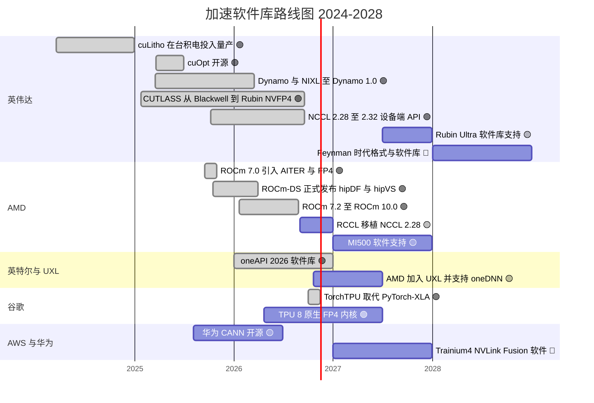
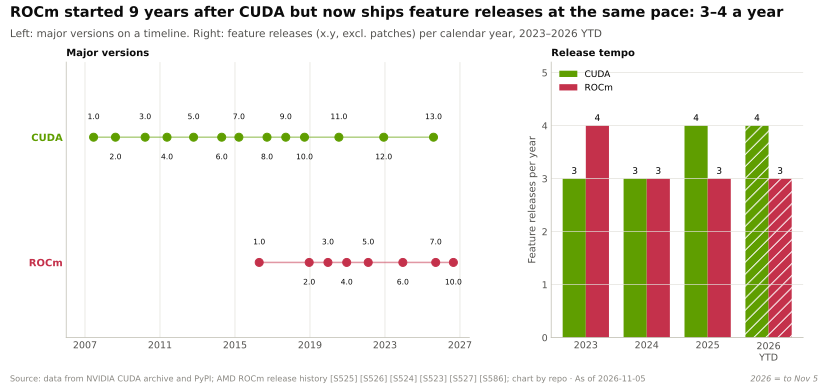

# 软件库（CUDA-X）：路线图

> [!NOTE]
> 本页为英文原文的简体中文参考译文，仅供参考；如有出入，以[英文原文](../../../layers/10-libraries-cuda-x/roadmap.md "English original")为准。

第 10 层 · 软件库（CUDA-X） · 约 9 分钟阅读 · 最近核实：2026-11-05

## ⚡ 要点速览

- **英伟达（NVIDIA）的软件库路线图紧跟芯片。** CUTLASS 4.8.0 和 [NCCL](../../glossary.md#nccl) 2.32.3 均于 2026-09-17 新增对 Rubin 的初步支持，距 Rubin 开始量产出货约六周 🟢 [[S10010]](../../../sources/bibliography.md#s10010)[[S10507]](../../../sources/bibliography.md#s10507)[[S500]](../../../sources/bibliography.md#s500)。
- **NCCL 正在演变为一个面向推理与 MoE 的软件库：**设备端 API 与复制引擎集合通信（2.28，2025 年 10 月）、[GPU 发起式网络通信](../../glossary.md#gpu-initiated-networking)、专家并行软件包（2026 年 6 月），以及 Compute Fabric Transport（2.31，2026 年 8 月）🟢 [[S10507]](../../../sources/bibliography.md#s10507)。
- **推理服务软件已经产品化：**[Dynamo](../../glossary.md#dynamo) 在 GTC 2026 上发布 1.0 版，v1.5.1（2026 年 10 月）是其首个提供企业级支持（Enterprise Support）的版本 🟢 [[S90066]](../../../sources/bibliography.md#s90066)[[S521]](../../../sources/bibliography.md#s521)。
- **AMD 的发布频率与英伟达相当，但仍是追随者：**[ROCm](../../glossary.md#rocm) 从 7.0（2025 年 9 月）发展到 10.0（2026 年 8 月），但当 NCCL 已到 2.29 时，其 RCCL 仍只对应 NCCL 2.27 🟢 [[S586]](../../../sources/bibliography.md#s586)[[S10509]](../../../sources/bibliography.md#s10509)[[S10506]](../../../sources/bibliography.md#s10506)。
- **谷歌（Google）正在淘汰 [PyTorch](../../glossary.md#pytorch)/XLA**，代之以原生的 TorchTPU 栈（2026 年 10 月开源；原代码仓库于 2026-11-15 归档），其第八代 TPU 原生支持 [FP4](../../glossary.md#fp4) 🟢 [[S553]](../../../sources/bibliography.md#s553)[[S595]](../../../sources/bibliography.md#s595)[[S552]](../../../sources/bibliography.md#s552)。
- **[Q7 · 路线图与变数]** 如果移植滞后接近于零，或者编译器让软件库变得可有可无，格局就会改变；如果英伟达能为 Rubin Ultra（2027 年）和 Feynman（2028 年）保持首日支持，格局就会维持 🟡 [[S507]](../../../sources/bibliography.md#s507)[[S90004]](../../../sources/bibliography.md#s90004)。

## 路线图 2024–2028

🟢 公司已确认 · 🟡 有报道或时间不确定 · 🔴 本资料库推断。条形为大致时间窗口。各行来源见下表；未列入下表的条形：cuLitho 在台积电投入量产 [[S10031]](../../../sources/bibliography.md#s10031)，ROCm-DS 正式发布 [[S10511]](../../../sources/bibliography.md#s10511)。

| 事项 | 时间窗口 | 状态 | 置信度 | 来源 |
|---|---|---|---|---|
| CUTLASS 4.8 与 NCCL 2.32：Rubin 初步支持 | 2026 年 9 月 | 已发布 | 🟢 | [[S10010]](../../../sources/bibliography.md#s10010)[[S10507]](../../../sources/bibliography.md#s10507) |
| CuTe DSL（Python）结束公开 beta | 目标为 2026 年夏末；2026 年 10 月仍为 beta | 已推迟 | 🟡 | [[S10009]](../../../sources/bibliography.md#s10009) |
| NCCL 设备端 API、GIN、复制引擎集合通信 | 2025 年 10 月 – 2026 年 8 月 | 已发布 | 🟢 | [[S10507]](../../../sources/bibliography.md#s10507)[[S10007]](../../../sources/bibliography.md#s10007) |
| Dynamo 1.0 至 1.5.1（首个企业级支持版本） | 2026 年 3 月 – 10 月 | 已发布 | 🟢 | [[S90066]](../../../sources/bibliography.md#s90066)[[S521]](../../../sources/bibliography.md#s521) |
| 搭配 NVQLink 的 CUDA-Q（17 家量子硬件厂商） | 2025 年 10 月起 | 逐步推出 | 🟢 | [[S10519]](../../../sources/bibliography.md#s10519) |
| Rubin Ultra 软件库支持 | 2027 年下半年 | 计划中；有报道称 Kyber 推迟，英伟达否认 | 🟡 | [[S507]](../../../sources/bibliography.md#s507)[[S508]](../../../sources/bibliography.md#s508) |
| Feynman 时代格式 | 2028 年 | 路线图 | 🔴 | [[S90004]](../../../sources/bibliography.md#s90004) |
| ROCm 10.0 Core SDK | 2026 年 8 月 | 已发布 | 🟢 | [[S586]](../../../sources/bibliography.md#s586) |
| RCCL 对应 NCCL 2.28.3 | 列入 ROCm 7.11 计划；截至 2026-11-05 尚未出现在更新日志中 | 待定 | 🟡 | [[S10509]](../../../sources/bibliography.md#s10509) |
| AMD MI500（2027 年）与 MI600（2028 年）软件 | 2027 – 2028 年 | 芯片已列入路线图 | 🟢 芯片 / 🔴 软件 | [[S538]](../../../sources/bibliography.md#s538)[[S541]](../../../sources/bibliography.md#s541) |
| AMD 加入 UXL；oneDNN 成为 PyTorch x86 默认后端 | 2026 年 10 月 | 有报道 | 🟡 | [[S10542]](../../../sources/bibliography.md#s10542) |
| TorchTPU 取代 PyTorch/XLA | 2026 年 10 月 – 11 月 | 已完成 | 🟢 | [[S553]](../../../sources/bibliography.md#s553)[[S595]](../../../sources/bibliography.md#s595) |
| 华为 CANN 开源 | 2025 年 8 月起 | 进行中 | 🟡 | [[S10537]](../../../sources/bibliography.md#s10537) |
| 搭配 NVLink Fusion 的 Trainium4 | 未定 | 已宣布 | 🔴 时间 | [[S90034]](../../../sources/bibliography.md#s90034) |

> [!TIP]
> **算例 —— “首日支持”到底有多快。** Rubin 于 2026 年 8 月初开始量产出货 [[S500]](../../../sources/bibliography.md#s500)。以 8 月中旬为参考日期，CUTLASS 和 NCCL 对 Rubin 的支持约在 33 天后（2026-09-17）到来 [[S10010]](../../../sources/bibliography.md#s10010)[[S10507]](../../../sources/bibliography.md#s10507)。如果 Rubin Ultra 按计划于 2027 年下半年出货，同样约 1 个月的间隔意味着其软件库将在 2027 年底到位；若如报道所称 Kyber 推迟到 2028 年，两者将一同顺延 [[S507]](../../../sources/bibliography.md#s507)。

## 规格演进：发布速度与追随者差距

NCCL 从 2.13（2022-07-11）发展到 2.32（2026-09-17）：约 50 个月内发布 19 个次版本，约每 2.6 个月一个 [[S10506]](../../../sources/bibliography.md#s10506)。近期版本瞄准推理与[混合专家模型（MoE）](../../glossary.md#mixture-of-experts)流量：能自行发起网络传输的 GPU 内核、释放计算单元的复制引擎集合通信、弹性通信器，以及专家并行软件包 [[S10507]](../../../sources/bibliography.md#s10507)（机制详见 [NCCL：隐形黏合剂](nccl-the-hidden-glue.md)）。AMD 如今发布 ROCm 功能版本的频率与英伟达发布 [CUDA](../../glossary.md#cuda) 版本相当，每年 3–4 个，但其中很多内容是对英伟达数月前已发布功能的移植 [[S586]](../../../sources/bibliography.md#s586)[[S10509]](../../../sources/bibliography.md#s10509)。

> [!TIP]
> **算例 —— 以日历时间衡量的追随者差距。** ROCm 7.2.0（2026-01-21）随附的 RCCL 仍只对应 NCCL 2.27.7，而后者的标签日期为 2025-07-24：早了 181 天，此时 NCCL 已发布 2.28 和 2.29 [[S10509]](../../../sources/bibliography.md#s10509)[[S10506]](../../../sources/bibliography.md#s10506)[[S586]](../../../sources/bibliography.md#s586)。在 12 个月的 GPU 周期下，98 天的滞后（ROCm 7.1）意味着 AMD 客户在每个周期中约有 27% 的时间用不上新的集合通信功能；若滞后缩短至 30 天，这一比例将降至约 8%。

🔧 技术细节：“Rubin 初步支持”包含哪些内容

CUTLASS 4.8.0 以 SM107 作为 Rubin 的目标架构，新增 [FP8](../../glossary.md#fp8) 和 FP4 矩阵路径，以及一种用于 [NVFP4](../../glossary.md#nvfp4) 块缩放的新 UE5M3 缩放因子类型（一种 5 位指数、3 位尾数的无符号 8 位格式）；4.8.1 版已列出若干已知的 Rubin 代码生成问题 [[S10010]](../../../sources/bibliography.md#s10010)。NCCL 2.32.3 新增了 Rubin 平台检测以及 ConnectX-9 的轨道（rail）与平面（plane）检测 [[S10507]](../../../sources/bibliography.md#s10507)。“初步”二字很关键：针对每种模型形状的调优内核通常会在随后的多个版本中陆续推出，这正是同一硬件上的软件增益在产品发布后仍不断出现的原因。

## 哪些因素会改变格局

- 🟡 **移植滞后接近于零。** 如果 AMD 共同维护上游代码（RCCL 已在沿用 NCCL 的许可证与 API），集合通信就不再构成差异化 [[S10002]](../../../sources/bibliography.md#s10002)。
- 🟡 **编译器让软件库变得可有可无。** TorchTPU、[Triton](../../glossary.md#triton) 后端以及高通（Qualcomm）对 Modular 的收购（Mojo、MAX；已于 2026-07-29 完成交割 [[S9511]](../../../sources/bibliography.md#s9511)），正把内核选择权推向编译器 [[S553]](../../../sources/bibliography.md#s553)[[S578]](../../../sources/bibliography.md#s578)[[S90057]](../../../sources/bibliography.md#s90057)。
- 🟡 **数据平台默认采用 GPU。** Snowflake ML 已在其默认 GPU 运行时中内置 cuML 和 cuDF；若 Databricks 和 AWS 也将其设为默认，将扩大英伟达在非 AI 领域的带动效应 [[S10521]](../../../sources/bibliography.md#s10521)[[S10522]](../../../sources/bibliography.md#s10522)。
- 🔴 **竞争对手进入只有英伟达覆盖的领域**（光刻、优化、基因组学），并与 EDA 厂商等合作伙伴联手。
- 🟢 **英伟达为 Rubin Ultra 和 Feynman 保持一个月内的首日支持：**差距持续存在。

> [!TIP]
> **算例 —— 编译器栈的转向能有多快。** 谷歌于 2026 年 10 月开源 TorchTPU，并将在约六周后的 2026-11-15 归档 PyTorch/XLA；[vLLM](../../glossary.md#vllm) 和 [SGLang](../../glossary.md#sglang) 已列出 TorchTPU 后端 [[S553]](../../../sources/bibliography.md#s553)[[S595]](../../../sources/bibliography.md#s595)[[S581]](../../../sources/bibliography.md#s581)[[S582]](../../../sources/bibliography.md#s582)。而同等重要的软件库移植（RCCL）自 2024 年以来每个版本需要 98–296 天 [[S10509]](../../../sources/bibliography.md#s10509)[[S10506]](../../../sources/bibliography.md#s10506)。以编译器为先的厂商几周内就能转向；移植方则在每次发布上都落后数月。

**[Q7 · 路线图与变数]** 到 2028 年，英伟达的路线图与年度 GPU 发布以及 NCCL 和 Dynamo 中面向推理时代的功能紧密绑定；AMD 在发布节奏上正在趋同，但在时间上尚未追平。最大的变数在于编译器（[XLA](../../glossary.md#xla)/TorchTPU、Triton、Mojo）是否会接管对 AI 至关重要的内核——若如此，护城河将收缩至非 AI 领域。

## 🎯 企业发展视角

1. NCCL 2025–26 年的新功能瞄准 MoE 与推理流量。这会让集合通信对以推理为先的新进入者变得更重要，还是更不重要？
2. ROCm 的发布频率与 CUDA 相当，但仍落后 1–4 个 NCCL 版本。组建一支零滞后的移植团队需要多少成本？共同维护上游是否可行？
3. 谷歌在一年内就用 TorchTPU 取代了 PyTorch/XLA。以编译为先的技术栈（例如 Modular 的 MAX）能多快在新芯片上投入生产？
4. 哪个路线图里程碑（Rubin Ultra 软件库、UXL 的采用、CANN 开源）最可能改变软件库“自建还是合作”的决策？

## 📚 来源（Sources）

<!-- Auto-generated from the [S…] citations on this page by `make build`. Edit sources/registry/*.csv, not this list. -->

- [**S500**](../../../sources/bibliography.md#s500) NVIDIA Corporation, *NVIDIA Q2 Fiscal 2027 Quarterly Presentation (CFO commentary deck)*, 2026-08-26. [Link](https://s201.q4cdn.com/141608511/files/doc_financials/2027/Q227/NVDA-F2Q27-Quarterly-Presentation-final-1.pdf)
- [**S507**](../../../sources/bibliography.md#s507) Tom's Hardware, *Nvidia's Kyber rack for Rubin Ultra slips to 2028*, 2026-07-06. [Link](https://www.tomshardware.com/pc-components/gpus/nvidias-kyber-rack-for-rubin-ultra-slips-to-2028)
- [**S508**](../../../sources/bibliography.md#s508) Wccftech, *NVIDIA Quashes Rubin & Kyber Rack Delay Rumors, Says 'Chip Roadmap Is Intact'*, 2026-07. [Link](https://wccftech.com/nvidia-quashes-rubin-kyber-rack-delay-rumors-says-chip-roadmap-is-intact/)
- [**S521**](../../../sources/bibliography.md#s521) NVIDIA Docs, *NVIDIA Dynamo release notes*, 2026-10. [Link](https://docs.nvidia.com/dynamo/zh-CN/latest/reference/releases)
- [**S538**](../../../sources/bibliography.md#s538) AMD Investor Relations, *AAI 2026: AMD Delivers Full-Stack Compute for the Agentic AI Era*, 2026-07-23. [Link](https://ir.amd.com/news-events/press-releases/detail/1294/aai-2026-amd-delivers-full-stack-compute-for-the-agentic-ai-era)
- [**S541**](../../../sources/bibliography.md#s541) PC Games Hardware, *CDNA 6 und CDNA Next: AMD kündigt Instinct MI500 für 2027 und MI600 für 2028 an*, 2026-07. [Link](https://www.pcgameshardware.de/Grafikkarten-Grafikkarte-97980/News/AMD-Instinct-MI500-MI600-Roadmap-CDNA-6-CDNA-Next-1549244/)
- [**S552**](../../../sources/bibliography.md#s552) Google Cloud Blog (Karan Batta), *Bringing Google TPUs to Oracle Cloud Infrastructure*, 2026-10-27. [Link](https://cloud.google.com/blog/products/infrastructure/bringing-google-tpus-to-oracle-cloud-infrastructure)
- [**S553**](../../../sources/bibliography.md#s553) Google Cloud Blog (Alex Barrett), *What's new in AI infrastructure and orchestration in October*, 2026-11. [Link](https://cloud.google.com/blog/topics/ai-infrastructure/whats-new-in-ai-infrastructure-this-month)
- [**S578**](../../../sources/bibliography.md#s578) OpenAI Triton (GitHub), *Triton (triton-lang/triton) README — supported hardware*, 2026-11. [Link](https://github.com/triton-lang/triton/blob/main/README.md)
- [**S581**](../../../sources/bibliography.md#s581) vLLM project (GitHub), *vLLM hardware plugin repositories (tpu-inference/vLLM JAX, vllm-gaudi, vllm-ascend, vllm-neuron)*, 2026-11. [Link](https://github.com/vllm-project)
- [**S582**](../../../sources/bibliography.md#s582) SGLang project (GitHub: sgl-project/sglang), *SGLang README — supported hardware*, 2026-11. [Link](https://github.com/sgl-project/sglang/blob/main/README.md)
- [**S586**](../../../sources/bibliography.md#s586) AMD (GitHub: ROCm/ROCm docs), *ROCm documentation sources: release history, AI-ecosystem compatibility matrix, consolidated changelog*, 2026-08-26. [Link](https://github.com/ROCm/ROCm/blob/develop/docs/release/versions.rst)
- [**S595**](../../../sources/bibliography.md#s595) PyTorch (GitHub: pytorch/xla), *PyTorch/XLA README (deprecation notice)*, 2026-11. [Link](https://github.com/pytorch/xla/blob/master/README.md)
- [**S9511**](../../../sources/bibliography.md#s9511) Nasdaq (Qualcomm press release), *Qualcomm Completes Acquisition of Modular*, 2026-07-29. [Link](https://www.nasdaq.com/press-release/qualcomm-completes-acquisition-modular-2026-07-29)
- [**S10002**](../../../sources/bibliography.md#s10002) AMD (GitHub: ROCm/rccl), *RCCL README and LICENSE (develop branch)*, 2026-11. [Link](https://github.com/ROCm/rccl/blob/develop/README.md)
- [**S10007**](../../../sources/bibliography.md#s10007) arXiv:2511.15076 (NVIDIA authors), *GPU-Initiated Networking for NCCL*, 2025-11. [Link](https://arxiv.org/abs/2511.15076)
- [**S10009**](../../../sources/bibliography.md#s10009) NVIDIA (GitHub: NVIDIA/cutlass), *CUTLASS README (4.8.1)*, 2026-10. [Link](https://github.com/NVIDIA/cutlass/blob/main/README.md)
- [**S10010**](../../../sources/bibliography.md#s10010) NVIDIA (GitHub: NVIDIA/cutlass), *CUTLASS CHANGELOG*, 2026-10-15. [Link](https://github.com/NVIDIA/cutlass/blob/main/CHANGELOG.md)
- [**S10031**](../../../sources/bibliography.md#s10031) NVIDIA Newsroom, *TSMC and Synopsys Bring Breakthrough NVIDIA Computational Lithography Platform to Production*, 2024-03-18. [Link](https://nvidianews.nvidia.com/news/tsmc-synopsys-nvidia-culitho)
- [**S10506**](../../../sources/bibliography.md#s10506) GitHub (NVIDIA), *NVIDIA/nccl tags*, 2026-09-17. [Link](https://github.com/NVIDIA/nccl/tags)
- [**S10507**](../../../sources/bibliography.md#s10507) GitHub (NVIDIA), *NVIDIA/nccl releases (release notes v2.28.3 to v2.32.3)*, 2026-09-17. [Link](https://github.com/NVIDIA/nccl/releases)
- [**S10509**](../../../sources/bibliography.md#s10509) GitHub (ROCm/rccl), *RCCL CHANGELOG*, 2026. [Link](https://github.com/ROCm/rccl/blob/develop/CHANGELOG.md)
- [**S10511**](../../../sources/bibliography.md#s10511) AMD ROCm Documentation, *ROCm-DS 25.10 release notes*, 2025-10. [Link](https://rocm.docs.amd.com/projects/rocm-ds/en/latest/about/release-notes.html)
- [**S10519**](../../../sources/bibliography.md#s10519) NVIDIA Newsroom, *NVIDIA Introduces NVQLink — Connecting Quantum and GPU Computing for 17 Quantum Builders and Nine Scientific Labs*, 2025-10-28. [Link](https://nvidianews.nvidia.com/news/nvidia-nvqlink-quantum-gpu-computing)
- [**S10521**](../../../sources/bibliography.md#s10521) Snowflake via Business Wire, *Snowflake Supercharges Machine Learning for Enterprises with Native Integration of NVIDIA CUDA-X Libraries*, 2025-11-18. [Link](https://www.businesswire.com/news/home/20251118211131/en/Snowflake-Supercharges-Machine-Learning-for-Enterprises-with-Native-Integration-of-NVIDIA-CUDA-X-Libraries)
- [**S10522**](../../../sources/bibliography.md#s10522) NVIDIA Blog, *Every Company's Data Is Their 'Gold Mine,' NVIDIA CEO Says at Databricks Data + AI Summit*, 2024-06. [Link](https://blogs.nvidia.com/?p=72122)
- [**S10537**](../../../sources/bibliography.md#s10537) TrendForce, *Huawei Open-Sources CANN Toolkit for Ascend AI GPUs, Taking Aim at NVIDIA's CUDA*, 2025-08-07. [Link](https://www.trendforce.com/news/2025/08/07/news-huawei-open-sources-cann-toolkit-for-ascend-ai-gpus-taking-aim-at-nvidias-cuda/)
- [**S10542**](../../../sources/bibliography.md#s10542) Crypto Briefing, *AMD joins UXL Foundation as steering member, backs oneDNN for PyTorch*, 2026-10-20. [Link](https://cryptobriefing.com/amd-joins-uxl-foundation-onednn-pytorch/)
- [**S90004**](../../../sources/bibliography.md#s90004) TrendForce, *Key GTC takeaways: how Samsung, Micron, Intel and more power NVIDIA's Vera Rubin and Feynman*, 2026-03-17. [Link](https://www.trendforce.com/news/2026/03/17/news-key-gtc-takeaways-how-samsung-micron-intel-more-power-nvidias-vera-rubin-and-feynman/)
- [**S90034**](../../../sources/bibliography.md#s90034) NAND Research, *AWS releases Trainium3, teases Trainium4*, 2025-12. [Link](https://nand-research.com/research-note-aws-releases-trainium3-teases-trainium4/4/)
- [**S90057**](../../../sources/bibliography.md#s90057) StorageReview, *Qualcomm unveils Dragonfly data center roadmap: C1000 CPU, AI300 accelerator and Modular acquisition*, 2026-06-24. [Link](https://www.storagereview.com/es/news/qualcomm-unveils-dragonfly-data-center-roadmap-c1000-cpu-ai300-accelerator-and-modular-acquisition)
- [**S90066**](../../../sources/bibliography.md#s90066) HPCwire (NVIDIA press release), *NVIDIA enters production with Dynamo, the broadly adopted inference operating system for AI factories*, 2026-03-17. [Link](https://www.hpcwire.com/aiwire/tag/dynamo-1-0/)
