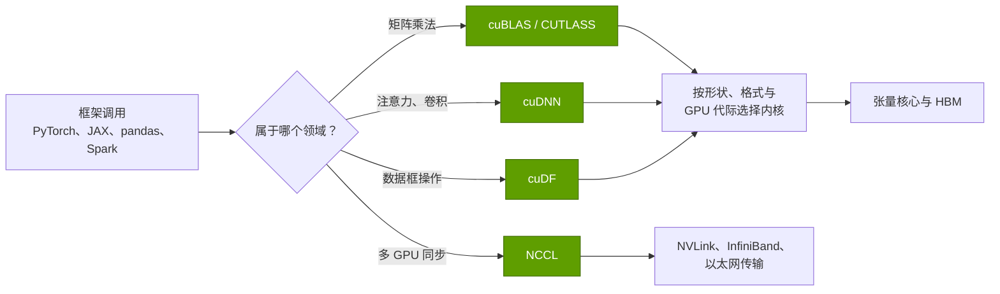
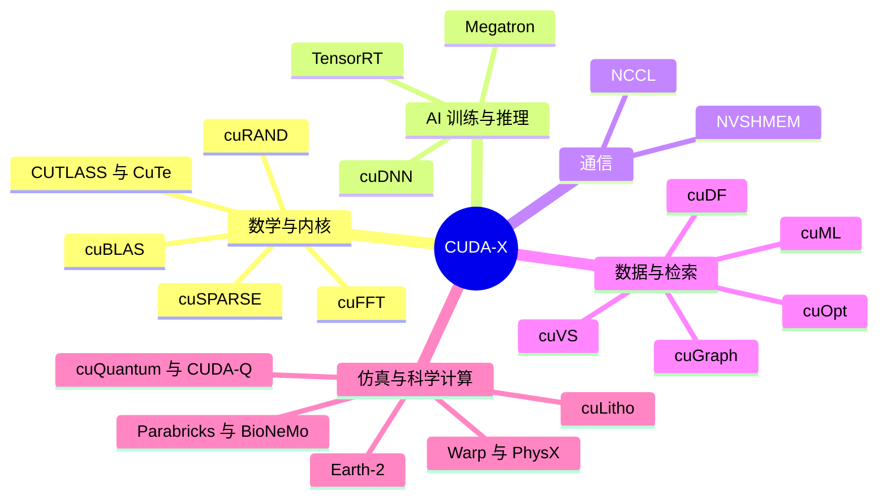
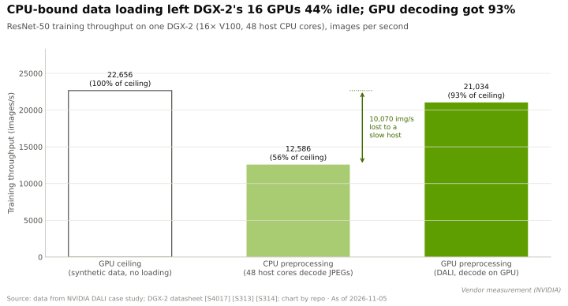

# CUDA-X 目录：每个软件库做什么

> [!NOTE]
> 本页为英文原文的简体中文参考译文，仅供参考；如有出入，以[英文原文](../../../layers/10-libraries-cuda-x/the-cuda-x-catalog.md "English original")为准。

第 10 层 · 软件库（CUDA-X） · 约 12 分钟阅读 · 最近核实：2026-11-05

## ⚡ 要点速览

- **[CUDA-X](../../glossary.md#cuda-x) 是一份预调优引擎的目录，**每个引擎都封装了某一领域多年的 GPU 调优成果。英伟达（NVIDIA）称其数量“数以百计” [[S10047]](../../../sources/bibliography.md#s10047)；其中约 20 个承载了大部分商业分量，下文逐一列出。
- **AI 核心规模不大，且大多闭源。** [cuBLAS](../../glossary.md#cublas)（矩阵运算）和 [cuDNN](../../glossary.md#cudnn)（神经网络层）以专有许可发布 [[S10038]](../../../sources/bibliography.md#s10038)。[CUTLASS](../../glossary.md#cutlass) 是用于编写自定义内核的开源模板工具包，在 4.0 版（2025 年 6 月）中新增了 Python DSL [[S10010]](../../../sources/bibliography.md#s10010)。
- **软件库质量就是钱。** 将一次 70B 训练任务的峰值 FLOPS 达成率从 41% 提升至 52%（Meta 的 Llama 3 对比英伟达的 Megatron 基准测试）[[S34006]](../../../sources/bibliography.md#s34006)[[S34002]](../../../sources/bibliography.md#s34002)，在一次 15T token（词元）的训练中可节省约 0.4M 个 B200 小时。
- **较新的软件库服务于 AI 以外的客户。** 台积电（TSMC）已在量产中使用 [cuLitho](../../glossary.md#culitho) [[S10031]](../../../sources/bibliography.md#s10031)。一项同行评审研究测得，[Parabricks](../../glossary.md#parabricks) 的胚系变异检测比 CPU 快最高 65 倍 [[S10033]](../../../sources/bibliography.md#s10033)。
- **加速倍数差异很大，最高的数字来自英伟达自己的测试。** 英伟达的 cudf.pandas 测试显示约 150 倍 [[S10014]](../../../sources/bibliography.md#s10014)；一项独立复测得到的是 50–70 倍 [[S10046]](../../../sources/bibliography.md#s10046)。cuML 的零代码修改模式中位数约为 5.8 倍，而一项低秩 PCA 反而*慢* 2 倍 [[S10015]](../../../sources/bibliography.md#s10015)。
- **许可策略在外围向开源演进。** cuDF、cuOpt 和 Warp 现已采用 Apache 2.0 [[S10011]](../../../sources/bibliography.md#s10011)[[S10026]](../../../sources/bibliography.md#s10026)[[S10028]](../../../sources/bibliography.md#s10028)，而最来之不易的调优成果仍保持闭源，且只支持英伟达硬件。

## 软件库如何位于框架与芯片之间

**类比。** [CUDA](../../glossary.md#cuda)（[第 09 层](../09-cuda-and-system-software/index.md)）好比一间机加工车间，任何人都可以用原钢切削零件；CUDA-X 则是预加工零件的目录。一位做两个矩阵相乘的 [PyTorch](../../glossary.md#pytorch) 用户从不需要编写 GPU 代码：PyTorch 调用 cuBLAS，cuBLAS 再从数百个手工调优的 [GPU 内核](../../glossary.md#gpu-kernel)中，挑出最契合该矩阵形状、数值格式和 GPU 代际的那一个。卷积与注意力（cuDNN）、通信（[NCCL](../../glossary.md#nccl)）以及推理引擎（TensorRT）也遵循同样的模式。

**[Q1 · 职能与失效后果]** 软件库层的职能是弥合峰值性能与实际交付性能之间的差距。若这一层薄弱，硬件就会闲置（一块内核只能跑到峰值一半的 GPU，在经济意义上就只是半块 GPU），新特性也无从发挥：低精度格式、稀疏性和交换机内规约，都只有在软件库用上之后才能兑现价值。

> [!TIP]
> **算例 —— 11 个百分点的效率值多少钱。** 一个 Llama-3 式的 70B 模型在 15T token 上训练，约需 6 × 70B × 15T ≈ 6.3 × 10²⁴ FLOPs。B200 的稠密 [BF16](../../glossary.md#bf16) 峰值为 2,250 TFLOPS [[S33003]](../../../sources/bibliography.md#s33003)。按 Meta 公布的 Llama 3 405B 峰值达成率（[MFU](../../glossary.md#mfu)）41% 计算 [[S34006]](../../../sources/bibliography.md#s34006)，每块 GPU 实际交付约 920 TFLOPS，整个训练约需 1.9M 个 B200 小时。按英伟达在其 Megatron 1T 基准测试中公布的 52% 计算 [[S34002]](../../../sources/bibliography.md#s34002)，则约需 1.5M 个。**结论：**按示意性的每 [GPU 小时](../../glossary.md#gpu-hour) $5 计算 [[S395]](../../../sources/bibliography.md#s395)，节省的约 0.4M GPU 小时价值约 $2M。并行方式的选择可解释部分差距；其余大部分则来自调优过的内核与集合通信。

## 目录一览

| 软件库 | 功能（一句话类比） | 用户 · 商业意义 |
|---|---|---|
| **cuBLAS**（2007） | GPU 的矩阵乘法（[GEMM](../../glossary.md#gemm)）计算器，即每个 Transformer 内部的算术运算 | 所有 AI 框架；专有软件 [[S10038]](../../../sources/bibliography.md#s10038) |
| **cuDNN**（2014） | 一本神经网络层的“菜谱”（卷积、注意力、归一化）[[S10039]](../../../sources/bibliography.md#s10039) | PyTorch、TensorFlow、JAX；针对每一代张量核心调优 |
| **CUTLASS / CuTe**（2017；DSL 2025） | 一套用于自建矩阵内核的可互换零件；CuTe 描述数据如何分块 | 编写自定义内核的实验室；[CuTe](../../glossary.md#cute) DSL 将其带入 Python；🟡 2026 年 10 月仍处于 beta，已错过“夏末结束 beta”的目标 [[S10009]](../../../sources/bibliography.md#s10009) |
| **[cuSPARSE](../../glossary.md#cusparse)**（2010） | 跳过零元素的矩阵运算 | 仿真、图分析、推荐模型 |
| **[cuFFT](../../glossary.md#cufft)**（2007） | 把信号拆分成各个频率分量 | 成像、地震勘探、雷达、5G/6G 信号处理 |
| **[cuRAND](../../glossary.md#curand)**（2010） | 一个快速掷骰器 | 金融领域的蒙特卡洛风险模型、物理仿真 |
| **NCCL**（2015） | 让每块 GPU 上的模型副本保持同步的“总机” | 所有多 GPU 作业；参见 [NCCL：隐形黏合剂](nccl-the-hidden-glue.md) |
| **TensorRT**（2016） | 把训练好的模型针对某一款 GPU 进行“收缩包装”的编译器；现已发展到第 11 版 [[S10045]](../../../sources/bibliography.md#s10045) | 推理服务（[第 11 层](../11-inference-and-ai-software/index.md)） |
| **[cuDF](../../glossary.md#cudf) / RAPIDS**（2018） | GPU 上的 pandas；也是 Spark、Polars 和 Dask 后端背后的引擎 [[S10011]](../../../sources/bibliography.md#s10011) | 数据工程与 [ETL](../../glossary.md#etl) |
| **[cuML](../../glossary.md#cuml)**（2018） | GPU 上的 scikit-learn，现可零代码修改运行 [[S10015]](../../../sources/bibliography.md#s10015) | 欺诈、客户流失与预测模型；数据科学团队 |
| **[cuGraph](../../glossary.md#cugraph)**（2019） | 面向拥有数十亿条连接的网络的“地图导航” | 欺诈团伙识别、网络安全、供应链图谱 |
| **[cuOpt](../../glossary.md#cuopt)**（2025 年开源） | 用于路径规划与[线性规划](../../glossary.md#linear-programming)的“调度员”；MIP 处于 beta [[S10026]](../../../sources/bibliography.md#s10026) | 物流与计划排程；Apache 2.0，并托管于 COIN-OR [[S10027]](../../../sources/bibliography.md#s10027) |
| **[cuQuantum](../../glossary.md#cuquantum) / [CUDA-Q](../../glossary.md#cuda-q)**（2022–23） | 量子计算机的“飞行模拟器”；CUDA-Q 可统一编程 QPU、GPU 与 CPU [[S10030]](../../../sources/bibliography.md#s10030) | 量子硬件初创公司与实验室 |
| **cuLitho**（2023） | 预先畸变芯片掩模，使图形能被正确印制（[计算光刻](../../glossary.md#computational-lithography)） | 台积电与新思科技（Synopsys）自 2024 年起用于量产 [[S10031]](../../../sources/bibliography.md#s10031)；这是把 GPU 卖进英伟达自身供应链 |
| **[NVIDIA Warp](../../glossary.md#nvidia-warp)**（2022） | 用纯 Python 编写物理仿真，并将其编译为 GPU 内核 [[S10028]](../../../sources/bibliography.md#s10028) | 机器人与仿真研究人员；自 2025 年起采用 Apache 2.0 |
| **Parabricks**（Clara） | 以分钟而非小时运行标准基因组流程（[变异检测](../../glossary.md#variant-calling)）[[S10033]](../../../sources/bibliography.md#s10033) | 测序实验室、医院、制药企业 |
| **[BioNeMo](../../glossary.md#bionemo)** | 蛋白质与 DNA 模型的训练配方及检查点 [[S10037]](../../../sources/bibliography.md#s10037) | 微调生物学基础模型的药物发现团队 |
| **[Earth-2](../../glossary.md#earth-2)** | 装进一个 Python 包（Earth2Studio）里的气象实验室 [[S10036]](../../../sources/bibliography.md#s10036) | 气象机构、保险公司、能源交易商 |
| **[Omniverse](../../glossary.md#omniverse) / [PhysX](../../glossary.md#physx)**（PhysX 2008） | 一个带有真实物理效果的共享 3D 世界；PhysX 已开源 [[S10035]](../../../sources/bibliography.md#s10035) | 工厂与机器人数字孪生；面向 AI 数据中心的 DSX 蓝图 [[S90063]](../../../sources/bibliography.md#s90063) |
| **cuVS**（2024） | 在数十亿个[嵌入向量](../../glossary.md#vector-search)中找出语义最接近者的“图书管理员” | RAG 与推荐系统背后的向量数据库（Faiss、Milvus）[[S10025]](../../../sources/bibliography.md#s10025) |

*年份为 `data/l10_library_timeline.csv` 中可核实的首次公开发布年份；来源与注意事项见该文件。*

## AI 核心：数学、内核与推理

四个软件库承载了几乎全部 AI 运算：cuBLAS 和 cuDNN 提供通用内核，TensorRT 把它们组装成引擎，而 CUTLASS 则是英伟达及外部开发者构建尚不存在的内核的工具。它们决定了客户能以多快的速度用上每一种新数值格式。如今 CUTLASS 覆盖从 FP64 到块缩放 [NVFP4](../../glossary.md#nvfp4)、MXFP4、MXFP6 和 MXFP8 的各种格式，支持从 Volta 到 Blackwell 的各代架构 [[S10009]](../../../sources/bibliography.md#s10009)。

> [!TIP]
> **算例 —— 为什么在软件库跟上之前，新数值格式一文不值。** Rubin GPU 的标称稠密 [FP4](../../glossary.md#fp4) 算力为 35 [PFLOPS](../../glossary.md#flops)，而稠密 BF16 为 4 PFLOPS [[S100]](../../../sources/bibliography.md#s100)，相差 8.75 倍。以 BF16 提供服务的模型只能用上这颗芯片的 4 PFLOPS。只有当 cuBLAS、CUTLASS 和 TensorRT 推出 FP4 内核、且模型完成量化而不损失精度之后，其余 31 PFLOPS 才变得可用。**结论：**在数值格式层面，软件库是数据手册算力与收入之间的闸门。参见[数值格式](../02-gpu-silicon/number-formats-and-precision.md)。

内核还必须针对每一代架构重写。FlashAttention-2 在 A100 上达到峰值的 50–73%，在 H100 上却只有 35%，直到专为 Hopper 设计的 FlashAttention-3 达到 75% [[S9002]](../../../sources/bibliography.md#s9002)[[S9003]](../../../sources/bibliography.md#s9003)。以 CuTe DSL 为 Blackwell 编写的 FlashAttention-4 达到 B200 BF16 峰值的 71%，比英伟达的 cuDNN 9.13 快最多 1.3 倍，比 Triton 快 2.7 倍 [[S9004]](../../../sources/bibliography.md#s9004)。英伟达旗舰产品上最快的注意力内核，出自英伟达软件库团队之外，但用的是英伟达的工具。

🔧 技术细节：内核库如何决定运行哪个内核

一次 GEMM 调用带有形状（M、N、K）、数据类型和内存布局。cuBLAS 为每种 GPU 架构保存大量预编译内核（分块大小、流水线深度以及跨 SM 的任务划分各不相同），再由启发式规则或自动调优流程从中选出一个。后续操作（偏置、激活、缩放）可以融合进内核的收尾阶段（epilogue），使结果无需在 [HBM](../../glossary.md#hbm) 中往返。CUTLASS 以模板形式开放同样的构建模块，CuTe 的布局代数则描述哪个线程负责分块中的哪个元素。CUTLASS 4 的 Python DSL 摒弃了 C++ 模板，并承诺大幅缩短编译时间 [[S10009]](../../../sources/bibliography.md#s10009)。竞争性的内核语言（OpenAI 的 [Triton](../../glossary.md#triton)、Modular 的 [Mojo](../../glossary.md#mojo)）以可移植的方式瞄准同一任务。

## AI 之外：数据、仿真与科学计算

2018 年以来推出的大多数软件库，瞄准的都是原本运行在 CPU 上的工作负载。方法始终如一：找出吞噬大部分 CPU 时间的热点循环，将其重写为并行 GPU 内核，同时保留用户熟悉的接口。数据加载是 AI 内部的经典例子。英伟达的 [DALI](../../glossary.md#dali) 软件库把 JPEG 解码转移到 DGX-2 的 GPU 上，使 ResNet-50 训练从 GPU 上限的 56% 提升至 93% [[S4017]](../../../sources/bibliography.md#s4017)：

> [!TIP]
> **算例 —— cuLitho 的服务器账。** 2023 年发布时，英伟达称 500 台 DGX H100 系统即可完成 40,000 台 CPU 系统的光刻计算工作 [[S10032]](../../../sources/bibliography.md#s10032)；到 2024 年宣布投入量产时，这一数字变为 350 台 [[S10031]](../../../sources/bibliography.md#s10031)。相当于每台 GPU 系统替代约 114 台 CPU 系统。**结论：**cuLitho 让英伟达成为其自身供应商的供应商，而台积电的采用 [[S10031]](../../../sources/bibliography.md#s10031) 使其成为所有其他晶圆厂的参照标杆。

> [!WARNING]
> **误区与事实：“GPU 软件库能让一切快 10–100 倍。”** 那些大数字来自厂商对计算密集型内核的测试；独立测试结果更小，有时甚至为负。cuml.accel 的低秩 PCA 只有 0.48 倍，因为数据搬运的开销超过了计算本身 [[S10015]](../../../sources/bibliography.md#s10015)。在 BMC 的研究中，GPU 体细胞变异检测工具在云上的成本反而*高于* CPU 运行 [[S10033]](../../../sources/bibliography.md#s10033)。Polars 自己的文档也指出，I/O 密集型查询在 GPU 与 CPU 上的运行速度大致相同 [[S10017]](../../../sources/bibliography.md#s10017)。

## 🎯 企业发展视角

1. **哪些软件库家族具备防御性？** 专有的 AI 核心（cuBLAS、cuDNN、TensorRT）是每个竞争对手的首要目标；长尾部分（cuLitho、Parabricks、cuOpt、Earth-2）竞争较少，但服务的市场也较小。
2. **供应商—客户闭环。** cuLitho 在台积电和新思科技的应用 [[S10031]](../../../sources/bibliography.md#s10031)，将英伟达 GPU 嵌入了晶圆厂与 EDA 流程。在其他供应链中（EDA 仿真、电信信号处理）是否存在类似的闭环，可供竞争对手抢先布局？
3. **以开源跑马圈地。** cuOpt 以 Apache 2.0 许可加入 COIN-OR [[S10027]](../../../sources/bibliography.md#s10027)，Warp 也改用 Apache 2.0 许可 [[S10028]](../../../sources/bibliography.md#s10028)。竞争对手能否把这些项目分叉（fork）到自家硬件上，还是会跟不上英伟达的发布节奏？

## 📚 来源（Sources）

<!-- Auto-generated from the [S…] citations on this page by `make build`. Edit sources/registry/*.csv, not this list. -->

- [**S100**](../../../sources/bibliography.md#s100) NVIDIA Technical Blog, *Inside the NVIDIA Vera Rubin Platform: Six New Chips, One AI Supercomputer*, 2026-01-05. [Link](https://developer.nvidia.com/blog/inside-the-nvidia-rubin-platform-six-new-chips-one-ai-supercomputer/)
- [**S395**](../../../sources/bibliography.md#s395) Lambda, *Lambda GPU cloud pricing*, 2025. [Link](https://lambda.ai/pricing)
- [**S4017**](../../../sources/bibliography.md#s4017) NVIDIA Technical Blog, *Case Study: ResNet50 with DALI*, 2019. [Link](https://developer.nvidia.com/blog/case-study-resnet50-dali/)
- [**S9002**](../../../sources/bibliography.md#s9002) arXiv:2307.08691 (ICLR 2024) (Tri Dao), *FlashAttention-2: Faster Attention with Better Parallelism and Work Partitioning*, 2023-07-17. [Link](https://arxiv.org/abs/2307.08691)
- [**S9003**](../../../sources/bibliography.md#s9003) arXiv:2407.08608 (NeurIPS 2024) (Jay Shah, Ganesh Bikshandi, Ying Zhang, Vijay Thakkar, Pradeep Ramani, Tri Dao), *FlashAttention-3: Fast and Accurate Attention with Asynchrony and Low-precision*, 2024-07-11. [Link](https://arxiv.org/abs/2407.08608)
- [**S9004**](../../../sources/bibliography.md#s9004) arXiv:2603.05451 (Zadouri, Hoehnerbach, Shah, Liu, Thakkar, Dao), *FlashAttention-4: Algorithm and Kernel Pipelining Co-Design for Asymmetric Hardware Scaling*, 2026-03. [Link](https://arxiv.org/abs/2603.05451)
- [**S10009**](../../../sources/bibliography.md#s10009) NVIDIA (GitHub: NVIDIA/cutlass), *CUTLASS README (4.8.1)*, 2026-10. [Link](https://github.com/NVIDIA/cutlass/blob/main/README.md)
- [**S10010**](../../../sources/bibliography.md#s10010) NVIDIA (GitHub: NVIDIA/cutlass), *CUTLASS CHANGELOG*, 2026-10-15. [Link](https://github.com/NVIDIA/cutlass/blob/main/CHANGELOG.md)
- [**S10011**](../../../sources/bibliography.md#s10011) NVIDIA RAPIDS (GitHub: rapidsai/cudf), *cuDF README*, 2026-11. [Link](https://github.com/rapidsai/cudf/blob/main/README.md)
- [**S10014**](../../../sources/bibliography.md#s10014) NVIDIA Technical Blog, *RAPIDS cuDF Accelerates pandas Nearly 150x with Zero Code Changes*, 2023-11. [Link](https://developer.nvidia.com/blog/rapids-cudf-accelerates-pandas-nearly-150x-with-zero-code-changes/)
- [**S10015**](../../../sources/bibliography.md#s10015) NVIDIA RAPIDS (GitHub: rapidsai/cuml docs), *cuml.accel overview and benchmarks*, 2026. [Link](https://github.com/rapidsai/cuml/blob/main/docs/source/cuml-accel/benchmarks.rst)
- [**S10017**](../../../sources/bibliography.md#s10017) Polars (GitHub: pola-rs/polars docs), *Polars user guide: GPU Support [Open Beta]*, 2026-11. [Link](https://github.com/pola-rs/polars/blob/main/docs/source/user-guide/gpu-support.md)
- [**S10025**](../../../sources/bibliography.md#s10025) Engineering at Meta, *Accelerating GPU indexes in Faiss with NVIDIA cuVS*, 2025-05-08. [Link](https://engineering.fb.com/2025/05/08/data-infrastructure/accelerating-gpu-indexes-in-faiss-with-nvidia-cuvs/)
- [**S10026**](../../../sources/bibliography.md#s10026) NVIDIA (GitHub: NVIDIA/cuopt), *cuOpt README and LICENSE*, 2026-11. [Link](https://github.com/NVIDIA/cuopt/blob/main/README.md)
- [**S10027**](../../../sources/bibliography.md#s10027) It's FOSS News, *NVIDIA cuOpt goes open source (with COIN-OR)*, 2025-03-19. [Link](https://news.itsfoss.com/nvidia-cuopt-open-source/)
- [**S10028**](../../../sources/bibliography.md#s10028) NVIDIA (GitHub: NVIDIA/warp), *NVIDIA Warp README and CHANGELOG*, 2026-11-02. [Link](https://github.com/NVIDIA/warp/blob/main/CHANGELOG.md)
- [**S10030**](../../../sources/bibliography.md#s10030) NVIDIA (GitHub: NVIDIA/cuda-quantum), *CUDA-Q repository README*, 2026-11. [Link](https://github.com/NVIDIA/cuda-quantum/blob/main/README.md)
- [**S10031**](../../../sources/bibliography.md#s10031) NVIDIA Newsroom, *TSMC and Synopsys Bring Breakthrough NVIDIA Computational Lithography Platform to Production*, 2024-03-18. [Link](https://nvidianews.nvidia.com/news/tsmc-synopsys-nvidia-culitho)
- [**S10032**](../../../sources/bibliography.md#s10032) AnandTech, *NVIDIA's 'cuLitho' Computational Lithography Adopted By TSMC and Synopsys For Production Use*, 2024-03-18. [Link](https://www.anandtech.com/show/21309/nvidias-culitho-gains-support-from-tsmc-and-synopsys)
- [**S10033**](../../../sources/bibliography.md#s10033) BMC Bioinformatics (PMC open access), *Accelerating genomic workflows using NVIDIA Parabricks*, 2023-05. [Link](https://www.ncbi.nlm.nih.gov/pmc/articles/PMC10230726/)
- [**S10035**](../../../sources/bibliography.md#s10035) NVIDIA (GitHub: NVIDIA-Omniverse/PhysX), *NVIDIA PhysX SDK README*, 2025. [Link](https://github.com/NVIDIA-Omniverse/PhysX/blob/main/README.md)
- [**S10036**](../../../sources/bibliography.md#s10036) NVIDIA (GitHub: NVIDIA/earth2studio), *NVIDIA Earth2Studio README*, 2026-11. [Link](https://github.com/NVIDIA/earth2studio/blob/main/README.md)
- [**S10037**](../../../sources/bibliography.md#s10037) NVIDIA (GitHub: NVIDIA/bionemo-framework), *BioNeMo Recipes README (bionemo-framework)*, 2026-11. [Link](https://github.com/NVIDIA/bionemo-framework/blob/main/README.md)
- [**S10038**](../../../sources/bibliography.md#s10038) Python Package Index, *PyPI JSON release histories for NVIDIA library packages (nvidia-nccl-cu11/cu12/cu13, cudf-cu12, cudf-polars-cu12, cuml-cu12, cugraph-cu12, cuvs-cu12, warp-lang, cuquantum-python, cuda-quantum, cudaq, cuopt-cu12, nvidia-cutlass-dsl, earth2studio, nvmath-python, cuequivariance, nvidia-cudss-cu12, nvidia-modulus, nvidia-physicsnemo)*, 2026-11-05. [Link](https://pypi.org/)
- [**S10039**](../../../sources/bibliography.md#s10039) arXiv:1410.0759 (Sharan Chetlur, Cliff Woolley, Philippe Vandermersch et al. (NVIDIA)), *cuDNN: Efficient Primitives for Deep Learning*, 2014-10. [Link](https://arxiv.org/abs/1410.0759)
- [**S10045**](../../../sources/bibliography.md#s10045) NVIDIA (GitHub: NVIDIA/TensorRT), *TensorRT Open Source Software README and CHANGELOG*, 2026-11. [Link](https://github.com/NVIDIA/TensorRT/blob/main/README.md)
- [**S10046**](../../../sources/bibliography.md#s10046) Daily Dose of Data Science, *NVIDIA's latest update can make your pandas workflow 150x faster*, 2023-11. [Link](https://blog.dailydoseofds.com/p/nvidias-latest-update-can-make-your)
- [**S10047**](../../../sources/bibliography.md#s10047) NVIDIA Developer, *NVIDIA CUDA-X Libraries (developer page)*, 2026. [Link](https://developer.nvidia.com/cuda/cuda-x-libraries)
- [**S33003**](../../../sources/bibliography.md#s33003) Lenovo Press, *ThinkSystem NVIDIA B200 180GB 1000W GPU product guide*, 2025. [Link](https://lenovopress.lenovo.com/lp2226-thinksystem-nvidia-b200-180gb-1000w-gpu)
- [**S34002**](../../../sources/bibliography.md#s34002) arXiv:2104.04473 (SC21) (Deepak Narayanan, Mohammad Shoeybi, Jared Casper et al. (NVIDIA; Stanford; Microsoft)), *Efficient Large-Scale Language Model Training on GPU Clusters Using Megatron-LM*, 2021-04-09. [Link](https://arxiv.org/abs/2104.04473)
- [**S34006**](../../../sources/bibliography.md#s34006) arXiv:2407.21783 (Llama Team (AI @ Meta)), *The Llama 3 Herd of Models*, 2024-07-31. [Link](https://arxiv.org/abs/2407.21783)
- [**S90063**](../../../sources/bibliography.md#s90063) Converge Digest, *The megawatt shift: NVIDIA's 800 VDC strategy*, 2026. [Link](https://convergedigest.com/the-megawatt-shift-nvidias-800-vdc-strategy/)
