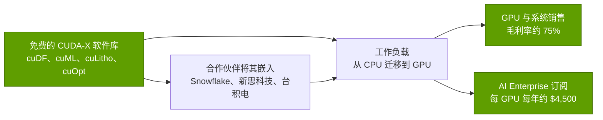
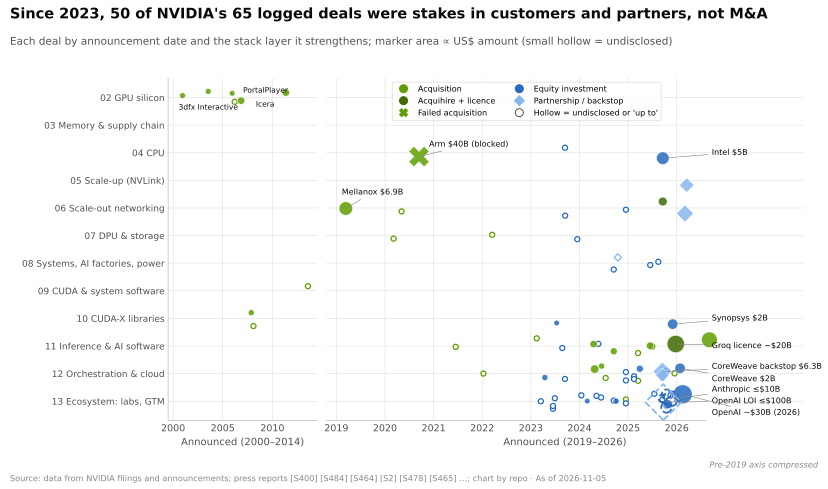

# 软件库（CUDA-X）：价值链与企业发展视角

> [!NOTE]
> 本页为英文原文的简体中文参考译文，仅供参考；如有出入，以[英文原文](../../../layers/10-libraries-cuda-x/value-chain-and-corp-dev.md "English original")为准。

第 10 层 · 软件库（CUDA-X） · 约 10 分钟阅读 · 最近核实：2026-11-05

## ⚡ 要点速览

- **软件库是一款带动硬件销售的免费产品。** 英伟达（NVIDIA）的付费层 [NVIDIA AI Enterprise](../../glossary.md#nvidia-ai-enterprise) 在 2024 年的标价约为每 GPU 每年 $4,500 [[S10526]](../../../sources/bibliography.md#s10526)；其余一切都通过[硬件带动销售（pull-through）](../../glossary.md#pull-through)获取回报。
- **直接软件收入规模很小：**2024 年初年化收入约 $1B，指引到 2024 年底接近约 $2B，约占 FY2025 收入 $130.5B 的 1.5%；未找到更新的数据 [[S10525]](../../../sources/bibliography.md#s10525)[[S10527]](../../../sources/bibliography.md#s10527)[[S2]](../../../sources/bibliography.md#s2)。
- **AI 以外的带动效应真实存在，但尚处早期：**Snowflake ML 默认内置 cuML 和 cuDF（2025 年 11 月），Databricks 宣布在 Photon 上开展 GPU 相关工作（2024 年），台积电（TSMC）已在量产中使用 cuLitho [[S10521]](../../../sources/bibliography.md#s10521)[[S10522]](../../../sources/bibliography.md#s10522)[[S10031]](../../../sources/bibliography.md#s10031)。
- **EDA 与仿真正围绕 GPU 整合：**新思科技（Synopsys）于 2025 年 7 月完成对 Ansys 的 $35B 收购，英伟达则于 2025 年 12 月买入新思科技 $2B 股权 [[S10524]](../../../sources/bibliography.md#s10524)[[S471]](../../../sources/bibliography.md#s471)。
- **看空证据：**GPU 往往让数据分析变得更便宜，而不是更快。在 AWS 的 1 TB Spark 测试中，GPU 运行快 1.06 倍，但便宜约 80%；英伟达的一个 Databricks 案例发现，RAPIDS 仅比 Photon 便宜约 6% [[S10020]](../../../sources/bibliography.md#s10020)[[S10523]](../../../sources/bibliography.md#s10523)。
- **并购：**在此处统计的 2022 年以来 12 笔芯片厂商软件收购样本中，有 6 笔公开了价格，其中最大的是高通（Qualcomm）宣布的 $3.9B Modular 交易，约为英伟达收购 Run:ai（约 $0.7B）的 5.6 倍 [[S90057]](../../../sources/bibliography.md#s90057)[[S476]](../../../sources/bibliography.md#s476)[[S10531]](../../../sources/bibliography.md#s10531)。
- **[Q8 · 价值池与并购机会]** 价值池在于数据分析、EDA、量子计算和工程仿真领域的硬件带动销售；对这些领域的非上市公司，英伟达选择投资而非收购（PhysicsX、Quantinuum、PsiQuantum）[[S10564]](../../../sources/bibliography.md#s10564)[[S10566]](../../../sources/bibliography.md#s10566)。

## 谁攫取了收益

软件库就像一个只适配某一品牌电器的免费电源适配器：它本身不赚钱，却决定了客户买哪个品牌的电器。英伟达的收益以 GPU 和系统收入的形式到来，GAAP 毛利率约 75%（Q2 FY2027），外加薄薄一层订阅收入 [[S3]](../../../sources/bibliography.md#s3)[[S90013]](../../../sources/bibliography.md#s90013)。

| 层级 | 示例 | 价格 | 英伟达如何获利 | 来源 |
|---|---|---|---|---|
| 开源 | NCCL（Apache 2.0）、cuOpt（Apache 2.0）、CUTLASS（BSD-3）、Warp（Apache 2.0） | $0 | 带动销售；生态 | [[S10507]](../../../sources/bibliography.md#s10507)[[S10026]](../../../sources/bibliography.md#s10026)[[S10038]](../../../sources/bibliography.md#s10038)[[S10028]](../../../sources/bibliography.md#s10028) |
| 免费的专有二进制 | cuBLAS、cuDNN | $0 | 带动销售；最好的内核留在英伟达硬件上 | [[S10038]](../../../sources/bibliography.md#s10038) |
| 订阅 | NVIDIA AI Enterprise（技术支持、认证构建版本） | 每 GPU 每年约 $4,500（2024 年） | 软件收入 | [[S10526]](../../../sources/bibliography.md#s10526) |

| 披露场合 | 软件、SaaS 与支持服务年化收入 | 来源 |
|---|---|---|
| Q3 FY2024 业绩电话会（2023 年 11 月） | 有望以约 $1B 的年化收入结束该年 | [[S10528]](../../../sources/bibliography.md#s10528) |
| Q4 FY2024 业绩电话会（2024 年 2 月） | 已达到约 $1B | [[S10525]](../../../sources/bibliography.md#s10525) |
| Q2 FY2025 业绩电话会（2024 年 8 月） | 年底前接近约 $2B | [[S10527]](../../../sources/bibliography.md#s10527) |

> [!TIP]
> **算例 —— 为什么英伟达不需要为软件库收费。** 一台 72 GPU 的机架若按标价计算，每年需为 AI Enterprise 支付 72 × $4,500 = $324,000 [[S10526]](../../../sources/bibliography.md#s10526)。即便 10,000 台机架全部获得许可，每年也只带来约 $3.2B，约为单季度收入（Q2 FY2027 为 $96.2B）的 3.4% [[S3]](../../../sources/bibliography.md#s3)。2024 年底的实际软件收入约为每年 $2B [[S10527]](../../../sources/bibliography.md#s10527)。软件库的价值在于它所带动销售的 GPU。

## 合作伙伴与带动销售的市场

| 合作伙伴 | 软件库 | 解锁了什么 | 状态 | 来源 |
|---|---|---|---|---|
| Snowflake | Snowflake ML 中的 cuML、cuDF | 无需修改代码的 GPU 机器学习 | 默认 GPU 运行时，2025 年 11 月 🟢 | [[S10521]](../../../sources/bibliography.md#s10521) |
| Databricks | Spark GPU 插件；Photon GPU 相关工作 | 在 GPU 上运行 ETL | 2024 年 6 月宣布；未找到 2026 年进展 🟡 | [[S10522]](../../../sources/bibliography.md#s10522)[[S10523]](../../../sources/bibliography.md#s10523) |
| 台积电、新思科技 | 新思科技 Proteus 中的 cuLitho | 掩模合成快 45–60 倍（厂商数据） | 2024 年 3 月起投入量产 🟢 | [[S10031]](../../../sources/bibliography.md#s10031) |
| 新思科技（含 Ansys） | CUDA-X EDA 与仿真 | GPU 加速的 EDA 与多物理场仿真 | 英伟达持股 $2B，2025 年 12 月 🟢 | [[S471]](../../../sources/bibliography.md#s471)[[S10524]](../../../sources/bibliography.md#s10524) |
| 量子硬件厂商（17 家） | CUDA-Q、[NVQLink](../../glossary.md#nvqlink) | 面向 QPU 的 GPU 控制与纠错 | 2025 年 10 月起 🟢 | [[S10519]](../../../sources/bibliography.md#s10519) |
| Meta（Faiss） | cuVS | 索引构建比 CPU HNSW 快 12.3 倍 | Faiss 1.10，2025 年 5 月 🟢 | [[S10025]](../../../sources/bibliography.md#s10025) |

> [!TIP]
> **算例 —— 光刻领域的带动销售是什么样子。** 英伟达称，在台积电，350 台 H100 系统即可完成 40,000 台 CPU 系统的计算光刻工作，相当于每台 GPU 系统替代约 114 台 CPU 系统，且流程快 45–60 倍 [[S10031]](../../../sources/bibliography.md#s10031)。每一家采用该流程的晶圆厂或掩模厂都要购买英伟达系统；没有其他加速器厂商能提供光刻软件库。

> [!WARNING]
> **误区与事实：**“GPU 数据分析总是更快。”在 AWS 的 1 TB Spark 基准测试中，原生 Spark 耗时 1.7 小时、花费 $31.28，运行在四块 L4 GPU 上的 cuDF 插件耗时 1.6 小时、花费 $6.27，而向量化 CPU 引擎（Velox）耗时 1.0 小时、花费 $18.40 [[S10020]](../../../sources/bibliography.md#s10020)。在这里，GPU 的优势在于成本，而 CPU 引擎也在持续进步。

## 值得关注的非上市公司（仅基于公开信息）

| 公司 | 业务 | 最近一轮公开融资 | 为何重要 | 来源 |
|---|---|---|---|---|
| PhysicsX | 面向工程的 AI 物理仿真 | C 轮 $300M，估值 $2.4B（2026 年 6 月）；投资方包括英伟达和西门子 | 运行在 GPU 上的 AI 原生 CAE | [[S10564]](../../../sources/bibliography.md#s10564) |
| Luminary Cloud | GPU 原生物理仿真与 AI | B 轮 $72M（2025 年 9 月），NVentures 参投 | 在 CAE 领域的同类带动效应 | [[S10565]](../../../sources/bibliography.md#s10565) |
| Quantinuum | 离子阱量子计算机 | $600M，投前估值 $10B（2025 年），NVentures 参投 | NVQLink 合作伙伴 | [[S10566]](../../../sources/bibliography.md#s10566)[[S10519]](../../../sources/bibliography.md#s10519) |
| PsiQuantum | 光量子计算机 | $1B，估值 $7B（2025 年），NVentures 参投 | CUDA-Q 生态的核心成员 | [[S10566]](../../../sources/bibliography.md#s10566) |
| QuEra | 中性原子量子计算机 | NVentures 参投的 $230M 融资（2025 年） | NVQLink 支持者 | [[S10566]](../../../sources/bibliography.md#s10566)[[S10520]](../../../sources/bibliography.md#s10520) |
| Voltron Data | Theseus GPU SQL 引擎，支持英伟达或 AMD | Accenture Ventures 入股（2025 年 2 月，金额未披露） | 厂商中立的 GPU 数据分析 | [[S10561]](../../../sources/bibliography.md#s10561)[[S10560]](../../../sources/bibliography.md#s10560) |
| Anyscale | Ray 分布式计算 | C 轮 $100M，估值 $1B（2021 年） | Ray 可调度英伟达、AMD、TPU、Neuron 和昇腾（Ascend）设备 | [[S10562]](../../../sources/bibliography.md#s10562)[[S584]](../../../sources/bibliography.md#s584) |
| Coiled | 托管式 Dask | 种子轮 $5M（2020 年）；后续轮次未核实 | Dask 可在 GPU 上运行 cuDF | [[S10563]](../../../sources/bibliography.md#s10563)[[S10011]](../../../sources/bibliography.md#s10011) |

> [!TIP]
> **算例 —— 一轮量子计算融资意味着什么。** Quantinuum 以 $10B 的投前估值融资 $600M [[S10566]](../../../sources/bibliography.md#s10566)：投后估值为 $10.6B，因此新投资者合计持股约 5.7%（600 ÷ 10,600）。NVentures 的份额未披露，在财务上对英伟达而言也微不足道；关键在于卡位，因为 Quantinuum 是 NVQLink 首批 17 家量子硬件厂商之一，而每一台此类机器都需要 GPU 端的控制与仿真 [[S10519]](../../../sources/bibliography.md#s10519)。

## 本层的并购历史

英伟达在软件库层的交易都是小型补强收购：mental images（2007 年，约 $88M）、Ageia/PhysX（2008 年）、The Portland Group 编译器（2013 年），以及 Bright Computing 和 Excelero（2022 年）[[S484]](../../../sources/bibliography.md#s484)[[S478]](../../../sources/bibliography.md#s478)[[S10534]](../../../sources/bibliography.md#s10534)。其 2024–25 年的 AI 软件收购，据报道每笔均不超过约 $0.7B [[S479]](../../../sources/bibliography.md#s479)[[S476]](../../../sources/bibliography.md#s476)；例外出现在 2026 年 9 月，英伟达同意以约 $12.9B 收购 Hugging Face（目标于 2027 年上半年完成交割），这是其自 Mellanox 以来最大的一笔交易 [[S11500]](../../../sources/bibliography.md#s11500)[[S90084]](../../../sources/bibliography.md#s90084)。AMD 在 2023–25 年间收购了四个 AI 软件团队，英特尔（Intel）则为获取 SYCL 工具收购了 Codeplay（2022 年）[[S10529]](../../../sources/bibliography.md#s10529)[[S10530]](../../../sources/bibliography.md#s10530)[[S10531]](../../../sources/bibliography.md#s10531)[[S10532]](../../../sources/bibliography.md#s10532)[[S10533]](../../../sources/bibliography.md#s10533)。英伟达在软件库相关领域最大的一笔投入是股权投资（新思科技，$2B），而非收购 [[S471]](../../../sources/bibliography.md#s471)。

> [!TIP]
> **算例 —— 用钱买时间。** 本资料库估计，一个 AI 核心软件库栈需在 5 年内投入约 $3B，即每年约 $0.6B 🔴（[发展历程](history-and-how-built.md)）。高通宣布以 $3.9B 收购 Modular，相当于约 6.5 年的自建预算 [[S90057]](../../../sources/bibliography.md#s90057)。这笔溢价买到的是一个现成可用、可跨硬件移植的技术栈及其团队，而不必花五年时间去招聘和调优。

**[Q8 · 价值池与并购机会]** 价值池并不在于软件库收入（按最近一次披露约为每年 $2B），而在于软件库在数据分析、EDA 与光刻、量子计算和工程仿真领域所创造的 GPU 需求 [[S10527]](../../../sources/bibliography.md#s10527)[[S10521]](../../../sources/bibliography.md#s10521)[[S10031]](../../../sources/bibliography.md#s10031)[[S10519]](../../../sources/bibliography.md#s10519)。英伟达主要通过合作关系和少数股权投资而非收购来锁定这部分价值 [[S471]](../../../sources/bibliography.md#s471)[[S10564]](../../../sources/bibliography.md#s10564)[[S10566]](../../../sources/bibliography.md#s10566)；待完成的约 $12.9B Hugging Face 收购——位于更上一层的模型中心——是个例外 [[S11500]](../../../sources/bibliography.md#s11500)。对竞争对手而言，思路恰恰相反：收购编译器与内核团队（Silo AI、Brium、Modular），以缩短追平 AI 核心所需的年数。

🔧 技术细节：合作伙伴为何嵌入英伟达软件库

采用 cuDF 或 cuML 的 ISV 或数据平台，无需招聘 GPU 专家即可获得多年的调优成果，而零代码修改模式意味着其用户无需重写 pandas 或 scikit-learn 代码 [[S10521]](../../../sources/bibliography.md#s10521)[[S10011]](../../../sources/bibliography.md#s10011)。代价是依赖：AMD 的 hipDF 跟随 cuDF 的 API，但 ROCm-DS 中没有列出 cuML 的对应物，因此希望引入第二个 GPU 供应来源的平台必须维护两条路径 [[S10511]](../../../sources/bibliography.md#s10511)[[S10512]](../../../sources/bibliography.md#s10512)。

## 🎯 企业发展视角

1. 英伟达通过硬件而非许可费将软件库变现。新进入者还有可能单独为软件定价吗？还是也必须免费提供软件库？
2. 非 AI 的带动销售市场（数据分析、EDA、量子计算、CAE）各自依赖一两个合作伙伴。哪些合作关系是可以争夺的？条件如何？
3. 英伟达对 CAE 和量子计算初创公司选择少数股权投资而非收购。投资者能从这些公司的股权结构（PhysicsX、Quantinuum、PsiQuantum）中看出什么？
4. 高通的 Modular 交易（已于 2026-07-29 完成交割，公开信息）[[S9511]](../../../sources/bibliography.md#s9511) 买到的是一个可移植的技术栈：在哪些 [CUDA-X](../../glossary.md#cuda-x) 领域它仍需要合作伙伴？
5. 厂商中立的公司（Voltron Data、Anyscale、Coiled）位于软件库与用户之间。对于第二个 GPU 供应来源而言，它们是合作伙伴、收购标的，还是两者兼而有之？

## 📚 来源（Sources）

<!-- Auto-generated from the [S…] citations on this page by `make build`. Edit sources/registry/*.csv, not this list. -->

- [**S2**](../../../sources/bibliography.md#s2) U.S. Securities and Exchange Commission (EDGAR), *NVIDIA Corporation Form 10-K annual reports FY2020–FY2025 (filing index)*, 2025-02-26. [Link](https://www.sec.gov/cgi-bin/browse-edgar?action=getcompany&CIK=0001045810&type=10-K&dateb=&owner=include&count=40)
- [**S3**](../../../sources/bibliography.md#s3) StorageNewsletter, *NVIDIA Q2 Fiscal 2027 results coverage: revenue $96.2B*, 2026-08-27. [Link](https://www.storagenewsletter.com/2026/08/27/nvidia-fiscal-2q27-financial-results/)
- [**S471**](../../../sources/bibliography.md#s471) NVIDIA Newsroom, *NVIDIA and Synopsys strategic partnership; NVIDIA $2B investment in Synopsys common stock*, 2025-12-01. [Link](https://nvidianews.nvidia.com/)
- [**S476**](../../../sources/bibliography.md#s476) NVIDIA Blog, *NVIDIA to Acquire GPU Orchestration Software Provider Run:ai*, 2024-04-24. [Link](https://blogs.nvidia.com/blog/runai/)
- [**S478**](../../../sources/bibliography.md#s478) NVIDIA, *NVIDIA Blog and Newsroom acquisition announcements (Cumulus, SwiftStack, DeepMap, Bright Computing, Excelero, Shoreline, Brev.dev, OctoAI, VinBrain, Gretel, Lepton AI, CentML, SchedMD)*, 2025-12. [Link](https://blogs.nvidia.com/)
- [**S479**](../../../sources/bibliography.md#s479) Various (press), *Reporting on NVIDIA tuck-in acquisition prices (Run:ai, Deci, Shoreline, OctoAI, Gretel, Lepton, CentML) — The Information, Calcalist, Reuters, CNBC*, 2025-06. [Link](https://www.reuters.com/technology/)
- [**S484**](../../../sources/bibliography.md#s484) NVIDIA press releases as summarised in NVIDIA 10-K filings and contemporaneous press, *History of NVIDIA acquisitions 2000–2013 (3dfx assets, MediaQ, ULi, Hybrid Graphics, PortalPlayer, mental images, Ageia, Icera, The Portland Group)*, 2013-07. [Link](https://en.wikipedia.org/wiki/Nvidia)
- [**S584**](../../../sources/bibliography.md#s584) Ray project (GitHub: ray-project/ray), *Ray accelerator managers (python/ray/_private/accelerators)*, 2026-11. [Link](https://github.com/ray-project/ray/blob/master/python/ray/_private/accelerators/__init__.py)
- [**S9511**](../../../sources/bibliography.md#s9511) Nasdaq (Qualcomm press release), *Qualcomm Completes Acquisition of Modular*, 2026-07-29. [Link](https://www.nasdaq.com/press-release/qualcomm-completes-acquisition-modular-2026-07-29)
- [**S10011**](../../../sources/bibliography.md#s10011) NVIDIA RAPIDS (GitHub: rapidsai/cudf), *cuDF README*, 2026-11. [Link](https://github.com/rapidsai/cudf/blob/main/README.md)
- [**S10020**](../../../sources/bibliography.md#s10020) AWS Labs (GitHub: awslabs/data-on-eks), *Apache Spark with NVIDIA RAPIDS GPU Acceleration Benchmarks (data-on-eks)*, 2026-01-12. [Link](https://github.com/awslabs/data-on-eks/blob/main/website/docs/benchmarks/spark-rapids-gpu-benchmark.md)
- [**S10025**](../../../sources/bibliography.md#s10025) Engineering at Meta, *Accelerating GPU indexes in Faiss with NVIDIA cuVS*, 2025-05-08. [Link](https://engineering.fb.com/2025/05/08/data-infrastructure/accelerating-gpu-indexes-in-faiss-with-nvidia-cuvs/)
- [**S10026**](../../../sources/bibliography.md#s10026) NVIDIA (GitHub: NVIDIA/cuopt), *cuOpt README and LICENSE*, 2026-11. [Link](https://github.com/NVIDIA/cuopt/blob/main/README.md)
- [**S10028**](../../../sources/bibliography.md#s10028) NVIDIA (GitHub: NVIDIA/warp), *NVIDIA Warp README and CHANGELOG*, 2026-11-02. [Link](https://github.com/NVIDIA/warp/blob/main/CHANGELOG.md)
- [**S10031**](../../../sources/bibliography.md#s10031) NVIDIA Newsroom, *TSMC and Synopsys Bring Breakthrough NVIDIA Computational Lithography Platform to Production*, 2024-03-18. [Link](https://nvidianews.nvidia.com/news/tsmc-synopsys-nvidia-culitho)
- [**S10038**](../../../sources/bibliography.md#s10038) Python Package Index, *PyPI JSON release histories for NVIDIA library packages (nvidia-nccl-cu11/cu12/cu13, cudf-cu12, cudf-polars-cu12, cuml-cu12, cugraph-cu12, cuvs-cu12, warp-lang, cuquantum-python, cuda-quantum, cudaq, cuopt-cu12, nvidia-cutlass-dsl, earth2studio, nvmath-python, cuequivariance, nvidia-cudss-cu12, nvidia-modulus, nvidia-physicsnemo)*, 2026-11-05. [Link](https://pypi.org/)
- [**S10507**](../../../sources/bibliography.md#s10507) GitHub (NVIDIA), *NVIDIA/nccl releases (release notes v2.28.3 to v2.32.3)*, 2026-09-17. [Link](https://github.com/NVIDIA/nccl/releases)
- [**S10511**](../../../sources/bibliography.md#s10511) AMD ROCm Documentation, *ROCm-DS 25.10 release notes*, 2025-10. [Link](https://rocm.docs.amd.com/projects/rocm-ds/en/latest/about/release-notes.html)
- [**S10512**](../../../sources/bibliography.md#s10512) AMD ROCm Documentation, *ROCm-DS 26.03 release notes*, 2026-03. [Link](https://rocm.docs.amd.com/projects/rocm-ds/en/docs-26.03/about/release-notes.html)
- [**S10519**](../../../sources/bibliography.md#s10519) NVIDIA Newsroom, *NVIDIA Introduces NVQLink — Connecting Quantum and GPU Computing for 17 Quantum Builders and Nine Scientific Labs*, 2025-10-28. [Link](https://nvidianews.nvidia.com/news/nvidia-nvqlink-quantum-gpu-computing)
- [**S10520**](../../../sources/bibliography.md#s10520) Quantum Computing Report, *NVIDIA's NVQLink unites quantum ecosystem for real-time error correction*, 2025-10. [Link](https://quantumcomputingreport.com/nvidias-nvqlink-unites-quantum-ecosystem-for-real-time-error-correction/)
- [**S10521**](../../../sources/bibliography.md#s10521) Snowflake via Business Wire, *Snowflake Supercharges Machine Learning for Enterprises with Native Integration of NVIDIA CUDA-X Libraries*, 2025-11-18. [Link](https://www.businesswire.com/news/home/20251118211131/en/Snowflake-Supercharges-Machine-Learning-for-Enterprises-with-Native-Integration-of-NVIDIA-CUDA-X-Libraries)
- [**S10522**](../../../sources/bibliography.md#s10522) NVIDIA Blog, *Every Company's Data Is Their 'Gold Mine,' NVIDIA CEO Says at Databricks Data + AI Summit*, 2024-06. [Link](https://blogs.nvidia.com/?p=72122)
- [**S10523**](../../../sources/bibliography.md#s10523) NVIDIA Technical Blog, *GPUs for ETL? Run Faster, Less Costly Workloads with NVIDIA RAPIDS Accelerator for Apache Spark and Databricks*, . [Link](https://developer.nvidia.com/blog/gpus-for-etl-run-faster-less-costly-workloads-with-nvidia-rapids-accelerator-for-apache-spark-and-databricks/)
- [**S10524**](../../../sources/bibliography.md#s10524) DatacenterDynamics, *Synopsys closes $35bn acquisition of Ansys*, 2025-07-17. [Link](https://www.datacenterdynamics.com/en/news/synopsys-closes-35bn-acquisition-of-ansys/)
- [**S10525**](../../../sources/bibliography.md#s10525) The Motley Fool, *Here's Nvidia's Newest $1 Billion Business*, 2024-02-28. [Link](https://www.fool.com/investing/2024/02/28/heres-nvidias-newest-1-billion-business-and-ceo-je)
- [**S10526**](../../../sources/bibliography.md#s10526) Benzinga, *Jensen Huang Predicts Every Enterprise On The Planet Will Eventually Run On Nvidia's 'Operating System For AI'*, 2024-02. [Link](https://in.benzinga.com/markets/equities/24/02/37255204/jensen-huang-predicts-every-enterprise-on-the-planet-will-eventually-run-on-nvidias-operating-sy)
- [**S10527**](../../../sources/bibliography.md#s10527) AlphaSpread (transcript), *NVIDIA Q2 fiscal 2025 earnings call*, 2024-08-28. [Link](https://www.alphaspread.com/security/nasdaq/nvda/investor-relations/earnings-call/q2-2025)
- [**S10528**](../../../sources/bibliography.md#s10528) Insider Monkey, *NVIDIA Corporation (NASDAQ:NVDA) Q3 2024 Earnings Call Transcript*, 2023-11-21. [Link](https://insidermonkey.com/blog/nvidia-corporation-nasdaqnvda-q3-2024-earnings-call-transcript-1227317/7)
- [**S10529**](../../../sources/bibliography.md#s10529) CB Insights, *Mipsology company profile*, 2023-08. [Link](https://www.cbinsights.com/company/mipsology)
- [**S10530**](../../../sources/bibliography.md#s10530) PrivSource, *AMD Acquires Nod.ai*, 2023-10-10. [Link](https://www.privsource.com/acquisitions/deal/bWSr8y)
- [**S10531**](../../../sources/bibliography.md#s10531) Converge Digest, *AMD completes $665 million acquisition of Silo AI*, 2024-08-12. [Link](https://convergedigest.com/amd-completes-665-million-acquisition-of-silo-ai/?amp=1)
- [**S10532**](../../../sources/bibliography.md#s10532) I-Connect007, *AMD Acquires Brium to Strengthen Open AI Software Ecosystem*, 2025-06-05. [Link](https://iconnect007.com/article/145627/amd-acquires-brium-to-strengthen-open-ai-software-ecosystem/145624)
- [**S10533**](../../../sources/bibliography.md#s10533) Phoronix, *Intel Makes Another Exciting Software Acquisition (Codeplay)*, 2022-06. [Link](https://www.phoronix.com/news/Intel-Acquires-Codeplay)
- [**S10534**](../../../sources/bibliography.md#s10534) Blocks and Files, *Nvidia buys Excelero to speed GPU cluster block data access*, 2022-03-07. [Link](https://blocksandfiles.com/2022/03/07/nvidia-buys-excelero-to-speed-gpu-cluster-block-data-access/)
- [**S10560**](../../../sources/bibliography.md#s10560) The Register, *Voltron Data's Theseus GPU SQL engine on AMD (article; title paraphrased)*, 2025-06-18. [Link](https://assets.theregister.com/2025/06/18/voltron_amd_sql/)
- [**S10561**](../../../sources/bibliography.md#s10561) FinSMEs, *Voltron Data receives investment from Accenture Ventures*, 2025-02. [Link](https://finsmes.com/2025/02/voltron-data-receives-investment-from-accenture-ventures.html)
- [**S10562**](../../../sources/bibliography.md#s10562) Fenwick, *Fenwick represents Anyscale in $100 million Series C financing*, 2021-12. [Link](https://www.fenwick.com/insights/experience/fenwick-represents-anyscale-in-100-million-series-c-financing)
- [**S10563**](../../../sources/bibliography.md#s10563) Coiled via PR Newswire, *Coiled Announces $5M Seed Funding to Meet the Needs of Modern Data Teams*, 2020. [Link](https://prnewswire.com/news-releases/coiled-announces-5m-seed-funding-to-meet-the-needs-of-modern-data-teams-301139759.html)
- [**S10564**](../../../sources/bibliography.md#s10564) Tech.eu, *PhysicsX raises $300M at $2.4BN valuation*, 2026-06-08. [Link](https://tech.eu/2026/06/08/physicsx-raises-300m-at-24bn-valuation/)
- [**S10565**](../../../sources/bibliography.md#s10565) Built In, *Luminary Cloud Raises $72M to Develop Physics-Based AI Tools for Engineers*, 2025-09-17. [Link](https://builtin.com/articles/luminary-cloud-raises-72-million-20250917)
- [**S10566**](../../../sources/bibliography.md#s10566) Global Venturing, *Nvidia backs three quantum startups amid investment boom*, 2025-09. [Link](https://globalventuring.com/corporate/investment/nvidia-backs-three-quantum-startups-amid-investment-boom/)
- [**S11500**](../../../sources/bibliography.md#s11500) TechRadar Pro, *'The planets aligned': Nvidia confirms $12.9bn Hugging Face deal in potentially huge AI shake-up*, 2026-09-03. [Link](https://techradar.com/pro/the-planets-aligned-nvidia-confirms-usd12-9bn-hugging-face-deal-in-potentially-huge-ai-shake-up)
- [**S90013**](../../../sources/bibliography.md#s90013) Quartr, *NVIDIA (NVDA) Q2 2027 earnings summary*, 2026-08-26. [Link](https://quartr.com/events/nvidia-corporation-nvda-q2-2027_33dRoFp6)
- [**S90057**](../../../sources/bibliography.md#s90057) StorageReview, *Qualcomm unveils Dragonfly data center roadmap: C1000 CPU, AI300 accelerator and Modular acquisition*, 2026-06-24. [Link](https://www.storagereview.com/es/news/qualcomm-unveils-dragonfly-data-center-roadmap-c1000-cpu-ai300-accelerator-and-modular-acquisition)
- [**S90084**](../../../sources/bibliography.md#s90084) Advanced Television, *Nvidia acquires Hugging Face for $12.9bn*, 2026-09-04. [Link](https://www.advanced-television.com/2026/09/04/nvidia-acquires-hugging-face-for-12-9bn/)
