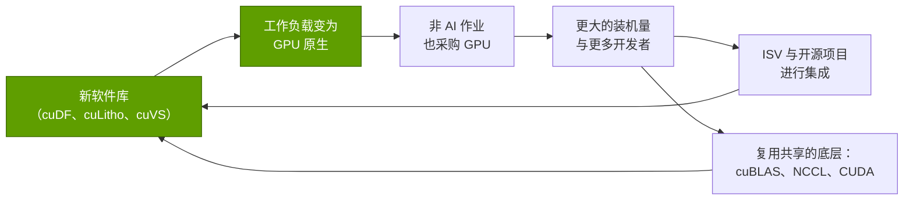
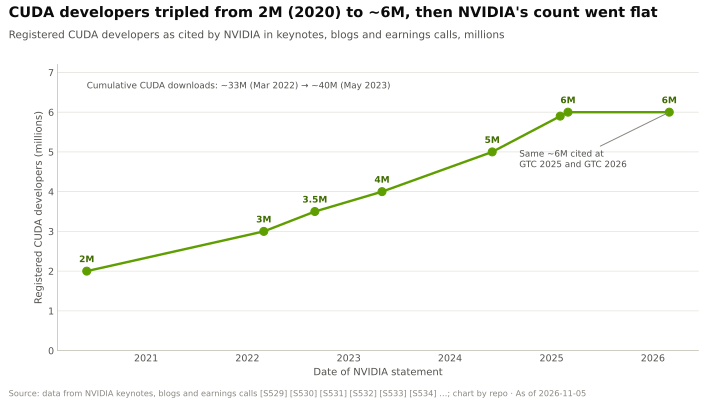

# 软件库广度为何产生复利

> [!NOTE]
> 本页为英文原文的简体中文参考译文，仅供参考；如有出入，以[英文原文](../../../layers/10-libraries-cuda-x/why-library-breadth-compounds.md "English original")为准。

第 10 层 · 软件库（CUDA-X） · 约 11 分钟阅读 · 最近核实：2026-11-05

## ⚡ 要点速览

- **每个软件库都把又一类工作负载变成 GPU 的活。** 在本资料库样本中 2018 年以来推出的 18 个软件库里，有 12 个瞄准 AI 模型以外的市场（见下图）。
- **Spark 的例子表明，成本优势胜过速度优势。** 在 AWS 运行的一项基于 [TPC-DS](../../glossary.md#tpc-ds) 衍生负载的 1 TB 测试中，英伟达（NVIDIA）面向 [Apache Spark](../../glossary.md#apache-spark) 的 cuDF 插件仅比原生 Spark 快 1.06 倍，且慢于向量化 CPU 引擎；但作业成本仍下降约 80%，从 $31.28 降至 $6.27 [[S10020]](../../../sources/bibliography.md#s10020)。🟡 据第三方的会议回顾，FINRA 报告 GPU Spark 运行速度快 14 倍、节省 90% [[S10021]](../../../sources/bibliography.md#s10021)。
- **需求如今来自 AI 之外。** 客户包括台积电（TSMC）（cuLitho 已投入量产）[[S10031]](../../../sources/bibliography.md#s10031)、Meta（Faiss 内置 cuVS）[[S10025]](../../../sources/bibliography.md#s10025)、基因组学实验室（一项同行评审研究中 Parabricks 最高提速 65 倍）[[S10033]](../../../sources/bibliography.md#s10033)，以及物流规划方（cuOpt，已与 COIN-OR 一同开源）[[S10027]](../../../sources/bibliography.md#s10027)。
- **集成胜于发明。** pandas、scikit-learn、Polars、Spark 和 Faiss 的用户如今无需重写代码即可切换到 GPU [[S10013]](../../../sources/bibliography.md#s10013)[[S10015]](../../../sources/bibliography.md#s10015)[[S10017]](../../../sources/bibliography.md#s10017)[[S10019]](../../../sources/bibliography.md#s10019)[[S10025]](../../../sources/bibliography.md#s10025)。CPU 回退机制消除了采用风险。
- **英伟达自己公布的数字先升后停。** GPU 加速应用从 2,000 个（2021 年）增至 3,000 个（2023 年）[[S537]](../../../sources/bibliography.md#s537)[[S533]](../../../sources/bibliography.md#s533)，英伟达如今称其拥有“数以百计”的 [CUDA-X](../../glossary.md#cuda-x) 软件库 [[S10047]](../../../sources/bibliography.md#s10047)，但开发者数量自 2025 年以来一直持平于约 6M [[S528]](../../../sources/bibliography.md#s528)。
- **看空情景：**广度只能在边际上增加需求；推动收入的是 AI 算力，而在 AI 之外，GPU 能否胜出取决于价格与工作负载形态（I/O 密集型查询获益甚微）[[S10017]](../../../sources/bibliography.md#s10017)。

## 复利循环

一个软件库创造出购买 GPU 的新理由，而每卖出一块 GPU，又扩大了下一个软件库可以瞄准的用户基础：

由于新软件库复用旧软件库，这一循环的成本会随时间降低：cuDF 的核心采用符合 Apache Arrow 规范的[数据框（dataframe）](../../glossary.md#dataframe)结构，并为 Spark、Polars、Dask、Velox 和 DuckDB 扩展提供底层引擎 [[S10011]](../../../sources/bibliography.md#s10011)。而每一次集成，都让英伟达进入一个其用户从未直接选择过英伟达的框架之中。

> [!TIP]
> **算例 —— 把 Spark ETL 作业变成 GPU 作业对账单有何影响。** 在 AWS 2026 年 1 月的测试中，8 个每小时 $2.30 的 c5d.12xlarge CPU 节点需要 1.7 小时（$31.28），才能在 1 TB 数据上完成 104 个查询 × 3 轮运行。4 个各配一块 L4 GPU、每小时 $0.98 的 g6.2xlarge 节点则需要 1.6 小时（$6.27）[[S10020]](../../../sources/bibliography.md#s10020)。一个每天运行该流水线 30 次（每月 900 次）的团队，在 CPU 上每月需支付约 $28,200，在 GPU 上约 $5,600。每月节省约 $22,500，并将约 5,800 实例小时的工作转移到英伟达 GPU 上。**结论：**在 [ETL](../../glossary.md#etl) 中，GPU 胜在单作业成本而非速度。向量化 CPU 引擎（Gluten + Velox）是三者中最快的 [[S10020]](../../../sources/bibliography.md#s10020)，因此 GPU 的优势取决于 GPU 的小时价格。

## AI 之外的需求

**[Q1 · 职能与失效后果]** 在 AI 之外，软件库层的职能是赢得从未买过 GPU 的买家；一个比现有 CPU 工具更慢或更贵的软件库，无论硬件多好都会失败。

| 领域 | 软件库 | 公开证据 | 谁买单 |
|---|---|---|---|
| 数据分析 | 面向 Spark 的 cuDF 插件、cudf.pandas、Polars GPU 引擎 | Spark 作业便宜约 5 倍 [[S10020]](../../../sources/bibliography.md#s10020)；Polars PDS-H 查询最高快 13 倍（厂商数据）[[S10018]](../../../sources/bibliography.md#s10018) | ETL 开支庞大的企业 |
| 向量检索 | cuVS | 索引构建比 CPU HNSW 快 12.3 倍（Meta）[[S10025]](../../../sources/bibliography.md#s10025) | 搜索、RAG 与推荐团队 |
| 优化 | cuOpt | LP、QP 与路径规划；MIP 仍处于 beta [[S10026]](../../../sources/bibliography.md#s10026) | 物流、能源与供应链规划方 |
| 光刻 | cuLitho | 曲线掩模流程上约 45 倍；350 台 H100 系统替代 40,000 台 CPU 系统 [[S10031]](../../../sources/bibliography.md#s10031) | 晶圆代工厂与 EDA 厂商 |
| 基因组学 | Parabricks | 胚系变异检测最高 65 倍（同行评审）[[S10033]](../../../sources/bibliography.md#s10033)；在 Terra 上最高 24 倍 [[S10034]](../../../sources/bibliography.md#s10034) | 测序中心、医院、制药企业 |
| 气候 | Earth-2（Earth2Studio） | 面向 AI 气象模型的开源 Python 包 [[S10036]](../../../sources/bibliography.md#s10036) | 气象机构、保险公司、能源交易商 |
| 量子计算 | cuQuantum、CUDA-Q | 仿真软件库与 QPU-GPU 混合平台 [[S10029]](../../../sources/bibliography.md#s10029)[[S10030]](../../../sources/bibliography.md#s10030) | 量子硬件公司与实验室 |
| 仿真 | Warp、PhysX、Omniverse | 基于 Python 和 C++ 的开源物理引擎 [[S10028]](../../../sources/bibliography.md#s10028)[[S10035]](../../../sources/bibliography.md#s10035) | 机器人、工业数字孪生 |

> [!TIP]
> **算例 —— 为什么在基因组学中速度不是采购标准。** BMC Bioinformatics 的研究将 GATK HaplotypeCaller 的运行时间从 CPU 上的 36 小时缩短到 DGX 上的 24 分钟，以及 AWS 或 GCP GPU 实例上的 33–35 分钟 [[S10033]](../../../sources/bibliography.md#s10033)。同一研究也发现，云 GPU 上的体细胞变异检测工具即便更快，成本也高于 CPU 运行 [[S10033]](../../../sources/bibliography.md#s10033)。**结论：**领域软件库要胜出，必须降低单样本成本（胚系变异检测），而不仅仅是缩短单样本耗时（体细胞变异检测）。

## 嵌入他人的框架

自 2023 年起，英伟达基本不再要求数据科学家学习新的 API，而是拦截他们已经在用的 API。[cudf.pandas](../../glossary.md#cudf-pandas) 支持“100% 的 pandas API”：受支持的操作在 GPU 上运行，其余则回退到普通 pandas [[S10013]](../../../sources/bibliography.md#s10013)。同样的代理模式如今已覆盖 scikit-learn、Polars、Spark 和 Faiss。英伟达称之为[零代码修改加速](../../glossary.md#zero-code-change)。

| 框架 | 底层的英伟达引擎 | 所需代码修改 | 推出时间 | 证据显示 |
|---|---|---|---|---|
| pandas | cudf.pandas | 无：`%load_ext cudf.pandas` | 2023 年公开 beta，2024 年正式发布 [[S10014]](../../../sources/bibliography.md#s10014) | 约 150 倍（英伟达）；独立测试 50–70 倍 [[S10046]](../../../sources/bibliography.md#s10046) |
| scikit-learn、UMAP、HDBSCAN | cuml.accel | 无：`python -m cuml.accel` | cuML 25.04，2025 年 [[S10016]](../../../sources/bibliography.md#s10016) | scikit-learn 示例库可完整运行；中位数约 5.8 倍 [[S10015]](../../../sources/bibliography.md#s10015) |
| Polars | cudf-polars | `pip install polars[gpu]`，设置 GPU 引擎标志 | 2024 年公开 beta [[S10018]](../../../sources/bibliography.md#s10018) | 在连接（join）与聚合上占优 [[S10017]](../../../sources/bibliography.md#s10017) |
| Apache Spark | 面向 Spark 的 cuDF 插件 | 集群配置 | 2020 年（以 RAPIDS Accelerator 名义）[[S10019]](../../../sources/bibliography.md#s10019) | 在 AWS 的测试中快 1.06 倍，便宜约 5 倍 [[S10020]](../../../sources/bibliography.md#s10020) |
| Faiss | cuVS 后端 | 选择 cuVS 索引 | Faiss 1.10，2025 年 [[S10025]](../../../sources/bibliography.md#s10025) | IVF 构建比 Faiss 旧版 GPU 代码快 4.7 倍 [[S10025]](../../../sources/bibliography.md#s10025) |
| Velox、DuckDB（Sirius） | cuDF | 引擎扩展 | 2026 年列入 cuDF README [[S10011]](../../../sources/bibliography.md#s10011) | 未找到独立基准测试 |

> [!TIP]
> **算例 —— 零代码修改在何处达到盈亏平衡。** cuML 自己的基准测试固定一个 61,035 × 4,096 的矩阵，改变 PCA 的输出秩。取 128 个主成分时，GPU 耗时 2.97 s，而 CPU 为 1.42 s（0.48 倍）。取 512 个时为 1.12 倍，取 1,024 个主成分时为 2.62 倍 [[S10015]](../../../sources/bibliography.md#s10015)。**结论：**小作业会输给数据搬运的开销。零代码修改工具让 GPU 成为一项免费的期权：用户先做性能剖析，保留占优的部分，其余回退即可。

🔧 技术细节：“零代码修改”如何实现

加速器在 `import pandas`（或 `sklearn`）之前加载，并安装模仿原始类的代理对象。当操作、数据类型和参数均受支持时，每次调用都交给 GPU 软件库处理，否则交给 CPU 软件库，并按需搬运数据 [[S10013]](../../../sources/bibliography.md#s10013)[[S10015]](../../../sources/bibliography.md#s10015)。代价是隐藏的数据传输以及偶尔出现的行为差异，这也是 cuML 为每个估计器记录回退条件并提供性能剖析工具的原因 [[S10015]](../../../sources/bibliography.md#s10015)。Polars 走的是另一条路：其查询规划器把整个优化后的执行计划交给 GPU 引擎，而 GPU 引擎会预先拒绝不受支持的计划 [[S10017]](../../../sources/bibliography.md#s10017)。

## CUDA-X 的数量如何增长

**[Q3 · 代际进步]** 英伟达并未发布口径可比的软件库数量序列。2022 年，它称有 550 个“SDK 和 AI 模型”，把软件库与模型混在一起 [[S532]](../../../sources/bibliography.md#s532)；它还曾在一届 GTC 上宣布了 60 项 CUDA-X 软件库更新 [[S530]](../../../sources/bibliography.md#s530)。如今它的说法是“数以百计的软件库” [[S10047]](../../../sources/bibliography.md#s10047)。因此，本资料库根据更新日志、PyPI 和新闻稿，对 29 个主要软件库和五项集成的样本进行了年份考证（`data/l10_library_timeline.csv`）。

> [!TIP]
> **算例 —— 解读样本。** 样本从 2007 年的 2 个软件库（cuBLAS、cuFFT）增长到 2017 年的 11 个，再到 2025 年的 29 个。2018 年之前，11 个中有 10 个是数学、AI 或通信软件库；2018 年以来，18 个中有 12 个（67%）服务于其他市场。**结论：**英伟达的软件库投入已从“让 GPU 可用”转向“让 GPU 在新行业中不可或缺”，而公布的注册开发者基数仍维持在约 6M [[S528]](../../../sources/bibliography.md#s528)。

> [!NOTE]
> **🐂 看多观点：**相对于其所撬动的 GPU 需求，每个软件库的成本都很低；竞争对手必须在数十个领域追平英伟达；而光刻、基因组学和数据分析的预算并不跟随 AI 支出周期波动。

> [!WARNING]
> **🐻 看空观点：**与 AI 相比，非 AI 领域规模很小，而 AI 贡献了数据中心业务的大部分收入（FY2026 英伟达 $215.9B 收入中数据中心占 $193.7B）[[S402]](../../../sources/bibliography.md#s402)[[S401]](../../../sources/bibliography.md#s401)（参见[第 13 层](../13-ecosystem-gtm-and-capital/index.md)）。在唯一一项独立的 Spark 测试中，搭配 Velox 的 CPU 反而更快 [[S10020]](../../../sources/bibliography.md#s10020)。挑战者可以忽略长尾，只需在主导 [LLM](../../glossary.md#llm) 推理服务的少数内核上胜出即可。参见[竞争格局](competition.md)。

## 🎯 企业发展视角

1. **非 AI 需求作为对冲。** ETL、光刻和基因组学软件库把 GPU 需求与 AI 资本开支之外的预算绑定在一起。这部分需求有多大？英伟达是否有任何披露能量化它？
2. **集成伙伴是“造王者”。** 框架所有者（Faiss 背后的 Meta、Polars 团队、Spark 平台、AWS EMR）决定了用户默认使用哪种加速器；这些合作关系可能比软件库数量更重要。
3. **单作业成本是竞争对手的突破口。** AWS 的测试显示 GPU 胜在价格而非速度 [[S10020]](../../../sources/bibliography.md#s10020)。一款更便宜、配有类 NCCL 和类 cuDF 软件栈的加速器可以在同一指标上竞争，但前提是它能提供零代码修改集成。
4. **高通视角的问题（仅基于公开信息）：**与开放数据引擎（Velox、DuckDB、Polars）合作，是否会比逐个自建领域软件库更便宜地切入非 AI 数据中心工作负载？

## 📚 来源（Sources）

<!-- Auto-generated from the [S…] citations on this page by `make build`. Edit sources/registry/*.csv, not this list. -->

- [**S401**](../../../sources/bibliography.md#s401) NVIDIA Corporation via SEC EDGAR, *NVIDIA Corporation Form 10-K for fiscal year ended January 25, 2026*, 2026-02-25. [Link](https://www.sec.gov/Archives/edgar/data/1045810/000104581026000021/nvda-20260125.htm)
- [**S402**](../../../sources/bibliography.md#s402) NVIDIA Corporation via SEC EDGAR (Colette Kress), *CFO Commentary on Fourth Quarter and Fiscal 2026 Results (Form 8-K exhibit 99.2)*, 2026-02-25. [Link](https://www.sec.gov/Archives/edgar/data/1045810/000104581026000019/q4fy26cfocommentary.htm)
- [**S528**](../../../sources/bibliography.md#s528) NVIDIA Developer Forums, *20 Years of CUDA: Honoring the Architects of the Accelerated Age*, 2026-03. [Link](https://forums.developer.nvidia.com/t/20-years-of-cuda-honoring-the-architects-of-the-accelerated-age/364654)
- [**S530**](../../../sources/bibliography.md#s530) NVIDIA press release via Stockhouse, *NVIDIA Introduces 60 Updates to CUDA-X Libraries, Opening New Science and Industries to Accelerated Computing*, 2022-03-22. [Link](https://stockhouse.com/news/press-releases/2022/03/22/nvidia-introduces-60-updates-to-cuda-x-libraries-opening-new-science-and)
- [**S532**](../../../sources/bibliography.md#s532) NVIDIA, *NVIDIA GTC 2022 Fall Highlights*, 2022-09-20. [Link](https://images.nvidia.com/nvimages/gtc/pdf/NVIDIA_GTC2022_Fall_Highlights.pdf)
- [**S533**](../../../sources/bibliography.md#s533) TechCrunch, *Jensen Huang at Nvidia's Computex 2023 keynote*, 2023-05-29. [Link](https://techcrunch.com/?p=2549988)
- [**S537**](../../../sources/bibliography.md#s537) NVIDIA press release via Yahoo Finance, *NVIDIA Announces CPU for Giant AI and High Performance Computing Workloads*, 2021-04-12. [Link](https://sg.finance.yahoo.com/news/nvidia-announces-cpu-giant-ai-161900753.html)
- [**S10011**](../../../sources/bibliography.md#s10011) NVIDIA RAPIDS (GitHub: rapidsai/cudf), *cuDF README*, 2026-11. [Link](https://github.com/rapidsai/cudf/blob/main/README.md)
- [**S10013**](../../../sources/bibliography.md#s10013) NVIDIA RAPIDS (GitHub: rapidsai/cudf docs), *cudf.pandas documentation (index and benchmarks)*, 2026-11. [Link](https://github.com/rapidsai/cudf/blob/main/docs/cudf/source/cudf_pandas/index.rst)
- [**S10014**](../../../sources/bibliography.md#s10014) NVIDIA Technical Blog, *RAPIDS cuDF Accelerates pandas Nearly 150x with Zero Code Changes*, 2023-11. [Link](https://developer.nvidia.com/blog/rapids-cudf-accelerates-pandas-nearly-150x-with-zero-code-changes/)
- [**S10015**](../../../sources/bibliography.md#s10015) NVIDIA RAPIDS (GitHub: rapidsai/cuml docs), *cuml.accel overview and benchmarks*, 2026. [Link](https://github.com/rapidsai/cuml/blob/main/docs/source/cuml-accel/benchmarks.rst)
- [**S10016**](../../../sources/bibliography.md#s10016) NVIDIA RAPIDS (GitHub: rapidsai/cuml), *cuML CHANGELOG (to 25.06)*, 2025-06-05. [Link](https://github.com/rapidsai/cuml/blob/branch-25.06/CHANGELOG.md)
- [**S10017**](../../../sources/bibliography.md#s10017) Polars (GitHub: pola-rs/polars docs), *Polars user guide: GPU Support [Open Beta]*, 2026-11. [Link](https://github.com/pola-rs/polars/blob/main/docs/source/user-guide/gpu-support.md)
- [**S10018**](../../../sources/bibliography.md#s10018) NVIDIA Technical Blog, *Polars GPU Engine Powered by RAPIDS cuDF Now Available in Open Beta*, 2024-09. [Link](https://developer.nvidia.com/blog/polars-gpu-engine-powered-by-rapids-cudf-now-available-in-open-beta/)
- [**S10019**](../../../sources/bibliography.md#s10019) NVIDIA (GitHub: NVIDIA/cudf-spark), *NVIDIA cuDF plugin for Apache Spark README and docs index*, 2026-11. [Link](https://github.com/NVIDIA/cudf-spark/blob/main/README.md)
- [**S10020**](../../../sources/bibliography.md#s10020) AWS Labs (GitHub: awslabs/data-on-eks), *Apache Spark with NVIDIA RAPIDS GPU Acceleration Benchmarks (data-on-eks)*, 2026-01-12. [Link](https://github.com/awslabs/data-on-eks/blob/main/website/docs/benchmarks/spark-rapids-gpu-benchmark.md)
- [**S10021**](../../../sources/bibliography.md#s10021) DEV Community, *AWS re:Invent 2025 - FINRA: accelerate massive data processing with NVIDIA on AWS EMR (AIM279), session recap*, 2025-12. [Link](https://dev.to/kazuya_dev/aws-reinvent-2025-finra-accelerate-massive-data-processing-with-nvidia-on-aws-emr-aim279-4cae)
- [**S10025**](../../../sources/bibliography.md#s10025) Engineering at Meta, *Accelerating GPU indexes in Faiss with NVIDIA cuVS*, 2025-05-08. [Link](https://engineering.fb.com/2025/05/08/data-infrastructure/accelerating-gpu-indexes-in-faiss-with-nvidia-cuvs/)
- [**S10026**](../../../sources/bibliography.md#s10026) NVIDIA (GitHub: NVIDIA/cuopt), *cuOpt README and LICENSE*, 2026-11. [Link](https://github.com/NVIDIA/cuopt/blob/main/README.md)
- [**S10027**](../../../sources/bibliography.md#s10027) It's FOSS News, *NVIDIA cuOpt goes open source (with COIN-OR)*, 2025-03-19. [Link](https://news.itsfoss.com/nvidia-cuopt-open-source/)
- [**S10028**](../../../sources/bibliography.md#s10028) NVIDIA (GitHub: NVIDIA/warp), *NVIDIA Warp README and CHANGELOG*, 2026-11-02. [Link](https://github.com/NVIDIA/warp/blob/main/CHANGELOG.md)
- [**S10029**](../../../sources/bibliography.md#s10029) NVIDIA (GitHub: NVIDIA/cuQuantum), *cuQuantum repository README*, 2026-11. [Link](https://github.com/NVIDIA/cuQuantum/blob/main/README.md)
- [**S10030**](../../../sources/bibliography.md#s10030) NVIDIA (GitHub: NVIDIA/cuda-quantum), *CUDA-Q repository README*, 2026-11. [Link](https://github.com/NVIDIA/cuda-quantum/blob/main/README.md)
- [**S10031**](../../../sources/bibliography.md#s10031) NVIDIA Newsroom, *TSMC and Synopsys Bring Breakthrough NVIDIA Computational Lithography Platform to Production*, 2024-03-18. [Link](https://nvidianews.nvidia.com/news/tsmc-synopsys-nvidia-culitho)
- [**S10033**](../../../sources/bibliography.md#s10033) BMC Bioinformatics (PMC open access), *Accelerating genomic workflows using NVIDIA Parabricks*, 2023-05. [Link](https://www.ncbi.nlm.nih.gov/pmc/articles/PMC10230726/)
- [**S10034**](../../../sources/bibliography.md#s10034) Terra (Broad Institute / Verily / Microsoft), *NVIDIA's Clara Parabricks workflows in Terra bring GPU acceleration to genomic analysis*, 2022. [Link](https://terra.bio/nvidias-clara-parabricks-workflows-in-terra-bring-gpu-acceleration-to-genomic-analysis)
- [**S10035**](../../../sources/bibliography.md#s10035) NVIDIA (GitHub: NVIDIA-Omniverse/PhysX), *NVIDIA PhysX SDK README*, 2025. [Link](https://github.com/NVIDIA-Omniverse/PhysX/blob/main/README.md)
- [**S10036**](../../../sources/bibliography.md#s10036) NVIDIA (GitHub: NVIDIA/earth2studio), *NVIDIA Earth2Studio README*, 2026-11. [Link](https://github.com/NVIDIA/earth2studio/blob/main/README.md)
- [**S10046**](../../../sources/bibliography.md#s10046) Daily Dose of Data Science, *NVIDIA's latest update can make your pandas workflow 150x faster*, 2023-11. [Link](https://blog.dailydoseofds.com/p/nvidias-latest-update-can-make-your)
- [**S10047**](../../../sources/bibliography.md#s10047) NVIDIA Developer, *NVIDIA CUDA-X Libraries (developer page)*, 2026. [Link](https://developer.nvidia.com/cuda/cuda-x-libraries)
