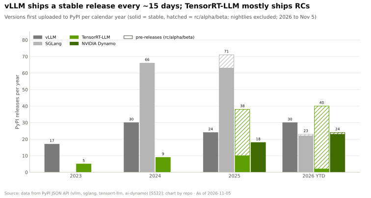
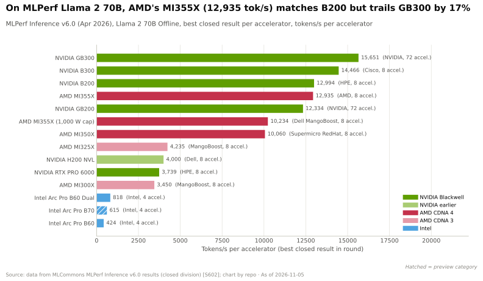
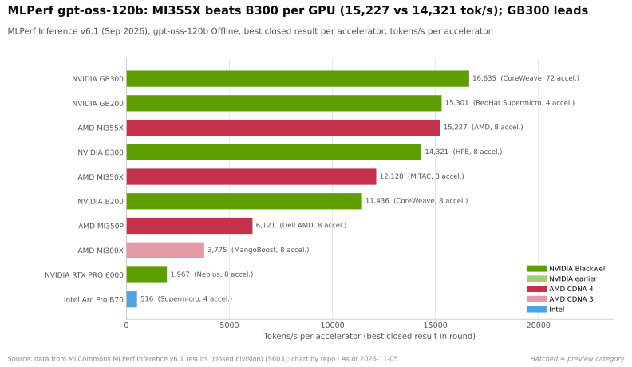
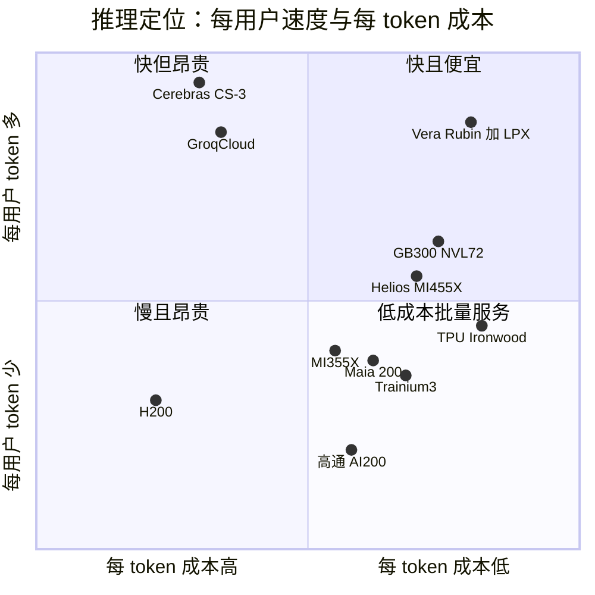

# 推理与 AI 软件：竞争格局

> [!NOTE]
> 本页为英文原文的简体中文参考译文，仅供参考；如有出入，以[英文原文](../../../layers/11-inference-and-ai-software/competition.md "English original")为准。

第 11 层 · 推理与 AI 软件 · 约 14 分钟阅读 · 最近核实：2026-11-05

## ⚡ 要点速览

- **英伟达（NVIDIA）在实际交付成本上领先：** 在每用户 50 [tokens](../../glossary.md#token)/s 下，GB300 [NVL72](../../glossary.md#nvl72) 运行 DeepSeek-R1 的成本为每百万 token ~$0.10，而 MI355X 为 ~$0.56，H200 为 ~$1.10（估计）[[S621]](../../../sources/bibliography.md#s621)[[S622]](../../../sources/bibliography.md#s622)。
- **开源推理服务打破锁定：** [vLLM](../../glossary.md#vllm)、[SGLang](../../glossary.md#sglang) 和 [llm-d](../../glossary.md#llm-d) 可在七大硬件家族上运行；2026 年迄今 vLLM 已发布 30 个稳定版本，而 [TensorRT-LLM](../../glossary.md#tensorrt-llm) 只有 2 个 [[S580]](../../../sources/bibliography.md#s580)[[S581]](../../../sources/bibliography.md#s581)[[S596]](../../../sources/bibliography.md#s596)[[S522]](../../../sources/bibliography.md#s522)。
- **英伟达选择了收编：** [Dynamo](../../glossary.md#dynamo) 可驱动 vLLM 和 SGLang，而尚待完成的 ~$12.9B Hugging Face 交易将把 transformers、TGI 和 llama.cpp 纳入麾下 🟡 [[S11001]](../../../sources/bibliography.md#s11001)[[S11500]](../../../sources/bibliography.md#s11500)[[S11539]](../../../sources/bibliography.md#s11539)。
- **TPU 是成本挑战者：** Ironwood 运行 Qwen3.5 397B 比 B200 便宜 ~18%（每百万 token $0.181 对比 $0.222）[[S625]](../../../sources/bibliography.md#s625)。
- **AMD 缩小了单 GPU 差距，但没有缩小机架级差距：** 在 MLPerf Llama 2 70B 上与 B200 持平，但在 GLM 5.3 上、每用户 150 tokens/s 时成本最高贵 5× [[S602]](../../../sources/bibliography.md#s602)[[S636]](../../../sources/bibliography.md#s636)。
- **SRAM 芯片赢在速度而非成本：** Cerebras 与 OpenAI 签下最多 750 MW 的合同；Groq 的设计则被装进英伟达的 Groq 3 LPX 机架出货 [[S11523]](../../../sources/bibliography.md#s11523)[[S114]](../../../sources/bibliography.md#s114)。
- **[Q5 · 最强挑战者]** 论成本，是 TPU 和自用 ASIC；论锁定，是开源推理服务。芯片规格已经追上（MI455X 如今在内存上领先 Rubin）；机架级推理服务则尚未追上。

## 推理竞争如何计分

[推理](../../glossary.md#inference)的买家会权衡五件事：**[交互速度](../../glossary.md#interactivity)**（每用户 tokens/s：智能体用起来是否即时？）、**每美元吞吐量**（卖方的毛利率）、**软件成熟度**（需要多少工程师）、**模型覆盖**（下周发布的模型能否在发布当天运行？）以及**部署灵活性**（能买断，还是只能向其所有者租用？）。前两项沿[帕累托前沿](../../glossary.md#pareto-frontier)此消彼长，就像公交车与出租车的取舍（[推理转向](the-inference-shift.md)）。

| 挑战者（依据） | 每用户 tokens/s | 每美元吞吐量 | 软件成熟度 | 模型覆盖 | 部署灵活性 |
|---|---|---|---|---|---|
| 开源推理服务（vLLM、SGLang、llm-d） | 🟨 在 NVL72 上同样支持大规模专家并行 | 🟨 使用相同 GPU | 🟨 每月 ~2 个版本 | 🟩 开放模型第 0 天支持 | 🟩 7 大硬件家族 |
| AMD MI355X → MI455X | 🟥 Helios 之前仅有 8-GPU 域 | 🟨 最多便宜 29.6% | 🟥 ROCm 7，无 Dynamo 对等产品 | 🟨 vLLM/SGLang 原生支持 | 🟨 商用芯片 |
| 谷歌 TPU Ironwood → 8i | 🟦 9,216 芯片 pod | 🟩 比 B200 低 ~18% | 🟥 TorchTPU 自 2026 年 10 月起 | 🟥 Gemini、Anthropic | 🟦 Google Cloud、OCI |
| AWS Trainium / Inferentia | 🟥 无公开结果 | 🟦 自用定价 | 🟥 vLLM 插件为 beta | 🟥 Claude 及部分模型 | 🟦 仅限 AWS |
| 微软 Maia 200 | 🟦 SRAM + HBM3E | 🟦 内部宣称 | 🟥 无公开软件栈 | 🟥 Copilot、OpenAI | 🟦 仅限 Azure |
| Cerebras CS-3 | 🟩 超越 GPU 节点 | 🟥 每系统 44 GB | 🟦 API 优先 | 🟥 精选模型 | 🟦 云端、本地部署 |
| Groq（GroqCloud） | 🟩 SRAM 级解码速度 | 🟥 每个模型需大量芯片 | 🟥 创始人已离开 | 🟥 精选模型 | 🟦 API 云服务 |
| 高通 AI 100 / AI200 / AI250 | 🟥 LPDDR 0.55 TB/s | 🟦 押注 768 GB 容量 | 🟥 vLLM + Modular | 🟥 无公开结果 | 🟨 商用芯片 |

评级 = 挑战者对比搭载 Dynamo 与 TensorRT-LLM 的英伟达 GB300 / Vera Rubin NVL72；为本资料库判断 🔴，依据 [[S621]](../../../sources/bibliography.md#s621)[[S630]](../../../sources/bibliography.md#s630)[[S637]](../../../sources/bibliography.md#s637)[[S636]](../../../sources/bibliography.md#s636)[[S625]](../../../sources/bibliography.md#s625)[[S553]](../../../sources/bibliography.md#s553)[[S581]](../../../sources/bibliography.md#s581)[[S158]](../../../sources/bibliography.md#s158)[[S634]](../../../sources/bibliography.md#s634)[[S167]](../../../sources/bibliography.md#s167)[[S172]](../../../sources/bibliography.md#s172)[[S173]](../../../sources/bibliography.md#s173)[[S596]](../../../sources/bibliography.md#s596)[[S9511]](../../../sources/bibliography.md#s9511)[[S602]](../../../sources/bibliography.md#s602)。数据：`l11_inference_verdicts.csv`。

> [!TIP]
> **算例 —— 成本差距对服务商意味着什么。** 按所有者[总拥有成本（TCO）](../../glossary.md#tco)计，在每用户 50 tokens/s 下服务一万亿个 DeepSeek-R1 token（10⁶ 个百万 token），GB300 NVL72 需 ~$100K，MI355X 需 ~$560K，H200 需 ~$1.1M（估计）[[S621]](../../../sources/bibliography.md#s621)[[S622]](../../../sources/bibliography.md#s622)。以谷歌 2025 年 10 月每月超过 1.3 千万亿 token 的规模计，每百万 token $0.46 的差距相当于每月 ~$600M [[S32020]](../../../sources/bibliography.md#s32020)。

🔧 技术细节：为什么各基准测试结论不一

[MLPerf](../../glossary.md#mlperf) 经过审计但定期发布；[InferenceX](../../glossary.md#inferencex) 每晚在不同交互速度水平上重跑，并用 TCO 模型定价（GB300 每 GPU 小时 $2.31，MI355X $1.50，TPU7x $1.21）[[S622]](../../../sources/bibliography.md#s622)。AMD 在稠密模型或激活参数较少的模型的离线场景中表现最好；英伟达则在高交互速度下的大型[混合专家](../../glossary.md#mixture-of-experts)模型上表现最好，因为 72-GPU [NVLink](../../glossary.md#nvlink) 域能承载专家间的通信流量 [[S630]](../../../sources/bibliography.md#s630)[[S636]](../../../sources/bibliography.md#s636)。

## 开源推理服务：锁定问题

[推理服务引擎](../../glossary.md#serving-engine)是模型、硬件与客户的交汇点。vLLM 源自 2023 年伯克利的一篇论文 [[S32011]](../../../sources/bibliography.md#s32011)，原生支持 [CUDA](../../glossary.md#cuda)、[ROCm](../../glossary.md#rocm) 和英特尔 GPU，并通过[硬件插件](../../glossary.md#hardware-plugin)支持 TPU、Gaudi、AWS Neuron（beta）和昇腾（Ascend），另有一个高通（Qualcomm）容器 [[S580]](../../../sources/bibliography.md#s580)[[S581]](../../../sources/bibliography.md#s581)[[S596]](../../../sources/bibliography.md#s596)。SGLang 列出了英伟达、AMD、TPU 和昇腾 [[S582]](../../../sources/bibliography.md#s582)。Ray 覆盖 13 个设备家族，llama.cpp 约覆盖十个，其中包括骁龙（Snapdragon）[[S584]](../../../sources/bibliography.md#s584)[[S579]](../../../sources/bibliography.md#s579)。Hugging Face 已将其 TGI 引擎转入维护模式，并引导用户转向 vLLM 和 SGLang [[S11502]](../../../sources/bibliography.md#s11502)。llm-d 1.0（2026 年 10 月；由红帽、谷歌、IBM、CoreWeave 和英伟达共同发起）增加了路由以及[预填充（prefill）](../../glossary.md#prefill)/解码拆分功能，并已在英伟达、AMD、英特尔和 TPU 上完成验证 [[S11503]](../../../sources/bibliography.md#s11503)。

> [!TIP]
> **算例 —— 开源省下的许可费。** 一个在生产环境中运行 [NIM](../../glossary.md#nim) 的 10,000 块 GPU 机群需要 [NVIDIA AI Enterprise](../../glossary.md#nvidia-ai-enterprise)，标价每 GPU 每年 $4,500：每年 $45M [[S9515]](../../../sources/bibliography.md#s9515)[[S11013]](../../../sources/bibliography.md#s11013)。若使用 vLLM 或 SGLang，则无需支付许可费，而且从 H200 换到 MI355X 只需更换容器，无需改动应用；TensorRT-LLM 则只能在英伟达 GPU 上运行 [[S589]](../../../sources/bibliography.md#s589)。

> [!WARNING]
> **误区与事实：“开源抹平了英伟达的优势。”** 开源引擎对英伟达硬件调优最为用力：SGLang 的一个版本就把同一组 B200 的吞吐量从每 GPU 508 提升到 907 tokens/s [[S629]](../../../sources/bibliography.md#s629)。AMD 同样受益（MI355X 在 Qwen3.5 上三个月内从 1.3K 提升到 6.4K）[[S632]](../../../sources/bibliography.md#s632)。开源推理服务降低了切换成本，但并不能抹平芯片之间的差距。

## 逐一审视挑战者

### AMD：最接近的商用芯片对手

MI355X 在 MLPerf Llama 2 70B 上与 B200 持平，在 gpt-oss-120b 上单 GPU 性能超过 B300（15,227 对比 14,321 tokens/s），这得益于 8 TB/s、288 GB 的 [HBM](../../glossary.md#hbm) [[S602]](../../../sources/bibliography.md#s602)[[S603]](../../../sources/bibliography.md#s603)。其在 MLPerf 推理封闭组结果中的占比在 18 个月内从 2% 升至 20% [[S600]](../../../sources/bibliography.md#s600)[[S603]](../../../sources/bibliography.md#s603)。其拿下的订单大多用于推理：OpenAI（自 2026 年下半年起 6 GW）、甲骨文（Oracle）（50,000 块 MI450）、Meta，以及 Anthropic（最多 2 GW 的 Helios）[[S90020]](../../../sources/bibliography.md#s90020)[[S90022]](../../../sources/bibliography.md#s90022)[[S546]](../../../sources/bibliography.md#s546)[[S9538]](../../../sources/bibliography.md#s9538)[[S90023]](../../../sources/bibliography.md#s90023)。**最有力的论据：**MI455X 每 GPU 配备 432 GB、23.3 TB/s 的内存，是 Rubin 288 GB 的 1.5×、其 19.2 TB/s 的 ~1.2× [[S144]](../../../sources/bibliography.md#s144)[[S90093]](../../../sources/bibliography.md#s90093)[[S90006]](../../../sources/bibliography.md#s90006)。**差距：**Helios 的 72-GPU 域要到 2027 年第二季度才能放量（据 SemiAnalysis），因此在那之前，英伟达仍将保有高交互速度 MoE 场景的前沿 🟡 [[S624]](../../../sources/bibliography.md#s624)。

### 谷歌 TPU、AWS 与微软：自用芯片的成本优势

Ironwood 是谷歌首款“为推理时代打造”的 TPU，配备 192 GB [HBM3E](../../glossary.md#hbm3e)，单个 pod 含 9,216 颗芯片 [[S151]](../../../sources/bibliography.md#s151)。TPU 8i（2026 年底）将用于 [KV 缓存](../../glossary.md#kv-cache)的片上 SRAM 增加到原来的三倍 [[S550]](../../../sources/bibliography.md#s550)。Anthropic 拥有超过 1M 块 TPU（~400K 块买断、~600K 块租用），Meta 租用 Ironwood，甲骨文云将于 2027 年引入 TPU [[S625]](../../../sources/bibliography.md#s625)[[S90025]](../../../sources/bibliography.md#s90025)[[S552]](../../../sources/bibliography.md#s552)。AWS 已推出 Trainium3（2025 年 12 月），并为 Anthropic 部署了 Project Rainier（~500K 块 Trainium2）；其 vLLM 插件仍处于 beta 阶段 [[S90034]](../../../sources/bibliography.md#s90034)[[S581]](../../../sources/bibliography.md#s581)。微软的 Maia 200（216 GB HBM3E、272 MB SRAM、>10 [PFLOPS](../../glossary.md#flops) [FP4](../../glossary.md#fp4)、750 W）用于运行 Copilot；Maia 300 将于 2027 年推出 [[S158]](../../../sources/bibliography.md#s158)[[S90044]](../../../sources/bibliography.md#s90044)[[S90046]](../../../sources/bibliography.md#s90046)。**最有力的论据：**没有商用芯片厂商的利润加成；相对于英伟达 ~75% 的毛利率，拥有自研 [ASIC](../../glossary.md#asic) 的企业一开始就有很大的价格缓冲空间 [[S3]](../../../sources/bibliography.md#s3)。

### SRAM 速度专家

[解码（decode）](../../glossary.md#decode)每生成一个 token 都要重读一遍权重：带宽决定速度上限，容量决定芯片数量。Cerebras 的晶圆级芯片拥有 44 GB、21 PB/s 的 [SRAM](../../glossary.md#sram) [[S634]](../../../sources/bibliography.md#s634)；OpenAI 同意在 2028 年前购买其最多 750 MW 的算力 [[S11523]](../../../sources/bibliography.md#s11523)[[S11524]](../../../sources/bibliography.md#s11524)。Groq [LPU](../../glossary.md#lpu) 的创始人及团队随授权交易加入英伟达；GroqCloud 继续运营 [[S90018]](../../../sources/bibliography.md#s90018)。Etched（$10.3B）、Positron（$5B）和 d-Matrix（$2B）仍未实现规模化 [[S2507]](../../../sources/bibliography.md#s2507)[[S11521]](../../../sources/bibliography.md#s11521)[[S2511]](../../../sources/bibliography.md#s2511)；详见[价值链](value-chain-and-corp-dev.md)。

> [!TIP]
> **算例 —— 为什么 SRAM 快但贵。** 一个 70B 参数的模型在 [FP8](../../glossary.md#fp8) 下为 ~70 GB。单块 Rubin GPU（288 GB、19.2 TB/s）即可容纳，每秒可将其完整读取 ~274 次，这就是单用户速度的上限 [[S90006]](../../../sources/bibliography.md#s90006)。每颗 Groq 3 LPU 只有 0.5 GB，因此权重需要 ~140 颗芯片，超过一个 256-LPU LPX 机架的一半 [[S114]](../../../sources/bibliography.md#s114)。每颗芯片每秒可重读自己那部分权重 ~300,000 次，因此决定上限的是互连而非内存：每用户的速度高得多，但每用户所需的芯片也多得多。

### 高通（仅限公开信息）

Cloud AI 100 Ultra 是一款 150 W 的加速卡，配备 128 GB、548 GB/s 的 [LPDDR](../../glossary.md#lpddr) [[S172]](../../../sources/bibliography.md#s172)。AI200（2026 年）每卡配备 768 GB LPDDR，部署于 160 kW 液冷机架中；AI250（2027 年）增加[近存计算](../../glossary.md#near-memory-compute)，宣称有效带宽提升 >10×；HUMAIN 计划部署 200 MW [[S173]](../../../sources/bibliography.md#s173)[[S90030]](../../../sources/bibliography.md#s90030)。2028 年的 AI300 宣称借助[高带宽计算（High Bandwidth Compute）](../../glossary.md#high-bandwidth-compute)实现 AI200 带宽的 54× [[S90060]](../../../sources/bibliography.md#s90060)，对 Modular 的收购已于 2026-07-29 完成 [[S9511]](../../../sources/bibliography.md#s9511)。截至 2026-11-05，尚无 AI200 量产出货、MLPerf 数据中心或 InferenceX 结果公开 🔴 [[S90028]](../../../sources/bibliography.md#s90028)[[S602]](../../../sources/bibliography.md#s602)[[S620]](../../../sources/bibliography.md#s620)。

本资料库定位 🔴，以 [[S621]](../../../sources/bibliography.md#s621)[[S625]](../../../sources/bibliography.md#s625)[[S634]](../../../sources/bibliography.md#s634) 为锚点；Helios、LPX 和 AI200 尚无基准测试数据。

> [!NOTE]
> **🐂 看多观点。** 英伟达掌握推理级 MoE 模型的实际交付成本前沿（每用户 50 tokens/s 下每百万 token $0.10），对开源引擎的运行效果最好，新增了 SRAM 解码（Groq 3 LPX），并且正在收购分发渠道（Hugging Face）🟡 [[S621]](../../../sources/bibliography.md#s621)[[S114]](../../../sources/bibliography.md#s114)[[S11500]](../../../sources/bibliography.md#s11500)。

> [!WARNING]
> **🐻 看空观点。** 推理奖励的是成本而非灵活性：TPU 在部分工作负载上便宜 ~18%，AMD 在单 GPU 层面与 B200 持平 [[S625]](../../../sources/bibliography.md#s625)[[S602]](../../../sources/bibliography.md#s602)。开源引擎让切换变成一次容器替换，而前沿实验室如今已把推理分散到 TPU、AMD、Trainium 和 Cerebras 上 [[S90026]](../../../sources/bibliography.md#s90026)[[S90020]](../../../sources/bibliography.md#s90020)[[S11523]](../../../sources/bibliography.md#s11523)。

**[Q5 · 最强挑战者]** 论每 token 成本：谷歌 TPU——唯一一款既有第三方成本数据显示其领先（较 B200 低 ~18%）、又有外部客户的自用 ASIC [[S625]](../../../sources/bibliography.md#s625)[[S552]](../../../sources/bibliography.md#s552)。论锁定：开源推理服务，它让任何挑战者都能继承[第 0 天模型支持](../../glossary.md#day-zero-support)。单芯片规格上的差距已经弥合（MI455X 在带宽上追平 Rubin），但机架级推理服务的差距尚未弥合——在每用户 150 tokens/s 下，英伟达的成本最多低 5× [[S90006]](../../../sources/bibliography.md#s90006)[[S636]](../../../sources/bibliography.md#s636)。

## 🎯 企业发展视角

1. 如果开源引擎使推理服务商品化，价值是否会转移到掌控分发渠道（[模型中心](../../glossary.md#model-hub)、API）的一方？英伟达的 Hugging Face 交易对中立的模型中心意味着什么？
2. SRAM 占据超低延迟市场，NVL72 占据中间地带：在长上下文、对成本敏感的推理服务中，是否还有容量优先设计（每卡 768 GB）的空间？
3. 新进入者需要多少公开基准测试证据，买家才会下大批量订单？生成这些证据需要多少成本？
4. 哪些大型 token 买家（主权机构、模型实验室）缺乏自研芯片，可能愿意与商用芯片伙伴联合设计？

## 📚 来源（Sources）

<!-- Auto-generated from the [S…] citations on this page by `make build`. Edit sources/registry/*.csv, not this list. -->

- [**S3**](../../../sources/bibliography.md#s3) StorageNewsletter, *NVIDIA Q2 Fiscal 2027 results coverage: revenue $96.2B*, 2026-08-27. [Link](https://www.storagenewsletter.com/2026/08/27/nvidia-fiscal-2q27-financial-results/)
- [**S114**](../../../sources/bibliography.md#s114) StorageReview, *NVIDIA Groq 3 LPX: Everything we know*, 2026-03. [Link](https://www.storagereview.com/news/nvidia-groq-3-lpx-everything-we-know)
- [**S144**](../../../sources/bibliography.md#s144) AMD Newsroom, *AMD Unveils Vision for an Open AI Ecosystem, Detailing New Silicon, Software and Systems at Advancing AI 2025*, 2025-06-12. [Link](https://www.amd.com/en/newsroom/press-releases/2025-6-12-amd-unveils-vision-for-an-open-ai-ecosystem-detai.html)
- [**S151**](../../../sources/bibliography.md#s151) Google Blog (Amin Vahdat), *Ironwood: The first Google TPU for the age of inference*, 2025-04-09. [Link](https://blog.google/products/google-cloud/ironwood-tpu-age-of-inference/)
- [**S158**](../../../sources/bibliography.md#s158) Microsoft, *Maia 200: Microsoft's AI accelerator built for inference*, 2026-01. [Link](https://blogs.microsoft.com/blog/2026/01/26/maia-200-the-ai-accelerator-built-for-inference/)
- [**S167**](../../../sources/bibliography.md#s167) ISCA 2022 (ACM) (Dennis Abts et al.), *A Software-defined Tensor Streaming Multiprocessor for Large-scale Machine Learning (Groq)*, 2022-06. [Link](https://dl.acm.org/doi/10.1145/3470496.3527405)
- [**S172**](../../../sources/bibliography.md#s172) Qualcomm, *Qualcomm Cloud AI 100 (incl. Cloud AI 100 Ultra)*, 2023-11. [Link](https://www.qualcomm.com/products/technology/processors/cloud-artificial-intelligence/cloud-ai-100)
- [**S173**](../../../sources/bibliography.md#s173) Qualcomm, *Qualcomm Unveils AI200 and AI250 - Redefining Rack-Scale Data Center Inference*, 2025-10-27. [Link](https://www.qualcomm.com/news/releases/2025/10/qualcomm-unveils-ai200-and-ai250-redefining-rack-scale-data-cent)
- [**S522**](../../../sources/bibliography.md#s522) Python Package Index, *PyPI JSON API release histories (vllm, sglang, tensorrt-llm, ai-dynamo, torch-npu, jax-rocm7-plugin, tensorflow-rocm, intel-extension-for-tensorflow, onnxruntime-cann, onnxruntime-migraphx, torch-xla, torch-tpu)*, 2026-11-05. [Link](https://pypi.org/)
- [**S546**](../../../sources/bibliography.md#s546) TechWire Asia, *AMD Advancing AI 2026: Helios, OpenAI, Meta, Anthropic*, 2026-07. [Link](https://techwireasia.com/2026/07/amd-advancing-ai-2026-helios-openai-meta-anthropic/)
- [**S550**](../../../sources/bibliography.md#s550) SiliconANGLE, *Google Cloud unveils eighth-generation TPUs (TPU 8t and TPU 8i)*, 2026-04-22. [Link](https://siliconangle.com/?p=740999)
- [**S552**](../../../sources/bibliography.md#s552) Google Cloud Blog (Karan Batta), *Bringing Google TPUs to Oracle Cloud Infrastructure*, 2026-10-27. [Link](https://cloud.google.com/blog/products/infrastructure/bringing-google-tpus-to-oracle-cloud-infrastructure)
- [**S553**](../../../sources/bibliography.md#s553) Google Cloud Blog (Alex Barrett), *What's new in AI infrastructure and orchestration in October*, 2026-11. [Link](https://cloud.google.com/blog/topics/ai-infrastructure/whats-new-in-ai-infrastructure-this-month)
- [**S579**](../../../sources/bibliography.md#s579) ggml-org (GitHub), *llama.cpp README — supported backends*, 2026-11. [Link](https://github.com/ggml-org/llama.cpp/blob/master/README.md)
- [**S580**](../../../sources/bibliography.md#s580) vLLM project (GitHub), *vLLM README and installation docs — supported hardware*, 2026-11. [Link](https://github.com/vllm-project/vllm/blob/main/docs/getting_started/installation/README.md)
- [**S581**](../../../sources/bibliography.md#s581) vLLM project (GitHub), *vLLM hardware plugin repositories (tpu-inference/vLLM JAX, vllm-gaudi, vllm-ascend, vllm-neuron)*, 2026-11. [Link](https://github.com/vllm-project)
- [**S582**](../../../sources/bibliography.md#s582) SGLang project (GitHub: sgl-project/sglang), *SGLang README — supported hardware*, 2026-11. [Link](https://github.com/sgl-project/sglang/blob/main/README.md)
- [**S584**](../../../sources/bibliography.md#s584) Ray project (GitHub: ray-project/ray), *Ray accelerator managers (python/ray/_private/accelerators)*, 2026-11. [Link](https://github.com/ray-project/ray/blob/master/python/ray/_private/accelerators/__init__.py)
- [**S589**](../../../sources/bibliography.md#s589) NVIDIA (GitHub: NVIDIA/TensorRT-LLM), *TensorRT-LLM README*, 2026-11. [Link](https://github.com/NVIDIA/TensorRT-LLM/blob/main/README.md)
- [**S596**](../../../sources/bibliography.md#s596) Qualcomm (GitHub: quic), *Qualcomm Cloud AI SDK and Efficient Transformers repositories*, 2026-11. [Link](https://github.com/quic/cloud-ai-sdk)
- [**S600**](../../../sources/bibliography.md#s600) MLCommons, *MLPerf Inference v5.0 results (summary_results.json and per-submitter logs)*, 2025-04-02. [Link](https://github.com/mlcommons/inference_results_v5.0)
- [**S602**](../../../sources/bibliography.md#s602) MLCommons, *MLPerf Inference v6.0 results (summary_results.json and per-submitter logs)*, 2026-04-01. [Link](https://github.com/mlcommons/inference_results_v6.0)
- [**S603**](../../../sources/bibliography.md#s603) MLCommons, *MLPerf Inference v6.1 results (summary.csv and per-submitter logs)*, 2026-09. [Link](https://github.com/mlcommons/inference_results_v6.1)
- [**S620**](../../../sources/bibliography.md#s620) SemiAnalysis, *SemiAnalysis InferenceX (formerly InferenceMAX) open-source benchmark repository*, 2026-11. [Link](https://github.com/SemiAnalysisAI/InferenceX)
- [**S621**](../../../sources/bibliography.md#s621) SemiAnalysis (InferenceX-app repository), *InferenceX public API snapshot (benchmarks.json and benchmarks-history.json fixtures)*, 2026-10-17. [Link](https://github.com/SemiAnalysisAI/InferenceX-app/tree/main/packages/app/cypress/fixtures/api)
- [**S622**](../../../sources/bibliography.md#s622) SemiAnalysis (InferenceX-app repository), *InferenceX hardware registry: TCO per GPU-hour by SKU (SemiAnalysis July 2026 pricing surveys and AI Cloud TCO Model)*, 2026-07. [Link](https://github.com/SemiAnalysisAI/InferenceX-app/blob/main/packages/constants/src/gpu-keys.ts)
- [**S624**](../../../sources/bibliography.md#s624) SemiAnalysis, *InferenceX v2: NVIDIA Blackwell Vs AMD vs Hopper - Formerly InferenceMAX*, 2026-02-16. [Link](https://github.com/SemiAnalysisAI/InferenceX-app/blob/main/packages/app/content/blog/inferencex-v2-nvidia-blackwell-vs-amd-vs-hopper.mdx)
- [**S625**](../../../sources/bibliography.md#s625) SemiAnalysis, *TPU Inference Externalization Full Steam Ahead*, 2026-09-07. [Link](https://github.com/SemiAnalysisAI/InferenceX-app/blob/main/packages/app/content/blog/tpu-inferencex-full-steam.mdx)
- [**S629**](../../../sources/bibliography.md#s629) SemiAnalysis, *SGLang 0.5.6 on B200 DeepSeek R1 FP4: Up to 1.8x at Low Concurrency*, 2026-05-02. [Link](https://github.com/SemiAnalysisAI/InferenceX-app/blob/main/packages/app/content/blog/sglang-0-5-6-b200-deepseek-r1-fp4-up-to-1-8x.mdx)
- [**S630**](../../../sources/bibliography.md#s630) SemiAnalysis, *GB200 NVL72 vs B200 on Kimi K2.5: 3.1x from Wide EP vLLM*, 2026-04-23. [Link](https://github.com/SemiAnalysisAI/InferenceX-app/blob/main/packages/app/content/blog/gb200-nvl72-kimi-k2-5-vllm-wide-ep-3x-vs-b200.mdx)
- [**S632**](../../../sources/bibliography.md#s632) SemiAnalysis, *AMD MI355X Qwen3.5 397B-A17B Inference: Up to 19x Throughput per GPU in 3 Months on SGLang FP8*, 2026-05-25. [Link](https://github.com/SemiAnalysisAI/InferenceX-app/blob/main/packages/app/content/blog/mi355x-qwen3-5-sglang-v0-5-12-up-to-17x.mdx)
- [**S634**](../../../sources/bibliography.md#s634) SemiAnalysis, *Ultra-High Interactivity on NVIDIA GPUs? TileRT on InferenceX*, 2026-08-10. [Link](https://github.com/SemiAnalysisAI/InferenceX-app/blob/main/packages/app/content/blog/ultra-high-interactivity-on-nvidia.mdx)
- [**S636**](../../../sources/bibliography.md#s636) SemiAnalysis, *GLM 5.3 on AgentX: NVIDIA Is Up to 5x Cheaper per Token at 150 tok/s/user*, 2026-08-25. [Link](https://github.com/SemiAnalysisAI/InferenceX-app/blob/main/packages/app/content/blog/glm-5-3-agentx-nvidia-vs-amd-sglang-150-toks.mdx)
- [**S637**](../../../sources/bibliography.md#s637) SemiAnalysis, *AMD MI355X GLM-5 Inference: Up to 29.6% Lower Cost per Million Tokens than B200 on SGLang FP8*, 2026-05-25. [Link](https://github.com/SemiAnalysisAI/InferenceX-app/blob/main/packages/app/content/blog/mi355x-glm5-fp8-sglang-40-cheaper-than-b200.mdx)
- [**S2507**](../../../sources/bibliography.md#s2507) AI Weekly, *Etched closes $300M Series C at $10.3B led by Sequoia, books ~$1B in pre-orders for Sohu*, 2026-07. [Link](https://aiweekly.co/alerts/etched-closes-300m-series-c-at-103b-led-by-sequoia-books-1b-in-pre-orders-for)
- [**S2511**](../../../sources/bibliography.md#s2511) Converge Digest, *d-Matrix raises $275 million to accelerate the age of AI inference*, 2025-11-12. [Link](https://convergedigest.com/d-matrix-raises-275-million-to-accelerate-the-age-of-ai-inference/)
- [**S9511**](../../../sources/bibliography.md#s9511) Nasdaq (Qualcomm press release), *Qualcomm Completes Acquisition of Modular*, 2026-07-29. [Link](https://www.nasdaq.com/press-release/qualcomm-completes-acquisition-modular-2026-07-29)
- [**S9515**](../../../sources/bibliography.md#s9515) The Register (Tobias Mann), *Nvidia's software empire (NVIDIA AI Enterprise licensing)*, 2024-08-06. [Link](https://www.theregister.com/2024/08/06/nvidia_software_empire/)
- [**S9538**](../../../sources/bibliography.md#s9538) The Next Web, *AMD is investing $5 billion in Anthropic and deploying 2 gigawatts of Helios GPUs to run Claude*, 2026. [Link](https://thenextweb.com/news/amd-anthropic-5-billion-investment-2gw-helios-mi450)
- [**S11001**](../../../sources/bibliography.md#s11001) NVIDIA (GitHub), *NVIDIA Dynamo README (ai-dynamo/dynamo)*, 2026-11. [Link](https://github.com/ai-dynamo/dynamo/blob/main/README.md)
- [**S11013**](../../../sources/bibliography.md#s11013) NVIDIA (docs.api.nvidia.com), *NVIDIA NIM FAQ*, 2025. [Link](https://docs.api.nvidia.com/nim/docs/faq)
- [**S11500**](../../../sources/bibliography.md#s11500) TechRadar Pro, *'The planets aligned': Nvidia confirms $12.9bn Hugging Face deal in potentially huge AI shake-up*, 2026-09-03. [Link](https://techradar.com/pro/the-planets-aligned-nvidia-confirms-usd12-9bn-hugging-face-deal-in-potentially-huge-ai-shake-up)
- [**S11502**](../../../sources/bibliography.md#s11502) Hugging Face (GitHub: huggingface/text-generation-inference), *Text Generation Inference (TGI) README: maintenance-mode notice*, 2026-11. [Link](https://github.com/huggingface/text-generation-inference/blob/main/README.md)
- [**S11503**](../../../sources/bibliography.md#s11503) llm-d project (GitHub: llm-d/llm-d), *llm-d README (distributed inference on Kubernetes)*, 2026-11. [Link](https://github.com/llm-d/llm-d/blob/main/README.md)
- [**S11521**](../../../sources/bibliography.md#s11521) Latham & Watkins, *Latham & Watkins advises Positron AI on Series C*, 2026-09. [Link](https://www.lw.com/en/news/2026/09/latham-watkins-advises-positron-ai-on-series-c)
- [**S11523**](../../../sources/bibliography.md#s11523) DatacenterDynamics, *OpenAI signs $10 billion deal with Cerebras with 750MW of big chip compute*, 2026-01-14. [Link](https://www.datacenterdynamics.com/en/news/openai-signs-10-billion-deal-with-cerebras-with-750mw-of-big-chip-compute/)
- [**S11524**](../../../sources/bibliography.md#s11524) TechCrunch, *OpenAI signs deal reportedly worth $10 billion for compute from Cerebras*, 2026-01-14. [Link](https://techcrunch.com/2026/01/14/openai-signs-deal-reportedly-worth-10-billion-for-compute-from-cerebras/)
- [**S11539**](../../../sources/bibliography.md#s11539) ggml-org/llama.cpp (GitHub) (Georgi Gerganov), *ggml.ai joins Hugging Face to ensure the long-term progress of Local AI (discussion #19759)*, 2026-02-20. [Link](https://github.com/ggml-org/llama.cpp/discussions/19759)
- [**S32011**](../../../sources/bibliography.md#s32011) SOSP 2023 (arXiv 2309.06180) (Kwon et al.), *Efficient Memory Management for Large Language Model Serving with PagedAttention (vLLM)*, 2023-09. [Link](https://arxiv.org/abs/2309.06180)
- [**S32020**](../../../sources/bibliography.md#s32020) Alphabet / Google (The Keyword) (Sundar Pichai), *Alphabet CEO remarks on token volume (October 2025)*, 2025-10. [Link](https://blog.google/inside-google/message-ceo/alphabet-earnings-q3-2025/)
- [**S90006**](../../../sources/bibliography.md#s90006) TweakTown, *Nvidia cuts Vera Rubin's memory bandwidth by up to 26% and AMD's Helios now leads in memory bandwidth*, 2026-10. [Link](https://www.tweaktown.com/news/114304/nvidia-cuts-vera-rubins-memory-bandwidth-by-up-to-26-percent-and-amds-helios-now-leads-in-memory-bandwidth/index.html)
- [**S90018**](../../../sources/bibliography.md#s90018) Constellation Research, *Nvidia's Groq deal: acquisition, acquihire or creative licensing deal?*, 2025-12. [Link](https://www.constellationr.com/insights/news/nvidias-groq-deal-acquisition-acquihire-or-creative-licensing-deal)
- [**S90020**](../../../sources/bibliography.md#s90020) Shacknews, *AMD Helios AI rack system on track for initial shipments in Q3 2026*, 2026. [Link](https://www.shacknews.com/article/150249/amd-helios-ai-system-shipping-q3-2026)
- [**S90022**](../../../sources/bibliography.md#s90022) Tom's Hardware, *AMD and Oracle partner to deploy 50,000 MI450 Instinct GPUs*, 2025-10. [Link](https://www.tomshardware.com/tech-industry/artificial-intelligence/amd-and-oracle-partner-to-deploy-50-000-mi450-instinct-gpus-in-new-ai-superclusters-deployment-of-expansion-set-for-2026-powered-by-amds-helios-rack)
- [**S90023**](../../../sources/bibliography.md#s90023) Wccftech, *AMD has begun sampling MI450 GPUs and engaged with customers on MI500*, 2026. [Link](https://wccftech.com/amd-sampling-mi450-gpus-engaged-with-customers-on-mi500-largest-ai-deployments-are-for-inference/)
- [**S90025**](../../../sources/bibliography.md#s90025) SiliconANGLE, *Google and Meta reportedly strike new multibillion-dollar AI chip deal*, 2026-02-26. [Link](https://siliconangle.com/2026/02/26/google-meta-reportedly-strike-new-multibillion-dollar-ai-chip-deal/)
- [**S90026**](../../../sources/bibliography.md#s90026) Maginative, *Anthropic secures 1M Google TPUs while keeping Amazon as primary training partner*, 2025-10. [Link](https://www.maginative.com/anthropic-secures-1m-google-tpus-while-keeping-amazon-as-primary-training-partner)
- [**S90028**](../../../sources/bibliography.md#s90028) TechRepublic, *Qualcomm unveils AI chips to rival Nvidia, AMD*, 2025-10-27. [Link](https://techrepublic.com/article/news-qualcomm-unveils-ai-chips-to-rival-nvidia-amd)
- [**S90030**](../../../sources/bibliography.md#s90030) Morningstar, *Qualcomm: Humain deal provides some AI upside*, 2025-10. [Link](https://www.morningstar.com/stocks/qualcomm-humain-deal-provides-some-ai-upside)
- [**S90034**](../../../sources/bibliography.md#s90034) NAND Research, *AWS releases Trainium3, teases Trainium4*, 2025-12. [Link](https://nand-research.com/research-note-aws-releases-trainium3-teases-trainium4/4/)
- [**S90044**](../../../sources/bibliography.md#s90044) eWeek, *Microsoft introduces Maia 200, its most powerful AI chip yet*, 2026-01-27. [Link](https://www.eweek.com/news/microsoft-maia-200-ai-chip/)
- [**S90046**](../../../sources/bibliography.md#s90046) IT Brief UK, *Microsoft unveils Maia 300 for 2027 AI deployments*, 2026-10. [Link](https://itbrief.co.uk/story/microsoft-unveils-maia-300-for-2027-ai-deployments)
- [**S90060**](../../../sources/bibliography.md#s90060) Qualcomm, *Qualcomm Dragonfly AI300 (product page)*, 2026-06. [Link](https://www.qualcomm.com/data-center/products/qualcomm-dragonfly-ai300)
- [**S90093**](../../../sources/bibliography.md#s90093) Tom's Hardware, *AMD takes the wraps off its Instinct MI455X AI accelerator: CDNA 5 and Helios rack-scale architecture*, 2026. [Link](https://www.tomshardware.com/pc-components/gpus/amd-takes-the-wraps-off-its-instinct-mi455x-ai-accelerator-cdna-5-and-helios-rack-scale-architecture-combine-to-take-the-fight-to-nvidia-in-the-data-center)
