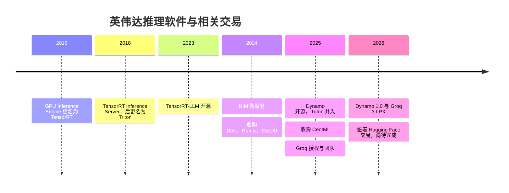
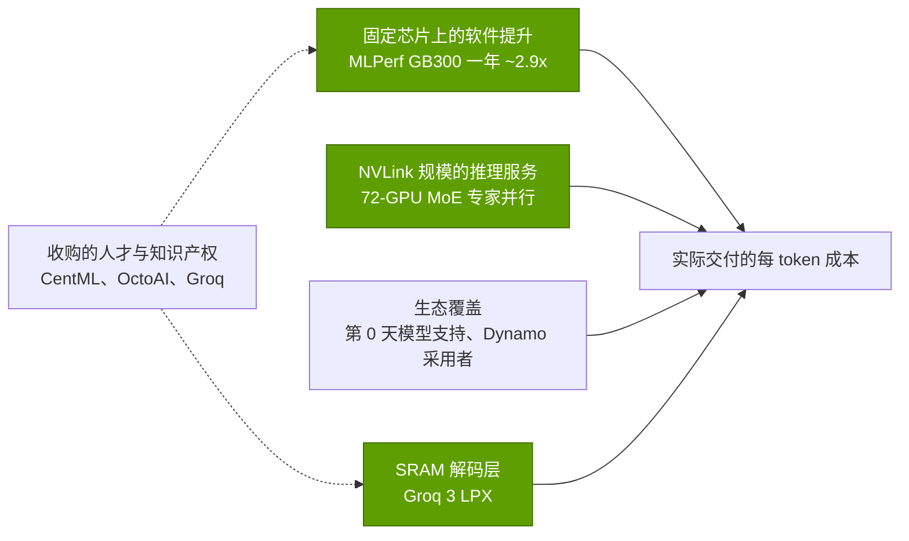
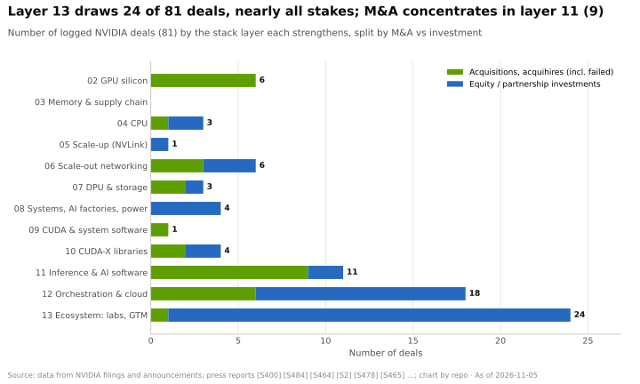

# 推理与 AI 软件：发展历程与英伟达的构建之道

> [!NOTE]
> 本页为英文原文的简体中文参考译文，仅供参考；如有出入，以[英文原文](../../../layers/11-inference-and-ai-software/history-and-how-built.md "English original")为准。

第 11 层 · 推理与 AI 软件 · 约 11 分钟阅读 · 最近核实：2026-11-05

## ⚡ 要点速览

- **十年四步棋：** TensorRT（2016）、[Triton](../../glossary.md#triton)（2018）、[TensorRT-LLM](../../glossary.md#tensorrt-llm) 与 NIM（2023–24），然后是 Dynamo（2025；1.0 版于 2026 年 3 月发布）[[S11505]](../../../sources/bibliography.md#s11505)[[S11009]](../../../sources/bibliography.md#s11009)[[S522]](../../../sources/bibliography.md#s522)[[S11014]](../../../sources/bibliography.md#s11014)[[S32015]](../../../sources/bibliography.md#s32015)[[S90066]](../../../sources/bibliography.md#s90066)。
- **缺人才就买：** 14 个月内收购 Deci、Run:ai、OctoAI 和 CentML，合计 ~$1.65B 🟡 [[S478]](../../../sources/bibliography.md#s478)[[S476]](../../../sources/bibliography.md#s476)[[S11510]](../../../sources/bibliography.md#s11510)[[S11509]](../../../sources/bibliography.md#s11509)。
- **硬件对冲：** ~$20B 的 Groq 授权加团队交易催生了 Groq 3 LPX 解码机架，自 2026 年 8 月起量产 [[S90019]](../../../sources/bibliography.md#s90019)[[S506]](../../../sources/bibliography.md#s506)。
- **分发渠道：** ~$12.9B 的 Hugging Face 收购协议（2026 年 9 月）正等待监管审查 🟡 [[S11026]](../../../sources/bibliography.md#s11026)[[S11500]](../../../sources/bibliography.md#s11500)。
- **[Q4 · 优势来源]** 集成与速度：软件让 GB300 [NVL72](../../glossary.md#nvl72) 的 MLPerf DeepSeek-R1 Server 成绩一年内提升 ~2.9×，而 72-GPU [NVLink](../../glossary.md#nvlink) 域能承载超大型 [MoE](../../glossary.md#mixture-of-experts) 模型 [[S601]](../../../sources/bibliography.md#s601)[[S603]](../../../sources/bibliography.md#s603)。
- **[Q6 · 复制成本]** 🔴 估计：若在新芯片上借助开源引擎，需要 ~3–5 年、~$1–3B 和 ~500–1,000 名工程师；机架级推理服务还要再加上数年的硬件开发时间。

## 从一块快速 GPU 到一座推理工厂

**第一阶段（2016–2022）：一块快速的 GPU。** GPU Inference Engine（2016 年年中）于当年 9 月更名为 TensorRT，它把训练好的网络编译为经过调优的运行时 [[S11505]](../../../sources/bibliography.md#s11505)；2026 年 10 月已发展到 11.4 版 [[S11504]](../../../sources/bibliography.md#s11504)。随后推出了模型服务器（TensorRT Inference Server，后更名为 Triton）；它甚至支持 CPU 和 AWS Inferentia [[S11009]](../../../sources/bibliography.md#s11009)[[S11506]](../../../sources/bibliography.md#s11506)。**第二阶段（2023–2024）：快速且打包交付的大语言模型。** TensorRT-LLM（2023）增加了[大语言模型（LLM）](../../glossary.md#llm)批处理与[量化](../../glossary.md#quantization)功能 [[S522]](../../../sources/bibliography.md#s522)[[S589]](../../../sources/bibliography.md#s589)；[NIM](../../glossary.md#nim) 把模型打包成容器，通过 [AI Enterprise](../../glossary.md#nvidia-ai-enterprise) 销售 [[S11014]](../../../sources/bibliography.md#s11014)[[S11015]](../../../sources/bibliography.md#s11015)。**第三阶段（2025 年起）：把机架当作一台机器。** [Dynamo](../../glossary.md#dynamo) 把[预填充（prefill）](../../glossary.md#prefill)与[解码（decode）](../../glossary.md#decode)拆开，并在 NVL72 内按 [KV 缓存](../../glossary.md#kv-cache)进行路由；Triton 则变为 Dynamo-Triton [[S32015]](../../../sources/bibliography.md#s32015)[[S11010]](../../../sources/bibliography.md#s11010)。工作机制详见：[TensorRT-LLM 与 Dynamo](tensorrt-llm-and-dynamo.md)。

| 日期 | 决策 | 为何重要 | 来源 |
|---|---|---|---|
| 2016-09 | GIE 更名为 TensorRT | 推理成为一款产品，而非训练的副产品 | [[S11505]](../../../sources/bibliography.md#s11505) |
| 2018 | 开放的模型服务器（Triton） | 掌控了推理服务 API，甚至覆盖 CPU 和 Inferentia | [[S11009]](../../../sources/bibliography.md#s11009)[[S11506]](../../../sources/bibliography.md#s11506) |
| 2023 | TensorRT-LLM 开源 | 回应 vLLM；设计上仅支持英伟达 | [[S522]](../../../sources/bibliography.md#s522)[[S589]](../../../sources/bibliography.md#s589) |
| 2024-03 | NIM 纳入 AI Enterprise | 把软件变成按 GPU 收费的许可（标价 $4,500） | [[S11014]](../../../sources/bibliography.md#s11014)[[S9515]](../../../sources/bibliography.md#s9515) |
| 2024-04 → 2025-06 | Deci、Run:ai、OctoAI、CentML | 买下编译器、调度和推理服务团队 | [[S478]](../../../sources/bibliography.md#s478)[[S476]](../../../sources/bibliography.md#s476)[[S11510]](../../../sources/bibliography.md#s11510)[[S11509]](../../../sources/bibliography.md#s11509) |
| 2025-03-18 | Dynamo 开源（Apache 2.0） | 位于 vLLM 和 SGLang 之上，而非与之对抗 | [[S32015]](../../../sources/bibliography.md#s32015)[[S11001]](../../../sources/bibliography.md#s11001) |
| 2025-12-24 | Groq 授权 + 团队（~$20B） | 无需并购审查即获得 SRAM 解码层 | [[S90018]](../../../sources/bibliography.md#s90018)[[S90019]](../../../sources/bibliography.md#s90019) |
| 2026-03-16 | Dynamo 1.0；发布 Groq 3 LPX | 量产级“推理操作系统”加上一款解码机架 | [[S90066]](../../../sources/bibliography.md#s90066)[[S90003]](../../../sources/bibliography.md#s90003) |
| 2026-09-03 | Hugging Face（~$12.9B，待完成） | 掌控人们寻找开放模型的中心平台 | [[S11026]](../../../sources/bibliography.md#s11026)[[S11500]](../../../sources/bibliography.md#s11500) |

> [!TIP]
> **算例 —— 以研发预算衡量“收购还是自建”。** Deci、OctoAI 和 CentML 合计花费 ~$950M（据媒体报道）[[S478]](../../../sources/bibliography.md#s478)[[S11510]](../../../sources/bibliography.md#s11510)[[S11509]](../../../sources/bibliography.md#s11509)，约为英伟达 FY2026 研发预算 $18.5B 的 5% [[S401]](../../../sources/bibliography.md#s401)。Groq 交易（~$20B）相当于 ~1.1 年的研发支出 [[S90019]](../../../sources/bibliography.md#s90019)。小团队加快了英伟达本来就在开发的软件；大额支票则买下了它所欠缺的硬件和分发渠道。

🔧 技术细节：为什么采用“授权加团队”而非收购

Groq 交易是一项非独家授权加人员招募（创始人 Jonathan Ross、总裁 Sunny Madra 及团队大部分成员）；Groq 在新任 CEO 领导下保留了 GroqCloud [[S90018]](../../../sources/bibliography.md#s90018)。分析人士认为，这是一种无需并购审查即可获得技术和人才的方式 [[S90019]](../../../sources/bibliography.md#s90019)[[S474]](../../../sources/bibliography.md#s474)；前 Groq 工程师后来起诉了 Groq 董事会 [[S118]](../../../sources/bibliography.md#s118)。相比之下，Hugging Face 是一项等待批准的全资收购，预计于 2027 年上半年完成交割 [[S11026]](../../../sources/bibliography.md#s11026)[[S11027]](../../../sources/bibliography.md#s11027)。

## [Q4 · 优势来源] 同样的硬件，更多的 token

三个来源相互叠加。**固定芯片上的软件提升：**在 2025 年 9 月至 2026 年 9 月间，同一套 GB300 NVL72 在 MLPerf DeepSeek-R1 Server 上的吞吐量从每 GPU 2,907 提升至 8,291 tokens/s [[S601]](../../../sources/bibliography.md#s601)[[S603]](../../../sources/bibliography.md#s603)。**NVLink 规模的推理服务：**在 72-GPU 域内实施大规模[专家并行](../../glossary.md#expert-parallelism)，使 Kimi K2.5 的吞吐量在同一 [vLLM](../../glossary.md#vllm) 引擎上比 B200 节点高 ~3.1× [[S630]](../../../sources/bibliography.md#s630)。**生态覆盖：**Dynamo 1.0 发布时即有一批采用者，从 CoreWeave、Together AI 到字节跳动和 PayPal [[S90066]](../../../sources/bibliography.md#s90066)。芯片技术本身不是护城河（AMD 已在 MLPerf Llama 2 70B 上实现单 GPU 持平 [[S602]](../../../sources/bibliography.md#s602)）；集成才是：机架、互连网络和引擎协同调优，并且每年更新。

> [!TIP]
> **算例 —— 软件增益价值几何。** 一个 GB300 NVL72 机架为 ~$4M（摩根士丹利估计）[[S332]](../../../sources/bibliography.md#s332)。如果软件把每 GPU 的 token 产出提升 2.85×（2,907 → 8,291）[[S601]](../../../sources/bibliography.md#s601)[[S603]](../../../sources/bibliography.md#s603)，所有者花一个机架的钱就能得到 ~2.85 个机架的产出，相当于每个机架避免了 ~$7M 的资本开支。这就是英伟达可以免费提供 Dynamo 的原因：这些增益让它的 GPU 更值钱。

## [Q6 · 复制成本] 打造一套有竞争力的技术栈需要什么

| 组成部分 | 时间 | 资金 | 人才 | 证据 |
|---|---|---|---|---|
| 单节点推理服务引擎 | 1–2 年 | $0.1–0.2B | 50–150 名工程师 | vLLM 和 SGLang 出自高校实验室；种子轮分别为 $150M 和 $100M [[S11511]](../../../sources/bibliography.md#s11511)[[S11513]](../../../sources/bibliography.md#s11513) |
| 新芯片上的内核、编译器与第 0 天模型支持 | 2–3 年 | $0.5–1.5B | 200–500 | AMD：Silo AI（$665M）、Nod.ai、Brium、Untether 团队、MK1；MI355X 于 2026 年实现持平 [[S9506]](../../../sources/bibliography.md#s9506)[[S9507]](../../../sources/bibliography.md#s9507)[[S9509]](../../../sources/bibliography.md#s9509)[[S602]](../../../sources/bibliography.md#s602) |
| 机架级分离式推理服务 | 3–5 年 | $1–2B，另加互连网络 | 200–400 | 英伟达 2016–2026；llm-d 作为开源捷径 [[S11503]](../../../sources/bibliography.md#s11503) |
| 分发渠道与开发者覆盖 | 数年，或直接收购 | $3.9–12.9B | — | Modular、Hugging Face 的收购价格 [[S9511]](../../../sources/bibliography.md#s9511)[[S11026]](../../../sources/bibliography.md#s11026) |

本资料库估计 🔴：工程师全口径成本每年 ~$0.5–1M；在复用开源成果的部分，各区间存在重叠。

**结论：** 🔴 估计：在新芯片上借助 vLLM、[SGLang](../../glossary.md#sglang) 和 llm-d 打造一套有竞争力的技术栈，需要 ~3–5 年、~$1–3B 和 ~500–1,000 名工程师。NVLink 规模的 MoE 推理服务还需要一套[纵向扩展（scale-up）](../../glossary.md#scale-up)互连网络；[UALink](../../glossary.md#ualink) 产品要到 2027 年才会面世 🟡 [[S90051]](../../../sources/bibliography.md#s90051)。引擎是便宜的部分；针对每款芯片的内核和机架则不便宜。

> [!TIP]
> **算例 —— AMD 的追赶账单。** 在 SemiAnalysis 于 2024 年 12 月发表对 [ROCm](../../glossary.md#rocm) 的批评之后，AMD 在软件上进入“战时状态”（"wartime mode"）[[S9537]](../../../sources/bibliography.md#s9537)，在 Silo AI（$665M）之外又纳入了 Brium、Untether AI 团队和 MK1 [[S9506]](../../../sources/bibliography.md#s9506)[[S9507]](../../../sources/bibliography.md#s9507)[[S9509]](../../../sources/bibliography.md#s9509)。到 2026 年 4 月，MI355X 在 MLPerf Llama 2 70B 上与 B200 持平（每 GPU 12,935 对比 12,994 tokens/s）[[S602]](../../../sources/bibliography.md#s602)，但在每用户 150 tokens/s 的[智能体](../../glossary.md#agentic-ai)推理服务中仍落后最多 5× [[S636]](../../../sources/bibliography.md#s636)。单芯片持平用了 ~16 个月；机架级持平仍无定论。

## 反事实推演 —— 如果英伟达没有……

- **……开源 Dynamo？** 🔴 llm-d（红帽、谷歌、IBM、CoreWeave）很可能会成为默认的分布式层，且其中不会包含英伟达的 KV 传输库 [[S11503]](../../../sources/bibliography.md#s11503)。英伟达同样是 llm-d 的联合发起方：无论哪条路线胜出都有对冲。
- **……达成 Groq 交易？** 🔴 Groq（2025 年 9 月估值 ~$6.9B）会继续作为低延迟领域的竞争对手，或被竞争对手收入囊中，而英伟达手里只剩 Rubin CPX——后者已从 GTC 2026 路线图中移除 [[S90019]](../../../sources/bibliography.md#s90019)[[S115]](../../../sources/bibliography.md#s115)。手握 OpenAI 750 MW 合同的 Cerebras 将独占超低延迟层 [[S11523]](../../../sources/bibliography.md#s11523)。
- **……同意收购 Hugging Face？** 🔴 该平台将保持中立；英伟达表示在那里不会强制要求使用其芯片，这一承诺可能会受到监管机构的检验 [[S11026]](../../../sources/bibliography.md#s11026)[[S11501]](../../../sources/bibliography.md#s11501)。

## 🎯 企业发展视角

1. 英伟达为软件团队支付了 ~$1B，却为一项硬件授权支付了 ~$20B：稀缺的推理资产究竟是芯片架构，而不是推理服务代码？
2. Groq 交易结构规避了并购审查；在 Hugging Face 交易受到审视之后，监管机构会如何对待下一笔类似交易？
3. 如果复制一个引擎只需 ~$0.1–0.2B，而针对每款芯片的内核需要 ~$0.5–1.5B，挑战者是否应该把资金投入 vLLM/SGLang 中的内核，而不是自建引擎？
4. 还剩下哪些独立的推理服务和编译器团队？还有谁在竞购？

## 📚 来源（Sources）

<!-- Auto-generated from the [S…] citations on this page by `make build`. Edit sources/registry/*.csv, not this list. -->

- [**S115**](../../../sources/bibliography.md#s115) Tom's Hardware, *Nvidia removes Rubin CPX accelerators from its roadmap - Groq 3 LPUs take center stage*, 2026-03. [Link](https://www.tomshardware.com/pc-components/gpus/nvidia-removes-rubin-cpx-accelerators-from-its-roadmap-groq-3-lpus-take-center-stage-as-cpx-is-removed)
- [**S118**](../../../sources/bibliography.md#s118) Tom's Hardware, *Former Groq engineers sue board over $20 billion Nvidia deal*, 2026. [Link](https://www.tomshardware.com/tech-industry/semiconductors/former-groq-engineers-sue-board-over-usd20-billion-nvidia-deal-saying-it-handed-nvidia-the-lpu-and-the-team-that-built-it-plaintiffs-allege-the-board-kept-billions-from-other-shareholders)
- [**S332**](../../../sources/bibliography.md#s332) Tiger Brokers (iTiger), *Morgan Stanley's BOM analysis of NVIDIA's Rubin: GPU share declines; PCB, MLCC and ABF substrate values soar*, 2026-05-20. [Link](https://www.itiger.com/news/1188068712)
- [**S401**](../../../sources/bibliography.md#s401) NVIDIA Corporation via SEC EDGAR, *NVIDIA Corporation Form 10-K for fiscal year ended January 25, 2026*, 2026-02-25. [Link](https://www.sec.gov/Archives/edgar/data/1045810/000104581026000021/nvda-20260125.htm)
- [**S474**](../../../sources/bibliography.md#s474) Groq Newsroom, *Groq and NVIDIA enter non-exclusive inference technology licensing agreement*, 2025-12-24. [Link](https://groq.com/newsroom)
- [**S476**](../../../sources/bibliography.md#s476) NVIDIA Blog, *NVIDIA to Acquire GPU Orchestration Software Provider Run:ai*, 2024-04-24. [Link](https://blogs.nvidia.com/blog/runai/)
- [**S478**](../../../sources/bibliography.md#s478) NVIDIA, *NVIDIA Blog and Newsroom acquisition announcements (Cumulus, SwiftStack, DeepMap, Bright Computing, Excelero, Shoreline, Brev.dev, OctoAI, VinBrain, Gretel, Lepton AI, CentML, SchedMD)*, 2025-12. [Link](https://blogs.nvidia.com/)
- [**S506**](../../../sources/bibliography.md#s506) SamMobile, *Samsung Foundry begins mass production of NVIDIA Groq 3 LPX chip*, 2026-08-25. [Link](https://www.sammobile.com/news/samsung-foundry-mass-production-nvidia-groq-3-lpx-chip/)
- [**S522**](../../../sources/bibliography.md#s522) Python Package Index, *PyPI JSON API release histories (vllm, sglang, tensorrt-llm, ai-dynamo, torch-npu, jax-rocm7-plugin, tensorflow-rocm, intel-extension-for-tensorflow, onnxruntime-cann, onnxruntime-migraphx, torch-xla, torch-tpu)*, 2026-11-05. [Link](https://pypi.org/)
- [**S589**](../../../sources/bibliography.md#s589) NVIDIA (GitHub: NVIDIA/TensorRT-LLM), *TensorRT-LLM README*, 2026-11. [Link](https://github.com/NVIDIA/TensorRT-LLM/blob/main/README.md)
- [**S601**](../../../sources/bibliography.md#s601) MLCommons, *MLPerf Inference v5.1 results (summary_results.json and per-submitter logs)*, 2025-09-09. [Link](https://github.com/mlcommons/inference_results_v5.1)
- [**S602**](../../../sources/bibliography.md#s602) MLCommons, *MLPerf Inference v6.0 results (summary_results.json and per-submitter logs)*, 2026-04-01. [Link](https://github.com/mlcommons/inference_results_v6.0)
- [**S603**](../../../sources/bibliography.md#s603) MLCommons, *MLPerf Inference v6.1 results (summary.csv and per-submitter logs)*, 2026-09. [Link](https://github.com/mlcommons/inference_results_v6.1)
- [**S630**](../../../sources/bibliography.md#s630) SemiAnalysis, *GB200 NVL72 vs B200 on Kimi K2.5: 3.1x from Wide EP vLLM*, 2026-04-23. [Link](https://github.com/SemiAnalysisAI/InferenceX-app/blob/main/packages/app/content/blog/gb200-nvl72-kimi-k2-5-vllm-wide-ep-3x-vs-b200.mdx)
- [**S636**](../../../sources/bibliography.md#s636) SemiAnalysis, *GLM 5.3 on AgentX: NVIDIA Is Up to 5x Cheaper per Token at 150 tok/s/user*, 2026-08-25. [Link](https://github.com/SemiAnalysisAI/InferenceX-app/blob/main/packages/app/content/blog/glm-5-3-agentx-nvidia-vs-amd-sglang-150-toks.mdx)
- [**S9506**](../../../sources/bibliography.md#s9506) Converge Digest, *AMD completes $665 million acquisition of Silo AI*, 2024-08. [Link](https://convergedigest.com/amd-completes-665-million-acquisition-of-silo-ai/?amp=1)
- [**S9507**](../../../sources/bibliography.md#s9507) DatacenterDynamics, *AMD extends acquisition run: brings software optimization firm Brium and staff from recently shuttered Untether AI into the fold*, 2025-06. [Link](https://www.datacenterdynamics.com/en/news/amd-extends-acquisition-run-brings-software-optimization-firm-brium-and-staff-from-recently-shuttered-untether-ai-into-the-fold/)
- [**S9509**](../../../sources/bibliography.md#s9509) PrivSource (deal record), *AMD Acquires MK1*, 2025-11. [Link](https://www.privsource.com/acquisitions/deal/y3S4jb)
- [**S9511**](../../../sources/bibliography.md#s9511) Nasdaq (Qualcomm press release), *Qualcomm Completes Acquisition of Modular*, 2026-07-29. [Link](https://www.nasdaq.com/press-release/qualcomm-completes-acquisition-modular-2026-07-29)
- [**S9515**](../../../sources/bibliography.md#s9515) The Register (Tobias Mann), *Nvidia's software empire (NVIDIA AI Enterprise licensing)*, 2024-08-06. [Link](https://www.theregister.com/2024/08/06/nvidia_software_empire/)
- [**S9537**](../../../sources/bibliography.md#s9537) SemiAnalysis, *AMD 2.0: new sense of urgency; MI450X chance to beat Nvidia; Nvidia's new moat*, 2025-04. [Link](https://newsletter.semianalysis.com/p/amd-2-0-new-sense-of-urgency-mi450x-chance-to-beat-nvidia-nvidias-new-moat)
- [**S11001**](../../../sources/bibliography.md#s11001) NVIDIA (GitHub), *NVIDIA Dynamo README (ai-dynamo/dynamo)*, 2026-11. [Link](https://github.com/ai-dynamo/dynamo/blob/main/README.md)
- [**S11009**](../../../sources/bibliography.md#s11009) NVIDIA (GitHub triton-inference-server/server), *Triton Inference Server README*, 2026-11. [Link](https://github.com/triton-inference-server/server/blob/main/README.md)
- [**S11010**](../../../sources/bibliography.md#s11010) NVIDIA Developer, *NVIDIA Dynamo-Triton (product page)*, 2025-03-18. [Link](https://developer.nvidia.com/dynamo-triton)
- [**S11014**](../../../sources/bibliography.md#s11014) NVIDIA (press release via Nasdaq), *NVIDIA launches generative AI microservices for developers to create and deploy generative AI copilots across NVIDIA CUDA GPU installed base*, 2024-03-18. [Link](https://www.nasdaq.com/press-release/nvidia-launches-generative-ai-microservices-for-developers-to-create-and-deploy)
- [**S11015**](../../../sources/bibliography.md#s11015) HPCwire (NVIDIA press release), *NVIDIA NIM now available to transform world's millions of developers into generative AI developers*, 2024-06-02. [Link](https://www.hpcwire.com/aiwire/2024/06/02/nvidia-nim-now-available-to-transform-worlds-millions-of-developers-into-generative-ai-developers/)
- [**S11026**](../../../sources/bibliography.md#s11026) Implicator.ai, *Nvidia confirms $12.9 billion Hugging Face deal, says its chips won't be required*, 2026-09. [Link](https://www.implicator.ai/nvidia-confirms-12-9-billion-hugging-face-deal-says-its-chips-wont-be-required/)
- [**S11027**](../../../sources/bibliography.md#s11027) MLex, *Nvidia may seek EU review of Hugging Face deal amid filing uncertainty*, 2026-09-23. [Link](https://www.mlex.com/mlex/articles/2528556/nvidia-may-seek-eu-review-of-hugging-face-deal-amid-european-filing-uncertainty)
- [**S11500**](../../../sources/bibliography.md#s11500) TechRadar Pro, *'The planets aligned': Nvidia confirms $12.9bn Hugging Face deal in potentially huge AI shake-up*, 2026-09-03. [Link](https://techradar.com/pro/the-planets-aligned-nvidia-confirms-usd12-9bn-hugging-face-deal-in-potentially-huge-ai-shake-up)
- [**S11501**](../../../sources/bibliography.md#s11501) Dealroom, *Nvidia's $12.9B Hugging Face deal could be blocked by Europe*, 2026-09. [Link](https://dealroom.co/news/147219-nvidias-12-9b-hugging-face-deal-could-be-blocked-by-europe/)
- [**S11503**](../../../sources/bibliography.md#s11503) llm-d project (GitHub: llm-d/llm-d), *llm-d README (distributed inference on Kubernetes)*, 2026-11. [Link](https://github.com/llm-d/llm-d/blob/main/README.md)
- [**S11504**](../../../sources/bibliography.md#s11504) NVIDIA (GitHub: NVIDIA/TensorRT), *TensorRT open-source repository CHANGELOG*, 2026-10-09. [Link](https://github.com/NVIDIA/TensorRT/blob/main/CHANGELOG.md)
- [**S11505**](../../../sources/bibliography.md#s11505) NVIDIA Developer Blog, *Production Deep Learning with NVIDIA GPU Inference Engine (Parallel Forall blog; update: GIE is now TensorRT)*, 2016-06. [Link](https://developer.nvidia.com/blog/parallelforall/production-deep-learning-nvidia-gpu-inference-engine)
- [**S11506**](../../../sources/bibliography.md#s11506) NVIDIA Docs, *Triton Inference Server Release Notes*, 2026. [Link](https://docs.nvidia.com/deeplearning/triton-inference-server/pdf/Triton-Inference-Server-Release-Notes.pdf)
- [**S11509**](../../../sources/bibliography.md#s11509) The Logic, *Nvidia's deal for CentML could be worth more than US$400M*, 2025-06. [Link](https://thelogic.co/news/exclusive/nvidias-deal-centml-us400m/)
- [**S11510**](../../../sources/bibliography.md#s11510) Analytics Insight, *Top AI acquisitions of 2024: a detailed analysis*, 2024-12. [Link](https://www.analyticsinsight.net/amp/story/artificial-intelligence/top-ai-acquisitions-of-2024-a-detailed-analysis)
- [**S11511**](../../../sources/bibliography.md#s11511) TechCrunch, *Inference startup Inferact lands $150M to commercialize vLLM*, 2026-01-22. [Link](https://techcrunch.com/2026/01/22/inference-startup-inferact-lands-150m-to-commercialize-vllm/)
- [**S11513**](../../../sources/bibliography.md#s11513) Doolpa, *RadixArk raises $100M seed to grow the SGLang inference engine*, 2026-05-05. [Link](https://doolpa.com/news/radixark-100m-seed-accel-spark-nvidia-amd-sglang-may-5-2026)
- [**S11523**](../../../sources/bibliography.md#s11523) DatacenterDynamics, *OpenAI signs $10 billion deal with Cerebras with 750MW of big chip compute*, 2026-01-14. [Link](https://www.datacenterdynamics.com/en/news/openai-signs-10-billion-deal-with-cerebras-with-750mw-of-big-chip-compute/)
- [**S32015**](../../../sources/bibliography.md#s32015) NVIDIA Newsroom, *NVIDIA Dynamo open-source inference framework announcement (GTC 2025)*, 2025-03-18. [Link](https://nvidianews.nvidia.com/news/nvidia-dynamo-open-source-library-accelerates-and-scales-ai-reasoning-models)
- [**S90003**](../../../sources/bibliography.md#s90003) eWeek, *Everything Nvidia Just Announced at GTC 2026: 7 Chips, 5 Racks, 1 Giant Bet on Agentic AI*, 2026-03-17. [Link](https://www.eweek.com/news/nvidia-gtc-2026-ai-inference-vera-rubin-neuron/)
- [**S90018**](../../../sources/bibliography.md#s90018) Constellation Research, *Nvidia's Groq deal: acquisition, acquihire or creative licensing deal?*, 2025-12. [Link](https://www.constellationr.com/insights/news/nvidias-groq-deal-acquisition-acquihire-or-creative-licensing-deal)
- [**S90019**](../../../sources/bibliography.md#s90019) TechSpot, *Nvidia's $20 billion Groq deal looks a lot like an acquisition*, 2025-12. [Link](https://www.techspot.com/news/110723-nvidia-20-billion-groq-deal-looks-lot-like.html)
- [**S90051**](../../../sources/bibliography.md#s90051) SDxCentral, *UALink Consortium takes another swing at Nvidia's NVLink supremacy with specification 2.0*, 2026-04. [Link](https://www.sdxcentral.com/news/ualink-consortium-takes-another-swing-at-nvidias-nvlink-supremacy-with-specification-20/)
- [**S90066**](../../../sources/bibliography.md#s90066) HPCwire (NVIDIA press release), *NVIDIA enters production with Dynamo, the broadly adopted inference operating system for AI factories*, 2026-03-17. [Link](https://www.hpcwire.com/aiwire/tag/dynamo-1-0/)
