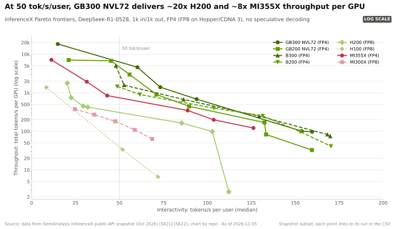
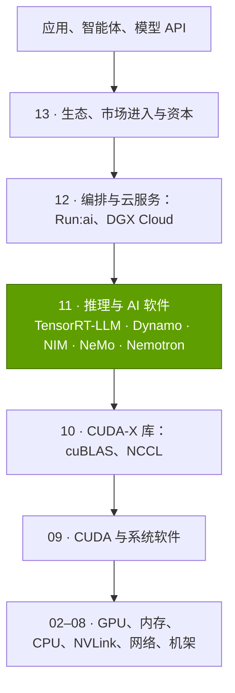
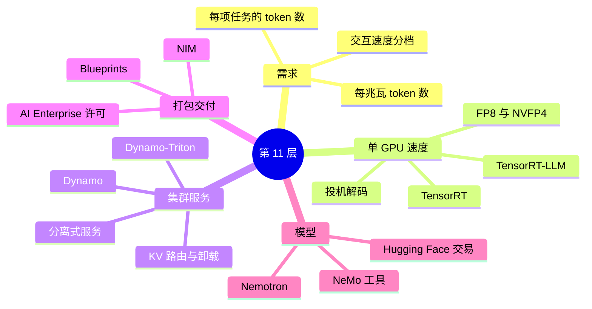

# 第 11 层 —— 推理与 AI 软件

> [!NOTE]
> 本页为英文原文的简体中文参考译文，仅供参考；如有出入，以[英文原文](../../../layers/11-inference-and-ai-software/index.md "English original")为准。

第 11 层（共 12 层）· 把 GPU 转化为可交付 token 的软件：TensorRT-LLM、Dynamo、NIM、NeMo、Nemotron 与 AI Enterprise · 约 6 分钟阅读 · 最近核实：2026-11-05

## ⚡ 要点速览

- **推理是增长引擎，但英伟达（NVIDIA）已不再披露其规模。** 管理层最近一次量化是：截至 Q2 FY2025 的一年中，[推理](../../glossary.md#inference)占数据中心收入的 40% 以上，即至少 ~$33B [[S11011]](../../../sources/bibliography.md#s11011)[[S441]](../../../sources/bibliography.md#s441)。此后只作定性表述：“推理即收入”（"inference is revenues"）[[S11012]](../../../sources/bibliography.md#s11012)[[S409]](../../../sources/bibliography.md#s409)。
- **推理模型与智能体使每项任务的 token 数成倍增长。** 按本资料库的示例测算，一次推理型回答生成的 token 为普通聊天回复的 ~21×，一个编程智能体的总量为 ~1,100×（估计）[[S32025]](../../../sources/bibliography.md#s32025)。谷歌（Google）的月度 token 量在 18 个月内增长 ~134× [[S32018]](../../../sources/bibliography.md#s32018)[[S32020]](../../../sources/bibliography.md#s32020)。
- **衡量系统要看曲线，而非峰值。** 在每用户 50 tokens/s 的交互速度下，GB300 [NVL72](../../glossary.md#nvl72) 运行 DeepSeek-R1 每 GPU 可输出 ~6,261 tokens/s，为 H200 的 ~20×；按每兆瓦计，差距为 ~13× [[S621]](../../../sources/bibliography.md#s621)[[S622]](../../../sources/bibliography.md#s622)。
- **软件持续提升同一套硬件的产出。** 在硬件不变的 GB300 NVL72 上，MLPerf DeepSeek-R1 吞吐量一年内提升 2.9×，估计每百万 token 成本下降 ~65% [[S601]](../../../sources/bibliography.md#s601)[[S603]](../../../sources/bibliography.md#s603)[[S622]](../../../sources/bibliography.md#s622)。
- 🟢 **[Dynamo](../../glossary.md#dynamo) 1.0 让整个集群像一台机器一样提供服务。** 它于 GTC 2026 以 Apache-2.0 开源许可发布 [[S90066]](../../../sources/bibliography.md#s90066)[[S520]](../../../sources/bibliography.md#s520)。将[预填充（prefill）](../../glossary.md#prefill)与[解码（decode）](../../glossary.md#decode)拆分后，B200 在长提示词场景下的每 GPU 吞吐量提升 ~2.5× [[S621]](../../../sources/bibliography.md#s621)。
- **直接软件收入很小，关键在于带动硬件销售。** [NVIDIA AI Enterprise](../../glossary.md#nvidia-ai-enterprise) 的标价为每 GPU 每年 $4,500 [[S11013]](../../../sources/bibliography.md#s11013)；管理层指引 FY2025 末软件年化收入 ~$2B [[S11011]](../../../sources/bibliography.md#s11011)，不到数据中心收入的 1%。
- **最大弱点：这一层几乎没有锁定客户的东西。** Dynamo 同样可以运行 [vLLM](../../glossary.md#vllm) 和 [SGLang](../../glossary.md#sglang)，而二者都支持 AMD 等其他硬件 [[S11001]](../../../sources/bibliography.md#s11001)[[S580]](../../../sources/bibliography.md#s580)[[S582]](../../../sources/bibliography.md#s582)。谷歌 TPU 运行某一大模型的每 token 成本比 B200 低 ~18% [[S625]](../../../sources/bibliography.md#s625)。🟡 ~$12.9B 收购 [Hugging Face](../../glossary.md#hugging-face) 一事正面临中立性审查 [[S11026]](../../../sources/bibliography.md#s11026)[[S11028]](../../../sources/bibliography.md#s11028)。

## 本层在技术栈中的位置

本层位于 [CUDA](../../glossary.md#cuda) 及其软件库（[第 09 层](../09-cuda-and-system-software/index.md)、[第 10 层](../10-libraries-cuda-x/index.md)）之上，集群编排（[第 12 层](../12-orchestration-and-cloud-services/index.md)）之下。

> [!TIP]
> **算例 —— 一次智能体请求如何穿过本层。** 某编程智能体发送 60,000 token 的上下文，要求生成 1,500 个新 token。Dynamo 的路由器选中一个已缓存了该上下文大部分内容的工作节点，因此只需对新一轮对话做预填充 [[S11001]](../../../sources/bibliography.md#s11001)。预填充池完成计算后，由 NIXL 将 [KV 缓存](../../glossary.md#kv-cache)传送至解码池 [[S11002]](../../../sources/bibliography.md#s11002)[[S11003]](../../../sources/bibliography.md#s11003)。在每用户 50 tokens/s 下，答案在 30 s 内流式输出完毕；若提速到 100 tokens/s，只需 15 s，但在 GB300 NVL72 上每个 token 消耗的 GPU 时间多 ~11×（每 GPU 6,261 对比 ~562 tokens/s，估计）[[S621]](../../../sources/bibliography.md#s621)[[S622]](../../../sources/bibliography.md#s622)。**商业解读：**本层把单一的 GPU 价格转化为多档 token 价格。

🔧 技术细节：本文所说的“推理软件”涵盖哪些内容

**编译器与运行时**：TensorRT 和 [TensorRT-LLM](../../glossary.md#tensorrt-llm) 让单块 GPU 或单个 [NVLink](../../glossary.md#nvlink) 域跑得更快 [[S11008]](../../../sources/bibliography.md#s11008)[[S589]](../../../sources/bibliography.md#s589)。**服务层**：Dynamo 与 Dynamo-Triton 负责请求路由、阶段拆分、缓存迁移和自动扩缩容 [[S11001]](../../../sources/bibliography.md#s11001)[[S11010]](../../../sources/bibliography.md#s11010)。**打包交付**：NIM 容器与 AI Enterprise 许可 [[S11013]](../../../sources/bibliography.md#s11013)。**模型与工具**：Nemotron 与 NeMo [[S11019]](../../../sources/bibliography.md#s11019)[[S11029]](../../../sources/bibliography.md#s11029)。Kubernetes 调度与云服务归入[第 12 层](../12-orchestration-and-cloud-services/index.md)。

## 本层地图

## 八个问题一览

| # | 问题 | 简要回答 | 详见 |
|---|---|---|---|
| Q1 | 职能是什么？薄弱会怎样？ | 在每个延迟档位上把 GPU 小时转化为尽可能多的 token；软件薄弱会在同一芯片上留下 2–3× 的成本差距 [[S601]](../../../sources/bibliography.md#s601)[[S603]](../../../sources/bibliography.md#s603)。 | [推理转向](the-inference-shift.md) |
| Q2 | 关键指标？ | 在给定每用户 tokens/s 下的每 GPU tokens/s；每兆瓦 tokens/s；每百万 token 的美元成本；首 token 延迟。 | [推理转向](the-inference-shift.md) |
| Q3 | 代际进步？ | 在每用户 50 tokens/s 下，每 GPU 从 H200 ~308 提升到 GB300 NVL72 ~6,261 tokens/s [[S621]](../../../sources/bibliography.md#s621)；仅软件一年即提升 2.9× [[S603]](../../../sources/bibliography.md#s603)。 | [软件增益](software-gains-on-same-hardware.md) |
| Q4 | 优势来源？ | 软件与机架级硬件（NVL72、NVFP4）协同设计，并针对每个新模型做性能调优。 | [发展历程与构建方式](history-and-how-built.md) |
| Q5 | 最强挑战者？ | 硬件中立的开源引擎（vLLM、SGLang），以及在每 token 成本上具备优势的谷歌 TPU [[S625]](../../../sources/bibliography.md#s625)。 | [竞争](competition.md) |
| Q6 | 复制成本？ | 引擎可以复制；但与机架级硬件绑定、针对每个模型持续调优的“跑步机”难以复制。 | [发展历程与构建方式](history-and-how-built.md) |
| Q7 | 路线图？ | 🟢 Dynamo 上 Vera Rubin；🟡 Groq LPX 解码机架（宣称每瓦 token 数提升 35×）[[S113]](../../../sources/bibliography.md#s113)[[S90003]](../../../sources/bibliography.md#s90003)；🟡 Nemotron 4 通过联盟开发 [[S11022]](../../../sources/bibliography.md#s11022)。 | [路线图](roadmap.md) |
| Q8 | 价值池？ | 直接软件收入 ~$2B/年 [[S11011]](../../../sources/bibliography.md#s11011)；真正的价值池在于对硬件的带动。交易：Groq 授权、🟡 Hugging Face [[S90019]](../../../sources/bibliography.md#s90019)[[S11026]](../../../sources/bibliography.md#s11026)。 | [价值链与企业发展](value-chain-and-corp-dev.md) |

## 本层各页

| 页面 | 你将了解 |
|---|---|
| [推理转向](the-inference-shift.md) | 每项任务的 token 数、延迟曲线、每兆瓦 token 数、收入占比 |
| [TensorRT-LLM 与 Dynamo](tensorrt-llm-and-dynamo.md) | 单 GPU 优化技巧、分离式服务、KV 缓存路由 |
| [同一硬件上的软件增益](software-gains-on-same-hardware.md) | 已部署 GPU 的性能提升、其价值、基准测试的注意事项 |
| [NIM、NeMo、Nemotron 与 AI Enterprise](nim-nemo-nemotron-and-ai-enterprise.md) | 打包模型、许可、开放模型、渠道冲突 |
| [竞争](competition.md) | 开源引擎、TPU、Trainium、推理 ASIC |
| [发展历程：英伟达如何建成这一层](history-and-how-built.md) | 关键决策；复制成本 |
| [路线图](roadmap.md) | 英伟达与竞争对手的时间线 |
| [价值链与企业发展视角](value-chain-and-corp-dev.md) | 价值池；非上市公司 |

## 🎯 企业发展视角

1. **推理软件是维护硬件利润率的工具。** 许可标价为每 GPU 每年 $4,500 [[S11013]](../../../sources/bibliography.md#s11013)，但软件收入不到数据中心收入的 1%。真正的产品是每块 GPU 多产出的 token——它们为采购下一个机架提供了理由。
2. **开放是一把双刃剑。** Dynamo、TensorRT-LLM 和 Nemotron 均已开源 [[S11001]](../../../sources/bibliography.md#s11001)[[S589]](../../../sources/bibliography.md#s589)[[S11019]](../../../sources/bibliography.md#s11019)。挑战者会采用、分叉还是忽略其中哪些组件？
3. **核心指标是特定延迟档位下的每兆瓦 token 数。** 任何加速器的推介，包括高通（Qualcomm）的 AI200/AI250 [[S173]](../../../sources/bibliography.md#s173)，都会以这条曲线来评判。在最赚钱的档位上，有哪些独立证据？
4. **模型分发正变得具有战略意义。** ~$12.9B 的 Hugging Face 收购要约 [[S11026]](../../../sources/bibliography.md#s11026) 加上 Nemotron，使英伟达成为模型发布方。其中立性承诺在美国司法部（DOJ）和欧盟的审查下能否站得住 [[S11027]](../../../sources/bibliography.md#s11027)[[S11028]](../../../sources/bibliography.md#s11028)？

## 📚 来源（Sources）

<!-- Auto-generated from the [S…] citations on this page by `make build`. Edit sources/registry/*.csv, not this list. -->

- [**S113**](../../../sources/bibliography.md#s113) Tom's Hardware, *How Nvidia's $20 billion Groq 3 LPU deal reshapes the Nvidia Vera Rubin Platform*, 2026-03. [Link](https://www.tomshardware.com/tech-industry/semiconductors/nvidias-20-billion-groq-deal-produces-its-first-chip)
- [**S173**](../../../sources/bibliography.md#s173) Qualcomm, *Qualcomm Unveils AI200 and AI250 - Redefining Rack-Scale Data Center Inference*, 2025-10-27. [Link](https://www.qualcomm.com/news/releases/2025/10/qualcomm-unveils-ai200-and-ai250-redefining-rack-scale-data-cent)
- [**S409**](../../../sources/bibliography.md#s409) NVIDIA Corporation, *NVIDIA Corp. (NVDA) Q1 Fiscal 2027 earnings call transcript (20 May 2026)*, 2026-05-20. [Link](https://s201.q4cdn.com/141608511/files/doc_financials/2027/q1/NVDA-Q1-2027-Earnings-Call-20-May-2026-5_00-PM-ET.pdf)
- [**S441**](../../../sources/bibliography.md#s441) NVIDIA Corporation, *NVIDIA Announces Financial Results for Second Quarter Fiscal 2025 (press release with CFO commentary)*, 2024-08-28. [Link](https://nvidianews.nvidia.com/news/nvidia-announces-financial-results-for-second-quarter-fiscal-2025)
- [**S520**](../../../sources/bibliography.md#s520) NVIDIA via ResearchPool, *NVIDIA Enters Production With Dynamo, the Broadly Adopted Inference Operating System for AI Factories (press release mirror)*, 2026-03-16. [Link](https://app.researchpool.com/company/nvda-us67066g1040-nvidia-corp-e9VqYYGjs8/press/nvidia-corporation-nvda-nvidia-enters-production-with-dynamo-the-broadly-adopted-inference-ope-DxMC1Gq48d)
- [**S580**](../../../sources/bibliography.md#s580) vLLM project (GitHub), *vLLM README and installation docs — supported hardware*, 2026-11. [Link](https://github.com/vllm-project/vllm/blob/main/docs/getting_started/installation/README.md)
- [**S582**](../../../sources/bibliography.md#s582) SGLang project (GitHub: sgl-project/sglang), *SGLang README — supported hardware*, 2026-11. [Link](https://github.com/sgl-project/sglang/blob/main/README.md)
- [**S589**](../../../sources/bibliography.md#s589) NVIDIA (GitHub: NVIDIA/TensorRT-LLM), *TensorRT-LLM README*, 2026-11. [Link](https://github.com/NVIDIA/TensorRT-LLM/blob/main/README.md)
- [**S601**](../../../sources/bibliography.md#s601) MLCommons, *MLPerf Inference v5.1 results (summary_results.json and per-submitter logs)*, 2025-09-09. [Link](https://github.com/mlcommons/inference_results_v5.1)
- [**S603**](../../../sources/bibliography.md#s603) MLCommons, *MLPerf Inference v6.1 results (summary.csv and per-submitter logs)*, 2026-09. [Link](https://github.com/mlcommons/inference_results_v6.1)
- [**S621**](../../../sources/bibliography.md#s621) SemiAnalysis (InferenceX-app repository), *InferenceX public API snapshot (benchmarks.json and benchmarks-history.json fixtures)*, 2026-10-17. [Link](https://github.com/SemiAnalysisAI/InferenceX-app/tree/main/packages/app/cypress/fixtures/api)
- [**S622**](../../../sources/bibliography.md#s622) SemiAnalysis (InferenceX-app repository), *InferenceX hardware registry: TCO per GPU-hour by SKU (SemiAnalysis July 2026 pricing surveys and AI Cloud TCO Model)*, 2026-07. [Link](https://github.com/SemiAnalysisAI/InferenceX-app/blob/main/packages/constants/src/gpu-keys.ts)
- [**S625**](../../../sources/bibliography.md#s625) SemiAnalysis, *TPU Inference Externalization Full Steam Ahead*, 2026-09-07. [Link](https://github.com/SemiAnalysisAI/InferenceX-app/blob/main/packages/app/content/blog/tpu-inferencex-full-steam.mdx)
- [**S11001**](../../../sources/bibliography.md#s11001) NVIDIA (GitHub), *NVIDIA Dynamo README (ai-dynamo/dynamo)*, 2026-11. [Link](https://github.com/ai-dynamo/dynamo/blob/main/README.md)
- [**S11002**](../../../sources/bibliography.md#s11002) NVIDIA (GitHub ai-dynamo/dynamo docs), *Dynamo design docs: Disaggregated Serving*, 2026. [Link](https://github.com/ai-dynamo/dynamo/blob/main/docs/fern/pages/developer-guide/knowledge-base/concepts/system-architecture/disaggregated-serving.md)
- [**S11003**](../../../sources/bibliography.md#s11003) NVIDIA (GitHub ai-dynamo/nixl), *NVIDIA Inference Xfer Library (NIXL) README*, 2026-11. [Link](https://github.com/ai-dynamo/nixl/blob/main/README.md)
- [**S11008**](../../../sources/bibliography.md#s11008) NVIDIA (GitHub NVIDIA/TensorRT), *TensorRT Open Source Software README (TensorRT 11.x announcement)*, 2026-11. [Link](https://github.com/NVIDIA/TensorRT/blob/main/README.md)
- [**S11010**](../../../sources/bibliography.md#s11010) NVIDIA Developer, *NVIDIA Dynamo-Triton (product page)*, 2025-03-18. [Link](https://developer.nvidia.com/dynamo-triton)
- [**S11011**](../../../sources/bibliography.md#s11011) MarketBeat, *NVIDIA Q2 Fiscal 2025 earnings call transcript (28 August 2024)*, 2024-08-28. [Link](https://www.marketbeat.com/earnings/transcripts/110080/)
- [**S11012**](../../../sources/bibliography.md#s11012) The Motley Fool, *NVIDIA (NVDA) Q4 fiscal 2026 earnings call transcript (25 February 2026)*, 2026-02-25. [Link](https://www.fool.com/earnings/call-transcripts/2026/02/25/nvidia-nvda-q4-2026-earnings-call-transcript)
- [**S11013**](../../../sources/bibliography.md#s11013) NVIDIA (docs.api.nvidia.com), *NVIDIA NIM FAQ*, 2025. [Link](https://docs.api.nvidia.com/nim/docs/faq)
- [**S11019**](../../../sources/bibliography.md#s11019) NVIDIA (GitHub), *NVIDIA Nemotron Developer Repository README (NVIDIA-NeMo/Nemotron)*, 2026-11. [Link](https://github.com/NVIDIA-NeMo/Nemotron/blob/main/README.md)
- [**S11022**](../../../sources/bibliography.md#s11022) Tom's Hardware, *Nvidia's Nemotron coalition brings eight AI labs together to build open frontier models*, 2026-03. [Link](https://www.tomshardware.com/tech-industry/artificial-intelligence/nvidias-nemoclaw-coalition-brings-eight-ai-labs-together-to-build-open-frontier-models)
- [**S11026**](../../../sources/bibliography.md#s11026) Implicator.ai, *Nvidia confirms $12.9 billion Hugging Face deal, says its chips won't be required*, 2026-09. [Link](https://www.implicator.ai/nvidia-confirms-12-9-billion-hugging-face-deal-says-its-chips-wont-be-required/)
- [**S11027**](../../../sources/bibliography.md#s11027) MLex, *Nvidia may seek EU review of Hugging Face deal amid filing uncertainty*, 2026-09-23. [Link](https://www.mlex.com/mlex/articles/2528556/nvidia-may-seek-eu-review-of-hugging-face-deal-amid-european-filing-uncertainty)
- [**S11028**](../../../sources/bibliography.md#s11028) Stocktwits, *NVDA stock edges down on DOJ interest in $12.9 billion Hugging Face acquisition*, 2026-10-28. [Link](https://stocktwits.com/news-articles/markets/equity/nvda-stock-edges-down-on-doj-interest-in-12-9-billion-hugging-face-acquisition/cZU9MDeR9Go)
- [**S11029**](../../../sources/bibliography.md#s11029) NVIDIA (GitHub NVIDIA-NeMo/Guardrails), *NVIDIA NeMo Guardrails library README*, 2026-11. [Link](https://github.com/NVIDIA-NeMo/Guardrails/blob/develop/README.md)
- [**S32018**](../../../sources/bibliography.md#s32018) Google (The Keyword) (Sundar Pichai), *Google I/O 2025 keynote remarks (Sundar Pichai)*, 2025-05-20. [Link](https://blog.google/technology/ai/io-2025-keynote/)
- [**S32020**](../../../sources/bibliography.md#s32020) Alphabet / Google (The Keyword) (Sundar Pichai), *Alphabet CEO remarks on token volume (October 2025)*, 2025-10. [Link](https://blog.google/inside-google/message-ceo/alphabet-earnings-q3-2025/)
- [**S32025**](../../../sources/bibliography.md#s32025) nvidia_deep_dive_claude repository, *Repo analysis: inference token-budget scenarios and roofline serving model (Primer P2)*, 2026-11-05. [Link](https://github.com/FrankHuang94/nvidia_deep_dive_claude/blob/main/primers/P2-how-ai-inference-works.md)
- [**S90003**](../../../sources/bibliography.md#s90003) eWeek, *Everything Nvidia Just Announced at GTC 2026: 7 Chips, 5 Racks, 1 Giant Bet on Agentic AI*, 2026-03-17. [Link](https://www.eweek.com/news/nvidia-gtc-2026-ai-inference-vera-rubin-neuron/)
- [**S90019**](../../../sources/bibliography.md#s90019) TechSpot, *Nvidia's $20 billion Groq deal looks a lot like an acquisition*, 2025-12. [Link](https://www.techspot.com/news/110723-nvidia-20-billion-groq-deal-looks-lot-like.html)
- [**S90066**](../../../sources/bibliography.md#s90066) HPCwire (NVIDIA press release), *NVIDIA enters production with Dynamo, the broadly adopted inference operating system for AI factories*, 2026-03-17. [Link](https://www.hpcwire.com/aiwire/tag/dynamo-1-0/)
