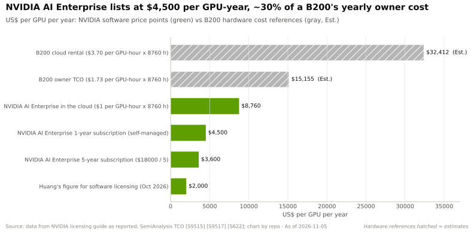
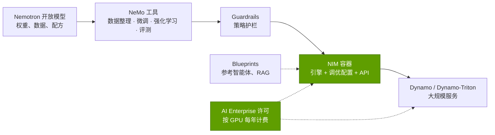
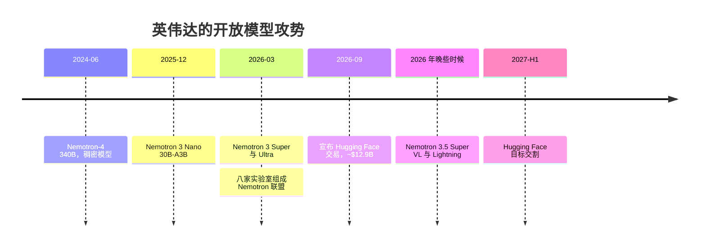

# NIM、NeMo、Nemotron 与 AI Enterprise

> [!NOTE]
> 本页为英文原文的简体中文参考译文，仅供参考；如有出入，以[英文原文](../../../layers/11-inference-and-ai-software/nim-nemo-nemotron-and-ai-enterprise.md "English original")为准。

第 11 层 · 推理与 AI 软件 · 约 9 分钟阅读 · 最近核实：2026-11-05

## ⚡ 要点速览

- **NIM 把模型变成一台“家电”。** [NIM](../../glossary.md#nim) 微服务是一个容器，内含模型权重、经过调优的引擎和兼容 OpenAI 的 API。它于 GTC 2024（3 月 18 日）发布，并于 2024 年 6 月 2 日正式商用（GA）[[S11014]](../../../sources/bibliography.md#s11014)[[S11015]](../../../sources/bibliography.md#s11015)。
- **开发免费，生产需要许可。** 在生产环境中使用 NIM 需要 [NVIDIA AI Enterprise](../../glossary.md#nvidia-ai-enterprise)，价格为每 GPU 每年 $4,500 起，或在云上每 [GPU 小时](../../glossary.md#gpu-hour) ~$1 [[S11013]](../../../sources/bibliography.md#s11013)，相当于在 B200 年度所有者成本之上再加 ~30% [[S622]](../../../sources/bibliography.md#s622)。🟡 在 GTC Berlin（2026 年 10 月 22 日）上，黄仁勋提出智能体软件每 GPU 每年 ~$2,000 的设想，但未公布价目表 [[S11016]](../../../sources/bibliography.md#s11016)[[S11017]](../../../sources/bibliography.md#s11017)。
- **直接收入规模很小。** 软件、SaaS 与支持服务在 Q4 FY2024 达到 ~$1B 的年化收入 [[S9516]](../../../sources/bibliography.md#s9516)，管理层指引 FY2025 末达到 ~$2B [[S11011]](../../../sources/bibliography.md#s11011)，不到最近一年 $277.7B 数据中心收入的 1% [[S405]](../../../sources/bibliography.md#s405)。
- **英伟达（NVIDIA）如今已是前沿开放模型的开发者。** [Nemotron](../../glossary.md#nemotron) 3 Nano 于 2025 年 12 月发布 [[S11021]](../../../sources/bibliography.md#s11021)；Nemotron 3 Ultra（总参数 550B，激活参数 55B）在 GTC 2026 上宣布，并开放权重 [[S11019]](../../../sources/bibliography.md#s11019)。Nemotron 3 模型每个 token 只使用 ~10% 的权重，而 2024 年的 Nemotron-4 340B 为 100% [[S11019]](../../../sources/bibliography.md#s11019)[[S34020]](../../../sources/bibliography.md#s34020)。
- **它正在把合作伙伴拉进来。** 🟢 由八家实验室组成的 Nemotron 联盟（包括 Mistral AI 和 Perplexity）正在 DGX Cloud 上开发 Nemotron 4 [[S11022]](../../../sources/bibliography.md#s11022)。🟡 英伟达已同意以 ~$12.9B 收购 Hugging Face，预计在 2027 年上半年完成交割，但须经审查 [[S11025]](../../../sources/bibliography.md#s11025)[[S11026]](../../../sources/bibliography.md#s11026)[[S11027]](../../../sources/bibliography.md#s11027)。
- **弱点：产品频繁更迭与渠道冲突。** NeMo Agent Toolkit 和 RAG Blueprint 已于 2026 年 10 月被弃用 [[S11030]](../../../sources/bibliography.md#s11030)[[S11031]](../../../sources/bibliography.md#s11031)。自建模型并掌控主要的模型中心，使英伟达更加逼近其最大客户的业务领地。

## NIM 与 AI Enterprise：模型即“家电”

**类比。** 自己运行开放模型就像买平板包装家具：零件免费，但要搭上一整晚。NIM 则是组装好的成品，送货上门还附带保修。

**机制。** 每个 NIM 都打包了一个模型、一个引擎（[TensorRT-LLM](../../glossary.md#tensorrt-llm)、[vLLM](../../glossary.md#vllm) 或 [SGLang](../../glossary.md#sglang)）、针对各类 GPU 的优化配置文件以及标准 API；开发者可免费使用，企业则在 AI Enterprise 许可下部署 [[S11015]](../../../sources/bibliography.md#s11015)[[S11013]](../../../sources/bibliography.md#s11013)。许可按 GPU 而非按模型计费 [[S11013]](../../../sources/bibliography.md#s11013)，并同时涵盖对 TensorRT 和 [Triton](../../glossary.md#triton) 的支持 [[S11008]](../../../sources/bibliography.md#s11008)[[S11009]](../../../sources/bibliography.md#s11009)。

> [!TIP]
> **算例 —— 许可费对一个机架意味着什么。** 一个 GB300 [NVL72](../../glossary.md#nvl72) 有 72 块 GPU：按 $4,500 标价计，每年 $324k [[S11013]](../../../sources/bibliography.md#s11013)。该机架价格 ~$4.0M（估计，摩根士丹利）[[S332]](../../../sources/bibliography.md#s332)，每年拥有和运行成本 ~$1.46M（$2.31 × 8,760 h × 72，估计）[[S622]](../../../sources/bibliography.md#s622)。按标价计，软件每年相当于资本开支的 ~8%，或年度所有者成本的 ~22%。二手资料称五年期合约为每 GPU $18,000，即每年 ~$3,600 [[S11017]](../../../sources/bibliography.md#s11017)[[S11018]](../../../sources/bibliography.md#s11018)。**商业解读：**大买家会议价或自行部署开源引擎，因此许可费主要落在需要技术支持的企业身上（🔴 本资料库分析）。

**规模校验。** 以每 GPU 每年 $4,500 计算，~$2B 的年化收入 [[S11011]](../../../sources/bibliography.md#s11011) 意味着 ~440,000 块获得许可的 GPU（🔴 示意性测算），仅占年出货量的一小部分。

## NeMo、Guardrails 与 Blueprints：定制化工具链

[NeMo](../../glossary.md#nemo) 是英伟达用于构建和适配模型的开源工具家族：Curator 负责数据，Megatron-Bridge 和 NeMo-RL 负责训练，Evaluator 负责基准评测 [[S11019]](../../../sources/bibliography.md#s11019)。[NeMo Guardrails](../../glossary.md#nemo-guardrails) 在模型的输入和输出周围加上可编程规则（0.24.1 版）[[S11029]](../../../sources/bibliography.md#s11029)。[AI Blueprints](../../glossary.md#ai-blueprint) 是参考应用，例如 AI-Q 研究智能体 [[S11032]](../../../sources/bibliography.md#s11032)。

> [!TIP]
> **算例 —— 为什么稀疏的 Nemotron 服务成本低。** Nemotron 3 Super 有 120.6B 参数，但每个 token 只激活 12.7B [[S11020]](../../../sources/bibliography.md#s11020)。在 [NVFP4](../../glossary.md#nvfp4) 下（含缩放因子 ~0.56 字节/参数），权重占用 ~68 GB，可装入一块 180 GB 的 B200，与英伟达 cookbook 中所列一致 [[S11019]](../../../sources/bibliography.md#s11019)[[S32017]](../../../sources/bibliography.md#s32017)。每个 token 只需读取 ~7 GB 的激活权重，因此单个流的带宽上限为 ~8,000 ÷ 7 ≈ 1,100 tokens/s；而一个 120B 的稠密模型只能达到 ~120（🔴 估计，忽略缓存流量和路由开销）[[S11000]](../../../sources/bibliography.md#s11000)。**商业解读：**英伟达的模型选型是在展示其 GPU 上的 NVFP4 与稀疏推理能力。

> [!WARNING]
> **误区与事实：**“英伟达的软件栈是一个稳定的平台。”其中部分组件更迭很快。NeMo Agent Toolkit 于 2026 年 10 月被弃用，年底终止支持，由 NeMo Relay 和 NeMo Helix 取代 [[S11030]](../../../sources/bibliography.md#s11030)。RAG Blueprint 则“仅保留作参考”（"retained for reference only"）[[S11031]](../../../sources/bibliography.md#s11031)。以这些工具为标准，意味着日后要承担迁移工作。

🔧 技术细节：Nemotron 3 有何不同

Nemotron 3 模型是混合架构：主体是 [Mamba](../../glossary.md#mamba) 状态空间层（其内存占用不随上下文增长），外加少量注意力层，以及英伟达称为 LatentMoE 的稀疏[混合专家](../../glossary.md#mixture-of-experts)设计 [[S11019]](../../../sources/bibliography.md#s11019)[[S11020]](../../../sources/bibliography.md#s11020)。Super 每层有 512 个专家、激活 22 个；它在 B200 上使用 NVFP4 以 25 万亿 token 完成预训练，支持 1M token 上下文 [[S11020]](../../../sources/bibliography.md#s11020)。Nano 使用了同样的 25 万亿 token 课程 [[S11034]](../../../sources/bibliography.md#s11034)。英伟达随权重一并公开了大量数据、训练配方和强化学习环境 [[S11019]](../../../sources/bibliography.md#s11019)，而大多数闭源实验室并不这样做。

## Nemotron：一家芯片公司为何要做模型

日期：[[S34020]](../../../sources/bibliography.md#s34020)[[S11021]](../../../sources/bibliography.md#s11021)[[S11035]](../../../sources/bibliography.md#s11035)[[S11019]](../../../sources/bibliography.md#s11019)[[S11022]](../../../sources/bibliography.md#s11022)[[S11026]](../../../sources/bibliography.md#s11026)；Nemotron 3.5 的发布月份与 2027 年交割时间为 🟡。

有四个动机尤为突出（🔴 基于所引事实的本资料库分析）：

1. **培育需求。** 在英伟达 GPU 上以 NVFP4 运行效果最佳的开放模型，会把企业和主权买家吸引到其硬件上 [[S11019]](../../../sources/bibliography.md#s11019)[[S11020]](../../../sources/bibliography.md#s11020)。
2. **确立参考性能。** 英伟达的引擎首先在自家模型上完成调优。
3. **主权 AI。** 各国政府希望拥有可审查、可自行托管的模型；据管理层称，FY2026 主权 AI 收入超过 ~$30B（🟡）[[S90071]](../../../sources/bibliography.md#s90071)。
4. **对冲实验室转向定制芯片。** Anthropic 计划使用多达 1M 块 TPU，OpenAI 与 AMD 签有 6 GW 的协议，而一款由博通（Broadcom）设计的 OpenAI 推理芯片也已有分析报道 [[S90025]](../../../sources/bibliography.md#s90025)[[S90020]](../../../sources/bibliography.md#s90020)[[S628]](../../../sources/bibliography.md#s628)。

> [!TIP]
> **算例 —— Nemotron 3 Ultra 作为硬件销售工具。** Ultra 有 550B 参数，激活 55B [[S11019]](../../../sources/bibliography.md#s11019)。在 NVFP4 下，权重占用 ~308 GB，超过单块 288 GB Rubin GPU 的容量 [[S102]](../../../sources/bibliography.md#s102)。加上长上下文缓存后，它需要跨多块 GPU 部署，因此大型 [NVLink](../../glossary.md#nvlink) 域最适合承载它；每个 token 只需读取 ~31 GB 的激活权重（🔴 估计）[[S11000]](../../../sources/bibliography.md#s11000)。**商业解读：**旗舰开放模型的尺寸正是为旗舰机架量身定制的。

### 渠道冲突问题

英伟达最大的客户是模型实验室以及托管这些模型的云厂商；其中一个直接客户占 Q2 FY2027 收入的 16% [[S90069]](../../../sources/bibliography.md#s90069)。

| 举措 | 对英伟达的好处 | 与实验室和云厂商之间的风险 |
|---|---|---|
| Nemotron 开放模型 | 推理需求；主权交易 | 与客户自身的开放权重发布形成竞争 |
| Nemotron 联盟 | 与八家实验室分摊模型成本 [[S11022]](../../../sources/bibliography.md#s11022) | 合作伙伴可能不满于对 DGX Cloud 的依赖 |
| 收购 Hugging Face 🟡 | 掌控模型分发与开发者习惯 [[S11025]](../../../sources/bibliography.md#s11025) | 中立性存疑；有报道称美国司法部（DOJ）已关注，欧盟可能审查 [[S11028]](../../../sources/bibliography.md#s11028)[[S11027]](../../../sources/bibliography.md#s11027) |
| AI Enterprise 费用 | 经常性收入 | 超大规模云厂商销售与之竞争的托管服务 |

迄今为止，英伟达的回应是保持开放：黄仁勋表示，在 Hugging Face 上构建或通过其部署将不要求使用英伟达算力，并承诺支持多种加速器 [[S11026]](../../../sources/bibliography.md#s11026)。

> [!NOTE]
> **🐂 看多观点。** 模型、工具加上模型中心，使英伟达成为开放模型开发者的默认起点。每一版 Nemotron 都首先针对 NVFP4 和 NVL72 调优 [[S11019]](../../../sources/bibliography.md#s11019)[[S11020]](../../../sources/bibliography.md#s11020)，而 Hugging Face 则带来了覆盖面，以及关于开发者在运行什么的数据 [[S11025]](../../../sources/bibliography.md#s11025)。

> [!WARNING]
> **🐻 看空观点。** 许可费只能变现很薄的一层，工具频繁更迭，模型又是免费的。拥有 Hugging Face 会招致反垄断救济措施，并把竞争对手推向中立的模型中心 [[S11027]](../../../sources/bibliography.md#s11027)[[S11028]](../../../sources/bibliography.md#s11028)。如果前沿实验室继续转向 TPU 和定制 ASIC，开放模型无法弥补它们减少的支出。

## 🎯 企业发展视角

1. **打包交付是切入企业市场的楔子。** 覆盖模型、引擎和支持服务的按 GPU 许可 [[S11013]](../../../sources/bibliography.md#s11013)，没有软件目录很难匹敌。哪些独立软件开发商（ISV）、系统集成商或模型中心能为挑战者提供同样的“家电式”方案？
2. **开放模型是一种硬件战略。** Nemotron 的稀疏性和 NVFP4 检查点 [[S11019]](../../../sources/bibliography.md#s11019)[[S11020]](../../../sources/bibliography.md#s11020) 是英伟达芯片的展示橱窗。竞争对手是否应针对自家硬件发布热门开放模型（包括 Nemotron）的调优版本？
3. **Hugging Face 交易最值得关注。** ~$12.9B 的对价，而据报道其年化收入为 ~$150M [[S11025]](../../../sources/bibliography.md#s11025)。监管机构可能要求哪些救济措施？模型中心的中立性对非英伟达加速器价值几何？
4. **工具更迭带来机会。** 被弃用的工具包和蓝图 [[S11030]](../../../sources/bibliography.md#s11030)[[S11031]](../../../sources/bibliography.md#s11031) 让企业转而寻求稳定、厂商中立的智能体工具。谁能提供这样的工具？

## 📚 来源（Sources）

<!-- Auto-generated from the [S…] citations on this page by `make build`. Edit sources/registry/*.csv, not this list. -->

- [**S102**](../../../sources/bibliography.md#s102) NVIDIA, *NVIDIA DGX Vera Rubin NVL72*, 2026. [Link](https://www.nvidia.com/en-us/data-center/dgx-vera-rubin-nvl72/)
- [**S332**](../../../sources/bibliography.md#s332) Tiger Brokers (iTiger), *Morgan Stanley's BOM analysis of NVIDIA's Rubin: GPU share declines; PCB, MLCC and ABF substrate values soar*, 2026-05-20. [Link](https://www.itiger.com/news/1188068712)
- [**S405**](../../../sources/bibliography.md#s405) NVIDIA Corporation via SEC EDGAR, *NVIDIA Announces Financial Results for Second Quarter Fiscal 2027 (Form 8-K exhibit 99.1)*, 2026-08-26. [Link](https://www.sec.gov/Archives/edgar/data/0001045810/000104581026000073/q2fy27pr.htm)
- [**S622**](../../../sources/bibliography.md#s622) SemiAnalysis (InferenceX-app repository), *InferenceX hardware registry: TCO per GPU-hour by SKU (SemiAnalysis July 2026 pricing surveys and AI Cloud TCO Model)*, 2026-07. [Link](https://github.com/SemiAnalysisAI/InferenceX-app/blob/main/packages/constants/src/gpu-keys.ts)
- [**S628**](../../../sources/bibliography.md#s628) SemiAnalysis, *OpenAI Jalapeño: Better Than Nvidia Blackwell*, 2026-08-25. [Link](https://github.com/SemiAnalysisAI/InferenceX-app/blob/main/packages/app/content/blog/openai-jalapeno-better-than-nvidia.mdx)
- [**S9516**](../../../sources/bibliography.md#s9516) MarketBeat, *NVIDIA Q4 FY2024 earnings call transcript*, 2024-02-21. [Link](https://www.marketbeat.com/earnings/reports/2024-2-21-nvidia-co-stock)
- [**S11000**](../../../sources/bibliography.md#s11000) nvidia_deep_dive_claude repository, *Repo analysis: layer 11 inference models (disaggregation comparison, cost per million tokens across software releases, implied inference revenue, tokens per MW and per-request economics)*, 2026-11-05. [Link](https://github.com/FrankHuang94/nvidia_deep_dive_claude/blob/main/layers/11-inference-and-ai-software/index.md)
- [**S11008**](../../../sources/bibliography.md#s11008) NVIDIA (GitHub NVIDIA/TensorRT), *TensorRT Open Source Software README (TensorRT 11.x announcement)*, 2026-11. [Link](https://github.com/NVIDIA/TensorRT/blob/main/README.md)
- [**S11009**](../../../sources/bibliography.md#s11009) NVIDIA (GitHub triton-inference-server/server), *Triton Inference Server README*, 2026-11. [Link](https://github.com/triton-inference-server/server/blob/main/README.md)
- [**S11011**](../../../sources/bibliography.md#s11011) MarketBeat, *NVIDIA Q2 Fiscal 2025 earnings call transcript (28 August 2024)*, 2024-08-28. [Link](https://www.marketbeat.com/earnings/transcripts/110080/)
- [**S11013**](../../../sources/bibliography.md#s11013) NVIDIA (docs.api.nvidia.com), *NVIDIA NIM FAQ*, 2025. [Link](https://docs.api.nvidia.com/nim/docs/faq)
- [**S11014**](../../../sources/bibliography.md#s11014) NVIDIA (press release via Nasdaq), *NVIDIA launches generative AI microservices for developers to create and deploy generative AI copilots across NVIDIA CUDA GPU installed base*, 2024-03-18. [Link](https://www.nasdaq.com/press-release/nvidia-launches-generative-ai-microservices-for-developers-to-create-and-deploy)
- [**S11015**](../../../sources/bibliography.md#s11015) HPCwire (NVIDIA press release), *NVIDIA NIM now available to transform world's millions of developers into generative AI developers*, 2024-06-02. [Link](https://www.hpcwire.com/aiwire/2024/06/02/nvidia-nim-now-available-to-transform-worlds-millions-of-developers-into-generative-ai-developers/)
- [**S11016**](../../../sources/bibliography.md#s11016) TweakTown, *Jensen Huang puts a $2000 per GPU yearly price on NVIDIA's AI agent software*, 2026-10. [Link](https://www.tweaktown.com/news/114285/jensen-huang-puts-a-dollars2000-per-gpu-yearly-price-on-nvidias-ai-agent-software/index.html)
- [**S11017**](../../../sources/bibliography.md#s11017) TechSpot, *Nvidia's AI chips already make billions, now Jensen wants $2,000 a year per GPU for software*, 2026-10. [Link](https://www.techspot.com/news/114333-nvidia-ai-chips-already-make-billions-now-jensen.html)
- [**S11018**](../../../sources/bibliography.md#s11018) beri.net, *Pick vLLM or SGLang to skip NVIDIA AI Enterprise fees (per-GPU licence pricing)*, 2026. [Link](https://www.beri.net/article/nvidia-ai-enterprise-alternatives-2026-vllm-sglang-red-hat-ai-per-gpu-licence)
- [**S11019**](../../../sources/bibliography.md#s11019) NVIDIA (GitHub), *NVIDIA Nemotron Developer Repository README (NVIDIA-NeMo/Nemotron)*, 2026-11. [Link](https://github.com/NVIDIA-NeMo/Nemotron/blob/main/README.md)
- [**S11020**](../../../sources/bibliography.md#s11020) NVIDIA (GitHub NVIDIA-NeMo/Nemotron docs), *Nemotron 3 Super training guide*, 2026. [Link](https://github.com/NVIDIA-NeMo/Nemotron/blob/main/docs/nemotron/super3/README.md)
- [**S11021**](../../../sources/bibliography.md#s11021) SiliconANGLE, *Nvidia launches Nemotron 3 open models to power multi-agent systems*, 2025-12-15. [Link](https://siliconangle.com/?p=725119)
- [**S11022**](../../../sources/bibliography.md#s11022) Tom's Hardware, *Nvidia's Nemotron coalition brings eight AI labs together to build open frontier models*, 2026-03. [Link](https://www.tomshardware.com/tech-industry/artificial-intelligence/nvidias-nemoclaw-coalition-brings-eight-ai-labs-together-to-build-open-frontier-models)
- [**S11025**](../../../sources/bibliography.md#s11025) Fortune, *Nvidia's Hugging Face deal (report of a ~$12.9 billion acquisition)*, 2026-08-27. [Link](https://www.fortune.com/2026/08/27/nvidia-hugging-face-billion-dollar-deal-open-source-ai/)
- [**S11026**](../../../sources/bibliography.md#s11026) Implicator.ai, *Nvidia confirms $12.9 billion Hugging Face deal, says its chips won't be required*, 2026-09. [Link](https://www.implicator.ai/nvidia-confirms-12-9-billion-hugging-face-deal-says-its-chips-wont-be-required/)
- [**S11027**](../../../sources/bibliography.md#s11027) MLex, *Nvidia may seek EU review of Hugging Face deal amid filing uncertainty*, 2026-09-23. [Link](https://www.mlex.com/mlex/articles/2528556/nvidia-may-seek-eu-review-of-hugging-face-deal-amid-european-filing-uncertainty)
- [**S11028**](../../../sources/bibliography.md#s11028) Stocktwits, *NVDA stock edges down on DOJ interest in $12.9 billion Hugging Face acquisition*, 2026-10-28. [Link](https://stocktwits.com/news-articles/markets/equity/nvda-stock-edges-down-on-doj-interest-in-12-9-billion-hugging-face-acquisition/cZU9MDeR9Go)
- [**S11029**](../../../sources/bibliography.md#s11029) NVIDIA (GitHub NVIDIA-NeMo/Guardrails), *NVIDIA NeMo Guardrails library README*, 2026-11. [Link](https://github.com/NVIDIA-NeMo/Guardrails/blob/develop/README.md)
- [**S11030**](../../../sources/bibliography.md#s11030) NVIDIA (GitHub NVIDIA/NeMo-Agent-Toolkit), *NVIDIA NeMo Agent Toolkit README*, 2026-11. [Link](https://github.com/NVIDIA/NeMo-Agent-Toolkit/blob/develop/README.md)
- [**S11031**](../../../sources/bibliography.md#s11031) NVIDIA (GitHub NVIDIA-AI-Blueprints/rag), *NVIDIA RAG Blueprint README*, 2026-11. [Link](https://github.com/NVIDIA-AI-Blueprints/rag/blob/main/README.md)
- [**S11032**](../../../sources/bibliography.md#s11032) NVIDIA (GitHub NVIDIA-AI-Blueprints/aiq), *NVIDIA AI-Q Blueprint README*, 2026-11. [Link](https://github.com/NVIDIA-AI-Blueprints/aiq/blob/main/README.md)
- [**S11034**](../../../sources/bibliography.md#s11034) NVIDIA (GitHub NVIDIA-NeMo/Nemotron docs), *Nemotron 3 Nano training guide*, 2026. [Link](https://github.com/NVIDIA-NeMo/Nemotron/blob/main/docs/nemotron/nano3/README.md)
- [**S11035**](../../../sources/bibliography.md#s11035) Techleap Finder (news feed), *Nvidia unveils Nemotron Super 3 AI model ahead of GTC conference*, 2026-03-11. [Link](https://finder.techleap.nl/news/feed/nvidia-unveils-nemotron-super-3-ai-model-ahead-of-gtc-conference)
- [**S32017**](../../../sources/bibliography.md#s32017) NVIDIA Technical Blog, *Introducing NVFP4 for Efficient and Accurate Low-Precision Inference*, 2025-06. [Link](https://developer.nvidia.com/blog/introducing-nvfp4-for-efficient-and-accurate-low-precision-inference/)
- [**S34020**](../../../sources/bibliography.md#s34020) arXiv:2406.11704 (NVIDIA), *Nemotron-4 340B Technical Report*, 2024-06-17. [Link](https://arxiv.org/abs/2406.11704)
- [**S90020**](../../../sources/bibliography.md#s90020) Shacknews, *AMD Helios AI rack system on track for initial shipments in Q3 2026*, 2026. [Link](https://www.shacknews.com/article/150249/amd-helios-ai-system-shipping-q3-2026)
- [**S90025**](../../../sources/bibliography.md#s90025) SiliconANGLE, *Google and Meta reportedly strike new multibillion-dollar AI chip deal*, 2026-02-26. [Link](https://siliconangle.com/2026/02/26/google-meta-reportedly-strike-new-multibillion-dollar-ai-chip-deal/)
- [**S90069**](../../../sources/bibliography.md#s90069) NVIDIA Corporation via SEC EDGAR, *NVIDIA Form 10-Q for the quarter ended July 26, 2026 (Q2 FY2027)*, 2026-08. [Link](https://www.sec.gov/Archives/edgar/data/0001045810/000104581026000075/nvda-20260726.htm)
- [**S90071**](../../../sources/bibliography.md#s90071) Crypto Briefing, *Nvidia CFO emphasizes neutral partnership with AI customers as company diversifies beyond hyperscalers*, 2026. [Link](https://cryptobriefing.com/nvidia-cfo-neutral-ai-partnership/)
