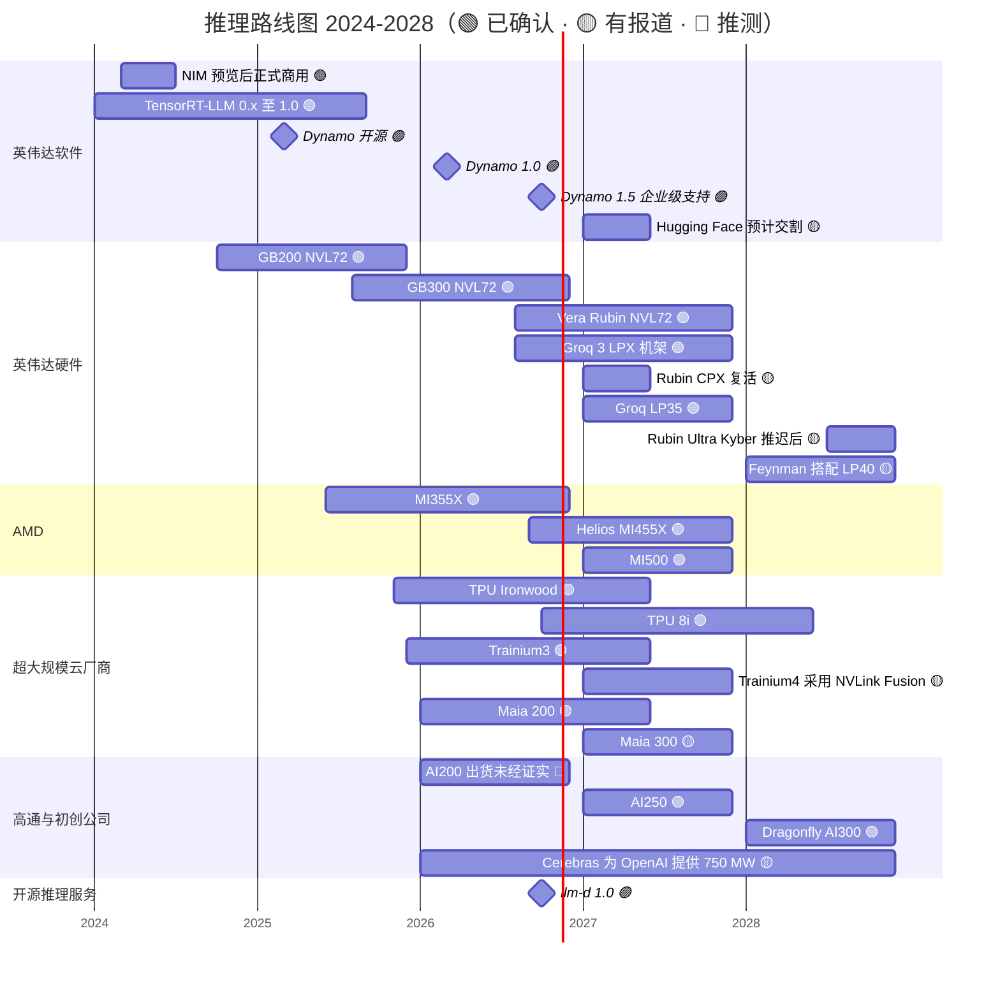

# 推理与 AI 软件：路线图

> [!NOTE]
> 本页为英文原文的简体中文参考译文，仅供参考；如有出入，以[英文原文](../../../layers/11-inference-and-ai-software/roadmap.md "English original")为准。

第 11 层 · 推理与 AI 软件 · 约 9 分钟阅读 · 最近核实：2026-11-05

## ⚡ 要点速览

- **软件以月为节拍迭代：** [Dynamo](../../glossary.md#dynamo) 从开源发布（2025 年 3 月）到 1.0（2026 年 3 月），再到提供企业级支持的 1.5.1（2026 年 10 月）；[TensorRT-LLM](../../glossary.md#tensorrt-llm) 于 2025 年 9 月发布 1.0 [[S32015]](../../../sources/bibliography.md#s32015)[[S521]](../../../sources/bibliography.md#s521)[[S522]](../../../sources/bibliography.md#s522)。
- **英伟达（NVIDIA）的推理硬件如今分为两档：** Vera Rubin [NVL72](../../glossary.md#nvl72)（自 2026 年第三季度起量产出货）主打吞吐量，Groq 3 LPX 机架（256 颗 [SRAM](../../glossary.md#sram) LPU，2026 年 8 月全面量产）主打快速解码 🟢 [[S90009]](../../../sources/bibliography.md#s90009)[[S114]](../../../sources/bibliography.md#s114)[[S506]](../../../sources/bibliography.md#s506)。
- **更多解码芯片即将到来：** LP35（2027）和与 Feynman 搭配的 LP40（2028），另有报道称 Rubin CPX 将以 [HBM4](../../glossary.md#hbm4) 版本复活、用于预填充 🟡 [[S108]](../../../sources/bibliography.md#s108)[[S90004]](../../../sources/bibliography.md#s90004)[[S117]](../../../sources/bibliography.md#s117)。
- **竞争对手同样按年度节奏推出产品：** MI455X Helios（2026）与 MI500（2027）；TPU 8i（2026 年底）；Maia 300 与 Trainium4（2027）；高通（Qualcomm）AI250（2027）与 AI300（2028）[[S538]](../../../sources/bibliography.md#s538)[[S550]](../../../sources/bibliography.md#s550)[[S90046]](../../../sources/bibliography.md#s90046)[[S156]](../../../sources/bibliography.md#s156)[[S173]](../../../sources/bibliography.md#s173)[[S90060]](../../../sources/bibliography.md#s90060)。
- **AMD 如今在单芯片内存带宽上领先：** 在英伟达修订规格后，MI455X 为 23.3 TB/s，Rubin 为 19.2 TB/s（高出 ~21%）；云端 ASIC 比 Rubin 低 ~2.6× [[S144]](../../../sources/bibliography.md#s144)[[S90093]](../../../sources/bibliography.md#s90093)[[S90006]](../../../sources/bibliography.md#s90006)。
- **[Q7 · 路线图与变数]** 关注三件事：开源推理服务在非英伟达机架上实现持平（llm-d 1.0；Helios 于 2027 年第二季度放量）、某款 [ASIC](../../glossary.md#asic) 公开展示超过 ~2× 的每 token 成本优势，以及 token 价格下降速度快于每 token 成本下降速度。

各行来源见下表；表中未列出的条形：NIM 预览（2024 年 3 月）与正式商用（2024 年 6 月）[[S11014]](../../../sources/bibliography.md#s11014)[[S11015]](../../../sources/bibliography.md#s11015)；Cerebras 为 OpenAI 提供最多 750 MW [[S11523]](../../../sources/bibliography.md#s11523)。

## 路线图逐项解析

| 项目 | 时间窗口 | 状态 | 置信度 | 来源 |
|---|---|---|---|---|
| Dynamo 1.0 → 1.5.1（企业级支持） | 2026 年 3 月 → 10 月 | 已发布 | 🟢 | [[S90066]](../../../sources/bibliography.md#s90066)[[S521]](../../../sources/bibliography.md#s521) |
| Vera Rubin NVL72 | 2026 年第三季度出货，第四季度爬坡 | 出货中 | 🟢 | [[S90009]](../../../sources/bibliography.md#s90009) |
| Groq 3 LPX（256 颗 LP30 LPU，128 GB SRAM） | 2026 年下半年 | 量产中 | 🟢 | [[S114]](../../../sources/bibliography.md#s114)[[S506]](../../../sources/bibliography.md#s506) |
| Rubin CPX（预填充），改用 HBM4 重新设计 | 2027 | 推迟 / 复活 | 🟡 | [[S115]](../../../sources/bibliography.md#s115)[[S117]](../../../sources/bibliography.md#s117) |
| Groq LP35（新增 NVFP4） | 2027 | 路线图 | 🟢 | [[S108]](../../../sources/bibliography.md#s108) |
| Rubin Ultra，Kyber 机架 | 2027 年下半年，据报道推迟至 2028 年 | 路线图 | 🟡 | [[S90003]](../../../sources/bibliography.md#s90003)[[S502]](../../../sources/bibliography.md#s502) |
| Feynman + LP40 LPU | 2028 | 路线图 | 🟡 | [[S90004]](../../../sources/bibliography.md#s90004)[[S109]](../../../sources/bibliography.md#s109) |
| Hugging Face 收购交割 | 2027 年上半年 | 待审查 | 🟡 | [[S11026]](../../../sources/bibliography.md#s11026)[[S11027]](../../../sources/bibliography.md#s11027) |
| AMD Helios MI455X → MI500 | 2026 → 2027 | 出货中 / 路线图 | 🟢 | [[S538]](../../../sources/bibliography.md#s538)[[S544]](../../../sources/bibliography.md#s544) |
| 谷歌 TPU 8i | 2026 年底 | 已发布 | 🟢 | [[S550]](../../../sources/bibliography.md#s550)[[S551]](../../../sources/bibliography.md#s551) |
| 微软 Maia 300 | 2027 | 已发布 | 🟡 | [[S90046]](../../../sources/bibliography.md#s90046)[[S560]](../../../sources/bibliography.md#s560) |
| AWS Trainium4（NVLink Fusion） | 2027（估计） | 路线图 | 🟡 | [[S156]](../../../sources/bibliography.md#s156)[[S90034]](../../../sources/bibliography.md#s90034) |
| 高通 AI200 → AI250 → AI300 | 2026 → 2027 → 2028 | 已发布；AI200 出货未经证实 | 🟢 / 🔴 | [[S173]](../../../sources/bibliography.md#s173)[[S90060]](../../../sources/bibliography.md#s90060)[[S90028]](../../../sources/bibliography.md#s90028) |
| llm-d 1.0（英伟达、AMD、英特尔、TPU） | 2026 年 10 月 | 已发布 | 🟢 | [[S11503]](../../../sources/bibliography.md#s11503) |

> [!TIP]
> **算例 —— 逐代看解码速度上限。** 单个用户运行一个 [FP8](../../glossary.md#fp8) 精度的 70B 模型（~70 GB）时，生成速度不可能超过内存带宽除以 70 GB：H100（3.35 TB/s）上为 ~48 tokens/s，B200（8 TB/s）上为 ~114，Rubin（19.2 TB/s）上为 ~274，MI455X（23.3 TB/s）上为 ~333 [[S33002]](../../../sources/bibliography.md#s33002)[[S33003]](../../../sources/bibliography.md#s33003)[[S90006]](../../../sources/bibliography.md#s90006)[[S144]](../../../sources/bibliography.md#s144)[[S90093]](../../../sources/bibliography.md#s90093)。如果 Rubin 保持发布时 22 TB/s 的规格，上限将为 ~314 [[S90006]](../../../sources/bibliography.md#s90006)，仍低于 MI455X。AMD 在这一单项指标上领先，规格下调又扩大了差距；让英伟达在[交互速度](../../glossary.md#interactivity)上保持领先的，是 [NVLink](../../glossary.md#nvlink) 域、软件和 LPX 层级。

🔧 技术细节：英伟达为何用 Groq LPU 取代 Rubin CPX，之后又可能两者都要

[预填充（prefill）](../../glossary.md#prefill)以一次计算密集的前向过程读取提示词；[解码（decode）](../../glossary.md#decode)则逐个输出 token，受限于带宽。[Rubin CPX](../../glossary.md#rubin-cpx)（GDDR7，发布时宣称 30 PFLOPS NVFP4）瞄准的是低成本预填充；随着 Groq 3 LPX 占据解码位置，它从 GTC 2026 路线图中消失 [[S115]](../../../sources/bibliography.md#s115)[[S116]](../../../sources/bibliography.md#s116)。英伟达宣称，对于万亿参数模型，LPX 与 Vera Rubin 搭配可实现相对 Blackwell NVL72 最高 35× 的每兆瓦吞吐量（厂商说法）[[S114]](../../../sources/bibliography.md#s114)[[S308]](../../../sources/bibliography.md#s308)。2026 年 9 月的一份分析师报告称，CPX 将以 HBM4 版本于 2027 年回归 🟡 [[S117]](../../../sources/bibliography.md#s117)。如果两者都推出，Rubin 时代的 AI 工厂可在 Dynamo 的[分离式服务](../../glossary.md#disaggregated-serving)下运行三个资源池（CPX 预填充、GPU 批量解码、LPU 快速解码）。

## 哪些因素会改变格局

**[Q7 · 路线图与变数]**

- **开源推理服务在每种机架上实现持平。** llm-d 1.0 已能在英伟达、AMD、英特尔和 TPU 上运行 [[S11503]](../../../sources/bibliography.md#s11503)；如果 Helios 在 2027 年第二季度放量，且开源引擎在其上实现 Dynamo 级别的分离式服务，英伟达的软件领先优势将缩短到几个月 🟡 [[S624]](../../../sources/bibliography.md#s624)。
- **某款 ASIC 公开展示超过 ~2× 的成本优势。** 目前公开的最大差距为 ~18%（Ironwood 对比 B200）[[S625]](../../../sources/bibliography.md#s625)；候选者包括 TPU 8i、Maia 300（寻求数十万颗的产量）以及 Etched 的 Sohu（据报道预订单 ~$1B）🟡 [[S550]](../../../sources/bibliography.md#s550)[[S559]](../../../sources/bibliography.md#s559)[[S2507]](../../../sources/bibliography.md#s2507)。
- **价格下降快于成本下降。** 在质量固定的前提下，价格每年下降 9–900× [[S11525]](../../../sources/bibliography.md#s11525)；在某一工作负载上，从 H200 到 GB300，每 token 硬件成本下降 ~11× [[S621]](../../../sources/bibliography.md#s621)[[S622]](../../../sources/bibliography.md#s622)。价格下降更快会挤压供应商；而 2026 年前沿模型的涨价（GPT-5.5 价格为 GPT-5.4 的 2×）则指向相反的方向 🟡 [[S11535]](../../../sources/bibliography.md#s11535)。
- **英伟达直接从软件变现。** 黄仁勋提出智能体软件每 GPU 每年 ~$2,000 的设想（2026 年 10 月），低于 AI Enterprise $4,500 的标价；目前尚无价目表 🟡 [[S11016]](../../../sources/bibliography.md#s11016)[[S9515]](../../../sources/bibliography.md#s9515)。
- **监管机构与 Hugging Face。** 若交易被否决或被附加条件，主要的模型中心将保持中立 🔴 [[S11027]](../../../sources/bibliography.md#s11027)[[S11028]](../../../sources/bibliography.md#s11028)。

## 🎯 企业发展视角

1. MI455X 如今在带宽上领先 Rubin，其他挑战者该在哪里实现差异化：容量（768 GB [LPDDR](../../glossary.md#lpddr)）、SRAM 速度，还是价格？
2. 如果英伟达自己的路线图加入了 SRAM 解码（LP30 → LP35 → LP40），独立的 SRAM 初创公司除了被收购或被授权之外，还剩下什么出路？
3. 2027 年的哪个里程碑（Helios 放量、TPU 8i、Maia 300、Trainium4）最可能改变[超大规模云厂商](../../glossary.md#hyperscaler)的采购组合？
4. 每 GPU $2,000 的软件费用会对开源采用率和推理云的利润率产生什么影响？

## 📚 来源（Sources）

<!-- Auto-generated from the [S…] citations on this page by `make build`. Edit sources/registry/*.csv, not this list. -->

- [**S108**](../../../sources/bibliography.md#s108) HPCwire / AIwire, *Huang Shares Nvidia Roadmap Showing More Chips, NVL1152, Scale-Up CPO*, 2026-03-18. [Link](https://www.hpcwire.com/aiwire/2026/03/18/huang-shares-nvidia-roadmap-showing-more-chips-nvl1152-scale-up-cpo/)
- [**S109**](../../../sources/bibliography.md#s109) NVIDIA Blog, *NVIDIA GTC 2026: Live Updates on What's Next in AI*, 2026-03-16. [Link](https://blogs.nvidia.com/blog/gtc-2026-news/)
- [**S114**](../../../sources/bibliography.md#s114) StorageReview, *NVIDIA Groq 3 LPX: Everything we know*, 2026-03. [Link](https://www.storagereview.com/news/nvidia-groq-3-lpx-everything-we-know)
- [**S115**](../../../sources/bibliography.md#s115) Tom's Hardware, *Nvidia removes Rubin CPX accelerators from its roadmap - Groq 3 LPUs take center stage*, 2026-03. [Link](https://www.tomshardware.com/pc-components/gpus/nvidia-removes-rubin-cpx-accelerators-from-its-roadmap-groq-3-lpus-take-center-stage-as-cpx-is-removed)
- [**S116**](../../../sources/bibliography.md#s116) Wccftech, *NVIDIA's Rubin CPX Is Off the Roadmap, Replaced by Groq LPUs for Inference, But May Return With Feynman in 2028*, 2026-03. [Link](https://wccftech.com/nvidia-rubin-cpx-is-off-the-roadmap-but-may-return-with-feynman-in-2028/)
- [**S117**](../../../sources/bibliography.md#s117) TechNews (Taiwan), *Nvidia Rubin CPX re-enters roadmap with HBM4 for AI prefill*, 2026-09-02. [Link](https://technews.tw/2026/09/02/nvidia-rubin-cpx-reenters-roadmap-hbm4-ai-prefill/)
- [**S144**](../../../sources/bibliography.md#s144) AMD Newsroom, *AMD Unveils Vision for an Open AI Ecosystem, Detailing New Silicon, Software and Systems at Advancing AI 2025*, 2025-06-12. [Link](https://www.amd.com/en/newsroom/press-releases/2025-6-12-amd-unveils-vision-for-an-open-ai-ecosystem-detai.html)
- [**S156**](../../../sources/bibliography.md#s156) About Amazon, *AWS re:Invent 2025: top announcements (Trainium3 GA, Trainium4 preview, Graviton5)*, 2025-12-02. [Link](https://www.aboutamazon.com/news/aws/aws-re-invent-2025-ai-news-updates)
- [**S173**](../../../sources/bibliography.md#s173) Qualcomm, *Qualcomm Unveils AI200 and AI250 - Redefining Rack-Scale Data Center Inference*, 2025-10-27. [Link](https://www.qualcomm.com/news/releases/2025/10/qualcomm-unveils-ai200-and-ai250-redefining-rack-scale-data-cent)
- [**S308**](../../../sources/bibliography.md#s308) The Decoder, *GTC 2026: with Groq 3 LPX Nvidia adds dedicated inference hardware to its platform for the first time*, 2026-03. [Link](https://the-decoder.com/gtc-2026-with-groq-3-lpx-nvidia-adds-dedicated-inference-hardware-to-its-platform-for-the-first-time/)
- [**S502**](../../../sources/bibliography.md#s502) Tom's Hardware, *Nvidia updates data center roadmap with Rosa CPU and stacked Feynman GPUs; optical NVLink; Groq LPUs with NVFP4 and NVLink also on deck*, 2026-03-17. [Link](https://www.tomshardware.com/pc-components/gpus/nvidia-updates-data-center-roadmap-with-rosa-cpu-and-stacked-feynman-gpus-optical-nvlink-groq-lpus-with-nvfp4-and-nvlink-also-on-deck)
- [**S506**](../../../sources/bibliography.md#s506) SamMobile, *Samsung Foundry begins mass production of NVIDIA Groq 3 LPX chip*, 2026-08-25. [Link](https://www.sammobile.com/news/samsung-foundry-mass-production-nvidia-groq-3-lpx-chip/)
- [**S521**](../../../sources/bibliography.md#s521) NVIDIA Docs, *NVIDIA Dynamo release notes*, 2026-10. [Link](https://docs.nvidia.com/dynamo/zh-CN/latest/reference/releases)
- [**S522**](../../../sources/bibliography.md#s522) Python Package Index, *PyPI JSON API release histories (vllm, sglang, tensorrt-llm, ai-dynamo, torch-npu, jax-rocm7-plugin, tensorflow-rocm, intel-extension-for-tensorflow, onnxruntime-cann, onnxruntime-migraphx, torch-xla, torch-tpu)*, 2026-11-05. [Link](https://pypi.org/)
- [**S538**](../../../sources/bibliography.md#s538) AMD Investor Relations, *AAI 2026: AMD Delivers Full-Stack Compute for the Agentic AI Era*, 2026-07-23. [Link](https://ir.amd.com/news-events/press-releases/detail/1294/aai-2026-amd-delivers-full-stack-compute-for-the-agentic-ai-era)
- [**S544**](../../../sources/bibliography.md#s544) DatacenterDynamics, *AMD unveils full MI400 product lineup, claims MI500 chips will deliver 1000x increase in AI performance*, 2026-01. [Link](https://www.datacenterdynamics.com/en/news/amd-unveils-full-mi400-product-lineup-claims-mi500-chips-will-deliver-1000x-increase-in-ai-performance/)
- [**S550**](../../../sources/bibliography.md#s550) SiliconANGLE, *Google Cloud unveils eighth-generation TPUs (TPU 8t and TPU 8i)*, 2026-04-22. [Link](https://siliconangle.com/?p=740999)
- [**S551**](../../../sources/bibliography.md#s551) Techzine, *Google presents TPU 8t and TPU 8i chips; splits training and inference*, 2026-04-22. [Link](https://www.techzine.eu/blogs/infrastructure/140680/google-presents-tpu-8t-and-tpu-8i-chips-splits-training-and-inference/)
- [**S559**](../../../sources/bibliography.md#s559) Techzine, *Microsoft aims to produce hundreds of thousands of Maia 300 AI chips*, 2026-08. [Link](https://www.techzine.eu/news/infrastructure/143518/microsoft-aims-to-produce-hundreds-of-thousands-of-maia-300-ai-chips/)
- [**S560**](../../../sources/bibliography.md#s560) DatacenterDynamics, *Microsoft unveils Azure Maia 300, says chip will be its primary inference system*, 2026. [Link](https://datacenterdynamics.com/en/news/microsoft-unveils-azure-maia-300-says-chip-will-be-its-primary-inference-system)
- [**S621**](../../../sources/bibliography.md#s621) SemiAnalysis (InferenceX-app repository), *InferenceX public API snapshot (benchmarks.json and benchmarks-history.json fixtures)*, 2026-10-17. [Link](https://github.com/SemiAnalysisAI/InferenceX-app/tree/main/packages/app/cypress/fixtures/api)
- [**S622**](../../../sources/bibliography.md#s622) SemiAnalysis (InferenceX-app repository), *InferenceX hardware registry: TCO per GPU-hour by SKU (SemiAnalysis July 2026 pricing surveys and AI Cloud TCO Model)*, 2026-07. [Link](https://github.com/SemiAnalysisAI/InferenceX-app/blob/main/packages/constants/src/gpu-keys.ts)
- [**S624**](../../../sources/bibliography.md#s624) SemiAnalysis, *InferenceX v2: NVIDIA Blackwell Vs AMD vs Hopper - Formerly InferenceMAX*, 2026-02-16. [Link](https://github.com/SemiAnalysisAI/InferenceX-app/blob/main/packages/app/content/blog/inferencex-v2-nvidia-blackwell-vs-amd-vs-hopper.mdx)
- [**S625**](../../../sources/bibliography.md#s625) SemiAnalysis, *TPU Inference Externalization Full Steam Ahead*, 2026-09-07. [Link](https://github.com/SemiAnalysisAI/InferenceX-app/blob/main/packages/app/content/blog/tpu-inferencex-full-steam.mdx)
- [**S2507**](../../../sources/bibliography.md#s2507) AI Weekly, *Etched closes $300M Series C at $10.3B led by Sequoia, books ~$1B in pre-orders for Sohu*, 2026-07. [Link](https://aiweekly.co/alerts/etched-closes-300m-series-c-at-103b-led-by-sequoia-books-1b-in-pre-orders-for)
- [**S9515**](../../../sources/bibliography.md#s9515) The Register (Tobias Mann), *Nvidia's software empire (NVIDIA AI Enterprise licensing)*, 2024-08-06. [Link](https://www.theregister.com/2024/08/06/nvidia_software_empire/)
- [**S11014**](../../../sources/bibliography.md#s11014) NVIDIA (press release via Nasdaq), *NVIDIA launches generative AI microservices for developers to create and deploy generative AI copilots across NVIDIA CUDA GPU installed base*, 2024-03-18. [Link](https://www.nasdaq.com/press-release/nvidia-launches-generative-ai-microservices-for-developers-to-create-and-deploy)
- [**S11015**](../../../sources/bibliography.md#s11015) HPCwire (NVIDIA press release), *NVIDIA NIM now available to transform world's millions of developers into generative AI developers*, 2024-06-02. [Link](https://www.hpcwire.com/aiwire/2024/06/02/nvidia-nim-now-available-to-transform-worlds-millions-of-developers-into-generative-ai-developers/)
- [**S11016**](../../../sources/bibliography.md#s11016) TweakTown, *Jensen Huang puts a $2000 per GPU yearly price on NVIDIA's AI agent software*, 2026-10. [Link](https://www.tweaktown.com/news/114285/jensen-huang-puts-a-dollars2000-per-gpu-yearly-price-on-nvidias-ai-agent-software/index.html)
- [**S11026**](../../../sources/bibliography.md#s11026) Implicator.ai, *Nvidia confirms $12.9 billion Hugging Face deal, says its chips won't be required*, 2026-09. [Link](https://www.implicator.ai/nvidia-confirms-12-9-billion-hugging-face-deal-says-its-chips-wont-be-required/)
- [**S11027**](../../../sources/bibliography.md#s11027) MLex, *Nvidia may seek EU review of Hugging Face deal amid filing uncertainty*, 2026-09-23. [Link](https://www.mlex.com/mlex/articles/2528556/nvidia-may-seek-eu-review-of-hugging-face-deal-amid-european-filing-uncertainty)
- [**S11028**](../../../sources/bibliography.md#s11028) Stocktwits, *NVDA stock edges down on DOJ interest in $12.9 billion Hugging Face acquisition*, 2026-10-28. [Link](https://stocktwits.com/news-articles/markets/equity/nvda-stock-edges-down-on-doj-interest-in-12-9-billion-hugging-face-acquisition/cZU9MDeR9Go)
- [**S11503**](../../../sources/bibliography.md#s11503) llm-d project (GitHub: llm-d/llm-d), *llm-d README (distributed inference on Kubernetes)*, 2026-11. [Link](https://github.com/llm-d/llm-d/blob/main/README.md)
- [**S11523**](../../../sources/bibliography.md#s11523) DatacenterDynamics, *OpenAI signs $10 billion deal with Cerebras with 750MW of big chip compute*, 2026-01-14. [Link](https://www.datacenterdynamics.com/en/news/openai-signs-10-billion-deal-with-cerebras-with-750mw-of-big-chip-compute/)
- [**S11525**](../../../sources/bibliography.md#s11525) Epoch AI, *LLM inference prices have fallen rapidly but unequally across tasks*, 2025-03. [Link](https://epoch.ai/data-insights/llm-inference-price-trends)
- [**S11535**](../../../sources/bibliography.md#s11535) Doolpa, *OpenAI launches GPT-5.5 with state-of-the-art agentic coding and doubles API prices (April 2026)*, 2026-04. [Link](https://doolpa.com/news/openai-gpt-5-5-launch-agentic-coding-pricing-april-2026)
- [**S32015**](../../../sources/bibliography.md#s32015) NVIDIA Newsroom, *NVIDIA Dynamo open-source inference framework announcement (GTC 2025)*, 2025-03-18. [Link](https://nvidianews.nvidia.com/news/nvidia-dynamo-open-source-library-accelerates-and-scales-ai-reasoning-models)
- [**S33002**](../../../sources/bibliography.md#s33002) NVIDIA, *NVIDIA H100 Tensor Core GPU (product page and datasheet)*, 2022-03-22. [Link](https://www.nvidia.com/en-us/data-center/h100/)
- [**S33003**](../../../sources/bibliography.md#s33003) Lenovo Press, *ThinkSystem NVIDIA B200 180GB 1000W GPU product guide*, 2025. [Link](https://lenovopress.lenovo.com/lp2226-thinksystem-nvidia-b200-180gb-1000w-gpu)
- [**S90003**](../../../sources/bibliography.md#s90003) eWeek, *Everything Nvidia Just Announced at GTC 2026: 7 Chips, 5 Racks, 1 Giant Bet on Agentic AI*, 2026-03-17. [Link](https://www.eweek.com/news/nvidia-gtc-2026-ai-inference-vera-rubin-neuron/)
- [**S90004**](../../../sources/bibliography.md#s90004) TrendForce, *Key GTC takeaways: how Samsung, Micron, Intel and more power NVIDIA's Vera Rubin and Feynman*, 2026-03-17. [Link](https://www.trendforce.com/news/2026/03/17/news-key-gtc-takeaways-how-samsung-micron-intel-more-power-nvidias-vera-rubin-and-feynman/)
- [**S90006**](../../../sources/bibliography.md#s90006) TweakTown, *Nvidia cuts Vera Rubin's memory bandwidth by up to 26% and AMD's Helios now leads in memory bandwidth*, 2026-10. [Link](https://www.tweaktown.com/news/114304/nvidia-cuts-vera-rubins-memory-bandwidth-by-up-to-26-percent-and-amds-helios-now-leads-in-memory-bandwidth/index.html)
- [**S90009**](../../../sources/bibliography.md#s90009) GamesBeat, *Nvidia Vera Rubin ramps into full production for fall launch*, 2026. [Link](https://gamesbeat.com/nvidia-vera-rubin-ramps-into-full-production-for-fall-launch-again/)
- [**S90028**](../../../sources/bibliography.md#s90028) TechRepublic, *Qualcomm unveils AI chips to rival Nvidia, AMD*, 2025-10-27. [Link](https://techrepublic.com/article/news-qualcomm-unveils-ai-chips-to-rival-nvidia-amd)
- [**S90034**](../../../sources/bibliography.md#s90034) NAND Research, *AWS releases Trainium3, teases Trainium4*, 2025-12. [Link](https://nand-research.com/research-note-aws-releases-trainium3-teases-trainium4/4/)
- [**S90046**](../../../sources/bibliography.md#s90046) IT Brief UK, *Microsoft unveils Maia 300 for 2027 AI deployments*, 2026-10. [Link](https://itbrief.co.uk/story/microsoft-unveils-maia-300-for-2027-ai-deployments)
- [**S90060**](../../../sources/bibliography.md#s90060) Qualcomm, *Qualcomm Dragonfly AI300 (product page)*, 2026-06. [Link](https://www.qualcomm.com/data-center/products/qualcomm-dragonfly-ai300)
- [**S90066**](../../../sources/bibliography.md#s90066) HPCwire (NVIDIA press release), *NVIDIA enters production with Dynamo, the broadly adopted inference operating system for AI factories*, 2026-03-17. [Link](https://www.hpcwire.com/aiwire/tag/dynamo-1-0/)
- [**S90093**](../../../sources/bibliography.md#s90093) Tom's Hardware, *AMD takes the wraps off its Instinct MI455X AI accelerator: CDNA 5 and Helios rack-scale architecture*, 2026. [Link](https://www.tomshardware.com/pc-components/gpus/amd-takes-the-wraps-off-its-instinct-mi455x-ai-accelerator-cdna-5-and-helios-rack-scale-architecture-combine-to-take-the-fight-to-nvidia-in-the-data-center)
