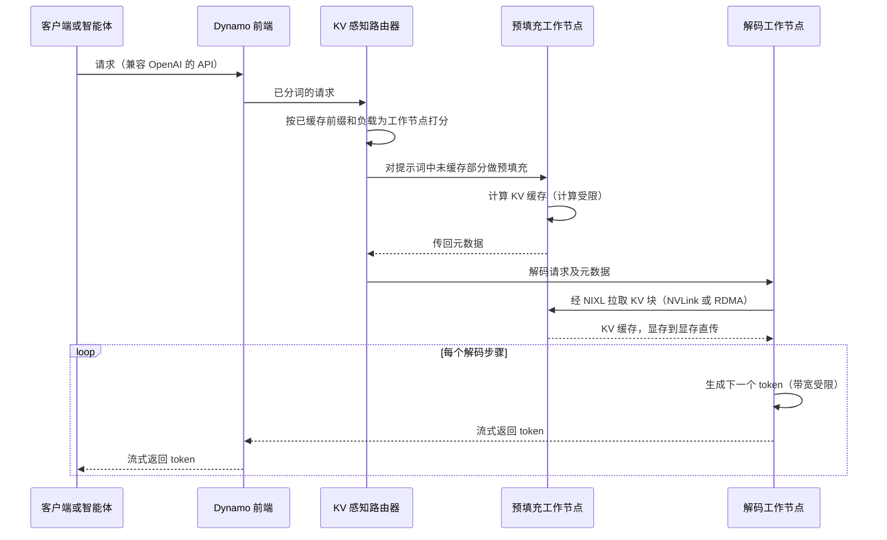

# TensorRT-LLM 与 Dynamo

> [!NOTE]
> 本页为英文原文的简体中文参考译文，仅供参考；如有出入，以[英文原文](../../../layers/11-inference-and-ai-software/tensorrt-llm-and-dynamo.md "English original")为准。

第 11 层 · 推理与 AI 软件 · 约 9 分钟阅读 · 最近核实：2026-11-05

## ⚡ 要点速览

- **推理服务软件分三层。** [TensorRT](../../glossary.md#tensorrt) 为单块 GPU 编译模型，2026 年已发展到第 11 版 [[S11008]](../../../sources/bibliography.md#s11008)。[TensorRT-LLM](../../glossary.md#tensorrt-llm) 在单块 GPU 或单个 [NVLink](../../glossary.md#nvlink) 域上运行大语言模型 [[S589]](../../../sources/bibliography.md#s589)。[Dynamo](../../glossary.md#dynamo) 位于 TensorRT-LLM、[vLLM](../../glossary.md#vllm) 和 [SGLang](../../glossary.md#sglang) 之上，负责协调整个集群 [[S11001]](../../../sources/bibliography.md#s11001)。
- **TensorRT-LLM 开源且原生基于 PyTorch**，自 2025 年 3 月起在 GitHub 上开发 [[S589]](../../../sources/bibliography.md#s589)。其主要手段包括：融合内核、[连续批处理（continuous batching）](../../glossary.md#continuous-batching)、分页可复用的 [KV 缓存](../../glossary.md#kv-cache)、[FP8](../../glossary.md#fp8)/[NVFP4](../../glossary.md#nvfp4) 以及[投机解码（speculative decoding）](../../glossary.md#speculative-decoding) [[S11004]](../../../sources/bibliography.md#s11004)[[S11005]](../../../sources/bibliography.md#s11005)[[S11006]](../../../sources/bibliography.md#s11006)[[S11007]](../../../sources/bibliography.md#s11007)。
- 🟢 **Dynamo 1.0 于 GTC 2026（3 月 16 日）以 Apache 2.0 许可发布。** 采用者包括 CoreWeave、Nebius、Together AI、Cursor、Perplexity、PayPal 和字节跳动 [[S90066]](../../../sources/bibliography.md#s90066)[[S520]](../../../sources/bibliography.md#s520)。1.5.1 版（10 月 6 日）是首个提供企业级支持的版本 [[S521]](../../../sources/bibliography.md#s521)。
- **分离式服务在长提示词上收益最大。** 在 B200 上处理 8k token 提示词时，[分离式](../../glossary.md#disaggregated-serving) Dynamo 配置每 GPU 输出 ~12,147 tokens/s，而最优的聚合式配置为 ~4,815，相差 ~2.5× [[S621]](../../../sources/bibliography.md#s621)。若提示词为 1k token，聚合式配置在低交互速度下领先 [[S621]](../../../sources/bibliography.md#s621)。
- **KV 缓存像库存一样被管理。** [KV 感知路由](../../glossary.md#kv-aware-routing)使 Baseten 的首 token 延迟减半 [[S11001]](../../../sources/bibliography.md#s11001)。[KV 块管理器](../../glossary.md#kvbm)会把缓存溢出到 CPU、SSD 和远程存储 [[S11001]](../../../sources/bibliography.md#s11001)。从 BlueField-4 闪存恢复一个 128K token 的上下文需 ~0.2 s，而重新计算需 ~4.7 s（估计）[[S7000]](../../../sources/bibliography.md#s7000)[[S3012]](../../../sources/bibliography.md#s3012)。
- **弱点：Dynamo 开源且与引擎无关。** 它能提升英伟达（NVIDIA）集群的效率，却不会让工作负载只能跑在英伟达上。AMD 的 MoRI-SGLang 分离式技术栈同样在 MI355X 上创下了前沿数据点 [[S621]](../../../sources/bibliography.md#s621)。

## TensorRT 与 TensorRT-LLM：让单块 GPU 跑得更快

**类比。** 研究阶段的模型好比一份为家庭厨房写的菜谱。TensorRT 把它改写成餐厅流水线版本：合并步骤、批量备料、每个工位配上合适的设备。

**机制。** [内核融合（kernel fusion）](../../glossary.md#kernel-fusion)把多个小型 GPU 程序合并，使中间结果留在片上，而无需往返 [HBM](../../glossary.md#hbm)。TensorRT-LLM 在此之上增加了针对注意力、GEMM 和混合专家层的定制内核，以及运行时调度 [[S589]](../../../sources/bibliography.md#s589)。

| 手段 | 作用 | 已公布的收益 |
|---|---|---|
| 融合内核与定制内核 | 减少 HBM 往返；按 GPU 和模型调优 | 对新架构收益最大 [[S645]](../../../sources/bibliography.md#s645) |
| 动态（连续）批处理 | 请求每一步都可加入或退出批次 | 在研究系统中，同等延迟下吞吐量提升 2–4× [[S32011]](../../../sources/bibliography.md#s32011)[[S32012]](../../../sources/bibliography.md#s32012) |
| 分页、可复用的 KV 缓存 | 固定大小的块；共享前缀可复用；冷块被逐出到主机内存 | 避免重复计算共享提示词 [[S11005]](../../../sources/bibliography.md#s11005) |
| FP8 与 NVFP4 | 每个权重和每个缓存 token 占用更少字节 | B200 上 NVFP4 解码较 BF16 快 ~2.7×（估计）[[S32025]](../../../sources/bibliography.md#s32025)[[S32017]](../../../sources/bibliography.md#s32017) |
| 投机解码（草稿模型、EAGLE-3、MTP） | 由廉价的草稿模型提出候选 token；主模型每次前向验证多个 | Llama 3.3 70B 上提速 3×（英伟达数据）[[S589]](../../../sources/bibliography.md#s589)；🟡 GB300 上使用 MTP，在每用户 150 tokens/s 下成本降低 ~21× [[S624]](../../../sources/bibliography.md#s624) |

> [!TIP]
> **算例 —— 为什么连续批处理很重要。** 把 64 个请求放进一个静态批次，输出长度在 100 到 2,000 token 之间均匀分布。该批次需运行 ~2,000 步，而请求平均只需 ~1,050 步，因此槽位有 ~48% 的时间处于空闲。连续批处理在请求结束的瞬间就补满空出的槽位，在同一块 GPU 上吞吐量约为原来的 1.9×（🔴 示意性测算）[[S11004]](../../../sources/bibliography.md#s11004)。**商业解读：**一块 GPU 能创造多少收入，很大程度上由调度器而非芯片决定。

投机解码只在小批次下有效；TensorRT-LLM 的文档称，加速效果“仅在小批次下可观察到”（"only observable at low batch sizes"）[[S11006]](../../../sources/bibliography.md#s11006)。

🔧 技术细节：KV 缓存如何分页与复用

TensorRT-LLM 把 KV 缓存存储为一个由固定大小块组成的池 [[S11005]](../../../sources/bibliography.md#s11005)。写满的块进入一棵基数树（radix tree），因此共享同一提示词前缀的请求可以复用它们。内存不足时，优先级最低、最近最少使用的块会被移到主机内存，并保持可复用 [[S11005]](../../../sources/bibliography.md#s11005)。分页存储由 vLLM 的 PagedAttention 推广开来 [[S32011]](../../../sources/bibliography.md#s32011)。FP8 和 NVFP4 KV 缓存选项降低了每个缓存 token 占用的字节数 [[S11007]](../../../sources/bibliography.md#s11007)。

## Dynamo：让一个集群像一台推理机器那样工作

**类比。** 如果说 TensorRT-LLM 是一间高效的厨房，那么 Dynamo 就是餐厅经理：安排客人入座、分派备菜工作，并在客流高峰到来时加开工位。

**机制。** Dynamo 用 Rust 编写并提供 Python 扩展，把多个引擎整合为一个多节点系统 [[S11001]](../../../sources/bibliography.md#s11001)。其**路由器**根据负载和已缓存的前缀选择工作节点。**分离式服务**把[预填充（prefill）](../../glossary.md#prefill)和[解码（decode）](../../glossary.md#decode)放在不同的资源池中运行。**KV 块管理器**负责卸载缓存。由 SLA 驱动的 **Planner** 根据延迟目标确定各资源池的规模。**Grove** 在 Kubernetes 上进行成组调度（gang scheduling），并感知 [NVL72](../../glossary.md#nvl72) 拓扑。**ModelExpress** 以流式方式加载权重，使冷启动加快 7× [[S11001]](../../../sources/bibliography.md#s11001)。数据传输使用 [NIXL](../../glossary.md#nixl)，它对 GPU 与 CPU 内存以及文件、块和对象存储做了统一抽象 [[S11003]](../../../sources/bibliography.md#s11003)。

该流程依据 Dynamo 的设计文档；KV 传输是非阻塞的，因此两个工作节点在传输期间仍可继续服务其他请求 [[S11002]](../../../sources/bibliography.md#s11002)。

> [!TIP]
> **算例 —— 为什么分离式服务能在给定延迟目标下提高每 GPU tokens/s。** InferenceX 在 B200 上以 8,000 个输入 token、1,000 个输出 token 测试 DeepSeek-R1。最优的聚合式配置（8 块 GPU，TensorRT-LLM）在每用户 ~37 tokens/s 下每 GPU 输出 ~4,815 tokens/s。分离式 Dynamo 配置（44 块 GPU，分布在预填充池与解码池中）在 ~32 下输出 ~12,147 [[S621]](../../../sources/bibliography.md#s621)。估计成本从每百万 token ~$0.10 降至 ~$0.04 [[S622]](../../../sources/bibliography.md#s622)。
>
> **原因。** 每个请求中，每生成 1 个 token 对应 8 个提示词 token。在聚合式配置下，这些预填充被切块后与解码挤在同一步骤中，于是每个用户的下一个 token 都要排在别人的提示词后面 [[S11002]](../../../sources/bibliography.md#s11002)；要维持每用户 ~35 tokens/s，只能用小批次。拆分之后，预填充 GPU 可以跑大规模、计算受限的批次，而解码 GPU 则能以稳定的 token 间延迟同时服务大量用户。若提示词为 1k token，干扰较小，聚合式配置在低交互速度区间保住了前沿 [[S621]](../../../sources/bibliography.md#s621)。**商业解读：**在长提示词流量（智能体、RAG）上，同一批 B200 可多产出 ~2.5× 的 token；在短提示词上则可能毫无收益。

Dynamo 的文档提醒，最优拆分方式“不应被编码为一个通用的 token 阈值”（"should not be encoded as a universal token threshold"）[[S11002]](../../../sources/bibliography.md#s11002)。Planner 与离线工具 AISimulate 会针对每个模型和流量组合搜索最优配置 [[S11001]](../../../sources/bibliography.md#s11001)。

🔧 技术细节：1.0 版新增了什么，以及 Dynamo-Triton

1.0 版新增了零配置部署（beta）：用一个 YAML 文件声明模型、硬件和 SLA；AISimulate 评估候选方案，Planner 设定拓扑 [[S11001]](../../../sources/bibliography.md#s11001)。TensorRT-LLM 也可以通过 `trtllm-serve` 独立实现分离式服务 [[S11033]](../../../sources/bibliography.md#s11033)。自 2025 年 3 月 18 日起，[Triton](../../glossary.md#triton) 推理服务器以 Dynamo-Triton 之名并入 Dynamo 平台 [[S11010]](../../../sources/bibliography.md#s11010)；2.74.0 版仍支持非 LLM 模型、CPU 和 AWS Inferentia [[S11009]](../../../sources/bibliography.md#s11009)。

## KV 缓存经济：路由与卸载层级

智能体和长对话让 KV 缓存成为一种可复用的资产：重新计算要耗费 GPU 时间，保留则要占用内存。Dynamo 的路由器和块管理器决定每份缓存存放在哪里 [[S11001]](../../../sources/bibliography.md#s11001)；BlueField-4 上下文内存存储则在机柜组（pod）层面增加了闪存层 [[S3012]](../../../sources/bibliography.md#s3012)[[S3013]](../../../sources/bibliography.md#s3013)。

> [!TIP]
> **算例 —— 缓存命中对智能体的价值。** 一个 128K token 的 Llama 3.1 70B 上下文在 FP8 下为 ~21.5 GB。从闪存恢复需 ~0.2 s；重新计算则需 ~4.7 s 的 Rubin 时间（估计）[[S7000]](../../../sources/bibliography.md#s7000)。在一个 30 轮的会话中，这可节省 ~135 GPU 秒，并让每轮等待减少 ~4.5 s（🔴 示意性测算）。**商业解读：**缓存放置成为一个收入杠杆，把存储和[网卡（NIC）](../../glossary.md#nic)厂商拉进了推理技术栈（[第 07 层](../07-dpu-supernic-storage-security/index.md)）。

**[Q4 · 优势来源]**（详见[发展历程与构建方式](history-and-how-built.md)）。引擎是开源的，因此优势在于集成与速度：为每个新模型编写内核、针对 NVLink 域调优的部署方案，以及围绕英伟达网络构建的传输软件 [[S11001]](../../../sources/bibliography.md#s11001)[[S11003]](../../../sources/bibliography.md#s11003)。

## 🎯 企业发展视角

1. **编排是新的控制点。** Dynamo 决定每个请求和每份缓存的去向 [[S11001]](../../../sources/bibliography.md#s11001)。如果它成为默认的开源“推理操作系统”，英伟达是否会因此获得对混合机群的影响力？
2. **分离式服务利好互连网络。** KV 传输在资源池之间为每个请求搬运数 GB 数据 [[S11002]](../../../sources/bibliography.md#s11002)，提升了 NVLink、RDMA 网卡和上下文内存存储的价值 [[S3012]](../../../sources/bibliography.md#s3012)。哪些供应商的价值在这一转变中被低估？
3. **对工作负载的依赖是一个切入口。** 长提示词上 ~2.5× 的收益在短提示词上消失了 [[S621]](../../../sources/bibliography.md#s621)。专用加速器可以瞄准某一个阶段，正如英伟达用 Groq LPX 专攻解码 [[S113]](../../../sources/bibliography.md#s113)。
4. **发布节奏既是护城河，也是成本。** 规模较小的厂商能否跟上 TensorRT-LLM 和 Dynamo 的发布节奏 [[S521]](../../../sources/bibliography.md#s521)[[S589]](../../../sources/bibliography.md#s589)，还是只能基于 vLLM 和 SGLang 来构建？

## 📚 来源（Sources）

<!-- Auto-generated from the [S…] citations on this page by `make build`. Edit sources/registry/*.csv, not this list. -->

- [**S113**](../../../sources/bibliography.md#s113) Tom's Hardware, *How Nvidia's $20 billion Groq 3 LPU deal reshapes the Nvidia Vera Rubin Platform*, 2026-03. [Link](https://www.tomshardware.com/tech-industry/semiconductors/nvidias-20-billion-groq-deal-produces-its-first-chip)
- [**S520**](../../../sources/bibliography.md#s520) NVIDIA via ResearchPool, *NVIDIA Enters Production With Dynamo, the Broadly Adopted Inference Operating System for AI Factories (press release mirror)*, 2026-03-16. [Link](https://app.researchpool.com/company/nvda-us67066g1040-nvidia-corp-e9VqYYGjs8/press/nvidia-corporation-nvda-nvidia-enters-production-with-dynamo-the-broadly-adopted-inference-ope-DxMC1Gq48d)
- [**S521**](../../../sources/bibliography.md#s521) NVIDIA Docs, *NVIDIA Dynamo release notes*, 2026-10. [Link](https://docs.nvidia.com/dynamo/zh-CN/latest/reference/releases)
- [**S589**](../../../sources/bibliography.md#s589) NVIDIA (GitHub: NVIDIA/TensorRT-LLM), *TensorRT-LLM README*, 2026-11. [Link](https://github.com/NVIDIA/TensorRT-LLM/blob/main/README.md)
- [**S621**](../../../sources/bibliography.md#s621) SemiAnalysis (InferenceX-app repository), *InferenceX public API snapshot (benchmarks.json and benchmarks-history.json fixtures)*, 2026-10-17. [Link](https://github.com/SemiAnalysisAI/InferenceX-app/tree/main/packages/app/cypress/fixtures/api)
- [**S622**](../../../sources/bibliography.md#s622) SemiAnalysis (InferenceX-app repository), *InferenceX hardware registry: TCO per GPU-hour by SKU (SemiAnalysis July 2026 pricing surveys and AI Cloud TCO Model)*, 2026-07. [Link](https://github.com/SemiAnalysisAI/InferenceX-app/blob/main/packages/constants/src/gpu-keys.ts)
- [**S624**](../../../sources/bibliography.md#s624) SemiAnalysis, *InferenceX v2: NVIDIA Blackwell Vs AMD vs Hopper - Formerly InferenceMAX*, 2026-02-16. [Link](https://github.com/SemiAnalysisAI/InferenceX-app/blob/main/packages/app/content/blog/inferencex-v2-nvidia-blackwell-vs-amd-vs-hopper.mdx)
- [**S645**](../../../sources/bibliography.md#s645) NVIDIA TensorRT-LLM team, *Pushing Latency Boundaries: Optimizing DeepSeek-R1 Performance on NVIDIA B200 GPUs (TensorRT-LLM tech blog 1)*, 2025-05-16. [Link](https://github.com/NVIDIA/TensorRT-LLM/blob/main/docs/source/blogs/tech_blog/blog01_Pushing_Latency_Boundaries_Optimizing_DeepSeek-R1_Performance_on_NVIDIA_B200_GPUs.md)
- [**S3012**](../../../sources/bibliography.md#s3012) NVIDIA Newsroom, *NVIDIA BlueField-4 Powers New Class of AI-Native Storage Infrastructure for the Next Frontier of AI*, 2026-01-05. [Link](https://nvidianews.nvidia.com/news/nvidia-bluefield-4-powers-new-class-of-ai-native-storage-infrastructure-for-the-next-frontier-of-ai)
- [**S3013**](../../../sources/bibliography.md#s3013) Blocks and Files, *Nvidia standardizes GPU cluster KV cache offload to NVMe SSDs*, 2026-01-06. [Link](https://blocksandfiles.com/2026/01/06/nvidia-standardizes-gpu-cluster-kv-cache-offload-to-nvme-ssds/)
- [**S7000**](../../../sources/bibliography.md#s7000) nvidia_deep_dive_claude repository, *Repo analysis: layer 07 models (DPU offload value per compute tray, checkpoint write time, KV-cache reload time by tier)*, 2026-11-05. [Link](https://github.com/FrankHuang94/nvidia_deep_dive_claude/blob/main/layers/07-dpu-supernic-storage-security/index.md)
- [**S11001**](../../../sources/bibliography.md#s11001) NVIDIA (GitHub), *NVIDIA Dynamo README (ai-dynamo/dynamo)*, 2026-11. [Link](https://github.com/ai-dynamo/dynamo/blob/main/README.md)
- [**S11002**](../../../sources/bibliography.md#s11002) NVIDIA (GitHub ai-dynamo/dynamo docs), *Dynamo design docs: Disaggregated Serving*, 2026. [Link](https://github.com/ai-dynamo/dynamo/blob/main/docs/fern/pages/developer-guide/knowledge-base/concepts/system-architecture/disaggregated-serving.md)
- [**S11003**](../../../sources/bibliography.md#s11003) NVIDIA (GitHub ai-dynamo/nixl), *NVIDIA Inference Xfer Library (NIXL) README*, 2026-11. [Link](https://github.com/ai-dynamo/nixl/blob/main/README.md)
- [**S11004**](../../../sources/bibliography.md#s11004) NVIDIA (GitHub NVIDIA/TensorRT-LLM docs), *TensorRT-LLM docs: Paged Attention, IFB and Request Scheduling*, 2026. [Link](https://github.com/NVIDIA/TensorRT-LLM/blob/main/docs/source/features/paged-attention-ifb-scheduler.md)
- [**S11005**](../../../sources/bibliography.md#s11005) NVIDIA (GitHub NVIDIA/TensorRT-LLM docs), *TensorRT-LLM docs: KV Cache System*, 2026. [Link](https://github.com/NVIDIA/TensorRT-LLM/blob/main/docs/source/features/kvcache.md)
- [**S11006**](../../../sources/bibliography.md#s11006) NVIDIA (GitHub NVIDIA/TensorRT-LLM docs), *TensorRT-LLM docs: Speculative Decoding*, 2026. [Link](https://github.com/NVIDIA/TensorRT-LLM/blob/main/docs/source/features/speculative-decoding.md)
- [**S11007**](../../../sources/bibliography.md#s11007) NVIDIA (GitHub NVIDIA/TensorRT-LLM docs), *TensorRT-LLM docs: Quantization*, 2026. [Link](https://github.com/NVIDIA/TensorRT-LLM/blob/main/docs/source/features/quantization.md)
- [**S11008**](../../../sources/bibliography.md#s11008) NVIDIA (GitHub NVIDIA/TensorRT), *TensorRT Open Source Software README (TensorRT 11.x announcement)*, 2026-11. [Link](https://github.com/NVIDIA/TensorRT/blob/main/README.md)
- [**S11009**](../../../sources/bibliography.md#s11009) NVIDIA (GitHub triton-inference-server/server), *Triton Inference Server README*, 2026-11. [Link](https://github.com/triton-inference-server/server/blob/main/README.md)
- [**S11010**](../../../sources/bibliography.md#s11010) NVIDIA Developer, *NVIDIA Dynamo-Triton (product page)*, 2025-03-18. [Link](https://developer.nvidia.com/dynamo-triton)
- [**S11033**](../../../sources/bibliography.md#s11033) NVIDIA (GitHub NVIDIA/TensorRT-LLM docs), *TensorRT-LLM docs: Disaggregated Serving*, 2026. [Link](https://github.com/NVIDIA/TensorRT-LLM/blob/main/docs/source/features/disagg-serving.md)
- [**S32011**](../../../sources/bibliography.md#s32011) SOSP 2023 (arXiv 2309.06180) (Kwon et al.), *Efficient Memory Management for Large Language Model Serving with PagedAttention (vLLM)*, 2023-09. [Link](https://arxiv.org/abs/2309.06180)
- [**S32012**](../../../sources/bibliography.md#s32012) USENIX OSDI 2022 (Yu et al.), *Orca: A Distributed Serving System for Transformer-Based Generative Models*, 2022-07. [Link](https://www.usenix.org/conference/osdi22/presentation/yu)
- [**S32017**](../../../sources/bibliography.md#s32017) NVIDIA Technical Blog, *Introducing NVFP4 for Efficient and Accurate Low-Precision Inference*, 2025-06. [Link](https://developer.nvidia.com/blog/introducing-nvfp4-for-efficient-and-accurate-low-precision-inference/)
- [**S32025**](../../../sources/bibliography.md#s32025) nvidia_deep_dive_claude repository, *Repo analysis: inference token-budget scenarios and roofline serving model (Primer P2)*, 2026-11-05. [Link](https://github.com/FrankHuang94/nvidia_deep_dive_claude/blob/main/primers/P2-how-ai-inference-works.md)
- [**S90066**](../../../sources/bibliography.md#s90066) HPCwire (NVIDIA press release), *NVIDIA enters production with Dynamo, the broadly adopted inference operating system for AI factories*, 2026-03-17. [Link](https://www.hpcwire.com/aiwire/tag/dynamo-1-0/)
