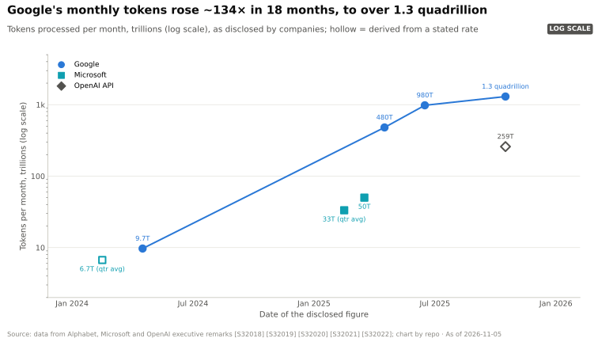
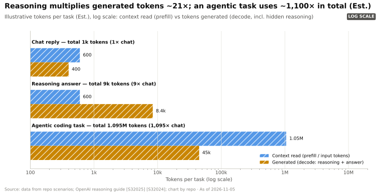
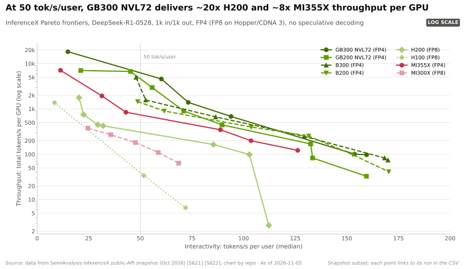
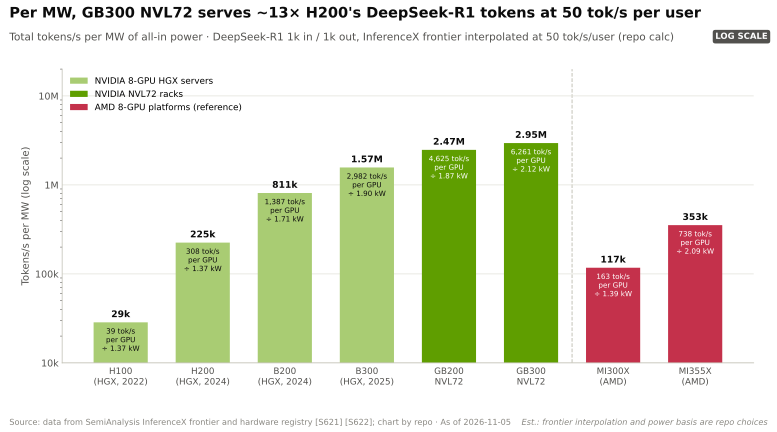
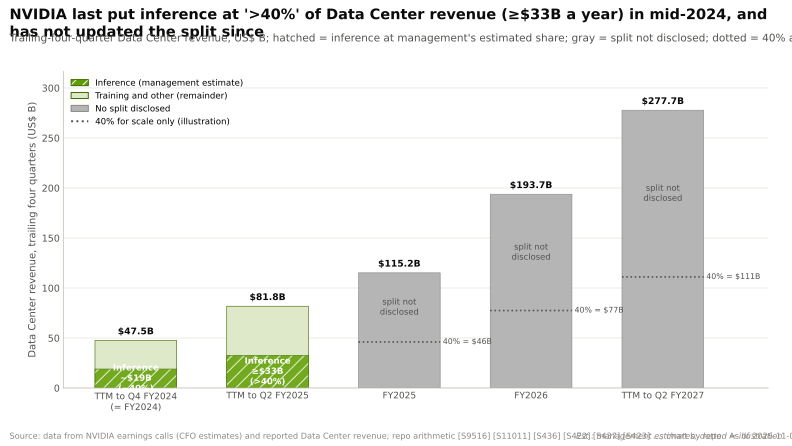

# 推理转向

> [!NOTE]
> 本页为英文原文的简体中文参考译文，仅供参考；如有出入，以[英文原文](../../../layers/11-inference-and-ai-software/the-inference-shift.md "English original")为准。

第 11 层 · 推理与 AI 软件 · 约 8 分钟阅读 · 最近核实：2026-11-05

## ⚡ 要点速览

- **驱动需求的是每项任务的 token 数，而非用户数。** 一次推理型回答生成的 token 为普通聊天回复的 ~21×；一个 30 轮的编程智能体处理的总量为 ~1,100×（估计）[[S32025]](../../../sources/bibliography.md#s32025)。谷歌（Google）的月度 token 量在 18 个月内增长 ~134× [[S32018]](../../../sources/bibliography.md#s32018)[[S32020]](../../../sources/bibliography.md#s32020)。
- **推理按延迟曲线定价销售。** 运行 DeepSeek-R1 时，GB300 [NVL72](../../glossary.md#nvl72) 在每用户 50 tokens/s 下每 GPU 可输出 ~6,261 tokens/s，而在每用户 100 tokens/s 下仅为 ~562 [[S621]](../../../sources/bibliography.md#s621)。更快的档位每 token 成本高出 ~11×（估计）[[S622]](../../../sources/bibliography.md#s622)。
- **电力是硬约束。** 在每用户 50 tokens/s 下，按全口径功耗计，GB300 NVL72 每兆瓦产出 ~3.0M tokens/s，H200 仅 ~225k，相差 ~13× [[S621]](../../../sources/bibliography.md#s621)[[S622]](../../../sources/bibliography.md#s622)。🟡 英伟达（NVIDIA）宣称 Vera Rubin 搭配 Groq LPX 可将每瓦 token 数提升 35× [[S113]](../../../sources/bibliography.md#s113)[[S90003]](../../../sources/bibliography.md#s90003)。
- **英伟达最后一次披露的数字：截至 Q2 FY2025 的一年中，推理占数据中心收入 >40%**，意味着 ≥$33B [[S11011]](../../../sources/bibliography.md#s11011)[[S441]](../../../sources/bibliography.md#s441)。🔴 若维持这一占比，最近一年 $277.7B 的数据中心收入中将有 ~$111B 来自推理，但此后从未再披露拆分 [[S405]](../../../sources/bibliography.md#s405)。
- **管理层如今只作定性表述。** 其提到“推理需求出现拐点”，以及截至 2027 年 Blackwell 加 Rubin 合计 $1T 的需求 [[S409]](../../../sources/bibliography.md#s409)[[S90001]](../../../sources/bibliography.md#s90001)。
- **看空要点：推理比训练更容易被争夺。** 推理请求彼此独立，每 token 成本也容易做基准测试。谷歌 TPU 运行 Qwen3.5 397B 的成本为每百万 token ~$0.18，而 B200 为 ~$0.22 [[S625]](../../../sources/bibliography.md#s625)。

## 为什么推理模型与智能体会成倍放大 token 需求

**类比。** 聊天机器人像一台自动售货机：一个问题，一个答案。[推理模型](../../glossary.md#reasoning-model)像一位顾问，回复之前先写好几页草稿。[智能体](../../glossary.md#agentic-ai)则像一个项目团队，每走一步都要把整份卷宗重读一遍。

**机制。** 推理模型会写出隐藏的“思考” token，这些 token 按输出计费，并消耗完整的[解码（decode）](../../glossary.md#decode)时间 [[S32024]](../../../sources/bibliography.md#s32024)。智能体则循环往复：规划、调用工具、读取结果、重读不断增长的上下文。每次重读都是[预填充（prefill）](../../glossary.md#prefill)；每个新想法都是解码（[入门 P2](../../primers/P2-how-ai-inference-works.md)）。英伟达 CEO 在 2025 年表示，推理模型与智能体所需的计算量轻松达到一年前预期的 100×（🟡 厂商说法）[[S33020]](../../../sources/bibliography.md#s33020)。

> [!TIP]
> **算例 —— 服务一个智能体编程任务的成本。** 本资料库的示例任务读取 ~1.05M 个上下文 token，生成 ~45k 个（估计）[[S32025]](../../../sources/bibliography.md#s32025)。
>
> | | GB300 NVL72 | H200 |
> |---|---|---|
> | 每用户 50 tokens/s 下的每 GPU tokens/s | ~6,261 | ~308 |
> | 每 [GPU 小时](../../glossary.md#gpu-hour)的所有者成本（估计） | $2.31 | $1.22 |
> | 每百万 token 成本（$）= 成本 ÷（tokens/s × 3,600）× 10⁶ | ~$0.10 | ~$1.10 |
> | ~1.1M 个 token 的成本 | ~$0.11 | ~$1.20 |
>
> 输入数据 [[S621]](../../../sources/bibliography.md#s621)[[S622]](../../../sources/bibliography.md#s622)；计算过程 [[S11000]](../../../sources/bibliography.md#s11000)。🔴 此为上限：缓存的前缀使重读比解码更便宜。仅解码一项，在每用户 50 tokens/s 下就需 ~15 分钟，150 tokens/s 下需 5 分钟。**商业解读：**智能体同时奖励便宜的 token 和快速的 token，这有利于最新一代机架。

## 延迟与吞吐量：前沿曲线

**机制。** 一块 GPU 通过[批处理（batching）](../../glossary.md#batching)同时服务许多用户。批次越大，每 GPU 的 token 数越高，但每个用户的速度越慢，因为每个解码步骤都要等整个批次完成。把每种配置画在“每用户 tokens/s（[交互速度](../../glossary.md#interactivity)）—每 GPU tokens/s”的坐标上，其上包络线就是[帕累托前沿](../../glossary.md#pareto-frontier)。

> [!TIP]
> **算例 —— 为什么快速档位必须贵 ~11×。** GB300 NVL72 在每用户 50 tokens/s 下每 GPU 输出 ~6,261 tokens/s，在 100 tokens/s 下为 ~562（插值）[[S621]](../../../sources/bibliography.md#s621)。在每 GPU 小时 $2.31 的固定成本下 [[S622]](../../../sources/bibliography.md#s622)，每百万 token 成本从 ~$0.10 升至 ~$1.14（估计）[[S11000]](../../../sources/bibliography.md#s11000)。**商业解读：**要为高端用户把阅读速度翻倍，每 token 价格需提高 ~11×，才能让每 GPU 小时赚到同样的钱。

**[Q1 · 职能与失效后果]** 本层在每个延迟档位上把 GPU 小时转化为 token。若本层薄弱，同一芯片的 token 产出就会减少：在硬件不变的 GB300 NVL72 上，2025 年 9 月与 2026 年 9 月的软件版本之间，MLPerf 吞吐量相差 2.9× [[S601]](../../../sources/bibliography.md#s601)[[S603]](../../../sources/bibliography.md#s603)。

**[Q2 · 关键指标]**

| 指标 | 为何重要 | 示例数值 |
|---|---|---|
| 给定每用户 tokens/s 下的每 GPU tokens/s | 一块 GPU 在某产品档位上的创收能力 | GB300 NVL72 在 50 下为 ~6,261 [[S621]](../../../sources/bibliography.md#s621) |
| 每兆瓦 tokens/s（全口径功耗） | 受电力约束站点的创收能力 | GB300 NVL72 ~3.0M；H200 ~225k [[S621]](../../../sources/bibliography.md#s621)[[S622]](../../../sources/bibliography.md#s622) |
| 给定交互速度下的每百万 token 成本（$） | 单位成本与 API 价格对比 | GB300 在 50 下 ~$0.10，在 100 下 ~$1.14（估计）[[S622]](../../../sources/bibliography.md#s622) |
| [首 token 延迟（TTFT）](../../glossary.md#ttft)与[有效吞吐量（goodput）](../../glossary.md#goodput) | 满足延迟目标的流量占比 | Dynamo 的 Planner 按 TTFT 与 token 间延迟目标自动扩缩容 [[S11001]](../../../sources/bibliography.md#s11001) |
| 每项任务的 token 数 | 把用户数换算为算力需求 | 为聊天回复的 ~21× 至 ~1,100×（估计）[[S32025]](../../../sources/bibliography.md#s32025) |

> [!WARNING]
> **误区与事实：**“推理是大宗商品，所以每 FLOP 最便宜的芯片会胜出。”解码受限于内存带宽、KV 容量和互连，而非 FLOPs [[S32027]](../../../sources/bibliography.md#s32027)。在每用户 50 tokens/s 下，NVL72 机架的每 GPU 性能领先 MI355X ~8× [[S621]](../../../sources/bibliography.md#s621)。但在另一个模型上、每用户 100 tokens/s 时，谷歌 TPU 比 B200 便宜 ~18% [[S625]](../../../sources/bibliography.md#s625)。答案取决于模型和档位。

🔧 技术细节：InferenceX 前沿曲线是如何测量的

SemiAnalysis 的 InferenceX 每晚在各系统上跑遍不同引擎、并行设置和并发度，保留最优点作为前沿曲线 [[S620]](../../../sources/bibliography.md#s620)[[S621]](../../../sources/bibliography.md#s621)。吞吐量统计每 GPU 的输入加输出 token 数；交互速度取每用户 tokens/s 的中位数。每百万 token 成本以 SemiAnalysis 估算的所有者每 GPU 小时[总拥有成本（TCO）](../../glossary.md#tco)除以吞吐量得出 [[S622]](../../../sources/bibliography.md#s622)：这是估算值，而非价格。

## 每兆瓦每秒 token 数：AI 工厂的核心指标

一个站点的电网接入容量是固定的，因此稀缺的投入是电力。英伟达因而以[每兆瓦每秒 token 数](../../glossary.md#tokens-per-megawatt)来推销其 [AI 工厂](../../glossary.md#ai-factory)。

> [!TIP]
> **算例 —— 一个 100 MW 站点的产出。** GB300 NVL72 全口径每 GPU 功耗 ~2.12 kW，因此每 GPU ~6,261 tokens/s 折合每兆瓦 ~2.95M tokens/s [[S621]](../../../sources/bibliography.md#s621)[[S622]](../../../sources/bibliography.md#s622)。一个满载的 100 MW 站点每秒产出 ~295M 个 token，30 天的月份合计 ~765 万亿：相当于谷歌 2025 年 10 月月度 token 量的 ~59% [[S32020]](../../../sources/bibliography.md#s32020)。若全部部署 H200，则只有 ~58 万亿。🔴 假设单一工作负载满负荷运行。**商业解读：**在电力固定的情况下，更新的机架意味着产能扩张，而不仅仅是降本。

## 英伟达收入中有多少来自推理？

> [!TIP]
> **算例 —— 隐含的推理收入。** CFO 估计，截至 Q4 FY2024 的一年（~$47.5B）中 ~40% 为推理，约合 $19B [[S9516]](../../../sources/bibliography.md#s9516)[[S439]](../../../sources/bibliography.md#s439)。对于截至 Q2 FY2025 的一年，她称 ~$81.8B 中“超过 40%”来自推理，即至少 ~$33B [[S11011]](../../../sources/bibliography.md#s11011)[[S441]](../../../sources/bibliography.md#s441)。此后，截至 Q2 FY2027 的一年数据中心收入达到 $277.7B [[S405]](../../../sources/bibliography.md#s405)[[S403]](../../../sources/bibliography.md#s403)[[S402]](../../../sources/bibliography.md#s402)。🔴 即便占比仅维持不变，推理收入也将达 ~$111B。**商业解读：**方向很清楚；规模则是模型推算，而非公司披露。

这一拆分本身并不精确。同一批 GPU 既做训练又做推理服务，而强化学习后训练会生成海量的 rollout token：这是被记作训练的推理工作（🔴 本资料库分析）。

> [!NOTE]
> **🐂 看多观点。** 随着推理模型与智能体普及，每项任务的 token 数不断复利增长 [[S32025]](../../../sources/bibliography.md#s32025)。交互速度分档奖励最新一代机架，软件也在持续提升已部署设备的产出 [[S603]](../../../sources/bibliography.md#s603)。在这一经常性市场中，英伟达在每兆瓦 token 数上处于领先 [[S621]](../../../sources/bibliography.md#s621)[[S622]](../../../sources/bibliography.md#s622)。

> [!WARNING]
> **🐻 看空观点。** 推理可拆分为小型、相互独立的任务，并不需要英伟达的训练互连网络。每 token 成本易于基准测试且可多源采购，TPU 和定制 ASIC 正是借此切入 [[S625]](../../../sources/bibliography.md#s625)。稀疏模型、[FP4](../../glossary.md#fp4) 与缓存技术降低每 token 所需硬件的速度，可能快于需求增长。

## 🎯 企业发展视角

1. **价格随延迟档位而定。** 在同一机架上，每用户 50 到 100 tokens/s 之间，每 token 成本上升 ~11×（估计）[[S622]](../../../sources/bibliography.md#s622)。哪些客户愿意为快速档位付费？在延迟要求宽松的场景中，更便宜的加速器能在哪里胜出？
2. **每兆瓦 token 数是采购指标。** 挑战者需要在这一维度上拿出独立的、与工作负载匹配的数据。高通（Qualcomm）的 AI200 和 AI250 [[S173]](../../../sources/bibliography.md#s173) 在这一指标上表现如何？
3. **推理收入占比未予披露。** 任何训练与推理的收入拆分都依赖 2024 年的数据 [[S11011]](../../../sources/bibliography.md#s11011)。哪些信息可以更新这一判断：[超大规模云厂商](../../glossary.md#hyperscaler)的表态、基准测试量、token 披露？
4. **智能体改变了产品形态。** 长生命周期的上下文更看重容量、KV 卸载和高速网络。无论采用哪种加速器，哪些内存、存储和[网卡（NIC）](../../glossary.md#nic)供应商都会受益？

## 📚 来源（Sources）

<!-- Auto-generated from the [S…] citations on this page by `make build`. Edit sources/registry/*.csv, not this list. -->

- [**S113**](../../../sources/bibliography.md#s113) Tom's Hardware, *How Nvidia's $20 billion Groq 3 LPU deal reshapes the Nvidia Vera Rubin Platform*, 2026-03. [Link](https://www.tomshardware.com/tech-industry/semiconductors/nvidias-20-billion-groq-deal-produces-its-first-chip)
- [**S173**](../../../sources/bibliography.md#s173) Qualcomm, *Qualcomm Unveils AI200 and AI250 - Redefining Rack-Scale Data Center Inference*, 2025-10-27. [Link](https://www.qualcomm.com/news/releases/2025/10/qualcomm-unveils-ai200-and-ai250-redefining-rack-scale-data-cent)
- [**S402**](../../../sources/bibliography.md#s402) NVIDIA Corporation via SEC EDGAR (Colette Kress), *CFO Commentary on Fourth Quarter and Fiscal 2026 Results (Form 8-K exhibit 99.2)*, 2026-02-25. [Link](https://www.sec.gov/Archives/edgar/data/1045810/000104581026000019/q4fy26cfocommentary.htm)
- [**S403**](../../../sources/bibliography.md#s403) NVIDIA Corporation via SEC EDGAR, *NVIDIA Announces Financial Results for First Quarter Fiscal 2027 (Form 8-K exhibit 99.1)*, 2026-05-20. [Link](https://www.sec.gov/Archives/edgar/data/0001045810/000104581026000051/q1fy27pr.htm)
- [**S405**](../../../sources/bibliography.md#s405) NVIDIA Corporation via SEC EDGAR, *NVIDIA Announces Financial Results for Second Quarter Fiscal 2027 (Form 8-K exhibit 99.1)*, 2026-08-26. [Link](https://www.sec.gov/Archives/edgar/data/0001045810/000104581026000073/q2fy27pr.htm)
- [**S409**](../../../sources/bibliography.md#s409) NVIDIA Corporation, *NVIDIA Corp. (NVDA) Q1 Fiscal 2027 earnings call transcript (20 May 2026)*, 2026-05-20. [Link](https://s201.q4cdn.com/141608511/files/doc_financials/2027/q1/NVDA-Q1-2027-Earnings-Call-20-May-2026-5_00-PM-ET.pdf)
- [**S439**](../../../sources/bibliography.md#s439) NVIDIA Corporation, *NVIDIA Announces Financial Results for Fourth Quarter and Fiscal 2024 (press release with CFO commentary)*, 2024-02-21. [Link](https://nvidianews.nvidia.com/news/nvidia-announces-financial-results-for-fourth-quarter-and-fiscal-2024)
- [**S441**](../../../sources/bibliography.md#s441) NVIDIA Corporation, *NVIDIA Announces Financial Results for Second Quarter Fiscal 2025 (press release with CFO commentary)*, 2024-08-28. [Link](https://nvidianews.nvidia.com/news/nvidia-announces-financial-results-for-second-quarter-fiscal-2025)
- [**S601**](../../../sources/bibliography.md#s601) MLCommons, *MLPerf Inference v5.1 results (summary_results.json and per-submitter logs)*, 2025-09-09. [Link](https://github.com/mlcommons/inference_results_v5.1)
- [**S603**](../../../sources/bibliography.md#s603) MLCommons, *MLPerf Inference v6.1 results (summary.csv and per-submitter logs)*, 2026-09. [Link](https://github.com/mlcommons/inference_results_v6.1)
- [**S620**](../../../sources/bibliography.md#s620) SemiAnalysis, *SemiAnalysis InferenceX (formerly InferenceMAX) open-source benchmark repository*, 2026-11. [Link](https://github.com/SemiAnalysisAI/InferenceX)
- [**S621**](../../../sources/bibliography.md#s621) SemiAnalysis (InferenceX-app repository), *InferenceX public API snapshot (benchmarks.json and benchmarks-history.json fixtures)*, 2026-10-17. [Link](https://github.com/SemiAnalysisAI/InferenceX-app/tree/main/packages/app/cypress/fixtures/api)
- [**S622**](../../../sources/bibliography.md#s622) SemiAnalysis (InferenceX-app repository), *InferenceX hardware registry: TCO per GPU-hour by SKU (SemiAnalysis July 2026 pricing surveys and AI Cloud TCO Model)*, 2026-07. [Link](https://github.com/SemiAnalysisAI/InferenceX-app/blob/main/packages/constants/src/gpu-keys.ts)
- [**S625**](../../../sources/bibliography.md#s625) SemiAnalysis, *TPU Inference Externalization Full Steam Ahead*, 2026-09-07. [Link](https://github.com/SemiAnalysisAI/InferenceX-app/blob/main/packages/app/content/blog/tpu-inferencex-full-steam.mdx)
- [**S9516**](../../../sources/bibliography.md#s9516) MarketBeat, *NVIDIA Q4 FY2024 earnings call transcript*, 2024-02-21. [Link](https://www.marketbeat.com/earnings/reports/2024-2-21-nvidia-co-stock)
- [**S11000**](../../../sources/bibliography.md#s11000) nvidia_deep_dive_claude repository, *Repo analysis: layer 11 inference models (disaggregation comparison, cost per million tokens across software releases, implied inference revenue, tokens per MW and per-request economics)*, 2026-11-05. [Link](https://github.com/FrankHuang94/nvidia_deep_dive_claude/blob/main/layers/11-inference-and-ai-software/index.md)
- [**S11001**](../../../sources/bibliography.md#s11001) NVIDIA (GitHub), *NVIDIA Dynamo README (ai-dynamo/dynamo)*, 2026-11. [Link](https://github.com/ai-dynamo/dynamo/blob/main/README.md)
- [**S11011**](../../../sources/bibliography.md#s11011) MarketBeat, *NVIDIA Q2 Fiscal 2025 earnings call transcript (28 August 2024)*, 2024-08-28. [Link](https://www.marketbeat.com/earnings/transcripts/110080/)
- [**S32018**](../../../sources/bibliography.md#s32018) Google (The Keyword) (Sundar Pichai), *Google I/O 2025 keynote remarks (Sundar Pichai)*, 2025-05-20. [Link](https://blog.google/technology/ai/io-2025-keynote/)
- [**S32020**](../../../sources/bibliography.md#s32020) Alphabet / Google (The Keyword) (Sundar Pichai), *Alphabet CEO remarks on token volume (October 2025)*, 2025-10. [Link](https://blog.google/inside-google/message-ceo/alphabet-earnings-q3-2025/)
- [**S32024**](../../../sources/bibliography.md#s32024) OpenAI, *Reasoning models guide (OpenAI API documentation)*, 2025. [Link](https://platform.openai.com/docs/guides/reasoning)
- [**S32025**](../../../sources/bibliography.md#s32025) nvidia_deep_dive_claude repository, *Repo analysis: inference token-budget scenarios and roofline serving model (Primer P2)*, 2026-11-05. [Link](https://github.com/FrankHuang94/nvidia_deep_dive_claude/blob/main/primers/P2-how-ai-inference-works.md)
- [**S32027**](../../../sources/bibliography.md#s32027) NVIDIA Technical Blog, *Mastering LLM Techniques: Inference Optimization*, 2023-11. [Link](https://developer.nvidia.com/blog/mastering-llm-techniques-inference-optimization/)
- [**S33020**](../../../sources/bibliography.md#s33020) NVIDIA (Jensen Huang), *NVIDIA GTC 2025 keynote (Jensen Huang)*, 2025-03-18. [Link](https://www.nvidia.com/gtc/keynote/)
- [**S90001**](../../../sources/bibliography.md#s90001) The Star (Reuters), *Nvidia bets on AI inference as chip revenue opportunity hits $1 trillion (Reuters)*, 2026-03-17. [Link](https://www.thestar.com.my/tech/tech-news/2026/03/17/nvidia-bets-on-ai-inference-as-chip-revenue-opportunity-hits-1-trillion)
- [**S90003**](../../../sources/bibliography.md#s90003) eWeek, *Everything Nvidia Just Announced at GTC 2026: 7 Chips, 5 Racks, 1 Giant Bet on Agentic AI*, 2026-03-17. [Link](https://www.eweek.com/news/nvidia-gtc-2026-ai-inference-vera-rubin-neuron/)
