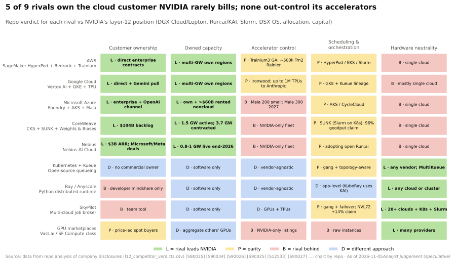
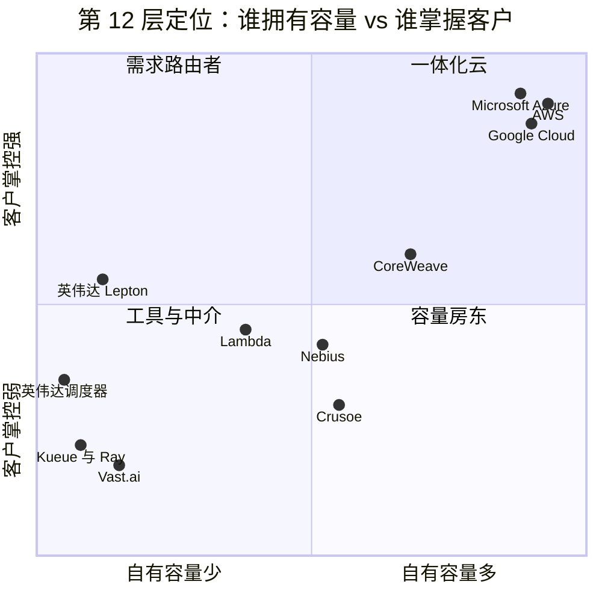

# 编排与云服务：竞争格局

> [!NOTE]
> 本页为英文原文的简体中文参考译文，仅供参考；如有出入，以[英文原文](../../../layers/12-orchestration-and-cloud-services/competition.md "English original")为准。

第 12 层 · 编排与云服务 · 约 13 分钟阅读 · 最后核实：2026-11-05

## ⚡ 要点速览

- **英伟达在这一层参与竞争，却并不拥有一朵云。** 它在 2025 年将 [DGX Cloud](../../glossary.md#dgx-cloud) 转为内部使用；[DGX Cloud Lepton](../../glossary.md#dgx-cloud-lepton) 则把开发者导流至合作伙伴的 GPU 🟡 [[S90068]](../../../sources/bibliography.md#s90068)[[S12009]](../../../sources/bibliography.md#s12009)。
- **它把软件免费送出，把 GPU 利润留给自己：** [KAI Scheduler](../../glossary.md#kai-scheduler)（2025 年）和整个 [Run:ai](../../glossary.md#run-ai) 平台（2026 年 10 月）均已开源，[Slurm](../../glossary.md#slurm) 在英伟达旗下也保持厂商中立 [[S12509]](../../../sources/bibliography.md#s12509)[[S12510]](../../../sources/bibliography.md#s12510)[[S12000]](../../../sources/bibliography.md#s12000)。
- **[Q5 · 最强挑战者]** [超大规模云厂商](../../glossary.md#hyperscaler)的垂直一体化云掌握客户、容量以及第二种加速器：Anthropic 拥有最多 100 万颗谷歌 TPU，并在 Project Rainier 中使用约 50 万颗 Trainium2 [[S90026]](../../../sources/bibliography.md#s90026)[[S90034]](../../../sources/bibliography.md#s90034)。
- **即便是对手也在购买英伟达算力：** 微软的 Maia 200 规模尚小，而微软已与纯英伟达的[新兴云服务商（neocloud）](../../glossary.md#neocloud)签订了超过 $60B 的租赁合同 🟡 [[S90044]](../../../sources/bibliography.md#s90044)[[S12526]](../../../sources/bibliography.md#s12526)。
- **CoreWeave 是最强的独立技术栈：** 拥有 $104.2B 的[收入积压（revenue backlog）](../../glossary.md#revenue-backlog)，并收购了 Weights & Biases（约 $1.7B）。但其机群全部采用英伟达 GPU，且由英伟达提供兜底承诺 [[S12500]](../../../sources/bibliography.md#s12500)[[S12507]](../../../sources/bibliography.md#s12507)[[S90067]](../../../sources/bibliography.md#s90067)。
- **看空情景：** 如果超大规模云厂商把工作负载引向自研芯片，英伟达的杠杆（供货分配、股权、市场平台）将无法把客户争取回来。

## 第 12 层的竞争如何计分

第 12 层把机架转化为客户可以租用并保持忙碌的容量。不妨以航空公司作比：GPU 是飞机，调度器是机组排班，云厂商负责售票并拥有乘客。英伟达造飞机、免费提供排班软件，还经营一个订票网站（Lepton），但它并不拥有航空公司。决定胜负的有五件事：谁**掌握客户**、谁**拥有容量**、谁**控制加速器**、谁的**调度器**在运行作业，以及技术栈是否**中立**。

| 对手 vs 英伟达 | 客户掌控 | 自有容量 | 加速器控制 | 调度与平台 | 中立性 |
|---|---|---|---|---|---|
| AWS（SageMaker HyperPod、Bedrock、Trainium） | 🟩 直接签订企业合同 | 🟩 自有区域 | 🟨 Trainium3 已正式商用 [[S90035]](../../../sources/bibliography.md#s90035) | 🟨 HyperPod / EKS | 🟥 单一云 |
| Google Cloud（Vertex AI、GKE、TPU） | 🟩 Gemini 带动需求 | 🟩 自有区域 | 🟨 向 Anthropic 提供最多 100 万颗 TPU [[S90026]](../../../sources/bibliography.md#s90026) | 🟨 GKE，Kueue 的发源地 | 🟥 基本为单一云 |
| Microsoft Azure（Foundry、AKS、Maia） | 🟩 企业客户 + OpenAI | 🟩 自有 + 超过 $60B 的租赁容量 [[S12526]](../../../sources/bibliography.md#s12526) | 🟥 Maia 200 规模小 [[S90044]](../../../sources/bibliography.md#s90044) | 🟨 AKS / CycleCloud | 🟥 单一云 |
| CoreWeave（CKS、SUNK、W&B） | 🟩 $104B 积压订单 [[S12500]](../../../sources/bibliography.md#s12500) | 🟩 在运行 1.5 GW [[S12501]](../../../sources/bibliography.md#s12501) | 🟥 仅用英伟达 | 🟨 宣称 96% goodput [[S12530]](../../../sources/bibliography.md#s12530) | 🟥 单一云 |
| 开源（Kueue、Ray、SkyPilot） | 🟦 无所有者 | 🟦 仅软件 | 🟦 厂商无关 | 🟨 成组 + 拓扑感知调度 [[S12533]](../../../sources/bibliography.md#s12533) | 🟩 任意云或芯片 |
| GPU 交易平台（Vast.ai、SF Compute） | 🟨 价格导向型买方 | 🟦 他人的 GPU | 🟥 英伟达 GPU 挂牌 | 🟥 裸实例 | 🟩 多家服务商 |

评级为本资料库的判断 🔴；上方热力图涵盖全部九家对手，来源见 `data/l12_competitor_verdicts.csv`。

> [!TIP]
> **算例 —— 这个对手同时也是新兴云服务商的最大客户。** 截至 2025 年 11 月，微软已签订超过 $60B 的多年期新兴云服务商租赁合同：Nscale 约 $23B（约 200,000 颗 GB300 GPU）、Nebius $17.4B（最高 $19.4B）以及 IREN $9.7B 🟡 [[S12526]](../../../sources/bibliography.md#s12526)。即便分摊到数年，这仍相当于微软 2026 日历年约 $175B 资本开支指引的约三分之一 🟡 [[S12518]](../../../sources/bibliography.md#s12518)。这些容量基于英伟达 GPU。一家超大规模云厂商可以在芯片上（Maia）与英伟达竞争，同时又是它最大的间接买家之一。

🔧 技术细节：GPU 调度器实际上在决定什么

一个 1,024 颗 GPU 的作业必须在所有 GPU 上同时启动（[成组调度（gang scheduling）](../../glossary.md#gang-scheduling)），并且这些 GPU 要共享一台高速交换机（拓扑感知）。调度器还要抢占低优先级工作、执行团队配额，并为小作业切分 GPU。Slurm 为超级计算机的批处理作业完成这些工作；Kueue 和 KAI Scheduler 等 [Kubernetes](../../glossary.md#kubernetes) 插件则为容器完成这些工作 [[S12533]](../../../sources/bibliography.md#s12533)[[S12002]](../../../sources/bibliography.md#s12002)。商业产品（Run:ai、[Mission Control](../../glossary.md#mission-control)、SageMaker HyperPod）在此基础上增加了仪表盘、计量计费以及故障节点的自动恢复 [[S12004]](../../../sources/bibliography.md#s12004)[[S12006]](../../../sources/bibliography.md#s12006)。

## 逐一审视挑战者

### 超大规模云厂商的垂直一体化云：最强挑战者

**[Q5 · 最强挑战者]** AWS、谷歌和微软是英伟达最大的客户（在 Q2 FY2027 $89.0B 的数据中心收入中，超大规模云厂商约占 $48.7B 🟡），也是其最全面的对手 [[S406]](../../../sources/bibliography.md#s406)[[S405]](../../../sources/bibliography.md#s405)：

- **AWS：** Trainium3 已正式商用（2025 年 12 月）；Trainium4 将支持 [NVLink](../../glossary.md#nvlink) Fusion；Project Rainier 中部署了约 50 万颗 Trainium2 [[S90034]](../../../sources/bibliography.md#s90034)[[S90035]](../../../sources/bibliography.md#s90035)。
- **谷歌：** 为 Anthropic 提供最多 100 万颗 TPU（2026 年超过 1 GW），向 Meta 出租 TPU，并向客户数据中心销售 TPU 🟡 [[S90026]](../../../sources/bibliography.md#s90026)[[S90025]](../../../sources/bibliography.md#s90025)[[S90027]](../../../sources/bibliography.md#s90027)。
- **微软：** Maia 200 用于运行 Copilot；Maia 300 及吉瓦级部署计划自 2027 年起推进 🟡 [[S90044]](../../../sources/bibliography.md#s90044)[[S90046]](../../../sources/bibliography.md#s90046)[[S90045]](../../../sources/bibliography.md#s90045)。

**它们最有力的论点：** 账单掌握在云厂商手中。在 Bedrock、Vertex AI 或 Foundry 背后，由服务商决定用哪种芯片，而英伟达的任何杠杆都触及不到这一选择。

**差距缩小了多少：** 在它们的自有工作负载和锚定实验室的工作负载上缩小了很多，在开放市场上则很少。它们仍在不断上调 2026 年的资本开支，而其中大部分流向英伟达（见[路线图](roadmap.md)）。

### CoreWeave 与新兴云服务商的软件栈

CoreWeave 的在运行功率从 2024 年底的约 360 MW 增长到 2026 年中的约 1.5 GW [[S12011]](../../../sources/bibliography.md#s12011)[[S12501]](../../../sources/bibliography.md#s12501)。其技术栈由 CoreWeave Kubernetes Service 加 SUNK（运行在 Kubernetes 上的 Slurm）组成，公司称其[有效产出（goodput）](../../glossary.md#goodput)最高可达 96%（厂商说法）[[S12530]](../../../sources/bibliography.md#s12530)。它收购了 Weights & Biases（约 $1.7B，2025-05-05 完成交割）以切入开发者工作流；其以全股票方式约 $9B 收购 Core Scientific 的提议于 2025-10-30 被股东投票否决 [[S12506]](../../../sources/bibliography.md#s12506)[[S12507]](../../../sources/bibliography.md#s12507)[[S12508]](../../../sources/bibliography.md#s12508)。

**最有力的论点：** 新兴云服务商运营大型集群的水平不逊于超大规模云厂商，而且成本更低。**局限：** 其机群、融资，甚至其调度器（Slurm，现归英伟达所有）都依赖英伟达 [[S12000]](../../../sources/bibliography.md#s12000)[[S90067]](../../../sources/bibliography.md#s90067)。

> [!TIP]
> **算例 —— 英伟达为何买下合作伙伴所用的调度器。** TOP500 前 10 名和前 100 名超级计算机中，超过一半运行 Slurm，而 CoreWeave 的 SUNK 将其置于 Kubernetes 之下 [[S12000]](../../../sources/bibliography.md#s12000)[[S12530]](../../../sources/bibliography.md#s12530)。收购 SchedMD（条款未披露）的花费很可能远低于 Run:ai 据报道的约 $700M [[S476]](../../../sources/bibliography.md#s476)，却拿下了 AI 训练的默认作业队列。由于已承诺 Slurm 保持开放与中立，这一杠杆在于对路线图的影响力，而非锁定。

### 开源调度器

Kueue 为 Kubernetes 增加了队列、公平份额、成组调度和拓扑感知调度 [[S12533]](../../../sources/bibliography.md#s12533)。Ray（Anyscale）可在任意集群上扩展 Python AI 代码 [[S12535]](../../../sources/bibliography.md#s12535)。SkyPilot 横跨 Kubernetes、Slurm 和 20 多家云，并宣称在 [NVL72](../../glossary.md#nvl72) 训练上提升 14%（厂商说法）[[S12534]](../../../sources/bibliography.md#s12534)。它们在中立性上领先，而且免费。英伟达选择加入而非对抗：KAI Scheduler 是 CNCF 沙箱项目，Crusoe、Nebius 等八家公司正在采用开源的 Run:ai [[S12002]](../../../sources/bibliography.md#s12002)[[S12512]](../../../sources/bibliography.md#s12512)。

### GPU 交易平台

Lepton 上线时有十家合作伙伴云，并于 2025 年 6 月新增了 Mistral、Nscale、Fluidstack 和 Together AI [[S12009]](../../../sources/bibliography.md#s12009)[[S12008]](../../../sources/bibliography.md#s12008)。Vast.ai、SF Compute 等 [GPU 交易平台](../../glossary.md#gpu-marketplace)以及 SkyPilot 的 GPU Compass 等中介以价格竞争 [[S12534]](../../../sources/bibliography.md#s12534)。Silicon Data 的 H100 指数在四周内从每 [GPU 小时](../../glossary.md#gpu-hour) $2.00 升至 $2.20，该公司正与芝商所（CME Group）合作推出算力期货 🟡 [[S12517]](../../../sources/bibliography.md#s12517)。

### 竞争定位

定位为本资料库的判断 🔴。英伟达是“需求路由者”：它在不拥有太多容量的情况下引导工作负载的流向（供货分配、Lepton、融资）。

> [!NOTE]
> **🐂 看多观点。** 英伟达无需在第 12 层全面获胜。非超大规模买方（新兴云服务商、主权客户、企业）在 Q2 FY2027 数据中心收入中约占 $40.3B，区域性新兴云服务商同比增长超过 3 倍 🟡 [[S406]](../../../sources/bibliography.md#s406)[[S90071]](../../../sources/bibliography.md#s90071)。开源编排栈让每一朵云都更容易在英伟达硬件上运行。

> [!WARNING]
> **🐻 看空观点。** 客户掌控是这一层的稀缺资产，而英伟达恰恰在这方面最弱。TPU 如今已在谷歌之外销售，Trainium4 将支持 [NVLink Fusion](../../glossary.md#nvlink-fusion)，而超大规模云厂商决定 API 背后用哪种芯片 [[S90027]](../../../sources/bibliography.md#s90027)[[S90034]](../../../sources/bibliography.md#s90034)。如果新兴云服务商的融资收紧，英伟达剩下的渠道就会收窄到那些正在构建替代方案的买方身上。

## 🎯 企业发展视角

1. 编排软件如今已是免费的（KAI、Run:ai、Slurm、Kueue）。剩下可变现的层次在哪里：托管运营、多云中介，还是融资？
2. 超大规模云厂商一边从新兴云服务商那里租用英伟达算力，一边自研 ASIC。一旦 Maia 300 和 Trainium4 在 2027 年放量，这种租赁需求能持续多久？
3. CoreWeave 收购 Weights & Biases 以向技术栈上层延伸。哪些新兴云服务商工具（MLOps、推理端点、调度器）可以在被商品化之前收购？
4. 非英伟达加速器需要一个把它当作一等公民的调度器和市场平台。Kueue、Ray 和 SkyPilot 是否已经提供了这条路径，还是需要新进入者出资打造？

## 📚 来源（Sources）

<!-- Auto-generated from the [S…] citations on this page by `make build`. Edit sources/registry/*.csv, not this list. -->

- [**S405**](../../../sources/bibliography.md#s405) NVIDIA Corporation via SEC EDGAR, *NVIDIA Announces Financial Results for Second Quarter Fiscal 2027 (Form 8-K exhibit 99.1)*, 2026-08-26. [Link](https://www.sec.gov/Archives/edgar/data/0001045810/000104581026000073/q2fy27pr.htm)
- [**S406**](../../../sources/bibliography.md#s406) NVIDIA Corporation (Colette Kress), *CFO Commentary on Second Quarter Fiscal 2027 Results*, 2026-08-26. [Link](https://s201.q4cdn.com/141608511/files/doc_financials/2027/Q227/Q2FY27-CFO-Commentary.pdf)
- [**S476**](../../../sources/bibliography.md#s476) NVIDIA Blog, *NVIDIA to Acquire GPU Orchestration Software Provider Run:ai*, 2024-04-24. [Link](https://blogs.nvidia.com/blog/runai/)
- [**S12000**](../../../sources/bibliography.md#s12000) NVIDIA Blog, *NVIDIA Acquires Open-Source Workload Management Provider SchedMD*, 2025-12-15. [Link](https://blogs.nvidia.com/blog/nvidia-acquires-schedmd)
- [**S12002**](../../../sources/bibliography.md#s12002) KAI Scheduler project (originally NVIDIA Run:ai), *KAI Scheduler (GitHub repository README)*, 2026-04. [Link](https://github.com/kai-scheduler/KAI-Scheduler)
- [**S12004**](../../../sources/bibliography.md#s12004) NVIDIA, *NVIDIA Mission Control (product page)*, 2025. [Link](https://www.nvidia.com/en-us/data-center/mission-control/)
- [**S12006**](../../../sources/bibliography.md#s12006) NVIDIA Technical Blog, *Automating AI Factory Operations with NVIDIA Mission Control*, 2026. [Link](https://developer.nvidia.com/blog/automating-ai-factory-operations-with-nvidia-mission-control)
- [**S12008**](../../../sources/bibliography.md#s12008) NVIDIA Newsroom, *NVIDIA DGX Cloud Lepton Connects Europe's Developers to Global NVIDIA Compute Ecosystem*, 2025-06-11. [Link](https://nvidianews.nvidia.com/news/nvidia-dgx-cloud-lepton-connects-europes-developers-to-global-nvidia-compute-ecosystem)
- [**S12009**](../../../sources/bibliography.md#s12009) DatacenterDynamics, *Nvidia launches Lepton AI platform connecting GPU cloud providers' resources*, 2025-05. [Link](https://www.datacenterdynamics.com/en/news/nvidia-launches-lepton-ai-platform-connecting-gpu-cloud-providers-resources/)
- [**S12011**](../../../sources/bibliography.md#s12011) DatacenterDynamics, *CoreWeave files for IPO on Nasdaq stock market*, 2025-03. [Link](https://www.datacenterdynamics.com/en/news/coreweave-files-for-ipo-on-nasdaq-stock-market/)
- [**S12500**](../../../sources/bibliography.md#s12500) CoreWeave (press release via Seeking Alpha), *CoreWeave Reports Strong Second Quarter 2026 Results*, 2026-08. [Link](https://seekingalpha.com/pr/20615715)
- [**S12501**](../../../sources/bibliography.md#s12501) Runtime Wire, *CoreWeave reports $2.58 billion Q2 revenue with $35 billion in debt*, 2026-08. [Link](https://runtimewire.com/article/coreweave-q2-2026-revenue-debt-ai-cloud)
- [**S12506**](../../../sources/bibliography.md#s12506) CoreWeave Investor Relations, *CoreWeave Completes Acquisition of Weights & Biases*, 2025-05-05. [Link](https://investors.coreweave.com/news/news-details/2025/CoreWeave-Completes-Acquisition-of-Weights--Biases/default.aspx)
- [**S12507**](../../../sources/bibliography.md#s12507) Maginative, *CoreWeave acquires Weights & Biases in a $1.7 billion AI cloud play*, 2025-03. [Link](https://www.maginative.com/article/coreweave-acquires-weights-biases-in-a-1-7-billion-ai-cloud-play/)
- [**S12508**](../../../sources/bibliography.md#s12508) SiliconANGLE, *Core Scientific shareholders dismiss $9B CoreWeave deal on valuation worries*, 2025-10-30. [Link](https://siliconangle.com/2025/10/30/core-scientific-shareholders-dismiss-9b-coreweave-deal-valuation-worries/)
- [**S12509**](../../../sources/bibliography.md#s12509) NVIDIA Technical Blog, *NVIDIA open sources Run:ai Scheduler to foster community collaboration (KAI Scheduler)*, 2025-04. [Link](https://developer.nvidia.com/blog/nvidia-open-sources-runai-scheduler-to-foster-community-collaboration/)
- [**S12510**](../../../sources/bibliography.md#s12510) NVIDIA Technical Blog, *NVIDIA Run:ai is now open source as part of NVIDIA DSX AI Factory platform*, 2026-10. [Link](https://developer.nvidia.com/blog/nvidia-runai-is-now-open-source-as-part-of-nvidia-dsx-ai-factory-platform/)
- [**S12512**](../../../sources/bibliography.md#s12512) Techstrong.ai, *NVIDIA hands Run:ai to the open source community*, 2026-10. [Link](https://techstrong.ai/articles/nvidia-hands-runai-to-the-open-source-community/)
- [**S12517**](../../../sources/bibliography.md#s12517) Silicon Data, *H100 price spike (Silicon Data H100 rental index)*, 2026-01. [Link](https://www.silicondata.com/blog/h100-price-spike)
- [**S12518**](../../../sources/bibliography.md#s12518) Datacentres.com, *Hyperscaler capex trends: over $700 billion for 2026*, 2026-08. [Link](https://www.datacentres.com/guides/hyperscaler-capex-trends)
- [**S12526**](../../../sources/bibliography.md#s12526) Introl, *Microsoft's $60B neocloud bet: buying time in the AI capacity crisis*, 2025-12. [Link](https://introl.com/blog/microsoft-60-billion-neocloud-spending-2025)
- [**S12530**](../../../sources/bibliography.md#s12530) CoreWeave Blog, *New CoreWeave SUNK capabilities help teams build modern AI research clusters*, 2025. [Link](https://coreweave.com/blog/new-coreweave-sunk-capabilities-help-teams-build-modern-ai-research-clusters)
- [**S12533**](../../../sources/bibliography.md#s12533) Kubernetes SIGs on GitHub, *Kueue (README)*, 2026. [Link](https://github.com/kubernetes-sigs/kueue)
- [**S12534**](../../../sources/bibliography.md#s12534) SkyPilot project on GitHub, *SkyPilot (README)*, 2026-10. [Link](https://github.com/skypilot-org/skypilot)
- [**S12535**](../../../sources/bibliography.md#s12535) Ray project on GitHub (Anyscale), *Ray (README)*, 2026. [Link](https://github.com/ray-project/ray)
- [**S90025**](../../../sources/bibliography.md#s90025) SiliconANGLE, *Google and Meta reportedly strike new multibillion-dollar AI chip deal*, 2026-02-26. [Link](https://siliconangle.com/2026/02/26/google-meta-reportedly-strike-new-multibillion-dollar-ai-chip-deal/)
- [**S90026**](../../../sources/bibliography.md#s90026) Maginative, *Anthropic secures 1M Google TPUs while keeping Amazon as primary training partner*, 2025-10. [Link](https://www.maginative.com/anthropic-secures-1m-google-tpus-while-keeping-amazon-as-primary-training-partner)
- [**S90027**](../../../sources/bibliography.md#s90027) The Next Web, *Google is building a four-partner chip supply chain to challenge Nvidia in AI inference*, 2026. [Link](https://thenextweb.com/news/google-inference-chips-nvidia-challenge-supply-chain)
- [**S90034**](../../../sources/bibliography.md#s90034) NAND Research, *AWS releases Trainium3, teases Trainium4*, 2025-12. [Link](https://nand-research.com/research-note-aws-releases-trainium3-teases-trainium4/4/)
- [**S90035**](../../../sources/bibliography.md#s90035) Business Today ME, *Trainium3 UltraServers now available*, 2025-12. [Link](https://businesstoday.me/tech-news/trainium3-ultraservers-now-available-enabling-customers-to-train-and-deploy-ai-models-fasterat-lower-cost/)
- [**S90044**](../../../sources/bibliography.md#s90044) eWeek, *Microsoft introduces Maia 200, its most powerful AI chip yet*, 2026-01-27. [Link](https://www.eweek.com/news/microsoft-maia-200-ai-chip/)
- [**S90045**](../../../sources/bibliography.md#s90045) Pulse 2.0, *Microsoft to expand Azure Maia AI infrastructure to multi-gigawatt deployments starting in 2027*, 2026-10. [Link](https://pulse2.com/microsoft-to-expand-azure-maia-ai-infrastructure/)
- [**S90046**](../../../sources/bibliography.md#s90046) IT Brief UK, *Microsoft unveils Maia 300 for 2027 AI deployments*, 2026-10. [Link](https://itbrief.co.uk/story/microsoft-unveils-maia-300-for-2027-ai-deployments)
- [**S90067**](../../../sources/bibliography.md#s90067) DatacenterDynamics, *Nvidia to purchase unsold compute capacity from CoreWeave for $6.3bn*, 2025-09-16. [Link](https://www.datacenterdynamics.com/en/news/nvidia-to-purchase-unsold-compute-capacity-from-coreweave-for-63bn/)
- [**S90068**](../../../sources/bibliography.md#s90068) Tom's Hardware, *Nvidia steps back from DGX Cloud — stops trying to compete with AWS and Azure*, 2025-09. [Link](https://www.tomshardware.com/tech-industry/nvidia-steps-back-from-dgx-cloud)
- [**S90071**](../../../sources/bibliography.md#s90071) Crypto Briefing, *Nvidia CFO emphasizes neutral partnership with AI customers as company diversifies beyond hyperscalers*, 2026. [Link](https://cryptobriefing.com/nvidia-cfo-neutral-ai-partnership/)
